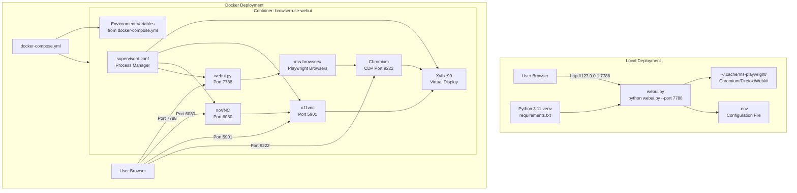
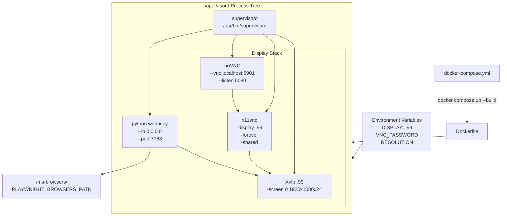

<!-- source: DeepWiki mcp.deepwiki.com · repo browser-use/web-ui · page 9 Deployment · fetched 2026-10-30 -->

# Deployment

Relevant source files

The following files were used as context for generating this wiki page:

- [Dockerfile](Dockerfile)
- [README.md](README.md)

This document provides an overview of the two supported deployment methods for `browser-use` web-ui: local installation and Docker containerization. It compares their architectures, resource requirements, and use cases to help you choose the appropriate deployment strategy.

For detailed step-by-step instructions, see:
- Docker deployment: [Docker Deployment](#9.1)
- Local deployment: [Local Deployment](#9.2)

---

## Deployment Options

The browser-use web-ui supports two primary deployment methods, each suited to different use cases and environments:

| Deployment Method | Description | Best For |
|------------------|-------------|----------|
| **Local Installation** | Direct Python environment setup using `uv` or `pip`, with Playwright browsers installed on the host system | Development, testing, and environments where you have full system control |
| **Docker Container** | Self-contained Docker image with all dependencies, including Xvfb, VNC, and noVNC for headless operation | Production deployments, server environments, CI/CD pipelines, and multi-user scenarios |

---

## Deployment Architecture Comparison

The following diagram illustrates the fundamental architectural differences between local and Docker deployments:

**Deployment Architecture Overview**

Sources: [README.md:24-147](), [Dockerfile:1-89]()

---

## Local Deployment Overview

Local deployment involves installing dependencies directly on your system and running the application as a Python process.

**Local Deployment Process Flow**

```mermaid
graph LR
    CLONE["git clone<br/>browser-use/web-ui"]
    VENV["uv venv --python 3.11<br/>Create Virtual Environment"]
    ACTIVATE["source .venv/bin/activate<br/>Activate Environment"]
    DEPS["uv pip install -r requirements.txt<br/>Install Python Dependencies"]
    PLAYWRIGHT["playwright install --with-deps<br/>Install Browsers"]
    ENV_SETUP["cp .env.example .env<br/>Configure API Keys"]
    RUN["python webui.py<br/>--ip 127.0.0.1 --port 7788"]
    ACCESS["http://127.0.0.1:7788"]
    
    CLONE --> VENV
    VENV --> ACTIVATE
    ACTIVATE --> DEPS
    DEPS --> PLAYWRIGHT
    PLAYWRIGHT --> ENV_SETUP
    ENV_SETUP --> RUN
    RUN --> ACCESS
```

**Key Characteristics:**
- **Startup Command:** `python webui.py --ip 127.0.0.1 --port 7788` [README.md:86-90]()
- **Browser Storage:** Playwright browsers installed in `~/.cache/ms-playwright` (Linux/macOS) or `%USERPROFILE%\AppData\Local\ms-playwright` (Windows)
- **Configuration:** Environment variables loaded from `.env` file [README.md:74-83]()
- **Process Management:** Single Python process managed by the user
- **Display:** Uses native system display (GUI required for non-headless mode)

Sources: [README.md:26-107]()

---

## Docker Deployment Overview

Docker deployment packages the entire application stack into a container with `supervisord` managing multiple processes for headless operation with VNC support.

**Docker Container Service Architecture**

**Key Characteristics:**
- **Startup Command:** `docker compose up --build` or `TARGETPLATFORM=linux/arm64 docker compose up --build` for ARM64 [README.md:133-140]()
- **Process Manager:** `supervisord` manages all processes [Dockerfile:84-89]()
- **Browser Storage:** Playwright browsers in `/ms-browsers` directory [Dockerfile:74-78]()
- **Configuration:** Environment variables defined in configuration files
- **Display:** Xvfb virtual display `:99` [Dockerfile:14-14]()
- **Remote Access:** VNC server on port 5901, noVNC web interface on port 6080 [README.md:143-146]()

**Exposed Ports:**

| Port | Service | Purpose |
|------|---------|---------|
| 7788 | Gradio WebUI | Main application interface |
| 6080 | noVNC | Web-based VNC client for browser visualization |
| 5901 | x11vnc | VNC server for remote display access |
| 9222 | Chrome DevTools Protocol | Browser debugging and inspection |

Sources: [Dockerfile:1-89](), [README.md:108-147]()

---

## Deployment Method Comparison

**Feature Comparison Matrix**

| Feature | Local Deployment | Docker Deployment |
|---------|------------------|-------------------|
| **Installation Complexity** | Moderate (requires Python setup, Playwright install) | Low (single `docker compose` command) |
| **System Requirements** | Python 3.11, system packages for Playwright | Docker Engine, 2GB+ RAM |
| **Headless Operation** | Requires manual Xvfb setup | Built-in with Xvfb [Dockerfile:14-14]() |
| **Browser Visualization** | Direct display (requires GUI) | VNC/noVNC web interface [README.md:143-146]() |
| **Process Management** | Manual (user manages Python process) | Automatic (`supervisord`) [Dockerfile:38-38]() |
| **Multi-Architecture** | Platform-dependent | Supports amd64 and arm64 [README.md:137-140]() |
| **Resource Isolation** | Uses host system resources | Containerized with resource limits |
| **Development Workflow** | Fast iteration (no rebuild) | Requires image rebuild for code changes |
| **Custom Browser Support** | Easy (native OS paths) [README.md:91-106]() | Possible but requires volume mounts |
| **Persistent Sessions** | Native browser data directory | Requires volume configuration |
| **Port Configuration** | Flexible (command-line args) [README.md:88-88]() | Fixed in orchestration files |

Sources: [README.md:24-147](), [Dockerfile:1-89]()

---

## Choosing a Deployment Method

### Use Local Deployment When:
- **Development and Testing:** You need rapid iteration without container rebuilds
- **Custom Browser Configuration:** You want to use your own browser with existing user data [README.md:91-106]()
- **Native Performance:** You require maximum performance without container overhead
- **Simple Debugging:** You prefer direct process access and native debugging tools
- **Single User:** The application serves only one user on a workstation

### Use Docker Deployment When:
- **Production Environments:** You need consistent, reproducible deployments across servers
- **Headless Servers:** You're deploying on systems without GUI displays
- **Multi-User Scenarios:** Multiple users need isolated browser instances
- **Remote Access Required:** Users need to visualize browser interactions remotely via VNC [README.md:143-146]()
- **CI/CD Pipelines:** Automated testing or deployment workflows require containerization
- **Resource Management:** You need to enforce memory and CPU limits on the application
- **Multi-Architecture:** You deploy across both x86_64 and ARM64 systems [README.md:137-140]()

Sources: [README.md:24-147]()

---

## Configuration Files Overview

**Configuration File Locations by Deployment Method**

| File | Local Deployment | Docker Deployment | Purpose |
|------|------------------|-------------------|---------|
| `.env` | Root directory | Environment injection | Environment variables for local runs [README.md:74-83]() |
| `.env.example` | Template file | Template file | Example configuration values [README.md:74-75]() |
| `requirements.txt` | Read during install | Copied into image [Dockerfile:70-71]() | Python dependencies |
| `supervisord.conf` | Not used | `/etc/supervisor/conf.d/supervisord.conf` [Dockerfile:84-85]() | Process management configuration |
| `Dockerfile` | Not used | Root directory | Container image build instructions [Dockerfile:1-89]() |

Sources: [README.md:74-83](), [Dockerfile:70-89]()

---

## Next Steps

- For detailed Docker deployment instructions, including supervisord configuration and VNC setup, see [Docker Deployment](#9.1)
- For detailed local installation instructions, including Python environment setup with `uv`, see [Local Deployment](#9.2)

---

