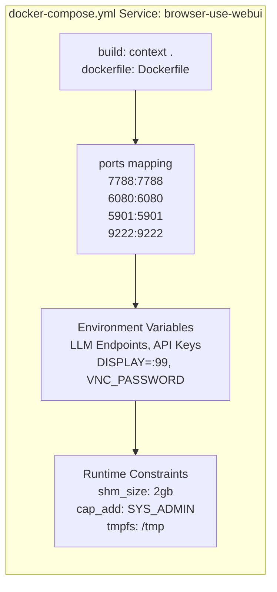
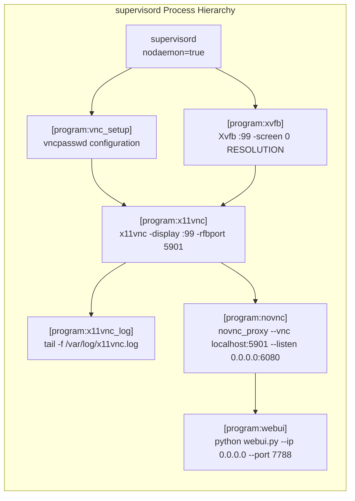

<!-- source: DeepWiki mcp.deepwiki.com · repo browser-use/web-ui · page 9.1 Docker Deployment · fetched 2026-10-30 -->

# Docker Deployment

<details>
<summary>Relevant source files</summary>

The following files were used as context for generating this wiki page:

- [.dockerignore](.dockerignore)
- [Dockerfile](Dockerfile)
- [docker-compose.yml](docker-compose.yml)
- [supervisord.conf](supervisord.conf)

</details>


This document provides detailed technical specifications for deploying the browser-use web-ui system using Docker. The deployment architecture relies on a multi-stage/multi-arch-capable Dockerfile, Docker Compose service orchestration, and `supervisord` process management to run the Gradio web interface, headless browser automation, Xvfb virtual display, and VNC/noVNC remote access layers concurrently within a single container instance.

Sources: [Dockerfile:1-89](), [docker-compose.yml:1-80](), [supervisord.conf:1-80]()

## 1. Dockerfile Build & Multi-Architecture Implementation

The build process uses `python:3.11-slim-bookworm` as the base runtime image and accepts build arguments for multi-architecture builds (`TARGETPLATFORM`) [Dockerfile:1-4](). It installs critical system packages including X11 display servers, VNC utilities, Node.js via NodeSource PPA, and Playwright system dependencies [Dockerfile:7-62]().

```mermaid
graph TD
    subgraph "Dockerfile Build Stages"
        base["python:3.11-slim-bookworm<] --> apt_install["RUN apt-get update && apt-get install<br>Xvfb, x11vnc, supervisor, git"]
        apt_install --> novnc_setup["Git Clone noVNC & websockify<br>/opt/novnc"]
        novnc_setup --> node_install["Node.js 20.x PPA Installation<br>nodejs & npm"]
        node_install --> pip_install["COPY requirements.txt<br>RUN pip install"]
        pip_install --> playwright_install["PLAYWRIGHT_BROWSERS_PATH=/ms-browsers<br>RUN playwright install chromium"]
        playwright_install --> supervisor_config["COPY supervisord.conf<br>/etc/supervisor/conf.d/supervisord.conf"]
    end
```

Sources: [Dockerfile:1-86]()

Key components installed during the build sequence:
- **Display & VNC Drivers**: `xvfb`, `x11vnc`, `tigervnc-tools` [Dockerfile:14,36-37]().
- **Web Interface**: `noVNC` repository cloned to `/opt/novnc` with `websockify` integration [Dockerfile:50-53]().
- **Browser Automation Runtime**: Chromium installed via Playwright targeting `/ms-browsers` with `PLAYWRIGHT_SKIP_BROWSER_DOWNLOAD=0` [Dockerfile:74-78]().

Sources: [Dockerfile:7-86]()

## 2. Docker Compose Services, Ports, and Environment

The `docker-compose.yml` configuration defines the `browser-use-webui` service, exposing necessary ports, resource constraints (`shm_size: "2gb"`), Linux capabilities (`SYS_ADMIN`), and health checks [docker-compose.yml:3-80]().



Sources: [docker-compose.yml:3-80]()

### Port Allocation Table

| Port | Service Name | Protocol | Description |
|------|-------------|----------|-------------|
| `7788` | `webui` | TCP | Gradio Web UI interface endpoint |
| `6080` | `novnc` | TCP | Web-based noVNC client browser access |
| `5901` | `x11vnc` | TCP | Direct VNC remote display access port |
| `9222` | `browser` | TCP | Chrome remote debugging protocol (CDP) port |

Sources: [Dockerfile:87](), [docker-compose.yml:10-14]()

Sources: [Dockerfile:87](), [docker-compose.yml:10-14]()

## 3. Supervisord Process Management

Inside the container, process orchestration and lifecycle management are governed by `supervisord` using configuration defined in `supervisord.conf`. It coordinates six sequential background programs [supervisord.conf:1-80]().



Sources: [supervisord.conf:1-80]()

### Supervisor Program Breakdown

1. **`xvfb`**: Initializes the virtual X11 framebuffer on display `:99` with hardware acceleration flags (`+extension GLX +render`) [supervisord.conf:8-18]().
2. **`vnc_setup`**: Generates the hashed VNC password file at `~/.vnc/passwd` using `vncpasswd -f` based on `%(ENV_VNC_PASSWORD)s` [supervisord.conf:20-29]().
3. **`x11vnc`**: Shares the Xvfb virtual display `:99` via VNC protocol on port `5901` using the generated auth file [supervisord.conf:30-43]().
4. **`x11vnc_log`**: Streams `/var/log/x11vnc.log` to standard output for container observability [supervisord.conf:44-55]().
5. **`novnc`**: Proxies the RFB stream from `localhost:5901` to an HTTP web interface accessible on `0.0.0.0:6080` [supervisord.conf:56-67]().
6. **`webui`**: Executes the primary application entrypoint `python webui.py --ip 0.0.0.0 --port 7788` from working directory `/app` [supervisord.conf:68-80]().

Sources: [supervisord.conf:8-80]()

## 4. Xvfb, VNC, and noVNC Architecture

The remote viewing subsystem enables headless execution of browser automation instances while allowing operators to inspect browser UI actions visually. 

- **Xvfb Display Server**: Allocates an in-memory X11 display context (`DISPLAY=:99`) governed by resolution variables (`RESOLUTION`, `RESOLUTION_WIDTH`, `RESOLUTION_HEIGHT`) [docker-compose.yml:56-62](), [supervisord.conf:8-18]().
- **VNC & noVNC Integration**: `x11vnc` captures the Xvfb framebuffer and exposes it over port `5901`. The `novnc` proxy (`/opt/novnc/utils/novnc_proxy`) translates this stream into WebSockets, allowing clients to interact directly with the browser session via a modern web browser at port `6080` [Dockerfile:50-53](), [supervisord.conf:30-67]().

Sources: [Dockerfile:50-53](), [docker-compose.yml:56-62](), [supervisord.conf:8-67]()

## 5. Build Automation and Multi-Arch Support

Multi-architecture image construction is handled via Docker Buildx using the `TARGETPLATFORM` argument. The image configuration automatically provisions the correct environment variables for Playwright browser binaries (`PLAYWRIGHT_BROWSERS_PATH=/ms-browsers`) and shared memory allocations (`shm_size: "2gb"`) required by Chromium inside containerized namespaces [Dockerfile:1-78](), [docker-compose.yml:71]().

Sources: [Dockerfile:1-78](), [docker-compose.yml:71]()

Sources: [Dockerfile](), [docker-compose.yml](), [supervisord.conf]()

---

