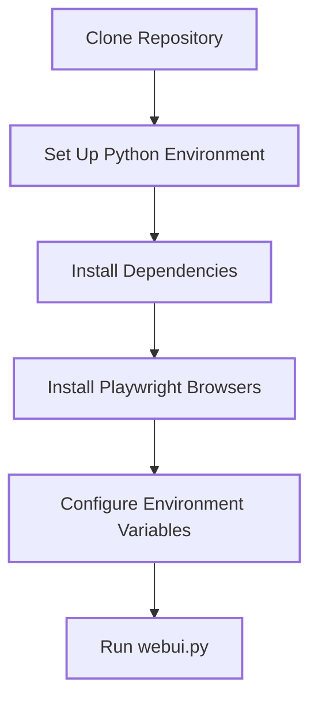
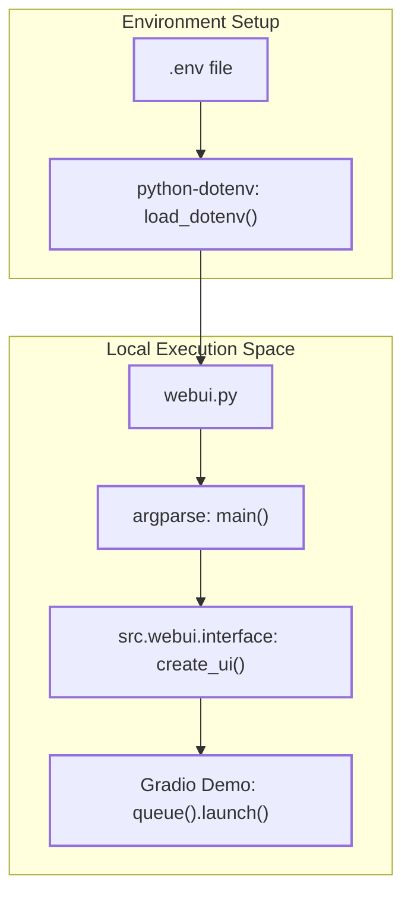

<!-- source: DeepWiki mcp.deepwiki.com · repo browser-use/web-ui · page 9.2 Local Deployment · fetched 2026-10-30 -->

# Local Deployment

<details>
<summary>Relevant source files</summary>

The following files were used as context for generating this wiki page:

- [README.md](README.md)
- [requirements.txt](requirements.txt)
- [webui.py](webui.py)

</details>


This page provides detailed instructions for deploying the web-ui system locally on your machine without using Docker. For Docker-based deployment, see [Docker Deployment](#9.1).

## System Requirements

Before beginning the local installation process, ensure your system meets the following requirements:

- Python 3.11 or higher
- Git (for cloning the repository)
- Sufficient disk space for browser installations (approximately 1GB)
- Internet connection for downloading dependencies

Sources: [README.md:30-42]()

## Installation Process

The local deployment follows a structured process involving repository cloning, environment setup, and dependency installation.



### Step 1: Clone the Repository

First, clone the repository and navigate to the project directory:

```bash
git clone https://github.com/browser-use/web-ui.git
cd web-ui
```

Sources: [README.md:30-34]()

### Step 2: Set Up Python Environment

The recommended method for creating a Python virtual environment is using `uv` [README.md:37](), but you can use standard virtual environment tools if preferred.

```bash
# Using uv (recommended)
uv venv --python 3.11
```

Then activate the virtual environment:

- Windows (Command Prompt):
  ```cmd
  .venv\Scripts\activate
  ```
- Windows (PowerShell):
  ```powershell
  .\.venv\Scripts\Activate.ps1
  ```
- macOS/Linux:
  ```bash
  source .venv/bin/activate
  ```

Sources: [README.md:36-57]()

### Step 3: Install Dependencies

Install the required Python packages using `uv` or standard pip:

```bash
# Using uv (recommended)
uv pip install -r requirements.txt
```

The key dependencies defined in `requirements.txt` include:

| Dependency | Purpose |
|------------|---------|
| `browser-use==0.1.48` | Core browser automation library [requirements.txt:1]() |
| `gradio==5.27.0` | Web UI framework [requirements.txt:3]() |
| `langgraph==0.3.34`, `langchain-*` | Workflow and LLM integrations [requirements.txt:5-10]() |
| `pyperclip==1.9.0` | Clipboard integration [requirements.txt:2]() |

Sources: [README.md:58-62](), [requirements.txt:1-10]()

### Step 4: Install Browsers in Playwright

After installing the Python dependencies, install the necessary browsers for Playwright:

```bash
# Install browsers with dependencies
playwright install --with-deps
# Or install specific browsers such as chromium
playwright install chromium --with-deps
```

Sources: [README.md:64-71]()

### Step 5: Configure Environment

Create and configure your environment file:

1. Create a copy of the example environment file:
   ```bash
   # Windows (Command Prompt)
   copy .env.example .env
   
   # macOS/Linux/Windows (PowerShell)
   cp .env.example .env
   ```

2. Open the `.env` file in your text editor and add your API keys and custom settings.

Sources: [README.md:73-83]()

## Running the Application

### Basic Usage

After completing installation and configuration, start the application via `webui.py` [webui.py:7-19]():

```bash
python webui.py --ip 127.0.0.1 --port 7788
```

Then access the web interface by navigating to `http://127.0.0.1:7788` in your browser [README.md:86-90]().

### Command Line Options

The entrypoint script `webui.py` defines command-line argument parsing using `argparse` [webui.py:8-12]():

| Argument | Description | Default | Defined in Code |
|----------|-------------|---------|-----------------|
| `--ip` | IP address to bind to | `127.0.0.1` | `webui.py:9` |
| `--port` | Port to listen on | `7788` | `webui.py:10` |
| `--theme` | UI theme (choices from `theme_map`) | `Ocean` | `webui.py:11` |

Example with custom parameters:
```bash
python webui.py --ip 0.0.0.0 --port 8080 --theme Ocean
```

Sources: [webui.py:1-19](), [README.md:86-90]()

## System Architecture

The local deployment wiring connects `webui.py` to the Gradio interface factory and runner [webui.py:4-15]():



Sources: [webui.py:1-19](), [src/webui/interface.py]()

## Advanced Configuration

### Using Your Own Browser

You can configure the system to use your existing browser installation to maintain login sessions:

1. Set `BROWSER_PATH` and `BROWSER_USER_DATA` in your `.env` file [README.md:91-103]().
2. Close all browser instances [README.md:104]().
3. Open the WebUI from an alternative browser (e.g., Firefox or Edge) [README.md:105]().
4. Check the "Use Own Browser" option in the Browser Settings tab [README.md:106]().

Sources: [README.md:91-107]()

## Troubleshooting

| Issue | Possible Solution |
|-------|-------------------|
| Missing API keys | Ensure `.env` is populated correctly |
| Browser launch fails | Run `playwright install --with-deps` |
| Port already in use | Change the port using `--port` argument |
| Python version conflict | Verify Python 3.11 is active in `uv` environment |

Sources: [README.md:58-90]()

## Environment Variable Reference

Key environment variables that affect local execution:

| Variable | Purpose |
|----------|---------|
| `OPENAI_API_KEY`, `ANTHROPIC_API_KEY`, `GOOGLE_API_KEY` | LLM Provider authentication |
| `BROWSER_PATH` | Path to custom browser executable [README.md:92]() |
| `BROWSER_USER_DATA` | Path to browser user profile data [README.md:92]() |

Sources: [README.md:91-107]()

---

