# Page: Overview

# Overview

<details>
<summary>Relevant source files</summary>

The following files were used as context for generating this wiki page:

- [README.md](README.md)
- [src/__init__.py](src/__init__.py)
- [src/agent/__init__.py](src/agent/__init__.py)
- [webui.py](webui.py)

</details>


## Purpose and Scope

This document provides a high-level introduction to the browser-use web-ui project, explaining its architecture, core components, and capabilities. It serves as an entry point for understanding how the system enables AI-powered browser automation through a Gradio-based web interface [README.md:10-14](). 

For detailed installation instructions, see [Getting Started](#1.1). For repository structure and dependency details, see [Project Layout and Dependencies](#1.2).

**Sources:** [README.md:1-151](), [webui.py:1-19]()

## What is browser-use web-ui?

`browser-use web-ui` is a Gradio-based graphical interface for AI-driven browser automation, built on top of the `browser-use` package [README.md:10-14](). The system enables users to control web browsers through natural language commands, leveraging Large Language Models (LLMs) to interpret tasks and execute browser actions autonomously [README.md:10-21]().

The application supports two primary workflows:
1. **Interactive Browser Automation** - Direct control of browser sessions through the agent interface, allowing users to submit tasks and receive real-time assistance requests [README.md:14-20]()
2. **Automated Research Workflows** - Multi-step research operations through research agents that autonomously plan, execute, and synthesize findings [README.md:14-21]()

The project extends base browser-use functionality by providing expanded LLM provider support (Google, OpenAI, Azure, Anthropic, DeepSeek, Ollama, etc.), custom browser integration to preserve authentication states, and persistent browser sessions [README.md:16-20]().

**Sources:** [README.md:1-21](), [webui.py:1-19]()

## Child Pages

The documentation is organized into the following child pages for detailed exploration:

- **[Getting Started](#1.1)** — Quick start instructions for installing and running the application, including prerequisites, `uv` and Playwright setup, `.env` configuration, and first execution [README.md:24-107]().
- **[Project Layout and Dependencies](#1.2)** — Repository directory structure mapping (`src/webui`, `src/agent`, `src/browser`, `src/controller`, `src/utils`, `tests`) and third-party dependencies from `requirements.txt` [README.md:58-62]().

**Sources:** [README.md:24-107]()

## Core System Architecture

The application is structured into layered modules handling the user interface, agent execution, browser control, LLM communication, and external tool integration [webui.py:1-19]().

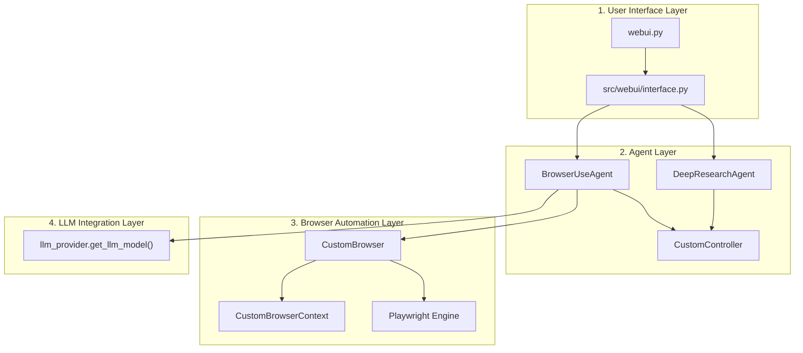

**Sources:** [webui.py:1-19](), [README.md:10-21]()

---

# Page: Getting Started

# Getting Started

<details>
<summary>Relevant source files</summary>

The following files were used as context for generating this wiki page:

- [README.md](README.md)
- [requirements.txt](requirements.txt)
- [webui.py](webui.py)

</details>


This document provides step-by-step instructions for installing and running the browser-use web-ui application. It covers both local and Docker deployment options, environment configuration, and initial setup verification, bridging user deployment workflows to underlying code entities such as `webui.py` and `requirements.txt`.

For detailed information about the system architecture and how components interact, see [User Interface](#3). For deployment-specific details and production considerations, see [Development](#10).

---

## Prerequisites

Before installing browser-use web-ui, ensure your system meets the requirements specified by the environment setup and dependency configuration:

### For Local Installation

| Requirement | Version/Details |
|-------------|-----------------|
| **Python** | 3.11 or higher |
| **pip** | Latest version (or `uv` recommended) |
| **Git** | For cloning the repository |
| **Operating System** | Windows, macOS, or Linux |
| **Playwright Dependencies** | System libraries for browser automation specified in [README.md:64-71]() |

### For Docker Installation

| Requirement | Details |
|-------------|---------|
| **Docker** | Docker Desktop (Windows/macOS) or Docker Engine (Linux) [README.md:111-113]() |
| **Docker Compose** | Included with Docker Desktop; separate install for Linux [README.md:111-113]() |
| **Git** | For cloning the repository [README.md:115-119]() |

Sources: [README.md:24-114]()

---

## Installation Decision Flow

The following diagram illustrates the decision process and maps installation steps to code assets like `requirements.txt` and `webui.py`:

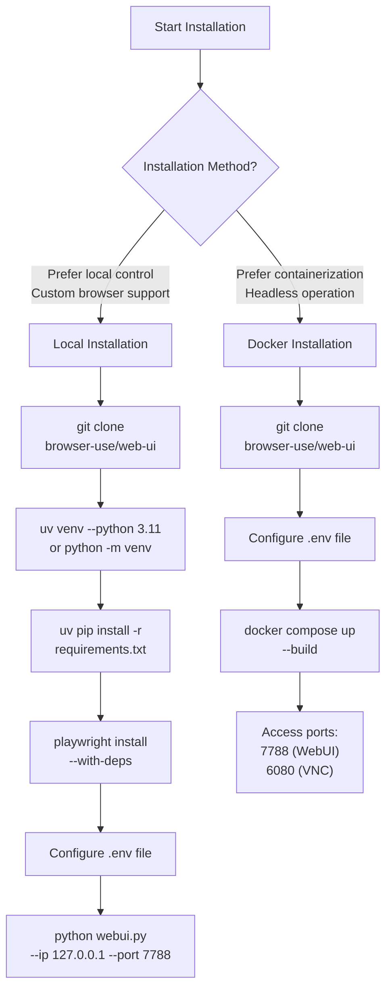

Sources: [README.md:24-147](), [requirements.txt:1-10]()

---

## Local Installation

### Step 1: Clone the Repository

Clone the browser-use web-ui repository from GitHub:

```bash
git clone https://github.com/browser-use/web-ui.git
cd web-ui
```

This creates a local copy of the codebase in the `web-ui` directory.

Sources: [README.md:30-34]()

### Step 2: Create Python Virtual Environment

The project requires Python 3.11. Using `uv` (recommended) or the standard `venv` module:

**Using uv (recommended):**
```bash
uv venv --python 3.11
```

**Using standard venv:**
```bash
python3.11 -m venv .venv
```

### Step 3: Activate Virtual Environment

Activation commands vary by operating system:

| Platform | Command |
|----------|---------|
| **Windows (Command Prompt)** | `.venv\Scripts\activate` |
| **Windows (PowerShell)** | `.\.venv\Scripts\Activate.ps1` |
| **macOS/Linux** | `source .venv/bin/activate` |

After activation, your terminal prompt should show `(.venv)` prefix.

Sources: [README.md:36-56]()

### Step 4: Install Python Dependencies

The [requirements.txt:1-10]() file specifies all Python packages needed:

```bash
uv pip install -r requirements.txt
```

**Key dependencies installed:**
- `browser-use==0.1.48` - Core browser automation framework [requirements.txt:1-1]()
- `gradio==5.27.0` - Web UI framework [requirements.txt:3-3]()
- `langgraph==0.3.34` - Research agent workflow orchestration [requirements.txt:9-9]()
- `langchain-mistralai`, `langchain-ibm`, `langchain_mcp_adapters` - LLM provider integrations [requirements.txt:5-8]()
- `pyperclip`, `json-repair`, `MainContentExtractor` - Utility libraries [requirements.txt:2-6]()

Sources: [requirements.txt:1-10]()

### Step 5: Install Playwright Browsers

Playwright requires browser binaries and system dependencies:

**Install all browsers with dependencies:**
```bash
playwright install --with-deps
```

**Install specific browser (recommended for minimal setup):**
```bash
playwright install chromium --with-deps
```

The `--with-deps` flag automatically installs system-level dependencies required for browser automation.

Sources: [README.md:64-71]()

### Step 6: Configure Environment Variables

Create a `.env` file from the template:

**Windows (Command Prompt):**
```bash
copy .env.example .env
```

**macOS/Linux/PowerShell:**
```bash
cp .env.example .env
```

Edit `.env` to add your API keys and settings. See [Environment Configuration](#environment-configuration) below for details.

Sources: [README.md:73-83]()

### Step 7: Run the Application

Start the Gradio web interface using [webui.py:7-19]():

```bash
python webui.py --ip 127.0.0.1 --port 7788
```

**Command-line arguments in [webui.py:8-12]():**
- `--ip`: IP address to bind to (default: `127.0.0.1`) [webui.py:9-9]()
- `--port`: Port number for the web server (default: `7788`) [webui.py:10-10]()
- `--theme`: Theme to use for the UI (choices from `theme_map`) [webui.py:11-11]()

Access the application at `http://127.0.0.1:7788` in your web browser.

Sources: [webui.py:7-19](), [README.md:85-90]()

---

## Docker Installation

### Step 1: Clone the Repository

```bash
git clone https://github.com/browser-use/web-ui.git
cd web-ui
```

Sources: [README.md:115-119]()

### Step 2: Configure Environment Variables

Create `.env` file as described in the local installation section:

```bash
cp .env.example .env
```

Edit the file to add your API keys and configuration. Docker-specific variables include resolution, VNC password, and debugging ports.

Sources: [README.md:121-131]()

### Step 3: Build and Run Docker Container

**For x86_64 systems:**
```bash
docker compose up --build
```

**For ARM64 systems (Apple Silicon Macs):**
```bash
TARGETPLATFORM=linux/arm64 docker compose up --build
```

This command builds the Docker image and starts all services defined in `docker-compose.yml`.

Sources: [README.md:133-140]()

### Step 4: Access the Application

The Docker deployment exposes multiple ports:

| Port | Service | URL |
|------|---------|-----|
| **7788** | Gradio WebUI | `http://localhost:7788` |
| **6080** | noVNC (Web VNC) | `http://localhost:6080/vnc.html` |
| **5901** | VNC Server | `vnc://localhost:5901` |
| **9222** | Chrome DevTools Protocol | `http://localhost:9222` |

**Default VNC password:** `youvncpassword` (configurable via `VNC_PASSWORD` in `.env`)

Sources: [README.md:143-146]()

---

## Environment Configuration

The `.env` file configures LLM providers, browser settings, and deployment parameters.

### Configuration File Structure

```mermaid
graph TB
    ENV[".env Configuration File"]
    
    subgraph "LLM Provider Credentials"
        OPENAI["OPENAI_API_KEY<br/>OPENAI_ENDPOINT"]
        ANTHROPIC["ANTHROPIC_API_KEY<br/>ANTHROPIC_ENDPOINT"]
        GOOGLE["GOOGLE_API_KEY"]
        AZURE["AZURE_OPENAI_ENDPOINT<br/>AZURE_OPENAI_API_KEY"]
        DEEPSEEK["DEEPSEEK_API_KEY<br/>DEEPSEEK_ENDPOINT"]
        MISTRAL["MISTRAL_API_KEY<br/>MISTRAL_ENDPOINT"]
        OLLAMA["OLLAMA_ENDPOINT"]
    end
    
    subgraph "Application Settings"
        DEFAULT_LLM["DEFAULT_LLM"]
        TELEMETRY["ANONYMIZED_TELEMETRY"]
        LOG_LEVEL["BROWSER_USE_LOGGING_LEVEL"]
    end
    
    subgraph "Browser Configuration"
        BROWSER_PATH["BROWSER_PATH"]
        BROWSER_DATA["BROWSER_USER_DATA"]
        CDP_PORT["BROWSER_DEBUGGING_PORT"]
        KEEP_OPEN["KEEP_BROWSER_OPEN"]
        USE_OWN["USE_OWN_BROWSER"]
    end
    
    ENV --> OPENAI
    ENV --> ANTHROPIC
    ENV --> GOOGLE
    ENV --> AZURE
    ENV --> DEEPSEEK
    ENV --> MISTRAL
    ENV --> OLLAMA
    ENV --> DEFAULT_LLM
    ENV --> TELEMETRY
    ENV --> LOG_LEVEL
    ENV --> BROWSER_PATH
    ENV --> BROWSER_DATA
    ENV --> CDP_PORT
    ENV --> KEEP_OPEN
    ENV --> USE_OWN
```

Sources: [.env.example:1-71]()

### Essential Configuration Variables

| Variable | Purpose | Example Value |
|----------|---------|---------------|
| `OPENAI_API_KEY` | OpenAI API authentication | `sk-...` |
| `DEFAULT_LLM` | Default LLM provider | `openai`, `anthropic`, `google` |
| `BROWSER_USE_LOGGING_LEVEL` | Logging verbosity | `result`, `info`, `debug` |
| `KEEP_BROWSER_OPEN` | Persist browser between tasks | `true`, `false` |
| `BROWSER_PATH` | Custom browser executable | Windows: `C:\Program Files\Google\Chrome\Application\chrome.exe`<br/>macOS: `/Applications/Google Chrome.app/Contents/MacOS/Google Chrome` |
| `BROWSER_USER_DATA` | Custom browser profile directory | Windows: `C:\Users\Username\AppData\Local\Google\Chrome\User Data`<br/>macOS: `/Users/Username/Library/Application Support/Google/Chrome` |

Sources: [.env.example:1-71](), [README.md:92-106]()

---

## First-Time Configuration and Code Initialization Workflow

The following diagram maps the startup sequence from `webui.py` to `src/webui/interface.py` and `create_ui`/`theme_map`:

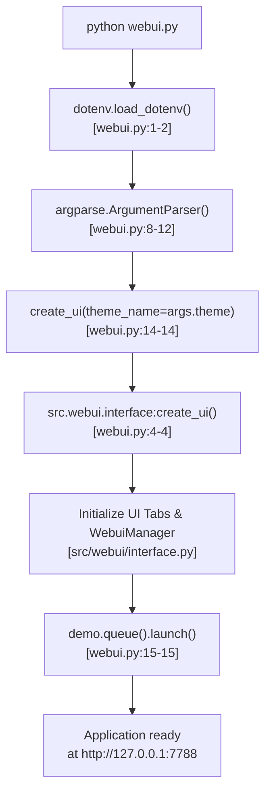

Sources: [webui.py:1-19](), [src/webui/interface.py]()

---

## Using Custom Browser (Optional)

For advanced users who want to use their existing browser profile with saved logins and history:

### Configuration Steps

1. **Set environment variables in `.env`:**
   - `BROWSER_PATH` - Path to browser executable [README.md:92-92]()
   - `BROWSER_USER_DATA` - Path to browser user data directory [README.md:92-92]()
   
2. **Close all instances of the target browser** (critical to avoid conflicts) [README.md:104-104]()

3. **Open the WebUI in a different browser** (e.g., Firefox if using Chrome data) [README.md:105-105]()

4. **Enable in Browser Settings tab:**
   - Check "Use Own Browser" option [README.md:106-106]()
   - Verify the paths are correctly configured

Sources: [README.md:91-106](), [.env.example:54-61]()

---

## Verification Steps

After installation, verify the setup is working correctly:

1. **Check Web Interface Access:** Navigate to `http://127.0.0.1:7788` [README.md:90-90]().
2. **Verify LLM Provider Configuration:** Open the **Agent Settings** tab and verify the dropdown model list.
3. **Test Browser Automation:** Submit a task via the **Browser Use Agent** tab.
4. **Docker-Specific Verification:** Verify noVNC access at `http://localhost:6080/vnc.html` [README.md:144-144]().

Sources: [README.md:90-146]()

---

# Page: Project Layout and Dependencies

# Project Layout and Dependencies

<details>
<summary>Relevant source files</summary>

The following files were used as context for generating this wiki page:

- [LICENSE](LICENSE)
- [SECURITY.md](SECURITY.md)
- [requirements.txt](requirements.txt)
- [src/__init__.py](src/__init__.py)
- [src/agent/__init__.py](src/agent/__init__.py)

</details>


## Purpose and Scope
This page maps the repository directory structure of the `browser-use/web-ui` codebase and details its core third-party dependencies as specified in `requirements.txt`. It provides a technical breakdown of how the source tree is organized across modules like `src/webui`, `src/agent`, `src/browser`, `src/controller`, `src/utils`, and `tests`, explaining the specific role of each package and library.

Sources: `[requirements.txt:1-10](), [src/__init__.py:1-1]()`

---

## Repository Directory Structure

The codebase follows a modular Python application layout, separating concerns between user interface orchestration, agent execution loops, browser automation wrappers, tool controllers, and utility helpers. 

```
.
├── src/
│   ├── __init__.py
│   ├── webui/          # Gradio interface, WebuiManager, and tab layouts
│   ├── agent/          # Browser Use and Deep Research agent workflows
│   ├── browser/        # CustomBrowser and CustomBrowserContext wrappers
│   ├── controller/     # CustomController and action orchestration
│   └── utils/          # Configuration, environment handlers, and helpers
├── tests/              # Automated test suite (LLM APIs, controllers, agents)
└── requirements.txt    # Third-party Python dependencies
```

### Natural Language to Code Entity Mapping

The following diagram bridges conceptual system layers with their concrete directory and module counterparts in the codebase.

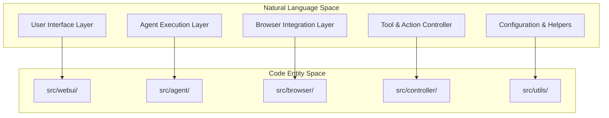
Sources: `[src/__init__.py:1-1]()`

---

## Key Third-Party Dependencies

The application relies on several core external packages specified in `requirements.txt`. These libraries provide the underlying browser automation runtime, UI framework, multi-provider LLM integrations, Model Context Protocol (MCP) support, and graph-based agent orchestration.

| Dependency | Version | Code Role & Purpose |
| :--- | :--- | :--- |
| `browser-use` | `0.1.48` | Core browser automation engine providing the base Agent framework, DOM parsing, and action execution `[requirements.txt:1]()`. |
| `gradio` | `5.27.0` | UI framework powering the web interface, reactive components, and real-time streaming displays `[requirements.txt:3]()`. |
| `langgraph` | `0.3.34` | Graph-based workflow orchestration engine utilized by complex agents like Deep Research `[requirements.txt:9]()`. |
| `langchain-mistralai` | `0.2.4` | Mistral AI provider integration for LangChain/LangGraph ecosystems `[requirements.txt:5]()`. |
| `langchain-ibm` | `0.3.10` | IBM watsonx LLM provider integration `[requirements.txt:7]()`. |
| `langchain_mcp_adapters` | `0.0.9` | Model Context Protocol (MCP) adapters for dynamic external tool registration `[requirements.txt:8]()`. |
| `json-repair` | Latest | Robust JSON parsing utility for recovering malformed model outputs `[requirements.txt:4]()`. |
| `pyperclip` | `1.9.0` | Cross-platform clipboard interaction utility `[requirements.txt:2]()`. |
| `MainContentExtractor` | `0.0.4` | Utility for parsing and extracting main readable text content from web pages `[requirements.txt:6]()`. |

Sources: `[requirements.txt:1-10]()`

---

## Module Breakdown

### 1. `src/webui/`
Houses the Gradio-based graphical interface components. It contains modules responsible for assembling interface tabs, managing reactive UI state through `WebuiManager`, handling chat histories, and synchronizing user configurations across sessions.

### 2. `src/agent/`
Contains the agent logic implementations. This includes wrappers and execution definitions for the primary interactive Browser Use Agent as well as the graph-based Deep Research Agent.

### 3. `src/browser/`
Implements custom Playwright browser wrappers (`CustomBrowser`) and context managers (`CustomBrowserContext`). It handles Chromium launch arguments, debugging port configurations, window sizing, security policies, and isolated session contexts.

### 4. `src/controller/`
Defines `CustomController` and custom action registries. This module bridges LLM tool-call outputs with concrete browser interactions, handling user assistance requests (`ask_for_assistant`) and file uploads.

### 5. `src/utils/`
Provides cross-cutting utility functions and configuration helpers. It manages environment variable parsing, UI theme maps, image encoding helpers for vision models, and configuration persistence.

### 6. `tests/`
Contains the test suite covering LLM API connectivity (`test_llm_api.py`), controller validation (`test_controller.py`), agent execution paths (`test_agents.py`), and Playwright integration (`test_playwright.py`).

---

## Component Dependency and Execution Flow

The following diagram illustrates how external dependencies interact with internal modules during runtime execution.

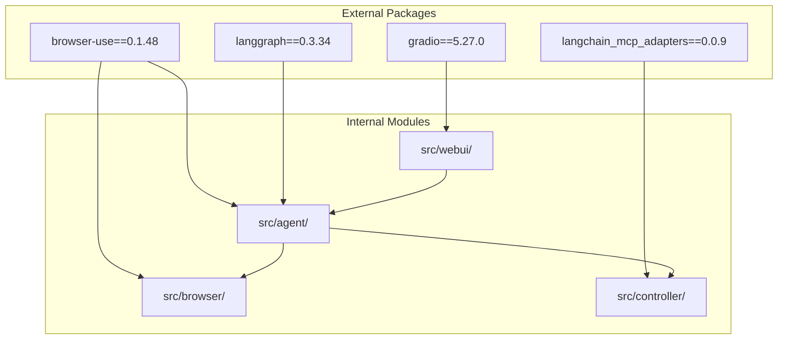
Sources: `[requirements.txt:1-10]()`

---

# Page: System Architecture

# System Architecture

<details>
<summary>Relevant source files</summary>

The following files were used as context for generating this wiki page:

- [src/webui/interface.py](src/webui/interface.py)
- [src/webui/webui_manager.py](src/webui/webui_manager.py)
- [webui.py](webui.py)

</details>


## Purpose and Scope

This document explains the high-level layered design of the browser-use web-ui system, its deployment models, and how components interact across the user interface, agent, browser, and LLM tiers. 

Because this is a parent page, it provides a high-level overview of the architecture and points to dedicated child pages for deep technical details:
- For application startup, CLI arguments, and Gradio tab assembly, see [Application Entrypoint and Interface Assembly](#2.1).
- For component registration, state management, chat history, and configuration persistence, see [WebuiManager and State Flow](#2.2).

**Sources:** [webui.py:1-19](), [src/webui/interface.py:1-95](), [src/webui/webui_manager.py:1-122]()

---

## System Layers

The system follows a strict layered architecture separating concerns from the Gradio interface down to Playwright browser automation and multi-provider LLM inference.

### Layered Architecture Overview

The following diagram bridges natural language functional concepts to code entities (`webui.py`, `interface.py`, `WebuiManager`, `CustomBrowser`, `CustomController`, `get_llm_model`) within the codebase:

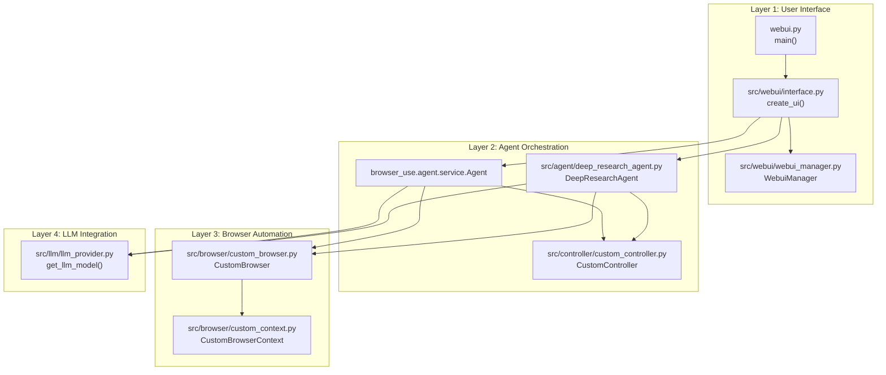

**Sources:** [webui.py:1-19](), [src/webui/interface.py:1-95](), [src/webui/webui_manager.py:1-122]()

### Layer Responsibilities

| Layer | Primary Code Entities | Responsibilities |
|-------|----------------------|------------------|
| **User Interface** | `webui.py`, `src/webui/interface.py`, `src/webui/webui_manager.py` | CLI parsing, Gradio block assembly, layout themes (`theme_map`), and state coordination |
| **Agent Orchestration** | `Agent`, `DeepResearchAgent`, `CustomController` | Task execution loops, action registration, step planning, and tool dispatch |
| **Browser Automation** | `CustomBrowser`, `CustomBrowserContext` | Playwright lifecycle control, CDP port binding, user data directories, and isolation |
| **LLM Integration** | `src/llm/llm_provider.py` | Multi-provider chat model instantiation and fallback handling |

**Sources:** [webui.py:1-19](), [src/webui/interface.py:1-95](), [src/webui/webui_manager.py:1-122]()

---

## Deployment Architectures

The system supports both local execution via standard Python environments and headless containerized execution via Docker.

### Deployment Architecture Mapping

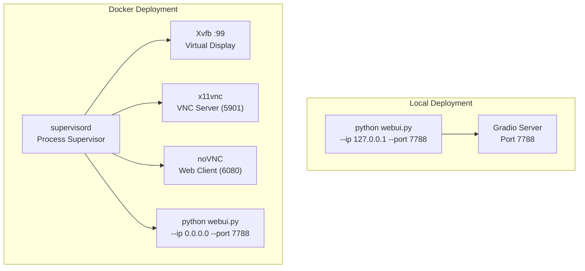

**Sources:** [webui.py:7-16](), [src/webui/interface.py:22-30]()

---

## Component Interaction Model

The interaction model governs how user triggers pass through the UI manager down to agents, controllers, and browser sessions.

### Request-Response Flow

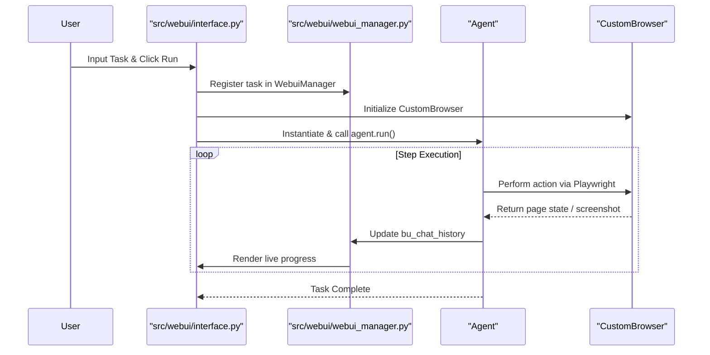

**Sources:** [src/webui/interface.py:22-95](), [src/webui/webui_manager.py:30-43]()

---

## Subsystem Details and Child Pages

For granular technical documentation on entrypoints, interface building, and state coordination, please refer to the child pages:

- **2.1 Application Entrypoint and Interface Assembly**: Details `webui.py` argument parsing, `theme_map`, `create_ui`, and tab registration in `src/webui/interface.py`.
- **2.2 WebuiManager and State Flow**: Explains component registration via `id_to_component`, chat history, browser reference management, and config save/load routines in `src/webui/webui_manager.py`.

**Sources:** [webui.py:1-19](), [src/webui/interface.py:1-95](), [src/webui/webui_manager.py:1-122]()

---

# Page: Application Entrypoint and Interface Assembly

# Application Entrypoint and Interface Assembly

<details>
<summary>Relevant source files</summary>

The following files were used as context for generating this wiki page:

- [src/webui/interface.py](src/webui/interface.py)
- [webui.py](webui.py)

</details>


The purpose and scope of this document is to detail the application entrypoint (`webui.py`) and the interface assembly layer (`src/webui/interface.py`). It covers CLI argument parsing, theme mapping, custom CSS/JS injection, the `WebuiManager` initialization, and the hierarchical assembly of Gradio tabs that launch the web server.

---

## 1. Application Entrypoint (`webui.py`)

The application starts via `webui.py`, which acts as the primary executable script. It loads environment variables, parses command-line arguments to configure network binding and UI themes, and initializes the Gradio application instance.

The execution flow begins by invoking `load_dotenv()` from the `dotenv` package to populate the environment from local configuration files [webui.py:1-2]. An `argparse.ArgumentParser` is then instantiated to handle three primary configuration parameters:
- `--ip`: The binding IP address for the Gradio server (default `127.0.0.1`) [webui.py:9].
- `--port`: The network port on which the server listens (default `7788`) [webui.py:10].
- `--theme`: The visual theme applied to the interface, restricted to valid keys present in `theme_map` (default `Ocean`) [webui.py:11].

Once arguments are parsed, `create_ui()` is called with the selected theme name [webui.py:14]. The returned Gradio `Blocks` demo object has its queue enabled and launches using the specified server parameters [webui.py:15].

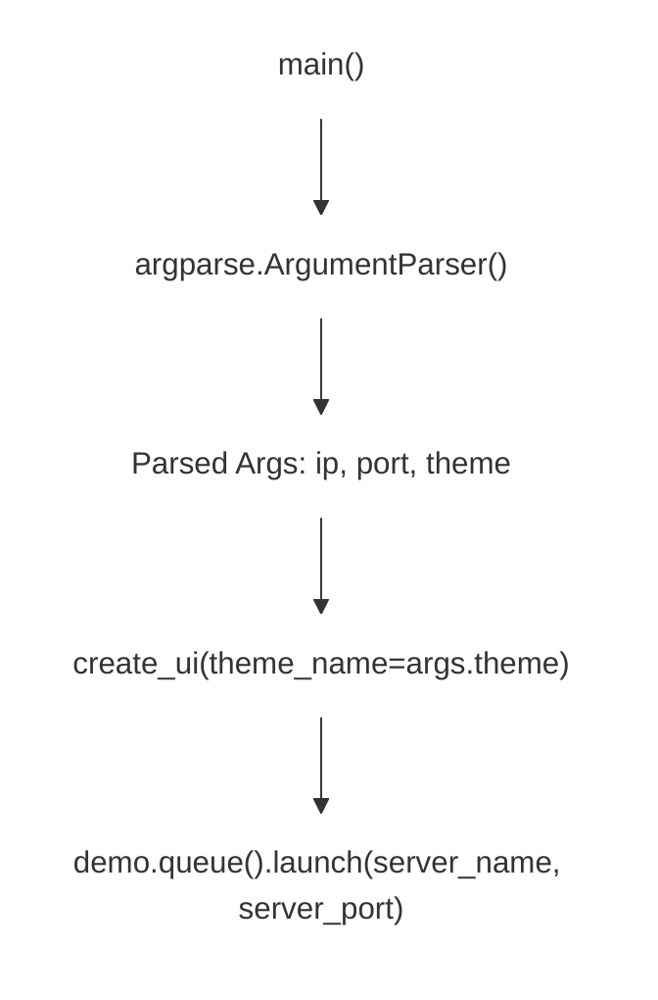

Sources: `webui.py:1-20`

---

## 2. Theme Mapping and Styling

The UI presentation layer relies on a predefined dictionary of Gradio themes and custom style injections located in `src/webui/interface.py`.

### Theme Mapping (`theme_map`)
The `theme_map` dictionary associates string identifiers with Gradio theme instances [src/webui/interface.py:10-19]:
- `"Default"`: `gr.themes.Default()`
- `"Soft"`: `gr.themes.Soft()`
- `"Monochrome"`: `gr.themes.Monochrome()`
- `"Glass"`: `gr.themes.Glass()`
- `"Origin"`: `gr.themes.Origin()`
- `"Citrus"`: `gr.themes.Citrus()`
- `"Ocean"`: `gr.themes.Ocean()`
- `"Base"`: `gr.themes.Base()`

### CSS and JS Injection
`create_ui()` defines a custom CSS block (`css`) that controls layout sizing, container margins, header alignments, and section padding for the `.gradio-container` [src/webui/interface.py:23-43]. Additionally, a JavaScript injection snippet (`js_func`) forces the browser session into dark mode by inspecting and modifying the URL query parameters (`__theme=dark`) upon load [src/webui/interface.py:46-55].

Sources: `src/webui/interface.py:1-55`

---

## 3. Interface Assembly and Tab Hierarchy (`src/webui/interface.py`)

The core user interface is assembled within `create_ui(theme_name)` [src/webui/interface.py:22]. This function instantiates the global state container `WebuiManager` and constructs the main Gradio layout using `gr.Blocks` and `gr.Tabs` [src/webui/interface.py:57-71].

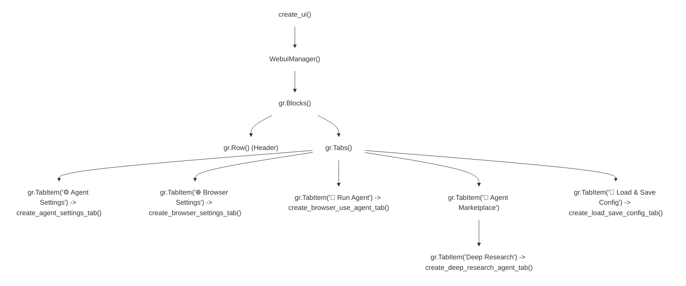

### Tab Breakdown
- **Agent Settings Tab**: Invokes `create_agent_settings_tab(ui_manager)` to render model selections, API keys, and behavioral parameters [src/webui/interface.py:72-73].
- **Browser Settings Tab**: Invokes `create_browser_settings_tab(ui_manager)` to configure headless mode, viewport dimensions, and proxy parameters [src/webui/interface.py:75-76].
- **Run Agent Tab**: Invokes `create_browser_use_agent_tab(ui_manager)` to host the primary interactive browser automation interface [src/webui/interface.py:78-79].
- **Agent Marketplace / Deep Research Tab**: Nests sub-tabs under an agent marketplace header, invoking `create_deep_research_agent_tab(ui_manager)` for multi-step research workflows [src/webui/interface.py:81-90].
- **Load & Save Config Tab**: Invokes `create_load_save_config_tab(ui_manager)` to manage profile persistence [src/webui/interface.py:92-93].

Sources: `src/webui/interface.py:56-96`

---

# Page: WebuiManager and State Flow

# WebuiManager and State Flow

<details>
<summary>Relevant source files</summary>

The following files were used as context for generating this wiki page:

- [src/webui/components/load_save_config_tab.py](src/webui/components/load_save_config_tab.py)
- [src/webui/webui_manager.py](src/webui/webui_manager.py)

</details>


## Purpose and Scope

The `WebuiManager` class serves as the central state container, component registry, and session coordinator for the application's Gradio interface. It manages UI component mapping via unique identifiers (`id_to_component`), maintains live references to underlying execution engines (`Agent`, `CustomBrowser`, `CustomController`), coordinates synchronization events for user-in-the-loop actions, and implements persistent configuration save/load workflows.

Sources: `src/webui/webui_manager.py:22-29`

---

## Component Registration and Identification

To allow global access and dynamic updates across disparate Gradio tabs, `WebuiManager` maintains bidirectional maps between Gradio `Component` instances and string identifiers.

### Key Data Structures
* `self.id_to_component`: Maps string keys of the format `"{tab_name}.{comp_name}"` to Gradio `Component` objects.
* `self.component_to_id`: Reverse lookup mapping `Component` instances back to their string identifiers.

```python
# Initialization of registration dictionaries
self.id_to_component: dict[str, Component] = {}
self.component_to_id: dict[Component, str] = {}
```

### Registration Methods
Components are registered during UI assembly by calling `add_components`:
* `add_components(tab_name: str, components_dict: dict[str, Component])`: Iterates through a dictionary of components for a given tab, constructs the namespaced key `f"{tab_name}.{comp_name}"`, and populates both lookup dictionaries.
* `get_components()`: Returns a list of all registered `Component` objects.
* `get_component_by_id(comp_id: str)`: Retrieves a specific component by its namespaced string ID.
* `get_id_by_component(comp: Component)`: Resolves a component instance to its string ID.

Sources: `src/webui/webui_manager.py:24-25`, `src/webui/webui_manager.py:53-78`

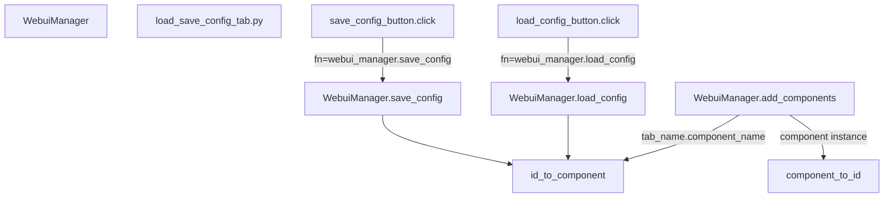
*Figure 1: Component registration and interface wiring linking UI events to `WebuiManager` methods.*

Sources: `src/webui/webui_manager.py:22-78`, `src/webui/components/load_save_config_tab.py:39-49`

---

## Agent, Browser, and State References

`WebuiManager` initializes and holds runtime references for the application's execution backends. It separates state management between the interactive Browser Use Agent and the Deep Research Agent.

### Browser Use Agent State (`init_browser_use_agent`)
* `self.bu_agent`: Reference to the `Agent` instance from `browser_use.agent.service`.
* `self.bu_browser`: Reference to the `CustomBrowser` instance.
* `self.bu_browser_context`: Reference to the active `CustomBrowserContext`.
* `self.bu_controller`: Reference to the `CustomController` instance.
* `self.bu_chat_history`: List of dictionaries storing message history for the chat interface.
* `self.bu_response_event`: An `asyncio.Event` utilized for synchronizing user assistance or step approvals.
* `self.bu_user_help_response`: String buffer holding user input provided during interactive prompts.
* `self.bu_current_task`: Active `asyncio.Task` running the agent execution loop.
* `self.bu_agent_task_id`: Unique string identifier for the active agent run.

### Deep Research Agent State (`init_deep_research_agent`)
* `self.dr_agent`: Reference to the `DeepResearchAgent` instance.
* `self.dr_current_task`: Active task handle for research execution.
* `self.dr_agent_task_id`: Unique identifier for the research task.
* `self.dr_save_dir`: File system path where research artifacts and reports are persisted.

Sources: `src/webui/webui_manager.py:30-52`

---

## Configuration Save and Load Flow

`WebuiManager` handles configuration persistence by serializing component values to JSON files in a designated settings directory (`./tmp/webui_settings` by default).

### Saving Configuration (`save_config`)
The `save_config` function iterates over all provided components, filters out buttons, file pickers, and non-interactive elements, and builds a dictionary mapping component IDs to their current values. It then serializes the dictionary to a timestamped JSON file.

```python
config_name = datetime.now().strftime("%Y%m%d-%H%M%S")
with open(os.path.join(self.settings_save_dir, f"{config_name}.json"), "w") as fw:
    json.dump(cur_settings, fw, indent=4)
```
Sources: `src/webui/webui_manager.py:80-95`

### Loading Configuration (`load_config`)
The `load_config` function reads a JSON settings file and updates the corresponding UI components. Because certain settings (such as LLM providers) trigger cascading UI callback refreshes, `load_config` is implemented as a Python generator (`yield`), allowing intermediary state to propagate to the Gradio runtime before continuing.

```python
for comp_id, comp_val in ui_settings.items():
    if comp_id in self.id_to_component:
        comp = self.id_to_component[comp_id]
        if comp.__class__.__name__ == "Chatbot":
            update_components[comp] = comp.__class__(value=comp_val, type="messages")
        else:
            update_components[comp] = comp.__class__(value=comp_val)
            if comp_id == "agent_settings.planner_llm_provider":
                yield update_components  # yield provider, let callback run
                time.sleep(0.1)  # wait for Gradio UI callback
```

Sources: `src/webui/webui_manager.py:97-123`

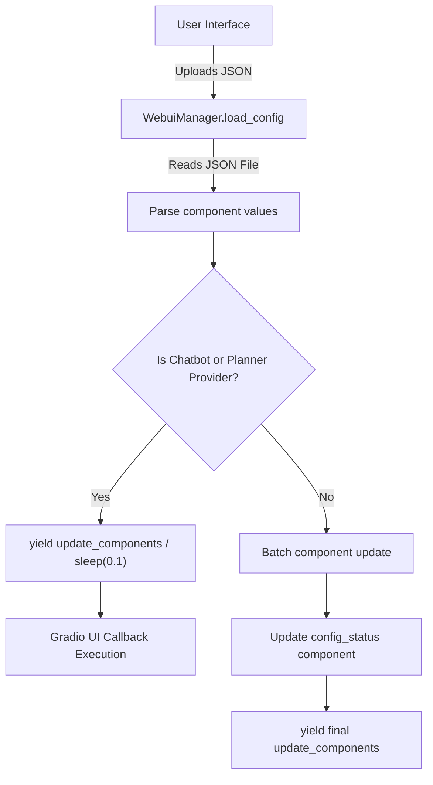
*Figure 2: Data flow during configuration loading via `WebuiManager.load_config`.*

Sources: `src/webui/webui_manager.py:97-123`, `src/webui/components/load_save_config_tab.py:45-49`

---

# Page: User Interface

# User Interface

<details>
<summary>Relevant source files</summary>

The following files were used as context for generating this wiki page:

- [src/webui/__init__.py](src/webui/__init__.py)
- [src/webui/components/__init__.py](src/webui/components/__init__.py)
- [src/webui/interface.py](src/webui/interface.py)

</details>


The User Interface provides a Gradio-based web frontend for controlling browser automation agents, configuring LLM providers, and monitoring task execution. This page documents the main entrypoint, tab organization, and how the UI layer coordinates with backend components through `WebuiManager`.

For detailed documentation of specific tabs, see:
- [Browser Use Agent Tab](#3.1)
- [Deep Research Agent Tab](#3.2)
- [Settings Tabs](#3.3)

## Overview and Interface Assembly

The UI is implemented using Gradio inside `src/webui/interface.py`. The `create_ui()` function initializes the `WebuiManager` state coordinator [src/webui/interface.py:57-57]() and constructs a `gr.Blocks` layout complete with customized themes (`theme_map`), CSS styling, and automatic dark mode enforcement [src/webui/interface.py:59-61]().

**Interface Assembly Flow**

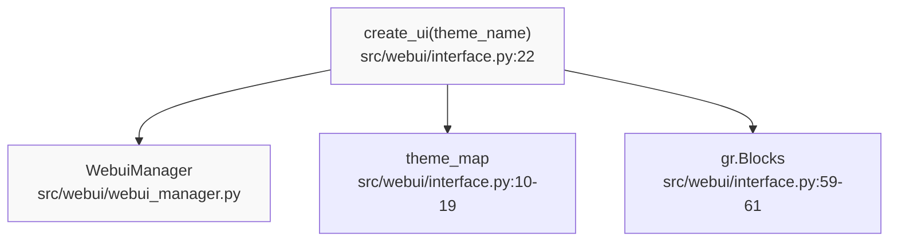

Sources: [src/webui/interface.py:1-95]()

## Tab Structure and Components

The Gradio interface is structured into modular tabs supporting agent execution, configuration, and research workflows. Each tab is imported and assembled into the main layout via `create_ui()` [src/webui/interface.py:4-8]().

**UI Tab Architecture**

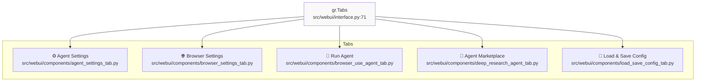

| Tab Title | Implementation Module | Primary Role |
|-----------|----------------------|--------------|
| ⚙️ Agent Settings | [src/webui/components/agent_settings_tab.py]() | Configure LLM providers, API keys, and agent execution parameters |
| 🌐 Browser Settings | [src/webui/components/browser_settings_tab.py]() | Configure Playwright browser flags, headless mode, and MCP servers |
| 🤖 Run Agent | [src/webui/components/browser_use_agent_tab.py]() | Interactive task submission, live browser view, and chat progress |
| 🎁 Agent Marketplace / Deep Research | [src/webui/components/deep_research_agent_tab.py]() | Multi-step research tasks and report generation |
| 📁 Load & Save Config | [src/webui/components/load_save_config_tab.py]() | Persistence of UI configurations and settings files |

Sources: [src/webui/interface.py:71-94]()

## Sub-Topics and Child Pages

- **[Browser Use Agent Tab](#3.1)**: Detail the interactive Browser Use Agent tab: task submission, real-time progress, live browser view, user assistance requests, stop/pause/resume controls.
- **[Deep Research Agent Tab](#3.2)**: Explain the Deep Research Agent tab: topic submission, research plan visualization, progress monitoring, report generation.
- **[Settings Tabs](#3.3)**: Document Agent Settings and Browser Settings tabs, plus load/save config: LLM configuration, browser options, MCP server setup, persistence.

Sources: [src/webui/interface.py:1-95]()

---

# Page: Browser Use Agent Tab

# Browser Use Agent Tab

<details>
<summary>Relevant source files</summary>

The following files were used as context for generating this wiki page:

- [src/webui/components/browser_use_agent_tab.py](src/webui/components/browser_use_agent_tab.py)

</details>


## Purpose and Scope

The Browser Use Agent Tab provides an interactive Gradio-based interface for submitting browser automation tasks to the `BrowserUseAgent`. This tab enables users to control and monitor AI-driven web browsing sessions through a chat-like interface with real-time progress updates, screenshot displays, and interactive controls for pausing, resuming, or stopping tasks. The agent can also request user assistance during execution when it encounters situations requiring human intervention.

For information about the underlying agent implementation and execution logic, see [Browser Use Agent](#4.1). For details about the Deep Research Agent interface, see [Deep Research Agent Tab](#3.2). For configuration options that affect agent and browser behavior, see [Settings Tabs](#3.3).

**Sources:** [src/webui/components/browser_use_agent_tab.py:1-81]()

---

## UI Components and Layout

### Component Structure

The tab consists of several key UI components organized in a vertical layout:

| Component | Type | Purpose | Element ID |
|-----------|------|---------|------------|
| `chatbot` | `gr.Chatbot` | Displays conversation history with agent outputs and screenshots | `browser_use_chatbot` |
| `user_input` | `gr.Textbox` | Input field for tasks or user responses | `user_input` |
| `run_button` | `gr.Button` | Submit task / Submit response to agent | - |
| `stop_button` | `gr.Button` | Stop the currently running task | - |
| `pause_resume_button` | `gr.Button` | Pause or resume task execution | - |
| `clear_button` | `gr.Button` | Clear chat history and reset state | - |
| `browser_view` | `gr.HTML` | Live browser screenshot stream (headless mode only) | `browser_view` |
| `agent_history_file` | `gr.File` | Download agent execution history JSON | - |
| `recording_gif` | `gr.Image` | View animated GIF recording of the task | - |

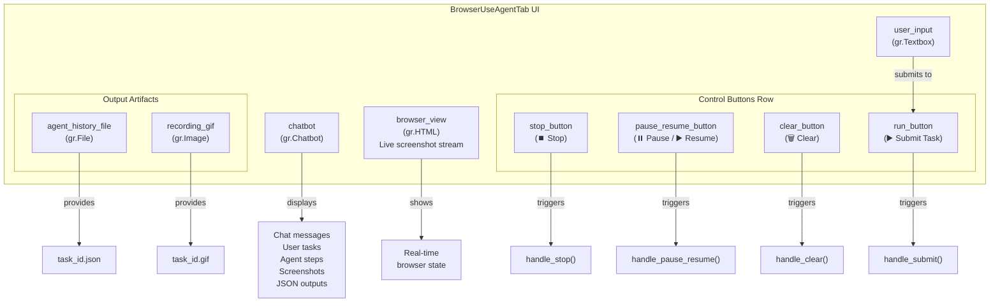

**Sources:** [src/webui/components/browser_use_agent_tab.py:1071-1080]()

### Component Registration

Components are registered with the `WebuiManager` using a tab-specific prefix (`"browser_use_agent"`) for unique identification via `webui_manager.add_components()`:

```python
webui_manager.add_components("browser_use_agent", tab_components)
```

This allows components to be retrieved by ID using the pattern `"browser_use_agent.{component_name}"`, enabling cross-tab access for settings and state coordination.

**Sources:** [src/webui/components/browser_use_agent_tab.py:25-26](), [src/webui/components/browser_use_agent_tab.py:69-96]()

---

## Task Submission and Execution Flow

### Submission Handler Architecture

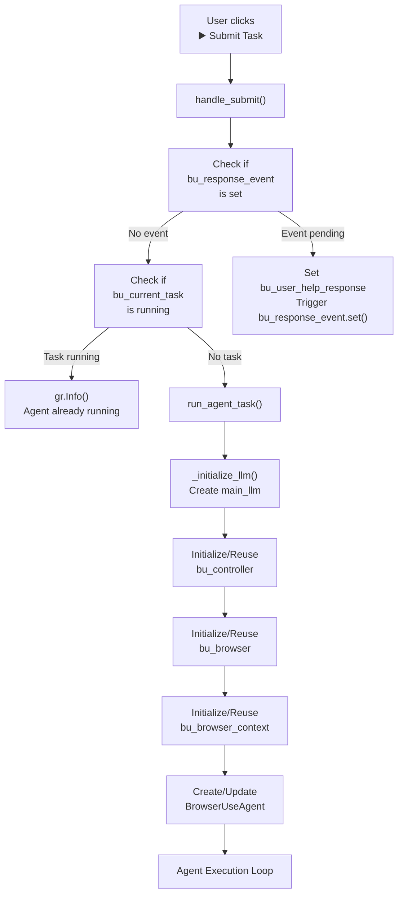

**Sources:** [src/webui/components/browser_use_agent_tab.py:21-25]()

### Main Execution Loop

The execution workflow coordinates LLM initialization, browser contexts, and agent steps inside `run_agent_task()`:

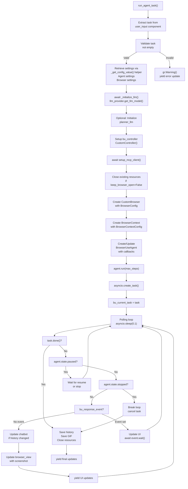

**Sources:** [src/webui/components/browser_use_agent_tab.py:33-66](), [src/webui/components/browser_use_agent_tab.py:69-96]()

### Settings Retrieval

Settings are retrieved from both the Agent Settings and Browser Settings tabs using the helper function `_get_config_value()`, which searches components via `WebuiManager.get_component_by_id()`.

**Sources:** [src/webui/components/browser_use_agent_tab.py:69-96]()

---

## Real-time Progress Monitoring

### Step-by-Step Display

The agent execution is monitored through callback functions like `_handle_new_step()` that update the UI as each step completes:

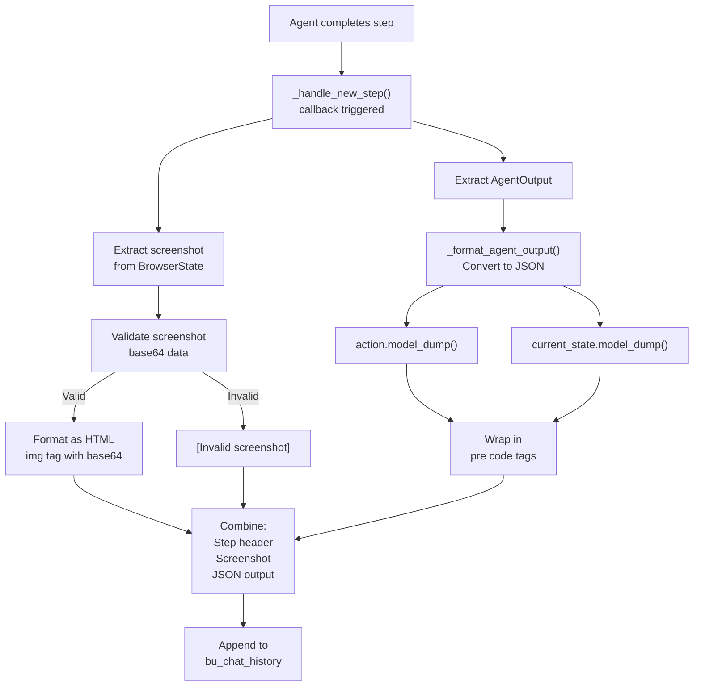

**Sources:** [src/webui/components/browser_use_agent_tab.py:98-167]()

### Screenshot Display Format

Screenshots are embedded directly in chat messages using base64-encoded JPEG data:

```html

```

**Sources:** [src/webui/components/browser_use_agent_tab.py:151-166]()

### Agent Output Formatting

Agent outputs are formatted via `_format_agent_output()` into syntax-highlighted JSON blocks using Pydantic's `model_dump()` method.

**Sources:** [src/webui/components/browser_use_agent_tab.py:98-128]()

---

## User Assistance Mechanism

### Assistance Request Flow

When the agent needs user help, it triggers a specialized callback (`_ask_assistant_callback`) which instantiates an `asyncio.Event` (`bu_response_event`) and suspends execution until the user submits text via `user_input`.

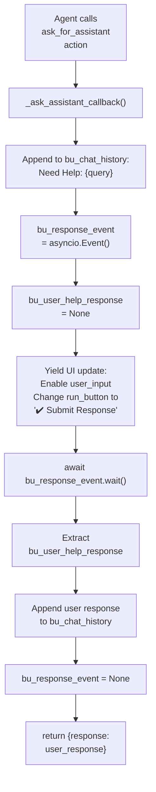

**Sources:** [src/webui/components/browser_use_agent_tab.py:21-25]()

---

## Browser Control Features

### Live Browser View

In headless mode, a live browser view is updated periodically by invoking `take_screenshot()` on `bu_browser_context` and streaming the resulting HTML `` tag into `browser_view`.

**Sources:** [src/webui/components/browser_use_agent_tab.py:21-25]()

### Pause, Resume, and Stop Controls

The agent handles execution pacing and cancellation states via internal flags (`agent.state.paused`, `agent.state.stopped`), manipulated by `handle_pause_resume()` and `handle_stop()` callbacks respectively.

**Sources:** [src/webui/components/browser_use_agent_tab.py:21-25]()

---

## State Management and Output Artifacts

State variables (e.g., `bu_chat_history`, `bu_current_task`, `bu_agent`, `bu_browser`, `bu_controller`, `bu_response_event`) are maintained globally through `WebuiManager`. Completed task executions serialize history to disk as JSON and compile step captures into a GIF recording when configured.

**Sources:** [src/webui/components/browser_use_agent_tab.py:21-26]()

Sources: [src/webui/components/browser_use_agent_tab.py:1-1080]()

---

# Page: Deep Research Agent Tab

# Deep Research Agent Tab

<details>
<summary>Relevant source files</summary>

The following files were used as context for generating this wiki page:

- [src/webui/components/deep_research_agent_tab.py](src/webui/components/deep_research_agent_tab.py)

</details>


## Purpose and Scope

The Deep Research Agent Tab provides a Gradio-based user interface for executing multi-step research workflows using the `DeepResearchAgent` class [src/webui/components/deep_research_agent_tab.py:12](). This tab enables users to submit research topics, configure parallel browser execution, monitor real-time progress through dynamically updated research plans, and download final research reports.

For information about the underlying agent implementation and Langgraph workflow, see [Custom Browser Context](#5.2). For details about configuring LLM and browser settings used by this tab, see [Controller and Actions](#4.3). For the simpler interactive browser automation interface, see [Browser Use Agent](#4.1).

Sources: [src/webui/components/deep_research_agent_tab.py:1-457]()

## UI Component Structure

The Deep Research Agent tab is organized into four main sections: MCP configuration, research parameters, execution controls, and output display.

### Component Layout Diagram

This diagram bridges natural language interface concepts with concrete UI component variables defined in the module.

```mermaid
graph TB
    subgraph "MCP Configuration Group"
        mcp_json_file["mcp_json_file<br/>(gr.File)"]
        mcp_server_config["mcp_server_config<br/>(gr.Textbox, lines=6)"]
    end
    
    subgraph "Research Parameters Group"
        research_task["research_task<br/>(gr.Textbox, lines=5)"]
        subgraph "Settings Row"
            resume_task_id["resume_task_id<br/>(gr.Textbox)"]
            parallel_num["parallel_num<br/>(gr.Number)"]
            max_query["max_query<br/>(gr.Textbox)<br/>Save Directory"]
        end
    end
    
    subgraph "Execution Controls Row"
        stop_button["stop_button<br/>(gr.Button, variant=stop)"]
        start_button["start_button<br/>(gr.Button, variant=primary)"]
    end
    
    subgraph "Output Display Group"
        markdown_display["markdown_display<br/>(gr.Markdown)"]
        markdown_download["markdown_download<br/>(gr.File)"]
    end
    
    mcp_json_file -->|"change event"| update_mcp_server["update_mcp_server()"]
    start_button -->|"click event"| run_deep_research["run_deep_research()"]
    stop_button -->|"click event"| stop_deep_research["stop_deep_research()"]
    run_deep_research -->|"updates"| markdown_display
    run_deep_research -->|"updates"| markdown_download
```

Sources: [src/webui/components/deep_research_agent_tab.py:57-420]()

### Component Registry

All components are registered with the `WebuiManager` using the prefix `"deep_research_agent"`. The tab creation function builds a dictionary mapping component names to Gradio objects:

| Component ID | Type | Purpose | Default Value |
|-------------|------|---------|---------------|
| `research_task` | `gr.Textbox` | Research topic input | Example travel plan query |
| `resume_task_id` | `gr.Textbox` | Task ID for resuming previous research | Empty string |
| `parallel_num` | `gr.Number` | Number of parallel browser agents | 1 |
| `max_query` | `gr.Textbox` | Output directory path | `"./tmp/deep_research"` |
| `start_button` | `gr.Button` | Initiates research execution | "▶️ Run" |
| `stop_button` | `gr.Button` | Stops running research | "⏹️ Stop" |
| `markdown_display` | `gr.Markdown` | Real-time plan/report display | Empty |
| `markdown_download` | `gr.File` | Download link for final report | Disabled |
| `mcp_json_file` | `gr.File` | MCP server configuration file upload | None |
| `mcp_server_config` | `gr.Textbox` | Parsed MCP configuration JSON | Hidden initially |

Sources: [src/webui/components/deep_research_agent_tab.py:383-419]()

## Research Execution Flow

The research execution process is orchestrated by the `run_deep_research()` async generator, which handles initialization, monitoring, and finalization in a single continuous flow.

### Execution State Machine

```mermaid
graph TB
    START["User clicks start_button"]
    EXTRACT["Extract task parameters<br/>from components dict"]
    VALIDATE{"Validate<br/>task_topic?"}
    INIT_UI["Update UI:<br/>Disable inputs<br/>Enable stop button"]
    GET_SETTINGS["Retrieve settings from<br/>agent_settings & browser_settings tabs"]
    INIT_LLM["_initialize_llm()<br/>Create LLM instance"]
    CHECK_LLM{"LLM created<br/>successfully?"}
    INIT_AGENT{"webui_manager.dr_agent<br/>exists?"}
    CREATE_AGENT["Create DeepResearchAgent<br/>with llm, browser_config, mcp_config"]
    START_RUN["webui_manager.dr_agent.run()<br/>Create async task"]
    WAIT_ID["Wait 1s for task_id generation"]
    GET_ID["Retrieve current_task_id<br/>from agent"]
    MONITOR["Monitor loop:<br/>Check research_plan.md every 1s"]
    FILE_CHANGED{"Plan file<br/>mtime changed?"}
    UPDATE_DISPLAY["Update markdown_display<br/>with plan content"]
    AGENT_DONE{"agent_task.done()?"}
    AWAIT_RESULT["await agent_task<br/>Get final_result_dict"]
    LOAD_REPORT["Load report.md<br/>from task directory"]
    FINAL_UPDATE["Update markdown_display<br/>Enable markdown_download"]
    CLEANUP["Reset UI state<br/>Clear dr_current_task"]
    END["Yield final updates"]
    ERROR["Handle exception<br/>Display error in markdown_display"]
    
    START --> EXTRACT
    EXTRACT --> VALIDATE
    VALIDATE -->|"Empty"| ERROR
    VALIDATE -->|"Valid"| INIT_UI
    INIT_UI --> GET_SETTINGS
    GET_SETTINGS --> INIT_LLM
    INIT_LLM --> CHECK_LLM
    CHECK_LLM -->|"Failed"| ERROR
    CHECK_LLM -->|"Success"| INIT_AGENT
    INIT_AGENT -->|"None"| CREATE_AGENT
    INIT_AGENT -->|"Exists"| START_RUN
    CREATE_AGENT --> START_RUN
    START_RUN --> WAIT_ID
    WAIT_ID --> GET_ID
    GET_ID --> MONITOR
    MONITOR --> FILE_CHANGED
    FILE_CHANGED -->|"No"| AGENT_DONE
    FILE_CHANGED -->|"Yes"| UPDATE_DISPLAY
    UPDATE_DISPLAY --> AGENT_DONE
    AGENT_DONE -->|"No"| MONITOR
    AGENT_DONE -->|"Yes"| AWAIT_RESULT
    AWAIT_RESULT --> LOAD_REPORT
    LOAD_REPORT --> FINAL_UPDATE
    FINAL_UPDATE --> CLEANUP
    CLEANUP --> END
    ERROR --> CLEANUP
```

Sources: [src/webui/components/deep_research_agent_tab.py:57-290]()

### Settings Retrieval Pattern

The `run_deep_research()` function retrieves configuration from other tabs using a helper closure that accesses the `components` dictionary:

```python
def get_setting(tab: str, key: str, default: Any = None):
    comp = webui_manager.id_to_component.get(f"{tab}.{key}")
    return components.get(comp, default) if comp else default
```

This pattern allows the function to pull LLM configuration from the `agent_settings` tab and browser configuration from the `browser_settings` tab without direct coupling to those UI components.

Sources: [src/webui/components/deep_research_agent_tab.py:118-120]()

### LLM and Browser Configuration

The execution flow retrieves the following settings:

| Setting Category | Settings Keys | Source Tab |
|-----------------|---------------|------------|
| LLM Configuration | `llm_provider`, `llm_model_name`, `llm_temperature`, `llm_base_url`, `llm_api_key`, `ollama_num_ctx` | `agent_settings` |
| Browser Configuration | `headless`, `disable_security`, `browser_binary_path`, `browser_user_data_dir`, `window_w`, `window_h` | `browser_settings` |

The browser settings are packaged into a dictionary (`browser_config_dict`) rather than instantiating full `CustomBrowser` objects, as the `DeepResearchAgent` creates its own browser instances internally.

Sources: [src/webui/components/deep_research_agent_tab.py:122-147]()

### Agent Initialization and Execution

The agent initialization follows a lazy creation pattern:

1. Check if `webui_manager.dr_agent` already exists
2. If not, create new `DeepResearchAgent` with current configuration
3. Call `agent.run()` with topic, task_id (for resume), save_dir, and max_parallel_browsers
4. Wrap the coroutine in `asyncio.create_task()` and store in `webui_manager.dr_current_task`

Sources: [src/webui/components/deep_research_agent_tab.py:150-166]()

## Progress Monitoring System

The tab implements a file-based progress monitoring system that watches the `research_plan.md` file for changes, providing real-time updates to the UI without requiring the agent to explicitly send status messages.

### File Monitoring Architecture

```mermaid
graph TB
    subgraph "File System"
        TASK_DIR["task_specific_dir<br/>{base_save_dir}/{running_task_id}"]
        PLAN_FILE["research_plan.md"]
        REPORT_FILE["report.md"]
        SEARCH_FILE["search_info.json"]
    end
    
    subgraph "Monitoring Loop (1s interval)"
        CHECK_STOP{"agent.stopped<br/>flag set?"}
        CHECK_EXISTS{"plan_file_path<br/>exists?"}
        GET_MTIME["os.path.getmtime()<br/>current_mtime"]
        COMPARE_MTIME{"current_mtime ><br/>last_plan_mtime?"}
        READ_FILE["_read_file_safe()<br/>Read plan content"]
        COMPARE_CONTENT{"Content<br/>changed?"}
        UPDATE_UI["Yield update_dict with<br/>markdown_display update"]
        SAVE_STATE["last_plan_content = plan_content<br/>last_plan_mtime = current_mtime"]
        SLEEP["await asyncio.sleep(1.0)"]
    end
    
    subgraph "UI Updates"
        MARKDOWN_DISPLAY["markdown_display component<br/>Shows plan/report"]
        RESUME_ID["resume_task_id component<br/>Shows running_task_id"]
    end
    
    TASK_DIR --> PLAN_FILE
    TASK_DIR --> REPORT_FILE
    CHECK_STOP -->|"Yes"| EXIT["Break monitoring loop"]
    CHECK_STOP -->|"No"| CHECK_EXISTS
    CHECK_EXISTS -->|"Yes"| GET_MTIME
    CHECK_EXISTS -->|"No"| SLEEP
    GET_MTIME --> COMPARE_MTIME
    COMPARE_MTIME -->|"Yes"| READ_FILE
    COMPARE_MTIME -->|"No"| SLEEP
    READ_FILE --> COMPARE_CONTENT
    COMPARE_CONTENT -->|"Yes"| UPDATE_UI
    COMPARE_CONTENT -->|"No"| SLEEP
    UPDATE_UI --> SAVE_STATE
    SAVE_STATE --> UPDATE_UI_COMPONENTS
    UPDATE_UI_COMPONENTS --> MARKDOWN_DISPLAY
    UPDATE_UI_COMPONENTS --> RESUME_ID
    UPDATE_UI_COMPONENTS --> SLEEP
    SLEEP --> CHECK_STOP
```

Sources: [src/webui/components/deep_research_agent_tab.py:188-229]()

### Monitoring Implementation Details

The monitoring system uses file modification time (`mtime`) to detect changes rather than polling the file content directly:

1. **Task ID Resolution**: After starting the agent, wait 1 second and retrieve `agent.current_task_id` to determine the task-specific directory path
2. **Plan File Path Construction**: `{base_save_dir}/{running_task_id}/research_plan.md`
3. **Mtime Tracking**: Store `last_plan_mtime` and compare with current `os.path.getmtime()`
4. **Content Change Detection**: Only update UI if file content actually changed (handles cases where mtime changes but content doesn't)
5. **Error Handling**: If plan file becomes unreadable, reset `last_plan_mtime` to 0 to force retry on next iteration

Sources: [src/webui/components/deep_research_agent_tab.py:206-223]()

### File Reading Safety

The `_read_file_safe()` helper function provides safe file reading with error handling:

- Returns `None` if file doesn't exist (rather than raising exception)
- Catches and logs exceptions during file reading
- Uses UTF-8 encoding explicitly
- Prevents the monitoring loop from crashing on transient file system errors

Sources: [src/webui/components/deep_research_agent_tab.py:43-52]()

## Stop Mechanism

The stop functionality allows users to gracefully terminate a running research task while preserving partial results.

### Stop Flow Diagram

```mermaid
graph TB
    USER_CLICK["User clicks stop_button"]
    CHECK_AGENT{"webui_manager.dr_agent<br/>exists?"}
    CHECK_TASK{"dr_current_task exists<br/>and not done?"}
    CALL_STOP["await agent.stop()<br/>Set stopped flag"]
    WAIT["await asyncio.sleep(1.5)<br/>Allow final file writes"]
    GET_PATHS["Construct report_file_path<br/>from task_id and base_save_dir"]
    CHECK_REPORT{"report.md<br/>exists?"}
    READ_REPORT["_read_file_safe()<br/>Load report content"]
    UPDATE_WITH_REPORT["Update markdown_display<br/>with report + stopped message"]
    UPDATE_DOWNLOAD["Enable markdown_download<br/>with report file"]
    UPDATE_STOPPED["markdown_display =<br/>'Research Stopped by User'"]
    UPDATE_BUTTON["stop_button = 'Stopping...'<br/>Disable interactive"]
    RESET_UI["Re-enable all input components<br/>(handled by run_deep_research finally)"]
    RETURN["Return update_dict"]
    
    USER_CLICK --> UPDATE_BUTTON
    UPDATE_BUTTON --> CHECK_AGENT
    CHECK_AGENT -->|"No"| RESET_UI
    CHECK_AGENT -->|"Yes"| CHECK_TASK
    CHECK_TASK -->|"No"| RESET_UI
    CHECK_TASK -->|"Yes"| CALL_STOP
    CALL_STOP --> WAIT
    WAIT --> GET_PATHS
    GET_PATHS --> CHECK_REPORT
    CHECK_REPORT -->|"Yes"| READ_REPORT
    CHECK_REPORT -->|"No"| UPDATE_STOPPED
    READ_REPORT --> UPDATE_WITH_REPORT
    UPDATE_WITH_REPORT --> UPDATE_DOWNLOAD
    UPDATE_DOWNLOAD --> RETURN
    UPDATE_STOPPED --> RETURN
    RESET_UI --> RETURN
```

Sources: [src/webui/components/deep_research_agent_tab.py:293-355]()

### Stop Signal Coordination

The stop mechanism coordinates between the UI handler and the monitoring loop:

1. **UI Handler (`stop_deep_research()`)**: 
   - Calls `await agent.stop()` which sets the agent's internal `stopped` flag
   - Waits 1.5 seconds for agent to write final files
   - Attempts to load and display partial report
   - Returns immediate UI update (button states, stopped message)

2. **Monitoring Loop (`run_deep_research()`)**: 
   - Checks `getattr(webui_manager.dr_agent, 'stopped', False)` each iteration
   - Breaks monitoring loop if stopped flag detected
   - Proceeds to finalization block to await final agent result
   - Executes `finally` block to reset all UI components

This two-phase approach ensures the UI responds immediately while allowing the agent's async tasks to complete gracefully.

Sources: [src/webui/components/deep_research_agent_tab.py:200-203](), [src/webui/components/deep_research_agent_tab.py:310-322]()

## MCP Server Integration

The tab supports configuring MCP (Model Context Protocol) servers for extending the agent's capabilities with external tools.

### MCP Configuration Flow

```mermaid
graph TB
    USER_UPLOAD["User uploads .json file<br/>to mcp_json_file component"]
    TRIGGER_CHANGE["File change event triggers<br/>update_mcp_server()"]
    CHECK_AGENT{"webui_manager.dr_agent<br/>exists?"}
    CLOSE_CLIENT["await agent.close_mcp_client()<br/>Close existing MCP connection"]
    VALIDATE{"File valid?<br/>(exists, .json extension)"}
    PARSE_JSON["json.load()<br/>Parse MCP config"]
    STRINGIFY["json.dumps(indent=2)<br/>Format for display"]
    UPDATE_TEXTBOX["mcp_server_config.update()<br/>Show parsed config, make visible"]
    RETURN_NONE["Return None, hide textbox"]
    STORE_CONFIG["Store mcp_config in<br/>webui_manager state"]
    PASS_TO_AGENT["Pass mcp_server_config to<br/>DeepResearchAgent constructor"]
    
    USER_UPLOAD --> TRIGGER_CHANGE
    TRIGGER_CHANGE --> CHECK_AGENT
    CHECK_AGENT -->|"Yes"| CLOSE_CLIENT
    CHECK_AGENT -->|"No"| VALIDATE
    CLOSE_CLIENT --> VALIDATE
    VALIDATE -->|"Invalid"| RETURN_NONE
    VALIDATE -->|"Valid"| PARSE_JSON
    PARSE_JSON --> STRINGIFY
    STRINGIFY --> UPDATE_TEXTBOX
    UPDATE_TEXTBOX --> STORE_CONFIG
    STORE_CONFIG --> PASS_TO_AGENT
```

Sources: [src/webui/components/deep_research_agent_tab.py:358-373](), [src/webui/components/deep_research_agent_tab.py:428-432]()

### MCP Configuration Lifecycle

The MCP configuration follows a specific lifecycle to prevent stale connections:

1. **Upload Detection**: User uploads JSON file to `mcp_json_file` component
2. **Client Closure**: If an agent instance exists, close its MCP client connection (prevents reusing stale tool connections)
3. **File Validation**: Check file exists, has `.json` extension
4. **Parsing**: Load and parse JSON configuration
5. **Display**: Show formatted JSON in `mcp_server_config` textbox, make it visible
6. **Storage**: Configuration stored in `components` dictionary
7. **Agent Initialization**: When research starts, configuration passed to `DeepResearchAgent` constructor

Sources: [src/webui/components/deep_research_agent_tab.py:84-85](), [src/webui/components/deep_research_agent_tab.py:151-155]()

## State Management

The tab maintains state through the `WebuiManager` singleton, which coordinates shared state across the application.

### State Variables and Lifecycle

```mermaid
graph TB
    subgraph "WebuiManager State"
        DR_AGENT["webui_manager.dr_agent<br/>DeepResearchAgent instance"]
        DR_CURRENT_TASK["webui_manager.dr_current_task<br/>asyncio.Task for agent.run()"]
        DR_TASK_ID["webui_manager.dr_task_id<br/>Current running task ID"]
        DR_SAVE_DIR["webui_manager.dr_save_dir<br/>Base output directory"]
    end
    
    subgraph "Component State"
        COMPONENTS_DICT["components: Dict[Component, Any]<br/>All input values"]
        ID_TO_COMPONENT["webui_manager.id_to_component<br/>ID -> Component mapping"]
    end
    
    subgraph "Local Monitoring State"
        LAST_PLAN_CONTENT["last_plan_content: Optional[str]<br/>Previous plan file content"]
        LAST_PLAN_MTIME["last_plan_mtime: float<br/>Previous modification time"]
        RUNNING_TASK_ID["running_task_id: Optional[str]<br/>Local copy of task ID"]
    end
    
    subgraph "File System State"
        PLAN_FILE["research_plan.md<br/>Updated by agent"]
        REPORT_FILE["report.md<br/>Final output"]
    end
    
    RUN_START["run_deep_research() starts"]
    RUN_MONITOR["Monitoring loop active"]
    RUN_FINISH["run_deep_research() finishes"]
    STOP_CLICK["stop_deep_research() called"]
    
    RUN_START -->|"Initialize"| DR_SAVE_DIR
    RUN_START -->|"Create or reuse"| DR_AGENT
    RUN_START -->|"Create task"| DR_CURRENT_TASK
    RUN_START -->|"Store ID"| DR_TASK_ID
    RUN_START -->|"Initialize"| LAST_PLAN_CONTENT
    RUN_START -->|"Initialize"| LAST_PLAN_MTIME
    
    RUN_MONITOR -->|"Read"| DR_AGENT
    RUN_MONITOR -->|"Check"| PLAN_FILE
    RUN_MONITOR -->|"Update"| LAST_PLAN_CONTENT
    RUN_MONITOR -->|"Update"| LAST_PLAN_MTIME
    
    STOP_CLICK -->|"Read"| DR_AGENT
    STOP_CLICK -->|"Read"| DR_CURRENT_TASK
    STOP_CLICK -->|"Read"| DR_TASK_ID
    STOP_CLICK -->|"Read"| DR_SAVE_DIR
    STOP_CLICK -->|"Call stop()"| DR_AGENT
    
    RUN_FINISH -->|"Clear (None)"| DR_CURRENT_TASK
    RUN_FINISH -->|"Clear (None)"| DR_TASK_ID
    RUN_FINISH -->|"Persist"| DR_AGENT
```

Sources: [src/webui/components/deep_research_agent_tab.py:93](), [src/webui/components/deep_research_agent_tab.py:108-113](), [src/webui/components/deep_research_agent_tab.py:150-156](), [src/webui/components/deep_research_agent_tab.py:166](), [src/webui/components/deep_research_agent_tab.py:185](), [src/webui/components/deep_research_agent_tab.py:277-278](), [src/webui/components/deep_research_agent_tab.py:296-299]()

### State Access Patterns

The tab uses multiple patterns for accessing state:

| Pattern | Usage | Example |
|---------|-------|---------|
| Direct attribute access | Accessing agent singleton | `webui_manager.dr_agent` |
| Component ID lookup | Retrieving UI component references | `webui_manager.get_component_by_id("deep_research_agent.start_button")` |
| Dictionary access | Reading component values | `components.get(research_task_comp, "")` |
| Settings retrieval closure | Cross-tab configuration access | `get_setting("agent_settings", "llm_provider")` |

Sources: [src/webui/components/deep_research_agent_tab.py:62-71](), [src/webui/components/deep_research_agent_tab.py:118-120]()

## File Output Structure

The Deep Research Agent creates a structured directory hierarchy for organizing research outputs.

### Output Directory Structure

```
{base_save_dir}/                    # Default: ./tmp/deep_research
└── {task_id}/                      # UUID or timestamp-based ID
    ├── research_plan.md            # Hierarchical research plan (updated during execution)
    ├── search_info.json            # Search results metadata
    └── report.md                   # Final synthesized research report
```

### File Purposes

| File | Created By | Updated | Purpose |
|------|-----------|---------|---------|
| `research_plan.md` | `planning_node` | During `research_execution_node` | Contains hierarchical research plan with task status markers |
| `search_info.json` | `parallel_browser_search` | After each search batch | Stores structured search results from parallel browser agents |
| `report.md` | `synthesis_node` | Once at completion | Final synthesized research report combining all findings |

Sources: [src/webui/components/deep_research_agent_tab.py:189-192](), [src/webui/components/deep_research_agent_tab.py:245-252]()

### Directory Path Safety

The implementation includes path validation to prevent directory traversal attacks:

1. Normalize the user-provided `base_save_dir` path using `os.path.abspath()` and `os.path.normpath()`
2. Define a safe root directory (`./tmp/deep_research`)
3. Use `os.path.commonpath()` to verify the normalized path is within the safe root
4. If validation fails, default to the safe root directory and log a warning

This ensures users cannot specify paths outside the intended output directory tree.

Sources: [src/webui/components/deep_research_agent_tab.py:77-83]()

## Event Handlers and Data Flow

The tab uses Gradio's event system to wire UI interactions to async handler functions through wrapper closures.

### Event Handler Architecture

```mermaid
graph TB
    subgraph "Gradio Event System"
        START_CLICK["start_button.click()"]
        STOP_CLICK["stop_button.click()"]
        MCP_CHANGE["mcp_json_file.change()"]
    end
    
    subgraph "Wrapper Closures"
        START_WRAPPER["start_wrapper(comps)<br/>Async generator wrapper"]
        STOP_WRAPPER["stop_wrapper()<br/>Async generator wrapper"]
        UPDATE_WRAPPER["update_wrapper(mcp_file)<br/>Async generator wrapper"]
    end
    
    subgraph "Core Handlers"
        RUN_DR["run_deep_research(webui_manager, components)<br/>AsyncGenerator"]
        STOP_DR["stop_deep_research(webui_manager)<br/>Returns Dict"]
        UPDATE_MCP["update_mcp_server(mcp_file, webui_manager)<br/>Returns Tuple"]
    end
    
    subgraph "Input Sources"
        ALL_INPUTS["all_managed_inputs<br/>All components from all tabs"]
        NO_INPUTS["None<br/>No inputs needed"]
        MCP_INPUT["mcp_json_file<br/>Uploaded file"]
    end
    
    subgraph "Output Targets"
        DR_OUTPUTS["dr_tab_outputs<br/>All deep_research_agent components"]
        MCP_OUTPUTS["[mcp_server_config, mcp_server_config]<br/>Display twice for update"]
    end
    
    START_CLICK --> START_WRAPPER
    START_WRAPPER --> RUN_DR
    RUN_DR -->|"Yields update dicts"| DR_OUTPUTS
    ALL_INPUTS -->|"inputs"| START_WRAPPER
    
    STOP_CLICK --> STOP_WRAPPER
    STOP_WRAPPER --> STOP_DR
    STOP_DR -->|"Returns update dict"| DR_OUTPUTS
    NO_INPUTS -->|"inputs"| STOP_WRAPPER
    
    MCP_CHANGE --> UPDATE_WRAPPER
    UPDATE_WRAPPER --> UPDATE_MCP
    UPDATE_MCP -->|"Returns (json_str, visibility)"| MCP_OUTPUTS
    MCP_INPUT -->|"inputs"| UPDATE_WRAPPER
```

Sources: [src/webui/components/deep_research_agent_tab.py:437-457]()

### Input/Output Configuration

The event handlers are configured with specific input and output component sets:

1. **Start Handler**: 
   - Inputs: `all_managed_inputs` (all components from all tabs via `webui_manager.get_components()`)
   - Outputs: `dr_tab_outputs` (all components specific to Deep Research tab)
   - This allows reading settings from other tabs while only updating the current tab

2. **Stop Handler**:
   - Inputs: `None` (reads state from `webui_manager` directly)
   - Outputs: `dr_tab_outputs`

3. **MCP Change Handler**:
   - Inputs: `[mcp_json_file]`
   - Outputs: `[mcp_server_config, mcp_server_config]` (same component listed twice to update value and visibility)

Sources: [src/webui/components/deep_research_agent_tab.py:434-435](), [src/webui/components/deep_research_agent_tab.py:447-457]()

### Wrapper Pattern Rationale

The wrapper closures serve two purposes:

1. **Signature Adaptation**: Convert between handler signatures that take specific parameters and Gradio's event system that passes all input component values as a dictionary
2. **Generator Wrapping**: Ensure single-return functions are wrapped in async generators to match Gradio's streaming update expectations

For example, `stop_wrapper` converts the `Dict` returned by `stop_deep_research()` into an async generator that yields once:

```python
async def stop_wrapper() -> AsyncGenerator[Dict[Component, Any], None]:
    update_dict = await stop_deep_research(webui_manager)
    yield update_dict
```

Sources: [src/webui/components/deep_research_agent_tab.py:442-444]()

---

# Page: Settings Tabs

# Settings Tabs

<details>
<summary>Relevant source files</summary>

The following files were used as context for generating this wiki page:

- [src/webui/components/agent_settings_tab.py](src/webui/components/agent_settings_tab.py)
- [src/webui/components/browser_settings_tab.py](src/webui/components/browser_settings_tab.py)
- [src/webui/components/load_save_config_tab.py](src/webui/components/load_save_config_tab.py)

</details>


## Purpose and Scope

This document covers the Settings Tabs in the Gradio web interface, which provide configuration controls for both agent behavior, browser automation, and settings persistence. The settings interface consists of three distinct components:

1. **Agent Settings Tab** - Configures LLM providers, model parameters, system prompts, MCP server integration, and agent execution limits.
2. **Browser Settings Tab** - Configures browser instance options, window dimensions, remote debugging, and file storage paths.
3. **Load and Save Configuration Tab** - Persists and restores user interface settings via JSON files.

For information about how these settings are consumed by agents during task execution, see [Custom Browser](#5.1) and [Custom Browser Context](#5.2). For details on the underlying LLM provider system, see [MCP Client Integration](#7.1). For browser automation specifics, see [LLM Provider System](#6.1).

Sources: [src/webui/components/agent_settings_tab.py:46-237](), [src/webui/components/browser_settings_tab.py:30-152](), [src/webui/components/load_save_config_tab.py:8-50]()

## Settings Tab Architecture

The Settings Tabs are implemented as Gradio components that register their input controls with the `WebuiManager`, enabling other tabs to access configuration values during agent initialization and state persistence.

```mermaid
graph TB
    subgraph "Settings Tabs Layer"
        AST["create_agent_settings_tab()"]
        BST["create_browser_settings_tab()"]
        LST["create_load_save_config_tab()"]
    end
    
    subgraph "Agent Settings Components"
        AST_PROMPT["override_system_prompt<br/>extend_system_prompt"]
        AST_LLM["llm_provider<br/>llm_model_name<br/>llm_temperature<br/>use_vision<br/>llm_base_url<br/>llm_api_key"]
        AST_PLANNER["planner_llm_provider<br/>planner_llm_model_name<br/>planner_llm_temperature<br/>planner_use_vision"]
        AST_EXEC["max_steps<br/>max_actions<br/>max_input_tokens<br/>tool_calling_method"]
        AST_MCP["mcp_json_file<br/>mcp_server_config"]
    end
    
    subgraph "Browser Settings Components"
        BST_INSTANCE["browser_binary_path<br/>browser_user_data_dir<br/>use_own_browser"]
        BST_BEHAVIOR["keep_browser_open<br/>headless<br/>disable_security"]
        BST_WINDOW["window_w<br/>window_h"]
        BST_DEBUG["cdp_url<br/>wss_url"]
        BST_PATHS["save_recording_path<br/>save_trace_path<br/>save_agent_history_path<br/>save_download_path"]
    end

    subgraph "Load/Save Config Components"
        LST_COMP["config_file<br/>load_config_button<br/>save_config_button<br/>config_status"]
    end
    
    subgraph "WebuiManager"
        WM["webui_manager"]
        WM_COMP["component_registry<br/>{agent_settings: {...}<br/>browser_settings: {...}<br/>load_save_config: {...}}"]
    end
    
    AST --> AST_PROMPT
    AST --> AST_LLM
    AST --> AST_PLANNER
    AST --> AST_EXEC
    AST --> AST_MCP
    
    BST --> BST_INSTANCE
    BST --> BST_BEHAVIOR
    BST --> BST_WINDOW
    BST --> BST_DEBUG
    BST --> BST_PATHS

    LST --> LST_COMP
    
    AST_PROMPT --> WM_COMP
    AST_LLM --> WM_COMP
    AST_PLANNER --> WM_COMP
    AST_EXEC --> WM_COMP
    AST_MCP --> WM_COMP
    
    BST_INSTANCE --> WM_COMP
    BST_BEHAVIOR --> WM_COMP
    BST_WINDOW --> WM_COMP
    BST_DEBUG --> WM_COMP
    BST_PATHS --> WM_COMP

    LST_COMP --> WM_COMP
    
    WM_COMP --> WM
```

**Settings Tab Component Registration Flow**

Sources: [src/webui/components/agent_settings_tab.py:46-237](), [src/webui/components/browser_settings_tab.py:30-152](), [src/webui/components/load_save_config_tab.py:8-50]()

## Agent Settings Tab

The Agent Settings Tab is created by the `create_agent_settings_tab()` function and provides comprehensive configuration for both the primary LLM and the planner LLM used by the Deep Research Agent.

### LLM Configuration

The primary LLM configuration section controls the language model used for browser automation tasks. It includes provider selection, model selection, and runtime parameters.

| Component | Type | Purpose | Default Value |
|-----------|------|---------|---------------|
| `llm_provider` | Dropdown | Select LLM provider from `config.model_names` | `os.getenv("DEFAULT_LLM", "openai")` |
| `llm_model_name` | Dropdown | Select or enter model name | Provider's first model |
| `llm_temperature` | Slider | Control randomness (0.0-2.0) | 0.6 |
| `use_vision` | Checkbox | Enable vision capabilities | True |
| `ollama_num_ctx` | Slider | Ollama context length (2^8 to 2^16) | 16000 |
| `llm_base_url` | Textbox | API endpoint URL | Empty |
| `llm_api_key` | Textbox (password) | API key override | Empty |

The `llm_provider` dropdown is populated from `config.model_names`, which maps provider names to their available models. When the provider changes, the `update_model_dropdown()` function is called to update the model choices: [src/webui/components/agent_settings_tab.py:15-24]().

Sources: [src/webui/components/agent_settings_tab.py:63-119]()

### Planner LLM Configuration

The Deep Research Agent uses a separate LLM instance for planning tasks. The planner LLM configuration mirrors the primary LLM configuration but is optional (defaults to None, which uses the primary LLM).

| Component | Type | Purpose | Default Value |
|-----------|------|---------|---------------|
| `planner_llm_provider` | Dropdown | Select LLM provider | None |
| `planner_llm_model_name` | Dropdown | Select or enter model name | Empty |
| `planner_llm_temperature` | Slider | Control randomness (0.0-2.0) | 0.6 |
| `planner_use_vision` | Checkbox | Enable vision capabilities | False |
| `planner_ollama_num_ctx` | Slider | Ollama context length | 16000 |
| `planner_llm_base_url` | Textbox | API endpoint URL | Empty |
| `planner_llm_api_key` | Textbox (password) | API key override | Empty |

Sources: [src/webui/components/agent_settings_tab.py:121-176]()

### Agent Execution Parameters

These parameters control agent behavior limits and tool calling mechanisms:

| Component | Type | Purpose | Range/Choices |
|-----------|------|---------|---------------|
| `max_steps` | Slider | Maximum agent iteration steps | 1-1000, default: 100 |
| `max_actions` | Slider | Maximum actions per step | 1-100, default: 10 |
| `max_input_tokens` | Number | Maximum input token limit | Default: 128000 |
| `tool_calling_method` | Dropdown | Tool invocation strategy | `['function_calling', 'json_mode', 'raw', 'auto', 'tools', "None"]` |

Sources: [src/webui/components/agent_settings_tab.py:178-212]()

### System Prompt Customization

The tab provides two textboxes for customizing the agent's system prompt:
- **`override_system_prompt`** - Completely replaces the default system prompt when non-empty.
- **`extend_system_prompt`** - Appends additional instructions to the default system prompt.

Sources: [src/webui/components/agent_settings_tab.py:53-56]()

### MCP Server Integration

The MCP (Model Context Protocol) server configuration enables external tool integration:

```mermaid
graph LR
    subgraph "User Actions"
        UPLOAD["Upload .json file"]
    end
    
    subgraph "UI Components"
        FILE["mcp_json_file<br/>(gr.File)"]
        CONFIG["mcp_server_config<br/>(gr.Textbox, hidden)"]
    end
    
    subgraph "Handler Function"
        UPDATE["update_mcp_server()"]
        VALIDATE["Validate file path<br/>and .json extension"]
        PARSE["Parse JSON content"]
        CLOSE["Close existing controller"]
    end
    
    subgraph "WebuiManager State"
        CTRL["bu_controller = None"]
    end
    
    UPLOAD --> FILE
    FILE --> UPDATE
    UPDATE --> VALIDATE
    VALIDATE --> PARSE
    VALIDATE --> CLOSE
    PARSE --> CONFIG
    CLOSE --> CTRL
```

**MCP Configuration Flow**

When a user uploads an MCP JSON file, the `update_mcp_server()` function is invoked [src/webui/components/agent_settings_tab.py:27-43]().

Sources: [src/webui/components/agent_settings_tab.py:27-43](), [src/webui/components/agent_settings_tab.py:59-60]()

## Browser Settings Tab

The Browser Settings Tab is created by the `create_browser_settings_tab()` function and provides configuration for browser automation behavior, window dimensions, remote debugging, and file storage.

### Browser Instance Configuration

| Component | Type | Purpose | Default/Placeholder |
|-----------|------|---------|-------------------|
| `browser_binary_path` | Textbox | Path to browser executable | Placeholder: `'/Applications/Google\ Chrome.app/Contents/MacOS/Google\ Chrome'` |
| `browser_user_data_dir` | Textbox | Browser profile directory | Placeholder: "Leave it empty if you use your default user data" |

Sources: [src/webui/components/browser_settings_tab.py:37-50]()

### Browser Behavior Options

| Component | Type | Purpose | Default Value |
|-----------|------|---------|---------------|
| `use_own_browser` | Checkbox | Connect to existing browser instance | `os.getenv("USE_OWN_BROWSER", "false")` |
| `keep_browser_open` | Checkbox | Persist browser between tasks | `os.getenv("KEEP_BROWSER_OPEN", "true")` |
| `headless` | Checkbox | Run browser without GUI | False |
| `disable_security` | Checkbox | Disable browser security features | False |

Sources: [src/webui/components/browser_settings_tab.py:52-76]()

### Window Configuration

| Component | Type | Purpose | Default Value |
|-----------|------|---------|---------------|
| `window_w` | Number | Browser window width in pixels | 1280 |
| `window_h` | Number | Browser window height in pixels | 1100 |

Sources: [src/webui/components/browser_settings_tab.py:78-91]()

### Remote Debugging Configuration

| Component | Type | Purpose | Default Value |
|-----------|------|---------|---------------|
| `cdp_url` | Textbox | Chrome DevTools Protocol URL | `os.getenv("BROWSER_CDP", None)` |
| `wss_url` | Textbox | WebSocket Secure URL for remote browser | Empty |

Sources: [src/webui/components/browser_settings_tab.py:92-104]()

### Storage Paths Configuration

| Component | Type | Purpose | Default Value |
|-----------|------|---------|---------------|
| `save_recording_path` | Textbox | Directory for browser recordings (GIF) | Placeholder: `./tmp/record_videos` |
| `save_trace_path` | Textbox | Directory for browser traces (ZIP) | Placeholder: `./tmp/traces` |
| `save_agent_history_path` | Textbox | Directory for agent history JSON | `./tmp/agent_history` |
| `save_download_path` | Textbox | Directory for browser downloads | `./tmp/downloads` |

Sources: [src/webui/components/browser_settings_tab.py:105-133]()

### Settings Change Handling

When certain browser behavior settings change, the existing browser instance is closed via `close_browser()` to ensure new settings take effect [src/webui/components/browser_settings_tab.py:12-28]().

Sources: [src/webui/components/browser_settings_tab.py:12-28](), [src/webui/components/browser_settings_tab.py:154-161]()

## Load and Save Configuration Tab

The Load and Save Configuration Tab is created by `create_load_save_config_tab()` [src/webui/components/load_save_config_tab.py:8-50](). It allows users to export current UI configurations to a JSON file or restore them from an existing file.

| Component | Type | Purpose |
|-----------|------|---------|
| `config_file` | File (.json) | Upload JSON configuration file for loading |
| `load_config_button` | Button | Triggers configuration loading into UI components |
| `save_config_button` | Button | Exports all registered UI settings to JSON |
| `config_status` | Textbox | Displays load/save execution status |

The save action invokes `webui_manager.save_config()` passing all registered components as inputs, while the load action calls `webui_manager.load_config()` with the uploaded file [src/webui/components/load_save_config_tab.py:39-49]().

Sources: [src/webui/components/load_save_config_tab.py:8-50]()

## Settings Flow and Integration

```mermaid
graph TB
    subgraph "Settings Tabs"
        AGT["Agent Settings Tab<br/>llm_*, planner_*, max_*"]
        BRT["Browser Settings Tab<br/>browser_*, window_*, save_*"]
        LST["Load/Save Tab<br/>config_file"]
    end
    
    subgraph "WebuiManager"
        REG["webui_manager.add_components()"]
        STORE["component_registry"]
        GET["webui_manager.get_components()"]
        SAVE_FN["webui_manager.save_config()"]
        LOAD_FN["webui_manager.load_config()"]
    end
    
    AGT --> REG
    BRT --> REG
    LST --> REG
    REG --> STORE
    
    SAVE_FN --> STORE
    LOAD_FN --> STORE
```

**Settings Flow from Configuration to Agent Initialization**

Sources: [src/webui/components/agent_settings_tab.py:237](), [src/webui/components/browser_settings_tab.py:152](), [src/webui/components/load_save_config_tab.py:37]()

## Configuration Defaults and Environment Variables

Both settings tabs support default values from environment variables:

| Setting | Environment Variable | UI Override |
|---------|---------------------|-------------|
| Default LLM Provider | `DEFAULT_LLM` | `llm_provider` dropdown |
| Use Own Browser | `USE_OWN_BROWSER` | `use_own_browser` checkbox |
| Keep Browser Open | `KEEP_BROWSER_OPEN` | `keep_browser_open` checkbox |
| Browser CDP URL | `BROWSER_CDP` | `cdp_url` textbox |

Sources: [src/webui/components/agent_settings_tab.py:67](), [src/webui/components/browser_settings_tab.py:55-61](), [src/webui/components/browser_settings_tab.py:96]()

---

# Page: Agent System

# Agent System

<details>
<summary>Relevant source files</summary>

The following files were used as context for generating this wiki page:

- [src/__init__.py](src/__init__.py)
- [src/agent/__init__.py](src/agent/__init__.py)
- [src/agent/browser_use/browser_use_agent.py](src/agent/browser_use/browser_use_agent.py)
- [src/agent/deep_research/deep_research_agent.py](src/agent/deep_research/deep_research_agent.py)
- [tests/test_playwright.py](tests/test_playwright.py)

</details>


## Purpose and Scope

This document provides a high-level overview of the agent architecture within the browser-use web-ui system. The platform orchestrates two primary agent classes—the interactive `BrowserUseAgent` and the autonomous `DeepResearchAgent`—leveraging shared infrastructure such as `CustomBrowser`, `CustomBrowserContext`, and `CustomController` to execute tasks via Large Language Models (LLMs).

As a parent page, this document summarizes the system design and interaction models. For deep technical implementation details, see the respective child pages:
- [Browser Use Agent](#4.1) — Detailed step-by-step execution loop, action selection, state management, and user assistance integration.
- [Deep Research Agent](#4.2) — Langgraph-based research workflows, planning nodes, parallel browser search execution, and report synthesis.
- [Controller and Actions](#4.3) — Action orchestration, built-in actions (`ask_for_assistant`, `upload_file`), tool registration, and execution flow.

Sources:
- [src/agent/browser_use/browser_use_agent.py:30-46]()
- [src/agent/deep_research/deep_research_agent.py:34-37]()

---

## Agent Architecture Overview

The codebase implements a multi-tiered agent architecture where interactive single-task browser automation and multi-step autonomous research share a common runtime foundation. Both agent types interact with language models through LangChain abstractions and control browser instances via Playwright-backed custom wrappers.

| Agent Type | Class / Module | Execution Model | Primary Role |
|------------|----------------|-----------------|--------------|
| Browser Use Agent | `BrowserUseAgent` [src/agent/browser_use/browser_use_agent.py:30-30]() | Iterative step-by-step loop (`run`) | Interactive web automation with human-in-the-loop assistance |
| Deep Research Agent | `DeepResearchAgent` [src/agent/deep_research/deep_research_agent.py:1008-1010]() | Langgraph state machine graph | Hierarchical planning and parallel web research |

### System-to-Code Architecture Bridge

The following diagram bridges natural language functional concepts to code entities within the `src/agent/` and `src/controller/` packages:

```mermaid
graph TB
    subgraph NaturalLanguageSpace["Natural Language Concepts"]
        NL_Interactive["Interactive Web Automation"]
        NL_Research["Autonomous Research Workflow"]
        NL_Tools["External Tools and Actions"]
    end

    subgraph CodeEntitySpace["Code Entity Space"]
        BUA["BrowserUseAgent<br/>src/agent/browser_use/browser_use_agent.py"]
        DRA["DeepResearchAgent<br/>src/agent/deep_research/deep_research_agent.py"]
        CC["CustomController<br/>src/controller/custom_controller.py"]
        RBT["run_single_browser_task<br/>src/agent/deep_research/deep_research_agent.py:50"]
    end

    NL_Interactive --> BUA
    NL_Research --> DRA
    DRA -.->|spawns| RBT
    RBT --> BUA
    NL_Tools --> CC
    BUA --> CC
    DRA --> CC
```

Sources:
- [src/agent/browser_use/browser_use_agent.py:30-51]()
- [src/agent/deep_research/deep_research_agent.py:50-61]()
- [src/agent/deep_research/deep_research_agent.py:1008-1043]()

---

## Browser Use Agent

The `BrowserUseAgent` class extends the core `Agent` service from the `browser_use` package [src/agent/browser_use/browser_use_agent.py:30-30](). It governs the iterative step-by-step execution loop where the LLM evaluates the current browser state, selects actions, and performs tasks such as form filling, clicking, and navigation.

Key architectural aspects include tool-calling configuration (`_set_tool_calling_method`) [src/agent/browser_use/browser_use_agent.py:31-45](), signal handling for safe pausing and resuming during execution [src/agent/browser_use/browser_use_agent.py:56-66](), and automated history artifact saving (such as Playwright scripts and GIFs) [src/agent/browser_use/browser_use_agent.py:144-169]().

For detailed coverage of the execution loop, action selection, pause/resume states, and human-in-the-loop callbacks, see [Browser Use Agent](#4.1).

Sources:
- [src/agent/browser_use/browser_use_agent.py:30-169]()

---

## Deep Research Agent

The `DeepResearchAgent` orchestrates comprehensive multi-step research tasks using a Langgraph `StateGraph` workflow [src/agent/deep_research/deep_research_agent.py:29-30](). It handles hierarchical planning, state resumption from disk, and parallel execution of browser automation tasks.

The research workflow breaks topics down into structured categories and tasks, invoking `run_single_browser_task` [src/agent/deep_research/deep_research_agent.py:50-61]() to spin up isolated `CustomBrowser` and `CustomBrowserContext` instances [src/agent/deep_research/deep_research_agent.py:95-115]() for concurrent query execution.

For detailed information on the planning node, parallel search execution, graph states, and report synthesis, see [Deep Research Agent](#4.2).

Sources:
- [src/agent/deep_research/deep_research_agent.py:50-115]()
- [src/agent/deep_research/deep_research_agent.py:1008-1043]()

---

## Controller and Actions

Action execution across both agent types is managed by `CustomController`. The controller registers built-in browser actions, file system utilities, and human-assistance mechanisms like `ask_for_assistant`. Additionally, it integrates with Model Context Protocol (MCP) clients to dynamically load external tools.

For details on action orchestration, parameter validation, built-in action definitions, and registration flows, see [Controller and Actions](#4.3).

Sources:
- [src/agent/deep_research/deep_research_agent.py:36-38]()
- [src/agent/deep_research/deep_research_agent.py:118-118]()

---

# Page: Browser Use Agent

# Browser Use Agent

<details>
<summary>Relevant source files</summary>

The following files were used as context for generating this wiki page:

- [src/agent/browser_use/browser_use_agent.py](src/agent/browser_use/browser_use_agent.py)
- [src/webui/components/browser_use_agent_tab.py](src/webui/components/browser_use_agent_tab.py)
- [tests/test_playwright.py](tests/test_playwright.py)

</details>


This document explains the Browser Use Agent's step-by-step execution loop, action selection, state management, user assistance mechanism, and integration with the `CustomController`. The Browser Use Agent is designed for interactive browser automation tasks where an LLM-powered agent navigates and interacts with web pages to accomplish user-defined goals.

For information about the Deep Research Agent's Langgraph-based workflow, see [Deep Research Agent](#4.2). For details on the `CustomController`'s action orchestration, see [Controller and Actions](#4.3).

## Overview and Purpose

The Browser Use Agent (`BrowserUseAgent`) is the primary agent for interactive web automation. It operates in a step-by-step execution loop where:
1. The agent observes the current browser state (screenshot, DOM, etc.)
2. An LLM decides what action(s) to take next
3. The agent executes the action(s) through the browser
4. The loop continues until the task is complete or max steps is reached

The agent can request human assistance when needed, supports pause/resume/stop operations, and generates comprehensive execution history and recordings.

**Sources**: [src/webui/components/browser_use_agent_tab.py:1-30](), [src/agent/browser_use/browser_use_agent.py:30-52]()

## Agent Architecture and Component Integration

```mermaid
graph TB
    subgraph "UI Layer"
        TAB["browser_use_agent_tab.py"]
        WM["WebuiManager"]
        CHAT["bu_chat_history"]
        TASK["bu_current_task"]
        EVENT["bu_response_event"]
    end
    
    subgraph "Agent Core"
        AGENT["BrowserUseAgent<br/>(src/agent/browser_use/browser_use_agent.py)"]
        STATE["AgentState<br/>paused, stopped, agent_id"]
        HISTORY["AgentHistoryList"]
        SETTINGS["AgentSettings<br/>generate_gif, max_steps"]
    end
    
    subgraph "Execution Components"
        LLM["BaseChatModel<br/>(src/utils/llm_provider.py)"]
        CONTROLLER["CustomController<br/>(src/controller/custom_controller.py)"]
        BROWSER["CustomBrowser<br/>(src/browser/custom_browser.py)"]
        CONTEXT["CustomBrowserContext"]
    end
    
    subgraph "Callbacks"
        STEP_CB["_handle_new_step"]
        DONE_CB["_handle_done"]
        ASK_CB["_ask_assistant_callback"]
    end
    
    subgraph "Output Artifacts"
        HISTORY_JSON["agent_history.json"]
        GIF["recording.gif"]
        TRACES["browser_traces.zip"]
    end
    
    TAB --> WM
    WM --> CHAT
    WM --> TASK
    WM --> EVENT
    WM --> AGENT
    
    AGENT --> STATE
    AGENT --> HISTORY
    AGENT --> SETTINGS
    AGENT --> LLM
    AGENT --> CONTROLLER
    AGENT --> BROWSER
    AGENT --> CONTEXT
    
    AGENT --> STEP_CB
    AGENT --> DONE_CB
    CONTROLLER --> ASK_CB
    
    STEP_CB --> CHAT
    DONE_CB --> CHAT
    ASK_CB --> EVENT
    
    AGENT -.saves.-> HISTORY_JSON
    AGENT -.generates.-> GIF
    CONTEXT -.captures.-> TRACES
```

**Architecture Overview**

The Browser Use Agent integrates multiple layers, bridging natural language spaces to concrete code entities:
- **UI Layer**: Gradio components managed by `WebuiManager` that maintain chat history, current task reference, and user assistance events [src/webui/components/browser_use_agent_tab.py:25]()
- **Agent Core**: The `BrowserUseAgent` instance defined in `src/agent/browser_use/browser_use_agent.py` [src/agent/browser_use/browser_use_agent.py:30]() with internal state tracking and execution history
- **Execution Components**: LLM for decision-making via `llm_provider`, `CustomController` [src/webui/components/browser_use_agent_tab.py:23]() for action orchestration, and `CustomBrowser` [src/webui/components/browser_use_agent_tab.py:22]() for web interaction
- **Callbacks**: Callback functions monitoring agent progress and handling user assistance requests
- **Output Artifacts**: Persistent files including JSON history, GIF recordings, and browser traces

**Sources**: [src/webui/components/browser_use_agent_tab.py:21-26](), [src/agent/browser_use/browser_use_agent.py:30-52]()

## Initialization and Configuration

### Agent Initialization Process

```mermaid
sequenceDiagram
    participant UI as "run_agent_task"
    participant WM as "WebuiManager"
    participant LLM as "_initialize_llm"
    participant CTRL as "CustomController"
    participant BR as "CustomBrowser"
    participant CTX as "BrowserContext"
    participant AG as "BrowserUseAgent"
    
    UI->>WM: get settings from components
    UI->>LLM: _initialize_llm(provider, model, temp)
    LLM-->>UI: BaseChatModel instance
    
    UI->>CTRL: CustomController(ask_assistant_callback)
    CTRL->>CTRL: setup_mcp_client(mcp_server_config)
    
    UI->>BR: CustomBrowser(BrowserConfig)
    BR-->>UI: browser instance
    
    UI->>CTX: browser.new_context(BrowserContextConfig)
    CTX-->>UI: context instance
    
    UI->>AG: BrowserUseAgent(task, llm, browser, context, controller)
    AG->>AG: register_new_step_callback
    AG->>AG: register_done_callback
    AG-->>UI: agent instance
    
    UI->>WM: store agent, browser, context
```

**Initialization Flow**

The initialization process follows these steps:
1. **Settings Retrieval**: Extract agent settings (LLM config, max steps, tool calling method) and browser settings.
2. **LLM Initialization**: Create the main LLM using `_initialize_llm()` [src/webui/components/browser_use_agent_tab.py:33-66]() which calls `llm_provider.get_llm_model()`.
3. **Controller Setup**: Create `CustomController` with the `ask_assistant_callback` wrapper and initialize MCP client if configured.
4. **Browser/Context Creation**: Configure and instantiate `CustomBrowser` [src/webui/components/browser_use_agent_tab.py:22]() and `BrowserContext`.
5. **Agent Instantiation**: Create new `BrowserUseAgent` [src/agent/browser_use/browser_use_agent.py:30]() instance registering step and done callbacks.

**Sources**: [src/webui/components/browser_use_agent_tab.py:33-66](), [src/agent/browser_use/browser_use_agent.py:30-52]()

### Configuration Parameters

| Parameter Category | Key Parameters | Default Value | Description |
|-------------------|----------------|---------------|-------------|
| **LLM Settings** | `llm_provider` | None | Provider name (openai, anthropic, etc.) |
| | `llm_model_name` | None | Model identifier |
| | `llm_temperature` | 0.6 | Sampling temperature |
| | `use_vision` | True | Enable vision capabilities |
| **Agent Settings** | `max_steps` | 100 | Maximum execution steps |
| | `tool_calling_method` | "auto" | Tool calling strategy |
| **Browser Settings** | `headless` | False | Headless mode |
| | `keep_browser_open` | False | Reuse browser between tasks |
| **Output Settings** | `save_agent_history_path` | "./tmp/agent_history" | History save location |

**Sources**: [src/webui/components/browser_use_agent_tab.py:33-66](), [src/agent/browser_use/browser_use_agent.py:30-52]()

## Execution Loop and State Machine

### Main Execution Loop

```mermaid
stateDiagram-v2
    [*] --> Initialize: Task submitted
    Initialize --> Running: agent.run(max_steps)
    
    Running --> CheckPause: Poll agent state
    CheckPause --> Paused: agent.state.paused=True
    CheckPause --> CheckStop: Not paused
    
    Paused --> WaitResume: UI updates
    WaitResume --> Running: agent.resume()
    WaitResume --> CheckStop: agent.state.stopped=True
    
    CheckStop --> Stopping: agent.state.stopped=True
    CheckStop --> CheckHelp: Not helped
    
    CheckHelp --> WaitingHelp: bu_response_event set
    CheckHelp --> UpdateUI: No help needed
    
    WaitingHelp --> Running: Response submitted
    
    UpdateUI --> CheckComplete: Update chat, screenshot
    CheckComplete --> Running: task.done()=False
    CheckComplete --> Finalize: task.done()=True
    
    Stopping --> Finalize: Wait for task exit
    
    Finalize --> SaveHistory: Save agent_history.json
    SaveHistory --> CheckOutputs: Check for GIF
    CheckOutputs --> CleanupBrowser: Close if needed
    CleanupBrowser --> [*]: Reset UI
```

**Execution Loop Details**

The execution loop managed in `BrowserUseAgent.run()` [src/agent/browser_use/browser_use_agent.py:48-169]() handles asynchronous step execution, signal handling, consecutive failure checks, and cleanup:
1. **Signal Handling**: Registers `SignalHandler` for graceful pause/resume control via keyboard or UI interrupts [src/agent/browser_use/browser_use_agent.py:59-66]().
2. **Step Iteration**: Iterates up to `max_steps`, evaluating `self.state.paused`, `self.state.stopped`, and `consecutive_failures` [src/agent/browser_use/browser_use_agent.py:76-96]().
3. **Playwright Script Saving**: Automatically serializes execution steps into a executable Playwright script upon completion if requested [src/agent/browser_use/browser_use_agent.py:144-157]().
4. **GIF Generation**: Generates history recordings using `create_history_gif` if enabled [src/agent/browser_use/browser_use_agent.py:164-169]().

**Sources**: [src/agent/browser_use/browser_use_agent.py:30-169](), [src/webui/components/browser_use_agent_tab.py:1-167]()

### Internal Agent Step Execution

```mermaid
sequenceDiagram
    participant Loop as "BrowserUseAgent.run"
    participant Agent as "BrowserUseAgent.step"
    participant LLM as "BaseChatModel"
    participant Ctrl as "CustomController"
    participant Ctx as "BrowserContext"
    participant CB as "_handle_new_step"
    
    Loop->>Agent: agent.run(max_steps)
    
    loop Each Step
        Agent->>Ctx: get_state() → BrowserState
        Agent->>LLM: decide_action(state) → AgentOutput
        Agent->>Ctrl: execute_action(action)
        Ctrl->>Ctx: perform browser action
        Ctx-->>Ctrl: action result
        Ctrl-->>Agent: execution status
        
        Agent->>CB: _handle_new_step(state, output, step_num)
        CB->>CB: format AgentOutput as JSON
        CB->>CB: display screenshot
        CB->>CB: append to bu_chat_history
    end
```

**Step Execution Details**

Each step inside `agent.run()` [src/agent/browser_use/browser_use_agent.py:48-169]() captures state, queries the LLM, executes actions via `CustomController`, and triggers the `_handle_new_step` callback [src/webui/components/browser_use_agent_tab.py:134-167]() to format output and render screenshots.

**Sources**: [src/agent/browser_use/browser_use_agent.py:48-169](), [src/webui/components/browser_use_agent_tab.py:134-167]()

## State Management

### WebUI Manager State

The `WebuiManager` [src/webui/components/browser_use_agent_tab.py:25]() maintains state variables for the agent (`bu_agent`), browser (`bu_browser`), browser context (`bu_browser_context`), controller (`bu_controller`), chat history (`bu_chat_history`), and coordination events (`bu_response_event`).

**Sources**: [src/webui/components/browser_use_agent_tab.py:21-26]()

## Action Selection and Execution

### LLM Action Selection and Tool Calling

`BrowserUseAgent` defines `_set_tool_calling_method()` [src/agent/browser_use/browser_use_agent.py:31-45]() to configure tool execution behavior based on model capabilities and library types (e.g. `ChatOpenAI`, `ChatGoogleGenerativeAI`, or raw tool support).

**Sources**: [src/agent/browser_use/browser_use_agent.py:31-45]()

## Callbacks and Event Handling

### Step Callback System

The `_handle_new_step` function processes state updates and formats screenshots into base64 image tags [src/webui/components/browser_use_agent_tab.py:134-167]() for chat display.

**Sources**: [src/webui/components/browser_use_agent_tab.py:134-167]()

## Browser Integration and Testing

Playwright integration is validated through test fixtures such as `tests/test_playwright.py` [tests/test_playwright.py:7-29](), which launch persistent browser contexts with custom executable paths and user data directories.

**Sources**: [tests/test_playwright.py:7-29]()

---

# Page: Deep Research Agent

# Deep Research Agent

<details>
<summary>Relevant source files</summary>

The following files were used as context for generating this wiki page:

- [src/agent/deep_research/deep_research_agent.py](src/agent/deep_research/deep_research_agent.py)

</details>


## Purpose and Scope

The Deep Research Agent implements an automated, multi-phase research workflow using Langgraph state machines (`StateGraph`) defined in `src/agent/deep_research/deep_research_agent.py` to systematically investigate a topic [src/agent/deep_research/deep_research_agent.py:1-1261](). It generates a hierarchical research plan (`research_plan.md`), executes parallel browser searches for each research task via `BrowserUseAgent` instances [src/agent/deep_research/deep_research_agent.py:133-141](), and synthesizes findings into a comprehensive markdown report (`report.md`) [src/agent/deep_research/deep_research_agent.py:42]().

This document covers the Deep Research Agent's architecture, Langgraph-based workflow, state management, and integration with parallel browser automation. For the interactive Browser Use Agent that executes individual browser tasks, see [Custom Browser](#5.1). For the UI integration, see [Deep Research Agent](#4.2).

**Sources:**
- [src/agent/deep_research/deep_research_agent.py:1-1261]()

---

## Architecture Overview

The Deep Research Agent uses a three-phase workflow orchestrated by a Langgraph state machine compiled in `DeepResearchAgent._compile_graph()` [src/agent/deep_research/deep_research_agent.py:1050-1083]():

```mermaid
graph TB
    START["User Input:<br/>Research Topic"]
    
    subgraph "Phase 1: Planning"
        PLAN_NODE["planning_node()"]
        PLAN_LLM["LLM generates<br/>hierarchical plan"]
        PLAN_SAVE["_save_plan_to_md()"]
    end
    
    subgraph "Phase 2: Execution (Loop)"
        EXEC_NODE["research_execution_node()"]
        EXEC_TOOL["parallel_browser_search tool<br/>(create_browser_search_tool)"]
        EXEC_BU["Spawn multiple<br/>BrowserUseAgent instances"]
        EXEC_SAVE["_save_search_results_to_json()"]
    end
    
    subgraph "Phase 3: Synthesis"
        SYNTH_NODE["synthesis_node()"]
        SYNTH_LLM["LLM synthesizes<br/>final report"]
        SYNTH_SAVE["_save_report_to_md()"]
    end
    
    COND{"should_continue()"}
    END_NODE["end_run node"]
    
    START --> PLAN_NODE
    PLAN_NODE --> PLAN_LLM
    PLAN_LLM --> PLAN_SAVE
    PLAN_SAVE --> EXEC_NODE
    
    EXEC_NODE --> EXEC_TOOL
    EXEC_TOOL --> EXEC_BU
    EXEC_BU --> EXEC_SAVE
    EXEC_SAVE --> COND
    
    COND -->|"More tasks"| EXEC_NODE
    COND -->|"All complete"| SYNTH_NODE
    COND -->|"Stop requested"| END_NODE
    
    SYNTH_NODE --> SYNTH_LLM
    SYNTH_LLM --> SYNTH_SAVE
    SYNTH_SAVE --> END_NODE
```

**Diagram: Three-Phase Research Workflow Mapping System Names to Code Entities (`src/agent/deep_research/deep_research_agent.py`)**

The agent maintains progress state across execution, enabling resume functionality after interruption via `_load_previous_state()` [src/agent/deep_research/deep_research_agent.py:338-418](). Each phase saves its output to disk for persistence and monitoring.

**Sources:**
- [src/agent/deep_research/deep_research_agent.py:461-977]()
- [src/agent/deep_research/deep_research_agent.py:1050-1083]()

---

## State Management

### DeepResearchState TypedDict

The agent uses a `DeepResearchState` TypedDict to manage execution state through the Langgraph workflow:

```mermaid
graph LR
    subgraph "DeepResearchState Fields"
        TASK_ID["task_id: str"]
        TOPIC["topic: str"]
        PLAN["research_plan:<br/>List[ResearchCategoryItem]"]
        RESULTS["search_results:<br/>List[Dict]"]
        MSGS["messages:<br/>List[BaseMessage]"]
        LLM["llm: Any"]
        TOOLS["tools: List[Tool]"]
        OUTPUT["output_dir: Path"]
        BROWSER["browser_config: Dict"]
        REPORT["final_report:<br/>Optional[str]"]
        CAT_IDX["current_category_index: int"]
        TASK_IDX["current_task_index_in_category: int"]
        STOP["stop_requested: bool"]
        ERROR["error_message:<br/>Optional[str]"]
    end
```

**Diagram: DeepResearchState Structure**

**Sources:**
- [src/agent/deep_research/deep_research_agent.py:318-333]()

### Hierarchical Plan Structure

The research plan follows a two-level hierarchy defined by `ResearchCategoryItem` and `ResearchTaskItem`:

| TypedDict | Fields | Purpose |
|-----------|--------|---------|
| `ResearchCategoryItem` | `category_name: str`<br/>`tasks: List[ResearchTaskItem]` | Top-level research category (e.g., "Historical Development") [src/agent/deep_research/deep_research_agent.py:304-316]() |
| `ResearchTaskItem` | `task_description: str`<br/>`status: str`<br/>`queries: Optional[List[str]]`<br/>`result_summary: Optional[str]` | Individual research task within a category [src/agent/deep_research/deep_research_agent.py:304-316]() |

Task status values: `"pending"`, `"completed"`, `"failed"`

**Sources:**
- [src/agent/deep_research/deep_research_agent.py:304-316]()

---

## Langgraph State Machine

The `DeepResearchAgent._compile_graph()` method constructs a Langgraph workflow with four nodes and conditional routing [src/agent/deep_research/deep_research_agent.py:1050-1083]():

```mermaid
stateDiagram-v2
    [*] --> plan_research
    
    plan_research --> execute_research: "Always"
    
    execute_research --> execute_research: "should_continue()<br/>returns 'execute_research'"
    execute_research --> synthesize_report: "should_continue()<br/>returns 'synthesize_report'"
    execute_research --> end_run: "should_continue()<br/>returns 'end_run'"
    
    synthesize_report --> end_run
    
    end_run --> [*]
    
    note right of plan_research
        planning_node()
        - Generate hierarchical plan
        - Save to research_plan.md
    end note
    
    note right of execute_research
        research_execution_node()
        - Execute one task
        - Call parallel_browser_search
        - Update indices
    end note
    
    note right of synthesize_report
        synthesis_node()
        - Generate final report
        - Save to report.md
    end note
```

**Diagram: Langgraph State Machine Execution Paths**

The `should_continue()` function determines routing based on [src/agent/deep_research/deep_research_agent.py:938-977]():
- `stop_requested` flag → route to `"end_run"`
- Critical errors in `error_message` → route to `"end_run"`
- More pending tasks exist → route to `"execute_research"`
- All tasks complete → route to `"synthesize_report"`

**Sources:**
- [src/agent/deep_research/deep_research_agent.py:938-977]()
- [src/agent/deep_research/deep_research_agent.py:1050-1083]()

---

## Phase 1: Planning Node

### Planning Workflow

The `planning_node()` function generates or loads the hierarchical research plan [src/agent/deep_research/deep_research_agent.py:461-607]():

```mermaid
graph TB
    START["planning_node(state)<br/>(src/agent/deep_research/deep_research_agent.py)"]
    
    CHECK_EXISTING{"Existing plan<br/>in state?"}
    RESUME["Return existing plan<br/>from _load_previous_state()"]
    
    PROMPT["Build JSON prompt<br/>for LLM"]
    LLM_CALL["await llm.ainvoke(messages)"]
    PARSE["Parse JSON response<br/>into ResearchCategoryItem list"]
    VALIDATE["Validate structure<br/>and task fields"]
    SAVE["_save_plan_to_md()"]
    
    RETURN["Return state update:<br/>research_plan,<br/>current_category_index: 0,<br/>current_task_index_in_category: 0"]
    
    START --> CHECK_EXISTING
    CHECK_EXISTING -->|"Yes"| RESUME
    CHECK_EXISTING -->|"No"| PROMPT
    RESUME --> RETURN
    PROMPT --> LLM_CALL
    LLM_CALL --> PARSE
    PARSE --> VALIDATE
    VALIDATE --> SAVE
    SAVE --> RETURN
```

**Diagram: Planning Node Flow and Code Entities**

### Plan Generation Prompt

The LLM receives a system prompt requesting a JSON array of categories, each with a list of tasks [src/agent/deep_research/deep_research_agent.py:481-521](). The prompt instructs the LLM to generate 3-10 categories with 2-6 tasks each, scaled to topic complexity.

**Sources:**
- [src/agent/deep_research/deep_research_agent.py:461-607]()

### Plan File Format

The `_save_plan_to_md()` function writes the plan to `research_plan.md` using markdown checkbox syntax [src/agent/deep_research/deep_research_agent.py:421-436]():

```markdown
# Research Plan

## 1. Understanding Core Concepts

  - [ ] Define primary terminology
  - [x] Identify fundamental principles
  - [-] Research historical context
```

Checkbox markers:
- `- [ ]` = pending
- `- [x]` = completed
- `- [-]` = failed

**Sources:**
- [src/agent/deep_research/deep_research_agent.py:421-436]()

---

## Phase 2: Research Execution Node

### Execution Loop

The `research_execution_node()` executes one research task per invocation, then updates indices [src/agent/deep_research/deep_research_agent.py:609-809]():

```mermaid
graph TB
    START["research_execution_node(state)"]
    
    GET_TASK["Get current task:<br/>plan[cat_idx]['tasks'][task_idx]"]
    
    CHECK_STATUS{"Task status?"}
    SKIP["Skip completed task,<br/>increment indices"]
    
    BUILD_PROMPT["Build task prompt<br/>with category context"]
    BIND_TOOLS["llm.bind_tools(tools)"]
    INVOKE["await llm_with_tools.ainvoke(messages)"]
    
    CHECK_TOOLS{"ai_response.tool_calls<br/>present?"}
    NO_TOOL["Mark task status,<br/>advance indices"]
    
    EXEC_TOOLS["For each tool_call:"]
    CALL_TOOL["await selected_tool.ainvoke(args)"]
    COLLECT["Collect tool results,<br/>update search_results"]
    
    UPDATE_STATUS["Update task status:<br/>'completed' or 'failed'"]
    SAVE_PLAN["_save_plan_to_md()"]
    SAVE_RESULTS["_save_search_results_to_json()"]
    
    ADVANCE["Increment indices:<br/>task_idx += 1<br/>(or cat_idx += 1 if done)"]
    
    RETURN["Return state update"]
    
    START --> GET_TASK
    GET_TASK --> CHECK_STATUS
    CHECK_STATUS -->|"completed"| SKIP
    CHECK_STATUS -->|"pending"| BUILD_PROMPT
    SKIP --> RETURN
    
    BUILD_PROMPT --> BIND_TOOLS
    BIND_TOOLS --> INVOKE
    INVOKE --> CHECK_TOOLS
    
    CHECK_TOOLS -->|"No"| NO_TOOL
    CHECK_TOOLS -->|"Yes"| EXEC_TOOLS
    NO_TOOL --> RETURN
    
    EXEC_TOOLS --> CALL_TOOL
    CALL_TOOL --> COLLECT
    COLLECT --> UPDATE_STATUS
    
    UPDATE_STATUS --> SAVE_PLAN
    SAVE_PLAN --> SAVE_RESULTS
    SAVE_RESULTS --> ADVANCE
    ADVANCE --> RETURN
```

**Diagram: Research Execution Node Flow**

**Sources:**
- [src/agent/deep_research/deep_research_agent.py:609-809]()

---

## Parallel Browser Search Tool

### Tool Architecture

The `create_browser_search_tool()` factory function creates a `StructuredTool` that spawns multiple `BrowserUseAgent` instances in parallel via `run_single_browser_task()` [src/agent/deep_research/deep_research_agent.py:50-299]():

```mermaid
graph TB
    LLM_DECISION["LLM decides to call<br/>parallel_browser_search"]
    
    TOOL_ARGS["Tool args:<br/>queries: List[str]"]
    
    BOUND_FUNC["_run_browser_search_tool()<br/>(bound with dependencies)"]
    
    LIMIT["Limit queries to<br/>max_parallel_browsers"]
    
    SEMAPHORE["asyncio.Semaphore(max_parallel)"]
    
    subgraph "Parallel Execution"
        TASK1["run_single_browser_task()<br/>query 1"]
        TASK2["run_single_browser_task()<br/>query 2"]
        TASKN["run_single_browser_task()<br/>query N"]
    end
    
    GATHER["asyncio.gather(*tasks)"]
    
    RESULTS["Return List[Dict]"]
    
    LLM_DECISION --> TOOL_ARGS
    TOOL_ARGS --> BOUND_FUNC
    BOUND_FUNC --> LIMIT
    LIMIT --> SEMAPHORE
    SEMAPHORE --> TASK1
    SEMAPHORE --> TASK2
    SEMAPHORE --> TASKN
    TASK1 --> GATHER
    TASK2 --> GATHER
    TASKN --> GATHER
    GATHER --> RESULTS
```

**Diagram: Parallel Browser Search Tool Execution**

**Sources:**
- [src/agent/deep_research/deep_research_agent.py:50-299]()

### Single Browser Task Execution

The `run_single_browser_task()` function manages the lifecycle of one browser task, instantiating `CustomBrowser`, `BrowserContextConfig`, and `BrowserUseAgent` [src/agent/deep_research/deep_research_agent.py:50-176]().

**Sources:**
- [src/agent/deep_research/deep_research_agent.py:50-176]()

---

## Phase 3: Synthesis Node

### Synthesis Workflow

The `synthesis_node()` generates the final report from collected search results by calling `llm.ainvoke()` with formatted system and human prompts, then writes the result via `_save_report_to_md()` [src/agent/deep_research/deep_research_agent.py:811-933]().

**Sources:**
- [src/agent/deep_research/deep_research_agent.py:811-933]()

---

## File Outputs

The agent produces three primary output files in `{output_dir}/{task_id}/`:

| Filename | Format | Purpose | Updated By |
|----------|--------|---------|------------|
| `research_plan.md` | Markdown | Hierarchical plan with checkbox status | `_save_plan_to_md()` [src/agent/deep_research/deep_research_agent.py:421-436]() |
| `search_info.json` | JSON | Array of all search result dicts | `_save_search_results_to_json()` [src/agent/deep_research/deep_research_agent.py:438-448]() |
| `report.md` | Markdown | Final synthesized research report | `_save_report_to_md()` [src/agent/deep_research/deep_research_agent.py:450-458]() |

**Constant Definitions:**
- `REPORT_FILENAME = "report.md"` [src/agent/deep_research/deep_research_agent.py:42]()
- `PLAN_FILENAME = "research_plan.md"` [src/agent/deep_research/deep_research_agent.py:43]()
- `SEARCH_INFO_FILENAME = "search_info.json"` [src/agent/deep_research/deep_research_agent.py:44]()

**Sources:**
- [src/agent/deep_research/deep_research_agent.py:42-458]()

---

## Stop Mechanism and Resume Capability

The agent supports clean cancellation and persistence across runs via `_AGENT_STOP_FLAGS`, `_BROWSER_AGENT_INSTANCES`, and `_load_previous_state()` [src/agent/deep_research/deep_research_agent.py:46-418](). Resuming reads existing files and locates the first pending task index [src/agent/deep_research/deep_research_agent.py:338-418]().

**Sources:**
- [src/agent/deep_research/deep_research_agent.py:46-418]()
- [src/agent/deep_research/deep_research_agent.py:1249-1259]()

---

## DeepResearchAgent Class

The main controller class `DeepResearchAgent` orchestrates initialization, tool setup (`_setup_tools`), graph compilation (`_compile_graph`), and execution (`run`) [src/agent/deep_research/deep_research_agent.py:982-1261]().

**Sources:**
- [src/agent/deep_research/deep_research_agent.py:982-1261]()

---

# Page: Controller and Actions

# Controller and Actions

<details>
<summary>Relevant source files</summary>

The following files were used as context for generating this wiki page:

- [src/controller/__init__.py](src/controller/__init__.py)
- [src/controller/custom_controller.py](src/controller/custom_controller.py)

</details>


## Purpose and Scope

The `CustomController` serves as the central action orchestration layer in the browser-use web-ui system. It extends the base `Controller` from the `browser_use` package to provide custom actions, integrate external Model Context Protocol (MCP) tools, and manage the execution flow between agents and browser automation primitives.

This page covers the controller's architecture, action registration mechanisms, built-in actions (`ask_for_assistant`, `upload_file`), and the action execution flow through `act()`.

Sources: [src/controller/custom_controller.py:1-159]()

---

## Controller Architecture

The `CustomController` class extends the base `Controller` from `browser_use` and adds custom browser action definitions and MCP client integration capabilities.

```mermaid
graph TB
    subgraph "browser_use"
        BaseController["Controller"]
        BaseRegistry["Registry"]
    end
    
    subgraph "src/controller/custom_controller.py"
        CC["CustomController"]
        CCRegistry["self.registry"]
        CCCallback["self.ask_assistant_callback"]
        MCPClient["self.mcp_client"]
        MCPConfig["self.mcp_server_config"]
    end
    
    subgraph "Code Entity Space"
        BuiltinActions["ClickElementAction<br/>InputTextAction<br/>GoToUrlAction"]
        CustomActions["ask_for_assistant<br/>upload_file"]
        MCPTools["mcp.server_name.tool_name"]
    end
    
    BaseController --> CC
    BaseRegistry --> CCRegistry
    CC --> CCRegistry
    CC --> CCCallback
    CC --> MCPClient
    CC --> MCPConfig
    
    CCRegistry --> BuiltinActions
    CCRegistry --> CustomActions
    CCRegistry --> MCPTools
```

Sources: [src/controller/custom_controller.py:39-49]()

### Constructor Parameters

| Parameter | Type | Purpose |
|-----------|------|---------|
| `exclude_actions` | `list[str]` | Actions to exclude from the registry |
| `output_model` | `Optional[Type[BaseModel]]` | Pydantic model for structured output |
| `ask_assistant_callback` | `Optional[Callable]` | Callback function invoked when agent requests user assistance |

Sources: [src/controller/custom_controller.py:39-49]()

---

## Action Registration System

The controller utilizes a decorator-based registration system inherited from the base `Controller` class, storing actions within `self.registry`.

```mermaid
graph LR
    subgraph "Code Entity Space"
        Decorator["@self.registry.action"]
        Function["async def _()"]
        RegisteredAction["RegisteredAction"]
        ActionsDict["self.registry.registry.actions"]
    end
    
    Decorator --> Function
    Function --> RegisteredAction
    RegisteredAction --> ActionsDict
```

Sources: [src/controller/custom_controller.py:51-108]()

---

## Built-in Custom Actions

`CustomController._register_custom_actions()` registers two core custom actions during initialization.

Sources: [src/controller/custom_controller.py:51-108]()

### ask_for_assistant

This action handles user assistance requests when the agent hits a blocker.

```mermaid
graph TB
    Start["ask_for_assistant"]
    CheckCallback{"self.ask_assistant_callback"}
    CheckAsync{"inspect.iscoroutinefunction"}
    AwaitCallback["await ask_assistant_callback"]
    SyncCallback["ask_assistant_callback"]
    GetResponse["user_response"]
    LogResponse["logger.info"]
    ReturnResult["ActionResult"]
    ReturnError["ActionResult"]
    
    Start --> CheckCallback
    CheckCallback -->|Yes| CheckAsync
    CheckCallback -->|No| ReturnError
    CheckAsync -->|Yes| AwaitCallback
    CheckAsync -->|No| SyncCallback
    AwaitCallback --> GetResponse
    SyncCallback --> GetResponse
    GetResponse --> LogResponse
    LogResponse --> ReturnResult
```

Sources: [src/controller/custom_controller.py:60-72]()

### upload_file

This action uploads files to interactive DOM elements using Playwright selectors.

```mermaid
graph TB
    Start["upload_file"]
    CheckAvailable{"path in available_file_paths"}
    CheckExists{"os.path.exists"}
    GetDomEl["browser.get_dom_element_by_index"]
    GetUploadEl["get_file_upload_element"]
    LocateEl["browser.get_locate_element"]
    SetFiles["set_input_files"]
    Success["ActionResult"]
    Error["ActionResult.error"]
    
    Start --> CheckAvailable
    CheckAvailable -->|No| Error
    CheckAvailable -->|Yes| CheckExists
    CheckExists -->|No| Error
    CheckExists -->|Yes| GetDomEl
    GetDomEl --> GetUploadEl
    GetUploadEl --> LocateEl
    LocateEl --> SetFiles
    SetFiles --> Success
```

Sources: [src/controller/custom_controller.py:73-108]()

---

## Action Execution Flow

The `CustomController.act()` method manages the execution of actions dispatched by agents.

```mermaid
graph TB
    Start["CustomController.act"]
    ExtractAction["action.model_dump"]
    CheckMCP{"action_name.startswith('mcp')"}
    GetMCPTool["mcp_tool.ainvoke"]
    ExecuteRegistry["self.registry.execute_action"]
    ProcessResult["Result normalization"]
    ReturnResult["ActionResult"]
    
    Start --> ExtractAction
    ExtractAction --> CheckMCP
    CheckMCP -->|Yes| GetMCPTool
    CheckMCP -->|No| ExecuteRegistry
    GetMCPTool --> ProcessResult
    ExecuteRegistry --> ProcessResult
    ProcessResult --> ReturnResult
```

Sources: [src/controller/custom_controller.py:109-153]()

---

## MCP Tool Integration

`CustomController.setup_mcp_client()` initializes external MCP server connections and registers discovered tools.

```mermaid
graph TB
    Start["setup_mcp_client"]
    StoreConfig["self.mcp_server_config"]
    CreateClient["setup_mcp_client_and_tools"]
    RegisterTools["register_mcp_tools"]
    End["Complete"]
    
    Start --> StoreConfig
    StoreConfig --> CreateClient
    CreateClient --> RegisterTools
    RegisterTools --> End
```

Sources: [src/controller/custom_controller.py:154-159]()

---

## Summary

`CustomController` provides a unified execution interface for built-in browser actions, custom human-in-the-loop workflows, and external MCP tool integrations.

Sources: [src/controller/custom_controller.py:1-159]()

---

# Page: Browser Integration

# Browser Integration

<details>
<summary>Relevant source files</summary>

The following files were used as context for generating this wiki page:

- [src/browser/__init__.py](src/browser/__init__.py)
- [src/browser/custom_browser.py](src/browser/custom_browser.py)
- [src/browser/custom_context.py](src/browser/custom_context.py)

</details>


## Purpose and Scope

This document provides a high-level overview of how `browser-use` web-ui integrates with Playwright for browser automation. It covers the core architectural wrappers (`CustomBrowser` and `CustomBrowserContext`), configuration merging, Chrome DevTools Protocol (CDP) port handling, and browser launch workflows.

As a parent page, this section introduces the high-level concepts. For deeper technical implementation details, refer to the child pages:
- For `CustomBrowser` launch logic, argument assembly, and debugging port handling, see [Custom Browser](#5.1).
- For `CustomBrowserContext` session management and configuration merging, see [Custom Browser Context](#5.2).

Sources: `[src/browser/custom_browser.py:1-109]()`, `[src/browser/custom_context.py:1-22]()`

## Architecture Overview

The browser integration layer extends the base `browser_use` package via subclasses that customize browser lifecycle management, context creation, and process launch arguments.

```mermaid
graph TB
    subgraph "Playwright Layer"
        PW["Playwright"]
        PWB["PlaywrightBrowser"]
        PWBC["PlaywrightBrowserContext"]
    end
    
    subgraph "browser_use Package"
        B["Browser"]
        BC["BrowserContext"]
        BCC["BrowserContextConfig"]
    end
    
    subgraph "Custom Wrappers src/browser"
        CB["CustomBrowser"]
        CBC["CustomBrowserContext"]
    end
    
    CB -->|"extends"| B
    CBC -->|"extends"| BC
    
    B -->|"manages"| PWB
    BC -->|"manages"| PWBC
    
    CB -->|"creates"| CBC
    CBC -->|"uses"| BCC
    
    PW -->|"launches"| PWB
    PWB -->|"creates"| PWBC
    CB -->|"calls"| PW
```

Sources: `[src/browser/custom_browser.py:1-110]`, `[src/browser/custom_context.py:1-23]`

## Browser Initialization Flow

The browser initialization sequence coordinates asynchronous Playwright setup, argument assembly, port conflict resolution, and browser context generation.

```mermaid
sequenceDiagram
    participant Agent as "Agent System"
    participant CB as "CustomBrowser"
    participant PW as "Playwright"
    participant PWB as "PlaywrightBrowser"
    participant CBC as "CustomBrowserContext"
    
    Agent->>CB: "new_context(config)"
    CB->>PW: "async_playwright()"
    PW-->>CB: "Playwright instance"
    CB->>CB: "_setup_builtin_browser(playwright)"
    Note over CB: "Build chrome_args,<br/>check debugging port socket"
    CB->>PW: "chromium.launch(args=chrome_args)"
    PW->>PWB: "Launch browser process"
    PWB-->>CB: "PlaywrightBrowser"
    CB->>CBC: "Create CustomBrowserContext"
    CBC-->>Agent: "CustomBrowserContext instance"
```

Sources: `[src/browser/custom_browser.py:36-109]`, `[src/browser/custom_context.py:15-22]`

## Custom Browser

The `CustomBrowser` class inherits from `Browser` and handles the underlying Playwright browser process, argument compilation (such as `CHROME_ARGS`, `CHROME_DOCKER_ARGS`, and security flags), and CDP port checking via a local socket connection. 

For full details on configuration options, headless behaviors, window sizing adjustments, and Chrome argument handling, see [Custom Browser](#5.1).

Sources: `[src/browser/custom_browser.py:34-110]`

## Custom Browser Context

The `CustomBrowserContext` class extends `BrowserContext` to manage isolated browsing sessions. It merges browser-level configurations (`self.config`) with context-specific overrides (`config`) when instantiating new sessions.

For detailed information on state management and configuration merging, see [Custom Browser Context](#5.2).

Sources: `[src/browser/custom_context.py:15-23]`, `[src/browser/custom_browser.py:36-41]`

---

# Page: Custom Browser

# Custom Browser

<details>
<summary>Relevant source files</summary>

The following files were used as context for generating this wiki page:

- [src/browser/custom_browser.py](src/browser/custom_browser.py)

</details>


## Purpose and Scope

The `CustomBrowser` class (defined in `src/browser/custom_browser.py`) [src/browser/custom_browser.py:34-34]() extends the base `Browser` class from `browser-use` [src/browser/custom_browser.py:12-12]() to provide tailored browser automation capabilities for the web-ui application. It handles advanced window sizing calculations, dynamic Chrome argument aggregation (including security flags, headless modes, and Docker-specific configurations), robust debugging port conflict resolution, and the instantiation of custom browser contexts (`CustomBrowserContext`) [src/browser/custom_browser.py:29-41]().

Sources:
- [src/browser/custom_browser.py:12-41]()

## Class Architecture and Inheritance

`CustomBrowser` inherits from `Browser` and overrides context creation and browser setup logic to integrate custom configuration handling and custom context types.

```mermaid
classDiagram
    class Browser {
        +config: BrowserContextConfig
        +new_context(config)
        +_setup_builtin_browser(playwright)
    }
    
    class CustomBrowser {
        +new_context(config: BrowserContextConfig) CustomBrowserContext
        +_setup_builtin_browser(playwright: Playwright) PlaywrightBrowser
    }
    
    class CustomBrowserContext {
        +__init__(config, browser)
    }
    
    Browser <|-- CustomBrowser : extends
    CustomBrowser --> CustomBrowserContext : creates
```

Sources:
- [src/browser/custom_browser.py:12-41]()

## Configuration Options and Window Sizing

When launching a builtin browser via `_setup_builtin_browser`, `CustomBrowser` determines the screen dimensions and window positioning based on headless state, custom context specifications, or environment defaults.

| Condition | Width / Height Source | Position Adjustment |
|---|---|---|
| Non-Headless with Context Size | `self.config.new_context_config.window_width` / `window_height` [src/browser/custom_browser.py:48-57]() | `get_window_adjustments()` [src/browser/custom_browser.py:58]() |
| Headless Mode | Fixed `1920` x `1080` [src/browser/custom_browser.py:59-60]() | `0, 0` [src/browser/custom_browser.py:61]() |
| Default / Interactive Mode | `get_screen_resolution()` [src/browser/custom_browser.py:63]() | `get_window_adjustments()` [src/browser/custom_browser.py:64]() |

Sources:
- [src/browser/custom_browser.py:43-65]()

## Chrome Argument Handling

`CustomBrowser` compiles a comprehensive set of command-line arguments when launching Chromium-based browsers. These arguments control rendering behavior, sandbox restrictions, debugging capabilities, and window geometry.

```mermaid
graph TD
    subgraph "Chrome Argument Aggregation"
        BaseArgs["CHROME_ARGS"]
        DockerArgs["CHROME_DOCKER_ARGS (if IN_DOCKER)"]
        HeadlessArgs["CHROME_HEADLESS_ARGS (if headless)"]
        SecurityArgs["CHROME_DISABLE_SECURITY_ARGS (if disable_security)"]
        RenderArgs["CHROME_DETERMINISTIC_RENDERING_ARGS (if deterministic_rendering)"]
        WindowArgs["--window-position & --window-size"]
        ExtraArgs["extra_browser_args"]
        
        BaseArgs --> ChromeArgsSet["chrome_args (set)"]
        DockerArgs --> ChromeArgsSet
        HeadlessArgs --> ChromeArgsSet
        SecurityArgs --> ChromeArgsSet
        RenderArgs --> ChromeArgsSet
        WindowArgs --> ChromeArgsSet
        ExtraArgs --> ChromeArgsSet
    end
```

Sources:
- [src/browser/custom_browser.py:17-23](), [src/browser/custom_browser.py:66-76]()

## Debugging Port Logic and Conflict Resolution

To avoid port binding collisions with existing Chrome or browser-use instances, `CustomBrowser` checks whether `chrome_remote_debugging_port` is already active on localhost before launching the process.

```mermaid
sequenceDiagram
    participant CB as CustomBrowser
    participant Sock as socket.socket
    participant Playwright as PlaywrightBrowser
    
    CB->>CB: Compile chrome_args with --remote-debugging-port
    CB->>Sock: connect_ex(('localhost', chrome_remote_debugging_port))
    alt Port is already in use (exit code == 0)
        Sock-->>CB: Connection successful (Port occupied)
        CB->>CB: chrome_args.remove(--remote-debugging-port)
    else Port is free
        Sock-->>CB: Connection refused (Port available)
        Note over CB: Keep remote-debugging-port argument
    end
    CB->>Playwright: browser_class.launch(channel='chromium', args=list(chrome_args), ...)
    Playwright-->>CB: Return PlaywrightBrowser instance
```

Sources:
- [src/browser/custom_browser.py:78-109]()

## Browser Launch Process

The `_setup_builtin_browser` function finalizes the launch sequence by selecting the appropriate browser engine (`chromium`, `firefox`, or `webkit`), injecting specific startup flags, configuring proxy settings, and disabling signal handlers (`handle_sigterm=False`, `handle_sigint=False`) to ensure smooth integration with the web-ui task lifecycle.

Sources:
- [src/browser/custom_browser.py:84-109]()

---

# Page: Custom Browser Context

# Custom Browser Context

<details>
<summary>Relevant source files</summary>

The following files were used as context for generating this wiki page:

- [src/browser/custom_context.py](src/browser/custom_context.py)

</details>


## Purpose and Scope

The `CustomBrowserContext` class (`[src/browser/custom_context.py:15]()`) provides isolated session management for browser automation within the `browser-use` web-ui system. It extends the upstream `BrowserContext` class (`[src/browser/custom_context.py:6]()`) to maintain independent browsing sessions with configurable state management, cookies, local storage, and page states.

This page covers the implementation details of `CustomBrowserContext`, its initialization parameters, state handling, and integration within agent workflows. For browser-level configuration, see [Custom Browser](#5.1).

Sources: [src/browser/custom_context.py:1-22]()

---

## Class Overview

`CustomBrowserContext` is a subclass of `BrowserContext` provided by the underlying `browser-use` library (`[src/browser/custom_context.py:6,15]()`). It acts as a specialized extension point for managing Playwright-backed browser sessions (`[src/browser/custom_context.py:7-8]()`).

### Class Hierarchy and Inheritance

```mermaid
graph TB
    PlaywrightBrowserContext["PlaywrightBrowserContext"]
    BrowserContext["BrowserContext"]
    CustomBrowserContext["CustomBrowserContext"]
    BrowserContextConfig["BrowserContextConfig"]
    BrowserContextState["BrowserContextState"]
    
    PlaywrightBrowserContext -->|"wrapped by"| BrowserContext
    BrowserContext -->|"extended by"| CustomBrowserContext
    BrowserContext -.->|"uses"| BrowserContextConfig
    BrowserContext -.->|"uses"| BrowserContextState
    CustomBrowserContext -.->|"receives"| BrowserContextConfig
    CustomBrowserContext -.->|"receives"| BrowserContextState
```

Sources: [src/browser/custom_context.py:6-10,15-22]()

---

## Constructor Implementation

The `CustomBrowserContext.__init__` method (`[src/browser/custom_context.py:16-21]`) initializes the context by forwarding parameters to the parent `BrowserContext` constructor (`[src/browser/custom_context.py:22]()`).

### Constructor Parameter Flow

```mermaid
graph LR
    browser["Browser"]
    config["BrowserContextConfig"]
    state["BrowserContextState"]
    init["CustomBrowserContext.__init__"]
    super_init["BrowserContext.__init__"]
    
    browser --> init
    config --> init
    state --> init
    init -->|"super()"| super_init
```

| Parameter | Type | Optional | Description |
|-----------|------|----------|-------------|
| `browser` | `Browser` | No | Parent `Browser` instance managing this context (`[src/browser/custom_context.py:18]()`) |
| `config` | `BrowserContextConfig | None` | Yes | Configuration object controlling context behavior (`[src/browser/custom_context.py:19]()`) |
| `state` | `BrowserContextState | Optional` | Yes | Initial or restored state data (`[src/browser/custom_context.py:20]()`) |

Sources: [src/browser/custom_context.py:16-22]()

---

## Integration with Browser System

`CustomBrowserContext` bridges the agent execution layers with Playwright's execution context.

### System Architecture to Code Mapping

```mermaid
graph TB
    Agent["BrowserUseAgent"]
    CustomBrowser["CustomBrowser"]
    CustomBrowserContext["CustomBrowserContext"]
    PlaywrightContext["PlaywrightBrowserContext"]
    WebuiManager["WebuiManager"]
    
    Agent -->|"requests context"| CustomBrowser
    CustomBrowser -->|"instantiates"| CustomBrowserContext
    CustomBrowserContext -->|"wraps"| PlaywrightContext
    WebuiManager -.->|"tracks reference"| CustomBrowserContext
```

Sources: [src/browser/custom_context.py:5-22]()

---

## State Management

`CustomBrowserContext` inherits session isolation and state handling features from `BrowserContext` (`[src/browser/custom_context.py:6,15]()`), allowing tasks to maintain cookies, navigation history, and storage independently.

### State Container Components

```mermaid
graph TB
    CustomBrowserContext["CustomBrowserContext"]
    BrowserContextState["BrowserContextState"]
    Cookies["Cookies"]
    LocalStorage["LocalStorage"]
    PageState["PageState"]
    
    CustomBrowserContext -->|"manages"| BrowserContextState
    BrowserContextState --> Cookies
    BrowserContextState --> LocalStorage
    BrowserContextState --> PageState
```

Sources: [src/browser/custom_context.py:6,10,15-22]()

---

## Import Dependencies

The module relies on standard libraries, Playwright bindings, and base classes from `browser_use`.

```mermaid
graph TB
    json["json"]
    logging["logging"]
    os["os"]
    Browser["Browser"]
    IN_DOCKER["IN_DOCKER"]
    BrowserContext["BrowserContext"]
    BrowserContextConfig["BrowserContextConfig"]
    BrowserContextState["BrowserContextState"]
    PlaywrightBrowser["PlaywrightBrowser"]
    PlaywrightBrowserContext["PlaywrightBrowserContext"]
    Module["src/browser/custom_context.py"]
    
    json --> Module
    logging --> Module
    os --> Module
    Browser --> Module
    IN_DOCKER --> Module
    BrowserContext --> Module
    BrowserContextConfig --> Module
    BrowserContextState --> Module
    PlaywrightBrowser --> Module
    PlaywrightBrowserContext --> Module
```

Sources: [src/browser/custom_context.py:1-11]()

---

## Summary

The `CustomBrowserContext` class (`[src/browser/custom_context.py:15-23]`) acts as a direct extension of `BrowserContext` (`[src/browser/custom_context.py:6]()`), establishing a clean architectural boundary for managing isolated browser sessions, configuration merging, and state persistence across agent runs.

Sources: [src/browser/custom_context.py:1-22]()

---

# Page: LLM Integration

# LLM Integration

<details>
<summary>Relevant source files</summary>

The following files were used as context for generating this wiki page:

- [.gitignore](.gitignore)
- [src/utils/__init__.py](src/utils/__init__.py)
- [src/utils/config.py](src/utils/config.py)
- [src/utils/llm_provider.py](src/utils/llm_provider.py)

</details>


## Purpose and Scope

This document provides a high-level overview of the multi-provider Large Language Model (LLM) integration within the `browser-use` web-ui system. The architecture decouples the agent system from concrete LLM vendor APIs through a unified factory pattern and abstraction layer. 

For deep technical details regarding model initialization, provider-specific configurations, and specialized wrapper classes, see [LLM Provider System](#6.1). For details on verification routines and automated API testing, see [LLM Testing](#6.2).

## Overview of LLM Architecture

The system supports a diverse set of LLM providers (OpenAI, Anthropic, Google, Ollama, DeepSeek, Mistral, Alibaba, etc.) by wrapping LangChain chat models and providing fallback configuration logic. The entry point for instantiating any provider is the `get_llm_model()` factory function [src/utils/llm_provider.py:152-193](). Predefined models and display maps are maintained centrally in `src/utils/config.py:1-100]().

```mermaid
graph TD
    subgraph "NaturalLanguageSpace"
        Agent["Browser Agent / Research Agent"]
        UserConfig["User Settings UI"]
    end

    subgraph "CodeEntitySpace"
        Factory["get_llm_model()\nsrc/utils/llm_provider.py"]
        ConfigMap["model_names & PROVIDER_DISPLAY_NAMES\nsrc/utils/config.py"]
        OpenAIClient["ChatOpenAI / DeepSeekR1ChatOpenAI\nsrc/utils/llm_provider.py"]
        OllamaClient["ChatOllama / DeepSeekR1ChatOllama\nsrc/utils/llm_provider.py"]
        OtherProviders["ChatAnthropic / ChatGoogleGenerativeAI / ChatMistralAI\nsrc/utils/llm_provider.py"]
    end

    Agent -->|"Requests Model"| Factory
    UserConfig -->|"Configures Provider"| ConfigMap
    ConfigMap -->|"Supplies Names"| Factory
    Factory -->|"Instantiates"| OpenAIClient
    Factory -->|"Instantiates"| OllamaClient
    Factory -->|"Instantiates"| OtherProviders
```

Sources: [src/utils/llm_provider.py:152-193](), [src/utils/config.py:1-100]()

## Child Pages

- **[LLM Provider System](#6.1)**: Covers the `get_llm_model` factory implementation, environment validation, provider-specific initialization logic, the `DeepSeekR1ChatOpenAI` and `DeepSeekR1ChatOllama` wrapper classes, and model mapping metadata (`model_names` and `PROVIDER_DISPLAY_NAMES`).
- **[LLM Testing](#6.2)**: Covers automated validation tests found in `tests/test_llm_api.py`, per-provider test functions, vision model image encoding routines, and test execution procedures.

Sources: [src/utils/llm_provider.py:55-193](), [src/utils/config.py:1-100]()

---

# Page: LLM Provider System

# LLM Provider System

<details>
<summary>Relevant source files</summary>

The following files were used as context for generating this wiki page:

- [.gitignore](.gitignore)
- [src/utils/config.py](src/utils/config.py)
- [src/utils/llm_provider.py](src/utils/llm_provider.py)

</details>


## Purpose and Scope

The LLM Provider System provides a unified abstraction layer for integrating multiple Large Language Model (LLM) providers into the browser-use web-ui. This system enables agents to seamlessly switch between 14 different LLM providers through a single factory function, handles provider-specific authentication and configuration, and includes custom wrapper classes for providers with non-standard APIs.

This document covers the `get_llm_model()` factory function, provider-specific configurations, custom LLM classes, and the model selection mechanism. For information on how agents use LLM instances, see [Agent System](#4). For UI-based model selection and configuration, see [Settings Tabs](#3.3). For testing LLM integrations, see [LLM Testing](#6.2).

Sources: [src/utils/llm_provider.py:1-355](), [src/utils/config.py:1-100]()

---

## Architecture Overview

The LLM Provider System acts as a central abstraction layer between agents and LLM APIs. It translates provider-agnostic requests into provider-specific API calls, manages authentication credentials, and normalizes responses across different providers.

### Provider System Integration

```mermaid
graph TB
    subgraph "Configuration Layer"
        ENV[".env file<br/>API keys and endpoints"]
        CONFIG["config.py<br/>PROVIDER_DISPLAY_NAMES<br/>model_names dict"]
        UI_SETTINGS["Agent Settings UI<br/>Provider & model selection"]
    end
    
    subgraph "Provider Abstraction"
        FACTORY["get_llm_model()<br/>Factory function"]
        
        subgraph "Native Provider Classes"
            ANTHROPIC["ChatAnthropic"]
            MISTRAL["ChatMistralAI"]
            GOOGLE["ChatGoogleGenerativeAI"]
            IBM["ChatWatsonx"]
        end
        
        subgraph "OpenAI-Compatible Classes"
            OPENAI["ChatOpenAI"]
            AZURE["AzureChatOpenAI"]
            OLLAMA["ChatOllama"]
        end
        
        subgraph "Custom Wrapper Classes"
            DEEPSEEK_R1_OPENAI["DeepSeekR1ChatOpenAI<br/>Extends ChatOpenAI"]
            DEEPSEEK_R1_OLLAMA["DeepSeekR1ChatOllama<br/>Extends ChatOllama"]
        end
    end
    
    subgraph "Consumer Layer"
        BU_AGENT["BrowserUseAgent"]
        DR_AGENT["DeepResearchAgent"]
    end
    
    ENV --> FACTORY
    CONFIG --> FACTORY
    UI_SETTINGS --> FACTORY
    
    FACTORY --> ANTHROPIC
    FACTORY --> MISTRAL
    FACTORY --> GOOGLE
    FACTORY --> IBM
    FACTORY --> OPENAI
    FACTORY --> AZURE
    FACTORY --> OLLAMA
    FACTORY --> DEEPSEEK_R1_OPENAI
    FACTORY --> DEEPSEEK_R1_OLLAMA
    
    ANTHROPIC --> BU_AGENT
    OPENAI --> BU_AGENT
    GOOGLE --> DR_AGENT
    DEEPSEEK_R1_OPENAI --> BU_AGENT
```

Sources: [src/utils/llm_provider.py:152-355](), [src/utils/config.py:1-100]()

---

## Provider Factory Function

The `get_llm_model()` function is the central entry point for obtaining LLM instances. It accepts a provider name and configuration parameters, validates API credentials, and returns an initialized LLM client.

### Function Signature

```python
def get_llm_model(provider: str, **kwargs):
    """
    Get LLM model
    :param provider: LLM provider
    :param kwargs: Configuration parameters (model_name, temperature, api_key, base_url, etc.)
    :return: Initialized LLM client instance
    """
```

Sources: [src/utils/llm_provider.py:152-158]()

### API Key Validation

The factory performs automatic API key validation for most providers. It checks the `kwargs` for an `api_key` parameter, falls back to environment variables, and raises a descriptive error if neither is present.

| Provider | Exempted from Key Check | Reason |
|----------|------------------------|--------|
| `ollama` | Yes | Local installation, no API key required |
| `bedrock` | Yes | Uses AWS credentials instead |
| All others | No | Require API key authentication |

The error message uses provider display names from the configuration system for better user experience:

```python
provider_display = config.PROVIDER_DISPLAY_NAMES.get(provider, provider.upper())
error_msg = f"💥 {provider_display} API key not found! 🔑..."
```

Sources: [src/utils/llm_provider.py:159-166](), [src/utils/config.py:1-12]()

---

## Provider Categories

The system organizes providers into three categories based on their API compatibility and integration approach.

### Provider Categorization Diagram

```mermaid
graph LR
    subgraph "Native Langchain Integrations"
        NATIVE_1["anthropic -> ChatAnthropic"]
        NATIVE_2["mistral -> ChatMistralAI"]
        NATIVE_3["google -> ChatGoogleGenerativeAI"]
        NATIVE_4["ibm -> ChatWatsonx"]
    end
    
    subgraph "OpenAI-Compatible APIs"
        OPENAI_1["openai -> ChatOpenAI"]
        OPENAI_2["grok -> ChatOpenAI"]
        OPENAI_3["alibaba -> ChatOpenAI"]
        OPENAI_4["moonshot -> ChatOpenAI"]
        OPENAI_5["unbound -> ChatOpenAI"]
        OPENAI_6["siliconflow -> ChatOpenAI"]
        OPENAI_7["modelscope -> ChatOpenAI"]
        OPENAI_8["azure_openai -> AzureChatOpenAI"]
        OPENAI_9["deepseek -> ChatOpenAI"]
    end
    
    subgraph "Local/Self-Hosted"
        LOCAL_1["ollama -> ChatOllama"]
    end
    
    subgraph "Custom Wrappers"
        CUSTOM_1["deepseek-reasoner -> DeepSeekR1ChatOpenAI"]
        CUSTOM_2["ollama deepseek-r1:* -> DeepSeekR1ChatOllama"]
    end
```

Sources: [src/utils/llm_provider.py:152-355]()

---

## Native Provider Integrations

Native integrations use provider-specific Langchain classes that implement each provider's unique API requirements.

### Anthropic Provider

| Configuration Parameter | Default Value | Environment Variable | Description |
|------------------------|---------------|---------------------|-------------|
| `model` | `claude-3-5-sonnet-20241022` | - | Model identifier |
| `temperature` | `0.0` | - | Sampling temperature |
| `base_url` | `https://api.anthropic.com` | `ANTHROPIC_ENDPOINT` | API endpoint |
| `api_key` | - | `ANTHROPIC_API_KEY` | Authentication key |

Sources: [src/utils/llm_provider.py:168-179]()

### Mistral Provider

| Configuration Parameter | Default Value | Environment Variable | Description |
|------------------------|---------------|---------------------|-------------|
| `model` | `mistral-large-latest` | - | Model identifier |
| `temperature` | `0.0` | - | Sampling temperature |
| `base_url` | `https://api.mistral.ai/v1` | `MISTRAL_ENDPOINT` | API endpoint |
| `api_key` | - | `MISTRAL_API_KEY` | Authentication key |

Sources: [src/utils/llm_provider.py:180-195]()

### Google Provider

The Google provider uses `ChatGoogleGenerativeAI` and requires only an API key (no base URL configuration):

| Configuration Parameter | Default Value | Environment Variable | Description |
|------------------------|---------------|---------------------|-------------|
| `model` | `gemini-2.0-flash-exp` | - | Model identifier |
| `temperature` | `0.0` | - | Sampling temperature |
| `api_key` | - | `GOOGLE_API_KEY` | Authentication key |

Sources: [src/utils/llm_provider.py:240-245]()

### IBM Watsonx Provider

IBM's provider requires additional configuration parameters beyond standard API credentials:

| Configuration Parameter | Default Value | Environment Variable | Description |
|------------------------|---------------|---------------------|-------------|
| `model_id` | `ibm/granite-vision-3.1-2b-preview` | - | Model identifier |
| `url` | `https://us-south.ml.cloud.ibm.com` | `IBM_ENDPOINT` | Service URL |
| `project_id` | - | `IBM_PROJECT_ID` | IBM Cloud project ID |
| `apikey` | - | `IBM_API_KEY` | Authentication key |
| `params.temperature` | `0.0` | - | Sampling temperature |
| `params.max_tokens` | `32000` (from `num_ctx`) | - | Maximum output tokens |

Sources: [src/utils/llm_provider.py:292-308]()

---

## OpenAI-Compatible Providers

These providers implement OpenAI's API specification, allowing them to use `ChatOpenAI` or `AzureChatOpenAI` classes with different base URLs.

### Standard OpenAI-Compatible Configuration

Most OpenAI-compatible providers follow this pattern:

```python
return ChatOpenAI(
    model=kwargs.get("model_name", "<default_model>"),
    temperature=kwargs.get("temperature", 0.0),
    base_url=base_url,
    api_key=api_key,
)
```

Sources: [src/utils/llm_provider.py:196-207]()

### Provider-Specific Endpoints

| Provider | Default Endpoint | Environment Variable | Default Model |
|----------|-----------------|---------------------|---------------|
| `openai` | `https://api.openai.com/v1` | `OPENAI_ENDPOINT` | `gpt-4o` |
| `grok` | `https://api.x.ai/v1` | `GROK_ENDPOINT` | `grok-3` |
| `alibaba` | `https://dashscope.aliyuncs.com/compatible-mode/v1` | `ALIBABA_ENDPOINT` | `qwen-plus` |
| `moonshot` | - | `MOONSHOT_ENDPOINT` | `moonshot-v1-32k-vision-preview` |
| `unbound` | `https://api.getunbound.ai` | `UNBOUND_ENDPOINT` | `gpt-4o-mini` |
| `siliconflow` | - | `SiliconFLOW_ENDPOINT` | `Qwen/QwQ-32B` |
| `modelscope` | - | `MODELSCOPE_ENDPOINT` | `Qwen/QwQ-32B` |

Sources: [src/utils/llm_provider.py:196-239]()

### Azure OpenAI Special Case

Azure OpenAI uses a separate class `AzureChatOpenAI` and requires an additional `api_version` parameter:

| Configuration Parameter | Default Value | Environment Variable | Description |
|------------------------|---------------|---------------------|-------------|
| `model` | `gpt-4o` | - | Deployment name (not model name) |
| `temperature` | `0.0` | - | Sampling temperature |
| `azure_endpoint` | - | `AZURE_OPENAI_ENDPOINT` | Azure resource endpoint |
| `api_key` | - | `AZURE_OPENAI_API_KEY` | Authentication key |
| `api_version` | `2025-01-01-preview` | `AZURE_OPENAI_API_VERSION` | API version |

Sources: [src/utils/llm_provider.py:267-279]()

### ModelScope Special Configuration

ModelScope includes an `extra_body` parameter to disable thinking mode:

```python
return ChatOpenAI(
    api_key=api_key,
    base_url=base_url,
    model_name=kwargs.get("model_name", "Qwen/QwQ-32B"),
    temperature=kwargs.get("temperature", 0.0),
    extra_body={"enable_thinking": False}
)
```

Sources: [src/utils/llm_provider.py:338-353]()

---

## Local and Self-Hosted Providers

### Ollama Provider

Ollama runs models locally and requires no API key authentication. The provider supports local model serving with configurable context windows.

| Configuration Parameter | Default Value | Environment Variable | Description |
|------------------------|---------------|---------------------|-------------|
| `model` | `qwen2.5:7b` | - | Local model name |
| `temperature` | `0.0` | - | Sampling temperature |
| `base_url` | `http://localhost:11434` | `OLLAMA_ENDPOINT` | Ollama server endpoint |
| `num_ctx` | `32000` | - | Context window size |
| `num_predict` | `1024` | - | Maximum prediction tokens |

Sources: [src/utils/llm_provider.py:246-266]()

---

## Custom LLM Wrapper Classes

For models with non-standard response formats, the system provides custom wrapper classes that extend base Langchain classes and normalize their outputs.

### DeepSeek R1 Reasoning Models

DeepSeek's R1 models output reasoning traces alongside their final responses. The system provides two wrapper classes to handle different hosting environments.

#### DeepSeekR1ChatOpenAI Class

This class extends `ChatOpenAI` and handles DeepSeek's official API format, where reasoning content is provided in a separate field.

**Key Implementation Details:**

1. **Custom Client Initialization**: Creates a direct OpenAI client instance.
2. **Message History Conversion**: Transforms Langchain messages to OpenAI format.
3. **Reasoning Content Extraction**: Separates reasoning from final answer (`reasoning_content` and `content`).

Both `invoke()` and `ainvoke()` methods are overridden to support synchronous and asynchronous execution.

Sources: [src/utils/llm_provider.py:55-115]()

#### DeepSeekR1ChatOllama Class

This class extends `ChatOllama` for local DeepSeek R1 models, where reasoning is embedded in the response using tags, extracts the final answer after the `</think>` tag, and cleans up JSON response prefixes if present.

Sources: [src/utils/llm_provider.py:117-150]()

### Provider Selection Logic for DeepSeek

The `get_llm_model()` function includes conditional logic to select the appropriate wrapper:

| Condition | Class Used | Trigger |
|-----------|-----------|---------|
| `provider == "deepseek"` AND `model_name == "deepseek-reasoner"` | `DeepSeekR1ChatOpenAI` | Official DeepSeek R1 API |
| `provider == "deepseek"` AND `model_name != "deepseek-reasoner"` | `ChatOpenAI` | Standard DeepSeek models |
| `provider == "ollama"` AND `"deepseek-r1" in model_name` | `DeepSeekR1ChatOllama` | Local DeepSeek R1 |
| `provider == "ollama"` AND `"deepseek-r1" not in model_name` | `ChatOllama` | Other Ollama models |

Sources: [src/utils/llm_provider.py:55-150](), [src/utils/llm_provider.py:220-266]()

---

## Configuration System Integration

The LLM Provider System integrates with the broader configuration system through two primary mechanisms: the `config.py` module and environment variables.

### Model Names Configuration

The `model_names` dictionary maps provider identifiers to lists of available models:

```python
model_names = {
    "anthropic": ["claude-3-5-sonnet-20241022", ...],
    "openai": ["gpt-4o", "gpt-4", "gpt-3.5-turbo", "o3-mini"],
    "deepseek": ["deepseek-chat", "deepseek-reasoner"],
    "google": ["gemini-2.0-flash", ...],
}
```

Sources: [src/utils/config.py:14-100]()

### Provider Display Names

The `PROVIDER_DISPLAY_NAMES` dictionary provides user-friendly names for UI labels, error messages, and log outputs.

Sources: [src/utils/config.py:1-12]()

---

## Provider Instantiation Flow

### End-to-End Provider Setup

```mermaid
graph TB
    START["Agent initialization"]
    GET_CONFIG["Read provider & model from UI settings or kwargs"]
    GET_ENV["Load environment variables from .env file"]
    FACTORY_CALL["Call get_llm_model() with provider and config"]
    
    CHECK_KEY{"API key required?"}
    VALIDATE_KEY["Extract api_key from kwargs or environment"]
    KEY_ERROR["Raise ValueError with display name"]
    
    CHECK_PROVIDER{"Which provider?"}
    
    NATIVE["Native integration: ChatAnthropic, ChatMistralAI, etc."]
    OPENAI_COMPAT["OpenAI-compatible: ChatOpenAI with custom base_url"]
    AZURE["Azure special case: AzureChatOpenAI"]
    OLLAMA["Ollama / DeepSeekR1ChatOllama"]
    DEEPSEEK["DeepSeek / DeepSeekR1ChatOpenAI"]
    
    RETURN["Return initialized LLM client instance"]
    
    START --> GET_CONFIG
    GET_CONFIG --> GET_ENV
    GET_ENV --> FACTORY_CALL
    FACTORY_CALL --> CHECK_KEY
    
    CHECK_KEY -->|Yes| VALIDATE_KEY
    CHECK_KEY -->|No| CHECK_PROVIDER
    VALIDATE_KEY -->|Found| CHECK_PROVIDER
    VALIDATE_KEY -->|Not found| KEY_ERROR
    
    CHECK_PROVIDER -->|"anthropic, mistral, google, ibm"| NATIVE
    CHECK_PROVIDER -->|"openai, grok, alibaba, etc"| OPENAI_COMPAT
    CHECK_PROVIDER -->|"azure_openai"| AZURE
    CHECK_PROVIDER -->|"ollama"| OLLAMA
    CHECK_PROVIDER -->|"deepseek"| DEEPSEEK
    
    NATIVE --> RETURN
    OPENAI_COMPAT --> RETURN
    AZURE --> RETURN
    OLLAMA --> RETURN
    DEEPSEEK --> RETURN
```

Sources: [src/utils/llm_provider.py:152-355]()

---

## Supported Providers Summary

| Provider | Class | API Key Required | Custom Endpoint Support | Special Features |
|----------|-------|-----------------|------------------------|------------------|
| `anthropic` | `ChatAnthropic` | Yes | Yes | Native integration |
| `openai` | `ChatOpenAI` | Yes | Yes | Standard OpenAI |
| `azure_openai` | `AzureChatOpenAI` | Yes | Yes | Requires `api_version` |
| `google` | `ChatGoogleGenerativeAI` | Yes | No | Native integration |
| `deepseek` | `ChatOpenAI` / `DeepSeekR1ChatOpenAI` | Yes | Yes | Conditional R1 wrapper |
| `mistral` | `ChatMistralAI` | Yes | Yes | Native integration |
| `ollama` | `ChatOllama` / `DeepSeekR1ChatOllama` | No | Yes | Local models, conditional R1 wrapper |
| `grok` | `ChatOpenAI` | Yes | Yes | OpenAI-compatible |
| `alibaba` | `ChatOpenAI` | Yes | Yes | OpenAI-compatible |
| `moonshot` | `ChatOpenAI` | Yes | Yes | OpenAI-compatible |
| `unbound` | `ChatOpenAI` | Yes | Yes | OpenAI-compatible |
| `siliconflow` | `ChatOpenAI` | Yes | Yes | OpenAI-compatible |
| `modelscope` | `ChatOpenAI` | Yes | Yes | `extra_body` parameter |
| `ibm` | `ChatWatsonx` | Yes | Yes | Requires `project_id` |

Sources: [src/utils/llm_provider.py:152-355](), [src/utils/config.py:14-100]()

---

# Page: LLM Testing

# LLM Testing

<details>
<summary>Relevant source files</summary>

The following files were used as context for generating this wiki page:

- [src/utils/utils.py](src/utils/utils.py)
- [tests/test_llm_api.py](tests/test_llm_api.py)

</details>


## Purpose and Scope

This document describes the LLM testing framework implemented in `tests/test_llm_api.py`. The testing system provides a standardized approach to verify API connectivity, model invocation, vision capabilities, and reasoning output across all supported LLM providers in the codebase.

For details on the LLM provider abstraction layer, see [LLM Provider System](#6.1). For configuration files and model names, see [Configuration Files](#8.2).

---

## Testing Framework Overview

The LLM testing framework (`tests/test_llm_api.py`) defines individual test functions for each supported provider and orchestration utilities to validate responses [tests/test_llm_api.py:1-159]().

The following diagram maps the high-level testing concepts (Natural Language Space) directly to their implementing code entities (`Code Entity Space`), showing how test cases flow through `test_llm` and helper functions.

```mermaid
graph TB
    subgraph "Natural Language Space"
        A["OpenAI Vision Test"]
        B["DeepSeek Reasoning Test"]
        C["Ollama Local Test"]
    end

    subgraph "Code Entity Space"
        TF1["test_openai_model()<br/>tests/test_llm_api.py:93-96"]
        TF2["test_deepseek_r1_model()<br/>tests/test_llm_api.py:114-117"]
        TF3["test_ollama_model()<br/>tests/test_llm_api.py:119-122"]
        
        CFG["LLMConfig<br/>tests/test_llm_api.py:16-23"]
        CORE["test_llm()<br/>tests/test_llm_api.py:55-92"]
        
        TF1 -->|Configures| CFG
        TF2 -->|Configures| CFG
        TF3 -->|Configures| CFG
        
        CFG --> CORE
        TF1 --> CORE
        TF2 --> CORE
        TF3 --> CORE
    end

    A -.-> TF1
    B -.-> TF2
    C -.-> TF3
```

**Sources:** [tests/test_llm_api.py:16-122]()

---

## LLMConfig Dataclass

The `LLMConfig` dataclass (`tests/test_llm_api.py`) encapsulates parameters required to configure a test run:

| Field | Type | Default | Description |
|-------|------|---------|-------------|
| `provider` | `str` | Required | Provider identifier (e.g., `"openai"`, `"google"`, `"ollama"`) |
| `model_name` | `str` | Required | Model identifier (e.g., `"gpt-4o"`, `"gemini-2.0-flash-exp"`) |
| `temperature` | `float` | `0.8` | Sampling temperature for model generation |
| `base_url` | `str` | `None` | Custom API endpoint URL |
| `api_key` | `str` | `None` | Override API key |

**Sources:** [tests/test_llm_api.py:16-23]()

---

## Environment Variable Resolution

The `get_env_value` function maps provider names to their corresponding environment variables [tests/test_llm_api.py:38-53]().

```mermaid
graph LR
    subgraph "Code Entity Space"
        GEV["get_env_value()<br/>tests/test_llm_api.py:38-53"]
        ENV["os.getenv()"]
        
        GEV --> ENV
    end

    subgraph "Environment Mapping"
        M1["openai -> OPENAI_API_KEY, OPENAI_ENDPOINT"]
        M2["azure_openai -> AZURE_OPENAI_API_KEY, AZURE_OPENAI_ENDPOINT"]
        M3["google -> GOOGLE_API_KEY"]
        M4["deepseek -> DEEPSEEK_API_KEY, DEEPSEEK_ENDPOINT"]
        M5["mistral -> MISTRAL_API_KEY, MISTRAL_ENDPOINT"]
        M6["alibaba -> ALIBABA_API_KEY, ALIBABA_ENDPOINT"]
        M7["moonshot -> MOONSHOT_API_KEY, MOONSHOT_ENDPOINT"]
        M8["ibm -> IBM_API_KEY, IBM_ENDPOINT"]
    end

    GEV --> M1
    GEV --> M2
    GEV --> M3
    GEV --> M4
    GEV --> M5
    GEV --> M6
    GEV --> M7
    GEV --> M8
```

**Sources:** [tests/test_llm_api.py:38-53]()

---

## Message Content Construction and Vision Encoding

The `create_message_content` function builds message content structures, handling image encoding via `utils.encode_image` for vision models [tests/test_llm_api.py:25-36]().

The bridge diagram below connects user-facing vision test requirements to the specific codebase entities responsible for processing images.

```mermaid
graph TB
    subgraph "Natural Language Space"
        NV["Vision Test Request<br/>'Describe this image'"]
    end

    subgraph "Code Entity Space"
        CMC["create_message_content()<br/>tests/test_llm_api.py:25-36"]
        EI["utils.encode_image()<br/>src/utils/utils.py:12-17"]
        HM["HumanMessage<br/>langchain_core.messages"]
        
        CMC -->|Calls| EI
        EI -->|Returns Base64| CMC
        CMC -->|Wraps in Data URL| HM
    end

    NV -.-> CMC
```

**Sources:** [src/utils/utils.py:12-17](), [tests/test_llm_api.py:25-36]()

---

## Core Test Function (`test_llm`)

The `test_llm` function orchestrates test execution, branching between Ollama-specific logic and standard provider initialization [tests/test_llm_api.py:55-92]().

```mermaid
graph TB
    subgraph "Code Entity Space"
        TL["test_llm()<br/>tests/test_llm_api.py:55-92"]
        GLM["llm_provider.get_llm_model()<br/>src/utils/llm_provider.py"]
        CO["ChatOllama / DeepSeekR1ChatOllama"]
        INV["llm.invoke()"]
        
        TL -->|Provider == ollama| CO
        TL -->|Other Providers| GLM
        GLM --> INV
        CO --> INV
    end
```

**Key Behaviors:**
1. **Ollama Models**: Instantiates `ChatOllama` or `DeepSeekR1ChatOllama` directly and invokes with raw queries [tests/test_llm_api.py:59-70]().
2. **Standard Models**: Retrieves the model instance via `llm_provider.get_llm_model()` and passes structured messages [tests/test_llm_api.py:73-86]().
3. **Reasoning Content**: Inspects responses for `reasoning_content` attributes (exposed by DeepSeek R1) [tests/test_llm_api.py:89-92]().

**Sources:** [tests/test_llm_api.py:55-92]()

---

## Provider-Specific Test Functions

The test suite provides individual entry points for each supported provider [tests/test_llm_api.py:93-147]():

| Function Name | Provider | Model Identifier | Purpose / Features |
|---------------|----------|------------------|--------------------|
| `test_openai_model()` | `openai` | `gpt-4o` | Vision test [tests/test_llm_api.py:93-96]() |
| `test_google_model()` | `google` | `gemini-2.0-flash-exp` | Vision test [tests/test_llm_api.py:98-102]() |
| `test_azure_openai_model()` | `azure_openai` | `gpt-4o` | Vision test [tests/test_llm_api.py:104-107]() |
| `test_deepseek_model()` | `deepseek` | `deepseek-chat` | Text-only test [tests/test_llm_api.py:109-112]() |
| `test_deepseek_r1_model()` | `deepseek` | `deepseek-reasoner` | Reasoning test [tests/test_llm_api.py:114-117]() |
| `test_ollama_model()` | `ollama` | `qwen2.5:7b` | Local model test [tests/test_llm_api.py:119-122]() |
| `test_deepseek_r1_ollama_model()` | `ollama` | `deepseek-r1:14b` | Local reasoning + debug trace [tests/test_llm_api.py:124-127]() |
| `test_mistral_model()` | `mistral` | `pixtral-large-latest` | Vision test [tests/test_llm_api.py:129-132]() |
| `test_moonshot_model()` | `moonshot` | `moonshot-v1-32k-vision-preview` | Vision test [tests/test_llm_api.py:134-137]() |
| `test_ibm_model()` | `ibm` | `meta-llama/llama-4-maverick-17b-128e-instruct-fp8` | Vision test [tests/test_llm_api.py:139-142]() |
| `test_qwen_model()` | `alibaba` | `qwen-vl-max` | Vision test [tests/test_llm_api.py:144-147]() |

**Sources:** [tests/test_llm_api.py:93-147]()

---

## Running Tests

To run the LLM integration tests:

1. Configure required API keys and endpoints in your `.env` file.
2. Open `tests/test_llm_api.py` and uncomment the desired test function in the execution block [tests/test_llm_api.py:149-159]().
3. Execute the test script from the repository root:
   ```bash
   python tests/test_llm_api.py
   ```

**Sources:** [tests/test_llm_api.py:1-159]()

---

# Page: External Tool Integration

# External Tool Integration

<details>
<summary>Relevant source files</summary>

The following files were used as context for generating this wiki page:

- [src/controller/custom_controller.py](src/controller/custom_controller.py)
- [src/utils/mcp_client.py](src/utils/mcp_client.py)
- [tests/test_controller.py](tests/test_controller.py)

</details>


## Purpose and Scope

This document provides a high-level overview of the Model Context Protocol (MCP) integration within the codebase. MCP enables the agent system to leverage external tools—such as file system access, terminal commands, or custom utilities—beyond standard browser automation capabilities.

As a parent page, this document outlines the architecture and execution flow. For detailed implementation of client connection logic, dynamic Pydantic model generation, and tool registration, see [MCP Client Integration](#7.1). For details on how MCP server JSON configurations are supplied via the user interface and passed to the client at runtime, see [MCP Configuration and Usage](#7.2).

Sources: [src/controller/custom_controller.py:39-50](), [src/utils/mcp_client.py:17-44]()

---

## MCP Architecture Overview

The system integrates external tools through `CustomController`, which extends `Controller` from the `browser-use` library. External tools are fetched and managed via `MultiServerMCPClient` from the `langchain-mcp-adapters` package. 

### Diagram: High-Level MCP Architecture

```mermaid
graph TB
    subgraph "Controller Layer"
        CC["CustomController<br/>src/controller/custom_controller.py"]
        REG["Registry<br/>browser_use.controller.registry.service"]
    end

    subgraph "MCP Integration Layer"
        CLI["MultiServerMCPClient<br/>src/utils/mcp_client.py"]
        SETUP["setup_mcp_client_and_tools()<br/>src/utils/mcp_client.py"]
    end

    subgraph "External Tool Execution"
        TOOL["BaseTool<br/>langchain.tools"]
    end

    CC --> SETUP
    SETUP --> CLI
    CLI --> TOOL
    CC --> REG
    REG -.-> TOOL
```

Sources: [src/controller/custom_controller.py:39-50](), [src/utils/mcp_client.py:17-44]()

---

## 7.1 MCP Client Integration

The MCP client integration manages connections to external server processes, discovers available tools, translates their JSON schemas into type-safe Pydantic parameter models, and registers them into the controller's action namespace using the `mcp.{server_name}.{tool_name}` convention.

For detailed implementation of `MultiServerMCPClient`, dynamic schema translation via `create_tool_param_model()`, and controller tool registration logic, see [MCP Client Integration](#7.1).

Sources: [src/controller/custom_controller.py:154-159](), [src/utils/mcp_client.py:46-132]()

---

## 7.2 MCP Configuration and Usage

MCP servers are configured using JSON dictionaries defining server commands (such as `npx` or `docker`) and arguments. These configurations can be provided through the UI or agent settings and are passed into `CustomController.setup_mcp_client()` at runtime.

For details on how MCP server configurations are structured, parsed, and passed into `setup_mcp_client_and_tools()` at runtime, see [MCP Configuration and Usage](#7.2).

Sources: [src/controller/custom_controller.py:154-159](), [tests/test_controller.py:16-43]()

---

## Execution Flow

When an agent executes an action, `CustomController.act()` evaluates whether the action name belongs to an MCP tool or a built-in browser action. If it starts with the `mcp` prefix, it invokes the underlying tool instance asynchronously.

### Diagram: MCP Action Execution Flow

```mermaid
sequenceDiagram
    participant Agent as "Agent System"
    participant CC as "CustomController<br/>src/controller/custom_controller.py"
    participant Reg as "Registry<br/>browser_use.controller.registry.service"
    participant Tool as "BaseTool<br/>langchain.tools"

    Agent->>CC: act(action_model)
    CC->>CC: check action_name starts with "mcp"
    CC->>Reg: get mcp_tool function
    CC->>Tool: ainvoke(params)
    Tool-->>CC: ActionResult
    CC-->>Agent: Return result
```

Sources: [src/controller/custom_controller.py:110-153]()

---

# Page: MCP Client Integration

# MCP Client Integration

<details>
<summary>Relevant source files</summary>

The following files were used as context for generating this wiki page:

- [src/utils/mcp_client.py](src/utils/mcp_client.py)
- [tests/test_controller.py](tests/test_controller.py)

</details>


## Purpose and Scope

This document details the Model Context Protocol (MCP) client integration system, which enables the browser-use web-ui to interact with external MCP servers and expose their tools to AI agents. The integration uses `MultiServerMCPClient` from `langchain_mcp_adapters` to connect to multiple MCP servers simultaneously, dynamically generates Pydantic parameter models from tool schemas, and registers these tools with the `CustomController` for agent execution.

For information about how the CustomController orchestrates these MCP tools alongside built-in actions, see [Controller and Actions](#4.3). For details on agent-level tool usage, see [Browser Use Agent](#4.1) and [Deep Research Agent](#4.2).

---

## MCP Integration Architecture

The MCP client integration layer bridges external tool servers with the agent execution system through a multi-stage pipeline: server connection, tool discovery, schema conversion, and action registration.

### System Overview

```mermaid
graph TB
    subgraph "Configuration"
        CONFIG["MCP Server Config<br/>{mcpServers: {...}}"]
    end
    
    subgraph "MCP Client Layer"
        SETUP["setup_mcp_client_and_tools()"]
        CLIENT["MultiServerMCPClient"]
        CONNECT["__aenter__()"]
    end
    
    subgraph "Tool Schema Processing"
        TOOLS["List[BaseTool]<br/>from langchain"]
        CREATE_MODEL["create_tool_param_model()"]
        RESOLVE["resolve_type()"]
        PARAM_MODEL["Pydantic BaseModel<br/>ActionModel subclass"]
    end
    
    subgraph "Controller Registration"
        CONTROLLER["CustomController"]
        REGISTRY["registry.registry.actions"]
        ACTION_INFO["ActionInfo<br/>{name, param_model, func}"]
    end
    
    subgraph "MCP Servers"
        DESKTOP["desktop-commander<br/>npx command"]
        FILESYSTEM["filesystem<br/>npx command"]
        CUSTOM["Custom MCP Servers"]
    end
    
    CONFIG --> SETUP
    SETUP --> CLIENT
    CLIENT --> CONNECT
    CONNECT --> DESKTOP
    CONNECT --> FILESYSTEM
    CONNECT --> CUSTOM
    CLIENT --> TOOLS
    
    TOOLS --> CREATE_MODEL
    CREATE_MODEL --> RESOLVE
    RESOLVE --> PARAM_MODEL
    
    PARAM_MODEL --> CONTROLLER
    CONTROLLER --> REGISTRY
    REGISTRY --> ACTION_INFO
    
    style CLIENT fill:#f9f9f9,stroke:#333,stroke-width:2px
    style PARAM_MODEL fill:#f9f9f9,stroke:#333,stroke-width:2px
    style REGISTRY fill:#f9f9f9,stroke:#333,stroke-width:2px
```

Sources: [src/utils/mcp_client.py:1-254](), [tests/test_controller.py:1-131]()

---

## MultiServerMCPClient Setup

The `setup_mcp_client_and_tools()` function initializes the MCP client and establishes connections to all configured MCP servers [src/utils/mcp_client.py:17-43](). It returns the client instance for lifecycle management.

### Setup Process

```mermaid
graph LR
    INPUT["mcp_server_config<br/>Dict[str, Any]"]
    CHECK{"Has<br/>'mcpServers'<br/>key?"}
    EXTRACT["Extract mcpServers<br/>sub-dictionary"]
    CREATE["MultiServerMCPClient<br/>(server_config)"]
    ENTER["await client.__aenter__()"]
    RETURN["Return client"]
    ERROR["Log error<br/>Return None"]
    
    INPUT --> CHECK
    CHECK -->|Yes| EXTRACT
    CHECK -->|No| CREATE
    EXTRACT --> CREATE
    CREATE --> ENTER
    ENTER --> RETURN
    CREATE -.Exception.-> ERROR
    ENTER -.Exception.-> ERROR
    
    style CREATE fill:#f9f9f9,stroke:#333,stroke-width:2px
    style ENTER fill:#f9f9f9,stroke:#333,stroke-width:2px
```

Sources: [src/utils/mcp_client.py:17-43](), [tests/test_controller.py:16-45]()

---

## Tool Parameter Model Generation

The `create_tool_param_model()` function converts LangChain tool schemas into Pydantic models that inherit from `ActionModel`, enabling type-safe parameter validation and integration with the controller's action registry [src/utils/mcp_client.py:46-131]().

### Model Creation Flow

```mermaid
graph TB
    TOOL["BaseTool<br/>from langchain"]
    CHECK_SCHEMA{"Has<br/>args_schema?"}
    
    subgraph "Schema-Based Generation"
        SCHEMA["tool.args_schema<br/>JSON Schema dict"]
        PROPS["Extract properties<br/>& required fields"]
        ITERATE["For each property"]
        RESOLVE_T["resolve_type()<br/>JSON -> Python type"]
        BUILD_FIELD["Build Field()<br/>with constraints"]
        PARAMS_SCHEMA["params dict"]
    end
    
    subgraph "Inspection-Based Generation"
        RUN_METHOD["tool._run method"]
        SIG["inspect.signature()"]
        HINTS["get_type_hints()"]
        EXTRACT_PARAMS["Extract parameters<br/>skip 'self'"]
        PARAMS_INSPECT["params dict"]
    end
    
    CREATE["create_model()<br/>__base__=ActionModel"]
    MODEL["ToolName_parameters<br/>Pydantic Model"]
    
    TOOL --> CHECK_SCHEMA
    CHECK_SCHEMA -->|Yes| SCHEMA
    CHECK_SCHEMA -->|No| RUN_METHOD
    
    SCHEMA --> PROPS
    PROPS --> ITERATE
    ITERATE --> RESOLVE_T
    RESOLVE_T --> BUILD_FIELD
    BUILD_FIELD --> PARAMS_SCHEMA
    
    RUN_METHOD --> SIG
    SIG --> HINTS
    HINTS --> EXTRACT_PARAMS
    EXTRACT_PARAMS --> PARAMS_INSPECT
    
    PARAMS_SCHEMA --> CREATE
    PARAMS_INSPECT --> CREATE
    CREATE --> MODEL
    
    style RESOLVE_T fill:#f9f9f9,stroke:#333,stroke-width:2px
    style CREATE fill:#f9f9f9,stroke:#333,stroke-width:2px
```

Sources: [src/utils/mcp_client.py:46-131]()

---

## Type Resolution System

The `resolve_type()` function recursively converts JSON Schema type definitions into Python/Pydantic types, handling complex schemas including nested objects, unions, arrays, and enums [src/utils/mcp_client.py:134-254]().

### Type Resolution Algorithm

```mermaid
graph TB
    START["resolve_type()<br/>prop_details, prefix"]
    
    CHECK_REF{"Has<br/>$ref?"}
    CHECK_FORMAT{"Has<br/>format?"}
    CHECK_ENUM{"Has<br/>enum?"}
    CHECK_ARRAY{"type ==<br/>array?"}
    CHECK_OBJECT{"type ==<br/>object?"}
    CHECK_UNION{"Has oneOf<br/>or anyOf?"}
    CHECK_ALLOF{"Has<br/>allOf?"}
    CHECK_TYPE{"Get<br/>type"}
    
    REF_RETURN["Return Any"]
    FORMAT_MAP["Map to datetime,<br/>date, time, uuid, etc"]
    ENUM_CREATE["Create Enum class<br/>from values"]
    ARRAY_RECURSE["Recurse on items<br/>Return List[item_type]"]
    OBJECT_RECURSE["Recurse on properties<br/>Create nested Model"]
    UNION_RECURSE["Recurse on schemas<br/>Return Union[...]"]
    ALLOF_RECURSE["Merge allOf schemas<br/>Create composite Model"]
    BASIC_MAP["Map to str, int,<br/>float, bool, Dict"]
    
    START --> CHECK_REF
    CHECK_REF -->|Yes| REF_RETURN
    CHECK_REF -->|No| CHECK_FORMAT
    CHECK_FORMAT -->|Yes| FORMAT_MAP
    CHECK_FORMAT -->|No| CHECK_ENUM
    CHECK_ENUM -->|Yes| ENUM_CREATE
    CHECK_ENUM -->|No| CHECK_ARRAY
    CHECK_ARRAY -->|Yes| ARRAY_RECURSE
    CHECK_ARRAY -->|No| CHECK_OBJECT
    CHECK_OBJECT -->|Yes| OBJECT_RECURSE
    CHECK_OBJECT -->|No| CHECK_UNION
    CHECK_UNION -->|Yes| UNION_RECURSE
    CHECK_UNION -->|No| CHECK_ALLOF
    CHECK_ALLOF -->|Yes| ALLOF_RECURSE
    CHECK_ALLOF -->|No| CHECK_TYPE
    CHECK_TYPE --> BASIC_MAP
    
    style START fill:#f9f9f9,stroke:#333,stroke-width:2px
    style ARRAY_RECURSE fill:#f9f9f9,stroke:#333,stroke-width:1px
    style OBJECT_RECURSE fill:#f9f9f9,stroke:#333,stroke-width:1px
    style UNION_RECURSE fill:#f9f9f9,stroke:#333,stroke-width:1px
```

Sources: [src/utils/mcp_client.py:134-254]()

---

## Integration with CustomController

The MCP tools are registered with `CustomController` through its setup methods, handling client initialization, tool extraction, and action registration [tests/test_controller.py:55-127]().

### Controller Integration Flow

```mermaid
sequenceDiagram
    participant Controller as CustomController
    participant Setup as setup_mcp_client_and_tools()
    participant Client as MultiServerMCPClient
    participant Registry as controller.registry
    
    Controller->>Setup: await setup_mcp_client_and_tools(config)
    Setup->>Client: MultiServerMCPClient(config)
    Setup->>Client: await __aenter__()
    Client-->>Setup: connected client
    Setup-->>Controller: client instance
    
    Controller->>Client: get_tools()
    Client-->>Controller: List[BaseTool]
    
    loop For each tool
        Controller->>Controller: create_tool_param_model(tool)
        Controller->>Registry: register_action(<br/>name=f"mcp.{server}.{tool}",<br/>param_model=model,<br/>func=tool.ainvoke)
    end
    
    Controller->>Controller: Store client reference
```

Sources: [tests/test_controller.py:55-127](), [src/utils/mcp_client.py:17-43]()

---

## Summary

The MCP client integration system provides a robust bridge between external tool servers and the browser-use agent system through:

1. **MultiServerMCPClient** - Manages connections to multiple MCP servers simultaneously [src/utils/mcp_client.py:37-38]().
2. **Dynamic Model Generation** - Converts tool schemas to type-safe Pydantic models [src/utils/mcp_client.py:46-98]().
3. **Advanced Type Resolution** - Handles complex JSON Schema features (enums, unions, nested objects) [src/utils/mcp_client.py:134-254]().
4. **Controller Integration** - Registers MCP tools as first-class actions with namespaced identifiers [tests/test_controller.py:89-92]().

Sources: [src/utils/mcp_client.py:1-254](), [tests/test_controller.py:1-131]()

---

# Page: MCP Configuration and Usage

# MCP Configuration and Usage

<details>
<summary>Relevant source files</summary>

The following files were used as context for generating this wiki page:

- [src/webui/components/agent_settings_tab.py](src/webui/components/agent_settings_tab.py)
- [src/webui/components/browser_use_agent_tab.py](src/webui/components/browser_use_agent_tab.py)

</details>


### Purpose and Scope
This section details how Model Context Protocol (MCP) server configurations are supplied through the user interface, managed within application state, and passed into `setup_mcp_client` at runtime to empower agents with external tools.

Sources: `[src/webui/components/agent_settings_tab.py:27-43]()`

---

## 1. UI Configuration Elements and Upload Flow

The Model Context Protocol (MCP) server integration begins in the Agent Settings tab, where users can upload or define an MCP server configuration via a JSON file. 

Within `[src/webui/components/agent_settings_tab.py:46-61]`, Gradio components are instantiated for this exact workflow:
* `mcp_json_file`: A `gr.File` component restricted to `.json` extensions, allowing users to upload their server configuration file.
* `mcp_server_config`: A hidden-by-default `gr.Textbox` that displays the parsed JSON content once an eligible file is loaded.

When a file is uploaded, the event triggers the asynchronous handler `update_mcp_server` defined in `[src/webui/components/agent_settings_tab.py:27-43]`. This function validates the file path extension, opens the JSON payload, loads it into a dictionary, and returns a formatted JSON string to populate the `mcp_server_config` text area while rendering it visible.

```mermaid
graph TD
    A["UserUploadsFile"] --> B["mcp_json_file"]
    B --> C["update_mcp_server"]
    C --> D["src/webui/components/agent_settings_tab.py"]
    D --> E["mcp_server_config"]

    classDef default stroke:#000,fill:#fff;
```
*Figure 1: UI configuration flow mapping user action to `update_mcp_server` and `mcp_server_config`.*

Sources: `[src/webui/components/agent_settings_tab.py:27-61]()`

---

## 2. State Management and Controller Lifecycle

When the MCP configuration file changes or is updated, the active controller instance must be managed to prevent stale connections or mismatched tool declarations. 

As implemented in `[src/webui/components/agent_settings_tab.py:31-35]`, `update_mcp_server` checks whether `webui_manager.bu_controller` is instantiated. If a prior controller exists, it invokes `await webui_manager.bu_controller.close_mcp_client()` and resets the controller reference to `None`. This guarantees that subsequent agent initializations instantiate a fresh MCP client mapped to the newly supplied configuration.

```mermaid
sequenceDiagram
    participant User as "User"
    participant Tab as "agent_settings_tab.py"
    participant Manager as "WebuiManager"
    participant Controller as "CustomController"

    User->>Tab: "Upload mcp_json_file"
    Tab->>Manager: "Check bu_controller"
    alt Controller Exists
        Manager->>Controller: "close_mcp_client()"
        Controller-->>Manager: "Client Closed"
        Manager->>Tab: "Reset bu_controller = None"
    end
    Tab->>Tab: "Load json.load(mcp_file)"
    Tab-->>User: "Update mcp_server_config Textbox"
```
*Figure 2: Sequence of controller teardown upon MCP configuration modification.*

Sources: `[src/webui/components/agent_settings_tab.py:27-44]`, `[src/webui/webui_manager.py]()`

---

## 3. Runtime Parsing and Client Initialization

At runtime, the contents of the `mcp_server_config` text area (or the underlying JSON dictionary) are extracted and passed down to the agent execution environment. 

The application uses these parameters to configure the underlying MCP client via functions like `setup_mcp_client`. The configuration dictionary typically maps server names to their respective transport specifications (e.g., standard input/output command execution paths, environment variables, and arguments).

```mermaid
graph TD
    A["mcp_server_config"] --> B["_get_config_value"]
    B --> C["BrowserUseAgent"]
    C --> D["CustomController"]
    D --> E["setup_mcp_client"]

    classDef default stroke:#000,fill:#fff;
```
*Figure 3: Data propagation from UI component state to runtime `setup_mcp_client`.*

Sources: `[src/webui/components/agent_settings_tab.py:58-61]`, `[src/webui/components/browser_use_agent_tab.py:69-96]()`

---

# Page: Configuration

# Configuration

<details>
<summary>Relevant source files</summary>

The following files were used as context for generating this wiki page:

- [.env.example](.env.example)
- [.gitignore](.gitignore)
- [src/utils/config.py](src/utils/config.py)
- [src/utils/llm_provider.py](src/utils/llm_provider.py)

</details>


This page provides an overview of the configuration system used throughout the `browser-use` web-ui application. It outlines how configuration is sourced from environment variables, static configuration files, and UI settings, and how these different configuration sources work together to control LLM providers, browser behavior, and system-wide settings.

As a parent page, this section maintains a high-level view. For specific details, refer to the child pages:
- For a complete reference of environment variables, see [Environment Variables](#8.1).
- For details on static configuration structures and constants, see [Configuration Files](#8.2).

## Configuration Architecture

The application uses a three-tiered configuration system that combines static defaults, environment-based configuration, and user preferences. Each tier serves a specific purpose and can override values from lower tiers.

```mermaid
graph TB
    subgraph "Configuration Sources"
        ENV_FILE[".env file<br/>Runtime secrets & endpoints"]
        CONFIG_PY["src/utils/config.py<br/>Static constants"]
        UI_SETTINGS["UI Settings Tabs<br/>User preferences"]
        CONFIG_PKL[".config.pkl<br/>Persisted UI state"]
    end
    
    subgraph "Configuration Consumers"
        LLM_PROVIDER["src/utils/llm_provider.get_llm_model()<br/>LLM initialization"]
        CUSTOM_BROWSER["CustomBrowser<br/>Browser launch"]
        WEBUI_MANAGER["WebuiManager<br/>State coordination"]
        AGENT_TABS["Agent Tab Components<br/>UI rendering"]
    end
    
    subgraph "Runtime Configuration"
        OS_ENV["os.getenv()<br/>Environment variable reads"]
        MODEL_DICT["model_names dict<br/>Provider-specific models"]
        DISPLAY_NAMES["PROVIDER_DISPLAY_NAMES<br/>UI labels"]
    end
    
    ENV_FILE -->|"loaded at startup"| OS_ENV
    CONFIG_PY -->|"imported"| MODEL_DICT
    CONFIG_PY -->|"imported"| DISPLAY_NAMES
    UI_SETTINGS -->|"serialized"| CONFIG_PKL
    CONFIG_PKL -->|"restored at startup"| UI_SETTINGS
    
    OS_ENV -->|"API keys, endpoints"| LLM_PROVIDER
    OS_ENV -->|"BROWSER_PATH, etc"| CUSTOM_BROWSER
    MODEL_DICT -->|"model selection"| AGENT_TABS
    DISPLAY_NAMES -->|"provider labels"| AGENT_TABS
    
    UI_SETTINGS -->|"model choice"| LLM_PROVIDER
    UI_SETTINGS -->|"browser options"| CUSTOM_BROWSER
    
    WEBUI_MANAGER -->|"manages"| UI_SETTINGS
```

**Sources:** [.env.example:1-71](), [src/utils/config.py:1-100](), [.gitignore:189]()

## Configuration Tiers

The configuration system operates in three distinct tiers, each with specific responsibilities:

| Tier | Source | Purpose | Persistence | Override Priority |
|------|--------|---------|-------------|-------------------|
| **Static Defaults** | `src/utils/config.py` | Model lists, provider names, default values | Code repository | Lowest |
| **Environment Configuration** | `.env` file | API keys, endpoints, browser paths | File system | Medium |
| **User Preferences** | UI Settings tabs | Model selection, browser options | `.config.pkl` | Highest |

- **Static Defaults**: Defined in `src/utils/config.py`, providing foundational data structures like `model_names` and `PROVIDER_DISPLAY_NAMES`. For details, see [Configuration Files](#8.2).
- **Environment Configuration**: Loaded via `.env` and `.env.example` templates, managed through `os.getenv()`. For details, see [Environment Variables](#8.1).
- **User Preferences**: Runtime choices made through the UI settings tabs that persist via `.config.pkl` (excluded by [.gitignore:189]()).

**Sources:** [src/utils/config.py:1-100](), [.env.example:1-71](), [.gitignore:189]()

---

# Page: Environment Variables

# Environment Variables

<details>
<summary>Relevant source files</summary>

The following files were used as context for generating this wiki page:

- [.env.example](.env.example)

</details>


## Purpose and Scope

This document provides a comprehensive reference for all environment variables used in the browser-use web-ui system. Environment variables control LLM provider credentials, browser automation settings, display configuration, and application behavior.

Environment variables are loaded from a `.env` file in the project root and are used throughout the application to configure runtime behavior. For information about how these variables are processed and used in code, see [Configuration Files](#8.2). For details on LLM provider usage, see [LLM Provider System](#6.1). For browser-specific settings implementation, see [Custom Browser](#5.1).

**Sources:** [.env.example:1-71]()

## Environment Variable Categories

The system organizes environment variables into five primary categories:

```mermaid
graph TB
    ENV[".env file"]
    
    subgraph "LLM Provider Configuration"
        LLM_KEYS["API Keys & Endpoints<br/>14 providers"]
        DEFAULT["DEFAULT_LLM"]
    end
    
    subgraph "Browser Configuration"
        BROWSER["BROWSER_PATH<br/>BROWSER_USER_DATA<br/>BROWSER_CDP"]
        DEBUG["BROWSER_DEBUGGING_PORT<br/>BROWSER_DEBUGGING_HOST"]
        BROWSER_FLAGS["KEEP_BROWSER_OPEN<br/>USE_OWN_BROWSER"]
    end
    
    subgraph "Display Configuration"
        RESOLUTION["RESOLUTION<br/>RESOLUTION_WIDTH<br/>RESOLUTION_HEIGHT"]
    end
    
    subgraph "VNC Configuration"
        VNC["VNC_PASSWORD"]
    end
    
    subgraph "Application Settings"
        TELEMETRY["ANONYMIZED_TELEMETRY"]
        LOGGING["BROWSER_USE_LOGGING_LEVEL"]
    end
    
    ENV --> LLM_KEYS
    ENV --> DEFAULT
    ENV --> BROWSER
    ENV --> DEBUG
    ENV --> BROWSER_FLAGS
    ENV --> RESOLUTION
    ENV --> VNC
    ENV --> TELEMETRY
    ENV --> LOGGING
```

**Sources:** [.env.example:1-71]()

## Complete Environment Variable Reference

### LLM Provider Variables

The system supports 14 LLM providers, each requiring specific API keys and endpoints. Most providers follow the pattern of `{PROVIDER}_API_KEY` and `{PROVIDER}_ENDPOINT`:

| Variable | Purpose | Default Value | Required |
|----------|---------|---------------|----------|
| `OPENAI_API_KEY` | OpenAI API authentication | - | For OpenAI models |
| `OPENAI_ENDPOINT` | OpenAI API base URL | `https://api.openai.com/v1` | No |
| `ANTHROPIC_API_KEY` | Anthropic (Claude) API key | - | For Anthropic models |
| `ANTHROPIC_ENDPOINT` | Anthropic API base URL | `https://api.anthropic.com` | No |
| `GOOGLE_API_KEY` | Google (Gemini) API key | - | For Google models |
| `AZURE_OPENAI_ENDPOINT` | Azure OpenAI endpoint URL | - | For Azure OpenAI |
| `AZURE_OPENAI_API_KEY` | Azure OpenAI API key | - | For Azure OpenAI |
| `AZURE_OPENAI_API_VERSION` | Azure API version | `2025-01-01-preview` | No |
| `DEEPSEEK_API_KEY` | DeepSeek API key | - | For DeepSeek models |
| `DEEPSEEK_ENDPOINT` | DeepSeek API base URL | `https://api.deepseek.com` | No |
| `MISTRAL_API_KEY` | Mistral AI API key | - | For Mistral models |
| `MISTRAL_ENDPOINT` | Mistral API base URL | `https://api.mistral.ai/v1` | No |
| `OLLAMA_ENDPOINT` | Ollama server URL | `http://localhost:11434` | For Ollama models |
| `ALIBABA_API_KEY` | Alibaba Cloud API key | - | For Alibaba models |
| `ALIBABA_ENDPOINT` | Alibaba API base URL | `https://dashscope.aliyuncs.com/compatible-mode/v1` | No |
| `MODELSCOPE_API_KEY` | ModelScope API key | - | For ModelScope models |
| `MODELSCOPE_ENDPOINT` | ModelScope API base URL | `https://api-inference.modelscope.cn/v1` | No |
| `MOONSHOT_API_KEY` | Moonshot AI API key | - | For Moonshot models |
| `MOONSHOT_ENDPOINT` | Moonshot API base URL | `https://api.moonshot.cn/v1` | No |
| `UNBOUND_API_KEY` | Unbound API key | - | For Unbound models |
| `UNBOUND_ENDPOINT` | Unbound API base URL | `https://api.getunbound.ai` | No |
| `SiliconFLOW_API_KEY` | SiliconFlow API key | - | For SiliconFlow models |
| `SiliconFLOW_ENDPOINT` | SiliconFlow API base URL | `https://api.siliconflow.cn/v1/` | No |
| `IBM_API_KEY` | IBM Watsonx API key | - | For IBM models |
| `IBM_ENDPOINT` | IBM Watsonx endpoint | `https://us-south.ml.cloud.ibm.com` | No |
| `IBM_PROJECT_ID` | IBM Watsonx project ID | - | For IBM models |
| `GROK_API_KEY` | Grok (X.AI) API key | - | For Grok models |
| `GROK_ENDPOINT` | Grok API base URL | `https://api.x.ai/v1` | No |

**Sources:** [.env.example:1-42]()

### Browser Configuration Variables

These variables control browser automation behavior, including browser executable paths, debugging capabilities, and session management:

| Variable | Purpose | Default Value | Example |
|----------|---------|---------------|---------|
| `BROWSER_PATH` | Custom browser executable path | Empty (uses Playwright default) | `/usr/bin/chromium` |
| `BROWSER_USER_DATA` | Browser user data directory path | Empty (temporary profile) | `/path/to/profile` |
| `BROWSER_DEBUGGING_PORT` | Chrome DevTools Protocol port | `9222` | `9222` |
| `BROWSER_DEBUGGING_HOST` | CDP listening host | `localhost` | `0.0.0.0` |
| `KEEP_BROWSER_OPEN` | Keep browser running between tasks | `true` | `true` or `false` |
| `USE_OWN_BROWSER` | Connect to existing browser via CDP | `false` | `true` or `false` |
| `BROWSER_CDP` | CDP connection URL (for existing browser) | Empty | `http://localhost:9222` |

The `BROWSER_PATH` variable is read by `CustomBrowser` when launching browsers [src/browser/custom_browser.py](), while `BROWSER_DEBUGGING_PORT` and `BROWSER_DEBUGGING_HOST` are used to configure the Chrome DevTools Protocol endpoint for remote browser control.

**Sources:** [.env.example:53-61]()

### Display Configuration Variables

Display settings are primarily used in Docker deployments to configure the virtual display (Xvfb) and ensure proper rendering:

| Variable | Purpose | Default Value | Notes |
|----------|---------|---------------|-------|
| `RESOLUTION` | Xvfb display resolution | `1920x1080x24` | Format: WIDTHxHEIGHTxDEPTH |
| `RESOLUTION_WIDTH` | Display width in pixels | `1920` | Used for browser window sizing |
| `RESOLUTION_HEIGHT` | Display height in pixels | `1080` | Used for browser window sizing |

These variables are referenced in the Docker deployment configuration and are used to initialize the virtual display when running in headless mode. See [Docker Deployment](#9.1) for details on how these are used with Xvfb.

**Sources:** [.env.example:62-68]()

### VNC Configuration Variables

VNC settings enable remote visualization of the browser in Docker deployments:

| Variable | Purpose | Default Value | Security Note |
|----------|---------|---------------|---------------|
| `VNC_PASSWORD` | VNC server authentication password | `youvncpassword` | Change in production |

The VNC password is used by x11vnc to secure access to the virtual display. This is essential for production deployments where the VNC port (5901) or noVNC web interface (6080) are exposed.

**Sources:** [.env.example:70-71]()

### Application Settings Variables

These variables control general application behavior:

| Variable | Purpose | Default Value | Options |
|----------|---------|---------------|---------|
| `DEFAULT_LLM` | Default LLM provider selection | `openai` | Any supported provider name |
| `ANONYMIZED_TELEMETRY` | Enable/disable anonymized usage tracking | `false` | `true` or `false` |
| `BROWSER_USE_LOGGING_LEVEL` | Logging verbosity level | `info` | `result`, `info`, `debug` |

The `DEFAULT_LLM` variable sets which provider is pre-selected in the Agent Settings UI. The value must match one of the provider keys defined in the LLM provider system (see [LLM Provider System](#6.1)).

The `BROWSER_USE_LOGGING_LEVEL` controls the verbosity of browser-use package logging:
- `result`: Only final results
- `info`: Standard operational logging
- `debug`: Verbose debugging information

**Sources:** [.env.example:43-51]()

## Environment Variable Flow

The following diagram shows how environment variables are loaded and propagated through the system components:

```mermaid
graph TB
    DOTENV[".env file"]
    OS_ENV["os.environ<br/>(Python environment)"]
    
    subgraph "LLM Provider Flow"
        LLM_FUNC["llm_provider.get_llm_model()"]
        LLM_CLIENTS["ChatOpenAI<br/>ChatAnthropic<br/>ChatGoogleGenerativeAI<br/>etc."]
    end
    
    subgraph "Browser Configuration Flow"
        BROWSER_CLASS["CustomBrowser.__init__()"]
        PLAYWRIGHT_ARGS["browser_launch_args"]
        CDP_CONFIG["CDP connection config"]
    end
    
    subgraph "UI Configuration Flow"
        AGENT_TAB["agent_settings_tab.py"]
        DEFAULT_MODEL["default_model selection"]
    end
    
    subgraph "Docker Flow"
        SUPERVISORD["supervisord.conf"]
        XVFB["Xvfb process"]
        VNC["x11vnc process"]
    end
    
    DOTENV -->|"python-dotenv loads"| OS_ENV
    
    OS_ENV -->|"os.getenv('OPENAI_API_KEY')"| LLM_FUNC
    OS_ENV -->|"os.getenv('ANTHROPIC_API_KEY')"| LLM_FUNC
    OS_ENV -->|"os.getenv('DEFAULT_LLM')"| AGENT_TAB
    
    LLM_FUNC --> LLM_CLIENTS
    
    OS_ENV -->|"os.getenv('BROWSER_PATH')"| BROWSER_CLASS
    OS_ENV -->|"os.getenv('BROWSER_DEBUGGING_PORT')"| BROWSER_CLASS
    OS_ENV -->|"os.getenv('KEEP_BROWSER_OPEN')"| BROWSER_CLASS
    
    BROWSER_CLASS --> PLAYWRIGHT_ARGS
    BROWSER_CLASS --> CDP_CONFIG
    
    AGENT_TAB --> DEFAULT_MODEL
    
    OS_ENV -->|"$RESOLUTION"| SUPERVISORD
    OS_ENV -->|"$VNC_PASSWORD"| SUPERVISORD
    
    SUPERVISORD --> XVFB
    SUPERVISORD --> VNC
```

**Sources:** [.env.example:1-71]()

## Provider-Specific Configuration

### OpenAI-Compatible Providers

Several providers use OpenAI-compatible APIs and only require endpoint and API key configuration:

- **Ollama** (`OLLAMA_ENDPOINT`): Local model serving, no API key required
- **Alibaba** (`ALIBABA_ENDPOINT`, `ALIBABA_API_KEY`): Alibaba Cloud DashScope
- **ModelScope** (`MODELSCOPE_ENDPOINT`, `MODELSCOPE_API_KEY`): ModelScope inference API
- **Moonshot** (`MOONSHOT_ENDPOINT`, `MOONSHOT_API_KEY`): Moonshot AI Chinese models
- **SiliconFlow** (`SiliconFLOW_ENDPOINT`, `SiliconFLOW_API_KEY`): SiliconFlow platform
- **Grok** (`GROK_ENDPOINT`, `GROK_API_KEY`): X.AI's Grok models

These providers are instantiated using `ChatOpenAI` with custom endpoints in the LLM provider factory.

**Sources:** [.env.example:19-42]()

### Native Provider Integrations

Providers with dedicated LangChain classes:

- **Anthropic**: Uses `ChatAnthropic` class
- **Google**: Uses `ChatGoogleGenerativeAI` class
- **Azure OpenAI**: Uses `AzureChatOpenAI` class with version specification
- **Mistral**: Uses `ChatMistralAI` class
- **IBM**: Uses `ChatWatsonx` class with project ID

**Sources:** [.env.example:1-42]()

### DeepSeek Special Configuration

DeepSeek has both standard and reasoning (R1) model configurations. The `DEEPSEEK_ENDPOINT` and `DEEPSEEK_API_KEY` are used to initialize custom `DeepSeekR1ChatOpenAI` and `DeepSeekR1ChatOllama` classes that handle the DeepSeek-specific reasoning capabilities. See [LLM Provider System](#6.1) for implementation details.

**Sources:** [.env.example:13-14]()

## Browser CDP Configuration

The Chrome DevTools Protocol (CDP) configuration enables advanced browser debugging and remote control:

```mermaid
graph LR
    subgraph "Browser Launch Mode"
        ENV_CDP["BROWSER_CDP<br/>(empty)"]
        ENV_USE_OWN["USE_OWN_BROWSER<br/>(false)"]
        LAUNCH["Launch new browser<br/>with CDP enabled"]
    end
    
    subgraph "Connect to Existing Browser Mode"
        ENV_CDP_URL["BROWSER_CDP<br/>(http://localhost:9222)"]
        ENV_USE_OWN_TRUE["USE_OWN_BROWSER<br/>(true)"]
        CONNECT["Connect to existing<br/>browser via CDP"]
    end
    
    subgraph "CDP Configuration"
        PORT["BROWSER_DEBUGGING_PORT<br/>(9222)"]
        HOST["BROWSER_DEBUGGING_HOST<br/>(localhost)"]
        CDP_ENDPOINT["CDP Endpoint<br/>http://localhost:9222"]
    end
    
    ENV_CDP --> LAUNCH
    ENV_USE_OWN --> LAUNCH
    
    ENV_CDP_URL --> CONNECT
    ENV_USE_OWN_TRUE --> CONNECT
    
    PORT --> CDP_ENDPOINT
    HOST --> CDP_ENDPOINT
    
    LAUNCH --> CDP_ENDPOINT
    CONNECT --> CDP_ENDPOINT
```

When `USE_OWN_BROWSER` is set to `true` and `BROWSER_CDP` contains a valid CDP URL, the system connects to an existing browser instance instead of launching a new one. This is useful for debugging or when using a pre-configured browser with specific extensions or settings.

**Sources:** [.env.example:53-61]()

## Configuration File Creation

To initialize the environment configuration:

1. **Copy the example file:**
   ```bash
   cp .env.example .env
   ```

2. **Set required API keys** for your chosen LLM provider(s)

3. **Configure browser settings** if using custom browser paths or CDP connections

4. **Set display/VNC settings** for Docker deployments

5. **Adjust logging and telemetry** preferences

The `.env` file is loaded automatically when the application starts via python-dotenv, making all variables available through `os.getenv()` calls throughout the codebase.

**Sources:** [.env.example:1-71]()

## Security Considerations

### Sensitive Variables

The following variables contain sensitive credentials and should never be committed to version control:

- All `*_API_KEY` variables
- `VNC_PASSWORD`
- `AZURE_OPENAI_API_KEY`
- `IBM_API_KEY` and `IBM_PROJECT_ID`

The `.env.example` file provides a template with empty values. The actual `.env` file should be listed in `.gitignore` to prevent accidental exposure.

### Production Recommendations

For production deployments:

1. **Change default VNC password:** The default `youvncpassword` should be replaced with a strong password
2. **Restrict CDP access:** Set `BROWSER_DEBUGGING_HOST` to `localhost` unless remote debugging is required
3. **Use environment-specific endpoints:** Configure appropriate API endpoints for production vs. development
4. **Disable telemetry if needed:** Set `ANONYMIZED_TELEMETRY=false` for privacy-sensitive deployments

**Sources:** [.env.example:1-71]()

---

# Page: Configuration Files

# Configuration Files

<details>
<summary>Relevant source files</summary>

The following files were used as context for generating this wiki page:

- [.gitignore](.gitignore)
- [src/utils/config.py](src/utils/config.py)
- [src/utils/llm_provider.py](src/utils/llm_provider.py)
- [src/webui/components/load_save_config_tab.py](src/webui/components/load_save_config_tab.py)

</details>


## Purpose and Scope

This document details the configuration file structure used to define LLM provider metadata and model options throughout the browser-use web-ui system. The primary configuration module is `src/utils/config.py`, which provides centralized definitions for provider display names and available models per provider.

Configuration data from this file is accessed by the LLM provider factory (`src/utils/llm_provider.py`) and UI components (such as settings tabs) to populate dropdown menus, standardize names, and validate provider/model selections.

Sources: [src/utils/config.py:1-100](), [src/utils/llm_provider.py:52]()

---

## Configuration File Structure

The application centralizes provider and model metadata in a single Python module (`src/utils/config.py`). This design decouples hardcoded model lists from UI components and execution pipelines.

The module exports two main data structures:
1. `PROVIDER_DISPLAY_NAMES` (`Dict[str, str]`): Maps short internal provider IDs to human-readable names.
2. `model_names` (`Dict[str, List[str]]`): Maps provider IDs to lists of valid model identifiers.

```mermaid
graph TB
    CONFIG["src/utils/config.py"]
    
    subgraph "Configuration Data Structures"
        PROVIDER_NAMES["PROVIDER_DISPLAY_NAMES<br/>Dict[str, str]"]
        MODEL_NAMES["model_names<br/>Dict[str, List[str]]"]
    end
    
    subgraph "Consumers"
        LLM_PROVIDER["llm_provider.py<br/>get_llm_model()"]
        AGENT_TAB["agent_settings_tab.py<br/>UI dropdowns"]
        WEBUI_MGR["webui_manager.py<br/>settings validation"]
    end
    
    CONFIG --> PROVIDER_NAMES
    CONFIG --> MODEL_NAMES
    
    PROVIDER_NAMES --> LLM_PROVIDER
    PROVIDER_NAMES --> AGENT_TAB
    MODEL_NAMES --> AGENT_TAB
    
    LLM_PROVIDER -.-> CONFIG
    AGENT_TAB -.-> CONFIG
    WEBUI_MGR -.-> CONFIG
    
    style CONFIG fill:#f0f0f0,stroke:#333,stroke-width:2px
```

Sources: [src/utils/config.py:1-100](), [src/utils/llm_provider.py:52]()

---

## `PROVIDER_DISPLAY_NAMES` Dictionary

The `PROVIDER_DISPLAY_NAMES` dictionary maps internal string identifiers for LLM providers to clean, capitalized display names used in UI forms and error logging.

### Implementation

```python
PROVIDER_DISPLAY_NAMES = {
    "openai": "OpenAI",
    "azure_openai": "Azure OpenAI",
    "anthropic": "Anthropic",
    "deepseek": "DeepSeek",
    "google": "Google",
    "alibaba": "Alibaba",
    "moonshot": "MoonShot",
    "unbound": "Unbound AI",
    "ibm": "IBM",
    "grok": "Grok",
}
```[src/utils/config.py:1-12]()

### Provider Mapping Reference

| Internal Provider ID | Display Name | Primary Consumers |
|---------------------|--------------|-------------------|
| `"openai"` | `"OpenAI"` | LLM Factory, UI Dropdowns |
| `"azure_openai"` | `"Azure OpenAI"` | LLM Factory, UI Dropdowns |
| `"anthropic"` | `"Anthropic"` | LLM Factory, UI Dropdowns |
| `"deepseek"` | `"DeepSeek"` | LLM Factory, UI Dropdowns |
| `"google"` | `"Google"` | LLM Factory, UI Dropdowns |
| `"alibaba"` | `"Alibaba"` | LLM Factory, UI Dropdowns |
| `"moonshot"` | `"MoonShot"` | LLM Factory, UI Dropdowns |
| `"unbound"` | `"Unbound AI"` | LLM Factory, UI Dropdowns |
| `"ibm"` | `"IBM"` | LLM Factory, UI Dropdowns |
| `"grok"` | `"Grok"` | LLM Factory, UI Dropdowns |

Sources: [src/utils/config.py:1-12]()

---

## `model_names` Dictionary

The `model_names` dictionary lists supported model IDs across various cloud and local inference providers.

### Structure and Catalogs

```python
model_names = {
    "anthropic": ["claude-3-5-sonnet-20241022", "claude-3-5-sonnet-20240620", "claude-3-opus-20240229"],
    "openai": ["gpt-4o", "gpt-4", "gpt-3.5-turbo", "o3-mini"],
    "deepseek": ["deepseek-chat", "deepseek-reasoner"],
    # ... other providers ...
}
```[src/utils/config.py:14-100]()

### Summary of Model Catalogs

| Provider Key | Predefined Models Count | Representative Models |
|--------------|-------------------------|-----------------------|
| `"anthropic"` | 3 | `claude-3-5-sonnet-20241022`, `claude-3-opus-20240229` |
| `"openai"` | 4 | `gpt-4o`, `gpt-4`, `o3-mini` |
| `"deepseek"` | 2 | `deepseek-chat`, `deepseek-reasoner` |
| `"google"` | 8 | `gemini-2.0-flash`, `gemini-2.5-pro-preview-03-25` |
| `"ollama"` | 8 | `qwen2.5:7b`, `deepseek-r1:14b` |
| `"azure_openai"` | 3 | `gpt-4o`, `gpt-4`, `gpt-3.5-turbo` |
| `"mistral"` | 4 | `pixtral-large-latest`, `mistral-large-latest` |
| `"alibaba"` | 6 | `qwen-plus`, `qwen-max`, `qwen-vl-max` |
| `"moonshot"` | 2 | `moonshot-v1-32k-vision-preview` |
| `"unbound"` | 4 | `gemini-2.0-flash`, `gpt-4o-mini` |
| `"grok"` | 7 | `grok-3`, `grok-2-vision` |
| `"siliconflow"` | 30 | `deepseek-ai/DeepSeek-R1`, `Qwen/Qwen2.5-72B-Instruct` |
| `"ibm"` | 3 | `ibm/granite-vision-3.1-2b-preview` |
| `"modelscope"` | 24 | `Qwen/Qwen3-32B`, `deepseek-ai/DeepSeek-R1` |

Sources: [src/utils/config.py:14-100]()

---

## Integration and Access Patterns

Modules across the application access `config.py` via standard python imports (`from src.utils import config`).

### Error Message Generation in `get_llm_model()`

When an API key is missing for a given provider, `src/utils/llm_provider.py` queries `config.PROVIDER_DISPLAY_NAMES` to build a clean error message:

```python
if provider not in ["ollama", "bedrock"]:
    env_var = f"{provider.upper()}_API_KEY"
    api_key = kwargs.get("api_key", "") or os.getenv(env_var, "")
    if not api_key:
        provider_display = config.PROVIDER_DISPLAY_NAMES.get(provider, provider.upper())
        error_msg = f"💥 {provider_display} API key not found! 🔑 Please set the `{env_var}` environment variable or provide it in the UI."
        raise ValueError(error_msg)
```[src/utils/llm_provider.py:159-165]()

```mermaid
sequenceDiagram
    participant "get_llm_model()" as LLM_FACTORY
    participant "config.py" as CONFIG
    participant "Environment / UI" as ENV
    
    LLM_FACTORY->>ENV: "Check API key for provider"
    alt Key Missing
        LLM_FACTORY->>CONFIG: "Get PROVIDER_DISPLAY_NAMES.get(provider)"
        CONFIG-->>LLM_FACTORY: "Return display name"
        LLM_FACTORY->>LLM_FACTORY: "Raise ValueError with formatted message"
    end
```

Sources: [src/utils/llm_provider.py:159-165](), [src/utils/config.py:1-12]()

---

## Extending Configuration

To introduce a new LLM provider into the application:
1. **Add Display Name**: Register the internal name and human-readable label in `src/utils/config.py` under `PROVIDER_DISPLAY_NAMES`.
2. **Add Model List**: Define available model strings in `src/utils/config.py` under `model_names`.
3. **Implement Factory Handler**: Add branching logic in `src/utils/llm_provider.py` inside `get_llm_model()` to instantiate the corresponding LangChain model wrapper.

Sources: [src/utils/config.py:1-100](), [src/utils/llm_provider.py:152-193]()

---

# Page: Deployment

# Deployment

<details>
<summary>Relevant source files</summary>

The following files were used as context for generating this wiki page:

- [Dockerfile](Dockerfile)
- [README.md](README.md)

</details>


This document provides an overview of the two supported deployment methods for `browser-use` web-ui: local installation and Docker containerization. It compares their architectures, resource requirements, and use cases to help you choose the appropriate deployment strategy.

For detailed step-by-step instructions, see:
- Docker deployment: [Docker Deployment](#9.1)
- Local deployment: [Local Deployment](#9.2)

---

## Deployment Options

The browser-use web-ui supports two primary deployment methods, each suited to different use cases and environments:

| Deployment Method | Description | Best For |
|------------------|-------------|----------|
| **Local Installation** | Direct Python environment setup using `uv` or `pip`, with Playwright browsers installed on the host system | Development, testing, and environments where you have full system control |
| **Docker Container** | Self-contained Docker image with all dependencies, including Xvfb, VNC, and noVNC for headless operation | Production deployments, server environments, CI/CD pipelines, and multi-user scenarios |

---

## Deployment Architecture Comparison

The following diagram illustrates the fundamental architectural differences between local and Docker deployments:

**Deployment Architecture Overview**

```mermaid
graph TB
    subgraph Local["Local Deployment"]
        L_USER["User Browser"]
        L_WEBUI["webui.py<br/>python webui.py --port 7788"]
        L_PLAYWRIGHT["~/.cache/ms-playwright/<br/>Chromium/Firefox/Webkit"]
        L_ENV[".env<br/>Configuration File"]
        L_PYTHON["Python 3.11 venv<br/>requirements.txt"]
        
        L_USER -->|"http://127.0.0.1:7788"| L_WEBUI
        L_WEBUI --> L_PLAYWRIGHT
        L_WEBUI --> L_ENV
        L_PYTHON --> L_WEBUI
    end
    
    subgraph Docker["Docker Deployment"]
        D_USER["User Browser"]
        D_COMPOSE["docker-compose.yml"]
        
        subgraph Container["Container: browser-use-webui"]
            D_SUPERVISOR["supervisord.conf<br/>Process Manager"]
            D_XVFB["Xvfb :99<br/>Virtual Display"]
            D_VNC["x11vnc<br/>Port 5901"]
            D_NOVNC["noVNC<br/>Port 6080"]
            D_WEBUI["webui.py<br/>Port 7788"]
            D_CHROMIUM["Chromium<br/>CDP Port 9222"]
            D_PLAYWRIGHT["/ms-browsers/<br/>Playwright Browsers"]
            D_ENV["Environment Variables<br/>from docker-compose.yml"]
        end
        
        D_USER -->|"Port 7788"| D_WEBUI
        D_USER -->|"Port 6080"| D_NOVNC
        D_USER -->|"Port 5901"| D_VNC
        D_USER -->|"Port 9222"| D_CHROMIUM
        
        D_COMPOSE --> Container
        D_COMPOSE --> D_ENV
        D_SUPERVISOR --> D_XVFB
        D_SUPERVISOR --> D_VNC
        D_SUPERVISOR --> D_NOVNC
        D_SUPERVISOR --> D_WEBUI
        D_WEBUI --> D_PLAYWRIGHT
        D_PLAYWRIGHT --> D_CHROMIUM
        D_CHROMIUM --> D_XVFB
        D_VNC --> D_XVFB
        D_NOVNC --> D_VNC
    end
```

Sources: [README.md:24-147](), [Dockerfile:1-89]()

---

## Local Deployment Overview

Local deployment involves installing dependencies directly on your system and running the application as a Python process.

**Local Deployment Process Flow**

```mermaid
graph LR
    CLONE["git clone<br/>browser-use/web-ui"]
    VENV["uv venv --python 3.11<br/>Create Virtual Environment"]
    ACTIVATE["source .venv/bin/activate<br/>Activate Environment"]
    DEPS["uv pip install -r requirements.txt<br/>Install Python Dependencies"]
    PLAYWRIGHT["playwright install --with-deps<br/>Install Browsers"]
    ENV_SETUP["cp .env.example .env<br/>Configure API Keys"]
    RUN["python webui.py<br/>--ip 127.0.0.1 --port 7788"]
    ACCESS["http://127.0.0.1:7788"]
    
    CLONE --> VENV
    VENV --> ACTIVATE
    ACTIVATE --> DEPS
    DEPS --> PLAYWRIGHT
    PLAYWRIGHT --> ENV_SETUP
    ENV_SETUP --> RUN
    RUN --> ACCESS
```

**Key Characteristics:**
- **Startup Command:** `python webui.py --ip 127.0.0.1 --port 7788` [README.md:86-90]()
- **Browser Storage:** Playwright browsers installed in `~/.cache/ms-playwright` (Linux/macOS) or `%USERPROFILE%\AppData\Local\ms-playwright` (Windows)
- **Configuration:** Environment variables loaded from `.env` file [README.md:74-83]()
- **Process Management:** Single Python process managed by the user
- **Display:** Uses native system display (GUI required for non-headless mode)

Sources: [README.md:26-107]()

---

## Docker Deployment Overview

Docker deployment packages the entire application stack into a container with `supervisord` managing multiple processes for headless operation with VNC support.

**Docker Container Service Architecture**

```mermaid
graph TB
    COMPOSE["docker-compose.yml"]
    BUILD["Dockerfile"]
    
    subgraph Supervisor["supervisord Process Tree"]
        SUPERVISORD["supervisord<br/>/usr/bin/supervisord"]
        
        subgraph Display["Display Stack"]
            XVFB_PROC["Xvfb :99<br/>-screen 0 1920x1080x24"]
            VNC_PROC["x11vnc<br/>-display :99<br/>-forever<br/>-shared"]
            NOVNC_PROC["noVNC<br/>--vnc localhost:5901<br/>--listen 6080"]
        end
        
        WEBUI_PROC["python webui.py<br/>--ip 0.0.0.0<br/>--port 7788"]
    end
    
    PLAYWRIGHT_INSTALL["/ms-browsers/<br/>PLAYWRIGHT_BROWSERS_PATH"]
    ENV_VARS["Environment Variables<br/>DISPLAY=:99<br/>VNC_PASSWORD<br/>RESOLUTION"]
    
    COMPOSE -->|"docker compose up --build"| BUILD
    BUILD -->|"Creates Image"| Supervisor
    SUPERVISORD --> XVFB_PROC
    SUPERVISORD --> VNC_PROC
    SUPERVISORD --> NOVNC_PROC
    SUPERVISORD --> WEBUI_PROC
    VNC_PROC --> XVFB_PROC
    NOVNC_PROC --> VNC_PROC
    WEBUI_PROC --> XVFB_PROC
    WEBUI_PROC --> PLAYWRIGHT_INSTALL
    ENV_VARS --> Supervisor
```

**Key Characteristics:**
- **Startup Command:** `docker compose up --build` or `TARGETPLATFORM=linux/arm64 docker compose up --build` for ARM64 [README.md:133-140]()
- **Process Manager:** `supervisord` manages all processes [Dockerfile:84-89]()
- **Browser Storage:** Playwright browsers in `/ms-browsers` directory [Dockerfile:74-78]()
- **Configuration:** Environment variables defined in configuration files
- **Display:** Xvfb virtual display `:99` [Dockerfile:14-14]()
- **Remote Access:** VNC server on port 5901, noVNC web interface on port 6080 [README.md:143-146]()

**Exposed Ports:**

| Port | Service | Purpose |
|------|---------|---------|
| 7788 | Gradio WebUI | Main application interface |
| 6080 | noVNC | Web-based VNC client for browser visualization |
| 5901 | x11vnc | VNC server for remote display access |
| 9222 | Chrome DevTools Protocol | Browser debugging and inspection |

Sources: [Dockerfile:1-89](), [README.md:108-147]()

---

## Deployment Method Comparison

**Feature Comparison Matrix**

| Feature | Local Deployment | Docker Deployment |
|---------|------------------|-------------------|
| **Installation Complexity** | Moderate (requires Python setup, Playwright install) | Low (single `docker compose` command) |
| **System Requirements** | Python 3.11, system packages for Playwright | Docker Engine, 2GB+ RAM |
| **Headless Operation** | Requires manual Xvfb setup | Built-in with Xvfb [Dockerfile:14-14]() |
| **Browser Visualization** | Direct display (requires GUI) | VNC/noVNC web interface [README.md:143-146]() |
| **Process Management** | Manual (user manages Python process) | Automatic (`supervisord`) [Dockerfile:38-38]() |
| **Multi-Architecture** | Platform-dependent | Supports amd64 and arm64 [README.md:137-140]() |
| **Resource Isolation** | Uses host system resources | Containerized with resource limits |
| **Development Workflow** | Fast iteration (no rebuild) | Requires image rebuild for code changes |
| **Custom Browser Support** | Easy (native OS paths) [README.md:91-106]() | Possible but requires volume mounts |
| **Persistent Sessions** | Native browser data directory | Requires volume configuration |
| **Port Configuration** | Flexible (command-line args) [README.md:88-88]() | Fixed in orchestration files |

Sources: [README.md:24-147](), [Dockerfile:1-89]()

---

## Choosing a Deployment Method

### Use Local Deployment When:
- **Development and Testing:** You need rapid iteration without container rebuilds
- **Custom Browser Configuration:** You want to use your own browser with existing user data [README.md:91-106]()
- **Native Performance:** You require maximum performance without container overhead
- **Simple Debugging:** You prefer direct process access and native debugging tools
- **Single User:** The application serves only one user on a workstation

### Use Docker Deployment When:
- **Production Environments:** You need consistent, reproducible deployments across servers
- **Headless Servers:** You're deploying on systems without GUI displays
- **Multi-User Scenarios:** Multiple users need isolated browser instances
- **Remote Access Required:** Users need to visualize browser interactions remotely via VNC [README.md:143-146]()
- **CI/CD Pipelines:** Automated testing or deployment workflows require containerization
- **Resource Management:** You need to enforce memory and CPU limits on the application
- **Multi-Architecture:** You deploy across both x86_64 and ARM64 systems [README.md:137-140]()

Sources: [README.md:24-147]()

---

## Configuration Files Overview

**Configuration File Locations by Deployment Method**

| File | Local Deployment | Docker Deployment | Purpose |
|------|------------------|-------------------|---------|
| `.env` | Root directory | Environment injection | Environment variables for local runs [README.md:74-83]() |
| `.env.example` | Template file | Template file | Example configuration values [README.md:74-75]() |
| `requirements.txt` | Read during install | Copied into image [Dockerfile:70-71]() | Python dependencies |
| `supervisord.conf` | Not used | `/etc/supervisor/conf.d/supervisord.conf` [Dockerfile:84-85]() | Process management configuration |
| `Dockerfile` | Not used | Root directory | Container image build instructions [Dockerfile:1-89]() |

Sources: [README.md:74-83](), [Dockerfile:70-89]()

---

## Next Steps

- For detailed Docker deployment instructions, including supervisord configuration and VNC setup, see [Docker Deployment](#9.1)
- For detailed local installation instructions, including Python environment setup with `uv`, see [Local Deployment](#9.2)

---

# Page: Docker Deployment

# Docker Deployment

<details>
<summary>Relevant source files</summary>

The following files were used as context for generating this wiki page:

- [.dockerignore](.dockerignore)
- [Dockerfile](Dockerfile)
- [docker-compose.yml](docker-compose.yml)
- [supervisord.conf](supervisord.conf)

</details>


This document provides detailed technical specifications for deploying the browser-use web-ui system using Docker. The deployment architecture relies on a multi-stage/multi-arch-capable Dockerfile, Docker Compose service orchestration, and `supervisord` process management to run the Gradio web interface, headless browser automation, Xvfb virtual display, and VNC/noVNC remote access layers concurrently within a single container instance.

Sources: [Dockerfile:1-89](), [docker-compose.yml:1-80](), [supervisord.conf:1-80]()

## 1. Dockerfile Build & Multi-Architecture Implementation

The build process uses `python:3.11-slim-bookworm` as the base runtime image and accepts build arguments for multi-architecture builds (`TARGETPLATFORM`) [Dockerfile:1-4](). It installs critical system packages including X11 display servers, VNC utilities, Node.js via NodeSource PPA, and Playwright system dependencies [Dockerfile:7-62]().

```mermaid
graph TD
    subgraph "Dockerfile Build Stages"
        base["python:3.11-slim-bookworm<] --> apt_install["RUN apt-get update && apt-get install<br>Xvfb, x11vnc, supervisor, git"]
        apt_install --> novnc_setup["Git Clone noVNC & websockify<br>/opt/novnc"]
        novnc_setup --> node_install["Node.js 20.x PPA Installation<br>nodejs & npm"]
        node_install --> pip_install["COPY requirements.txt<br>RUN pip install"]
        pip_install --> playwright_install["PLAYWRIGHT_BROWSERS_PATH=/ms-browsers<br>RUN playwright install chromium"]
        playwright_install --> supervisor_config["COPY supervisord.conf<br>/etc/supervisor/conf.d/supervisord.conf"]
    end
```

Sources: [Dockerfile:1-86]()

Key components installed during the build sequence:
- **Display & VNC Drivers**: `xvfb`, `x11vnc`, `tigervnc-tools` [Dockerfile:14,36-37]().
- **Web Interface**: `noVNC` repository cloned to `/opt/novnc` with `websockify` integration [Dockerfile:50-53]().
- **Browser Automation Runtime**: Chromium installed via Playwright targeting `/ms-browsers` with `PLAYWRIGHT_SKIP_BROWSER_DOWNLOAD=0` [Dockerfile:74-78]().

Sources: [Dockerfile:7-86]()

## 2. Docker Compose Services, Ports, and Environment

The `docker-compose.yml` configuration defines the `browser-use-webui` service, exposing necessary ports, resource constraints (`shm_size: "2gb"`), Linux capabilities (`SYS_ADMIN`), and health checks [docker-compose.yml:3-80]().

```mermaid
graph TD
    subgraph "docker-compose.yml Service: browser-use-webui"
        direction TB
        compose_build["build: context .<br>dockerfile: Dockerfile"] --> compose_ports["ports mapping<br>7788:7788<br>6080:6080<br>5901:5901<br>9222:9222"]
        compose_ports --> compose_env["Environment Variables<br>LLM Endpoints, API Keys<br>DISPLAY=:99, VNC_PASSWORD"]
        compose_env --> compose_runtime["Runtime Constraints<br>shm_size: 2gb<br>cap_add: SYS_ADMIN<br>tmpfs: /tmp"]
    end
```

Sources: [docker-compose.yml:3-80]()

### Port Allocation Table

| Port | Service Name | Protocol | Description |
|------|-------------|----------|-------------|
| `7788` | `webui` | TCP | Gradio Web UI interface endpoint |
| `6080` | `novnc` | TCP | Web-based noVNC client browser access |
| `5901` | `x11vnc` | TCP | Direct VNC remote display access port |
| `9222` | `browser` | TCP | Chrome remote debugging protocol (CDP) port |

Sources: [Dockerfile:87](), [docker-compose.yml:10-14]()

Sources: [Dockerfile:87](), [docker-compose.yml:10-14]()

## 3. Supervisord Process Management

Inside the container, process orchestration and lifecycle management are governed by `supervisord` using configuration defined in `supervisord.conf`. It coordinates six sequential background programs [supervisord.conf:1-80]().

```mermaid
graph TD
    subgraph "supervisord Process Hierarchy"
        direction TB
        supervisor_main["supervisord<br>nodaemon=true"] --> xvfb["[program:xvfb]<br>Xvfb :99 -screen 0 RESOLUTION"]
        supervisor_main --> vnc_setup["[program:vnc_setup]<br>vncpasswd configuration"]
        vnc_setup --> x11vnc["[program:x11vnc]<br>x11vnc -display :99 -rfbport 5901"]
        xvfb --> x11vnc
        x11vnc --> x11vnc_log["[program:x11vnc_log]<br>tail -f /var/log/x11vnc.log"]
        x11vnc --> novnc["[program:novnc]<br>novnc_proxy --vnc localhost:5901 --listen 0.0.0.0:6080"]
        novnc --> webui["[program:webui]<br>python webui.py --ip 0.0.0.0 --port 7788"]
    end
```

Sources: [supervisord.conf:1-80]()

### Supervisor Program Breakdown

1. **`xvfb`**: Initializes the virtual X11 framebuffer on display `:99` with hardware acceleration flags (`+extension GLX +render`) [supervisord.conf:8-18]().
2. **`vnc_setup`**: Generates the hashed VNC password file at `~/.vnc/passwd` using `vncpasswd -f` based on `%(ENV_VNC_PASSWORD)s` [supervisord.conf:20-29]().
3. **`x11vnc`**: Shares the Xvfb virtual display `:99` via VNC protocol on port `5901` using the generated auth file [supervisord.conf:30-43]().
4. **`x11vnc_log`**: Streams `/var/log/x11vnc.log` to standard output for container observability [supervisord.conf:44-55]().
5. **`novnc`**: Proxies the RFB stream from `localhost:5901` to an HTTP web interface accessible on `0.0.0.0:6080` [supervisord.conf:56-67]().
6. **`webui`**: Executes the primary application entrypoint `python webui.py --ip 0.0.0.0 --port 7788` from working directory `/app` [supervisord.conf:68-80]().

Sources: [supervisord.conf:8-80]()

## 4. Xvfb, VNC, and noVNC Architecture

The remote viewing subsystem enables headless execution of browser automation instances while allowing operators to inspect browser UI actions visually. 

- **Xvfb Display Server**: Allocates an in-memory X11 display context (`DISPLAY=:99`) governed by resolution variables (`RESOLUTION`, `RESOLUTION_WIDTH`, `RESOLUTION_HEIGHT`) [docker-compose.yml:56-62](), [supervisord.conf:8-18]().
- **VNC & noVNC Integration**: `x11vnc` captures the Xvfb framebuffer and exposes it over port `5901`. The `novnc` proxy (`/opt/novnc/utils/novnc_proxy`) translates this stream into WebSockets, allowing clients to interact directly with the browser session via a modern web browser at port `6080` [Dockerfile:50-53](), [supervisord.conf:30-67]().

Sources: [Dockerfile:50-53](), [docker-compose.yml:56-62](), [supervisord.conf:8-67]()

## 5. Build Automation and Multi-Arch Support

Multi-architecture image construction is handled via Docker Buildx using the `TARGETPLATFORM` argument. The image configuration automatically provisions the correct environment variables for Playwright browser binaries (`PLAYWRIGHT_BROWSERS_PATH=/ms-browsers`) and shared memory allocations (`shm_size: "2gb"`) required by Chromium inside containerized namespaces [Dockerfile:1-78](), [docker-compose.yml:71]().

Sources: [Dockerfile:1-78](), [docker-compose.yml:71]()

Sources: [Dockerfile](), [docker-compose.yml](), [supervisord.conf]()

---

# Page: Local Deployment

# Local Deployment

<details>
<summary>Relevant source files</summary>

The following files were used as context for generating this wiki page:

- [README.md](README.md)
- [requirements.txt](requirements.txt)
- [webui.py](webui.py)

</details>


This page provides detailed instructions for deploying the web-ui system locally on your machine without using Docker. For Docker-based deployment, see [Docker Deployment](#9.1).

## System Requirements

Before beginning the local installation process, ensure your system meets the following requirements:

- Python 3.11 or higher
- Git (for cloning the repository)
- Sufficient disk space for browser installations (approximately 1GB)
- Internet connection for downloading dependencies

Sources: [README.md:30-42]()

## Installation Process

The local deployment follows a structured process involving repository cloning, environment setup, and dependency installation.

```mermaid
flowchart TD
    A["Clone Repository"] --> B["Set Up Python Environment"]
    B --> C["Install Dependencies"]
    C --> D["Install Playwright Browsers"]
    D --> E["Configure Environment Variables"]
    E --> F["Run webui.py"]
    
    style A stroke-width:2px
    style B stroke-width:2px
    style C stroke-width:2px
    style D stroke-width:2px
    style E stroke-width:2px
    style F stroke-width:2px
```

### Step 1: Clone the Repository

First, clone the repository and navigate to the project directory:

```bash
git clone https://github.com/browser-use/web-ui.git
cd web-ui
```

Sources: [README.md:30-34]()

### Step 2: Set Up Python Environment

The recommended method for creating a Python virtual environment is using `uv` [README.md:37](), but you can use standard virtual environment tools if preferred.

```bash
# Using uv (recommended)
uv venv --python 3.11
```

Then activate the virtual environment:

- Windows (Command Prompt):
  ```cmd
  .venv\Scripts\activate
  ```
- Windows (PowerShell):
  ```powershell
  .\.venv\Scripts\Activate.ps1
  ```
- macOS/Linux:
  ```bash
  source .venv/bin/activate
  ```

Sources: [README.md:36-57]()

### Step 3: Install Dependencies

Install the required Python packages using `uv` or standard pip:

```bash
# Using uv (recommended)
uv pip install -r requirements.txt
```

The key dependencies defined in `requirements.txt` include:

| Dependency | Purpose |
|------------|---------|
| `browser-use==0.1.48` | Core browser automation library [requirements.txt:1]() |
| `gradio==5.27.0` | Web UI framework [requirements.txt:3]() |
| `langgraph==0.3.34`, `langchain-*` | Workflow and LLM integrations [requirements.txt:5-10]() |
| `pyperclip==1.9.0` | Clipboard integration [requirements.txt:2]() |

Sources: [README.md:58-62](), [requirements.txt:1-10]()

### Step 4: Install Browsers in Playwright

After installing the Python dependencies, install the necessary browsers for Playwright:

```bash
# Install browsers with dependencies
playwright install --with-deps
# Or install specific browsers such as chromium
playwright install chromium --with-deps
```

Sources: [README.md:64-71]()

### Step 5: Configure Environment

Create and configure your environment file:

1. Create a copy of the example environment file:
   ```bash
   # Windows (Command Prompt)
   copy .env.example .env
   
   # macOS/Linux/Windows (PowerShell)
   cp .env.example .env
   ```

2. Open the `.env` file in your text editor and add your API keys and custom settings.

Sources: [README.md:73-83]()

## Running the Application

### Basic Usage

After completing installation and configuration, start the application via `webui.py` [webui.py:7-19]():

```bash
python webui.py --ip 127.0.0.1 --port 7788
```

Then access the web interface by navigating to `http://127.0.0.1:7788` in your browser [README.md:86-90]().

### Command Line Options

The entrypoint script `webui.py` defines command-line argument parsing using `argparse` [webui.py:8-12]():

| Argument | Description | Default | Defined in Code |
|----------|-------------|---------|-----------------|
| `--ip` | IP address to bind to | `127.0.0.1` | `webui.py:9` |
| `--port` | Port to listen on | `7788` | `webui.py:10` |
| `--theme` | UI theme (choices from `theme_map`) | `Ocean` | `webui.py:11` |

Example with custom parameters:
```bash
python webui.py --ip 0.0.0.0 --port 8080 --theme Ocean
```

Sources: [webui.py:1-19](), [README.md:86-90]()

## System Architecture

The local deployment wiring connects `webui.py` to the Gradio interface factory and runner [webui.py:4-15]():

```mermaid
graph TD
    subgraph "Local Execution Space"
        A["webui.py"] --> B["argparse: main()"]
        B --> C["src.webui.interface: create_ui()"]
        C --> D["Gradio Demo: queue().launch()"]
    end
    
    subgraph "Environment Setup"
        E[".env file"] --> F["python-dotenv: load_dotenv()"]
        F --> A
    end
    
    style A stroke-width:2px
    style B stroke-width:2px
    style C stroke-width:2px
    style D stroke-width:2px
    style E stroke-width:2px
    style F stroke-width:2px
```

Sources: [webui.py:1-19](), [src/webui/interface.py]()

## Advanced Configuration

### Using Your Own Browser

You can configure the system to use your existing browser installation to maintain login sessions:

1. Set `BROWSER_PATH` and `BROWSER_USER_DATA` in your `.env` file [README.md:91-103]().
2. Close all browser instances [README.md:104]().
3. Open the WebUI from an alternative browser (e.g., Firefox or Edge) [README.md:105]().
4. Check the "Use Own Browser" option in the Browser Settings tab [README.md:106]().

Sources: [README.md:91-107]()

## Troubleshooting

| Issue | Possible Solution |
|-------|-------------------|
| Missing API keys | Ensure `.env` is populated correctly |
| Browser launch fails | Run `playwright install --with-deps` |
| Port already in use | Change the port using `--port` argument |
| Python version conflict | Verify Python 3.11 is active in `uv` environment |

Sources: [README.md:58-90]()

## Environment Variable Reference

Key environment variables that affect local execution:

| Variable | Purpose |
|----------|---------|
| `OPENAI_API_KEY`, `ANTHROPIC_API_KEY`, `GOOGLE_API_KEY` | LLM Provider authentication |
| `BROWSER_PATH` | Path to custom browser executable [README.md:92]() |
| `BROWSER_USER_DATA` | Path to browser user profile data [README.md:92]() |

Sources: [README.md:91-107]()

---

# Page: Development

# Development

<details>
<summary>Relevant source files</summary>

The following files were used as context for generating this wiki page:

- [.vscode/settings.json](.vscode/settings.json)
- [SECURITY.md](SECURITY.md)
- [assets/examples/test.png](assets/examples/test.png)
- [assets/web-ui.png](assets/web-ui.png)
- [src/utils/utils.py](src/utils/utils.py)

</details>


This section provides resources, tooling guidelines, and workflows for contributors working on the `browser-use/web-ui` codebase. It covers local development setup, editor configurations, security reporting policies, and high-level overviews of utility modules, the testing suite, and CI/CD automation.

For detailed technical specifications, implementation details, and deep dives, refer to the child pages:
- [Utility Functions](#10.1) — Detailed documentation of `src/utils/utils.py` helpers like `encode_image()` and `get_latest_files()`.
- [Testing](#10.2) — Comprehensive overview of the `tests/` directory covering `test_llm_api.py`, `test_controller.py`, and provider validation.
- [CI/CD Pipeline](#10.3) — Workflow definitions for multi-platform Docker builds and GHCR publishing.

Sources: [.vscode/settings.json:1-11](), [SECURITY.md:1-19]()

## Development Workflow & Setup

Contributors use `uv` for dependency management and Python 3.12+ for development. The workflow standardizes environment setup, code formatting via Ruff, and automated testing.

```mermaid
graph TB
    subgraph "DevelopmentSpace"
        CLONE["CloneRepo"] --> SETUP["uvSync"]
        SETUP --> CONFIG[".envConfig"]
        CONFIG --> PLAYWRIGHT["PlaywrightInstall"]
        PLAYWRIGHT --> RUN["RunServer"]
    end
    subgraph "ValidationSpace"
        RUN --> MODIFY["ModifyCode"]
        MODIFY --> RUFF["RuffFormat"]
        RUFF --> TEST["PytestSuite"]
        TEST --> PR["PullRequest"]
    end
    style CLONE fill:none,stroke:#333,stroke-width:2px
    style RUN fill:none,stroke:#333,stroke-width:2px
    style PR fill:none,stroke:#333,stroke-width:2px
```

**Development Lifecycle Flow**

To set up your local environment:
1. Clone the repository and install dependencies using `uv sync --all-extras`
2. Configure your local environment variables in `.env` based on `.env.example`
3. Install headless browsers via `uv run playwright install chromium`
4. Launch the application via `python webui.py`

Editor settings are pre-configured for VS Code in `[.vscode/settings.json:1-11]`, enforcing Ruff formatting and type checking (`python.analysis.typeCheckingMode`).

Sources: [.vscode/settings.json:1-11](), [src/utils/utils.py:1-39]()

## Utility Functions Overview

The codebase provides helper utilities in `[src/utils/utils.py:1-39]()` to manage file encoding and artifacts. 

- **`encode_image()`**: Converts local image paths into base64-encoded strings required by vision-capable LLM APIs `[src/utils/utils.py:12-17]()`.
- **`get_latest_files()`**: Scans directories for completion-verified recording (`.webm`) and trace (`.zip`) files, ensuring stale or incomplete files are ignored `[src/utils/utils.py:20-39]()`.

For in-depth documentation, function signatures, and usage patterns, see [Utility Functions](#10.1).

Sources: [src/utils/utils.py:1-39]()

## Testing Infrastructure Overview

The test suite located in `tests/` verifies LLM provider integrations, controller actions, agent loops, and browser automation behaviors.

```mermaid
graph TB
    subgraph "TestSuite"
        DIR["tests/Directory"] --> LLM["test_llm_api.py"]
        DIR --> CTRL["test_controller.py"]
        DIR --> AGENTS["test_agents.py"]
        DIR --> PW["test_playwright.py"]
    end
    subgraph "ExecutionEntity"
        LLM --> FACTORY["src/utils/llm_provider.py"]
        CTRL --> MCP["src/utils/mcp_client.py"]
    end
    style DIR fill:none,stroke:#333,stroke-width:2px
    style FACTORY fill:none,stroke:#333,stroke-width:2px
```

**Testing Architecture Hierarchy**

Key testing modules include `test_llm_api.py` for validating multi-provider LLM responses, `test_controller.py` for controller actions, and browser-level checks. For complete testing guides, run instructions, and framework patterns, see [Testing](#10.2).

Sources: [tests/test_llm_api.py:1-159]()

## CI/CD Pipeline Overview

Automated continuous integration and deployment workflows are managed via GitHub Actions. These pipelines build multi-architecture Docker containers (`amd64`, `arm64`) and push validated images directly to the GitHub Container Registry (GHCR).

For step-by-step pipeline configurations, runner details, and publishing triggers, see [CI/CD Pipeline](#10.3).

Sources: [.github/workflows/](/.github/workflows/)

## Security Policy

Security vulnerabilities should be reported responsibly rather than through public repository issues or pull requests. Contributors must follow coordinated disclosure guidelines via the GitHub Security Advisories interface `[SECURITY.md:1-19]()`.

- **Reporting Channel**: Open a new advisory at [GitHub Security Advisories](https://github.com/browser-use/web-ui/security/advisories/new) `[SECURITY.md:7-7]()`.
- **Required Details**: Include vulnerability type, affected source paths `[SECURITY.md:11-12]()`, replication steps, and proof-of-concept code `[SECURITY.md:15-16]()`.

Sources: [SECURITY.md:1-19]()

---

# Page: Utility Functions

# Utility Functions

<details>
<summary>Relevant source files</summary>

The following files were used as context for generating this wiki page:

- [src/utils/utils.py](src/utils/utils.py)

</details>


This document describes the utility functions provided in `src/utils/utils.py`. These are helper functions used throughout the browser-use web-ui codebase for common operations such as image encoding and file retrieval. The utilities support the UI components, agent implementations, and LLM integration layers.

For information about the overall development environment and testing infrastructure, see [Testing](#10.2) and [CI/CD Pipeline](#10.3).

---

## Overview

The utility module provides two primary functions that are used across multiple system components:

| Function | Purpose | Primary Consumers |
|----------|---------|-------------------|
| `encode_image` | Base64 encoding of image files | LLM vision model integration, testing framework |
| `get_latest_files` | Retrieval of most recent files by type | Browser Use Agent tab (recordings/traces), Deep Research Agent |

**Sources:** [src/utils/utils.py:1-39]()

---

## System Integration

The following diagram illustrates how utility functions integrate with the broader system architecture:

```mermaid
graph TB
    subgraph "UI_Components"
        BU_TAB["browser_use_agent_tab.py"]
        DR_AGENT_UI["deep_research_agent_tab.py"]
    end
    
    subgraph "Utility_Module"
        UTILS["src/utils/utils.py"]
        ENCODE_IMAGE["encode_image(img_path)"]
        GET_LATEST["get_latest_files(directory,file_types)"]
        
        UTILS --> ENCODE_IMAGE
        UTILS --> GET_LATEST
    end
    
    subgraph "Agent_Layer"
        DR_AGENT["DeepResearchAgent"]
    end
    
    subgraph "LLM_Integration"
        LLM_TEST["test_llm_provider.py"]
    end
    
    subgraph "External_Resources"
        IMAGE_FILES["Image files"]
        RECORDING_FILES["Browser recordings"]
        TRACE_FILES["Browser traces"]
    end
    
    BU_TAB --> GET_LATEST
    DR_AGENT --> GET_LATEST
    DR_AGENT_UI --> GET_LATEST
    LLM_TEST --> ENCODE_IMAGE
    
    GET_LATEST --> RECORDING_FILES
    GET_LATEST --> TRACE_FILES
    ENCODE_IMAGE --> IMAGE_FILES
    
    GET_LATEST -.-> BU_TAB
    GET_LATEST -.-> DR_AGENT_UI
    ENCODE_IMAGE -.-> LLM_TEST
```

**Sources:** [src/utils/utils.py:1-39]()

---

## Image Encoding Function

### Function Signature

```python
encode_image(img_path) -> Optional[str]
```

The `encode_image` function converts an image file to a base64-encoded string suitable for transmission to LLM vision models.

**Sources:** [src/utils/utils.py:12-17]()

### Implementation Details

The function operates as follows:

1. **Null Check**: Returns `None` if `img_path` is not provided [src/utils/utils.py:13-14]()
2. **File Reading**: Opens the image file in binary read mode [src/utils/utils.py:15]()
3. **Base64 Encoding**: Encodes the binary data using `base64.b64encode()` [src/utils/utils.py:16]()
4. **String Conversion**: Decodes the bytes to a UTF-8 string for JSON serialization [src/utils/utils.py:16]()

### Data Flow

```mermaid
graph LR
    INPUT["img_path"]
    CHECK{"img_path exists?"}
    OPEN["open(img_path, 'rb')"]
    READ["fin.read()"]
    ENCODE["base64.b64encode()"]
    DECODE["decode('utf-8')"]
    OUTPUT["Base64 string"]
    NULL["None"]
    
    INPUT --> CHECK
    CHECK -->|Yes| OPEN
    CHECK -->|No| NULL
    OPEN --> READ
    READ --> ENCODE
    ENCODE --> DECODE
    DECODE --> OUTPUT
```

**Sources:** [src/utils/utils.py:12-17]()

### Use Cases

The `encode_image` function is primarily used in:

1. **LLM Testing**: The `test_llm_provider.py` module uses this function to prepare test images for vision model API calls. Vision-capable models require base64-encoded images in their message payloads.

2. **Multimodal Agent Interactions**: When agents need to send screenshots or other visual content to vision-enabled LLMs for analysis or decision-making.

**Sources:** [src/utils/utils.py:12-17]()

---

## File Retrieval Function

### Function Signature

```python
get_latest_files(directory: str, file_types: list = ['.webm', '.zip']) -> Dict[str, Optional[str]]
```

The `get_latest_files` function retrieves the most recently modified files of specified types from a directory.

**Sources:** [src/utils/utils.py:20-39]()

### Parameters

| Parameter | Type | Default | Description |
|-----------|------|---------|-------------|
| `directory` | `str` | (required) | Directory path to search for files |
| `file_types` | `list` | `['.webm', '.zip']` | List of file extensions to search for |

### Return Value

Returns a `Dict[str, Optional[str]]` where:
- **Keys**: File extensions from `file_types` parameter
- **Values**: Absolute path to the latest file of that type, or `None` if no file found

**Sources:** [src/utils/utils.py:20-22]()

### Implementation Details

The function implements a robust file retrieval algorithm:

#### Directory Handling

```mermaid
graph TB
    START["get_latest_files()"]
    INIT["Initialize latest_files dict"]
    CHECK{"Directory exists?"}
    CREATE["os.makedirs()"]
    RETURN_EMPTY["Return empty dict"]
    PROCESS["Process file types"]
    
    START --> INIT
    INIT --> CHECK
    CHECK -->|No| CREATE
    CREATE --> RETURN_EMPTY
    CHECK -->|Yes| PROCESS
```

**Sources:** [src/utils/utils.py:22-26]()

#### File Selection Logic

For each file type, the function:

1. **Recursive Search**: Uses `Path.rglob()` to find all matching files recursively [src/utils/utils.py:30]()
2. **Timestamp Comparison**: Identifies the file with the most recent modification time using `max()` with `st_mtime` [src/utils/utils.py:32]()
3. **Completion Check**: Only returns files that were modified more than 1 second ago to avoid returning files still being written [src/utils/utils.py:34]()
4. **Error Handling**: Wraps operations in try-except to gracefully handle permission errors or corrupted files [src/utils/utils.py:29-37]()

**Sources:** [src/utils/utils.py:28-37]()

### Completion Check Rationale

The 1-second delay check at [src/utils/utils.py:34]() prevents the function from returning files that are currently being written to. This is critical for:

- **Browser recordings** (`.webm`): Playwright may still be encoding video frames
- **Browser traces** (`.zip`): Trace files may still be compressed
- **Concurrent writes**: Prevents race conditions when files are being generated asynchronously

**Sources:** [src/utils/utils.py:34-35]()

### Use Cases

The `get_latest_files` function is used by several components:

#### Browser Use Agent Tab

The Browser Use Agent tab calls this function to retrieve:
- **Recording files** (`.webm`): Browser session recordings for playback in the UI
- **Trace files** (`.zip`): Playwright trace files for debugging browser interactions

#### Deep Research Agent

The Deep Research Agent uses this function to locate research artifacts generated during the workflow.

**Sources:** [src/utils/utils.py:20-39]()

---

## Error Handling

Both utility functions implement defensive programming practices:

### encode_image Error Handling

- **Null Safety**: Returns `None` for invalid input rather than raising exceptions [src/utils/utils.py:13-14]()
- **File I/O**: Relies on Python's built-in exception handling for `open()` operations, allowing exceptions to propagate to the caller

### get_latest_files Error Handling

- **Directory Creation**: Automatically creates missing directories with `exist_ok=True` [src/utils/utils.py:25]()
- **Exception Catching**: Wraps file operations in try-except blocks to prevent crashes [src/utils/utils.py:29-37]()
- **Error Logging**: Prints error messages to console for debugging [src/utils/utils.py:37]()
- **Graceful Degradation**: Returns partial results if some file types fail to retrieve

**Sources:** [src/utils/utils.py:13-14](), [src/utils/utils.py:24-37]()

---

## Usage Patterns

### Typical encode_image Usage

```python
# In LLM testing or vision model integration
image_path = "path/to/screenshot.png"
encoded_data = encode_image(image_path)
if encoded_data:
    message = {"image": encoded_data, "type": "base64"}
```

### Typical get_latest_files Usage

```python
# In Browser Use Agent tab after task completion
latest = get_latest_files("./tmp/downloads", ['.webm', '.zip'])
recording_path = latest.get('.webm')
trace_path = latest.get('.zip')

if recording_path:
    gr.Video(value=recording_path)
```

**Sources:** [src/utils/utils.py:12-39]()

---

## Dependencies

The utility module has minimal dependencies:

| Module | Purpose | Usage |
|--------|---------|-------|
| `base64` | Base64 encoding/decoding | Image data encoding [src/utils/utils.py:1]() |
| `os` | Operating system interface | Directory existence checks, path operations [src/utils/utils.py:2]() |
| `time` | Time access and conversions | File modification time checks [src/utils/utils.py:3]() |
| `pathlib.Path` | Object-oriented filesystem paths | Recursive file searching with `rglob()` [src/utils/utils.py:4]() |
| `typing` | Type hints | Function signature annotations [src/utils/utils.py:5]() |

Note that while `requests`, `json`, `gradio`, and `uuid` are imported [src/utils/utils.py:6-9](), they are not currently used in the implemented functions and may represent planned future utilities.

**Sources:** [src/utils/utils.py:1-9]()

---

## Module Structure

```mermaid
graph TB
    MODULE["src/utils/utils.py"]
    
    subgraph "Imports"
        BASE64["base64"]
        OS["os"]
        TIME["time"]
        PATH["pathlib.Path"]
        TYPING["typing.Dict, Optional"]
        UNUSED["requests, json, gradio, uuid"]
    end
    
    subgraph "Public_Functions"
        ENCODE["encode_image(img_path)"]
        GET_LATEST["get_latest_files(directory, file_types)"]
    end
    
    MODULE --> BASE64
    MODULE --> OS
    MODULE --> TIME
    MODULE --> PATH
    MODULE --> TYPING
    MODULE --> UNUSED
    
    MODULE --> ENCODE
    MODULE --> GET_LATEST
    
    ENCODE -.-> BASE64
    GET_LATEST -.-> OS
    GET_LATEST -.-> TIME
    GET_LATEST -.-> PATH
    GET_LATEST -.-> TYPING
    ENCODE -.-> TYPING
```

**Sources:** [src/utils/utils.py:1-39]()

---

# Page: Testing

# Testing

<details>
<summary>Relevant source files</summary>

The following files were used as context for generating this wiki page:

- [src/agent/browser_use/browser_use_agent.py](src/agent/browser_use/browser_use_agent.py)
- [src/utils/mcp_client.py](src/utils/mcp_client.py)
- [tests/test_agents.py](tests/test_agents.py)
- [tests/test_controller.py](tests/test_controller.py)
- [tests/test_llm_api.py](tests/test_llm_api.py)
- [tests/test_playwright.py](tests/test_playwright.py)

</details>


This document explains the testing infrastructure located in the `tests/` directory of the `browser-use/web-ui` codebase. It covers unit and integration tests for LLM APIs (`tests/test_llm_api.py`), agent execution (`tests/test_agents.py`), MCP tool integration and controller actions (`tests/test_controller.py`), and direct Playwright browser connectivity (`tests/test_playwright.py`).

---

## 1. Testing Architecture Overview

The `tests/` directory houses modular test scripts designed to validate independent subsystems as well as end-to-end agent workflows. 

```mermaid
graph TD
    A["Test Runner Suite"] --> B["tests/test_llm_api.py"]
    A --> C["tests/test_agents.py"]
    A --> D["tests/test_controller.py"]
    A --> E["tests/test_playwright.py"]
    
    B --> B1["LLMConfig & Multi-Provider Validation"]
    C --> C1["BrowserUseAgent & MCP Server Execution"]
    D --> D1["CustomController & MultiServerMCPClient"]
    E --> E1["Sync Playwright Persistent Context"]
```

Sources: [tests/test_llm_api.py:1-159](), [tests/test_agents.py:20-164](), [tests/test_controller.py:13-131](), [tests/test_playwright.py:7-28]()

---

## 2. LLM Integration Testing (`tests/test_llm_api.py`)

`tests/test_llm_api.py` provides a testing harness for verifying model connectivity, text generation, tool calling, reasoning, and vision capabilities across various LLM providers (OpenAI, Azure, Google, DeepSeek, Ollama, Mistral, Moonshot, IBM, and Alibaba) [tests/test_llm_api.py:38-147]().

### Key Entities and Data Flow
- **`LLMConfig`**: A dataclass encapsulating provider settings, model names, temperature, base URLs, and API keys [tests/test_llm_api.py:16-23]().
- **`create_message_content()`**: Formats text queries and encodes local images (e.g., `.png` or `.jpeg`) into base64 data URLs via `src.utils.utils.encode_image()` [tests/test_llm_api.py:25-35]().
- **`get_env_value()`**: Resolves provider-specific environment variables for endpoints and API keys (`OPENAI_API_KEY`, `AZURE_OPENAI_ENDPOINT`, `DEEPSEEK_API_KEY`, etc.) [tests/test_llm_api.py:38-52]().
- **`test_llm()`**: Dispatches the request to either local Ollama instances (with special handling for `DeepSeekR1ChatOllama`) or standardized models via `src.utils.llm_provider.get_llm_model()` [tests/test_llm_api.py:55-91]().

```mermaid
sequenceDiagram
    participant "test_llm_api.py" as Test
    participant "LLMConfig" as Config
    participant "utils.py" as Utils
    participant "llm_provider" as Provider
    participant "LLM API / Ollama" as API

    Test->>Config: Define provider & model
    Test->>Test: create_message_content(query, image_path)
    alt Has Image Path
        Test->>Utils: encode_image(image_path)
        Utils-->>Test: base64 string
    end
    Test->>Provider: get_llm_model(provider, model_name, ...)
    Provider-->>Test: LangChain Chat Model
    Test->>API: llm.invoke(messages)
    API-->>Test: ai_msg (content, reasoning_content)
    Test->>Test: Print results / debug trace
```

Sources: [tests/test_llm_api.py:16-91]()

---

## 3. Agent Testing (`tests/test_agents.py`)

`tests/test_agents.py` verifies the execution of `BrowserUseAgent` integrated with `CustomBrowser`, `CustomController`, and Model Context Protocol (MCP) servers [tests/test_agents.py:20-164]().

### Key Functions
- **`test_browser_use_agent()`**: Initializes an OpenAI or Azure LLM model, sets up an MCP configuration (e.g., `@wonderwhy-er/desktop-commander`), instantiates `CustomBrowser` and `CustomBrowserContext`, and runs `BrowserUseAgent` against tasks like stock price lookups [tests/test_agents.py:20-147]().
- **Resource Cleanup**: Employs a robust `try...finally` block to ensure browser contexts, browser instances, and MCP clients are properly closed [tests/test_agents.py:104-164]().

```mermaid
graph TD
    A["test_browser_use_agent()"] --> B["CustomController()"]
    A --> C["CustomBrowser() & ContextConfig"]
    A --> D["BrowserUseAgent(task, llm, browser, controller)"]
    
    B --> B1["setup_mcp_client(mcp_server_config)"]
    C --> C1["Browser Context & Downloads Dir"]
    
    D --> E["agent.run(max_steps=100)"]
    E --> F["History / Final Result / Errors"]
    
    E --> G["finally: Cleanup Resources"]
    G --> H["Browser Context Close"]
    G --> I["Browser Close"]
    G --> J["MCP Client Close"]
```

Sources: [tests/test_agents.py:20-164](), [src/agent/browser_use/browser_use_agent.py:48-169]()

---

## 4. Controller and MCP Tool Testing (`tests/test_controller.py`)

`tests/test_controller.py` tests Model Context Protocol (MCP) tool discovery, dynamic Pydantic schema generation, and tool execution through `CustomController` [tests/test_controller.py:1-131]().

### Test Suites
- **`test_mcp_client()`**: Tests `setup_mcp_client_and_tools()` and `create_tool_param_model()` from `src.utils.mcp_client`, iterating over fetched MCP tools and printing their JSON schemas [tests/test_controller.py:13-53]().
- **`test_controller_with_mcp()`**: Initializes `CustomController`, connects to MCP servers, fetches actions (e.g., `mcp.desktop-commander.execute_command`), validates parameters against generated Pydantic models (`ActionModel`), executes actions via `controller.act()`, and handles asynchronous output streaming [tests/test_controller.py:55-127]().

```mermaid
sequenceDiagram
    participant Test as test_controller.py
    participant Client as MultiServerMCPClient
    participant Ctrl as CustomController
    participant Tool as MCP Server Tool

    Test->>Client: setup_mcp_client_and_tools(config)
    Client-->>Test: mcp_tools, mcp_client
    Test->>Ctrl: setup_mcp_client(config)
    Test->>Ctrl: registry.registry.actions[action_name]
    Ctrl-->>Test: action_info (param_model)
    Test->>Ctrl: act(action_model)
    Ctrl->>Tool: Execute command / tool call
    Tool-->>Ctrl: ActionResult (extracted_content)
    Ctrl-->>Test: Return result
    Test->>Ctrl: close_mcp_client()
```

Sources: [tests/test_controller.py:13-131](), [src/utils/mcp_client.py:17-44]()

---

## 5. Playwright Browser Connectivity (`tests/test_playwright.py`)

`tests/test_playwright.py` provides a low-level diagnostic script to verify direct Playwright synchronization and persistent browser context launching [tests/test_playwright.py:7-28]().

### Implementation Details
- **`test_connect_browser()`**: Utilizes `playwright.sync_api.sync_playwright()` to launch a Chromium persistent context with user data paths and executable paths configured via environment variables (`CHROME_PATH`, `CHROME_USER_DATA`) [tests/test_playwright.py:7-19]().
- Opens a new page, navigates to a target URL (`https://mail.google.com/`), waits for load states, and pauses for manual inspection before closing [tests/test_playwright.py:21-27]().

Sources: [tests/test_playwright.py:7-28]()

---

## 6. Testing Practices and Execution Guidelines

When running or adding tests in the repository, follow these standard practices:

1. **Environment Setup**: Always ensure a `.env` file is present or required environment variables (`OPENAI_API_KEY`, etc.) are exported before executing LLM or agent tests [tests/test_llm_api.py:5-9](), [tests/test_agents.py:3-5]().
2. **Selective Execution**: Run specific test functions directly via python:
   ```bash
   python tests/test_llm_api.py
   python tests/test_agents.py
   python tests/test_controller.py
   python tests/test_playwright.py
   ```
3. **Resource Management**: Always use `try...finally` blocks to close browser contexts, browsers, and MCP clients to prevent orphan processes or locked user data directories [tests/test_agents.py:154-164]().

Sources: [tests/test_llm_api.py:149-159](), [tests/test_agents.py:154-164](), [tests/test_controller.py:129-131](), [tests/test_playwright.py:30-31]()

---

# Page: CI/CD Pipeline

# CI/CD Pipeline

<details>
<summary>Relevant source files</summary>

The following files were used as context for generating this wiki page:

- [.github/workflows/build.yml](.github/workflows/build.yml)

</details>


## Purpose and Scope

This document describes the Continuous Integration and Continuous Deployment (CI/CD) pipeline for the browser-use web-ui project. The pipeline automates the building and publishing of multi-platform Docker images to GitHub Container Registry (GHCR) using GitHub Actions.

The pipeline handles:
- Multi-architecture Docker image builds (AMD64 and ARM64)
- Automated builds triggered by releases and main branch commits
- Digest-based building for efficient multi-platform images
- Semantic versioning and tagging strategies
- Publication to GitHub Container Registry

For information about the actual Docker deployment configuration, see [Docker Deployment](#9.1).

Sources: [.github/workflows/build.yml:1-124]()

---

## Workflow Overview

The CI/CD pipeline is implemented as a GitHub Actions workflow located in [.github/workflows/build.yml:1-124](). The workflow uses a two-job architecture:

1. **Build Job**: Builds platform-specific images in parallel using a matrix strategy
2. **Merge Job**: Combines platform-specific builds into multi-architecture manifest lists

This approach optimizes build time by parallelizing platform builds while ensuring the final image supports multiple architectures.

Sources: [.github/workflows/build.yml:1-124]()

---

## Trigger Conditions

The workflow is triggered by two types of events:

| Event Type | Trigger | Purpose |
|------------|---------|---------|
| `release` | When a release is published | Creates tagged releases with semantic versioning |
| `push` | When code is pushed to `main` branch | Creates `main` tag for latest development builds |

```yaml
on:
  release:
    types: [published]
  push:
    branches: [main]
```

Sources: [.github/workflows/build.yml:3-7]()

---

## Environment Configuration

The workflow uses a global environment variable to define the container registry repository:

```yaml
env:
  GITHUB_CR_REPO: ghcr.io/${{ github.repository }}
```

This resolves to `ghcr.io/browser-use/web-ui` for the repository, ensuring all build and push operations target the correct registry location.

Sources: [.github/workflows/build.yml:9-10]()

---

## Build Job: Multi-Platform Builds

The build job executes platform-specific builds in parallel using a matrix strategy.

### Matrix Configuration

```yaml
strategy:
  fail-fast: false
  matrix:
    platform:
      - linux/amd64
      - linux/arm64
```

The `fail-fast: false` setting ensures that if one platform build fails, the other continues, allowing partial success states.

Sources: [.github/workflows/build.yml:15-20]()

### Build Steps

The build job follows this sequence:

#### 1. Platform Preparation

Converts the platform string (e.g., `linux/amd64`) into a filesystem-safe identifier:

```bash
platform=${{ matrix.platform }}
echo "PLATFORM_PAIR=${platform//\//-}" >> $GITHUB_ENV
```

This creates identifiers like `linux-amd64` for artifact naming.

Sources: [.github/workflows/build.yml:22-25]()

#### 2. Docker Metadata Generation

Uses the `docker/metadata-action@v5` to generate standardized labels for the image:

```yaml
- name: Docker meta
  id: meta
  uses: docker/metadata-action@v5
  with:
    images: |
      ${{ env.GITHUB_CR_REPO }}
```

Sources: [.github/workflows/build.yml:27-32]()

#### 3. Registry Authentication

Authenticates with GitHub Container Registry using the built-in `GITHUB_TOKEN`:

```yaml
- name: Login to GHCR
  uses: docker/login-action@v3
  with:
    registry: ghcr.io
    username: ${{ github.repository_owner }}
    password: ${{ secrets.GITHUB_TOKEN }}
```

Sources: [.github/workflows/build.yml:34-39]()

#### 4. QEMU Setup

Enables cross-platform emulation for building ARM64 images on AMD64 runners:

```yaml
- name: Set up QEMU
  uses: docker/setup-qemu-action@v3
```

Sources: [.github/workflows/build.yml:41-42]()

#### 5. Docker Buildx Setup

Configures Docker Buildx for multi-platform builds:

```yaml
- name: Set up Docker Buildx
  uses: docker/setup-buildx-action@v3
```

Sources: [.github/workflows/build.yml:44-45]()

#### 6. Build and Push by Digest

The core build step uses digest-based pushing instead of tags:

```yaml
- name: Build and push by digest
  id: build
  uses: docker/build-push-action@v6
  with:
    platforms: ${{ matrix.platform }}
    labels: ${{ steps.meta.outputs.labels }}
    tags: |
      ${{ env.GITHUB_CR_REPO }}
    build-args: |
      TARGETPLATFORM=${{ matrix.platform }}
    outputs: type=image,push-by-digest=true,name-canonical=true,push=true
```

The `push-by-digest=true` setting is crucial - it pushes the image by content hash rather than tag, allowing later manifest creation.

Sources: [.github/workflows/build.yml:47-57]()

#### 7. Digest Export and Upload

Each platform build exports its digest hash and uploads it as an artifact:

```bash
mkdir -p ${{ runner.temp }}/digests
digest="${{ steps.build.outputs.digest }}"
touch "${{ runner.temp }}/digests/${digest#sha256:}"
```

```yaml
- name: Upload digest
  uses: actions/upload-artifact@v4
  with:
    name: digests-${{ env.PLATFORM_PAIR }}
    path: ${{ runner.temp }}/digests/*
    if-no-files-found: error
    retention-days: 1
```

Sources: [.github/workflows/build.yml:59-71]()

---

## Merge Job: Manifest List Creation

The merge job runs after all platform builds complete and combines them into multi-architecture manifest lists.

### Digest Aggregation

Downloads all platform-specific digests into a single directory:

```yaml
- name: Download digests
  uses: actions/download-artifact@v4
  with:
    path: ${{ runner.temp }}/digests
    pattern: digests-*
    merge-multiple: true
```

Sources: [.github/workflows/build.yml:78-83]()

### Tag Generation

Generates appropriate tags based on the trigger event:

```yaml
- name: Docker meta
  id: meta
  uses: docker/metadata-action@v5
  with:
    images: |
      ${{ env.GITHUB_CR_REPO }}
    tags: |
      type=ref,event=branch
      type=ref,event=pr
      type=semver,pattern={{version}}
      type=semver,pattern={{major}}
```

This creates different tags depending on the event type:

| Event | Example Tags |
|-------|--------------|
| Push to `main` | `ghcr.io/browser-use/web-ui:main` |
| Release `v1.2.3` | `ghcr.io/browser-use/web-ui:1.2.3`, `ghcr.io/browser-use/web-ui:1` |
| Pull Request #42 | `ghcr.io/browser-use/web-ui:pr-42` |

Sources: [.github/workflows/build.yml:95-106]()

### Tag Fallback Logic

If metadata generation produces no tags (edge case), the workflow falls back to using the branch/ref name:

```bash
tags=$(jq -cr '.tags | map("-t " + .) | join(" ")' <<< "$DOCKER_METADATA_OUTPUT_JSON")
if [ -z "$tags" ]; then
  echo "DOCKER_METADATA_OUTPUT_VERSION=${{ github.ref_name }}" >> $GITHUB_ENV
  tags="-t ${{ env.GITHUB_CR_REPO }}:${{ github.ref_name }}"
fi
echo "DOCKER_METADATA_TAGS=$tags" >> $GITHUB_ENV
```

Sources: [.github/workflows/build.yml:107-114]()

### Manifest Creation and Push

Creates a manifest list that references all platform-specific digests:

```bash
docker buildx imagetools create ${{ env.DOCKER_METADATA_TAGS }} \
  $(printf '${{ env.GITHUB_CR_REPO }}@sha256:%s ' *)
```

This command:
1. Reads all digest files from the digests directory
2. Creates a manifest list pointing to each platform-specific image by digest
3. Tags the manifest list with the appropriate version tags

Sources: [.github/workflows/build.yml:116-120]()

### Image Inspection

Verifies the final multi-architecture image:

```bash
docker buildx imagetools inspect ${{ env.GITHUB_CR_REPO }}:${{ env.DOCKER_METADATA_OUTPUT_VERSION }}
```

This outputs the manifest list structure, showing all supported platforms.

Sources: [.github/workflows/build.yml:122-124]()

---

## Build Process Flow

### Diagram: Build Process Flow
```mermaid
graph TB
    TRIGGER["TriggerEvent"]
    
    subgraph "BuildJobParallelMatrix"
        BUILD_AMD64["BuildJobAmd64"]
        BUILD_ARM64["BuildJobArm64"]
        
        subgraph "Amd64BuildSteps"
            AMD64_PREP["PrepareAmd64"]
            AMD64_META["DockerMetaAmd64"]
            AMD64_LOGIN["LoginGhcrAmd64"]
            AMD64_QEMU["SetupQemuAmd64"]
            AMD64_BUILDX["SetupBuildxAmd64"]
            AMD64_BUILD["BuildPushActionAmd64"]
            AMD64_EXPORT["ExportDigestAmd64"]
            AMD64_UPLOAD["UploadArtifactAmd64"]
        end
        
        subgraph "Arm64BuildSteps"
            ARM64_PREP["PrepareArm64"]
            ARM64_META["DockerMetaArm64"]
            ARM64_LOGIN["LoginGhcrArm64"]
            ARM64_QEMU["SetupQemuArm64"]
            ARM64_BUILDX["SetupBuildxArm64"]
            ARM64_BUILD["BuildPushActionArm64"]
            ARM64_EXPORT["ExportDigestArm64"]
            ARM64_UPLOAD["UploadArtifactArm64"]
        end
    end
    
    subgraph "MergeJobSequential"
        DOWNLOAD["DownloadArtifacts"]
        MERGE_LOGIN["LoginGhcrMerge"]
        MERGE_META["DockerMetaMerge"]
        TAG_PROCESS["ProcessTagsJq"]
        MANIFEST["ImagetoolsCreateManifest"]
        INSPECT["ImagetoolsInspect"]
    end
    
    PUBLISH["PublishedGhcrRegistry"]
    
    TRIGGER --> BUILD_AMD64
    TRIGGER --> BUILD_ARM64
    
    BUILD_AMD64 --> AMD64_PREP
    AMD64_PREP --> AMD64_META
    AMD64_META --> AMD64_LOGIN
    AMD64_LOGIN --> AMD64_QEMU
    AMD64_QEMU --> AMD64_BUILDX
    AMD64_BUILDX --> AMD64_BUILD
    AMD64_BUILD --> AMD64_EXPORT
    AMD64_EXPORT --> AMD64_UPLOAD
    
    BUILD_ARM64 --> ARM64_PREP
    ARM64_PREP --> ARM64_META
    ARM64_META --> ARM64_LOGIN
    ARM64_LOGIN --> ARM64_QEMU
    ARM64_QEMU --> ARM64_BUILDX
    ARM64_BUILDX --> ARM64_BUILD
    ARM64_BUILD --> ARM64_EXPORT
    ARM64_EXPORT --> ARM64_UPLOAD
    
    AMD64_UPLOAD --> DOWNLOAD
    ARM64_UPLOAD --> DOWNLOAD
    
    DOWNLOAD --> MERGE_LOGIN
    MERGE_LOGIN --> MERGE_META
    MERGE_META --> TAG_PROCESS
    TAG_PROCESS --> MANIFEST
    MANIFEST --> INSPECT
    INSPECT --> PUBLISH
```

Sources: [.github/workflows/build.yml:1-124]()

---

## GitHub Actions Workflow Structure

### Diagram: GitHub Actions Workflow Structure
```mermaid
graph TB
    WORKFLOW["WorkflowBuildYml"]
    
    subgraph "TriggerConfiguration"
        ON_RELEASE["OnReleasePublished"]
        ON_PUSH["OnPushMain"]
    end
    
    subgraph "EnvironmentVariables"
        ENV_GHCR["EnvGithubCrRepo"]
    end
    
    subgraph "JobBuild"
        BUILD_RUNS_ON["RunsOnUbuntuLatest"]
        BUILD_STRATEGY["StrategyFailFastFalse"]
        BUILD_MATRIX["StrategyMatrixPlatform"]
        
        subgraph "BuildStepsEntities"
            STEP_PREPARE["StepPrepare"]
            STEP_META["StepDockerMeta"]
            STEP_LOGIN["StepLoginGhcr"]
            STEP_QEMU["StepSetupQemu"]
            STEP_BUILDX["StepSetupBuildx"]
            STEP_BUILD["StepBuildPushAction"]
            STEP_EXPORT["StepExportDigest"]
            STEP_UPLOAD["StepUploadArtifact"]
        end
    end
    
    subgraph "JobMerge"
        MERGE_RUNS_ON["MergeRunsOnUbuntuLatest"]
        MERGE_NEEDS["MergeNeedsBuild"]
        
        subgraph "MergeStepsEntities"
            MERGE_DOWNLOAD["StepDownloadDigests"]
            MERGE_LOGIN["StepMergeLoginGhcr"]
            MERGE_BUILDX["StepMergeSetupBuildx"]
            MERGE_META["StepMergeDockerMeta"]
            MERGE_TAGS["StepMergeDockerTags"]
            MERGE_MANIFEST["StepCreateManifestList"]
            MERGE_INSPECT["StepInspectImage"]
        end
    end
    
    WORKFLOW --> ON_RELEASE
    WORKFLOW --> ON_PUSH
    WORKFLOW --> ENV_GHCR
    
    WORKFLOW --> BUILD_RUNS_ON
    BUILD_RUNS_ON --> BUILD_STRATEGY
    BUILD_STRATEGY --> BUILD_MATRIX
    BUILD_MATRIX --> STEP_PREPARE
    STEP_PREPARE --> STEP_META
    STEP_META --> STEP_LOGIN
    STEP_LOGIN --> STEP_QEMU
    STEP_QEMU --> STEP_BUILDX
    STEP_BUILDX --> STEP_BUILD
    STEP_BUILD --> STEP_EXPORT
    STEP_EXPORT --> STEP_UPLOAD
    
    WORKFLOW --> MERGE_RUNS_ON
    MERGE_RUNS_ON --> MERGE_NEEDS
    MERGE_NEEDS --> MERGE_DOWNLOAD
    MERGE_DOWNLOAD --> MERGE_LOGIN
    MERGE_LOGIN --> MERGE_BUILDX
    MERGE_BUILDX --> MERGE_META
    MERGE_META --> MERGE_TAGS
    MERGE_TAGS --> MERGE_MANIFEST
    MERGE_MANIFEST --> MERGE_INSPECT
```

Sources: [.github/workflows/build.yml:1-124]()

---

## Image Tagging Strategy

The workflow applies different tagging strategies based on the trigger event:

### Tag Types

| Tag Type | Pattern | Example | When Applied |
|----------|---------|---------|--------------|
| Branch Reference | `type=ref,event=branch` | `main` | Push to branch |
| PR Reference | `type=ref,event=pr` | `pr-42` | Pull request |
| Semantic Version | `type=semver,pattern={{version}}` | `1.2.3` | Release published |
| Major Version | `type=semver,pattern={{major}}` | `1` | Release published |

### Version Tag Examples

For a release tagged `v1.2.3`, the following tags are created:
- `ghcr.io/browser-use/web-ui:1.2.3` (full version)
- `ghcr.io/browser-use/web-ui:1` (major version)

For a push to the `main` branch:
- `ghcr.io/browser-use/web-ui:main`

Sources: [.github/workflows/build.yml:101-106]()

---

## Digest-Based Multi-Platform Strategy

The workflow uses a digest-based approach for multi-platform image creation, which offers several advantages:

### Why Digest-Based Building?

1. **Parallel Building**: Each platform can be built independently in parallel
2. **Efficient Storage**: Avoids creating temporary multi-arch images
3. **Atomic Publishing**: The final manifest is created only when all platforms succeed
4. **Deduplication**: Registry can deduplicate layers across platforms

### Diagram: Digest-Based Multi-Platform Process
```mermaid
graph LR
    subgraph "BuildPhase"
        BUILD_AMD64["BuildAmd64"]
        BUILD_ARM64["BuildArm64"]
        DIGEST_AMD64["DigestAmd64Sha256"]
        DIGEST_ARM64["DigestArm64Sha256"]
    end
    
    subgraph "MergePhase"
        DOWNLOAD_DIGESTS["DownloadAllDigests"]
        CREATE_MANIFEST["CreateManifestList"]
    end
    
    subgraph "RegistryGhcr"
        MANIFEST_LIST["ManifestListMain"]
        IMAGE_AMD64["RegistryImageAmd64"]
        IMAGE_ARM64["RegistryImageArm64"]
    end
    
    BUILD_AMD64 --> DIGEST_AMD64
    BUILD_ARM64 --> DIGEST_ARM64
    
    DIGEST_AMD64 --> IMAGE_AMD64
    DIGEST_ARM64 --> IMAGE_ARM64
    
    DIGEST_AMD64 --> DOWNLOAD_DIGESTS
    DIGEST_ARM64 --> DOWNLOAD_DIGESTS
    
    DOWNLOAD_DIGESTS --> CREATE_MANIFEST
    
    CREATE_MANIFEST --> MANIFEST_LIST
    MANIFEST_LIST -.references.-> IMAGE_AMD64
    MANIFEST_LIST -.references.-> IMAGE_ARM64
```

Sources: [.github/workflows/build.yml:47-124]()

---

## GitHub Actions Components

The workflow relies on several GitHub Actions and Docker tools:

### Actions Used

| Action | Version | Purpose |
|--------|---------|---------|
| `docker/metadata-action` | v5 | Generate image metadata and tags |
| `docker/login-action` | v3 | Authenticate with container registry |
| `docker/setup-qemu-action` | v3 | Enable cross-platform emulation |
| `docker/setup-buildx-action` | v3 | Set up Docker Buildx builder |
| `docker/build-push-action` | v6 | Build and push Docker images |
| `actions/upload-artifact` | v4 | Upload build artifacts |
| `actions/download-artifact` | v4 | Download build artifacts |

### Secrets and Permissions

The workflow requires:
- `GITHUB_TOKEN`: Automatically provided by GitHub Actions
  - Used for: Authenticating with GHCR, reading repository metadata
  - Scoped to: The current repository

No manual secret configuration is required.

Sources: [.github/workflows/build.yml:1-124]()

---

## Build Output

After successful execution, the workflow produces:

### Published Artifacts

1. **Multi-architecture Docker images** at `ghcr.io/browser-use/web-ui`
2. **Platform-specific image layers** stored by digest
3. **Manifest lists** tagged according to the versioning strategy

### Image Inspection Output

The final inspect step produces output showing the manifest structure:

```
Name:      ghcr.io/browser-use/web-ui:main
MediaType: application/vnd.docker.distribution.manifest.list.v2+json
Digest:    sha256:xyz789...

Manifests:
  Name:      ghcr.io/browser-use/web-ui@sha256:abc123...
  MediaType: application/vnd.docker.distribution.manifest.v2+json
  Platform:  linux/amd64

  Name:      ghcr.io/browser-use/web-ui@sha256:def456...
  MediaType: application/vnd.docker.distribution.manifest.v2+json
  Platform:  linux/arm64
```

Sources: [.github/workflows/build.yml:122-124]()

---

## Workflow Execution Context

### Job Dependencies

The workflow uses explicit job dependencies to ensure correct execution order:

```yaml
merge:
  runs-on: ubuntu-latest
  needs:
    - build
```

The `merge` job will not start until all matrix variants of the `build` job complete successfully.

### Parallel Execution

With the matrix strategy, both platform builds run in parallel on separate GitHub Actions runners, reducing total build time. The `fail-fast: false` setting allows one platform to fail while the other continues, though the merge job will not run if any build fails.

Sources: [.github/workflows/build.yml:15-16,73-76]()

---

## Build Arguments

The build step passes the target platform as a build argument:

```yaml
build-args: |
  TARGETPLATFORM=${{ matrix.platform }}
```

This allows the Dockerfile to implement platform-specific logic using the `TARGETPLATFORM` argument. For details on how this is used in the Dockerfile, see [Docker Deployment](#9.1).

Sources: [.github/workflows/build.yml:55-56]()

---

# Page: Glossary

# Glossary

<details>
<summary>Relevant source files</summary>

The following files were used as context for generating this wiki page:

- [.env.example](.env.example)
- [README.md](README.md)
- [src/controller/custom_controller.py](src/controller/custom_controller.py)
- [src/webui/webui_manager.py](src/webui/webui_manager.py)

</details>


## Purpose and Scope
This page serves as the definitive reference for codebase-specific terms, architectural classes, external protocols, and abbreviations used throughout the `browser-use/web-ui` repository. It bridges high-level conceptual terms (Natural Language Space) with their exact implementations in the codebase (Code Entity Space) to assist developers and contributors in navigating modules, classes, and configuration parameters.

---

## 11.1 Architectural & State Management Classes

* **`WebuiManager`**: The central state coordinator responsible for mapping Gradio UI components (`id_to_component`), managing runtime references to active browser and agent instances (`bu_agent`, `bu_browser`), maintaining chat histories, and handling JSON configuration persistence (`save_config`, `load_config`).
  * Defined in: `src/webui/webui_manager.py:22-123`
* **`CustomController`**: An extension of the base `Controller` class from `browser-use`. It registers custom user actions such as `ask_for_assistant` and `upload_file`, processes action execution (`act`), and integrates Model Context Protocol (MCP) servers and tools.
  * Defined in: `src/controller/custom_controller.py:39-159`
* **`CustomBrowser`**: A specialized Playwright browser wrapper that handles custom launch configurations, headless settings, security arguments, Chrome user data directories, and debugging ports.
  * Defined in: `src/browser/custom_browser.py` (Referenced in `src/webui/webui_manager.py:16-36`)
* **`CustomBrowserContext`**: Extends the base Playwright `BrowserContext` to merge custom settings, manage isolated session states, and support persistent browser profiles.
  * Defined in: `src/browser/custom_context.py` (Referenced in `src/webui/webui_manager.py:17-36`)

Sources: `src/webui/webui_manager.py:22-123`, `src/controller/custom_controller.py:39-159`

---

## 11.2 Protocols & Infrastructure Terms

* **`MCP` (Model Context Protocol)**: An open standard protocol used to securely connect external tools and data sources to LLM agents. In this codebase, it is initialized via `setup_mcp_client_and_tools` and dynamically generates Pydantic parameter models for registered tools.
  * Defined/Referenced in: `src/controller/custom_controller.py:30-159`
* **`CDP` (Chrome DevTools Protocol)**: A protocol enabling inspection, debugging, and control of Chromium-based browsers. Used in configuration to attach to running browser instances via remote debugging hosts and ports.
  * Configured in: `.env.example:56-61`
* **`Xvfb` (X Virtual Framebuffer)**: A display server implementing the X11 display server protocol without showing any screen output, used extensively in Docker environments to run headless browser instances.
  * Referenced in: `Dockerfile` / README.md
* **`noVNC`**: An HTML5 VNC client library and server setup that allows users to view and interact with the Xvfb virtual desktop running the browser automation inside a Docker container via a web browser.
  * Referenced in: `README.md:144-146`

Sources: `src/controller/custom_controller.py:30-159`, `.env.example:56-61`, `README.md:144-146`

---

## 11.3 External Libraries & Frameworks

* **`browser-use`**: The core underlying Python library providing the foundational agent loop, browser interaction primitives, and base controller abstractions.
  * Referenced in: `README.md:10-15`, `src/controller/custom_controller.py:6-9`
* **`Langgraph`**: A library for building stateful, multi-actor applications with LLMs, utilized by the Deep Research Agent for planning, parallel web searching, and report synthesis workflows.
  * Referenced in: `src/agent/deep_research/deep_research_agent.py` (and `src/webui/webui_manager.py:19-50`)
* **DeepSeekR1 Wrappers**: Specialized LLM handling layers designed to parse reasoning tokens (``) and integrate advanced reasoning models with browser automation tasks.
  * Referenced in: `README.md:149`
* **`theme_map`**: A UI styling and layout configuration mapping structure used within Gradio interface assembly modules to apply custom themes across tabs.
  * Referenced in: `src/webui/interface.py`

Sources: `README.md:10-15`, `src/controller/custom_controller.py:6-9`, `src/webui/webui_manager.py:19-50`

---

## 11.4 Natural Language to Code Entity Mappings

### Diagram 1: UI & Agent Control Concepts to Code Entities
```mermaid
graph TD
    UIState["UI State Manager Concept"] -->|Implemented by| WebuiManager["WebuiManager (src/webui/webui_manager.py)"]
    AgentController["Custom Action Controller Concept"] -->|Implemented by| CustomController["CustomController (src/controller/custom_controller.py)"]
    BrowserWrapper["Custom Browser Concept"] -->|Implemented by| CustomBrowser["CustomBrowser (src/browser/custom_browser.py)"]
    BrowserContext["Isolated Session Concept"] -->|Implemented by| CustomBrowserContext["CustomBrowserContext (src/browser/custom_context.py)"]

    WebuiManager -->|Manages| CustomBrowser
    WebuiManager -->|Manages| CustomController
    CustomBrowser -->|Creates| CustomBrowserContext
```
Sources: `src/webui/webui_manager.py:22-123`, `src/controller/custom_controller.py:39-159`

### Diagram 2: Tooling & Protocol Concepts to Code Entities
```mermaid
graph TD
    ExternalTools["External Tools Protocol Concept"] -->|Implemented via| MCPClient["setup_mcp_client_and_tools (src/utils/mcp_client.py)"]
    MCPClient -->|Injected into| CustomActionController["CustomController.setup_mcp_client (src/controller/custom_controller.py)"]
    CustomActionController -->|Executes via| ActMethod["CustomController.act (src/controller/custom_controller.py)"]
    
    RemoteDebugging["Remote Browser Debugging Concept"] -->|Configured via| CDPConfig["BROWSER_CDPSettings (.env.example)"]
    HeadlessDisplay["Virtual Display Concept"] -->|Managed via| XvfbServer["Xvfb / noVNC (Dockerfile)"]
```
Sources: `src/controller/custom_controller.py:30-159`, `.env.example:56-61`