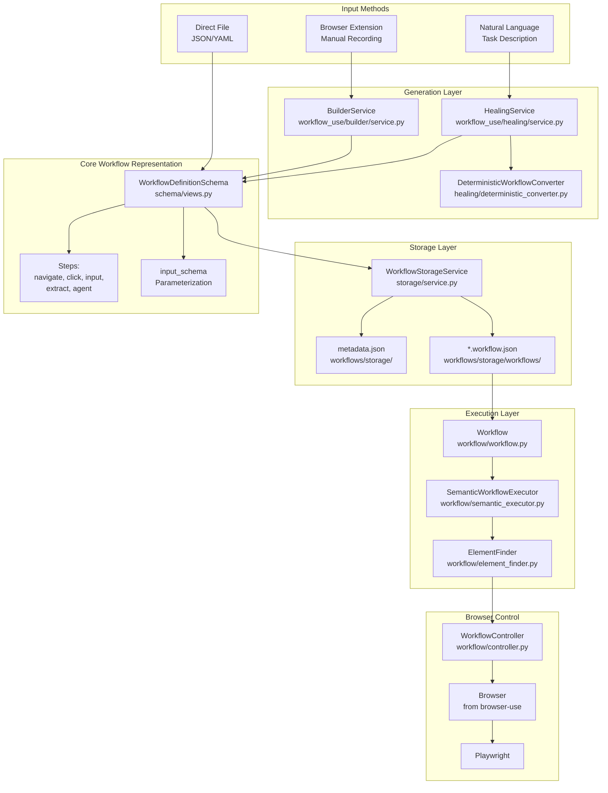
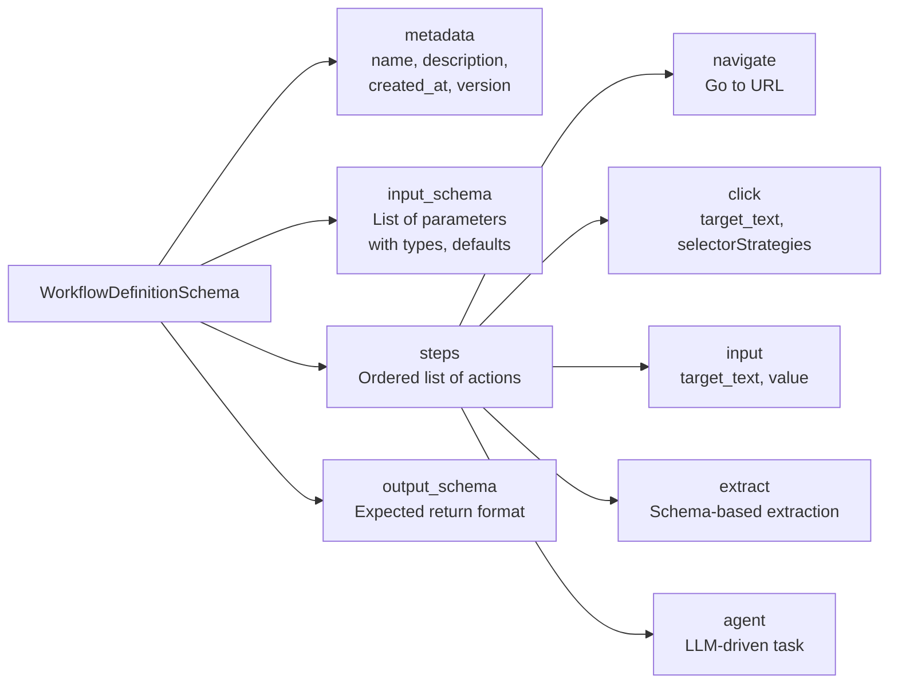
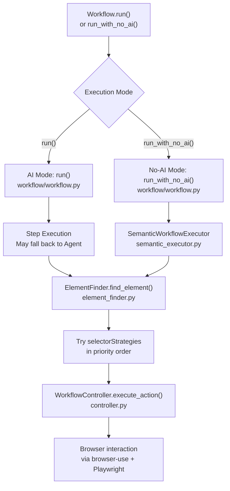

<!-- source: DeepWiki mcp.deepwiki.com · repo browser-use/workflow-use · page 1 Overview · fetched 2026-10-30 -->

# Overview

<details>
<summary>Relevant source files</summary>

The following files were used as context for generating this wiki page:

- [README.md](README.md)
- [workflows/.gitignore](workflows/.gitignore)
- [workflows/pyproject.toml](workflows/pyproject.toml)
- [workflows/uv.lock](workflows/uv.lock)
- [workflows/workflow_use/healing/service.py](workflows/workflow_use/healing/service.py)
- [workflows/workflow_use/storage/__init__.py](workflows/workflow_use/storage/__init__.py)

</details>


## Purpose and Scope

This document provides an overview of the workflow-use system, an RPA 2.0 solution that creates deterministic, self-healing workflows from browser interactions. It explains the system's purpose, architecture, and core components at a high level.

For detailed information about specific subsystems:
- Installation and configuration: see [Installation and Setup](#1.1)
- Workflow creation methods: see [Workflow Generation](#3)
- Running workflows: see [Workflow Execution](#5)
- CLI commands: see [Command Line Interface](#6)
- Web interface: see [Web Interface](#7)

**Sources:** [README.md:1-268](), [workflows/pyproject.toml:1-67]()

## What is workflow-use?

workflow-use is a system for creating and executing deterministic browser automation workflows. Unlike traditional RPA tools that rely on brittle CSS/XPath selectors, workflow-use generates **semantic workflows** that identify elements by visible text, ARIA labels, and other human-readable attributes. These workflows are self-healing—if one selector strategy fails, the system automatically tries alternative strategies.

The system is built on top of [browser-use](https://github.com/browser-use/browser-use), a browser automation framework that combines LLM agents with Playwright. workflow-use adds three critical capabilities:

1. **Recording** - Capture user interactions via browser extension
2. **Generation** - Create workflows from natural language using AI
3. **Deterministic Execution** - Run workflows without LLM calls (fast, low-cost)

**Key Principle:** Show the computer what to do once, then it repeats the task indefinitely without human intervention.

**Sources:** [README.md:7-17](), [README.md:237-246]()

## System Architecture Overview



**Diagram: System Architecture and Component Relationships**

This architecture separates workflow creation from execution. Workflows pass through a common `WorkflowDefinitionSchema` representation regardless of how they were created, enabling uniform storage and execution.

**Sources:** [workflows/workflow_use/healing/service.py:29-74](), [workflows/workflow_use/storage/service.py:1-4](), [workflows/workflow_use/workflow/workflow.py](), [workflows/workflow_use/schema/views.py]()

## Three Workflow Creation Modes

workflow-use supports three distinct methods for creating workflows:

| Mode | Input | Process | Output | LLM Required | Speed |
|------|-------|---------|--------|--------------|-------|
| **Browser Recording** | User actions in browser | Extension captures DOM events + semantic info | Semantic workflow | Optional (for variables) | Fast |
| **AI Generation** | Natural language prompt | browser-use agent executes task once | Semantic workflow | Yes (for generation) | Slow (one-time) |
| **Manual Creation** | Hand-written JSON/YAML | Direct file editing | Custom workflow | No | Instant |

### Browser Recording Mode

The browser extension (`extension/`) captures:
- DOM mutations via rrweb
- User interactions (clicks, inputs, selects)
- Element semantic information (visible text, ARIA labels)
- XPath and CSS selectors

The `BuilderService` ([workflow_use/builder/service.py]()) converts recordings to workflows.

### AI Generation Mode

1. User provides natural language task (e.g., "Find GitHub stars for browser-use repo")
2. `HealingService.generate_workflow_from_prompt()` ([workflow_use/healing/service.py:420-841]()) creates a browser-use `Agent`
3. Agent executes task once, recording all actions in `AgentHistoryList`
4. History converted to workflow via:
   - **LLM-based conversion**: Uses `workflow_creation_prompt.md` to generate workflow (flexible, may include agent steps)
   - **Deterministic conversion**: `DeterministicWorkflowConverter` ([healing/deterministic_converter.py]()) maps actions to steps programmatically (fast, guaranteed semantic)

### Manual Creation Mode

Developers can write workflows directly in JSON/YAML format conforming to `WorkflowDefinitionSchema` ([schema/views.py]()).

**Sources:** [README.md:19-105](), [workflows/workflow_use/healing/service.py:420-450](), [workflows/workflow_use/builder/service.py]()

## Workflow Definition Schema

All workflows conform to `WorkflowDefinitionSchema`, which defines:



**Diagram: Workflow Definition Structure**

### Step Types

Each step in the workflow is one of:

- **navigate**: Load a URL
  - Fields: `url` (can contain `{variables}`)
  
- **click**: Click an element
  - Fields: `target_text` (visible text), `selectorStrategies` (fallback selectors)
  
- **input**: Enter text into a field
  - Fields: `target_text`, `value` (can contain `{variables}`)
  
- **select**: Choose from dropdown
  - Fields: `target_text`, `value`
  
- **extract**: Extract structured data from page
  - Fields: `schema` (defines data structure), `selector` (optional)
  
- **agent**: Delegate to LLM agent (slow, expensive)
  - Fields: `task` (natural language instruction)

### Semantic Selectors

Steps use **semantic targeting** via `target_text` instead of CSS/XPath. For example:

```json
{
  "type": "click",
  "target_text": "Search"
}
```

This matches any clickable element with visible text "Search" (button, link, etc.).

For robustness, the `SelectorGenerator` ([healing/selector_generator.py]()) creates multiple fallback strategies stored in `selectorStrategies`:

```json
{
  "type": "click",
  "target_text": "Submit",
  "selectorStrategies": [
    {
      "strategy": "text_exact",
      "value": "Submit",
      "priority": 1
    },
    {
      "strategy": "xpath_id",
      "value": "//button[@id='submit-btn']",
      "priority": 2
    },
    {
      "strategy": "xpath_absolute",
      "value": "/html/body/div[1]/form/button",
      "priority": 10
    }
  ]
}
```

The `ElementFinder` ([workflow/element_finder.py]()) tries strategies in priority order until one succeeds.

**Sources:** [workflows/workflow_use/schema/views.py](), [workflows/workflow_use/healing/selector_generator.py](), [workflows/workflow_use/workflow/element_finder.py]()

## Workflow Storage

The `WorkflowStorageService` ([storage/service.py]()) manages persistent storage:

```
workflows/storage/
├── metadata.json           # Index of all workflows
└── workflows/
    ├── <uuid1>.workflow.json
    ├── <uuid2>.workflow.json
    └── ...
```

**metadata.json** structure:
```json
{
  "workflows": [
    {
      "id": "550e8400-e29b-41d4-a716-446655440000",
      "name": "GitHub Stars Lookup",
      "generation_mode": "browser_use",
      "original_task": "Find stars for browser-use repo",
      "created_at": "2024-01-15T10:30:00Z",
      "file_path": "workflows/550e8400-e29b-41d4-a716-446655440000.workflow.json"
    }
  ]
}
```

CLI commands for storage:
- `python cli.py list-workflows` - List all stored workflows
- `python cli.py run-stored-workflow <id>` - Execute by ID
- `python cli.py workflow-info <id>` - View details
- `python cli.py delete-workflow <id>` - Remove workflow

**Sources:** [README.md:72-77](), [workflows/workflow_use/storage/__init__.py:1-4]()

## Execution Modes



**Diagram: Workflow Execution Flow**

### AI Mode (`Workflow.run()`)

- Executes deterministic steps using semantic selectors
- Falls back to browser-use `Agent` if step fails
- LLM cost: $0.001-0.01 per step failure

### No-AI Mode (`Workflow.run_with_no_ai()`)

- Pure semantic execution via `SemanticWorkflowExecutor` ([workflow/semantic_executor.py]())
- Zero LLM calls
- Fails if no selector strategy matches
- Recommended for production when workflows are well-tested

Example usage:
```python
from workflow_use import Workflow

# Load workflow
workflow = Workflow.load_from_file("workflow.json")

# No-AI execution (fast, $0 cost)
result = await workflow.run_with_no_ai(inputs={"search_term": "playwright"})

# AI execution (with fallback)
result = await workflow.run(inputs={"search_term": "playwright"})
```

**Sources:** [README.md:165-174](), [workflows/workflow_use/workflow/workflow.py](), [workflows/workflow_use/workflow/semantic_executor.py]()

## Key Components

| Component | File Path | Purpose |
|-----------|-----------|---------|
| `HealingService` | [healing/service.py:29-841]() | Generate workflows from prompts using browser-use agents |
| `BuilderService` | [builder/service.py]() | Convert browser recordings to workflows |
| `DeterministicWorkflowConverter` | [healing/deterministic_converter.py]() | Map browser-use actions to semantic steps (no LLM) |
| `WorkflowStorageService` | [storage/service.py]() | Persist and retrieve workflows |
| `Workflow` | [workflow/workflow.py]() | Main orchestrator for workflow execution |
| `SemanticWorkflowExecutor` | [workflow/semantic_executor.py]() | Execute workflows without AI |
| `ElementFinder` | [workflow/element_finder.py]() | Locate elements using multi-strategy matching |
| `SelectorGenerator` | [healing/selector_generator.py]() | Generate fallback selector strategies |
| `WorkflowController` | [workflow/controller.py]() | Execute browser actions |
| `WorkflowValidator` | [healing/validator.py]() | Validate and improve workflow quality |
| `VariableIdentifier` | [workflow/variable_identifier.py]() | Extract variables from workflows |

**Sources:** [workflows/workflow_use/healing/service.py:29-74](), [workflows/workflow_use/storage/__init__.py:1-4]()

## Entry Points

workflow-use provides multiple interfaces:

### Command Line Interface

The CLI ([cli.py]()) provides commands for all workflow operations:

```bash
# Generate workflow
python cli.py generate-workflow "Your task"

# Run workflow
python cli.py run-workflow workflow.json

# Run as tool (LLM extracts inputs)
python cli.py run-as-tool workflow.json --prompt "Search for X"

# Bulk execution with CSV
python cli.py run-workflow-csv workflow.json inputs.csv
```

See [Command Line Interface](#6) for complete reference.

### Web Interface

FastAPI backend + React frontend provides visual workflow management:

```bash
python cli.py launch-gui
```

Opens http://localhost:5173 with:
- Workflow graph visualization
- Execution monitoring
- Real-time logs
- Parameter editing

See [Web Interface](#7) for details.

### Python API

```python
from workflow_use import Workflow
from workflow_use.healing.service import HealingService
from workflow_use.storage.service import WorkflowStorageService

# Execute existing workflow
workflow = Workflow.load_from_file("workflow.json")
result = await workflow.run_with_no_ai(inputs={"query": "test"})

# Generate new workflow
healing_service = HealingService(llm=my_llm)
workflow_def = await healing_service.generate_workflow_from_prompt(
    prompt="Fill contact form",
    agent_llm=agent_llm,
    extraction_llm=extraction_llm
)

# Store workflow
storage = WorkflowStorageService()
metadata = storage.save_workflow(workflow_def, generation_mode="browser_use")
```

**Sources:** [README.md:154-163](), [README.md:179-199](), [workflows/cli.py]()

## Dependencies

workflow-use is built on:

| Dependency | Purpose | Version |
|------------|---------|---------|
| `browser-use` | Browser automation with LLM agents | >=0.9.4 |
| `playwright` | Browser driver | Via browser-use |
| `pydantic` | Schema validation | Via browser-use |
| `fastapi` | Web API backend | >=0.115.12 |
| `aiofiles` | Async file I/O | >=24.1.0 |
| `typer` | CLI framework | >=0.15.3 |
| `pandas` | CSV bulk execution | >=2.3.0 |
| `faiss-cpu` | (Optional) Vector search | ==1.13.2 |

The system requires Python >=3.11.

**Sources:** [workflows/pyproject.toml:14-25](), [workflows/uv.lock:1-95]()

## Next Steps

- **Getting Started**: See [Installation and Setup](#1.1) to configure your environment
- **Learn Concepts**: See [Key Concepts](#1.2) for detailed terminology
- **Understand Architecture**: See [System Architecture](#2) for component relationships
- **Create Workflows**: See [Workflow Generation](#3) for creation methods
- **Execute Workflows**: See [Workflow Execution](#5) for running workflows
- **Extend System**: See [Development Guide](#10) for contributing

**Sources:** [README.md:1-268]()

---

