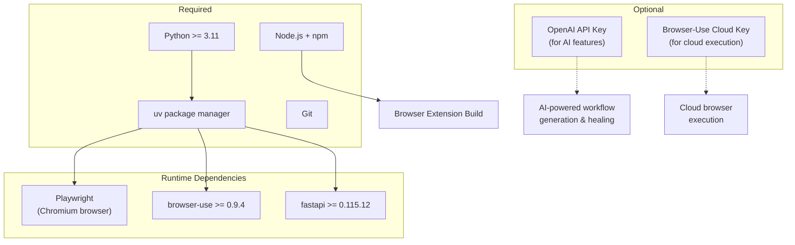
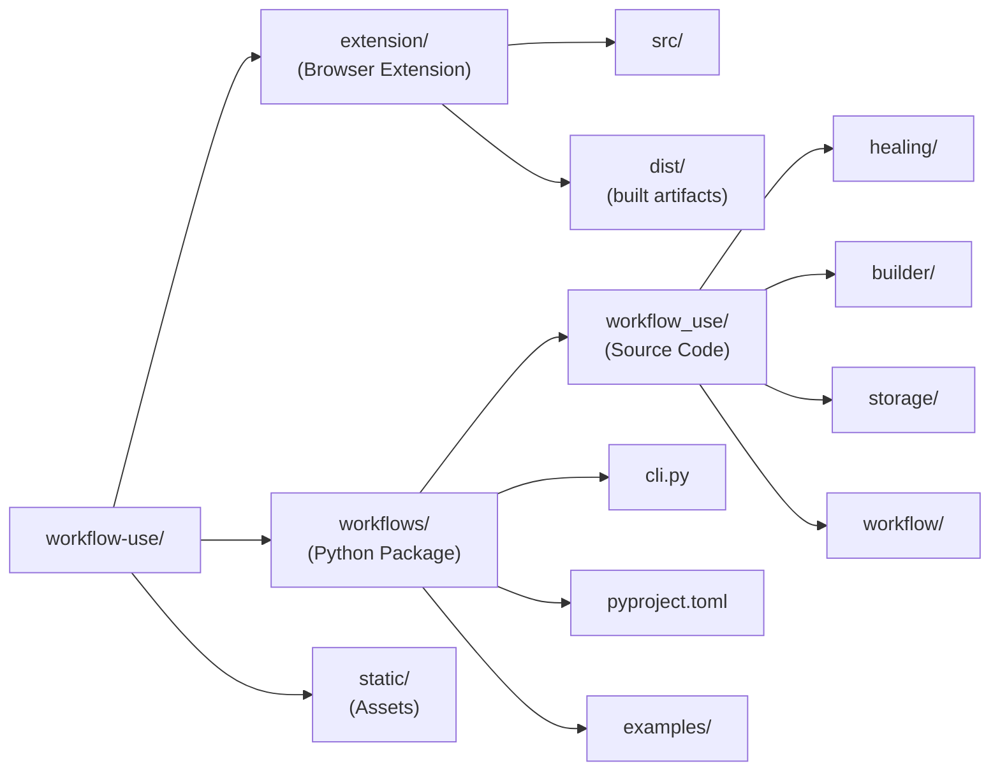
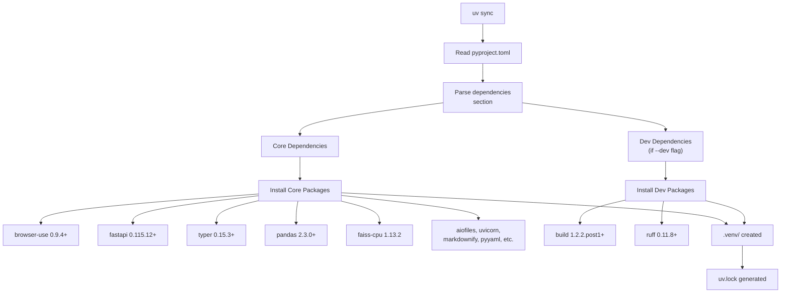
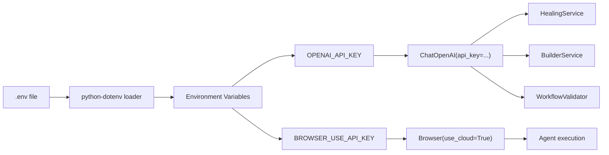
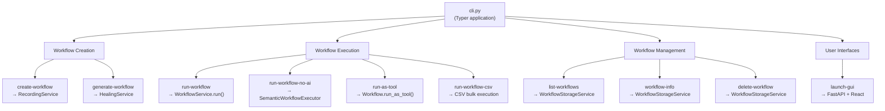
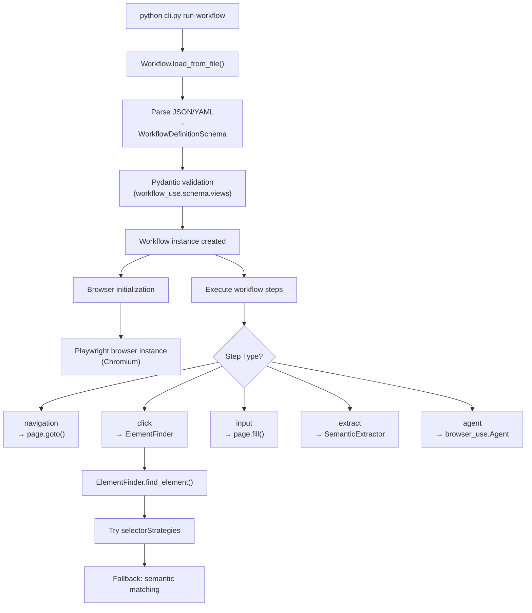
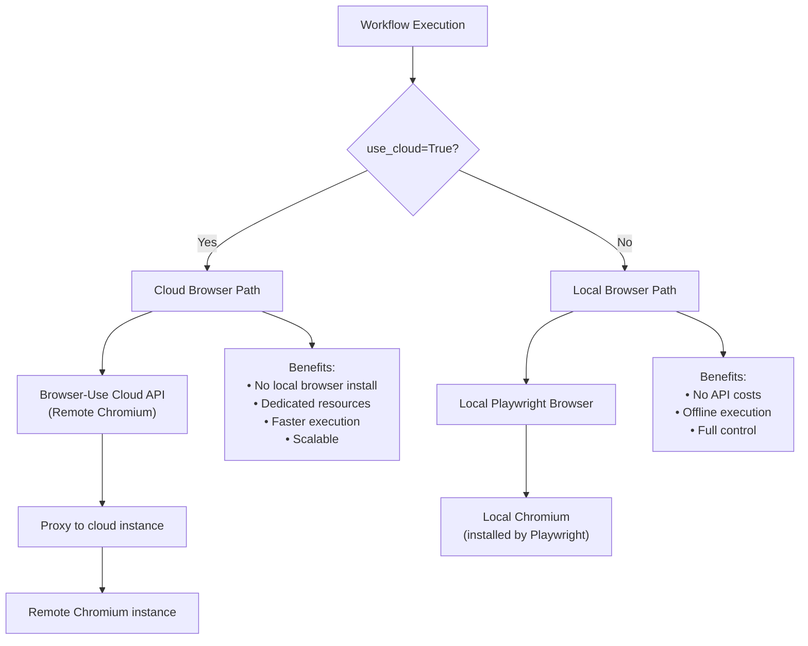
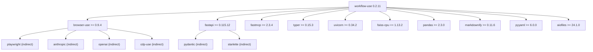

<!-- source: DeepWiki mcp.deepwiki.com · repo browser-use/workflow-use · page 1.1 Installation and Setup · fetched 2026-10-30 -->

# Installation and Setup

<details>
<summary>Relevant source files</summary>

The following files were used as context for generating this wiki page:

- [README.md](README.md)
- [workflows/.gitignore](workflows/.gitignore)
- [workflows/pyproject.toml](workflows/pyproject.toml)
- [workflows/uv.lock](workflows/uv.lock)
- [workflows/workflow_use/healing/service.py](workflows/workflow_use/healing/service.py)
- [workflows/workflow_use/storage/__init__.py](workflows/workflow_use/storage/__init__.py)

</details>


This page covers the installation, dependency management, and initial configuration required to run workflow-use on your local machine. For information about running workflows after installation, see [Workflow Execution](#5). For details about the browser extension architecture, see [Browser Extension](#8).

---

## Purpose and Scope

This guide provides step-by-step instructions for:
- Installing Python dependencies and system requirements
- Building and loading the browser extension for recording workflows
- Configuring environment variables and API keys
- Verifying the installation is functional
- Setting up optional components (GUI, cloud browser support)

---

## System Requirements

**Installation Prerequisites Diagram**



**Minimum Requirements:**
- **Python**: 3.11 or higher (3.12+ recommended)
- **Node.js**: 16+ (for building the browser extension)
- **uv**: Latest version for dependency management
- **Disk Space**: ~500MB for dependencies and browser binaries
- **Memory**: 4GB RAM minimum, 8GB recommended

Sources: [workflows/pyproject.toml:7](), [README.md:109-127]()

---

## Installation Process

### Step 1: Clone the Repository

```bash
git clone https://github.com/browser-use/workflow-use
cd workflow-use
```

**Repository Structure After Cloning:**



Sources: [README.md:109-111]()

---

### Step 2: Build the Browser Extension

The browser extension enables workflow recording by capturing user interactions in Chrome/Edge.

```bash
cd extension
npm install
npm run build
```

This creates the compiled extension in `extension/dist/`.

**Extension Build Dependencies:**

| Dependency | Purpose | Required By |
|------------|---------|-------------|
| TypeScript | Compilation | Content scripts, background service |
| Webpack | Bundling | Module packaging |
| React | UI Components | Side panel, popup |
| rrweb | Event Recording | User interaction capture |

**Loading the Extension:**
1. Open Chrome/Edge and navigate to `chrome://extensions/`
2. Enable "Developer mode"
3. Click "Load unpacked"
4. Select the `extension/dist/` directory

Sources: [README.md:114-117]()

---

### Step 3: Set Up Python Environment

Navigate to the workflows directory and initialize the Python environment:

```bash
cd ../workflows
uv sync
```

**Activation:**

```bash
# macOS / Linux
source .venv/bin/activate

# Windows
.venv\Scripts\activate
```

**What `uv sync` Does:**



Sources: [workflows/pyproject.toml:14-32](), [README.md:122-124]()

---

### Step 4: Install Browser Automation Dependencies

Install Playwright's Chromium browser binary:

```bash
playwright install chromium
```

This downloads the Chromium browser (~200MB) used by Playwright for automation. The browser is installed to:
- **macOS**: `~/Library/Caches/ms-playwright/`
- **Linux**: `~/.cache/ms-playwright/`
- **Windows**: `%USERPROFILE%\AppData\Local\ms-playwright\`

**Why Chromium Only?**

The `browser-use` library (version 0.9.4+) that workflow-use depends on uses Playwright's Chromium implementation. Firefox and WebKit are not currently supported.

Sources: [README.md:125](), [workflows/pyproject.toml:16]()

---

### Step 5: Configure Environment Variables

Create and configure the `.env` file:

```bash
cp .env.example .env
```

**Required Environment Variables:**

| Variable | Purpose | Required For | Example |
|----------|---------|--------------|---------|
| `OPENAI_API_KEY` | OpenAI API authentication | `HealingService`, `BuilderService`, `WorkflowValidator`, AI-powered healing, LLM steps | `sk-proj-...` |
| `BROWSER_USE_API_KEY` | Browser-Use Cloud authentication | Cloud browser execution via `Browser(use_cloud=True)` | `bu-...` |

**Environment Variable Loading:**



**Minimal `.env` Configuration:**

```bash
# Required for AI features (HealingService, variable extraction, workflow validation)
OPENAI_API_KEY=sk-proj-your-key-here

# Optional: for cloud browser execution (Browser(use_cloud=True))
BROWSER_USE_API_KEY=bu-your-key-here
```

**Configuration Loading Flow:**

The `python-dotenv` package (dependency of `browser-use`) automatically loads `.env` variables when the application starts. These are then accessed via `os.getenv()` in [workflow_use/healing/service.py]() and other services that require LLM or cloud browser access.

Sources: [README.md:126](), [workflows/pyproject.toml:16](), [workflows/workflow_use/healing/service.py:1-76]()

---

## Installation Verification

### Verify Core Installation

Test the CLI is functional:

```bash
python cli.py --help
```

**Expected Output Structure:**

```
Usage: cli.py [OPTIONS] COMMAND [ARGS]...

Commands:
  create-workflow          Record a new workflow
  generate-workflow        Generate workflow from task description
  run-workflow            Run workflow with predefined variables
  run-workflow-no-ai      Run workflow using semantic matching (no AI)
  run-as-tool             Run workflow with natural language input
  list-workflows          List all stored workflows
  launch-gui              Start the web UI
  ...
```

**CLI Command Routing:**



Sources: [README.md:148-152]()

---

### Verify Example Workflow Execution

Run a test workflow to verify the full stack:

```bash
python cli.py run-workflow examples/example.workflow.json
```

This validates:
- Python environment setup
- Playwright browser installation
- Workflow schema parsing
- Browser automation functionality

**Workflow Execution Dependencies:**



Sources: [workflows/workflow_use/healing/service.py:1-30]()

---

## Optional Components

### GUI Setup (Web Interface)

The GUI provides a visual interface for workflow management. For complete documentation, see [Web Interface](#7).

**Quick Start:**

```bash
python cli.py launch-gui
```

This command:
1. Starts the FastAPI backend on port 8000
2. Starts the React/Vite frontend on port 5173
3. Opens http://localhost:5173 in your browser

**Manual Setup:**

```bash
# Terminal 1: Backend
uvicorn backend.api:app --reload

# Terminal 2: Frontend
cd ui
npm install
npm run dev
```

**GUI Architecture Components:**

| Component | Technology | Port | File Path |
|-----------|-----------|------|-----------|
| Backend API | FastAPI + Uvicorn | 8000 | `backend/api.py` |
| Frontend | React + Vite | 5173 | `ui/src/` |
| Storage Service | File-based (JSON + YAML) | N/A | [workflow_use/storage/service.py]() |

**Storage Implementation:**

The `WorkflowStorageService` class uses a file-based storage approach (not SQLite):
- **Metadata Index**: `workflows/storage/metadata.json` - JSON index of all workflows with `WorkflowMetadata` entries
- **Individual Workflows**: `workflows/storage/workflows/<id>.workflow.yaml` - Each workflow stored as YAML

Sources: [README.md:179-224](), [workflows/workflow_use/storage/__init__.py:1-4]()

---

### Cloud Browser Configuration

To use Browser-Use Cloud for remote browser execution:

1. **Sign up**: Visit https://cloud.browser-use.com
2. **Get API Key**: New signups receive $10 free credits (OAuth) or $1 (email)
3. **Set Environment Variable**:
   ```bash
   export BROWSER_USE_API_KEY=bu-your-key-here
   ```

**Usage in Code:**

```python
from workflow_use import Workflow
from browser_use.llm import ChatOpenAI

llm = ChatOpenAI(model='gpt-4.1-mini')
workflow = Workflow.load_from_file(
    "workflow.json", 
    llm, 
    use_cloud=True  # Enable cloud browser
)

# Execute without local browser
result = await workflow.run_with_no_ai()
```

**Cloud vs Local Execution:**



Sources: [README.md:165-177](), [workflows/pyproject.toml:16]()

---

## Dependency Resolution

### Core Python Dependencies

The dependency tree from `pyproject.toml`:



**Version Pinning Strategy:**

- **Exact pins** (`==`): `faiss-cpu==1.13.2` only (for reproducible vector similarity operations in semantic extraction)
- **Minimum pins** (`>=`): All other packages (allow compatible updates)
- **Python constraint**: `>=3.11` (uses modern async/typing features)

**Note**: While `pyproject.toml` specifies `browser-use>=0.9.4`, `uv` typically resolves to the latest compatible version (currently 0.9.5 in `uv.lock`).

Sources: [workflows/pyproject.toml:14-25](), [workflows/uv.lock:196-239]()

---

### Dev Dependencies

For development and contribution:

```bash
uv sync --dev
```

Installs additional tools:

| Package | Version | Purpose |
|---------|---------|---------|
| `build` | >= 1.2.2.post1 | Package building |
| `ruff` | >= 0.11.8 | Linting and formatting |

**Ruff Configuration:**

Key linting rules are configured in `pyproject.toml`:
- Line length: 130 characters
- Auto-fix enabled
- Selected rules: `ASYNC`, `E`, `F`, `FAST`, `I`, `PLE`
- Formatting: Single quotes, tabs for indentation

Sources: [workflows/pyproject.toml:29-50]()

---

## Troubleshooting Common Installation Issues

### Python Version Mismatch

**Error**: `requires-python = ">=3.11"`

**Solution**: Verify Python version:
```bash
python --version  # Should be 3.11+
```

If using older Python, install 3.11+ or use pyenv:
```bash
pyenv install 3.12.0
pyenv local 3.12.0
```

---

### Playwright Browser Not Found

**Error**: `Executable doesn't exist at ...ms-playwright/chromium-*/chrome`

**Solution**: Reinstall Chromium binary:
```bash
playwright install chromium --force
```

---

### UV Not Found

**Error**: `command not found: uv`

**Solution**: Install uv package manager:
```bash
# macOS/Linux
curl -LsSf https://astral.sh/uv/install.sh | sh

# Windows (PowerShell)
powershell -c "irm https://astral.sh/uv/install.ps1 | iex"
```

---

### Extension Build Failures

**Error**: `Module not found: Error: Can't resolve 'react'`

**Solution**: Clean install dependencies:
```bash
cd extension
rm -rf node_modules package-lock.json
npm install
npm run build
```

---

## Post-Installation: Next Steps

After successful installation:

1. **Record Your First Workflow**: See [Browser Recording](#3.1) to create workflows using the extension
2. **Generate From Natural Language**: See [Natural Language Generation](#3.2) to create workflows from task descriptions
3. **Execute Workflows**: See [Workflow Execution](#5) for running created workflows
4. **Explore Examples**: Check `workflows/examples/` directory for sample workflows

**File Structure After Installation:**

```
workflow-use/
├── extension/
│   ├── dist/              # Built extension (load this in Chrome)
│   └── node_modules/      # NPM dependencies
├── workflows/
│   ├── .venv/             # Python virtual environment
│   ├── workflow_use/      # Source code
│   ├── storage/           # Workflow storage (created on first run)
│   │   ├── metadata.json
│   │   └── workflows/
│   ├── examples/          # Example workflows
│   ├── cli.py             # Main CLI entry point
│   └── .env               # Your API keys (not committed)
```

Sources: [README.md:109-152](), [workflows/.gitignore:189-191]()

---

