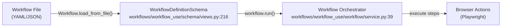
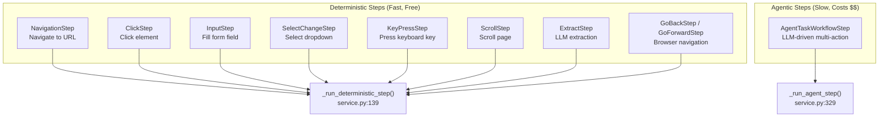
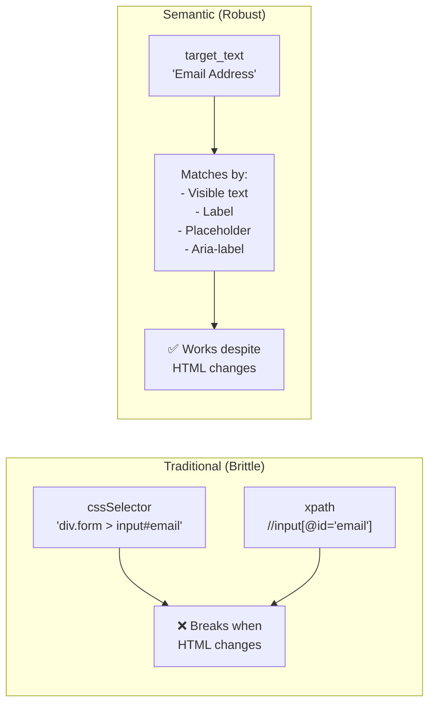
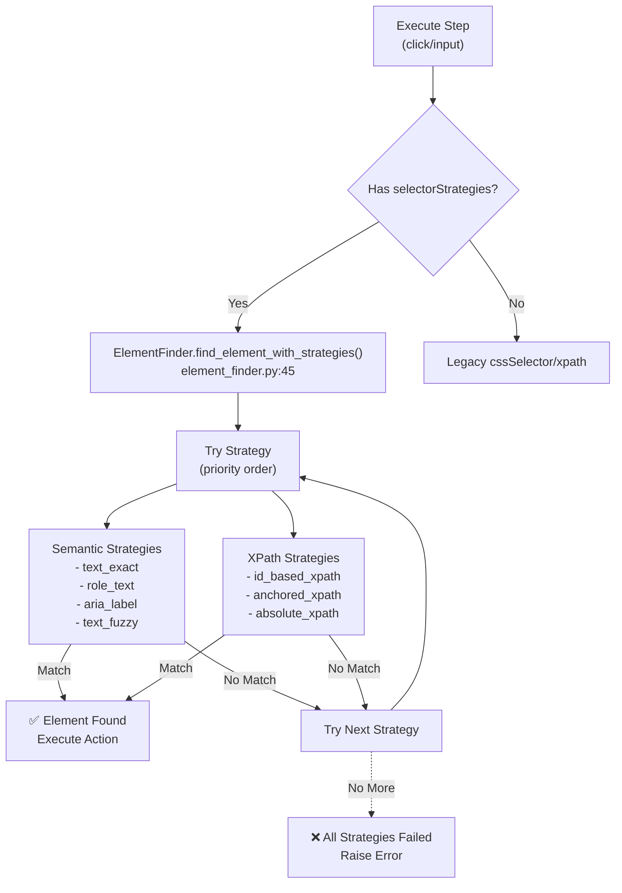
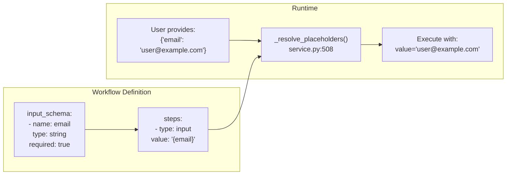
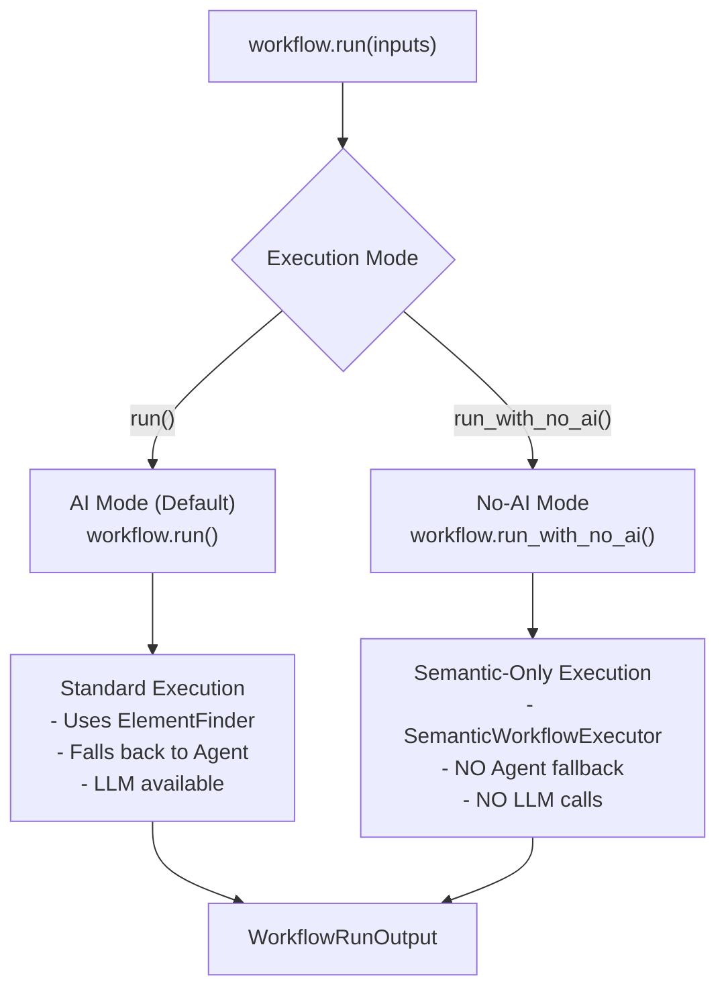
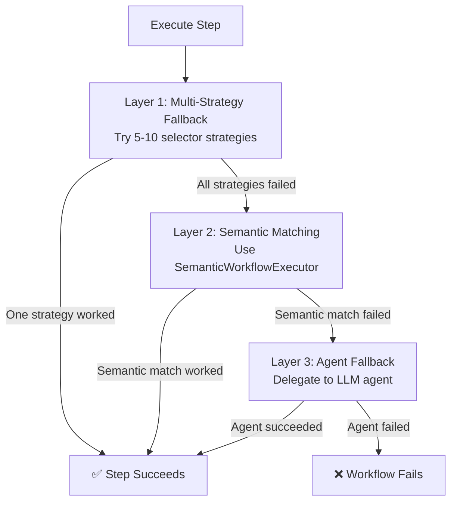
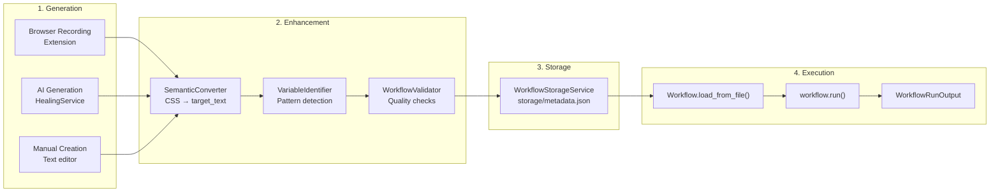
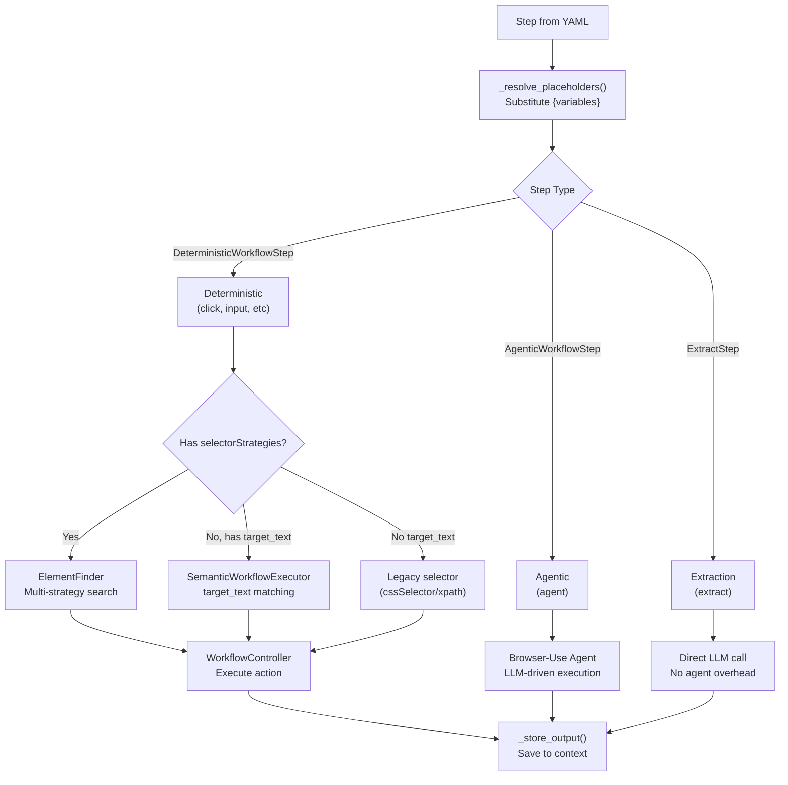

<!-- source: DeepWiki mcp.deepwiki.com · repo browser-use/workflow-use · page 1.2 Key Concepts · fetched 2026-10-30 -->

# Key Concepts

<details>
<summary>Relevant source files</summary>

The following files were used as context for generating this wiki page:

- [README.md](README.md)
- [workflows/.gitignore](workflows/.gitignore)
- [workflows/cli.py](workflows/cli.py)
- [workflows/examples/scripts/generate_workflow.py](workflows/examples/scripts/generate_workflow.py)
- [workflows/examples/workflows/basic/example.workflow.yaml](workflows/examples/workflows/basic/example.workflow.yaml)
- [workflows/examples/workflows/basic/pure_semantic.workflow.yaml](workflows/examples/workflows/basic/pure_semantic.workflow.yaml)
- [workflows/examples/workflows/form_filling/semantic_form_fill.workflow.yaml](workflows/examples/workflows/form_filling/semantic_form_fill.workflow.yaml)
- [workflows/tests/test_go_back.workflow.yaml](workflows/tests/test_go_back.workflow.yaml)
- [workflows/workflow_use/healing/prompts/workflow_creation_prompt.md](workflows/workflow_use/healing/prompts/workflow_creation_prompt.md)
- [workflows/workflow_use/healing/prompts/workflow_validation_prompt.md](workflows/workflow_use/healing/prompts/workflow_validation_prompt.md)
- [workflows/workflow_use/healing/tests/test_validator.py](workflows/workflow_use/healing/tests/test_validator.py)
- [workflows/workflow_use/schema/views.py](workflows/workflow_use/schema/views.py)
- [workflows/workflow_use/storage/__init__.py](workflows/workflow_use/storage/__init__.py)
- [workflows/workflow_use/workflow/service.py](workflows/workflow_use/workflow/service.py)

</details>


This page introduces the fundamental concepts and terminology used throughout the workflow-use system. Understanding these concepts is essential for creating, executing, and debugging workflows.

For installation instructions, see [Installation and Setup](#1.1). For detailed architecture information, see [System Architecture](#2). For workflow creation methods, see [Workflow Generation](#3).

---

## What is a Workflow?

A **workflow** is a reusable, parameterized sequence of browser automation steps defined in YAML or JSON format. Workflows are parsed into the `WorkflowDefinitionSchema` class and executed by the `Workflow` orchestrator.



**Sources:** [workflows/workflow_use/workflow/service.py:108-136](), [workflows/workflow_use/schema/views.py:216-280]()

### Workflow Definition Structure

Every workflow contains:

| Field | Type | Description |
|-------|------|-------------|
| `name` | string | Human-readable workflow name |
| `description` | string | Purpose and functionality description |
| `version` | string | Version identifier (e.g., "1.0") |
| `steps` | array | Ordered list of workflow steps |
| `input_schema` | array | Input variable definitions |
| `default_wait_time` | float | Time between steps (seconds) |
| `workflow_analysis` | string | Optional reasoning about workflow design |

**Sources:** [workflows/workflow_use/schema/views.py:216-238]()

---

## Step Types: Deterministic vs Agentic

Workflow steps fall into two fundamental categories with drastically different performance characteristics:



**Sources:** [workflows/workflow_use/schema/views.py:79-174](), [workflows/workflow_use/workflow/service.py:139-283](), [workflows/workflow_use/workflow/service.py:329-352]()

### Deterministic Steps

Deterministic steps execute **one specific action** with **no LLM calls** (except for `extract` steps). They are fast (milliseconds), free, and reliable.

**Common Deterministic Step Types:**

| Step Type | Code Class | Purpose | Required Fields |
|-----------|------------|---------|-----------------|
| `navigation` | `NavigationStep` | Navigate to URL | `url` |
| `click` | `ClickStep` | Click element | `target_text` or `cssSelector` |
| `input` | `InputStep` | Fill text field | `target_text`, `value` |
| `select_change` | `SelectChangeStep` | Select dropdown option | `target_text`, `selectedText` |
| `key_press` | `KeyPressStep` | Press keyboard key | `target_text`, `key` |
| `scroll` | `ScrollStep` | Scroll page | `scrollX`, `scrollY` |
| `extract` | `ExtractStep` | Extract data with LLM | `extractionGoal` |
| `go_back` | `GoBackStep` | Browser back button | (none) |
| `go_forward` | `GoForwardStep` | Browser forward button | (none) |

**Sources:** [workflows/workflow_use/schema/views.py:79-172]()

### Agentic Steps

Agentic steps delegate execution to a **browser-use Agent** that uses LLM reasoning to complete multi-step tasks. They are **10-30x slower** and **cost money per execution**.

```yaml
# Agent step example - AVOID when possible
- type: agent
  task: "Find the restaurant named {restaurant_name} and click on it"
  max_steps: 5
  description: "Complex search requiring AI reasoning"
```

**When to use agent steps:**
- Element has no stable visible text or label (rare)
- Complex multi-step conditional logic in dynamic UI
- Content evaluation requiring AI understanding
- **Last resort** when semantic targeting fails

**Sources:** [workflows/workflow_use/schema/views.py:64-73](), [workflows/workflow_use/workflow/service.py:329-352]()

---

## Semantic Targeting System

**Semantic targeting** identifies elements by **human-readable text** instead of brittle CSS selectors or XPath. This is the **primary method** for element location in workflow-use.



**Sources:** [workflows/workflow_use/schema/views.py:46-60](), [workflows/examples/workflows/basic/pure_semantic.workflow.yaml:1-47]()

### target_text Field

The `target_text` field is the **preferred** way to identify elements in modern workflows:

```yaml
# Semantic step - PREFERRED
- type: click
  target_text: "Submit"
  description: "Click submit button"

# Semantic step with variable
- type: input
  target_text: "Email Address"
  value: "{email}"
  description: "Enter email"

# Semantic step with variable IN target_text
- type: click
  target_text: "{repo_name}"
  container_hint: "Repositories"
  description: "Click repository (works for ANY repo name)"
```

**Key advantages:**
- Survives HTML structure changes
- Human-readable and maintainable
- Can contain variables for dynamic targeting
- No fragile DOM path dependencies

**Sources:** [workflows/workflow_use/schema/views.py:46-60](), [workflows/healing/prompts/workflow_creation_prompt.md:134-150]()

### Context Hints

Optional fields help disambiguate when multiple elements share the same text:

| Field | Purpose | Example |
|-------|---------|---------|
| `container_hint` | Parent section context | `"Personal Information"`, `"Billing Section"` |
| `position_hint` | Position among duplicates | `"item 2 of 3"`, `"first"`, `"last"` |
| `interaction_type` | Expected interaction pattern | `"form_submit"`, `"navigation"` |

**Sources:** [workflows/workflow_use/schema/views.py:52-60]()

---

## Element Finding Strategies

The system uses a **multi-strategy fallback mechanism** for robust element location. When a step executes, the `ElementFinder` tries strategies in priority order until one succeeds.



**Sources:** [workflows/workflow_use/workflow/element_finder.py:45-121](), [workflows/workflow_use/workflow/service.py:167-228]()

### selectorStrategies Array

Modern workflows include a `selectorStrategies` array with multiple fallback methods:

```yaml
- type: click
  target_text: "Submit"
  selectorStrategies:
    - type: "text_exact"
      value: "Submit"
      priority: 1
      metadata:
        role: "button"
    - type: "role_text"
      value: "button:Submit"
      priority: 2
    - type: "xpath"
      value: "//button[@id='submit-btn']"
      priority: 10
```

**Strategy Priority System:**

| Priority | Strategy Type | Description |
|----------|--------------|-------------|
| 1 | `text_exact` | Exact visible text match |
| 2 | `role_text` | ARIA role + text |
| 3 | `aria_label` | Aria-label attribute |
| 5 | `id_based_xpath` | XPath using stable IDs |
| 7 | `text_fuzzy` | Fuzzy text matching |
| 10 | `absolute_xpath` | Last resort XPath |

**Sources:** [workflows/workflow_use/workflow/element_finder.py:45-121](), [workflows/workflow_use/builder/selector_generator.py:15-187]()

### Self-Healing Behavior

When a strategy fails, the system **automatically tries the next one** without raising an error. This makes workflows resilient to minor UI changes:

```python
# Pseudocode of fallback logic
for strategy in sorted_by_priority(selectorStrategies):
    element = try_find_element(strategy)
    if element:
        return element  # Success!
# All strategies failed - only now raise error
```

**Sources:** [workflows/workflow_use/workflow/element_finder.py:91-121]()

---

## Variables and Parameterization

Workflows become **reusable** by replacing hardcoded values with variables. Variables use `{variable_name}` syntax (single curly braces) and are defined in the `input_schema`.

### Variable Syntax



**Sources:** [workflows/workflow_use/workflow/service.py:508-584](), [workflows/workflow_use/schema/views.py:189-210]()

### Input Schema Definition

The `input_schema` array defines all workflow variables:

```yaml
input_schema:
  - name: email
    type: string
    format: "user@domain.com"
    required: true
  - name: birth_date
    type: string
    format: "MM/DD/YYYY"
    required: true
  - name: max_results
    type: number
    required: false
    default: 10
```

**Field Definitions:**

| Field | Type | Description |
|-------|------|-------------|
| `name` | string | Variable name (used in `{name}` placeholders) |
| `type` | enum | `"string"`, `"number"`, or `"bool"` |
| `format` | string | Expected format (e.g., "MM/DD/YYYY") |
| `required` | boolean | Whether variable must be provided |
| `default` | any | Default value if not provided |

**Sources:** [workflows/workflow_use/schema/views.py:189-210]()

### Variable Usage in Steps

Variables can appear in **any string field** within steps:

```yaml
# In value fields
- type: input
  target_text: "Email"
  value: "{email}"

# In target_text (dynamic element targeting!)
- type: click
  target_text: "{repo_name}"
  container_hint: "Repositories"

# In URLs
- type: navigation
  url: "https://github.com/{username}/{repo_name}"

# In extraction goals
- type: extract
  extractionGoal: "Extract the star count for {repo_name}"
```

**Critical rules:**
- Use `{variable}` syntax (one pair of curly braces)
- ❌ WRONG: `{{variable}}` (double braces)
- ❌ WRONG: `{{{{variable}}}}` (quadruple braces)
- Python's `str.format()` performs substitution at runtime

**Sources:** [workflows/workflow_use/workflow/service.py:508-584](), [workflows/healing/prompts/workflow_creation_prompt.md:26-29]()

---

## Execution Modes

The `Workflow` class supports two execution modes with different characteristics:



**Sources:** [workflows/workflow_use/workflow/service.py:851-945](), [workflows/workflow_use/workflow/semantic_executor.py:1-300]()

### AI Mode (Default)

```python
# AI mode - allows fallback to agent steps
workflow = Workflow.load_from_file("workflow.yaml", llm=llm)
result = await workflow.run(inputs={"email": "user@example.com"})
```

**Characteristics:**
- Uses `ElementFinder` with multi-strategy fallback
- Can execute agent steps if present
- Falls back to agent on deterministic step failure (if `fallback_to_agent=True`)
- Requires LLM for agent steps and extractions

**Sources:** [workflows/workflow_use/workflow/service.py:851-945]()

### No-AI Mode (Cloud-Optimized)

```python
# No-AI mode - pure semantic execution
workflow = Workflow.load_from_file("workflow.yaml", llm=llm, use_cloud=True)
result = await workflow.run_with_no_ai(inputs={"email": "user@example.com"})
```

**Characteristics:**
- Uses `SemanticWorkflowExecutor` 
- **No LLM calls** (except for extract steps)
- **No agent steps** allowed
- Purely deterministic execution
- Optimized for cloud browser execution
- **$0 per run** (except extraction costs)

**Sources:** [workflows/workflow_use/workflow/semantic_executor.py:1-300](), [README.md:165-174]()

### Mode Comparison

| Feature | AI Mode | No-AI Mode |
|---------|---------|------------|
| **Speed** | Medium | Fast |
| **Cost per run** | $$ (agent steps) | $0 (semantic only) |
| **Agent steps** | ✅ Allowed | ❌ Forbidden |
| **Fallback behavior** | LLM agent fallback | Error immediately |
| **Use case** | Complex workflows | Production-ready deterministic workflows |

**Sources:** [workflows/workflow_use/workflow/service.py:851-945](), [workflows/workflow_use/workflow/semantic_executor.py:1-300]()

---

## Self-Healing Mechanisms

Self-healing refers to the system's ability to **recover from element location failures** without human intervention. Multiple layers provide resilience:



**Sources:** [workflows/workflow_use/workflow/element_finder.py:45-121](), [workflows/workflow_use/workflow/semantic_executor.py:1-300]()

### Multi-Strategy Selector Healing

The `SelectorGenerator` creates **multiple fallback strategies** during workflow generation:

```yaml
selectorStrategies:
  - type: "text_exact"      # Priority 1: Exact text
    value: "Submit"
  - type: "role_text"       # Priority 2: Role + text
    value: "button:Submit"
  - type: "aria_label"      # Priority 3: Aria label
    value: "submit-form"
  - type: "xpath"           # Priority 10: XPath fallback
    value: "//button[@id='submit']"
```

If the page HTML changes but "Submit" text remains, the workflow still works. If text changes but XPath remains valid, the workflow still works.

**Sources:** [workflows/workflow_use/builder/selector_generator.py:15-187]()

### Semantic Abstraction Layer

The `SemanticWorkflowExecutor` provides a **text-based matching layer** that works without CSS selectors:

1. Extracts `selector_map` from browser-use (visible interactive elements)
2. Matches `target_text` against visible text, labels, placeholders
3. Executes action using browser-use's semantic system

**Sources:** [workflows/workflow_use/workflow/semantic_executor.py:15-300]()

### Agent-Based Recovery

When enabled, failed deterministic steps can fall back to an LLM agent:

```python
workflow = Workflow(..., fallback_to_agent=True)
# If click fails, agent attempts task: "Click the element that says 'Submit'"
```

**Note:** This is **disabled by default** as it's slow and expensive. Multi-strategy selectors provide better healing.

**Sources:** [workflows/workflow_use/workflow/service.py:84-97]()

---

## Workflow Lifecycle



**Sources:** [workflows/workflow_use/healing/service.py:1-500](), [workflows/workflow_use/storage/service.py:1-300](), [workflows/workflow_use/workflow/service.py:39-945]()

### 1. Generation Phase

Three methods create workflows:

| Method | Class | Speed | Quality | Use Case |
|--------|-------|-------|---------|----------|
| **Browser Recording** | `RecordingService` | Fast | Manual | User records actions in extension |
| **AI Generation** | `HealingService` | Medium | Automatic | Describe task, AI generates workflow |
| **Manual Creation** | (Text editor) | Slow | Custom | Expert users write YAML |

**Sources:** [workflows/workflow_use/healing/service.py:1-500](), [workflows/workflow_use/recorder/service.py:1-200]()

### 2. Enhancement Phase

Generated workflows pass through enhancement pipeline:

1. **Semantic Conversion**: `SemanticWorkflowConverter` converts CSS selectors to `target_text`
2. **Variable Identification**: `VariableIdentifier` detects reusable values
3. **Selector Generation**: `SelectorGenerator` creates multi-strategy fallbacks
4. **Validation**: `WorkflowValidator` checks for issues and auto-corrects

**Sources:** [workflows/workflow_use/builder/semantic_converter.py:1-300](), [workflows/workflow_use/builder/variable_identifier.py:1-500](), [workflows/workflow_use/healing/validator.py:1-300]()

### 3. Storage Phase

Workflows are stored in file-based storage:

```
workflows/storage/
├── metadata.json              # Index of all workflows
└── workflows/
    ├── abc123.workflow.yaml   # Individual workflow files
    └── def456.workflow.yaml
```

**Sources:** [workflows/workflow_use/storage/service.py:1-300]()

### 4. Execution Phase

Workflows are loaded and executed:

```python
# Load workflow
workflow = Workflow.load_from_file("workflow.yaml", llm=llm)

# Execute with inputs
result = await workflow.run(inputs={"email": "user@example.com"})

# Access results
print(result.step_results)
print(result.output_model)  # If output model specified
```

**Sources:** [workflows/workflow_use/workflow/service.py:108-136](), [workflows/workflow_use/workflow/service.py:851-945]()

---

## Step Execution Flow

Understanding how individual steps execute helps debug workflows:



**Sources:** [workflows/workflow_use/workflow/service.py:630-720](), [workflows/workflow_use/workflow/service.py:139-283](), [workflows/workflow_use/workflow/service.py:329-352]()

### Placeholder Resolution

Before execution, all `{variable}` placeholders are replaced with actual values from the input context:

```python
# Input: {"email": "user@example.com"}
# Step before resolution:
{"type": "input", "value": "{email}"}

# Step after resolution (_resolve_placeholders):
{"type": "input", "value": "user@example.com"}
```

**Sources:** [workflows/workflow_use/workflow/service.py:508-584]()

### Output Storage

Steps with an `output` field store their result in the workflow context:

```yaml
- type: extract
  extractionGoal: "Get the star count"
  output: star_count  # Store result as {star_count}

- type: navigation
  url: "https://example.com/stars/{star_count}"  # Use stored value
```

**Sources:** [workflows/workflow_use/workflow/service.py:586-628]()

---

## Key Takeaways

### Design Principles

1. **Semantic-first**: Always prefer `target_text` over CSS selectors
2. **Deterministic-first**: Avoid agent steps unless absolutely necessary
3. **Multi-strategy**: Generate multiple fallback strategies for robustness
4. **Parameterize everything**: Extract variables for reusability
5. **Self-healing**: Let the system recover from UI changes automatically

### Performance Rules

| Pattern | Speed | Cost | Reliability |
|---------|-------|------|-------------|
| Semantic deterministic step | ⚡⚡⚡ Fast | $0 | ✅✅✅ High |
| Multi-strategy deterministic | ⚡⚡ Fast | $0 | ✅✅✅ Very High |
| Legacy CSS selector | ⚡⚡⚡ Fast | $0 | ❌ Low |
| Agent step | 🐌 10-30x slower | $$$ | ✅✅ Medium |

### Common Patterns

```yaml
# ✅ GOOD: Semantic step with variable
- type: input
  target_text: "Email Address"
  value: "{email}"

# ✅ GOOD: Variable in target_text
- type: click
  target_text: "{button_label}"
  container_hint: "Main Form"

# ❌ BAD: Agent step for simple input
- type: agent
  task: "Enter {email} into the email field"

# ❌ BAD: Hardcoded value
- type: input
  target_text: "Email"
  value: "hardcoded@example.com"
```

**Sources:** [workflows/healing/prompts/workflow_creation_prompt.md:1-242](), [workflows/examples/workflows/basic/pure_semantic.workflow.yaml:1-47]()

---

This completes the key concepts overview. For specific implementation details:
- Workflow generation techniques: [Workflow Generation](#3)
- Element finding implementation: [Element Finding Strategies](#5.2)
- Variable detection algorithms: [Variable Identification and Parameterization](#9.1)
- Storage internals: [Workflow Storage and Management](#9.3)

---

