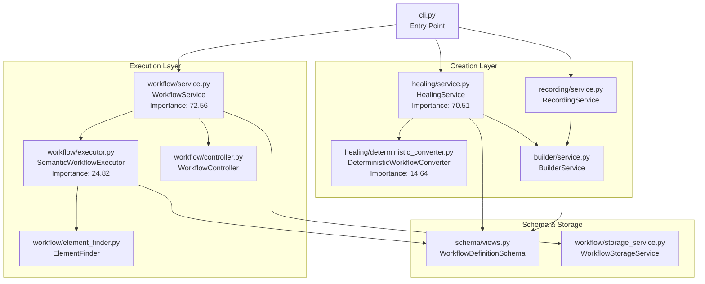
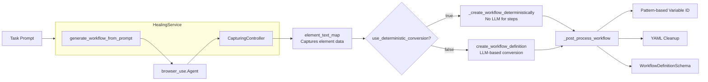
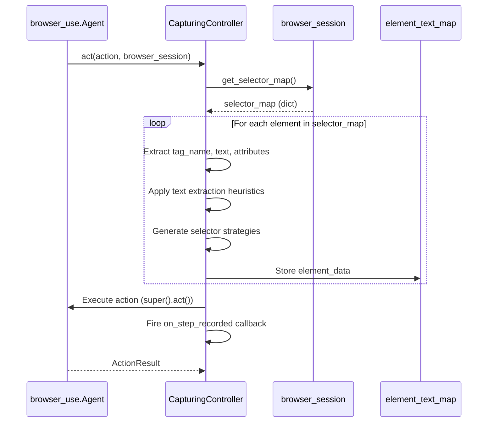
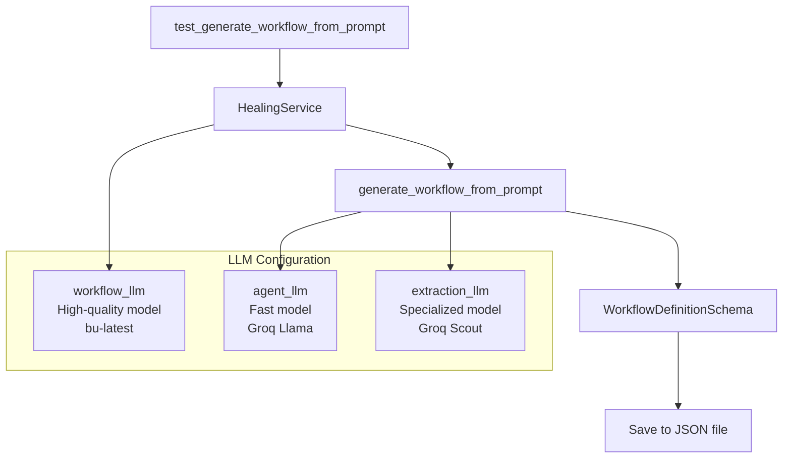
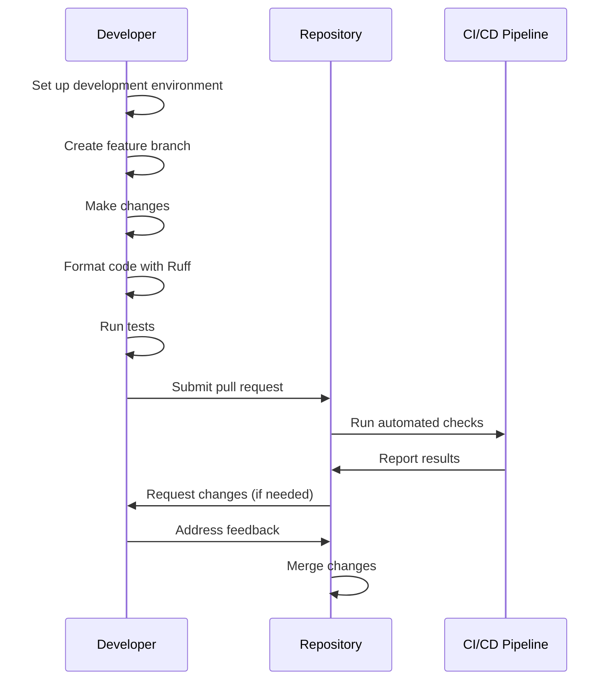
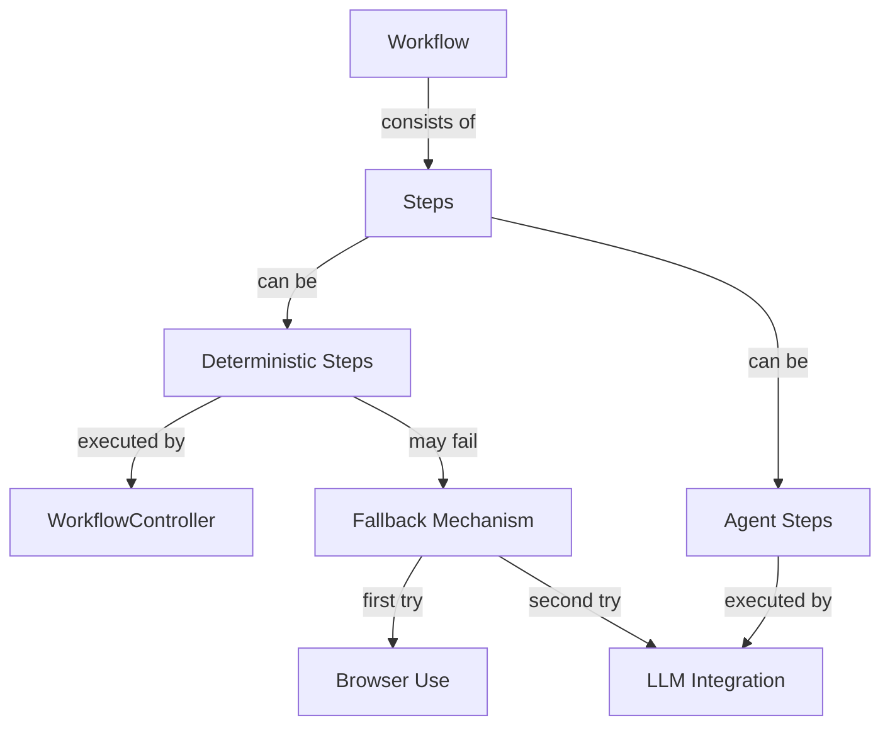

<!-- source: DeepWiki mcp.deepwiki.com · repo browser-use/workflow-use · page 10 Development Guide · fetched 2026-10-30 -->

# Development Guide

<details>
<summary>Relevant source files</summary>

The following files were used as context for generating this wiki page:

- [workflows/pyproject.toml](workflows/pyproject.toml)
- [workflows/uv.lock](workflows/uv.lock)
- [workflows/workflow_use/healing/_agent/controller.py](workflows/workflow_use/healing/_agent/controller.py)
- [workflows/workflow_use/healing/service.py](workflows/workflow_use/healing/service.py)
- [workflows/workflow_use/healing/tests/constants.py](workflows/workflow_use/healing/tests/constants.py)
- [workflows/workflow_use/healing/tests/test_exploration_agent.py](workflows/workflow_use/healing/tests/test_exploration_agent.py)
- [workflows/workflow_use/healing/tests/test_generate_workflow.py](workflows/workflow_use/healing/tests/test_generate_workflow.py)
- [workflows/workflow_use/healing/tests/test_workflow_creation.py](workflows/workflow_use/healing/tests/test_workflow_creation.py)

</details>


This guide provides technical documentation for developers contributing to or extending workflow-use. It covers the project structure, architecture patterns, agent system design, testing infrastructure, and build/release processes.

## Development Environment Setup

### Prerequisites

- Python 3.11 or later (`requires-python = ">=3.11"`)
- `uv` package manager (recommended) or `pip`
- Git

### Installation

```bash
# Clone the repository
git clone https://github.com/browser-use/workflow-use.git
cd workflow-use/workflows

# Using uv (recommended)
uv venv
source .venv/bin/activate  # On Windows: .venv\Scripts\activate
uv pip install -e .

# Install development dependencies
uv pip install build ruff
```

### Code Quality Tools

The project uses Ruff for linting and formatting:

| Configuration | Value | Purpose |
|--------------|-------|---------|
| Line length | 130 | Maximum characters per line |
| Quote style | Single quotes | String delimiter |
| Indent style | Tabs | Code indentation |
| Linting rules | `E`, `F`, `I`, `ASYNC`, `PLE`, `FAST` | Error detection patterns |
| Type checking | `pyright` basic mode | Static type validation |

Key Ruff settings:
- Auto-fix enabled (`fix = true`)
- Ignores: `ASYNC109`, `E101`, `E402`, `E501`, `F841`, `E731`
- Docstring code formatting enabled

Sources: [workflows/pyproject.toml:28-53]()

## Project Structure

### Package Organization

The codebase is organized under the `workflow_use` package:

```
workflow_use/
├── healing/                    # Workflow generation and healing
│   ├── service.py             # HealingService - main orchestrator
│   ├── deterministic_converter.py  # Fast no-LLM conversion
│   ├── selector_generator.py # Multi-strategy selector creation
│   ├── validator.py           # WorkflowValidator - quality checks
│   ├── variable_extractor.py # Variable identification
│   ├── _agent/               # Agent system components
│   │   └── controller.py     # HealingController with custom actions
│   └── tests/                # Healing service tests
├── workflow/                  # Workflow execution engine
│   ├── service.py            # WorkflowService - execution orchestrator
│   ├── executor.py           # SemanticWorkflowExecutor
│   ├── controller.py         # WorkflowController - deterministic actions
│   ├── element_finder.py     # ElementFinder - multi-strategy locator
│   ├── variable_identifier.py # Auto-parameterization
│   └── storage_service.py    # WorkflowStorageService - persistence
├── builder/                   # AI-enhanced workflow building
│   └── service.py            # BuilderService - LLM enhancement
├── recording/                 # Browser recording infrastructure
│   └── service.py            # RecordingService - event capture
├── cli.py                    # CLI commands (20+ commands)
├── main.py                   # FastAPI backend server
└── schema/
    └── views.py              # WorkflowDefinitionSchema
```

### Module Hierarchy and Importance

**Title: Core Module Relationships**



Sources: [workflows/workflow_use/healing/service.py:1-894](), System architecture diagrams

### Key Component Locations

| Component | File Path | Primary Classes/Functions |
|-----------|-----------|---------------------------|
| CLI Entry Point | `workflow_use/cli.py` | All CLI commands (generate-workflow, run-workflow, etc.) |
| Workflow Generation | `workflow_use/healing/service.py` | `HealingService.generate_workflow_from_prompt()` |
| Deterministic Conversion | `workflow_use/healing/deterministic_converter.py` | `DeterministicWorkflowConverter` |
| Workflow Execution | `workflow_use/workflow/service.py` | `WorkflowService`, `Workflow.run_async()` |
| Semantic Execution | `workflow_use/workflow/executor.py` | `SemanticWorkflowExecutor` |
| Element Finding | `workflow_use/workflow/element_finder.py` | `ElementFinder.find_element()` |
| Selector Generation | `workflow_use/healing/selector_generator.py` | `SelectorGenerator.generate_strategies_dict()` |
| Variable Identification | `workflow_use/workflow/variable_identifier.py` | `identify_variables_in_workflow()` |

Sources: [workflows/workflow_use/healing/service.py:1-30]()

## Agent System and Controllers

### HealingService Architecture

The `HealingService` is the main orchestrator for workflow generation. It supports two conversion strategies:

**Title: HealingService Workflow Generation Modes**



Sources: [workflows/workflow_use/healing/service.py:29-894]()

### HealingService Configuration

Key constructor parameters control the generation pipeline:

| Parameter | Default | Purpose |
|-----------|---------|---------|
| `enable_variable_extraction` | `True` | LLM-based variable detection |
| `use_deterministic_conversion` | `False` | Fast no-LLM step creation |
| `enable_ai_validation` | `False` | Post-generation validation |
| `enable_pattern_variable_identification` | `True` | Pattern-based variable detection ($0 cost) |
| `pattern_variable_confidence` | `0.5` | Confidence threshold for pattern detection |
| `cleanup_yaml` | `True` | Remove verbose fields |
| `enable_xpath_optimization` | `True` | Generate optimized selectors |

The service initializes these components:
- `VariableExtractor` (if variable extraction enabled)
- `DeterministicWorkflowConverter` (if deterministic mode enabled)
- `SelectorGenerator` (always initialized for multi-strategy selector generation)
- `WorkflowValidator` (initialized in `generate_workflow_from_prompt` if AI validation enabled)

Sources: [workflows/workflow_use/healing/service.py:29-74]()

### CapturingController Pattern

The `CapturingController` extends `browser_use.Controller` to capture element mappings during agent execution:

**Title: CapturingController Element Capture Flow**



The controller captures:
- Element text (with priority heuristics for semantic attributes)
- Tag names and attributes
- XPath and CSS selectors
- Multi-strategy selector alternatives via `SelectorGenerator`

Sources: [workflows/workflow_use/healing/service.py:464-783]()

### Custom Controller Pattern

The `HealingController` demonstrates custom action registration:

```python
# workflow_use/healing/_agent/controller.py
class HealingController(Controller):
    def __init__(self, extraction_llm: BaseChatModel, 
                 exclude_actions: list[str] = [], 
                 output_model: type[BaseModel] | None = None):
        super().__init__(exclude_actions=exclude_actions, output_model=output_model)
        self.extraction_llm = extraction_llm
        
        # Register custom action
        self.registry.action(
            'Call this action EVERY TIME the content on the page changes...'
        )(self.analyse_page_content_and_extract_possible_actions)
    
    async def analyse_page_content_and_extract_possible_actions(self, page):
        # Extract HTML, convert to markdown, analyze with LLM
        html_content = await page.evaluate('() => document.documentElement.outerHTML')
        content = markdownify.markdownify(html_content, strip=['a', 'img'])
        
        # Use structured output
        structured_llm = self.extraction_llm.with_structured_output(
            PageContentAnalysis, method='function_calling'
        )
        output: PageContentAnalysis = await structured_llm.ainvoke(formatted_prompt)
        
        return ActionResult(extracted_content=msg, include_in_memory=True)
```

The custom action extracts structured page analysis:
- All interactive elements
- Variables that can be filled
- Side effects of actions
- Whether actions are required

Sources: [workflows/workflow_use/healing/_agent/controller.py:1-77]()

### Element Text Extraction Heuristics

The `CapturingController` implements sophisticated text extraction to handle edge cases:

| Element Type | Priority 1 | Priority 2 | Priority 3 |
|--------------|-----------|-----------|-----------|
| Links/Buttons | `aria-label`, `title` | ID/class inference (search, submit, action) | href path extraction |
| All Elements | `text`, `inner_text`, `node_value` | Semantic attributes | Empty |

Special handling:
- JavaScript hrefs are filtered out for anchor tags
- Short/generic text triggers semantic attribute fallback
- ID/class patterns infer common actions (e.g., "search", "submit")
- href paths are cleaned and used as readable text

Sources: [workflows/workflow_use/healing/service.py:509-650]()

## Testing and Quality Assurance

### Test Structure

Tests are organized by component within their respective packages:

```
workflow_use/
├── healing/
│   └── tests/
│       ├── test_exploration_agent.py
│       ├── test_workflow_creation.py
│       ├── test_generate_workflow.py
│       └── constants.py
└── workflow/
    └── tests/
        └── (workflow execution tests)
```

### Test Patterns

#### 1. Agent Exploration Tests

The `test_exploration_agent.py` demonstrates agent testing with custom controllers:

```python
# Create agent with custom controller
agent = Agent(
    task=TASK_MESSAGE,
    browser_session=browser,
    llm=llm,
    page_extraction_llm=page_extraction_llm,
    controller=HealingController(extraction_llm=page_extraction_llm),
    override_system_message=system_prompt,
    enable_memory=False,
    max_failures=10,
    tool_calling_method='auto',
)

history = await agent.run()
history.save_to_file('./tmp/history.json')
```

Key testing patterns:
- Use separate LLMs for agent actions vs. page extraction
- Save history to JSON for reproducibility
- Set `enable_memory=False` for deterministic behavior
- Configure `max_failures` to prevent infinite loops

Sources: [workflows/workflow_use/healing/tests/test_exploration_agent.py:1-58]()

#### 2. Workflow Creation Tests

The `test_workflow_creation.py` demonstrates testing workflow generation from saved history:

```python
# Load history with custom output model
ActionModel = HealingController(extraction_llm=llm).registry.create_action_model()
WorkflowAgentOutput = AgentOutput.type_with_custom_actions(ActionModel)

history_list = AgentHistoryList.load_from_file(
    './tmp/history.json', 
    output_model=WorkflowAgentOutput
)

# Generate workflow definition
workflow_definition = await healing_service.create_workflow_definition(
    TASK_MESSAGE, 
    history_list
)
```

This pattern allows:
- Testing workflow generation independently from agent execution
- Reproducible workflow creation from saved histories
- Custom action model registration

Sources: [workflows/workflow_use/healing/tests/test_workflow_creation.py:1-39]()

#### 3. End-to-End Generation Tests

The `test_generate_workflow.py` demonstrates full pipeline testing with three separate LLMs:

**Title: Three-LLM Testing Pattern**



The three-LLM pattern optimizes for:
- **Workflow LLM**: High-quality structured output (workflow definition quality)
- **Agent LLM**: Fast reasoning (browser automation speed)
- **Extraction LLM**: Specialized page analysis (content extraction accuracy)

Sources: [workflows/workflow_use/healing/tests/test_generate_workflow.py:1-73]()

### Testing Best Practices

| Practice | Rationale |
|----------|-----------|
| Use `asyncio.run()` for async tests | Standard pattern for running async code in tests |
| Save intermediate artifacts (history.json, workflow.json) | Enables debugging and reproducibility |
| Use constants file for task definitions | Centralized test data management |
| Test with multiple LLM configurations | Validates flexibility and LLM-agnostic design |
| Set temperature=0.0 for LLMs | Ensures deterministic test results |

### Test Data Management

Test constants are centralized in `constants.py`:

```python
TASK_MESSAGE = """
Create a workflow for the government form on https://v0-simple-government-form-xi.vercel.app

Make up all information. It's a multi page form. The task is done when you submit the form.
"""
```

This approach:
- Avoids test data duplication
- Makes test tasks easy to update
- Provides clear examples of expected task format

Sources: [workflows/workflow_use/healing/tests/constants.py:1-6]()

## Building and Packaging

### Build System

The project uses Hatchling as its build backend with specific include patterns:

```toml
[build-system]
requires = ["hatchling"]
build-backend = "hatchling.build"

[tool.hatch.build]
include = [
    "workflow_use/**/*.py",
    "workflow_use/**/*.md",
]

[tool.hatch.metadata]
allow-direct-references = true
```

Build the package:

```bash
# Using build module (recommended)
python -m build

# Or using uv
uv build
```

This creates distribution packages in `dist/`:
- `workflow_use-<version>.tar.gz` (source distribution)
- `workflow_use-<version>-py3-none-any.whl` (wheel distribution)

Sources: [workflows/pyproject.toml:55-66]()

### Runtime Dependencies

| Dependency | Version | Purpose |
|------------|---------|---------|
| `aiofiles` | >=24.1.0 | Async file I/O operations |
| `browser-use` | >=0.9.4 | Core browser automation engine |
| `fastapi` | >=0.115.12 | Web API backend |
| `fastmcp` | >=2.3.4 | Model Context Protocol server |
| `typer` | >=0.15.3 | CLI framework |
| `uvicorn` | >=0.34.2 | ASGI server for FastAPI |
| `faiss-cpu` | ==1.10.0 | Vector similarity search (semantic targeting) |
| `pandas` | >=2.3.0 | Data processing (CSV workflows) |
| `markdownify` | >=0.11.6 | HTML to markdown conversion |
| `pyyaml` | >=6.0.0 | YAML workflow serialization |

Development dependencies:

| Dependency | Version | Purpose |
|------------|---------|---------|
| `build` | >=1.2.2.post1 | Package building |
| `ruff` | >=0.11.8 | Code formatting and linting |

Sources: [workflows/pyproject.toml:14-32]()

### Package Metadata

```toml
[project]
name = "workflow-use"
version = "0.2.11"
authors = [{ name = "Gregor Zunic" }]
description = "Create, edit, run deterministic workflows"
readme = "README.md"
requires-python = ">=3.11"
```

Sources: [workflows/pyproject.toml:1-12]()

## 6. Contributing Guidelines

### 6.1 Workflow



### 6.2 License Compliance

All contributions must comply with the GNU Affero General Public License v3 (AGPL-3.0). Ensure that any new files include the appropriate license header.

Sources: [LICENSE:1-662]()

## 7. Component Development

### 7.1 Workflow Definition Schema

When modifying the workflow definition schema, ensure compatibility with existing workflows. The schema defines the structure of workflow JSON files.

### 7.2 Workflow Executor

The workflow executor is responsible for:
- Loading workflow definitions
- Validating inputs
- Executing workflow steps
- Handling fallback mechanisms



When modifying the workflow executor, consider:
- Error handling and recovery
- Context management between steps
- Integration with browser automation

Sources: System architecture diagrams

---

