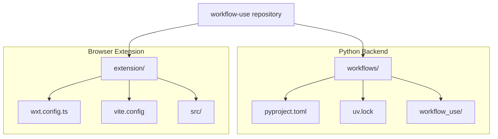
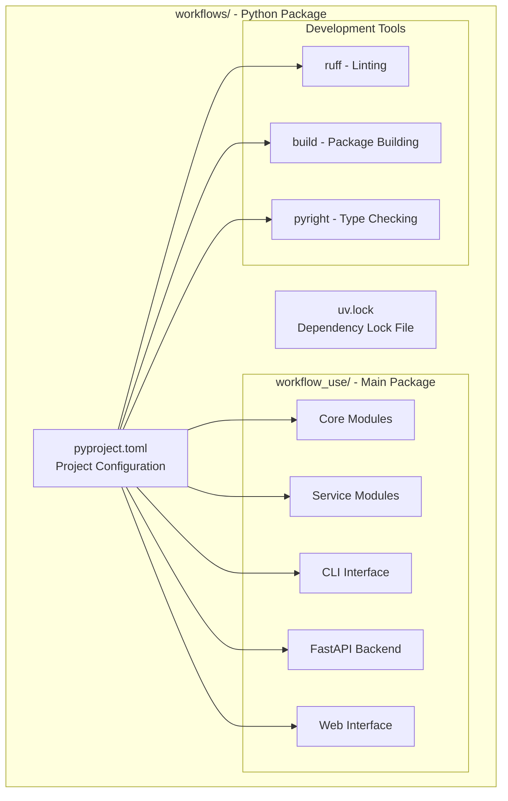
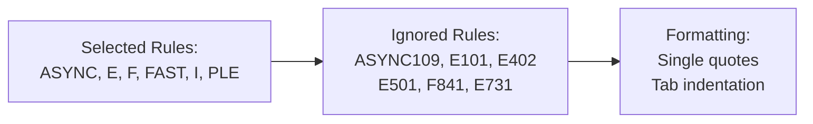
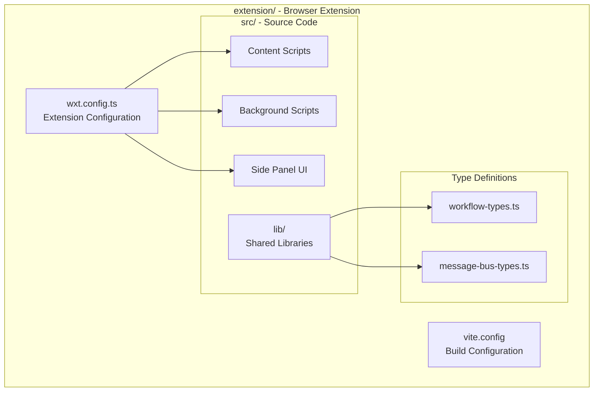
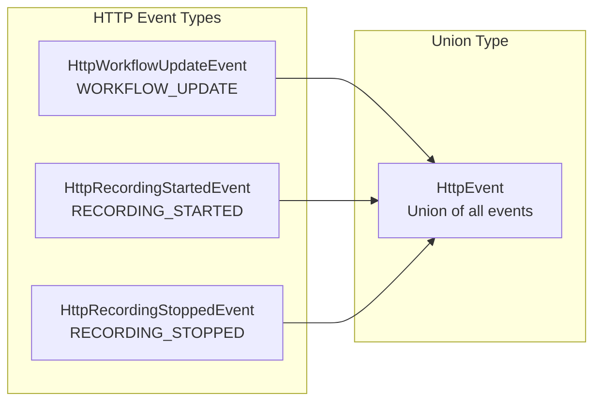
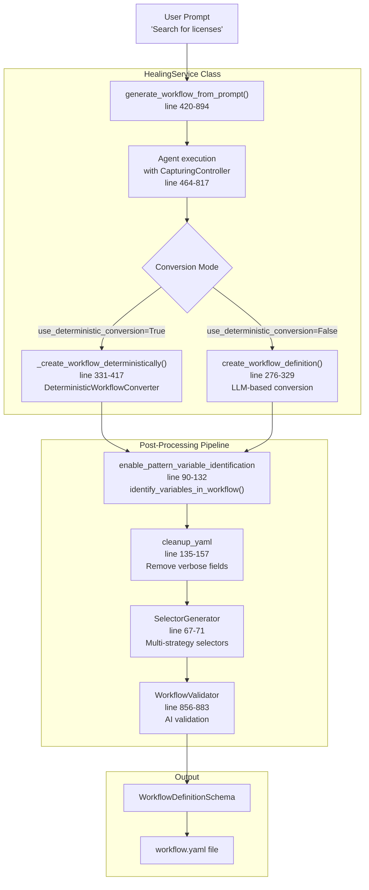
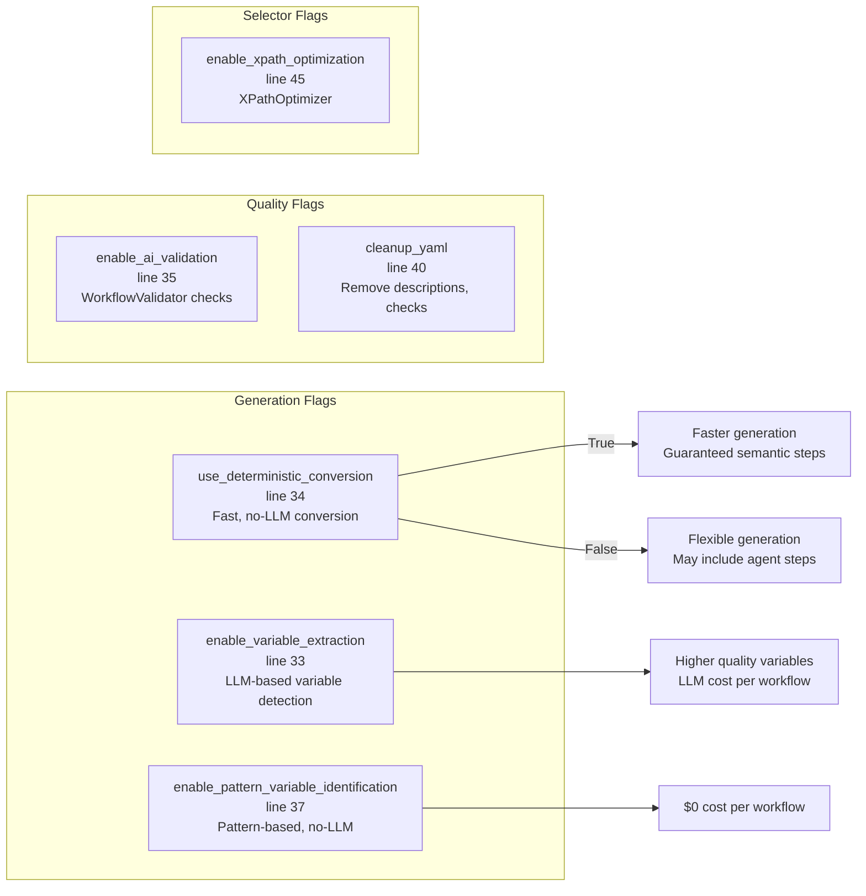
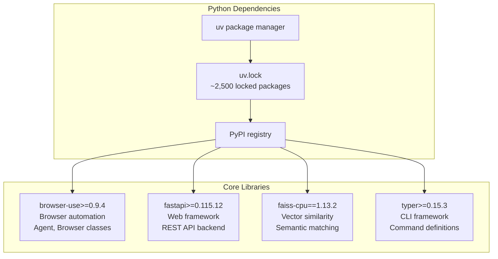

<!-- source: DeepWiki mcp.deepwiki.com · repo browser-use/workflow-use · page 10.1 Project Structure · fetched 2026-10-30 -->

# Project Structure

Relevant source files

The following files were used as context for generating this wiki page:

- [workflows/pyproject.toml](workflows/pyproject.toml)
- [workflows/uv.lock](workflows/uv.lock)
- [workflows/workflow_use/healing/service.py](workflows/workflow_use/healing/service.py)

This page explains the codebase organization, module dependencies, and development toolchain setup for workflow-use. For information about the high-level system architecture and component interactions, see [System Architecture](#2). For details about the specific development patterns used in the agent system, see [Agent System](#8.1).

The workflow-use project consists of two main codebases: a Python backend for workflow processing and execution, and a TypeScript browser extension for recording user interactions. Both components use modern development toolchains and follow established project structure conventions.

## Overall Project Layout

The repository is organized into two primary directories representing the main system components:

**Project Structure Overview**
Sources: [workflows/pyproject.toml:1-64](), [extension/wxt.config.ts:1-24]()

The `workflows/` directory contains the Python package implementing the core workflow engine, while `extension/` contains the browser extension for recording user interactions. Each component maintains its own build configuration and dependency management.

## Python Backend Structure

The Python backend is structured as a standard Python package with modern tooling:

**Python Package Structure and Toolchain**
Sources: [workflows/pyproject.toml:1-64]()

### Package Configuration

The `pyproject.toml` defines the project as `workflow-use` version `0.2.11` with Python 3.11+ compatibility. The package includes several core dependencies:

- **Core Dependencies**: `browser-use>=0.9.4`, `fastapi>=0.115.12`, `typer>=0.15.3` for CLI
- **AI/ML Stack**: `faiss-cpu==1.13.2`, `pandas>=2.3.0` for semantic processing  
- **Server Components**: `uvicorn>=0.34.2` for ASGI serving, `fastmcp>=2.3.4` for MCP integration
- **File I/O**: `aiofiles>=24.1.0` for async file operations, `pyyaml>=6.0.0` for YAML parsing
- **Content Processing**: `markdownify>=0.11.6` for HTML to Markdown conversion

Sources: [workflows/pyproject.toml:2-3](), [workflows/pyproject.toml:14-25]()

### Development Toolchain

The development environment uses modern Python tooling:

- **Package Manager**: `uv` for fast dependency resolution and virtual environment management
- **Code Quality**: `ruff>=0.11.8` for linting and formatting with custom rules
- **Type Checking**: `pyright` in basic mode for static type analysis
- **Build System**: `hatchling` backend with custom build configuration

Sources: [workflows/pyproject.toml:28-57]()

The Ruff configuration enforces specific rules while ignoring certain patterns commonly found in async codebases:

**Ruff Linting Configuration**
Sources: [workflows/pyproject.toml:38-50]()

## Browser Extension Structure

The browser extension uses the WXT framework for modern extension development:

**Browser Extension Architecture**
Sources: [extension/wxt.config.ts:1-24](), [extension/src/lib/message-bus-types.ts:1-41]()

### Extension Configuration

The WXT configuration defines the extension manifest and permissions:

- **Framework**: WXT with React module for UI components
- **Permissions**: `tabs`, `sidePanel`, `<all_urls>` for broad browser access
- **Host Permissions**: `http://127.0.0.1/*` for local Python backend communication
- **Source Directory**: `src/` with TypeScript/React components

Sources: [extension/wxt.config.ts:9-22]()

### Message Bus Types

The extension defines structured types for communication with the Python backend:

**Extension Message Bus Type System**
Sources: [extension/src/lib/message-bus-types.ts:5-40]()

Each event type includes a `type` discriminator, `timestamp`, and typed `payload` for type-safe communication between the extension and Python backend.

## Package Module Organization

The `workflow_use/` package is organized into functional modules that map directly to the system architecture:

```mermaid
graph TB
    WFUSE["workflow_use/"]
    
    subgraph "Core Workflow System"
        WORKFLOW["workflow/<br/>Workflow, SemanticWorkflowExecutor<br/>variable_identifier.py"]
        SCHEMA["schema/<br/>WorkflowDefinitionSchema<br/>StepSchema types"]
    end
    
    subgraph "Generation & Enhancement"
        HEALING["healing/<br/>HealingService<br/>DeterministicWorkflowConverter<br/>SelectorGenerator<br/>WorkflowValidator"]
        BUILDER["builder/<br/>BuilderService<br/>SemanticConverter"]
    end
    
    subgraph "Execution Support"
        ELEMENT["element/<br/>ElementFinder<br/>SemanticExtractor"]
        CONTROLLER["controller/<br/>WorkflowController<br/>Custom Controllers"]
    end
    
    subgraph "Storage & Management"
        STORAGE["storage/<br/>WorkflowStorageService"]
    end
    
    subgraph "Interfaces"
        CLI["cli.py<br/>typer commands"]
        API["api/<br/>FastAPI routes"]
        WEB["web/<br/>React frontend"]
    end
    
    WFUSE --> WORKFLOW
    WFUSE --> SCHEMA
    WFUSE --> HEALING
    WFUSE --> BUILDER
    WFUSE --> ELEMENT
    WFUSE --> CONTROLLER
    WFUSE --> STORAGE
    WFUSE --> CLI
    WFUSE --> API
    WFUSE --> WEB
```

**workflow_use Package Structure**
Sources: [workflows/workflow_use/healing/service.py:1-895](), [workflows/pyproject.toml:60-63]()

### Key Module Responsibilities

| Module | Primary Classes/Functions | Purpose |
|--------|---------------------------|---------|
| `healing/` | `HealingService`, `DeterministicWorkflowConverter`, `SelectorGenerator` | AI-driven workflow generation and optimization |
| `builder/` | `BuilderService`, `SemanticConverter` | Recording-based workflow creation |
| `workflow/` | `Workflow`, `SemanticWorkflowExecutor`, `identify_variables_in_workflow` | Workflow execution engines and variable handling |
| `element/` | `ElementFinder`, `SemanticExtractor` | DOM element location and analysis |
| `schema/` | `WorkflowDefinitionSchema`, `StepSchema` | Pydantic models for workflow structure |
| `storage/` | `WorkflowStorageService` | File-based workflow persistence |
| `controller/` | `WorkflowController`, custom controllers | Browser interaction abstractions |
| `cli.py` | Typer CLI commands | Command-line interface |
| `api/` | FastAPI routes | REST API endpoints |

Sources: [workflows/workflow_use/healing/service.py:29-74](), [workflows/pyproject.toml:60-63]()

## Code-to-Concept Mapping: Healing Service

The `HealingService` class demonstrates how the codebase bridges natural language tasks to executable workflows:

**HealingService Workflow Generation Pipeline**
Sources: [workflows/workflow_use/healing/service.py:29-74](), [workflows/workflow_use/healing/service.py:420-894](), [workflows/workflow_use/healing/service.py:80-169]()

### Service Configuration Flags

The `HealingService.__init__` method exposes fine-grained control over workflow generation behavior:

**HealingService Configuration Matrix**
Sources: [workflows/workflow_use/healing/service.py:30-74]()

## Dependency Management

The Python backend uses modern dependency management:

**Dependency Management Strategy**
Sources: [workflows/uv.lock:1-10](), [workflows/pyproject.toml:14-25]()

The Python backend uses `uv` for deterministic dependency resolution with approximately 2,500 locked packages in `uv.lock`, ensuring reproducible builds across environments.

## Development Setup Requirements

The project requires specific versions and tools for development:

| Component | Requirement | Purpose |
|-----------|-------------|---------|
| Python | `>=3.11` | Core runtime |
| Node.js | Latest LTS | Extension development |
| `uv` | Latest | Python dependency management |
| WXT | Via npm | Extension framework |
| Browser | Chromium-based | Extension runtime |

**Development Environment Matrix**
Sources: [workflows/pyproject.toml:7](), [extension/wxt.config.ts:2]()

The build system is configured to support both local development and production deployment, with separate configurations for the Python package distribution and browser extension packaging.

---

