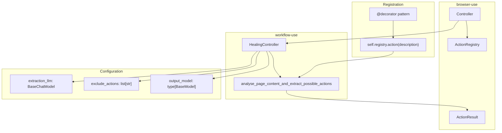
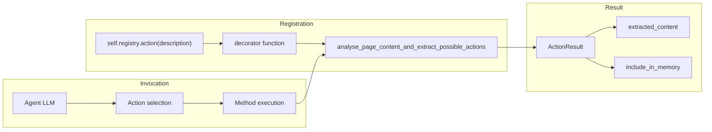
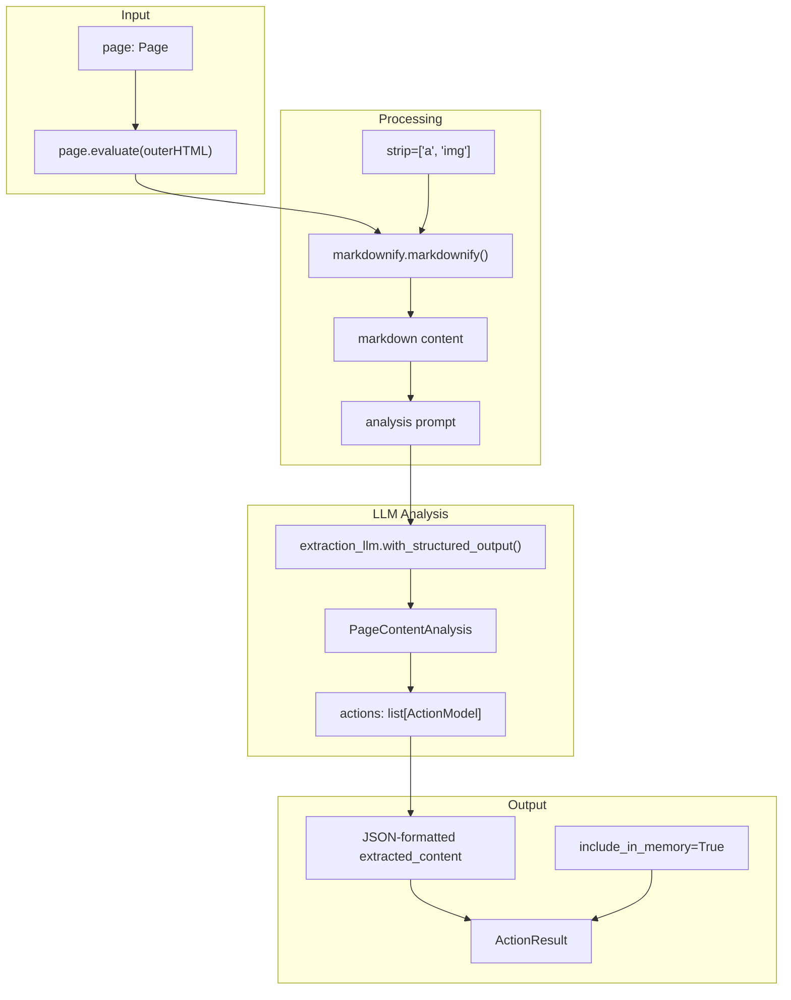
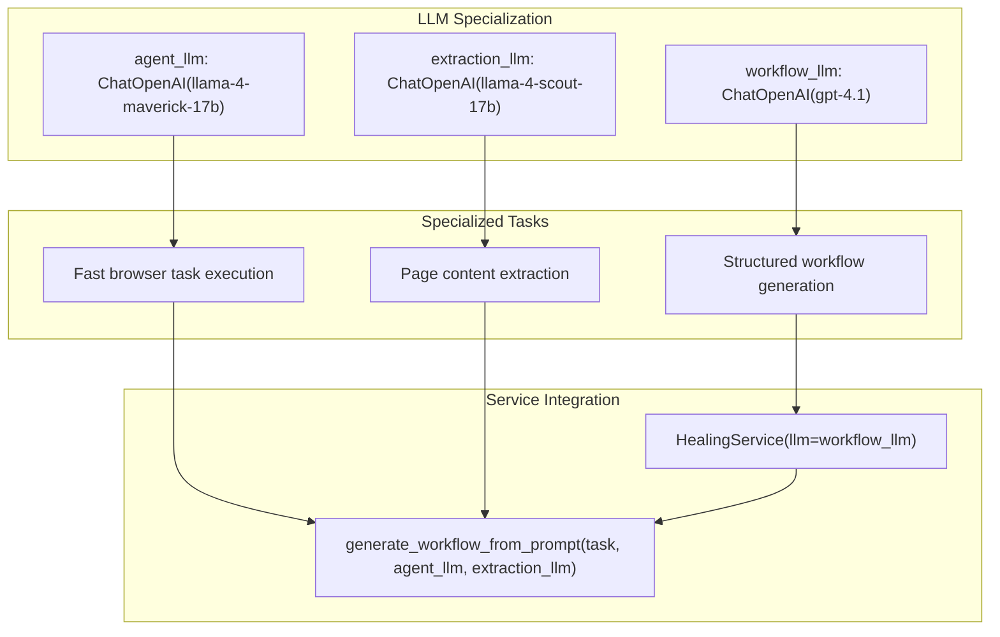
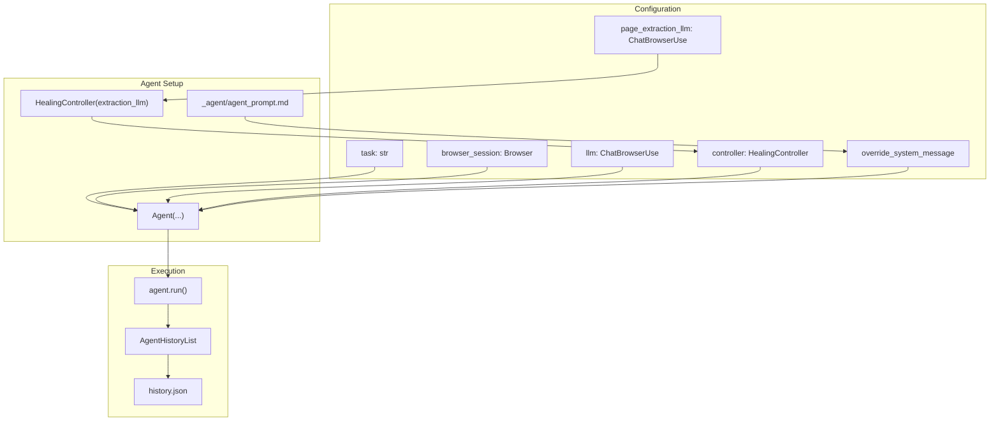
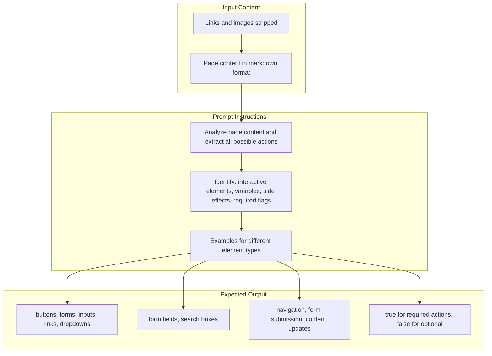
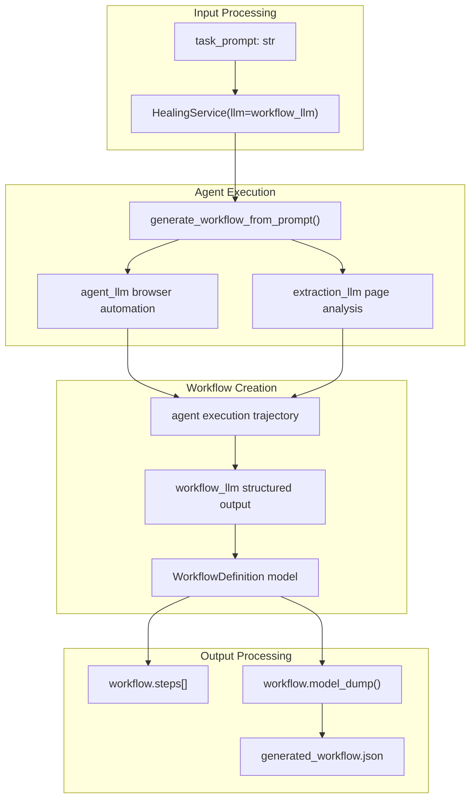

<!-- source: DeepWiki mcp.deepwiki.com · repo browser-use/workflow-use · page 10.2 Agent System and Controllers · fetched 2026-10-30 -->

# Agent System and Controllers

<details>
<summary>Relevant source files</summary>

The following files were used as context for generating this wiki page:

- [workflows/pyproject.toml](workflows/pyproject.toml)
- [workflows/uv.lock](workflows/uv.lock)
- [workflows/workflow_use/healing/_agent/controller.py](workflows/workflow_use/healing/_agent/controller.py)
- [workflows/workflow_use/healing/service.py](workflows/workflow_use/healing/service.py)
- [workflows/workflow_use/healing/tests/constants.py](workflows/workflow_use/healing/tests/constants.py)
- [workflows/workflow_use/healing/tests/test_exploration_agent.py](workflows/workflow_use/healing/tests/test_exploration_agent.py)
- [workflows/workflow_use/healing/tests/test_generate_workflow.py](workflows/workflow_use/healing/tests/test_generate_workflow.py)
- [workflows/workflow_use/healing/tests/test_workflow_creation.py](workflows/workflow_use/healing/tests/test_workflow_creation.py)

</details>


The Agent System provides the AI-powered browser automation capabilities used for workflow generation in workflow-use. At its core is the `HealingController`, which extends browser-use's `Controller` base class to add specialized page analysis and action registration capabilities.

This document covers the controller architecture, custom action registration system, LLM integration patterns, and how the agent system generates workflows from natural language prompts. For information about the `HealingService` that orchestrates workflow generation, see [Natural Language Generation](#3.2). For details about workflow execution, see [Workflow Execution](#5).

## Controller Architecture

The controller system in workflow-use is built on top of browser-use's `Controller` base class, which provides the action registry mechanism for registering custom browser actions that the AI agent can invoke.

**Controller Class Hierarchy**


Sources: [workflows/workflow_use/healing/_agent/controller.py:27-36]()

### Controller Inheritance Pattern

The `HealingController` extends `Controller` with initialization parameters:

| Parameter | Type | Purpose |
|-----------|------|---------|
| `extraction_llm` | `BaseChatModel` | LLM used for analyzing page content and extracting actions |
| `exclude_actions` | `list[str]` | Actions to exclude from the agent's available action set |
| `output_model` | `type[BaseModel]` or `None` | Custom output model for structured agent responses |

The constructor calls `super().__init__()` to initialize the base controller, then registers custom actions via the action registry.

Sources: [workflows/workflow_use/healing/_agent/controller.py:27-32]()

## Custom Action Registration

The action registry system allows custom actions to be registered with the agent. The `HealingController` demonstrates this by registering the `analyse_page_content_and_extract_possible_actions` method as a custom action.

**Action Registration Flow**


Sources: [workflows/workflow_use/healing/_agent/controller.py:34-36]()

### Registration Syntax

The action registration uses a decorator pattern:

```python
self.registry.action(
    'Call this action EVERY TIME the content on the page changes or is new. This is very important for understanding workflows.'
)(self.analyse_page_content_and_extract_possible_actions)
```

The description string provided to `registry.action()` becomes the action's description that the LLM sees when deciding which actions to take. This description should clearly specify:
- When the action should be called
- What the action accomplishes
- Any special requirements or constraints

Sources: [workflows/workflow_use/healing/_agent/controller.py:34-36]()

### Action Method Requirements

Custom action methods must return an `ActionResult` object:

| Field | Type | Purpose |
|-------|------|---------|
| `extracted_content` | `str` | Content extracted by the action (shown to the agent) |
| `include_in_memory` | `bool` | Whether this result should be included in the agent's memory |

The `analyse_page_content_and_extract_possible_actions` method demonstrates this pattern by returning extracted page analysis results.

Sources: [workflows/workflow_use/healing/_agent/controller.py:72-76]()

## HealingController Implementation

The `HealingController` class provides specialized page analysis for workflow generation.

**HealingController Data Flow**


Sources: [workflows/workflow_use/healing/_agent/controller.py:38-76]()

### Data Models

The controller uses two Pydantic models for structured output:

**ActionModel**
| Field | Type | Description |
|-------|------|-------------|
| `variable` | `str` | Name of the variable/field this action relates to |
| `action` | `str` | Description of the action that can be performed |
| `side_effect` | `str` | What happens when this action is performed |
| `is_required` | `bool` | Whether this action is required for typical workflow completion |

**PageContentAnalysis**
| Field | Type | Description |
|-------|------|-------------|
| `actions` | `list[ActionModel]` | List of all possible actions that can be performed on the page |

Sources: [workflows/workflow_use/healing/_agent/controller.py:16-24]()

### Page Analysis Method

The `analyse_page_content_and_extract_possible_actions` method performs the following steps:

1. **HTML Extraction**: Uses CDP `page.evaluate()` to get the page's HTML content
2. **Markdown Conversion**: Converts HTML to markdown using `markdownify`, stripping links and images
3. **LLM Analysis**: Sends the markdown content to the extraction LLM with structured output
4. **Result Formatting**: Returns an `ActionResult` with JSON-formatted analysis

The method is marked to be called every time page content changes, allowing the agent to understand available interactions on each page state.

Sources: [workflows/workflow_use/healing/_agent/controller.py:38-76]()

### Multi-LLM Architecture

The system employs three specialized LLMs for different aspects of workflow generation:

**Multi-LLM Integration Pattern**


| LLM Type | Model | Purpose | Configuration |
|----------|-------|---------|---------------|
| Workflow Creation | `gpt-4.1` | High-quality structured output generation | `temperature=0.0` |
| Browser Agent | `llama-4-maverick-17b` | Fast browser automation tasks | Groq API, `temperature=0.0` |
| Page Extraction | `llama-4-scout-17b` | Specialized content analysis | Groq API, `temperature=0.0` |

Sources: [workflows/workflow_use/healing/tests/test_generate_workflow.py:22-42]()

## Agent Configuration and Integration

The agent system integrates with browser-use's `Agent` class, configured with the `HealingController` and specialized LLMs.

**Agent Configuration Flow**


Sources: [workflows/workflow_use/healing/tests/test_exploration_agent.py:35-54]()

### Agent Initialization Parameters

The `Agent` class is configured with multiple parameters for workflow generation:

| Parameter | Value | Purpose |
|-----------|-------|---------|
| `task` | Task description string | Natural language task for the agent to complete |
| `browser_session` | `Browser()` instance | Browser automation session |
| `llm` | Agent LLM (e.g., `llama-4-maverick-17b`) | Primary reasoning LLM for task execution |
| `page_extraction_llm` | Extraction LLM (e.g., `llama-4-scout-17b`) | Specialized LLM for page content analysis |
| `controller` | `HealingController` instance | Custom controller with page analysis actions |
| `override_system_message` | Prompt from `agent_prompt.md` | Custom system instructions for agent behavior |
| `enable_memory` | `False` | Disable memory to avoid context buildup |
| `max_failures` | `10` | Maximum failure retries before stopping |
| `tool_calling_method` | `'auto'` | Method for tool/action invocation |

Sources: [workflows/workflow_use/healing/tests/test_exploration_agent.py:38-49]()

### Agent History Output

After execution, the agent produces an `AgentHistoryList` that captures all browser interactions, which can be saved and later converted to workflow definitions:

```python
history = await agent.run()
history.save_to_file('./tmp/history.json')
```

The history file contains the complete trajectory of agent actions, which is processed by the `HealingService` to generate structured workflow definitions.

Sources: [workflows/workflow_use/healing/tests/test_exploration_agent.py:51-53]()

## Page Content Analysis Prompt

The page analysis method uses a detailed prompt to guide the extraction LLM:

**Analysis Prompt Structure**


Sources: [workflows/workflow_use/healing/_agent/controller.py:50-63]()

### Example Action Patterns

The prompt includes specific examples for common patterns:

| Pattern | Variable | Action | Side Effect | Required |
|---------|----------|--------|-------------|----------|
| Search input | `search_term` | `enter search query` | `triggers search results` | `true` |
| Submit button | `form_submission` | `click submit button` | `submits form and navigates to next page` | `true` |
| Optional fields | Field name | Field-specific action | Field-specific effect | `false` |

These patterns help the extraction LLM understand how to categorize and describe page elements consistently.

Sources: [workflows/workflow_use/healing/_agent/controller.py:58-62]()

### Error Handling

The page analysis method includes error handling for LLM failures:

```python
try:
    structured_llm = self.extraction_llm.with_structured_output(PageContentAnalysis, method='function_calling')
    output: PageContentAnalysis = await structured_llm.ainvoke(formatted_prompt)
except Exception as e:
    logger.error(f'Error extracting content: {e}')
    return ActionResult(extracted_content=f'Error extracting content: {e}')
```

If extraction fails, an `ActionResult` with an error message is returned, allowing the agent to continue execution.

Sources: [workflows/workflow_use/healing/_agent/controller.py:67-72]()

## Workflow Generation Process

### End-to-End Generation Flow

The healing service orchestrates the complete workflow generation process:

**Workflow Generation Pipeline**


### Test Integration Pattern

The test system demonstrates the complete workflow generation pipeline:

```python
# LLM configuration for different roles
workflow_llm = ChatOpenAI(model='gpt-4.1', temperature=0.0)
agent_llm = ChatOpenAI(
    base_url='https://api.groq.com/openai/v1',
    model='meta-llama/llama-4-maverick-17b-128e-instruct',
    api_key=SecretStr(os.environ['GROQ_API_KEY']),
    temperature=0.0
)
extraction_llm = ChatOpenAI(
    base_url='https://api.groq.com/openai/v1', 
    model='meta-llama/llama-4-scout-17b-16e-instruct',
    api_key=SecretStr(os.environ['GROQ_API_KEY']),
    temperature=0.0
)

# Service initialization and workflow generation
healing_service = HealingService(llm=workflow_llm)
workflow_definition = await healing_service.generate_workflow_from_prompt(
    task_prompt, agent_llm, extraction_llm
)
```

Sources: [workflows/workflow_use/healing/tests/test_generate_workflow.py:14-72](), [workflows/workflow_use/healing/tests/constants.py:1-5]()

---

