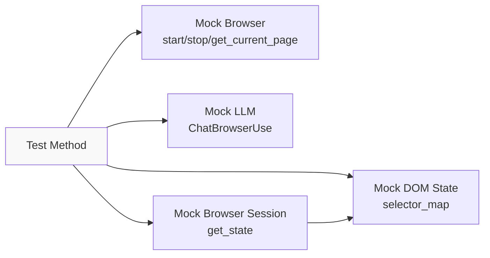
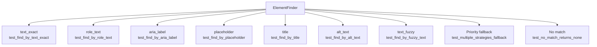
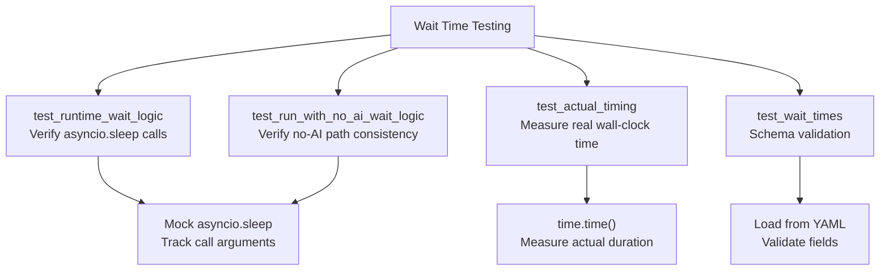
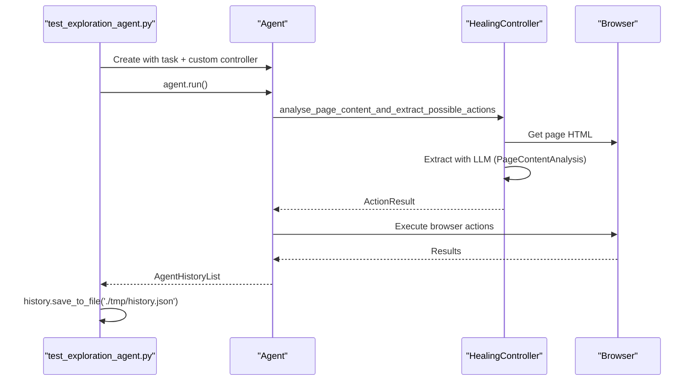
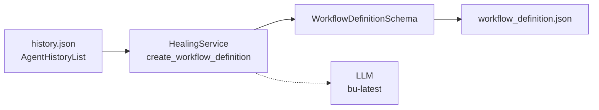
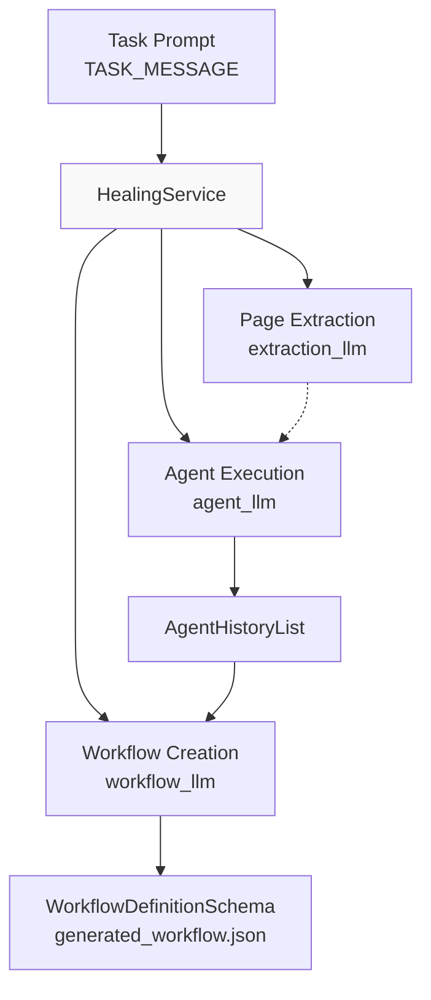
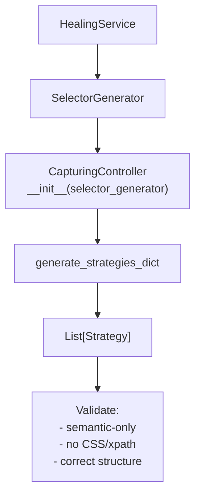

<!-- source: DeepWiki mcp.deepwiki.com · repo browser-use/workflow-use · page 10.3 Testing and Quality Assurance · fetched 2026-10-30 -->

# Testing and Quality Assurance

<details>
<summary>Relevant source files</summary>

The following files were used as context for generating this wiki page:

- [workflows/tests/test_element_finder.py](workflows/tests/test_element_finder.py)
- [workflows/tests/test_go_back_fix.py](workflows/tests/test_go_back_fix.py)
- [workflows/tests/test_selector_generator_fix.py](workflows/tests/test_selector_generator_fix.py)
- [workflows/tests/test_wait_times.py](workflows/tests/test_wait_times.py)
- [workflows/tests/test_workflow_execution.py](workflows/tests/test_workflow_execution.py)
- [workflows/workflow_use/healing/_agent/controller.py](workflows/workflow_use/healing/_agent/controller.py)
- [workflows/workflow_use/healing/tests/constants.py](workflows/workflow_use/healing/tests/constants.py)
- [workflows/workflow_use/healing/tests/test_exploration_agent.py](workflows/workflow_use/healing/tests/test_exploration_agent.py)
- [workflows/workflow_use/healing/tests/test_generate_workflow.py](workflows/workflow_use/healing/tests/test_generate_workflow.py)
- [workflows/workflow_use/healing/tests/test_workflow_creation.py](workflows/workflow_use/healing/tests/test_workflow_creation.py)
- [workflows/workflow_use/recorder/semantic_converter.py](workflows/workflow_use/recorder/semantic_converter.py)

</details>


## Purpose and Scope

This document covers the testing infrastructure and quality assurance practices for the workflow-use system. It details the test suite organization, testing patterns, mock configurations, and how to run tests for various components. For information about workflow validation during generation, see [Workflow Validation and Quality Assurance](#4.2). For development setup, see [Project Structure](#10.1).

The test suite covers four main areas:
1. **Workflow generation** - AI-driven generation, deterministic conversion
2. **Workflow execution** - Semantic execution, element finding, action execution
3. **Component-level functionality** - Selector generation, variable identification, semantic conversion
4. **Integration flows** - End-to-end workflow creation and execution

---

## Test Suite Organization

### Test File Structure

```mermaid
graph TB
    subgraph "Healing Service Tests"
        TE["test_exploration_agent.py<br/>Agent execution"]
        TW["test_workflow_creation.py<br/>Workflow from history"]
        TG["test_generate_workflow.py<br/>Complete generation"]
        TC["constants.py<br/>Shared test data"]
    end
    
    subgraph "Workflow Execution Tests"
        TWE["test_workflow_execution.py<br/>Deterministic steps"]
        TGF["test_go_back_fix.py<br/>Navigation actions"]
        TWT["test_wait_times.py<br/>Timing validation"]
    end
    
    subgraph "Component Tests"
        TEF["test_element_finder.py<br/>Semantic matching"]
        TSG["test_selector_generator_fix.py<br/>Strategy generation"]
    end
    
    TE --> TC
    TW --> TC
    TG --> TC
    
    style "Healing Service Tests" fill:#f9f9f9
    style "Workflow Execution Tests" fill:#f9f9f9
    style "Component Tests" fill:#f9f9f9
```

**Sources:** [workflows/workflow_use/healing/tests/test_exploration_agent.py:1-58](), [workflows/workflow_use/healing/tests/test_workflow_creation.py:1-39](), [workflows/workflow_use/healing/tests/test_generate_workflow.py:1-73](), [workflows/tests/test_workflow_execution.py:1-233](), [workflows/tests/test_element_finder.py:1-331]()

### Test Categories

| Category | Files | Purpose | Dependencies |
|----------|-------|---------|--------------|
| **Agent Tests** | `test_exploration_agent.py`, `test_generate_workflow.py` | Validate browser-use agent execution | LLM API, Browser |
| **Workflow Creation** | `test_workflow_creation.py`, `test_generate_workflow.py` | Test workflow generation pipeline | LLM API, Agent history |
| **Execution Logic** | `test_workflow_execution.py`, `test_go_back_fix.py`, `test_wait_times.py` | Validate step execution, timing, navigation | Mock browser/LLM |
| **Element Finding** | `test_element_finder.py` | Test semantic matching strategies | Mock DOM state |
| **Component Fixes** | `test_selector_generator_fix.py`, `test_go_back_fix.py` | Validate specific bug fixes | Mock dependencies |

---

## Testing Infrastructure

### Mock Objects and Test Doubles

The test suite uses extensive mocking to avoid external dependencies during testing:



**Key Mock Patterns:**

**1. Browser Mocking** - [workflows/tests/test_wait_times.py:268-271]()
```python
mock_browser = Mock()
mock_browser.start = AsyncMock()
mock_browser.stop = AsyncMock()
mock_browser.get_current_page = AsyncMock(return_value=Mock())
```

**2. DOM State Mocking** - [workflows/tests/test_element_finder.py:23-34]()
```python
mock_session = Mock()
mock_state = Mock()
mock_nodes = {
    1: Mock(text='Cancel', tag_name='button'),
    2: Mock(text='Submit', tag_name='button'),
}
mock_state.selector_map = mock_nodes
mock_session.get_state = AsyncMock(return_value=mock_state)
```

**3. LLM Mocking** - [workflows/tests/test_wait_times.py:271]()
```python
mock_llm = Mock()
```

**Sources:** [workflows/tests/test_wait_times.py:268-271](), [workflows/tests/test_element_finder.py:23-34]()

### Async Test Execution

All async tests use a helper function for execution:

```python
def run_async_test(test_method):
    """Helper to run async test methods"""
    return asyncio.run(test_method())
```

**Sources:** [workflows/tests/test_element_finder.py:282-288](), [workflows/tests/test_workflow_execution.py:184-190]()

---

## Unit Tests

### ElementFinder Tests

`ElementFinder` tests validate semantic matching against browser-use's DOM state. All tests use mocked DOM state to avoid browser dependencies.

**Test Coverage:**



**Example Test:** Text Exact Matching - [workflows/tests/test_element_finder.py:21-44]()

The test creates a mock DOM with multiple buttons, defines a `text_exact` strategy, and verifies that the correct element index is returned:

```python
async def test_find_by_text_exact(self):
    mock_nodes = {
        1: Mock(text='Cancel', tag_name='button'),
        2: Mock(text='Submit', tag_name='button'),  # Should match
        3: Mock(text='Back', tag_name='a'),
    }
    mock_state.selector_map = mock_nodes
    
    strategies = [{'type': 'text_exact', 'value': 'Submit', 'priority': 1, 'metadata': {}}]
    result = await self.finder.find_element_with_strategies(strategies, mock_session)
    
    assert result is not None
    index, strategy_used = result
    assert index == 2  # Returns element index, not handle
```

**Key Validation:** Tests confirm that `ElementFinder` returns element indices (integers) from browser-use's `selector_map`, not Playwright element handles.

**Sources:** [workflows/tests/test_element_finder.py:1-331]()

### Workflow Execution Tests

Tests for deterministic step execution, focusing on `NoParamsAction` handling and multi-strategy element finding.

**Test Coverage Map:**

| Test | Component Tested | Purpose |
|------|------------------|---------|
| `test_go_back_uses_no_params_action` | Action parameter handling | Verifies `go_back` uses `NoParamsAction()` instance |
| `test_go_forward_uses_no_params_action` | Action parameter handling | Verifies `go_forward` uses `NoParamsAction()` instance |
| `test_click_action_uses_multi_strategy` | Element finding | Confirms click actions trigger multi-strategy finding |
| `test_element_index_injection` | Parameter injection | Validates found element index is injected into params |
| `test_semantic_strategies_format` | Strategy validation | Ensures strategies have required fields and are semantic-only |
| `test_actions_requiring_wait` | Post-action behavior | Validates which actions trigger page stabilization wait |

**Example Test:** NoParamsAction Validation - [workflows/tests/test_workflow_execution.py:20-34]()

```python
def test_go_back_uses_no_params_action(self):
    from browser_use.tools.views import NoParamsAction
    
    action_name = 'go_back'
    params = {}
    
    # Apply the fix logic
    empty_actions = {'go_back', 'go_forward'}
    if action_name in empty_actions:
        params = NoParamsAction()
    
    assert isinstance(params, NoParamsAction)
```

This test validates the fix in [workflow_use/workflow/service.py:179]() that ensures empty actions use `NoParamsAction()` instances instead of empty dictionaries.

**Sources:** [workflows/tests/test_workflow_execution.py:1-233]()

### Wait Time Tests

Comprehensive testing of the `wait_time` and `default_wait_time` functionality across four areas:



**Key Test:** Runtime Wait Logic - [workflows/tests/test_wait_times.py:37-113]()

This test mocks `asyncio.sleep` to capture all sleep calls, then verifies:
- Step 1 (no `wait_time`) uses `default_wait_time` (0.5s)
- Step 2 (`wait_time=1.0`) waits exactly 1.0s
- Step 3 (`wait_time=0`) skips delay entirely

**Sources:** [workflows/tests/test_wait_times.py:1-401]()

---

## Integration Tests

### Agent Exploration Test

End-to-end test of browser-use agent execution with custom `HealingController`.

**Workflow:**



**Configuration:** [workflows/workflow_use/healing/tests/test_exploration_agent.py:16-32]()

The test uses three LLM instances:
- Main LLM: `llama-4-maverick-17b` for agent decisions
- Extraction LLM: `llama-4-scout-17b` for page analysis
- Custom system prompt from `agent_prompt.md`

**Sources:** [workflows/workflow_use/healing/tests/test_exploration_agent.py:1-58]()

### Workflow Creation from History

Tests the conversion of `AgentHistoryList` into `WorkflowDefinitionSchema`.

**Process Flow:**



**Test Implementation:** [workflows/workflow_use/healing/tests/test_workflow_creation.py:21-35]()

```python
async def test_workflow_creation():
    healing_service = HealingService(llm)
    history_list = AgentHistoryList.load_from_file(
        './tmp/history.json', 
        output_model=WorkflowAgentOutput
    )
    workflow_definition = await healing_service.create_workflow_definition(
        TASK_MESSAGE, 
        history_list
    )
    # Save to JSON
```

**Custom Action Model:** The test creates a custom `WorkflowAgentOutput` that includes actions from `HealingController.registry`.

**Sources:** [workflows/workflow_use/healing/tests/test_workflow_creation.py:1-39]()

### Complete Workflow Generation

End-to-end test of the entire generation pipeline from prompt to workflow definition.

**Three-LLM Architecture:**



**LLM Configuration:** [workflows/workflow_use/healing/tests/test_generate_workflow.py:22-42]()

1. **Workflow LLM** (`bu-latest`): High-quality model for structured workflow output
2. **Agent LLM** (`llama-4-maverick-17b`): Faster model for browser automation
3. **Extraction LLM** (`llama-4-scout-17b`): Specialized for page content extraction

**Method Call:** [workflows/workflow_use/healing/tests/test_generate_workflow.py:54]()
```python
workflow_definition = await healing_service.generate_workflow_from_prompt(
    task_prompt, 
    agent_llm, 
    extraction_llm
)
```

**Sources:** [workflows/workflow_use/healing/tests/test_generate_workflow.py:1-73]()

### Go Back Fix Validation

Integration test verifying `go_back` action execution in a complete workflow.

**Test Workflow:**

```yaml
steps:
  - type: navigation
    url: https://example.com
  - type: navigation
    url: https://google.com
  - type: go_back
    description: Go back to example.com
```

**Validation:** [workflows/tests/test_go_back_fix.py:14-64]()

The test creates a minimal workflow with a `go_back` step, loads it via `Workflow.load_from_file`, executes with `workflow.run({})`, and confirms no errors occur. This validates the `NoParamsAction` fix.

**Sources:** [workflows/tests/test_go_back_fix.py:1-68]()

---

## Component Testing Patterns

### Selector Generator Validation

Tests that `CapturingController` has `selector_generator` attribute and generates semantic-only strategies.

**Test Flow:**



**Validation Checks:** [workflows/tests/test_selector_generator_fix.py:63-69]()

```python
# Verify no CSS/xpath strategies
strategy_types = [s['type'] for s in strategies]
assert 'css' not in strategy_types
assert 'xpath' not in strategy_types
assert 'id' not in strategy_types
```

**Sources:** [workflows/tests/test_selector_generator_fix.py:1-111]()

### Semantic Converter Testing

While not in the provided files, `SemanticWorkflowConverter` is a critical component. Testing would cover:

- CSS selector to `target_text` extraction
- `semanticInfo` processing
- Container and position hint extraction
- Variable identification integration

**Key Methods to Test:**
- `convert_workflow_to_semantic()` - [workflows/workflow_use/recorder/semantic_converter.py:22-43]()
- `_convert_step_to_semantic()` - [workflows/workflow_use/recorder/semantic_converter.py:55-117]()
- `_extract_semantic_target_text()` - [workflows/workflow_use/recorder/semantic_converter.py:119-248]()

**Sources:** [workflows/workflow_use/recorder/semantic_converter.py:1-311]()

---

## Test Execution

### Running Individual Tests

**Agent Tests (require API keys):**
```bash
# Set up environment
export BROWSER_USE_API_KEY=your_key
export GROQ_API_KEY=your_key  # For llama models

# Run agent exploration
python workflows/workflow_use/healing/tests/test_exploration_agent.py

# Run workflow generation
python workflows/workflow_use/healing/tests/test_generate_workflow.py
```

**Unit Tests (no external dependencies):**
```bash
# Element finder tests
python workflows/tests/test_element_finder.py

# Workflow execution tests
python workflows/tests/test_workflow_execution.py

# Wait time tests
python workflows/tests/test_wait_times.py
```

**Integration Tests:**
```bash
# Go back fix validation
python workflows/tests/test_go_back_fix.py

# Selector generator validation
python workflows/tests/test_selector_generator_fix.py
```

### Test Output Format

Unit test runners provide detailed output:

```
================================================================================
Running 14 tests for ElementFinder
================================================================================

✅ PASS: test_find_by_text_exact
✅ PASS: test_find_by_role_text
✅ PASS: test_find_by_aria_label
...
✅ PASS: test_fuzzy_matching_case_insensitive

================================================================================
Test Results: 14 passed, 0 failed
================================================================================
```

**Sources:** [workflows/tests/test_element_finder.py:295-330](), [workflows/tests/test_workflow_execution.py:197-232]()

---

## Test Fixtures and Constants

### Shared Test Data

`constants.py` provides shared test data for healing service tests:

```python
TASK_MESSAGE = """
Create a workflow for the government form on 
https://v0-simple-government-form-xi.vercel.app

Make up all information. It's a multi page form. 
The task is done when you submit the form.
"""
```

This constant is used across multiple tests to ensure consistency.

**Sources:** [workflows/workflow_use/healing/tests/constants.py:1-6]()

### Mock DOM Nodes

Standard pattern for creating mock DOM elements:

```python
mock_nodes = {
    1: Mock(
        text='Submit',
        tag_name='button',
        aria_label='Submit form',
        role='button'
    ),
    2: Mock(
        text='Cancel',
        tag_name='button'
    ),
}
```

**Sources:** [workflows/tests/test_element_finder.py:28-34]()

---

## Testing Best Practices

### 1. Async Test Isolation

Each test method should be independent and use `setup_method` for initialization:

```python
class TestElementFinder:
    def setup_method(self):
        self.finder = ElementFinder()
    
    async def test_find_by_text_exact(self):
        # Test implementation
```

**Sources:** [workflows/tests/test_element_finder.py:13-18]()

### 2. Mock External Dependencies

Always mock browser, LLM, and network dependencies in unit tests:

```python
mock_browser = Mock()
mock_browser.start = AsyncMock()
mock_session.get_state = AsyncMock(return_value=mock_state)
```

### 3. Patch Strategy Verification

When testing strategy behavior, patch the method and verify arguments:

```python
with patch('asyncio.sleep', mock_sleep):
    with patch.object(Workflow, '_execute_step', new_callable=lambda: AsyncMock()):
        await workflow.run(inputs={})
```

**Sources:** [workflows/tests/test_wait_times.py:78-89]()

### 4. Integration Test Data Persistence

Integration tests save results to `./tmp/` for inspection:

```python
history.save_to_file('./tmp/history.json')
await f.write(json.dumps(workflow_definition.model_dump(), indent=2))
```

**Sources:** [workflows/workflow_use/healing/tests/test_exploration_agent.py:53](), [workflows/workflow_use/healing/tests/test_workflow_creation.py:32]()

---

## Coverage Areas Summary

### Components with Test Coverage

| Component | Test File | Coverage |
|-----------|-----------|----------|
| `ElementFinder` | `test_element_finder.py` | ✅ Comprehensive (14 tests) |
| `Workflow.run()` | `test_workflow_execution.py`, `test_wait_times.py` | ✅ Good (runtime, timing, actions) |
| `HealingService` | `test_generate_workflow.py`, `test_workflow_creation.py` | ✅ Integration tests |
| `HealingController` | `test_exploration_agent.py` | ✅ Integration test |
| `SemanticWorkflowConverter` | None in provided files | ⚠️ Manual testing only |
| `WorkflowValidator` | None in provided files | ⚠️ Not covered |
| `VariableIdentifier` | None in provided files | ⚠️ Not covered |

### Testing Gaps

**Components needing test coverage:**
1. `SemanticWorkflowConverter` - CSS to semantic conversion
2. `WorkflowValidator` - Validation and auto-correction
3. `VariableIdentifier` - Pattern-based detection
4. `SelectorGenerator` - Strategy generation (partial coverage)
5. `XPathOptimizer` - XPath strategy creation
6. `BuilderService` - Recording to workflow conversion

**Sources:** Analysis based on provided test files

---

## Debugging Failed Tests

### Common Test Failures

**1. LLM API Key Missing:**
```
ValueError: BROWSER_USE_API_KEY not set
```
**Solution:** Set environment variable or skip integration tests

**2. Async Test Timeout:**
```
asyncio.TimeoutError: Test exceeded maximum duration
```
**Solution:** Check for hanging browser/network calls, add timeouts

**3. Mock State Mismatch:**
```
AssertionError: Expected index 2, got None
```
**Solution:** Verify mock `selector_map` structure matches expected format

### Test Debugging Pattern

```python
# Add detailed output in tests
print(f'Sleep calls: {sleep_calls}')
print(f'Mock nodes: {mock_state.selector_map}')
print(f'Strategies: {strategies}')

# Use traceback for errors
except Exception as e:
    import traceback
    traceback.print_exc()
```

**Sources:** [workflows/tests/test_wait_times.py:91-94](), [workflows/tests/test_element_finder.py:321-324]()

---

