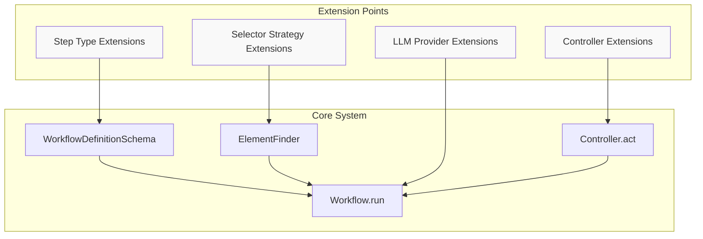
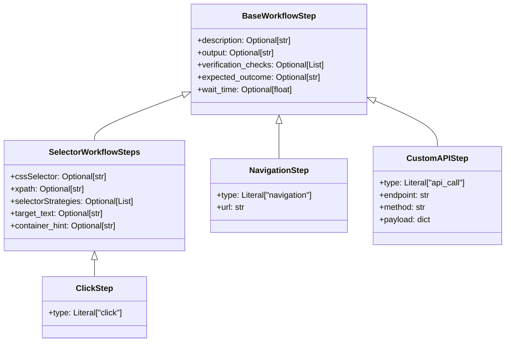
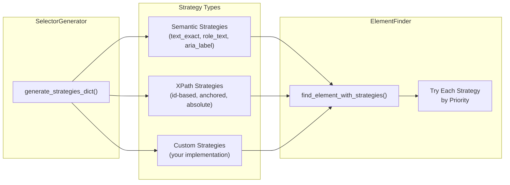
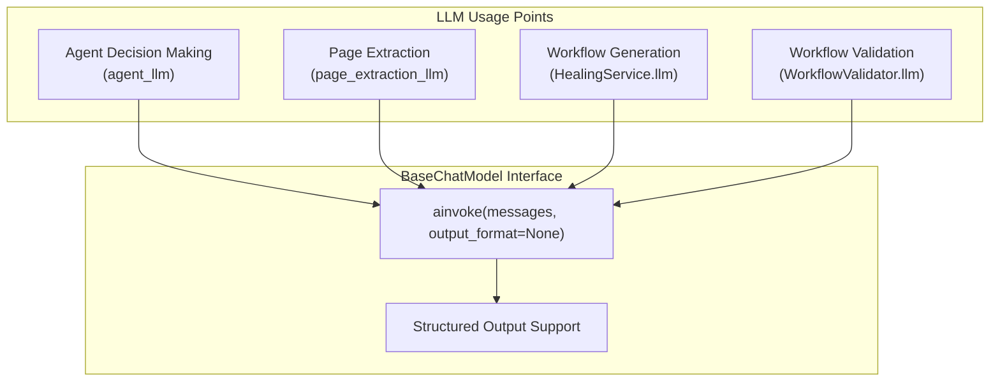
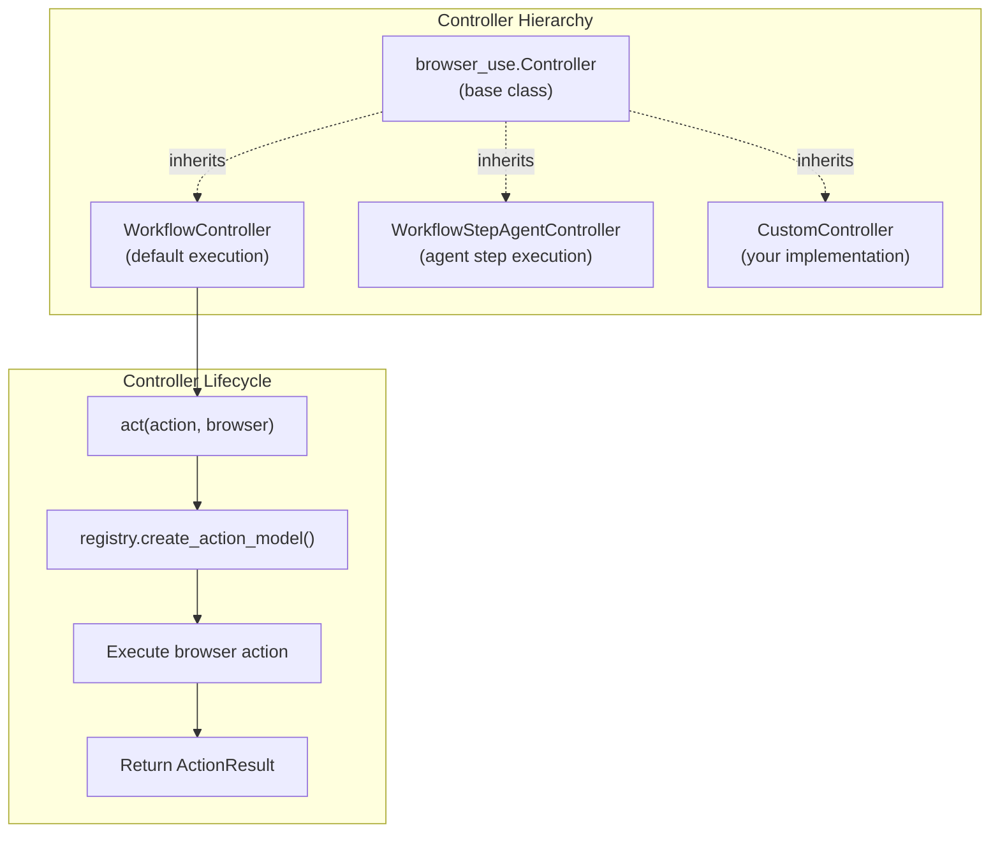

<!-- source: DeepWiki mcp.deepwiki.com · repo browser-use/workflow-use · page 10.4 Extending the System · fetched 2026-10-30 -->

# Extending the System

<details>
<summary>Relevant source files</summary>

The following files were used as context for generating this wiki page:

- [workflows/cli.py](workflows/cli.py)
- [workflows/pyproject.toml](workflows/pyproject.toml)
- [workflows/uv.lock](workflows/uv.lock)
- [workflows/workflow_use/healing/service.py](workflows/workflow_use/healing/service.py)
- [workflows/workflow_use/schema/views.py](workflows/workflow_use/schema/views.py)
- [workflows/workflow_use/workflow/service.py](workflows/workflow_use/workflow/service.py)

</details>


This guide covers the primary extension points in workflow-use for developers who want to add custom functionality. It explains how to add new step types, implement custom selector strategies, integrate different LLM providers, create custom controllers, and integrate with other automation frameworks.

For information about the core workflow execution system, see [Workflow Execution](#5). For details on the existing selector generation system, see [Selector Generation and XPath Optimization](#9.2).

---

## Extension Points Overview

The workflow-use system provides four primary extension mechanisms:

| Extension Point | Use Case | Primary Files |
|----------------|----------|---------------|
| **Step Types** | Add new workflow actions (e.g., API calls, file operations) | [schema/views.py](workflows/workflow_use/schema/views.py) |
| **Selector Strategies** | Add new element finding methods beyond text/xpath | [healing/selector_generator.py]() |
| **LLM Providers** | Integrate custom or self-hosted language models | [cli.py:36-45]() |
| **Controllers** | Customize browser action execution and error handling | [workflow/service.py:74](), [workflow/step_agent/controller.py]() |



**Sources:** [workflow_use/schema/views.py:1-280](), [workflow_use/workflow/service.py:39-102]()

---

## Adding New Step Types

### Step Type Architecture

All workflow steps inherit from `BaseWorkflowStep` and are registered in the `WorkflowStep` union type. Steps that interact with DOM elements should inherit from `SelectorWorkflowSteps` to gain selector field support.



**Sources:** [workflow_use/schema/views.py:8-27](), [workflow_use/schema/views.py:29-62]()

### Step 1: Define the Step Schema

Create a new Pydantic model in [schema/views.py]():

```python
class APICallStep(BaseWorkflowStep):
    """Makes an HTTP API call and stores the response."""
    
    type: Literal['api_call']
    endpoint: str = Field(..., description='API endpoint URL. Can use {context_var}.')
    method: Literal['GET', 'POST', 'PUT', 'DELETE'] = Field('GET', description='HTTP method')
    headers: Optional[Dict[str, str]] = Field(None, description='HTTP headers')
    payload: Optional[Dict[str, Any]] = Field(None, description='Request payload')
    timeout: Optional[int] = Field(30, description='Request timeout in seconds')
```

Key requirements:
- Use `Literal['step_type']` for the `type` field to enable discriminated unions
- Inherit from `BaseWorkflowStep` for non-DOM steps or `SelectorWorkflowSteps` for DOM interactions
- Use `Field(...)` with descriptions for all fields to enable AI generation
- Mark required fields with `...` and provide defaults for optional fields

**Sources:** [workflow_use/schema/views.py:79-84](), [workflow_use/schema/views.py:86-91]()

### Step 2: Register in Union Type

Add your step to the `DeterministicWorkflowStep` or `AgenticWorkflowStep` union:

```python
DeterministicWorkflowStep = Union[
    NavigationStep,
    ClickStep,
    # ... existing steps ...
    APICallStep,  # Add your step here
]
```

The `WorkflowStep` union [schema/views.py:177-182]() combines both deterministic and agentic steps, making all registered steps valid in workflows.

**Sources:** [workflow_use/schema/views.py:161-172](), [workflow_use/schema/views.py:177-182]()

### Step 3: Implement Execution Logic

Add execution logic in [workflow/service.py]() within the `_execute_step` method:

```python
async def _execute_step(self, step_index: int, step_resolved: WorkflowStep) -> ActionResult | AgentHistoryList:
    """Execute the resolved step dictionary, handling type branching and fallback."""
    
    if isinstance(step_resolved, APICallStep):
        # Custom execution logic
        import httpx
        
        async with httpx.AsyncClient() as client:
            response = await client.request(
                method=step_resolved.method,
                url=step_resolved.endpoint,
                headers=step_resolved.headers,
                json=step_resolved.payload,
                timeout=step_resolved.timeout
            )
            
            return ActionResult(
                is_done=False,
                extracted_content=response.text,
                include_in_memory=True
            )
    
    # ... existing step handling ...
```

The execution logic should:
1. Handle placeholder resolution (already done by `_resolve_placeholders`)
2. Execute the action with proper error handling
3. Return an `ActionResult` or `AgentHistoryList`
4. Store outputs using `self._store_output` if needed

**Sources:** [workflow_use/workflow/service.py:630-720](), [workflow_use/workflow/service.py:354-419]()

### Step 4: Support in Deterministic Conversion

If you want AI-generated workflows to include your step, add conversion logic in [healing/deterministic_converter.py]():

```python
def _convert_action_to_step(self, action_dict: dict, element_hash: str | None = None) -> dict | None:
    """Convert browser-use action to workflow step."""
    
    # Check for custom action patterns in agent reasoning
    if 'api_call' in action_dict.get('reasoning', '').lower():
        # Extract API details from action or return generic step
        return {
            'type': 'api_call',
            'endpoint': '{api_endpoint}',  # Parameterize for reusability
            'method': 'GET',
            'description': 'Make API call'
        }
    
    # ... existing action conversion ...
```

**Sources:** [workflow_use/healing/deterministic_converter.py]() (file reference)

---

## Custom Selector Strategies

The `ElementFinder` uses a priority-based multi-strategy system to locate elements. Custom strategies allow specialized element finding logic.

### Strategy Architecture



**Sources:** [workflow_use/workflow/element_finder.py](), [workflow_use/healing/selector_generator.py]()

### Adding a Custom Strategy

Edit [healing/selector_generator.py]() to add your strategy:

```python
class SelectorGenerator:
    def generate_strategies_dict(self, element_data: dict) -> list[dict]:
        """Generate multiple selector strategies ordered by priority."""
        
        strategies = []
        
        # Existing semantic strategies...
        
        # Add custom strategy
        if element_data.get('data_testid'):
            strategies.append({
                'type': 'testid',  # Strategy type identifier
                'value': element_data['data_testid'],
                'priority': 3,  # Lower number = higher priority
                'metadata': {
                    'strategy': 'data-testid attribute',
                    'reliability': 'high'
                }
            })
        
        # Sort by priority
        strategies.sort(key=lambda x: x['priority'])
        return strategies
```

### Implementing Strategy Execution

Add execution logic in [workflow/element_finder.py]():

```python
async def find_element_with_strategies(
    self,
    strategies: list[dict],
    browser: Browser,
    target_text: str | None = None
) -> tuple[int | str, dict] | None:
    """Try each strategy until one succeeds."""
    
    for strategy in strategies:
        try:
            if strategy['type'] == 'testid':
                # Execute custom strategy
                page = await browser.get_current_page()
                selector_map = await page.get_selector_map()
                
                for index, element in selector_map.items():
                    if element.get('data-testid') == strategy['value']:
                        return (index, strategy)
            
            # ... existing strategy handlers ...
            
        except Exception as e:
            continue
    
    return None
```

**Sources:** [workflow_use/workflow/element_finder.py](), [workflow_use/healing/selector_generator.py]()

### Strategy Priority Guidelines

| Priority | Use Case | Examples |
|----------|----------|----------|
| 1 | Exact semantic matches | `text_exact`, `data-testid` |
| 2-3 | Role-based or aria matches | `role_text`, `aria_label` |
| 4-6 | Partial text or attribute matches | `text_fuzzy`, `id-based-xpath` |
| 7-9 | Structural selectors | `anchored-xpath`, `css_selector` |
| 10+ | Fallback absolute selectors | `absolute-xpath` |

Lower priority numbers are tried first. The system stops at the first successful match.

**Sources:** [workflow_use/healing/selector_generator.py](), [workflow_use/workflow/element_finder.py]()

---

## Custom LLM Providers

The system uses browser-use's `BaseChatModel` interface for LLM abstraction. Any LLM that implements this interface can be used.

### LLM Integration Points



**Sources:** [workflow_use/workflow/service.py:42-82](), [workflow_use/healing/service.py:29-75]()

### Implementing a Custom Provider

Create a class that implements `BaseChatModel` from browser-use:

```python
from browser_use.llm.base import BaseChatModel, BaseMessage
from typing import Sequence, Optional, Type
from pydantic import BaseModel

class CustomLLMProvider(BaseChatModel):
    """Custom LLM provider implementation."""
    
    def __init__(self, api_key: str, model: str):
        self.api_key = api_key
        self.model = model
        self.client = YourLLMClient(api_key)
    
    async def ainvoke(
        self,
        messages: Sequence[BaseMessage],
        output_format: Optional[Type[BaseModel]] = None
    ):
        """
        Invoke the LLM with messages and optional structured output.
        
        Args:
            messages: List of system/user/assistant messages
            output_format: Pydantic model for structured output (if None, return text)
        
        Returns:
            ChatInvokeCompletion with completion field containing:
            - Pydantic model instance if output_format specified
            - String if output_format is None
        """
        # Convert browser-use messages to your LLM's format
        formatted_messages = self._convert_messages(messages)
        
        if output_format:
            # Use structured output (JSON mode, function calling, etc.)
            response = await self.client.structured_completion(
                messages=formatted_messages,
                schema=output_format.model_json_schema()
            )
            # Parse response into Pydantic model
            result = output_format(**response)
        else:
            # Regular text completion
            response = await self.client.completion(messages=formatted_messages)
            result = response.text
        
        # Return in browser-use format
        from browser_use.llm.views import ChatInvokeCompletion
        return ChatInvokeCompletion(completion=result)
    
    def _convert_messages(self, messages: Sequence[BaseMessage]) -> list:
        """Convert browser-use message format to your LLM's format."""
        converted = []
        for msg in messages:
            if hasattr(msg, 'content'):
                # Handle text and multimodal content
                if isinstance(msg.content, str):
                    converted.append({
                        'role': msg.__class__.__name__.replace('Message', '').lower(),
                        'content': msg.content
                    })
                elif isinstance(msg.content, list):
                    # Multimodal content (text + images)
                    converted.append({
                        'role': msg.__class__.__name__.replace('Message', '').lower(),
                        'content': msg.content  # Adapt format as needed
                    })
        return converted
```

### Using Custom Provider

Initialize the provider in [cli.py]() or your script:

```python
# Replace default ChatBrowserUse
from workflow_use.custom_llm import CustomLLMProvider

llm_instance = CustomLLMProvider(
    api_key=os.environ['CUSTOM_LLM_API_KEY'],
    model='custom-model-v1'
)

# Use in services
healing_service = HealingService(llm=llm_instance)
workflow = Workflow.load_from_file(
    'workflow.yaml',
    llm=llm_instance,
    page_extraction_llm=llm_instance  # Can use different model for extraction
)
```

**Sources:** [cli.py:36-46](), [workflow_use/workflow/service.py:42-82]()

### Structured Output Requirements

The system requires structured output support for:
1. **Workflow Generation** - Produces `WorkflowDefinitionSchema` [healing/service.py:278-329]()
2. **Validation** - Produces validation schemas [healing/validator.py]()
3. **Variable Extraction** - Produces variable suggestion schemas [healing/variable_extractor.py]()

Your LLM must support JSON schema-based structured output or function calling to generate valid Pydantic models.

**Sources:** [workflow_use/healing/service.py:278-329](), [workflow_use/schema/views.py:216-258]()

---

## Custom Controllers

Controllers handle browser action execution. Custom controllers can add logging, error recovery, or custom action types.

### Controller Architecture



**Sources:** [workflow_use/controller/service.py](), [workflow_use/workflow/step_agent/controller.py]()

### Creating a Custom Controller

Create a controller by inheriting from browser-use's `Controller`:

```python
from browser_use import Controller, Browser
from browser_use.agent.views import ActionResult

class LoggingController(Controller):
    """Controller that logs all actions to a file."""
    
    def __init__(self, log_path: str):
        super().__init__()
        self.log_path = log_path
        self.action_count = 0
    
    async def act(self, action, browser: Browser, *args, **kwargs):
        """Execute action with logging."""
        self.action_count += 1
        
        # Log action details
        action_dict = action.model_dump() if hasattr(action, 'model_dump') else {}
        self._log_action(action_dict)
        
        # Execute action using parent implementation
        try:
            result = await super().act(action, browser, *args, **kwargs)
            self._log_result(result, success=True)
            return result
        except Exception as e:
            self._log_result(str(e), success=False)
            raise
    
    def _log_action(self, action_dict: dict):
        """Log action to file."""
        import json
        from datetime import datetime
        
        log_entry = {
            'timestamp': datetime.utcnow().isoformat(),
            'action_number': self.action_count,
            'action': action_dict
        }
        
        with open(self.log_path, 'a') as f:
            f.write(json.dumps(log_entry) + '\n')
    
    def _log_result(self, result, success: bool):
        """Log action result."""
        # Implementation...
        pass
```

### Using Custom Controller

Pass your controller to the workflow:

```python
from workflow_use.workflow.service import Workflow

# Create custom controller
controller = LoggingController(log_path='./workflow_actions.jsonl')

# Use in workflow
workflow = Workflow.load_from_file(
    'workflow.yaml',
    llm=llm_instance,
    controller=controller  # Use custom controller
)

result = await workflow.run(inputs={'search_term': 'Python'})
```

**Sources:** [workflow_use/workflow/service.py:42-82](), [workflow_use/controller/service.py]()

### Advanced Controller Features

#### 1. Custom Action Registration

Register custom browser actions:

```python
class CustomController(Controller):
    def __init__(self):
        super().__init__()
        # Register custom action
        self.registry.register_action(
            action_name='scroll_to_element',
            action_model=ScrollToElementAction,
            handler=self._handle_scroll_to_element
        )
    
    async def _handle_scroll_to_element(self, action, browser):
        """Execute custom scroll action."""
        page = await browser.get_current_page()
        element = await page.query_selector(action.selector)
        await element.scroll_into_view_if_needed()
        return ActionResult(success=True)
```

#### 2. Error Recovery

Implement retry logic and error recovery:

```python
class RetryController(Controller):
    async def act(self, action, browser, *args, **kwargs):
        """Execute with automatic retry."""
        max_retries = 3
        
        for attempt in range(max_retries):
            try:
                result = await super().act(action, browser, *args, **kwargs)
                return result
            except Exception as e:
                if attempt == max_retries - 1:
                    raise
                # Wait and retry
                await asyncio.sleep(2 ** attempt)
        
        raise RuntimeError('Max retries exceeded')
```

**Sources:** [workflow_use/workflow/service.py:139-283](), [workflow_use/controller/service.py]()

---

## Integration with Other Frameworks

### Playwright Integration

workflow-use uses Playwright through browser-use. You can access the raw Playwright page:

```python
async def custom_playwright_action(workflow: Workflow):
    """Execute custom Playwright operations."""
    # Get Playwright page
    page = await workflow.browser.get_current_page()
    
    # Use Playwright directly
    await page.screenshot(path='screenshot.png')
    cookies = await page.context.cookies()
    
    # Custom interactions
    await page.evaluate('() => window.scrollTo(0, document.body.scrollHeight)')
```

**Sources:** [workflow_use/workflow/service.py:42-82]()

### Selenium Integration

Wrap Selenium operations in custom step types:

```python
class SeleniumStep(BaseWorkflowStep):
    """Execute Selenium script within workflow."""
    
    type: Literal['selenium']
    script: str
    
async def _execute_selenium_step(self, step: SeleniumStep):
    """Execute Selenium commands."""
    from selenium import webdriver
    from selenium.webdriver.common.by import By
    
    # Get current page URL from Playwright
    page = await self.browser.get_current_page()
    url = await page.url()
    
    # Execute in Selenium
    driver = webdriver.Chrome()
    driver.get(url)
    # Execute step.script
    driver.quit()
```

### CI/CD Integration

Run workflows in CI pipelines:

```python
# pytest test
import pytest
from workflow_use.workflow.service import Workflow

@pytest.mark.asyncio
async def test_login_workflow():
    """Test login workflow in CI."""
    workflow = Workflow.load_from_file(
        'workflows/login.yaml',
        llm=llm_instance,
        use_cloud=True  # Use cloud browser in CI
    )
    
    result = await workflow.run(inputs={
        'username': 'test@example.com',
        'password': os.environ['TEST_PASSWORD']
    })
    
    assert result.is_successful()
```

**Sources:** [cli.py:1-150](), [workflow_use/workflow/service.py:851-950]()

### API Integration

Expose workflows as API endpoints:

```python
from fastapi import FastAPI, BackgroundTasks
from workflow_use.workflow.service import Workflow

app = FastAPI()

@app.post('/api/workflows/{workflow_id}/execute')
async def execute_workflow(
    workflow_id: str,
    inputs: dict,
    background_tasks: BackgroundTasks
):
    """Execute workflow via API."""
    workflow = Workflow.load_from_file(
        f'workflows/{workflow_id}.yaml',
        llm=llm_instance
    )
    
    # Run in background
    background_tasks.add_task(
        run_workflow_async,
        workflow,
        inputs
    )
    
    return {'status': 'started', 'workflow_id': workflow_id}
```

**Sources:** [workflow_use/web/backend.py]() (FastAPI backend reference)

---

## Extension Best Practices

### Type Safety

Always use Pydantic models with full type hints:

```python
from typing import Literal, Optional
from pydantic import Field

class MyStep(BaseWorkflowStep):
    type: Literal['my_step']  # Use Literal for step type
    param1: str = Field(..., description='Required parameter')
    param2: Optional[int] = Field(None, description='Optional parameter')
```

### Error Handling

Provide meaningful error messages:

```python
async def _execute_custom_step(self, step):
    try:
        result = await perform_action(step)
    except ConnectionError as e:
        raise RuntimeError(
            f"Custom step '{step.type}' failed: Connection error - {e}. "
            f"Check network connectivity and retry."
        ) from e
```

### Documentation

Document all custom components:

```python
class CustomStep(BaseWorkflowStep):
    """
    Executes a custom action with retry logic.
    
    This step type allows you to:
    - Execute custom business logic
    - Retry on failure
    - Store results in context
    
    Example:
        {
            "type": "custom",
            "action": "process_data",
            "retry_count": 3,
            "output": "result"
        }
    """
    type: Literal['custom']
    action: str = Field(..., description='Action identifier')
    retry_count: int = Field(1, description='Number of retries on failure')
```

### Testing

Write unit tests for custom components:

```python
import pytest
from workflow_use.schema.views import WorkflowDefinitionSchema

def test_custom_step_validation():
    """Test custom step validates correctly."""
    workflow_dict = {
        'name': 'Test',
        'description': 'Test workflow',
        'version': '1.0',
        'steps': [
            {'type': 'custom', 'action': 'test'},
            {'type': 'extract', 'extractionGoal': 'Get results'}
        ],
        'input_schema': []
    }
    
    # Should validate successfully
    workflow = WorkflowDefinitionSchema(**workflow_dict)
    assert workflow.steps[0].type == 'custom'
```

**Sources:** [workflow_use/schema/views.py:216-280](), [workflow_use/workflow/service.py:39-136]()

---

## Example: Complete Custom Extension

Here's a complete example adding a database query step:

```python
# 1. Define step schema (in schema/views.py)
class DatabaseQueryStep(BaseWorkflowStep):
    """Executes a database query and stores results."""
    
    type: Literal['db_query']
    connection_string: str = Field(..., description='Database connection string')
    query: str = Field(..., description='SQL query to execute')
    params: Optional[dict] = Field(None, description='Query parameters')

# 2. Add to union type
DeterministicWorkflowStep = Union[
    # ... existing steps ...
    DatabaseQueryStep,
]

# 3. Implement execution (in workflow/service.py)
async def _execute_step(self, step_index: int, step_resolved: WorkflowStep):
    if isinstance(step_resolved, DatabaseQueryStep):
        import asyncpg
        
        conn = await asyncpg.connect(step_resolved.connection_string)
        try:
            rows = await conn.fetch(
                step_resolved.query,
                *(step_resolved.params or {}).values()
            )
            result_data = [dict(row) for row in rows]
            
            return ActionResult(
                is_done=False,
                extracted_content=json.dumps(result_data),
                include_in_memory=True
            )
        finally:
            await conn.close()
    
    # ... existing step handling ...

# 4. Use in workflow (workflow.yaml)
# steps:
#   - type: db_query
#     description: Fetch user data
#     connection_string: postgresql://localhost/mydb
#     query: SELECT * FROM users WHERE email = $1
#     params:
#       email: "{user_email}"
#     output: user_data
#   - type: extract
#     extractionGoal: Format user data for display
```

This complete example demonstrates all components needed to extend workflow-use with custom functionality.

**Sources:** [workflow_use/schema/views.py:79-150](), [workflow_use/workflow/service.py:630-720]()