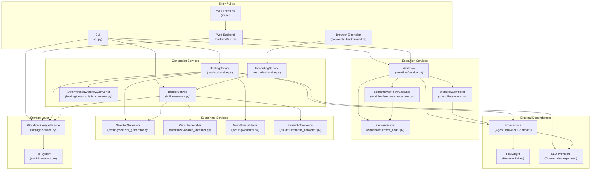
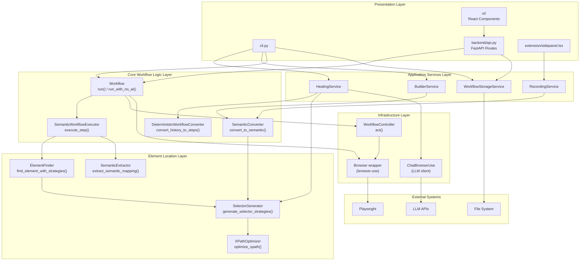
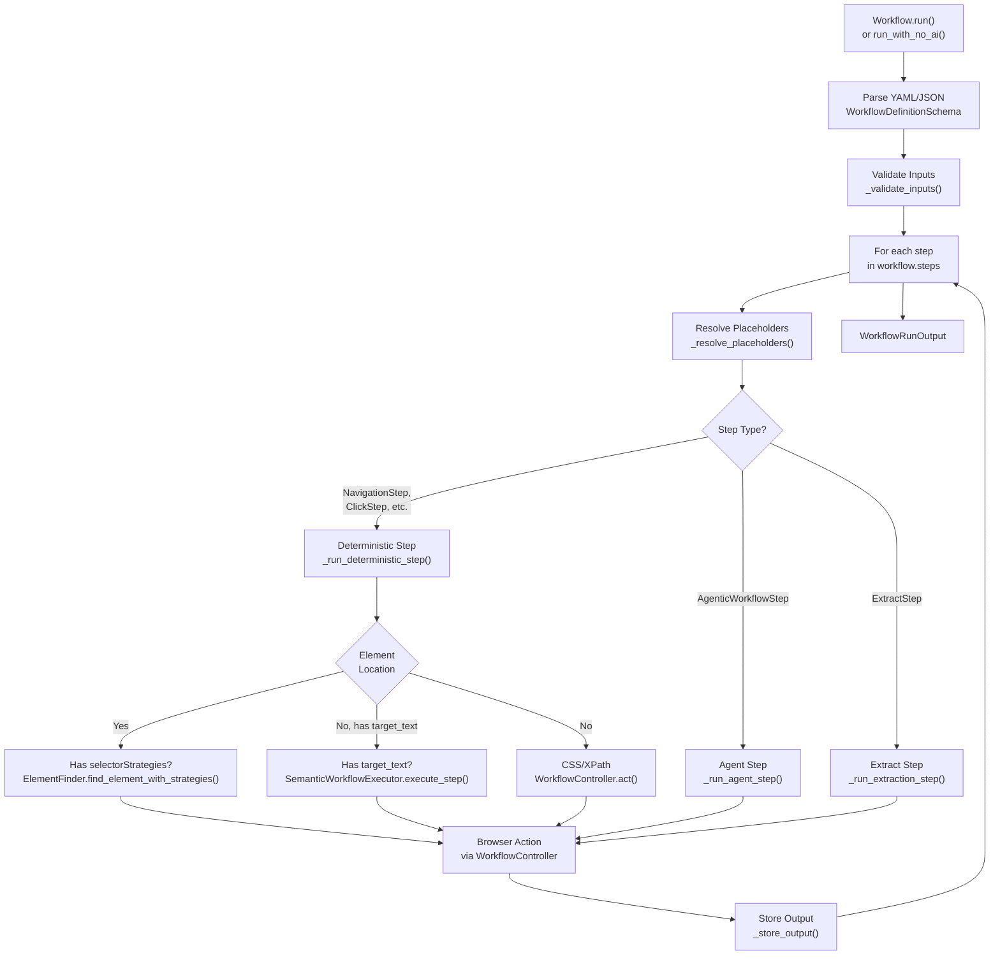
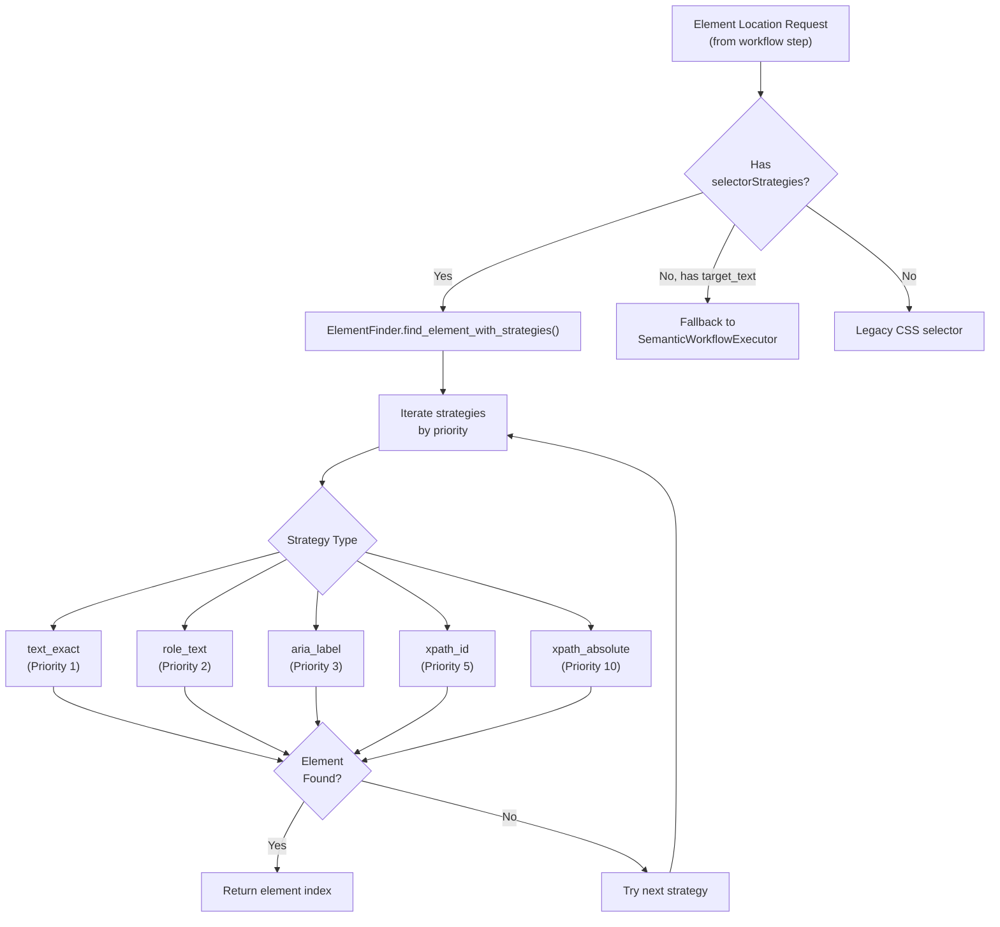
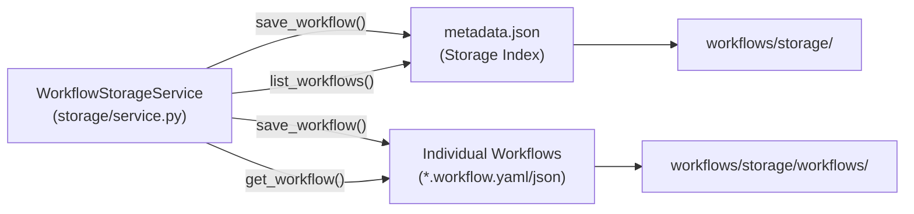
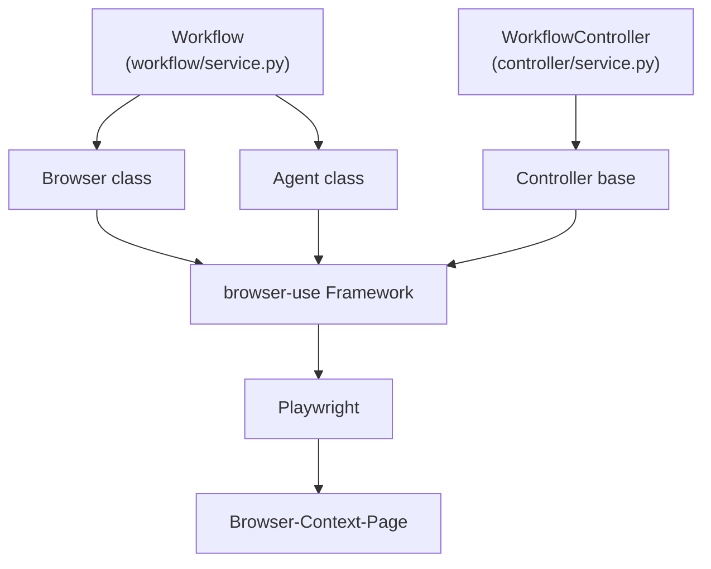
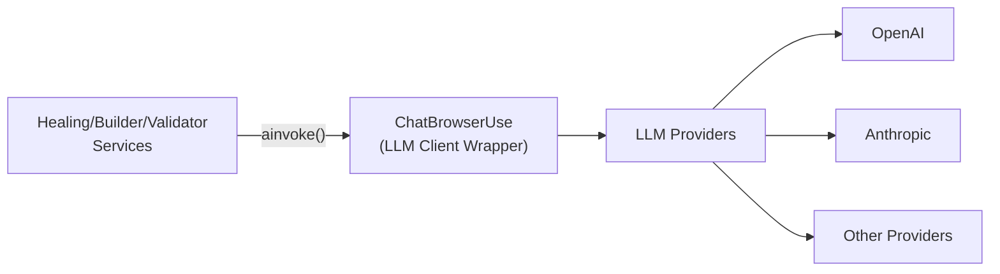
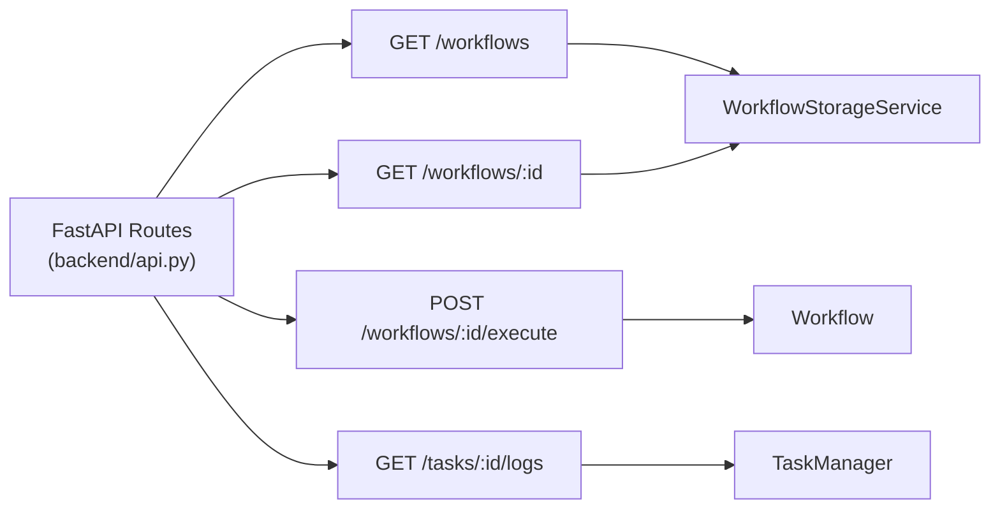
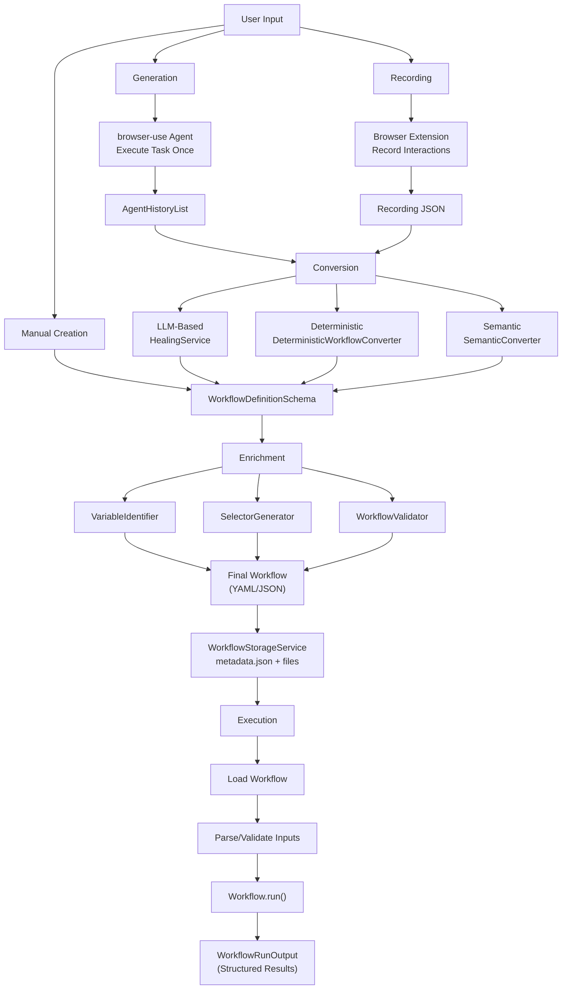

<!-- source: DeepWiki mcp.deepwiki.com · repo browser-use/workflow-use · page 2 System Architecture · fetched 2026-10-30 -->

# System Architecture

<details>
<summary>Relevant source files</summary>

The following files were used as context for generating this wiki page:

- [README.md](README.md)
- [workflows/.gitignore](workflows/.gitignore)
- [workflows/cli.py](workflows/cli.py)
- [workflows/pyproject.toml](workflows/pyproject.toml)
- [workflows/uv.lock](workflows/uv.lock)
- [workflows/workflow_use/healing/service.py](workflows/workflow_use/healing/service.py)
- [workflows/workflow_use/schema/views.py](workflows/workflow_use/schema/views.py)
- [workflows/workflow_use/storage/__init__.py](workflows/workflow_use/storage/__init__.py)
- [workflows/workflow_use/workflow/service.py](workflows/workflow_use/workflow/service.py)

</details>


## Purpose and Scope

This document presents the high-level architecture of the workflow-use system, describing how its major components interact to enable workflow creation, storage, and execution. It covers the system's layered structure, data flow patterns, and integration points with external dependencies.

For detailed information about specific subsystems:
- For the structure of workflow definitions, see [Workflow Definition Schema](#2.1)
- For in-depth descriptions of individual components, see [Core Components Overview](#2.2)
- For the complete workflow lifecycle from creation to execution, see [Workflow Lifecycle](#2.3)

---

## System Overview

The workflow-use system is structured around three core phases: **workflow generation**, **workflow storage**, and **workflow execution**. The system accepts input through multiple interfaces (CLI, Web UI, Browser Extension) and produces deterministic, reusable workflows stored as YAML/JSON files.



**Sources:** [workflows/cli.py:1-1000](), [workflows/workflow_use/workflow/service.py:1-100](), [workflows/workflow_use/healing/service.py:1-100](), [workflows/workflow_use/builder/service.py:1-50](), [workflows/workflow_use/storage/service.py:1-50]()

---

## Core Architectural Layers

The system is organized into distinct architectural layers, each with specific responsibilities:



**Layer Responsibilities:**

| Layer | Purpose | Key Classes |
|-------|---------|-------------|
| Presentation | User interfaces and CLI commands | `cli.py`, `backend/api.py`, React components |
| Application Services | High-level business logic and orchestration | `HealingService`, `BuilderService`, `WorkflowStorageService` |
| Core Workflow Logic | Workflow conversion and execution strategies | `Workflow`, `SemanticWorkflowExecutor`, `DeterministicWorkflowConverter` |
| Element Location | Multi-strategy element finding and selector generation | `ElementFinder`, `SelectorGenerator`, `XPathOptimizer` |
| Infrastructure | Low-level browser and LLM interactions | `WorkflowController`, `Browser`, `ChatBrowserUse` |

**Sources:** [workflows/cli.py:1-100](), [workflows/workflow_use/workflow/service.py:39-106](), [workflows/workflow_use/healing/service.py:29-73](), [workflows/workflow_use/builder/service.py:1-50]()

---

## Data Flow Architecture

### Workflow Generation Flow

```mermaid
flowchart LR
    Input["User Input<br/>(Natural Language<br/>or Recording)"]
    
    Agent["browser-use Agent<br/>Agent.run()"]
    History["AgentHistoryList<br/>(Action History)"]
    
    Converter{"Conversion<br/>Strategy"}
    
    LLMConv["LLM-Based<br/>HealingService.create_workflow_definition()"]
    DetConv["Deterministic<br/>DeterministicWorkflowConverter.convert_history_to_steps()"]
    
    Schema["WorkflowDefinitionSchema<br/>(workflow/schema/views.py)"]
    
    Enrich["Enrichment Pipeline"]
    VarID["VariableIdentifier.identify_variables_in_workflow()"]
    SelGen["SelectorGenerator.generate_selector_strategies()"]
    Valid["WorkflowValidator.validate_and_correct()"]
    
    Final["Final Workflow<br/>(YAML/JSON)"]
    Storage["WorkflowStorageService.save_workflow()"]
    
    Input --> Agent
    Agent --> History
    History --> Converter
    
    Converter -->|"use_deterministic=True"| DetConv
    Converter -->|"use_deterministic=False"| LLMConv
    
    DetConv --> Schema
    LLMConv --> Schema
    
    Schema --> Enrich
    Enrich --> VarID
    Enrich --> SelGen
    Enrich --> Valid
    
    VarID --> Final
    SelGen --> Final
    Valid --> Final
    
    Final --> Storage
```



**Key Data Transformations:**

1. **Natural Language → Agent Actions**: `HealingService.generate_workflow_from_prompt()` creates an `Agent` that executes the task once
2. **Agent Actions → History**: Browser interactions are captured as `AgentHistoryList` containing `DOMInteractedElement` objects
3. **History → Steps**: Two conversion paths:
   - **LLM-based** ([healing/service.py:276-329]()): Uses `WorkflowDefinitionSchema` structured output
   - **Deterministic** ([healing/deterministic_converter.py:1-200]()): Direct mapping without LLM
4. **Steps → Enriched Workflow**: Post-processing adds:
   - Variables via `VariableIdentifier` ([workflow/variable_identifier.py:1-100]())
   - Multi-strategy selectors via `SelectorGenerator` ([healing/selector_generator.py:1-200]())
   - Quality validation via `WorkflowValidator` ([healing/validator.py:1-150]())

**Sources:** [workflows/workflow_use/healing/service.py:419-526](), [workflows/workflow_use/healing/deterministic_converter.py:1-100](), [workflows/workflow_use/healing/selector_generator.py:1-100]()

---

### Workflow Execution Flow



**Execution Modes:**

| Mode | Method | Uses AI? | Element Finding Strategy |
|------|--------|----------|--------------------------|
| Standard | `Workflow.run()` | Yes (fallback) | `selectorStrategies` → `target_text` → CSS/XPath |
| No-AI | `Workflow.run_with_no_ai()` | No | Pure semantic via `SemanticWorkflowExecutor` |
| Tool | `Workflow.run_as_tool()` | Yes (input parsing) | Standard mode with LLM-extracted inputs |

**Sources:** [workflows/workflow_use/workflow/service.py:851-1088](), [workflows/workflow_use/workflow/semantic_executor.py:1-200](), [workflows/workflow_use/workflow/element_finder.py:1-150]()

---

## Multi-Strategy Element Finding System

The element finding system implements a priority-based fallback mechanism for robust element location across page changes:



**Strategy Priority Table:**

| Priority | Strategy Type | Description | Robustness |
|----------|---------------|-------------|------------|
| 1 | `text_exact` | Exact visible text match | High |
| 2 | `role_text` | ARIA role + text combination | High |
| 3 | `aria_label` | ARIA label attribute | Medium |
| 5 | `xpath_id` | XPath using ID attributes | Medium |
| 7 | `text_fuzzy` | Fuzzy text matching | Low |
| 10 | `xpath_absolute` | Absolute XPath (fallback) | Very Low |

**Sources:** [workflows/workflow_use/workflow/element_finder.py:1-200](), [workflows/workflow_use/healing/selector_generator.py:1-250](), [workflows/workflow_use/healing/xpath_optimizer.py:1-150]()

---

## Storage and Persistence

The system uses a file-based storage system with JSON metadata and individual workflow files:



**Storage Structure:**

```
workflows/storage/
├── metadata.json              # Searchable index of all workflows
└── workflows/
    ├── abc123.workflow.yaml   # Individual workflow files
    ├── def456.workflow.json
    └── ...
```

**Metadata Schema:**

Each entry in `metadata.json` contains:
- `id`: Unique workflow identifier
- `name`: Workflow name
- `description`: Workflow description
- `generation_mode`: One of `browser_use`, `recording`, `manual`
- `original_task`: Original task prompt (for generated workflows)
- `created_at`: ISO timestamp
- `tags`: List of tags
- `input_schema`: List of input parameters

**Sources:** [workflows/workflow_use/storage/service.py:1-200]()

---

## External Dependencies Integration

### Browser Automation Stack



**Integration Points:**

| Component | browser-use Class | Purpose |
|-----------|-------------------|---------|
| `Workflow` | `Browser` | Browser session management |
| `Workflow` | `Agent` | AI-driven task execution (generation phase) |
| `WorkflowController` | `Controller` | Base class for action execution |
| `HealingService` | `Agent`, `AgentHistoryList` | Workflow generation from history |

**Sources:** [workflows/workflow_use/workflow/service.py:1-100](), [workflows/workflow_use/controller/service.py:1-100](), [workflows/pyproject.toml:14-25]()

---

### LLM Provider Integration



**LLM Usage Points:**

1. **Workflow Generation** ([healing/service.py:276-329]()): `HealingService.create_workflow_definition()` uses structured output
2. **Variable Extraction** ([healing/variable_extractor.py:1-100]()): `VariableExtractor.suggest_variables()`
3. **Workflow Validation** ([healing/validator.py:1-150]()): `WorkflowValidator.validate_and_correct()`
4. **Content Extraction** ([workflow/service.py:354-420]()): `Workflow._run_extraction_step()`
5. **Tool Input Parsing** ([workflow/tool_executor.py:1-100]()): `run_as_tool()` extracts inputs from prompts

**Sources:** [workflows/workflow_use/healing/service.py:1-100](), [workflows/cli.py:34-45](), [workflows/workflow_use/workflow/service.py:354-420]()

---

## Entry Point Architecture

The system provides multiple entry points for different use cases:

### CLI Entry Points

| Command | Primary Service | Use Case |
|---------|----------------|----------|
| `generate-workflow` | `HealingService` | AI-driven workflow generation |
| `create-workflow` | `BuilderService`, `RecordingService` | Recording-based workflow creation |
| `run-workflow` | `Workflow.run()` | Execute with predefined inputs |
| `run-as-tool` | `Workflow.run_as_tool()` | Execute with LLM-parsed inputs |
| `run-workflow-csv` | Bulk execution | Parallel CSV-based execution |
| `launch-gui` | FastAPI + React | Start web interface |

**Sources:** [workflows/cli.py:1-1000]()

### Web API Entry Points



**API Endpoints:**

- `GET /workflows`: List all workflows
- `GET /workflows/{workflow_id}`: Get workflow details
- `POST /workflows/{workflow_id}/execute`: Execute workflow with inputs
- `GET /tasks/{task_id}/logs`: Stream execution logs (WebSocket-compatible)

**Sources:** [workflows/backend/api.py:1-300]()

---

## Data Flow: Complete System Pipeline



**Pipeline Stages:**

1. **Input** (3 modes): Natural language prompt, browser recording, or manual YAML/JSON
2. **Generation**: Task executed once to capture interaction patterns
3. **Conversion**: Transform captured data into `WorkflowDefinitionSchema`
4. **Enrichment**: Add variables, selector strategies, and validation
5. **Storage**: Persist to file system with metadata index
6. **Execution**: Load, validate inputs, execute steps, return results

**Sources:** [workflows/workflow_use/healing/service.py:419-526](), [workflows/workflow_use/builder/service.py:1-200](), [workflows/workflow_use/workflow/service.py:851-1088](), [workflows/workflow_use/storage/service.py:1-200]()

---

