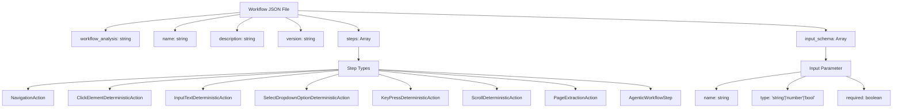
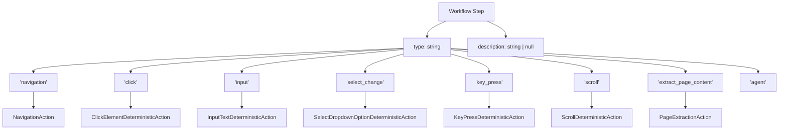
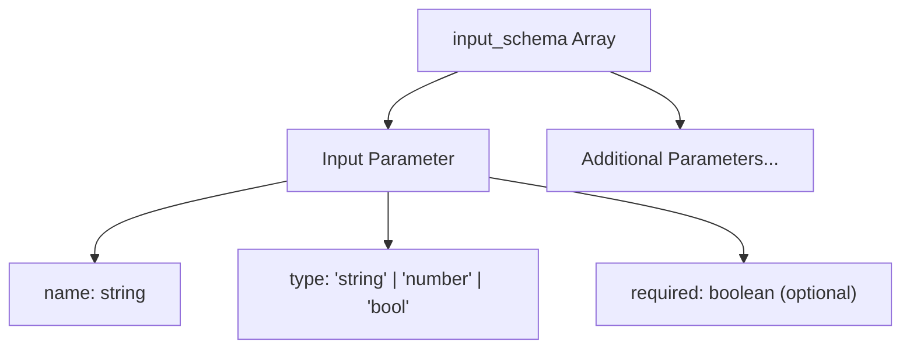

<!-- source: DeepWiki mcp.deepwiki.com · repo browser-use/workflow-use · page 2.1 Workflow Definition Schema · fetched 2026-10-30 -->

# Workflow Definition Schema

<details>
<summary>Relevant source files</summary>

The following files were used as context for generating this wiki page:

- [workflows/cli.py](workflows/cli.py)
- [workflows/examples/scripts/generate_workflow.py](workflows/examples/scripts/generate_workflow.py)
- [workflows/examples/workflows/basic/example.workflow.yaml](workflows/examples/workflows/basic/example.workflow.yaml)
- [workflows/examples/workflows/basic/pure_semantic.workflow.yaml](workflows/examples/workflows/basic/pure_semantic.workflow.yaml)
- [workflows/examples/workflows/form_filling/semantic_form_fill.workflow.yaml](workflows/examples/workflows/form_filling/semantic_form_fill.workflow.yaml)
- [workflows/tests/test_go_back.workflow.yaml](workflows/tests/test_go_back.workflow.yaml)
- [workflows/workflow_use/healing/prompts/workflow_creation_prompt.md](workflows/workflow_use/healing/prompts/workflow_creation_prompt.md)
- [workflows/workflow_use/healing/prompts/workflow_validation_prompt.md](workflows/workflow_use/healing/prompts/workflow_validation_prompt.md)
- [workflows/workflow_use/healing/tests/test_validator.py](workflows/workflow_use/healing/tests/test_validator.py)
- [workflows/workflow_use/schema/views.py](workflows/workflow_use/schema/views.py)
- [workflows/workflow_use/workflow/service.py](workflows/workflow_use/workflow/service.py)

</details>


The Workflow Definition Schema is the structured JSON format that defines how workflows are stored, validated, and executed within the workflow-use system. This schema serves as the contract between the recording process, the workflow builder, and the execution engine.

For information about how workflows are recorded and converted to this schema, see [Recording Workflows](#3.1). For details on how this schema is executed, see [Workflow Execution](#5).

## Schema Overview

Workflow definitions are stored as JSON files that define the structure and execution sequence for browser automation tasks. The schema is validated through Pydantic models defined across multiple files, with step action models in [workflow_use/controller/views.py]() and execution result models in [workflow_use/workflow/views.py](). The schema defines a hierarchical structure with metadata, input parameters, and an ordered list of executable steps.

### Top-Level Workflow Structure



**Workflow JSON Schema Structure**

Sources: [examples/form-filling/v1.json](), [workflow_use/controller/views.py:30-83]()

The workflow JSON file contains the following top-level fields:

| Field | Type | Description |
|-------|------|-------------|
| `workflow_analysis` | `string` | AI analysis of the workflow from the builder service |
| `name` | `string` | Human-readable workflow name |
| `description` | `string` | Brief description of workflow purpose |
| `version` | `string` | Version identifier (typically "1.0") |
| `steps` | `Array` | Ordered list of executable steps |
| `input_schema` | `Array` | Runtime input parameter definitions |

## Step Types and Actions

The schema supports deterministic browser actions and agentic AI-powered tasks. Each step corresponds to a registered action in the `WorkflowController` that performs the actual browser automation.



**Step Type Mapping to Controller Actions**

Sources: [workflow_use/controller/service.py:64-242](), [workflow_use/controller/views.py:30-83]()

### Common Step Properties

All workflow steps include standard fields alongside action-specific parameters:

- **`type`**: String literal identifying the action type (required)
- **`description`**: Optional human-readable comment about the step's purpose
- **Recording metadata**: Steps may include `timestamp`, `tabId`, and other recording context

The Pydantic models use `extra = 'ignore'` configuration to allow additional recorder payload fields to pass through without validation errors.

### Browser Action Steps

These steps correspond directly to browser automation actions that can be executed deterministically. Each action type has specific required parameters for targeting elements and providing input.

```mermaid
graph TB
    ActionTypes["Browser Action Types"]
    
    ActionTypes --> navigation["NavigationAction"]
    navigation --> nav_url["url: string"]
    
    ActionTypes --> click["ClickElementDeterministicAction"] 
    click --> click_css["cssSelector: string"]
    click --> click_meta["xpath, elementTag, elementText (optional)"]
    
    ActionTypes --> input["InputTextDeterministicAction"]
    input --> input_css["cssSelector: string"]
    input --> input_value["value: string"]
    input --> input_meta["xpath, elementTag, elementText (optional)"]
    
    ActionTypes --> select["SelectDropdownOptionDeterministicAction"]
    select --> select_css["cssSelector: string"] 
    select --> select_value["selectedValue: string"]
    select --> select_text["selectedText: string"]
    
    ActionTypes --> keypress["KeyPressDeterministicAction"]
    keypress --> key_css["cssSelector: string"]
    keypress --> key_key["key: string"]
    
    ActionTypes --> scroll["ScrollDeterministicAction"]
    scroll --> scroll_x["scrollX: number"]
    scroll --> scroll_y["scrollY: number"]
    
    ActionTypes --> extract["PageExtractionAction"]
    extract --> extract_goal["goal: string"]
```

**Browser Action Parameters**

Sources: [workflow_use/controller/views.py:30-83]()

#### Navigation Steps
Navigate to a specific URL, supporting dynamic URL construction with input variables.

```json
{
  "type": "navigation",
  "url": "https://v0-complex-form-example.vercel.app/",
  "description": "Navigate to https://v0-complex-form-example.vercel.app/"
}
```

#### Element Interaction Steps  
Target and interact with page elements using CSS selectors or semantic text targeting.

```json
{
  "type": "click",
  "cssSelector": "#submit-button",
  "xpath": "//button[@id='submit-button']",
  "elementTag": "button", 
  "elementText": "Submit",
  "description": "Click element"
}
```

#### Text Input Steps
Fill form fields and input elements with specified values.

```json
{
  "type": "input",
  "cssSelector": "#username", 
  "value": "user@example.com",
  "description": "Input element"
}
```

### Agentic Steps

Agentic steps delegate complex tasks to AI agents when deterministic actions cannot handle dynamic or variable content. The workflow builder generates these automatically when tasks involve selecting from changing lists or evaluating content.

```json
{
  "type": "agent", 
  "task": "Select the restaurant named {{restaurant_name}} from the search results",
  "max_steps": 5,
  "description": "The list of restaurants varies with each search, requiring the agent to find the specified one"
}
```

Sources: [workflow_use/builder/prompts.py:26-36]()

## Element Targeting Strategies

The schema supports two primary targeting approaches: CSS selector-based and semantic text-based targeting. This dual approach provides both precision and reliability in different scenarios.

### CSS Selector Targeting

Traditional selector-based targeting uses precise CSS selectors with optional metadata for context:

| Field | Purpose | Required |
|-------|---------|----------|
| `cssSelector` | Primary element selector | Yes |
| `xpath` | Alternative XPath selector | No |
| `elementTag` | HTML tag type | No |
| `elementText` | Element visible text content | No |
| `frameUrl` | Frame context if in iframe | No |

### Semantic Text Targeting  

Semantic targeting identifies elements by their visible text content, providing better resilience to UI changes:

```json
{
  "type": "click",
  "target_text": "Start Application",
  "description": "Click element"
}
```

The `WorkflowController` uses the `get_best_element_handle` function to try multiple selector strategies, falling back from CSS selectors to semantic targeting when elements cannot be found.

Sources: [workflow_use/controller/utils.py](), [examples/form-filling/v1.fully-semantic.json:14-16]()

### Input Variable Interpolation

Steps support dynamic values through input variable interpolation using `{{variable_name}}` double-brace syntax:

```json
{
  "type": "input",
  "cssSelector": "#search",
  "value": "{{search_term}}",
  "description": "Enter search term from input"
}
```

This allows workflows to be parameterized with runtime inputs, making them reusable across different contexts and data.

Sources: [workflow_use/builder/prompts.py:44-49]()

### Page Content Extraction

The `extract_page_content` action type uses LLMs to extract specific information from web pages based on natural language goals:

```json
{
  "type": "extract_page_content",
  "goal": "Extract all company names and their descriptions in structured format",
  "description": "Extract page content to retrieve specific information"
}
```

The action converts page content to markdown and uses the specified goal to guide extraction, returning structured JSON data.

Sources: [workflow_use/controller/service.py:210-242]()

## Input Schema Definition

Workflows define runtime parameters through the `input_schema` array. This follows JSON Schema Draft-7 subset semantics for type validation and parameter specification:



**Input Parameter Structure**

Example input schema with various parameter types:
```json
{
  "input_schema": [
    {
      "name": "search_term", 
      "type": "string",
      "required": true
    },
    {
      "name": "max_results",
      "type": "number", 
      "required": false
    },
    {
      "name": "include_images",
      "type": "bool"
    }
  ]
}
```

The workflow builder automatically generates input schemas based on detected dynamic values and user goals, aiming to include at least one input parameter unless the workflow is explicitly static.

Sources: [workflow_use/builder/prompts.py:16-23](), [examples/form-filling/v1.json:325]()

## Schema Validation and Loading

The schema includes utility methods for loading and validating workflow files:

```python
# Load workflow from JSON file with validation
workflow = WorkflowDefinitionSchema.load_from_json("path/to/workflow.json")
```

The Pydantic models provide automatic validation ensuring:
- Required fields are present
- Type constraints are enforced
- At least one step is defined (`min_length=1`)
- Step types match the defined literals

Sources: [workflows/workflow_use/schema/views.py:163-166]()

---

