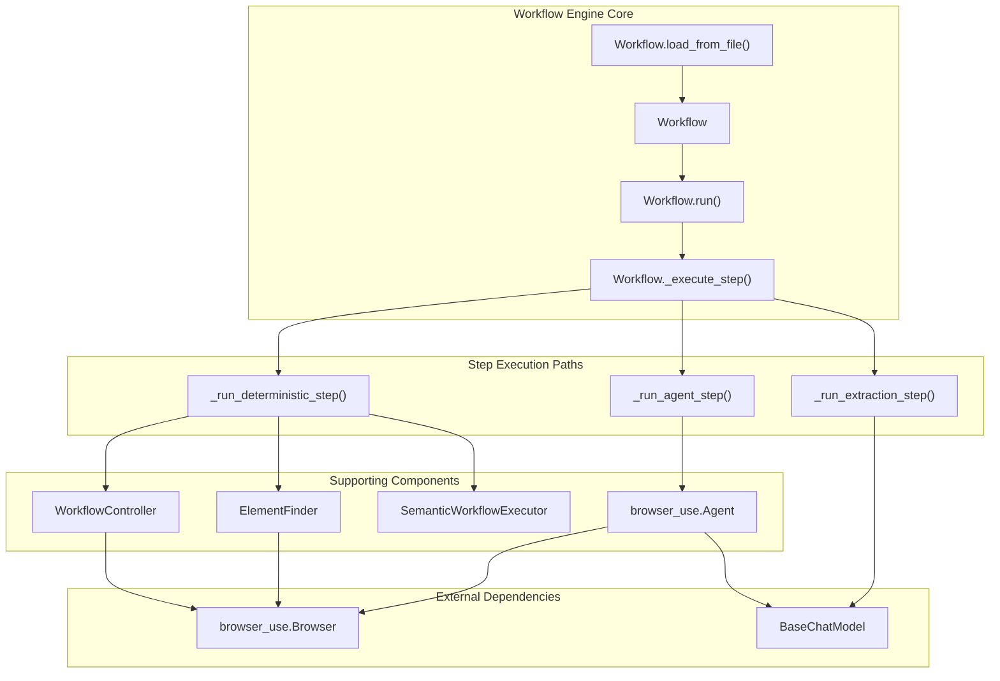
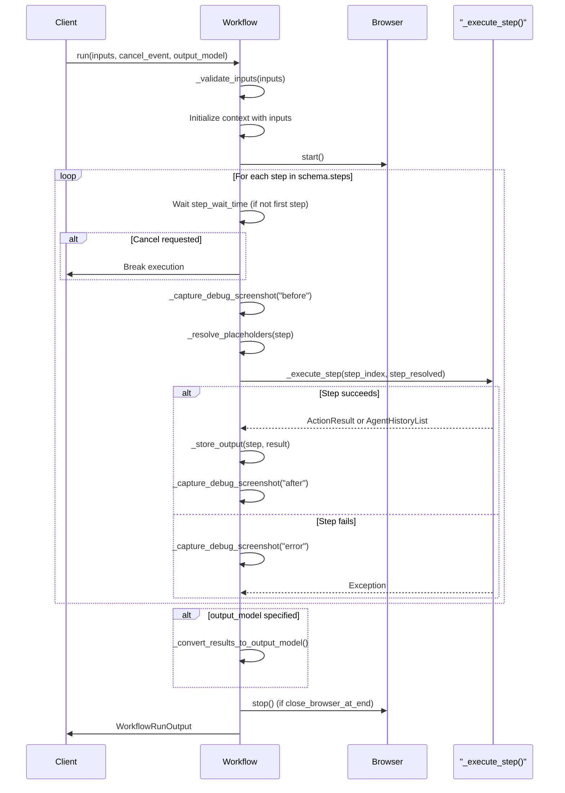
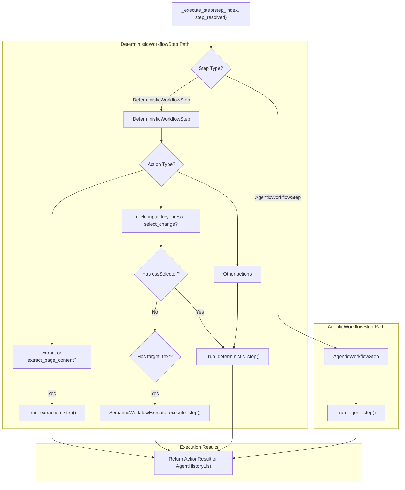
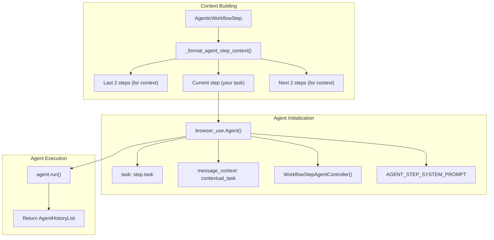
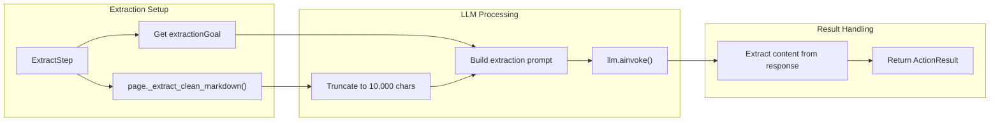
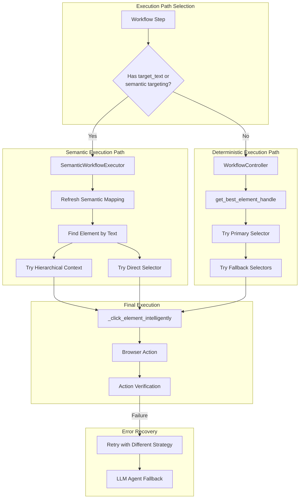

<!-- source: DeepWiki mcp.deepwiki.com · repo browser-use/workflow-use · page 2.2 Core Components Overview · fetched 2026-10-30 -->

# Core Engine Components

<details>
<summary>Relevant source files</summary>

The following files were used as context for generating this wiki page:

- [workflows/cli.py](workflows/cli.py)
- [workflows/pyproject.toml](workflows/pyproject.toml)
- [workflows/uv.lock](workflows/uv.lock)
- [workflows/workflow_use/healing/service.py](workflows/workflow_use/healing/service.py)
- [workflows/workflow_use/recorder/recorder.py](workflows/workflow_use/recorder/recorder.py)
- [workflows/workflow_use/schema/views.py](workflows/workflow_use/schema/views.py)
- [workflows/workflow_use/workflow/semantic_executor.py](workflows/workflow_use/workflow/semantic_executor.py)
- [workflows/workflow_use/workflow/semantic_extractor.py](workflows/workflow_use/workflow/semantic_extractor.py)
- [workflows/workflow_use/workflow/service.py](workflows/workflow_use/workflow/service.py)

</details>


This document covers the core execution engine that powers workflow automation in the workflow-use system. The primary component is the `Workflow` class, which orchestrates the execution of workflow steps by coordinating between deterministic actions, AI-powered agent steps, and multi-strategy element finding.

For information about workflow definition schemas and step types, see [Workflow Definition Schema](#2.1). For details about semantic execution and element finding strategies, see [Workflow Execution](#5).

## Component Overview

The core execution engine centers around the `Workflow` class, which coordinates several supporting components:

| Component | Class/Module | Purpose |
|-----------|-------------|---------|
| **Workflow Engine** | `Workflow` | Main orchestrator that executes workflow steps sequentially |
| **Workflow Controller** | `WorkflowController` | Executes deterministic browser actions |
| **Element Finder** | `ElementFinder` | Multi-strategy element location with fallbacks |
| **Semantic Executor** | `SemanticWorkflowExecutor` | Text-based element targeting (fallback mode) |

### Core Architecture



**Sources:** [workflows/workflow_use/workflow/service.py:39-106](), [workflows/workflow_use/workflow/service.py:851-945](), [workflows/workflow_use/workflow/service.py:630-720]()

## The Workflow Class

The `Workflow` class serves as the main orchestrator for workflow execution. It loads workflow definitions, validates inputs, manages execution context, and coordinates between different execution strategies.

### Initialization and Configuration

The `Workflow` class accepts extensive configuration options to control execution behavior:

```mermaid
graph TB
    subgraph "Workflow Initialization"
        init["Workflow.__init__()"]
        
        schema["workflow_schema: WorkflowDefinitionSchema"]
        controller["controller: WorkflowController | None"]
        browser["browser: Browser | None"]
        llm["llm: BaseChatModel"]
        page_llm["page_extraction_llm: BaseChatModel | None"]
        
        init --> schema
        init --> controller
        init --> browser
        init --> llm
        init --> page_llm
    end
    
    subgraph "Configuration Options"
        fallback["fallback_to_agent: bool = True"]
        cloud["use_cloud: bool = False"]
        debug["debug: bool = False"]
        wait_time["step_wait_time: float | None"]
        
        init --> fallback
        init --> cloud
        init --> debug
        init --> wait_time
    end
    
    subgraph "Internal Components"
        element_finder["ElementFinder()"]
        context["context: dict[str, Any]"]
        input_model["_build_input_model()"]
        
        init --> element_finder
        init --> context
        init --> input_model
    end
```



**Key Parameters:**

| Parameter | Type | Default | Purpose |
|-----------|------|---------|---------|
| `workflow_schema` | `WorkflowDefinitionSchema` | Required | The parsed workflow definition |
| `controller` | `WorkflowController \| None` | `WorkflowController()` | Handles deterministic actions |
| `browser` | `Browser \| None` | `Browser()` | Browser automation instance |
| `llm` | `BaseChatModel` | Required | LLM for agent steps and fallback |
| `page_extraction_llm` | `BaseChatModel \| None` | None | Optional separate LLM for page extraction |
| `fallback_to_agent` | `bool` | `True` | Whether to use agent fallback on failures |
| `use_cloud` | `bool` | `False` | Use browser-use cloud browser service |
| `debug` | `bool` | `False` | Enable debug mode with screenshots |
| `step_wait_time` | `float \| None` | `0.1` or from schema | Time to wait between steps |

**Sources:** [workflows/workflow_use/workflow/service.py:42-106]()

### Loading Workflows

The `Workflow` class provides a class method for loading workflows from files:

```python
# Class method signature
@classmethod
def load_from_file(
    cls,
    file_path: str | Path,
    llm: BaseChatModel,
    *,
    controller: WorkflowController | None = None,
    browser: Browser | None = None,
    page_extraction_llm: BaseChatModel | None = None,
    use_cloud: bool = False,
    debug: bool = False,
    debug_log_folder: str | Path | None = None,
    step_wait_time: float = 0.1,
) -> Workflow
```

This method:
1. Loads the workflow file (JSON or YAML)
2. Parses it into `WorkflowDefinitionSchema`
3. Initializes a `Workflow` instance with the schema

**Sources:** [workflows/workflow_use/workflow/service.py:108-136]()

## Step Execution Flow

The `Workflow.run()` method orchestrates the execution of all workflow steps sequentially. It manages context, handles errors, and provides optional debug capabilities.

### Main Execution Loop



**Sources:** [workflows/workflow_use/workflow/service.py:851-945]()

### Step Execution Decision Tree

The `_execute_step()` method routes each step to the appropriate execution path based on step type and available selectors:



**Sources:** [workflows/workflow_use/workflow/service.py:630-720]()

## Execution Paths

The `Workflow` class implements three distinct execution paths for different step types.

### Deterministic Step Execution

The `_run_deterministic_step()` method executes deterministic actions through the `WorkflowController`:

```mermaid
flowchart LR
    subgraph "Step Processing"
        step["DeterministicWorkflowStep"]
        extract_params["Extract action parameters"]
        filter_metadata["Filter workflow metadata fields"]
        
        step --> extract_params
        extract_params --> filter_metadata
    end
    
    subgraph "Multi-Strategy Element Finding"
        has_strategies{Has selectorStrategies?}
        find_element["ElementFinder.find_element_with_strategies()"]
        update_params["Update params with found index"]
        
        filter_metadata --> has_strategies
        has_strategies -->|Yes| find_element
        find_element --> update_params
    end
    
    subgraph "Controller Execution"
        create_model["registry.create_action_model()"]
        controller_act["controller.act()"]
        
        has_strategies -->|No| create_model
        update_params --> create_model
        create_model --> controller_act
    end
    
    subgraph "Post-Action Handling"
        wait_stable["Wait for page to stabilize"]
        wait_next["Wait for next step's element"]
        
        controller_act --> wait_stable
        wait_stable --> wait_next
    end
```



**Key Features:**

1. **Parameter Filtering**: Removes workflow metadata fields (`description`, `output`, `cssSelector`, `selectorStrategies`, etc.) before passing to controller
2. **Multi-Strategy Finding**: If `selectorStrategies` exists, attempts element location with multiple fallback strategies
3. **Page Stabilization**: Waits for network idle after navigation/click actions
4. **Next Element Pre-loading**: Proactively waits for the next step's target element

**Sources:** [workflows/workflow_use/workflow/service.py:139-283]()

### Agent Step Execution

The `_run_agent_step()` method delegates complex tasks to an AI agent:



**Context Window**: The agent receives a 5-step context window (2 before, current, 2 after) to understand its place in the workflow without executing additional steps.

**Sources:** [workflows/workflow_use/workflow/service.py:285-352](), [workflows/workflow_use/workflow/service.py:329-352]()

### Extraction Step Execution

The `_run_extraction_step()` method provides lightweight LLM-based content extraction without spawning a full agent:



**Performance Benefits**: This approach is 10-100x faster than agent-based extraction because it:
- Skips agent initialization overhead
- Makes a single LLM call instead of multiple iterations
- Uses simplified prompting without action selection

**Sources:** [workflows/workflow_use/workflow/service.py:354-419]()

## Component Interaction Flow

The core components work together to execute workflow steps with maximum reliability through layered fallback mechanisms:

### Execution Decision Tree



**Sources:** [workflows/workflow_use/workflow/semantic_executor.py:393-491](), [workflows/workflow_use/controller/service.py:81-101](), [workflows/workflow_use/workflow/semantic_executor.py:493-650]()

### Action Result Flow

Both execution paths return standardized `ActionResult` objects:

| Component | Success Result | Error Handling |
|-----------|----------------|----------------|
| `SemanticWorkflowExecutor` | `ActionResult(extracted_content=msg, include_in_memory=True)` | Raises `Exception` with detailed error context |
| `WorkflowController` | `ActionResult(extracted_content=msg, include_in_memory=True)` | Raises `Exception` with selector and error details |

**Sources:** [workflows/workflow_use/workflow/semantic_executor.py:485-490](), [workflows/workflow_use/controller/service.py:95-101](), [workflows/workflow_use/workflow/views.py:9-14]()

---

