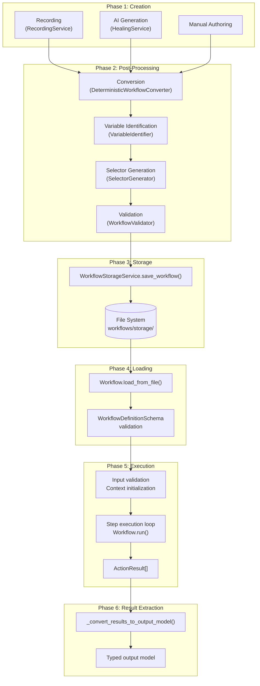
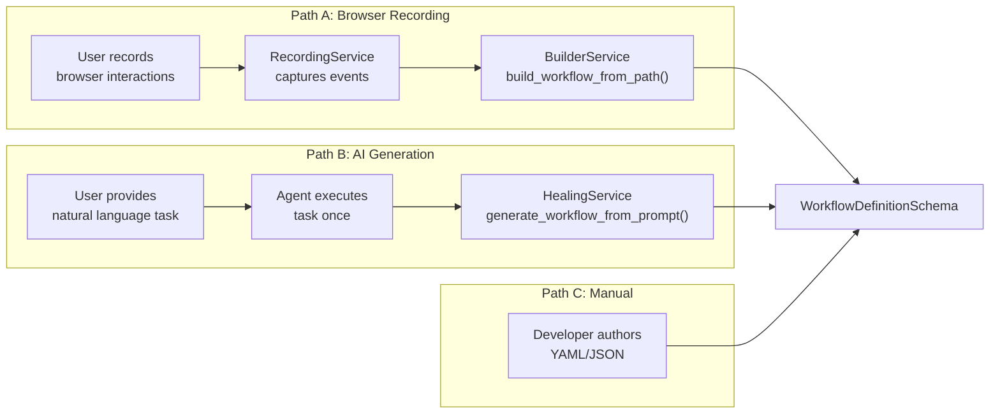
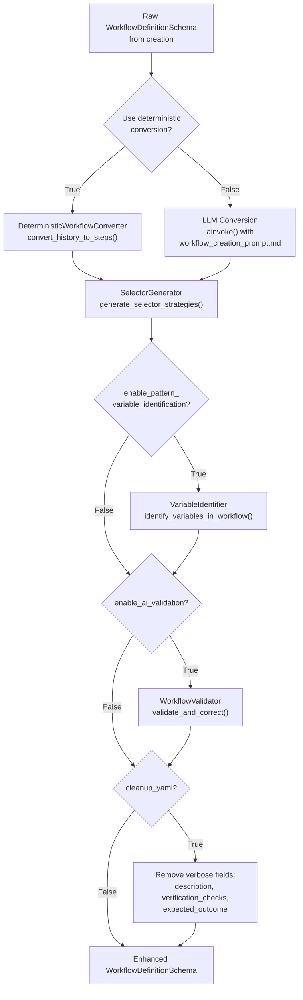
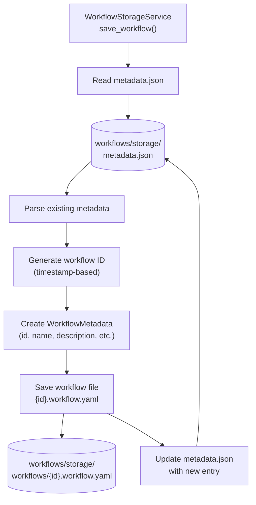
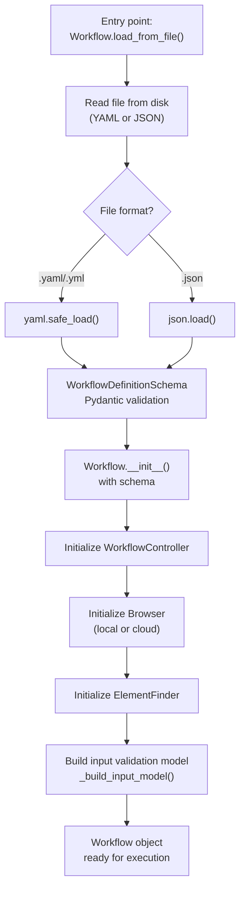
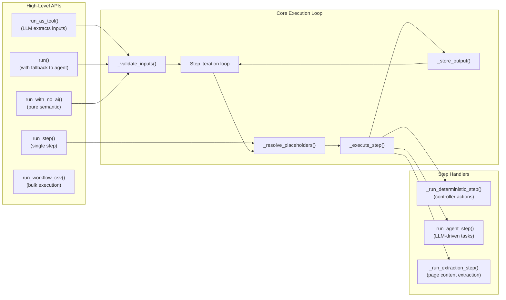
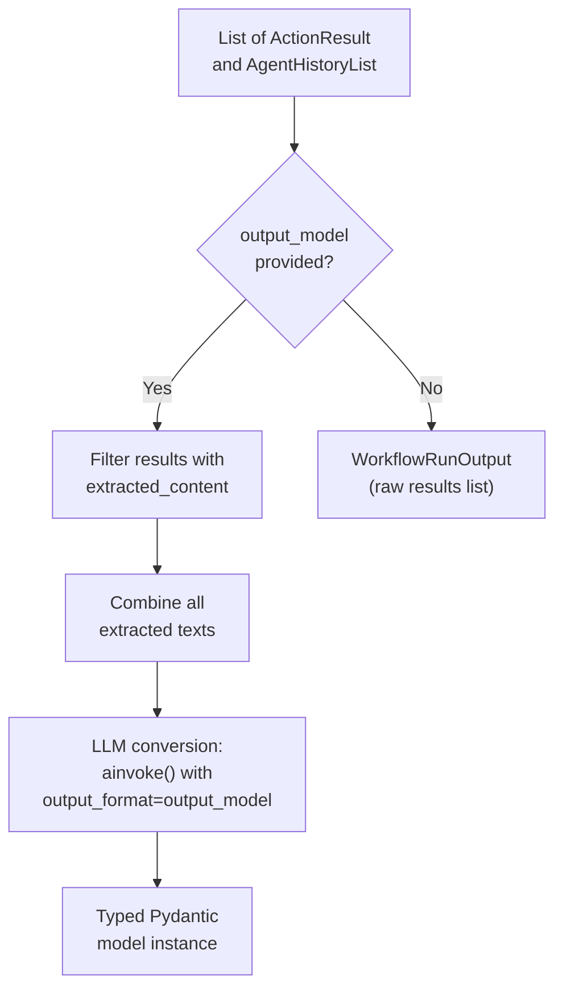

<!-- source: DeepWiki mcp.deepwiki.com · repo browser-use/workflow-use · page 2.3 Workflow Lifecycle · fetched 2026-10-30 -->

# Workflow Lifecycle

<details>
<summary>Relevant source files</summary>

The following files were used as context for generating this wiki page:

- [README.md](README.md)
- [workflows/.gitignore](workflows/.gitignore)
- [workflows/cli.py](workflows/cli.py)
- [workflows/pyproject.toml](workflows/pyproject.toml)
- [workflows/uv.lock](workflows/uv.lock)
- [workflows/workflow_use/healing/service.py](workflows/workflow_use/healing/service.py)
- [workflows/workflow_use/schema/views.py](workflows/workflow_use/schema/views.py)
- [workflows/workflow_use/storage/__init__.py](workflows/workflow_use/storage/__init__.py)
- [workflows/workflow_use/workflow/service.py](workflows/workflow_use/workflow/service.py)

</details>


## Purpose and Scope

This page documents the complete lifecycle of a workflow in the workflow-use system, from initial creation through execution and result extraction. It traces how workflows are born (via recording, AI generation, or manual creation), transformed (through validation and enhancement), persisted (to storage), loaded, executed, and ultimately produce structured outputs.

For detailed information about the structure of workflow definitions themselves, see [Workflow Definition Schema](#2.1). For execution strategies and modes, see [Workflow Execution](#5). For storage implementation details, see [Workflow Storage and Management](#9.3).

---

## Lifecycle Overview

A workflow passes through six distinct phases during its lifetime:

| Phase | Description | Key Components | Output |
|-------|-------------|----------------|--------|
| **1. Creation** | Workflow generated from recording, AI prompt, or manual authoring | `HealingService`, `BuilderService`, `RecordingService` | Raw workflow definition |
| **2. Post-Processing** | Conversion, validation, variable extraction, selector generation | `DeterministicWorkflowConverter`, `WorkflowValidator`, `VariableIdentifier`, `SelectorGenerator` | Enhanced workflow definition |
| **3. Storage** | Persistence to file system with metadata indexing | `WorkflowStorageService` | Stored workflow file + metadata entry |
| **4. Loading** | Parsing from YAML/JSON and schema validation | `Workflow.load_from_file()`, `WorkflowDefinitionSchema` | In-memory `Workflow` object |
| **5. Execution** | Step-by-step browser automation with input resolution | `Workflow.run()`, `Workflow.run_with_no_ai()`, `SemanticWorkflowExecutor` | List of `ActionResult` or `AgentHistoryList` |
| **6. Result Extraction** | Converting execution results to structured output | `Workflow._convert_results_to_output_model()` | Typed Pydantic model instance |



**Sources:** [workflow_use/workflow/service.py:39-1367](), [workflow_use/healing/service.py:29-551](), [workflow_use/storage/service.py:1-300]()

---

## Phase 1: Creation

Workflows are created through three distinct paths, all converging on a `WorkflowDefinitionSchema` object.

### Creation Path Comparison



**Sources:** [workflow_use/healing/service.py:420-551](), [workflow_use/builder/service.py:1-500](), [cli.py:65-150]()

### Recording Path

Browser recording uses the extension to capture user interactions, then converts them to workflow steps:

1. **Extension captures events** - `RecordingService` records DOM interactions with semantic information
2. **Recording saved as JSON** - Raw events stored with timestamps, CSS selectors, and target text
3. **BuilderService.build_workflow_from_path()** - Converts recording to `WorkflowDefinitionSchema`
4. **Semantic conversion** - CSS selectors transformed to `target_text` fields for robustness

The recording format includes:
- Navigation events with URLs
- Click events with `target_text` and container context
- Input events with field labels and values
- Scroll events with coordinates

**Sources:** [workflow_use/recorder/service.py:1-200](), [workflow_use/builder/service.py:50-300](), [cli.py:152-243]()

### AI Generation Path

AI-driven generation executes a task once to learn the workflow:

1. **HealingService.generate_workflow_from_prompt()** - Entry point accepting natural language task
2. **Agent execution** - `browser-use` Agent runs task with custom `CapturingController`
3. **History capture** - `AgentHistoryList` contains all actions, states, and interacted elements
4. **Conversion decision** - Two options:
   - **LLM-based**: `_history_to_workflow_definition()` → LLM analyzes history → `WorkflowDefinitionSchema`
   - **Deterministic**: `DeterministicWorkflowConverter.convert_history_to_steps()` → guaranteed semantic steps
5. **Element hash mapping** - `interacted_elements_hash_map` stores DOM elements for selector generation

The LLM-based path uses structured output with `workflow_creation_prompt.md` to guide generation. The deterministic path directly maps browser-use actions to workflow steps without LLM inference.

**Sources:** [workflow_use/healing/service.py:420-551](), [workflow_use/healing/service.py:171-241](), [workflow_use/healing/service.py:331-417]()

---

## Phase 2: Post-Processing

After initial creation, workflows pass through an enhancement pipeline that adds robustness and usability features.

### Post-Processing Pipeline



**Sources:** [workflow_use/healing/service.py:80-170](), [workflow_use/healing/service.py:264-417]()

### Conversion (LLM vs Deterministic)

**LLM-Based Conversion** (`use_deterministic_conversion=False`):
- Calls `_history_to_workflow_definition()` to format agent history as messages
- Invokes LLM with `workflow_creation_prompt.md` system prompt
- LLM produces `WorkflowDefinitionSchema` via structured output
- May include agent steps if LLM determines they're necessary
- Slower but more flexible interpretation of intent

**Deterministic Conversion** (`use_deterministic_conversion=True`):
- Calls `DeterministicWorkflowConverter.convert_history_to_steps()`
- Programmatically maps browser-use actions to semantic workflow steps
- Guaranteed zero agent steps (all deterministic)
- Faster generation, no LLM cost for step creation
- Preserves exact action sequence from agent execution

**Sources:** [workflow_use/healing/service.py:331-417](), [workflow_use/healing/deterministic_converter.py:1-400]()

### Variable Identification

`VariableIdentifier` detects input patterns and parameterizes workflows:

- **Pattern-based detection** (`enable_pattern_variable_identification=True`):
  - Analyzes `InputStep.value` fields for common patterns (email, phone, name, date, etc.)
  - Assigns confidence scores based on regex and heuristic matches
  - Creates `WorkflowInputSchemaDefinition` entries with inferred types
  - Zero LLM cost - purely programmatic analysis
- **Threshold filtering** - Only variables above `pattern_variable_confidence` are included
- **Schema generation** - Populates `workflow_definition.input_schema` with detected variables

This transforms static input values like `"john@example.com"` into parameterized `"{email}"` with corresponding input schema.

**Sources:** [workflow_use/healing/service.py:86-133](), [workflow_use/workflow/variable_identifier.py:1-500]()

### Selector Strategy Generation

`SelectorGenerator` creates multi-strategy selectors for element robustness:

1. **Per-element processing** - For each `ClickStep`, `InputStep`, `SelectChangeStep`, `KeyPressStep`
2. **Strategy generation** - Creates ordered list of fallback strategies:
   - Semantic strategies (text-based, ARIA attributes)
   - XPath strategies (ID-based, anchored, absolute)
3. **Priority assignment** - Lower numbers tried first (1 = highest priority)
4. **Storage in `selectorStrategies`** - Each step's `selectorStrategies` field populated with strategy objects
5. **XPath optimization** - `XPathOptimizer` generates multiple XPath variants if enabled

The result is self-healing element location: if the first strategy fails, the system automatically tries fallback strategies.

**Sources:** [workflow_use/healing/selector_generator.py:1-400](), [workflow_use/healing/xpath_optimizer.py:1-200]()

### Validation

`WorkflowValidator` (when `enable_ai_validation=True`) checks workflow quality:

- **Agent step detection** - Warns if workflow contains expensive agent steps
- **Missing selector detection** - Identifies steps lacking robust selectors
- **Hardcoded value detection** - Finds opportunities for parameterization
- **Auto-correction** - Attempts to fix issues using LLM (optional)
- **Quality warnings** - Logs suggestions for improvement

Validation occurs after conversion but before storage, allowing developers to review and refine generated workflows.

**Sources:** [workflow_use/healing/validator.py:1-300](), [workflow_use/healing/service.py:242-263]()

### YAML Cleanup

Optional cleanup pass removes verbose fields for production use:

```python
# Removed fields (when cleanup_yaml=True):
# - description: Human-readable step descriptions
# - verification_checks: Step validation rules
# - expected_outcome: Expected state after step
```

This produces cleaner, more maintainable workflow files focused on execution essentials.

**Sources:** [workflow_use/healing/service.py:135-158]()

---

## Phase 3: Storage

Workflows persist to a file-based storage system managed by `WorkflowStorageService`.

### Storage Architecture



**Sources:** [workflow_use/storage/service.py:1-300]()

### Storage Structure

The storage system uses a flat file hierarchy:

```
workflows/storage/
├── metadata.json          # Central index of all workflows
└── workflows/
    ├── {id1}.workflow.yaml
    ├── {id2}.workflow.yaml
    └── {id3}.workflow.yaml
```

**metadata.json format:**
```json
{
  "workflows": [
    {
      "id": "workflow_20250123_143052_abc123",
      "name": "Fill Contact Form",
      "description": "Automated form filling workflow",
      "version": "1.0",
      "generation_mode": "browser_use",
      "original_task": "Fill out the contact form on example.com",
      "created_at": "2025-01-23T14:30:52Z",
      "file_path": "workflows/workflow_20250123_143052_abc123.workflow.yaml",
      "input_schema_count": 5,
      "step_count": 12
    }
  ]
}
```

**Workflow file format:**
- YAML or JSON serialization of `WorkflowDefinitionSchema`
- Contains full workflow definition including steps and input schema
- Human-readable and version-controllable

**Sources:** [workflow_use/storage/service.py:50-150]()

### Metadata Management

`WorkflowStorageService` maintains the metadata index:

- **save_workflow()** - Adds new entry to `metadata.json` and writes workflow file
- **get_workflow()** - Loads workflow from storage by ID
- **list_workflows()** - Returns all metadata entries with optional filtering
- **delete_workflow()** - Removes workflow file and metadata entry
- **get_workflow_info()** - Retrieves metadata without loading full workflow

Metadata enables fast searching and filtering without parsing all workflow files.

**Sources:** [workflow_use/storage/service.py:100-250]()

---

## Phase 4: Loading

Loading transforms persisted workflow files back into executable `Workflow` objects.

### Loading Flow



**Sources:** [workflow_use/workflow/service.py:108-136](), [workflow_use/schema/views.py:261-280]()

### Schema Validation

`WorkflowDefinitionSchema` validation ensures:

- **Required fields present** - `name`, `description`, `version`, `steps`
- **Step type validation** - Each step matches a known type union member
- **Extract step requirement** - Workflow must end with `extract` or `extract_page_content` step
- **Input schema integrity** - Variable types and requirements properly defined
- **Selector field validation** - Multi-strategy selectors properly formatted

If validation fails, Pydantic raises `ValidationError` with detailed field errors.

**Sources:** [workflow_use/schema/views.py:216-280]()

### Workflow Initialization

`Workflow.__init__()` prepares the execution environment:

1. **Store schema** - `self.schema = workflow_schema`
2. **Initialize controller** - `WorkflowController()` for browser actions
3. **Initialize browser** - `Browser(use_cloud=use_cloud)` with keep-alive enabled
4. **Set LLMs** - Primary LLM and optional `page_extraction_llm`
5. **Configure timing** - `step_wait_time` from workflow or parameter
6. **Initialize ElementFinder** - For multi-strategy element location
7. **Build input model** - Dynamic Pydantic model from `input_schema` for runtime validation
8. **Initialize context** - Empty `self.context` dict for variable resolution

The resulting `Workflow` object is stateful and ready for execution with `run()` or `run_with_no_ai()`.

**Sources:** [workflow_use/workflow/service.py:42-106]()

---

## Phase 5: Execution

Execution transforms workflow definitions into browser actions and captures results.

### Execution Entry Points



**Sources:** [workflow_use/workflow/service.py:771-1070]()

### Execution Preparation

Before executing steps, `Workflow.run()` performs setup:

1. **Input validation** - `_validate_inputs()` checks inputs against `_input_model`
2. **Context initialization** - `self.context = runtime_inputs.copy()`
3. **Browser start** - `await self.browser.start()`
4. **Debug setup** - Create debug folder if `debug=True`

The context dict stores all runtime variables, allowing placeholder resolution in step parameters.

**Sources:** [workflow_use/workflow/service.py:851-889]()

### Step Execution Loop

The main execution loop in `Workflow.run()`:

```python
for step_index, step_dict in enumerate(self.schema.steps):
    # 1. Wait between steps (configurable)
    if step_index > 0:
        wait_time = getattr(previous_step, 'wait_time', None) or self.step_wait_time
        await asyncio.sleep(wait_time)
    
    # 2. Check cancellation
    if cancel_event and cancel_event.is_set():
        break
    
    # 3. Log step
    step_description = step_dict.description or 'No description provided'
    logger.info(f'Running Step {step_index + 1}/{len(self.schema.steps)} -- {step_description}')
    
    # 4. Capture debug screenshot (if enabled)
    await self._capture_debug_screenshot(step_index, step_description, prefix='before')
    
    # 5. Resolve placeholders
    step_resolved = self._resolve_placeholders(step_dict)
    
    # 6. Execute step
    result = await self._execute_step(step_index, step_resolved)
    
    # 7. Capture after screenshot
    await self._capture_debug_screenshot(step_index, step_description, prefix='after')
    
    # 8. Store result
    results.append(result)
    
    # 9. Store output in context
    self._store_output(step_resolved, result)
```

This loop continues until all steps complete, cancellation occurs, or an error is raised.

**Sources:** [workflow_use/workflow/service.py:890-933]()

### Placeholder Resolution

`_resolve_placeholders()` performs recursive variable substitution:

```python
# Example transformations:
"{email}" → "user@example.com"  # from context
"{name}" → "John Smith"          # from context
"Hello {name}!" → "Hello John Smith!"  # within strings

# Special handling for InputStep:
# If value is empty or unresolved, fallback to default_value
```

Resolution supports:
- String interpolation using Python `.format()` syntax
- Recursive resolution in dicts, lists, and Pydantic models
- Special `InputStep.default_value` fallback logic

**Sources:** [workflow_use/workflow/service.py:508-584]()

### Step Execution Branching

`_execute_step()` routes to appropriate handlers:

1. **Deterministic steps** - Actions that directly manipulate browser
   - Navigation, click, input, select, keypress, scroll, etc.
   - **Handler:** `_run_deterministic_step()`
   - **Multi-strategy element finding:** If `selectorStrategies` present, try each strategy until one succeeds
   - **Semantic fallback:** If no `cssSelector` but has `target_text`, use `SemanticWorkflowExecutor`
   - **Controller execution:** Pass action to `WorkflowController.act()`

2. **Agent steps** - LLM-driven task execution
   - Type: `agent`
   - **Handler:** `_run_agent_step()`
   - **Spawns Agent:** Creates browser-use `Agent` with step context
   - **Returns:** `AgentHistoryList` with full interaction history

3. **Extraction steps** - Page content extraction
   - Types: `extract`, `extract_page_content`
   - **Handler:** `_run_extraction_step()`
   - **Lightweight LLM call:** Direct LLM invocation without agent overhead
   - **Returns:** `ActionResult` with extracted content

**Sources:** [workflow_use/workflow/service.py:630-720](), [workflow_use/workflow/service.py:139-283](), [workflow_use/workflow/service.py:329-352](), [workflow_use/workflow/service.py:354-419]()

### Result Collection

After each step executes:

1. **Result appended** - `results.append(result)`
2. **Output stored** - `_store_output(step_resolved, result)` extracts data to context
3. **Context updated** - Extracted values available for subsequent step placeholders

The `results` list accumulates all `ActionResult` and `AgentHistoryList` objects for final processing.

**Sources:** [workflow_use/workflow/service.py:586-629]()

### Execution Modes

**Standard Mode (`run()`):**
- Allows agent step execution
- Supports fallback to agent on deterministic step failure (if `fallback_to_agent=True`)
- Requires LLM for agent steps and extraction
- Slower but handles complex, non-deterministic tasks

**No-AI Mode (`run_with_no_ai()`):**
- Routes to `SemanticWorkflowExecutor.execute()`
- Pure semantic element matching using `target_text`
- No LLM calls during execution (unless extraction step present)
- Fast, low-cost, fully deterministic
- Fails if agent steps present in workflow

**Sources:** [workflow_use/workflow/service.py:851-948](), [workflow_use/workflow/semantic_executor.py:1-500]()

---

## Phase 6: Result Extraction

The final phase converts execution results into structured, typed outputs.

### Output Conversion Flow



**Sources:** [workflow_use/workflow/service.py:722-770]()

### Structured Output Conversion

`_convert_results_to_output_model()` transforms raw results:

1. **Filter extracted content:**
   - Iterate through all `ActionResult` objects
   - Collect those with non-null `extracted_content`
   - Also check `AgentHistoryList` for agent-extracted content

2. **Combine extracted texts:**
   ```python
   combined_text = '\n\n'.join(extracted_contents)
   ```

3. **LLM parsing:**
   - System message: `STRUCTURED_OUTPUT_PROMPT`
   - User message: `combined_text`
   - Output format: `output_model` (Pydantic class)
   - LLM returns: Instance of `output_model` with fields populated

4. **Return typed result:**
   - Type-checked Pydantic model
   - Automatic validation of field types and constraints

This enables workflows to produce consistent, validated outputs like:
```python
class ContactFormOutput(BaseModel):
    submission_id: str
    confirmation_message: str
    timestamp: datetime

result = await workflow.run(inputs, output_model=ContactFormOutput)
# result.completion is ContactFormOutput instance
```

**Sources:** [workflow_use/workflow/service.py:722-770](), [workflow_use/workflow/prompts.py:1-100]()

### Context Variable Storage

During execution, `_store_output()` populates context for inter-step data flow:

```python
# If step has output field:
step_cfg.output = "submission_result"

# After execution, result stored:
self.context["submission_result"] = {
    "success": True,
    "extracted_content": {...}
}

# Available in subsequent steps:
# value: "{submission_result.extracted_content.id}"
```

This enables workflows to pass data between steps without re-extraction.

**Sources:** [workflow_use/workflow/service.py:586-629]()

---

## Complete Lifecycle Example

A concrete example tracing a workflow from creation to execution:

### Scenario: Contact Form Workflow

**Phase 1: Creation (Recording Path)**
```bash
# User records interaction in browser extension
# Recording saved to: recordings/contact_form_2025.json
```

**Phase 2: Post-Processing**
```python
# CLI invokes BuilderService
workflow_def = await BuilderService.build_workflow_from_path(
    "recordings/contact_form_2025.json",
    "Fill contact form with user information"
)

# Post-processing automatically:
# - Generates selectorStrategies for each interactive step
# - Identifies variables: {name}, {email}, {message}
# - Creates input_schema with 3 entries
# - Validates workflow structure
```

**Phase 3: Storage**
```python
# WorkflowStorageService persists
metadata = storage.save_workflow(
    workflow=workflow_def,
    generation_mode="recording",
    original_task="Manual recording of contact form"
)
# File: workflows/storage/workflows/workflow_20250123_143052_abc.workflow.yaml
# Entry added to: workflows/storage/metadata.json
```

**Phase 4: Loading**
```python
# Later execution loads from storage
workflow = Workflow.load_from_file(
    "workflows/storage/workflows/workflow_20250123_143052_abc.workflow.yaml",
    llm=ChatBrowserUse(model='bu-latest')
)
# Validates schema, initializes browser, builds input model
```

**Phase 5: Execution**
```python
# Execute with runtime inputs
result = await workflow.run(
    inputs={
        "name": "Alice Johnson",
        "email": "alice@example.com",
        "message": "I'm interested in your product"
    },
    output_model=ContactFormOutput
)

# Execution flow:
# 1. Navigate to form URL
# 2. Input "{name}" → "Alice Johnson" (placeholder resolved)
# 3. Input "{email}" → "alice@example.com"
# 4. Input "{message}" → "I'm interested in your product"
# 5. Click submit button
# 6. Extract confirmation (using LLM)
```

**Phase 6: Result Extraction**
```python
# Result contains typed output
print(result.completion.submission_id)      # "FORM-20250123-001"
print(result.completion.confirmation_message) # "Thank you for contacting us!"
print(result.completion.timestamp)         # datetime(2025, 1, 23, 14, 31, 5)
```

**Sources:** [cli.py:65-150](), [workflow_use/workflow/service.py:108-136](), [workflow_use/workflow/service.py:851-948]()

---

## Lifecycle State Transitions

The following table summarizes how workflow state evolves through each phase:

| Phase | Input State | Transformation | Output State | Persistent Artifacts |
|-------|-------------|----------------|--------------|---------------------|
| Creation | User actions or prompt | Recording → JSON or Agent execution → history | `WorkflowDefinitionSchema` | None (in-memory) |
| Post-Processing | Raw workflow definition | Variable extraction, validation, selector generation | Enhanced `WorkflowDefinitionSchema` | None (in-memory) |
| Storage | Enhanced workflow definition | Serialization + metadata indexing | Stored workflow | `{id}.workflow.yaml`, `metadata.json` entry |
| Loading | Workflow file path | Parsing + validation + initialization | `Workflow` object | None (in-memory) |
| Execution | `Workflow` + inputs | Step iteration + browser automation | `List[ActionResult]` | Debug screenshots (optional) |
| Result Extraction | Raw results | LLM parsing to structured format | Typed Pydantic model | None (returned to caller) |

**Sources:** [workflow_use/workflow/service.py:1-1367](), [workflow_use/healing/service.py:1-551](), [workflow_use/storage/service.py:1-300]()

---

## Key Lifecycle Characteristics

### Immutability After Storage
Once stored, workflow definitions are immutable. Updates require creating a new version with a new workflow ID. This ensures reproducibility and version tracking.

### Separation of Definition and Runtime
Workflow definitions are pure data structures (`WorkflowDefinitionSchema`). Runtime state (`Workflow` object with browser, controller, context) is ephemeral and constructed during loading.

### Dual Execution Paths
The same workflow definition supports both AI-assisted execution (`run()`) and pure semantic execution (`run_with_no_ai()`). This enables cost/speed tradeoffs without workflow duplication.

### Progressive Enhancement
Post-processing enhances workflows without changing their fundamental structure. A manually created workflow can benefit from variable identification and selector generation just like a generated one.

### Context-Driven Execution
The `context` dict serves as the workflow's memory, enabling:
- Placeholder resolution (`"{variable}"` → actual value)
- Inter-step data flow (output from step N → input for step N+1)
- Runtime parameterization (same workflow, different inputs)

**Sources:** [workflow_use/workflow/service.py:39-1367]()

---

