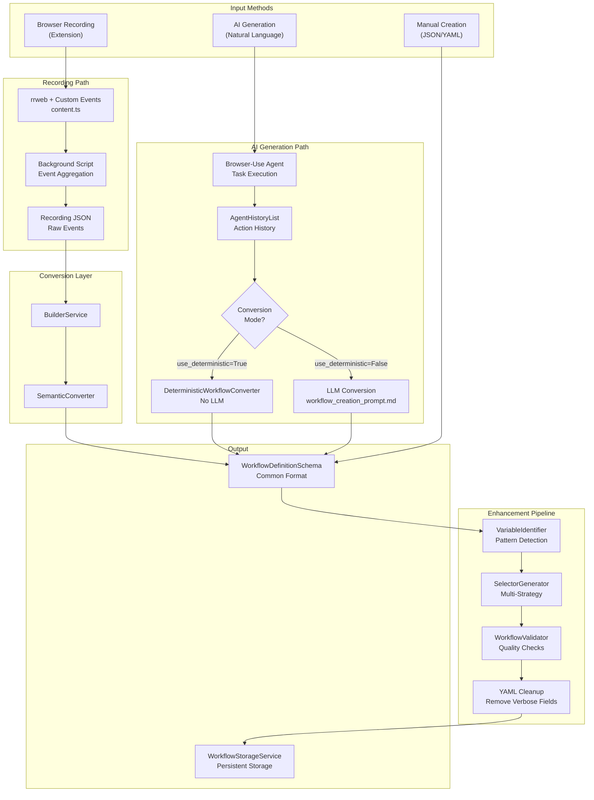
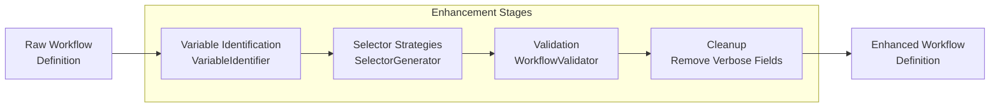
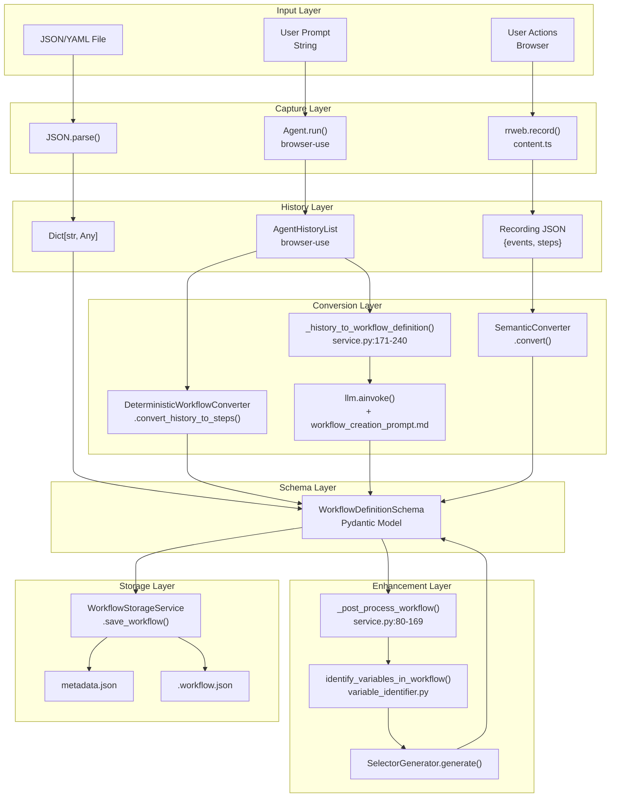

<!-- source: DeepWiki mcp.deepwiki.com · repo browser-use/workflow-use · page 3 Workflow Generation · fetched 2026-10-30 -->

# Workflow Generation

<details>
<summary>Relevant source files</summary>

The following files were used as context for generating this wiki page:

- [README.md](README.md)
- [extension/package-lock.json](extension/package-lock.json)
- [extension/src/components/ui/button.tsx](extension/src/components/ui/button.tsx)
- [extension/src/entrypoints/content.ts](extension/src/entrypoints/content.ts)
- [extension/src/entrypoints/sidepanel/context/workflow-provider.tsx](extension/src/entrypoints/sidepanel/context/workflow-provider.tsx)
- [extension/src/entrypoints/sidepanel/index.tsx](extension/src/entrypoints/sidepanel/index.tsx)
- [workflows/.gitignore](workflows/.gitignore)
- [workflows/pyproject.toml](workflows/pyproject.toml)
- [workflows/uv.lock](workflows/uv.lock)
- [workflows/workflow_use/healing/service.py](workflows/workflow_use/healing/service.py)
- [workflows/workflow_use/storage/__init__.py](workflows/workflow_use/storage/__init__.py)

</details>


This page provides an overview of the three primary methods for creating workflows in the workflow-use system. Each method produces a `WorkflowDefinitionSchema` that can be stored, executed, and reused across different contexts.

For details on executing generated workflows, see [Workflow Execution](#5). For information on how workflows are stored and managed, see [Workflow Storage and Management](#9.3).

## Purpose and Scope

Workflow generation is the process of creating reusable, deterministic workflow definitions from various input sources. This page covers:

- The three creation methods: browser recording, AI-driven generation, and manual creation
- The common output format (`WorkflowDefinitionSchema`)
- When to use each method
- The overall generation pipeline architecture

Child pages provide detailed documentation on specific generation methods and their components.

**Sources:** [README.md:15-106](), [workflows/workflow_use/healing/service.py:419-448]()

---

## Three Generation Methods

### Method 1: Browser Recording (Extension-Based)

The browser extension records user interactions in real-time, capturing both DOM events (via rrweb) and semantic information about interacted elements.

**Key Components:**
- `content.ts` - Captures click, input, scroll, and other events
- `background.ts` - Aggregates events and maintains workflow state
- `BuilderService` - Converts raw recording data to workflow definition
- `SemanticConverter` - Extracts semantic meaning from CSS selectors

**Process Flow:**
```
User Action → rrweb + Custom Handlers → Background Script → BuilderService → WorkflowDefinitionSchema
```

**Best For:**
- Creating workflows from existing manual processes
- Quick workflow prototyping without writing code
- Capturing complex interaction patterns that are hard to describe

**See:** [Browser Recording](#3.1) for detailed documentation.

**Sources:** [extension/src/entrypoints/content.ts:114-236](), [extension/src/entrypoints/content.ts:238-553]()

---

### Method 2: AI-Driven Generation (HealingService)

The `HealingService` generates workflows from natural language task descriptions by running a browser-use agent once and converting its execution history into a reusable workflow.

**Key Components:**
- `HealingService.generate_workflow_from_prompt()` - Main entry point
- `Agent` (from browser-use) - Executes task once to create history
- `DeterministicWorkflowConverter` (optional) - Fast, no-LLM conversion
- LLM-based conversion - Flexible conversion supporting agent steps

**Process Flow:**
```
Natural Language Prompt → Browser-Use Agent → AgentHistoryList → Converter → WorkflowDefinitionSchema
```

**Best For:**
- Generating workflows from task descriptions
- Creating workflows without manual interaction
- Programmatic workflow generation at scale

**See:** [AI-Driven Generation with HealingService](#3.2) for detailed documentation.

**Sources:** [workflows/workflow_use/healing/service.py:419-448](), [README.md:19-44]()

---

### Method 3: Manual Creation

Workflows can be manually authored by creating JSON/YAML files that conform to the `WorkflowDefinitionSchema` structure.

**Key Components:**
- `WorkflowDefinitionSchema` - Pydantic schema defining workflow structure
- Step types: `navigate`, `click`, `input`, `keypress`, `extract`, `agent`
- `input_schema` - Defines parameterized variables

**Process Flow:**
```
Developer → JSON/YAML Editor → WorkflowDefinitionSchema
```

**Best For:**
- Creating simple, well-understood workflows
- Fine-tuning generated workflows
- Learning the workflow schema structure

**See:** [Workflow Definition Schema](#2.1) for schema documentation.

**Sources:** [workflows/workflow_use/schema/views.py]()

---

## Workflow Generation Architecture

The following diagram shows how all three generation methods converge on a common workflow format:



**Key Insights:**

1. **Convergence Point:** All three methods produce `WorkflowDefinitionSchema` objects
2. **Enhancement Pipeline:** Common post-processing applies to all generation methods
3. **Conversion Flexibility:** AI generation supports both deterministic (fast, no cost) and LLM-based (flexible) conversion
4. **Storage Integration:** All workflows can be persisted via `WorkflowStorageService`

**Sources:** [workflows/workflow_use/healing/service.py:276-329](), [workflows/workflow_use/healing/service.py:331-417](), [workflows/workflow_use/builder/service.py]()

---

## Common Output Format: WorkflowDefinitionSchema

All generation methods produce a `WorkflowDefinitionSchema` object with the following structure:

```python
class WorkflowDefinitionSchema(BaseModel):
    name: str                          # Workflow name
    description: str                   # Task description
    steps: List[StepDefinition]        # Ordered workflow steps
    input_schema: List[InputVariable]  # Parameterized inputs
    output_schema: Optional[List[OutputVariable]]
    metadata: Optional[Dict[str, Any]]
```

### Step Types

| Step Type | Purpose | Requires AI | Typical Use Case |
|-----------|---------|-------------|------------------|
| `navigate` | Load URL | No | Go to starting page |
| `click` | Click element | No | Submit forms, click buttons |
| `input` | Enter text | No | Fill form fields |
| `keypress` | Press key | No | Submit forms (Enter), escape dialogs (Escape) |
| `select` | Choose dropdown option | No | Select from dropdowns |
| `extract` | Extract data | Optional | Scrape page content |
| `agent` | LLM-driven task | Yes | Handle dynamic/complex interactions |

### Variable Parameterization

The `input_schema` defines variables that can be substituted at runtime:

```json
{
  "input_schema": [
    {
      "name": "search_query",
      "type": "string",
      "description": "Search term to query",
      "default": "workflow use"
    }
  ],
  "steps": [
    {
      "type": "input",
      "target_text": "Search",
      "value": "{search_query}"
    }
  ]
}
```

**Sources:** [workflows/workflow_use/schema/views.py]()

---

## Generation Method Comparison

The following diagram shows the trade-offs between generation methods:

```mermaid
graph TB
    subgraph "Decision Factors"
        INPUT["Input Type"]
        SPEED["Generation Speed"]
        COST["LLM Cost"]
        QUALITY["Workflow Quality"]
    end
    
    subgraph "Browser Recording"
        REC_INPUT["Manual Interaction"]
        REC_SPEED["Fast<br/>Real-time capture"]
        REC_COST["$0<br/>No LLM calls"]
        REC_QUALITY["High<br/>Captures exact interactions"]
    end
    
    subgraph "AI Generation (Deterministic)"
        DET_INPUT["Natural Language"]
        DET_SPEED["Medium<br/>Agent + conversion"]
        DET_COST["Low<br/>1 agent run only"]
        DET_QUALITY["High<br/>Pure semantic steps"]
    end
    
    subgraph "AI Generation (LLM-Based)"
        LLM_INPUT["Natural Language"]
        LLM_SPEED["Slow<br/>Agent + LLM conversion"]
        LLM_COST["High<br/>Agent + conversion"]
        LLM_QUALITY["Variable<br/>May include agent steps"]
    end
    
    INPUT --> REC_INPUT
    INPUT --> DET_INPUT
    INPUT --> LLM_INPUT
    
    SPEED --> REC_SPEED
    SPEED --> DET_SPEED
    SPEED --> LLM_SPEED
    
    COST --> REC_COST
    COST --> DET_COST
    COST --> LLM_COST
    
    QUALITY --> REC_QUALITY
    QUALITY --> DET_QUALITY
    QUALITY --> LLM_QUALITY
```



### Recommendations

**Use Browser Recording when:**
- You can manually perform the task
- You need precise selector capture
- You want zero LLM costs
- You're prototyping or learning the workflow structure

**Use AI Generation (Deterministic) when:**
- You can describe the task in natural language
- You want guaranteed semantic steps (no agent fallback)
- You want minimal LLM costs
- The task is straightforward and deterministic

**Use AI Generation (LLM-Based) when:**
- The task requires complex reasoning
- You need agent steps for dynamic content
- You prioritize flexibility over cost
- The workflow may need AI fallback during execution

**Sources:** [workflows/workflow_use/healing/service.py:30-73](), [README.md:45-70]()

---

## HealingService Configuration

The `HealingService` class is the primary interface for AI-driven workflow generation and provides extensive configuration options:

```python
class HealingService:
    def __init__(
        self,
        llm: BaseChatModel,
        enable_variable_extraction: bool = True,
        use_deterministic_conversion: bool = False,
        enable_ai_validation: bool = False,
        enable_pattern_variable_identification: bool = True,
        pattern_variable_confidence: float = 0.5,
        cleanup_yaml: bool = True,
        remove_descriptions: bool = True,
        remove_verification_checks: bool = True,
        remove_expected_outcomes: bool = True,
        enable_xpath_optimization: bool = True,
    ):
        # ... initialization
```

### Key Configuration Options

| Parameter | Default | Purpose | Cost Impact |
|-----------|---------|---------|-------------|
| `use_deterministic_conversion` | `False` | Use `DeterministicWorkflowConverter` instead of LLM | **Reduces cost** by eliminating LLM conversion call |
| `enable_variable_extraction` | `True` | Run LLM-based variable suggestion | Adds 1 LLM call |
| `enable_ai_validation` | `False` | Run `WorkflowValidator` to check quality | Adds 1 LLM call |
| `enable_pattern_variable_identification` | `True` | Use pattern-based variable detection (no LLM) | **$0 cost** |
| `cleanup_yaml` | `True` | Remove verbose fields from output | No cost |
| `enable_xpath_optimization` | `True` | Generate optimized XPath strategies | No cost |

### Cost Optimization Strategy

**Minimal Cost Configuration (Recommended):**
```python
service = HealingService(
    llm=llm,
    use_deterministic_conversion=True,      # No LLM for conversion
    enable_variable_extraction=False,       # Skip LLM variable extraction
    enable_ai_validation=False,             # Skip LLM validation
    enable_pattern_variable_identification=True,  # Use $0 pattern detection
    cleanup_yaml=True,                      # Clean output (no cost)
)
```

**This configuration results in:**
- 1 agent run (required)
- 0 additional LLM calls
- Pure semantic steps (no agent fallback)
- Pattern-based variable identification

**Sources:** [workflows/workflow_use/healing/service.py:29-73](), [workflows/workflow_use/healing/service.py:80-169]()

---

## CLI Usage Examples

The CLI provides commands for all generation methods:

### Generate Workflow from Task Description

```bash
# Basic usage (AI generation with deterministic conversion)
python cli.py generate-workflow "Find GitHub stars for browser-use repo"

# Custom models
python cli.py generate-workflow "Your task" \
  --agent-model "gpt-4.1-mini" \
  --extraction-model "gpt-4.1-mini" \
  --workflow-model "gpt-4o"

# Use cloud browser
python cli.py generate-workflow "Your task" --use-cloud

# Save to custom location (skip storage)
python cli.py generate-workflow "Your task" \
  --output-file ./my-workflow.json \
  --no-save-to-storage
```

### Record Workflow with Extension

```bash
# Start recording session (opens browser with extension)
python cli.py create-workflow

# Convert recording to semantic workflow
python cli.py build-workflow recording.json --output semantic.workflow.json
```

### List and Manage Workflows

```bash
# List all workflows
python cli.py list-workflows

# Filter by generation mode
python cli.py list-workflows --generation-mode browser_use
python cli.py list-workflows --generation-mode recording

# View workflow details
python cli.py workflow-info <workflow-id>

# Delete workflow
python cli.py delete-workflow <workflow-id>
```

**Sources:** [README.md:19-70](), [workflows/cli.py]()

---

## Programmatic Usage

### AI-Driven Generation

```python
from workflow_use.healing.service import HealingService
from workflow_use.storage.service import WorkflowStorageService
from browser_use.llm import ChatOpenAI

# Initialize services
healing_service = HealingService(
    llm=ChatOpenAI(model='gpt-4o'),
    use_deterministic_conversion=True,  # Fast, cheap conversion
)
storage_service = WorkflowStorageService()

# Generate workflow from prompt
workflow = await healing_service.generate_workflow_from_prompt(
    prompt="Fill contact form on example.com",
    agent_llm=ChatOpenAI(model='gpt-4.1-mini'),
    extraction_llm=ChatOpenAI(model='gpt-4.1-mini'),
    use_cloud=False,
)

# Save to storage
metadata = storage_service.save_workflow(
    workflow=workflow,
    generation_mode='browser_use',
    original_task="Fill contact form on example.com",
)

print(f"Workflow saved with ID: {metadata.id}")
```

### Recording-Based Generation

```python
from workflow_use.builder.service import BuilderService
from browser_use.llm import ChatOpenAI

builder = BuilderService(llm=ChatOpenAI(model='gpt-4o'))

# Load recording from extension
with open('recording.json', 'r') as f:
    recording_data = json.load(f)

# Convert to workflow
workflow = await builder.build_workflow_from_recording(
    recording_data=recording_data,
    workflow_name="Contact Form Submission",
)

# Save workflow
workflow.save_to_file('contact_form.workflow.json')
```

**Sources:** [README.md:78-105](), [workflows/workflow_use/healing/service.py:419-448]()

---

## Enhancement Pipeline

After initial workflow creation, all workflows pass through a common enhancement pipeline that adds robustness and parameterization:



### Enhancement Components

**1. Variable Identification (`VariableIdentifier`)**
- Detects hardcoded values that should be parameters
- Pattern-based detection (no LLM, $0 cost)
- Optional LLM-based enhancement (additional cost)
- Generates `input_schema` with detected variables

**2. Selector Generation (`SelectorGenerator`)**
- Creates multi-strategy element selectors
- Combines semantic (text-based) and XPath strategies
- Provides fallback mechanisms for self-healing
- Optimizes XPath expressions for reliability

**3. Workflow Validation (`WorkflowValidator`)**
- Checks for agent steps (costly during execution)
- Detects hardcoded values missed by variable identification
- Validates selector presence and quality
- Auto-corrects common issues (optional)

**4. YAML Cleanup**
- Removes verbose fields: `description`, `verification_checks`, `expected_outcome`
- Reduces workflow file size by ~40%
- Improves readability and maintainability

**See:** [Enhancement Pipeline](#3.5) for detailed documentation.

**Sources:** [workflows/workflow_use/healing/service.py:80-169](), [workflows/workflow_use/workflow/variable_identifier.py]()

---

## Generation Pipeline Data Flow

The following diagram maps the complete data flow from input to stored workflow, showing which code entities handle each transformation:



**Key Functions by Stage:**

| Stage | Function/Class | File Location | Purpose |
|-------|---------------|---------------|---------|
| Capture | `Agent.run()` | browser-use | Execute task with LLM agent |
| Capture | `rrweb.record()` | content.ts:114-214 | Record DOM events |
| Conversion | `_history_to_workflow_definition()` | service.py:171-240 | Convert agent history to messages |
| Conversion | `DeterministicWorkflowConverter.convert_history_to_steps()` | deterministic_converter.py | Map actions to semantic steps |
| Conversion | `llm.ainvoke()` | service.py:292-305 | LLM-based workflow creation |
| Conversion | `SemanticConverter.convert()` | semantic_converter.py | CSS to semantic conversion |
| Enhancement | `_post_process_workflow()` | service.py:80-169 | Apply all enhancements |
| Enhancement | `identify_variables_in_workflow()` | variable_identifier.py | Pattern-based variable detection |
| Enhancement | `SelectorGenerator.generate()` | selector_generator.py | Multi-strategy selector creation |
| Storage | `WorkflowStorageService.save_workflow()` | storage/service.py | Persist to filesystem |

**Sources:** [workflows/workflow_use/healing/service.py:171-240](), [workflows/workflow_use/healing/service.py:276-329](), [workflows/workflow_use/healing/service.py:331-417](), [workflows/workflow_use/builder/service.py]()

---

## Quality Assurance

The system includes automatic quality checks during workflow generation:

### Agent Step Detection

The `_validate_workflow_quality()` method warns when generated workflows contain agent steps:

```python
def _validate_workflow_quality(self, workflow_definition: WorkflowDefinitionSchema) -> None:
    """Validate the generated workflow and warn about quality issues."""
    agent_steps = []
    for i, step in enumerate(workflow_definition.steps):
        if hasattr(step, 'type') and step.type == 'agent':
            agent_steps.append((i, step))
    
    if agent_steps:
        print(f'\n⚠️  WARNING: Generated workflow contains {len(agent_steps)} agent step(s)!')
        print('   Agent steps are 10-30x slower and cost money per execution.')
```

**Why This Matters:**
- Agent steps require LLM calls during execution (costly)
- Agent steps are 10-30x slower than semantic steps
- Deterministic conversion guarantees zero agent steps

### Selector Strategy Validation

The `SelectorGenerator` ensures every interactive step has fallback selectors:

- **Priority 1:** `text_exact` - Exact text match (most reliable)
- **Priority 2:** `role_text` - Role + text combination
- **Priority 3:** `aria_label` - ARIA label match
- **Priority 7:** `text_fuzzy` - Fuzzy text match (tolerant)
- **Priority 10:** `absolute_xpath` - Absolute XPath (last resort)

**Sources:** [workflows/workflow_use/healing/service.py:242-263](), [workflows/workflow_use/healing/selector_generator.py]()

---

## Next Steps

After generating a workflow:

1. **Review and Test:** Run the workflow with `python cli.py run-workflow <file>` to verify it works
2. **Refine Variables:** Edit `input_schema` to add defaults, descriptions, or constraints
3. **Store for Reuse:** Save to storage with `WorkflowStorageService` for centralized management
4. **Execute at Scale:** Use `run-workflow-csv` for bulk execution with different inputs

**Related Pages:**
- [Workflow Execution](#5) - Running and debugging workflows
- [Workflow Validation and Quality Assurance](#4.2) - Deep dive into validation
- [Variable Identification and Parameterization](#9.1) - Advanced variable configuration
- [Workflow Storage and Management](#9.3) - Storage system details

**Sources:** [README.md:107-153]()

---

