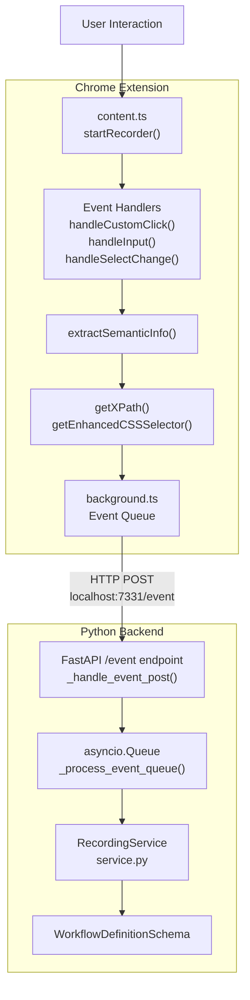
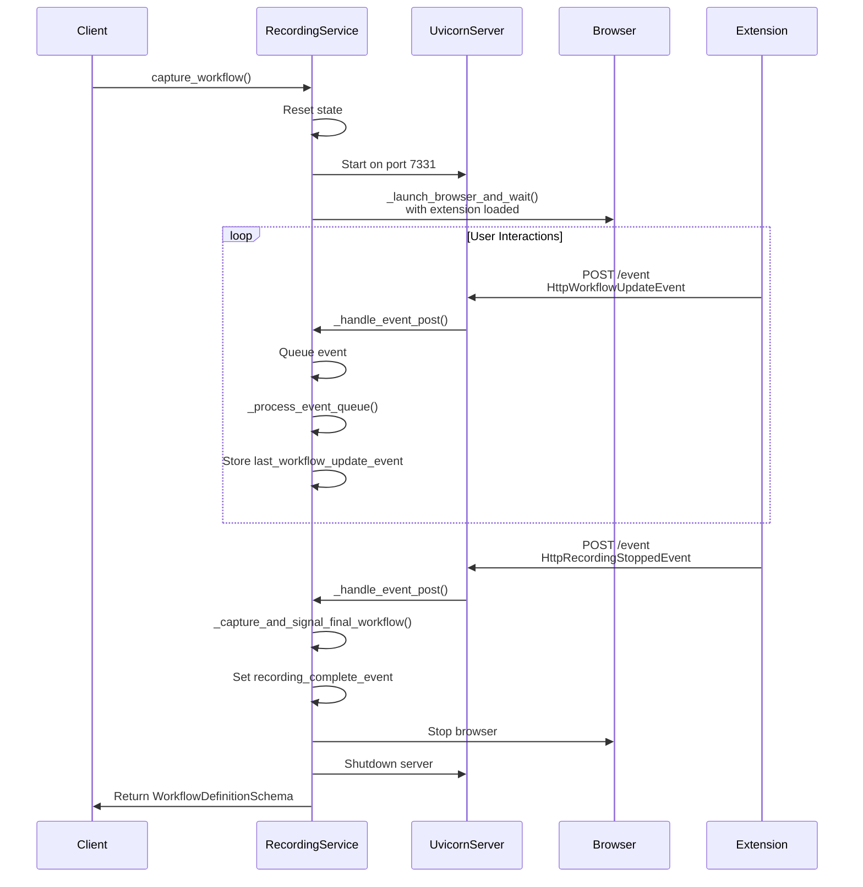
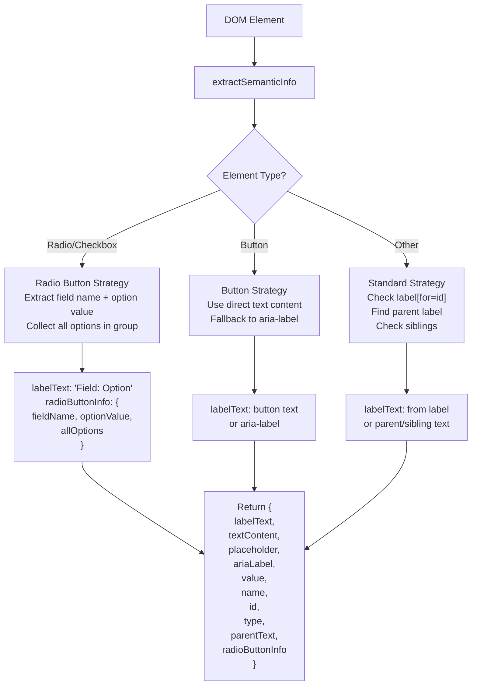
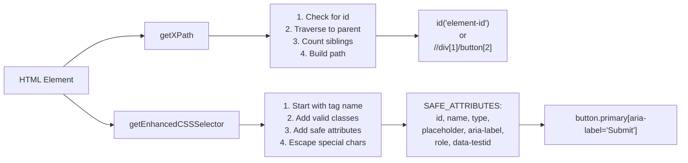
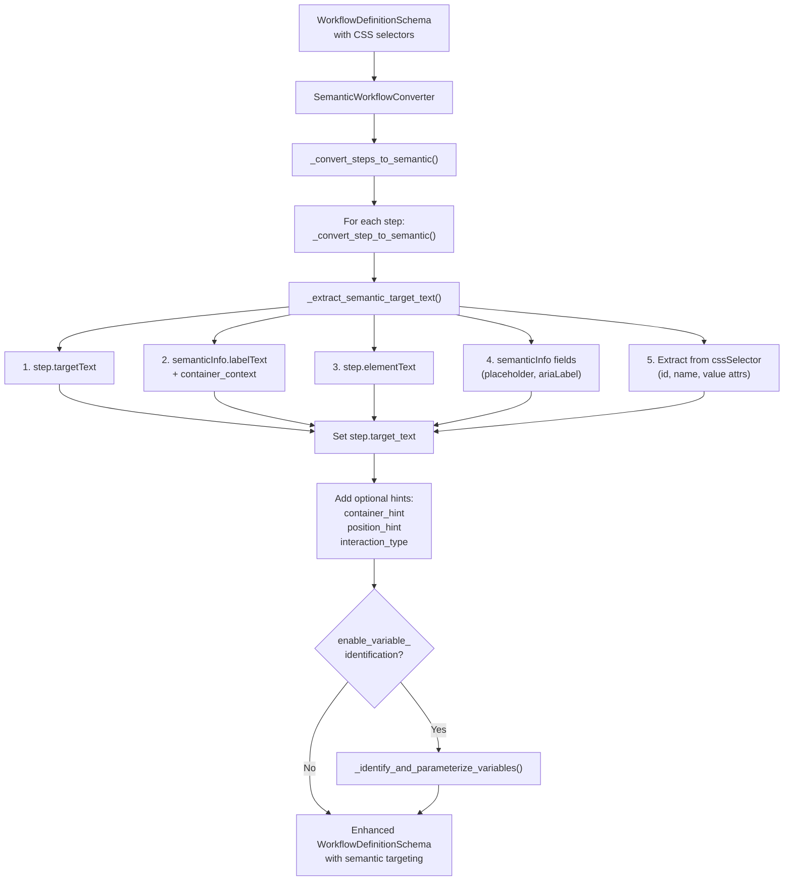
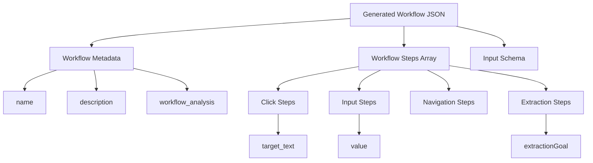

<!-- source: DeepWiki mcp.deepwiki.com · repo browser-use/workflow-use · page 3.1 Browser Recording · fetched 2026-10-30 -->

# Browser Recording

<details>
<summary>Relevant source files</summary>

The following files were used as context for generating this wiki page:

- [README.md](README.md)
- [extension/package-lock.json](extension/package-lock.json)
- [extension/src/components/ui/button.tsx](extension/src/components/ui/button.tsx)
- [extension/src/entrypoints/content.ts](extension/src/entrypoints/content.ts)
- [extension/src/entrypoints/sidepanel/context/workflow-provider.tsx](extension/src/entrypoints/sidepanel/context/workflow-provider.tsx)
- [extension/src/entrypoints/sidepanel/index.tsx](extension/src/entrypoints/sidepanel/index.tsx)
- [workflows/.gitignore](workflows/.gitignore)
- [workflows/workflow_use/storage/__init__.py](workflows/workflow_use/storage/__init__.py)

</details>


Browser recording captures user interactions through a Chrome extension and converts them into executable workflow definitions. The system consists of three main components: the browser extension's content script that monitors DOM events, the RecordingService that manages the recording session, and the SemanticWorkflowConverter that transforms raw events into semantic workflows.

For natural language workflow generation, see [Natural Language Generation](#3.2). For workflow enhancement and validation, see [Workflow Enhancement Pipeline](#3.4).

## Recording Architecture

The recording system operates across two processes: a Chrome extension running in the browser and a Python backend service. The extension captures and enriches events, while the RecordingService manages the browser lifecycle and receives workflow definitions.

**Recording System Components**



The content script in [extension/src/entrypoints/content.ts:114-214]() initializes rrweb recording for DOM mutation tracking and attaches custom event listeners for user interactions. Each event handler enriches captured data with semantic information before sending it to the background script.

Sources: [extension/src/entrypoints/content.ts:114-214](), [workflows/workflow_use/recorder/service.py:25-54]()

## Event Capture Pipeline

The content script captures six event types, each with a dedicated handler function that extracts semantic information and selector strategies.

**Event Handler Functions**

| Event Type | Handler Function | Captured Data | Line Reference |
|------------|------------------|---------------|----------------|
| Click | `handleCustomClick()` | `xpath`, `cssSelector`, `targetText`, `semanticInfo`, `radioButtonInfo` | [content.ts:556-644]() |
| Input | `handleInput()` | `value`, `inputType`, `targetText`, `semanticInfo` | [content.ts:688-729]() |
| Select | `handleSelectChange()` | `selectedValue`, `selectedText`, `allOptions`, `fieldName` | [content.ts:733-780]() |
| Keyboard | `handleKeydown()` | `key`, `xpath`, `cssSelector`, `elementTag` | [content.ts:801-857]() |
| Focus | `handleFocus()` | Element position, visual overlay | [content.ts:941-991]() |
| Blur | `handleBlur()` | Removes focus overlay | [content.ts:995-1001]() |

The event handlers use `extractSemanticInfo()` [content.ts:239-553]() to generate rich context for each interaction. This function implements multiple strategies to identify elements by their visible text, labels, and semantic attributes rather than brittle CSS selectors.

Sources: [extension/src/entrypoints/content.ts:556-857](), [extension/src/entrypoints/content.ts:239-553]()

## RecordingService Lifecycle

The `RecordingService` class manages the entire recording session, launching a browser with the extension loaded and receiving events via a temporary FastAPI server.

**RecordingService.capture_workflow() Flow**



The service uses three async tasks coordinated through an event-driven architecture:
1. **Server task**: Runs FastAPI on port 7331 to receive events from the extension
2. **Browser task**: Manages browser lifecycle with `_launch_browser_and_wait()` [service.py:104-164]()
3. **Event processor task**: Processes queued events with `_process_event_queue()` [service.py:64-80]()

The browser is launched with the extension directory loaded via Playwright's `--load-extension` argument [service.py:121-127](). When the extension sends a `HttpRecordingStoppedEvent`, the service captures the final workflow from `last_workflow_update_event` and signals completion.

Sources: [workflows/workflow_use/recorder/service.py:25-243]()

## Semantic Information Extraction

The `extractSemanticInfo()` function in the content script extracts multiple layers of semantic context from DOM elements to enable reliable element identification without brittle selectors.

**Semantic Extraction Strategy**



The function implements specialized extraction for different element types:

**Radio Button and Checkbox Handling** [content.ts:246-398]():
- Extracts both the field name (e.g., "Marital Status") and option value (e.g., "Married")
- Searches for parent `<fieldset>` with `<legend>` for field name
- Collects all options in the radio group for validation
- Combines field name and option: `"Marital Status: Married"`

**Button Element Handling** [content.ts:430-464]():
- Prioritizes direct `textContent` of the button
- Falls back to `aria-label` or `value` attribute
- Avoids parent container text that may include multiple buttons

**Standard Input Handling** [content.ts:444-516]():
1. Check for direct `label[for="id"]` association
2. Search for parent `<label>` element
3. Check preceding sibling elements for text
4. Use `aria-labelledby` references

Sources: [extension/src/entrypoints/content.ts:239-553]()

## Selector Generation

The content script generates two types of selectors for fallback element location: XPath and enhanced CSS selectors with safe attributes.

**Selector Generation Functions**



The `getXPath()` function [content.ts:12-37]() generates stable XPath expressions:
- Returns `id("element-id")` for elements with IDs
- Otherwise builds positional path: `//parent/tag[position]`
- Counts sibling elements with matching tag names

The `getEnhancedCSSSelector()` function [content.ts:67-112]() builds CSS selectors with:
- Tag name as base selector
- Valid CSS classes (matching `/^[a-zA-Z_][a-zA-Z0-9_-]*$/`)
- Safe attributes from whitelist [content.ts:42-65]()
- Proper escaping via `CSS.escape()` for attribute values

The `SAFE_ATTRIBUTES` set includes stable attributes like `data-testid`, `aria-label`, `placeholder`, avoiding dynamic attributes like `style` or auto-generated IDs.

Sources: [extension/src/entrypoints/content.ts:12-112]()

## Semantic Workflow Conversion

The `SemanticWorkflowConverter` class transforms raw recorded workflows into semantic-targeted workflows that use visible text instead of CSS selectors. This conversion happens post-recording to create more maintainable workflows.

**SemanticWorkflowConverter.convert_workflow_to_semantic()**



The converter implements a priority cascade in `_extract_semantic_target_text()` [semantic_converter.py:119-248]():

1. **Direct targetText**: If captured by extension, use immediately
2. **Hierarchical context**: Combine `labelText` with `container_context.text` for disambiguation
3. **Element text**: Use visible text content if under 100 characters
4. **Semantic attributes**: Extract from `placeholder`, `ariaLabel`, `name`, `id`
5. **Selector parsing**: Extract meaningful identifiers from CSS selectors using regex

**Contextual Target Text Generation**

When semantic information includes container context, the converter creates hierarchical target text:

```python
# From semantic_converter.py:148-156
if base_text and container_context:
    container_text = container_context.get('text', '').strip()
    container_id = container_context.get('id', '').strip()
    
    # Create contextual target text
    if container_text and len(container_text) < 50:
        return f'{base_text} (in {container_text})'
    elif container_id and len(container_id) < 30:
        formatted_id = container_id.replace('-', ' ').replace('_', ' ').title()
        return f'{base_text} (in {formatted_id})'
```

This produces target text like `"Email (in Login Form)"` instead of just `"Email"`, improving disambiguation.

**CSS Selector Fallback Extraction**

For workflows recorded before semantic capture was added, the converter extracts meaningful identifiers from CSS selectors [semantic_converter.py:174-246]():

- ID attributes: `\[id=["']([^"']+)["']\]` → `"username-input"`
- Name attributes: `\[name=["']([^"']+)["']\]` → `"email"`
- Value attributes for radio buttons: `\[value=["']([^"']+)["']\]` → `"married"`
- Meaningful class names: Filters out utility classes like `btn`, `flex`, `bg-primary`

Sources: [workflows/workflow_use/recorder/semantic_converter.py:22-311]()

## Workflow Generation

The final step converts captured events into structured workflow JSON files. The `StoppedView` component handles workflow finalization and provides options for naming and describing the generated workflow.

**Workflow File Structure**



The workflow generation process creates enhanced metadata including step counts and extraction capabilities:

```javascript
const enhancedWorkflow = {
  ...workflow,
  name: customName || workflow.name,
  description: customDescription || workflow.description,
  workflow_analysis: `Recorded workflow with ${workflow.steps?.length || 0} steps. ${
    workflow.steps?.some(s => s.type === 'extract') 
      ? 'Includes AI extraction steps for intelligent data gathering.' 
      : ''
  }`
};
```

**Generated Workflow Example**

A typical recorded workflow contains semantic targeting information and maintains compatibility with traditional selectors:

```json
{
  "workflow_analysis": "Semantic version of recorded workflow. Uses visible text to identify elements instead of CSS selectors for improved reliability.",
  "name": "Flight Search Workflow",
  "steps": [
    {
      "type": "click",
      "target_text": "From",
      "description": "Click element"
    },
    {
      "type": "input", 
      "target_text": "From",
      "value": "SFO",
      "description": "Input element"
    },
    {
      "type": "extract",
      "extractionGoal": "Extract all the available options and organize them in json",
      "description": "Extract information with AI"
    }
  ]
}
```

Sources: [extension/src/entrypoints/sidepanel/components/stopped-view.tsx:12-58](), [workflows/flight-test/v1.json:1-62](), [workflows/workflow_use/recorder/semantic_converter.py:24-39]()

---

