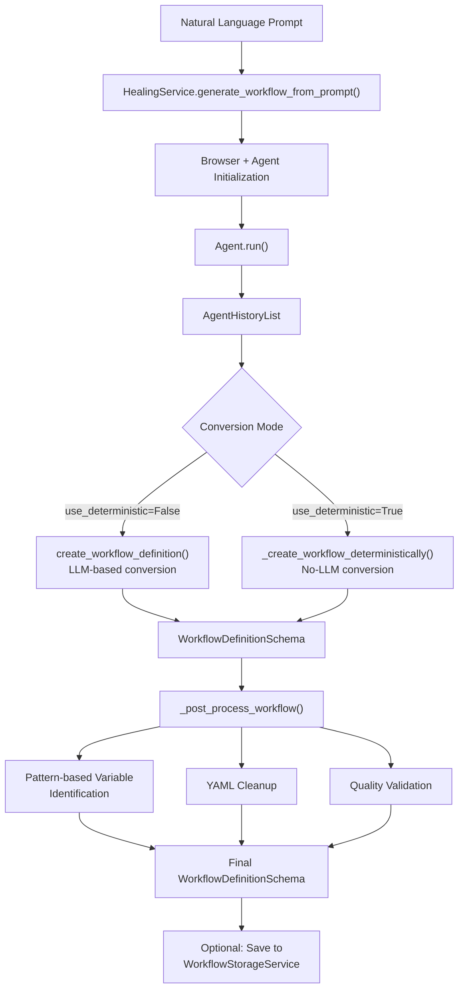
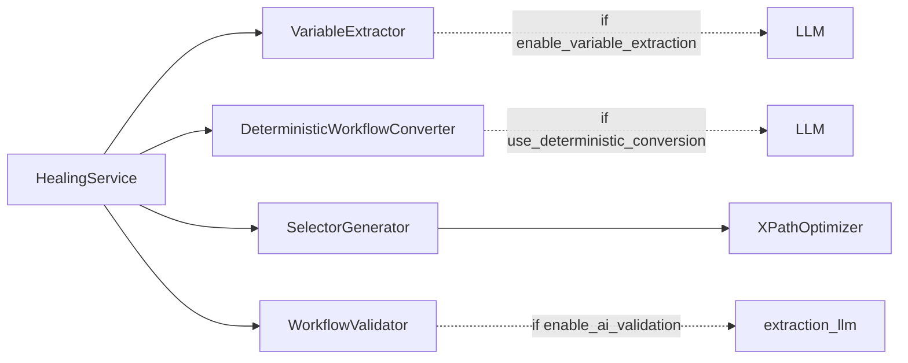
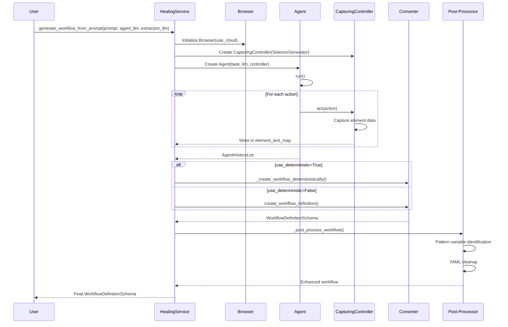
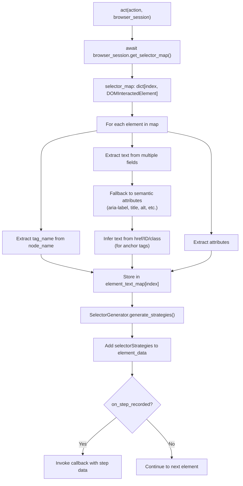
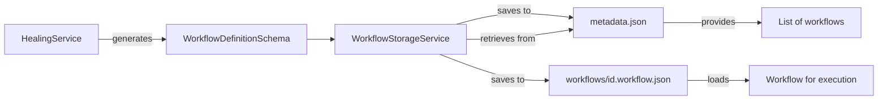

<!-- source: DeepWiki mcp.deepwiki.com · repo browser-use/workflow-use · page 3.2 AI-Driven Generation with HealingService · fetched 2026-10-30 -->

# AI-Driven Generation with HealingService

<details>
<summary>Relevant source files</summary>

The following files were used as context for generating this wiki page:

- [README.md](README.md)
- [workflows/.gitignore](workflows/.gitignore)
- [workflows/pyproject.toml](workflows/pyproject.toml)
- [workflows/uv.lock](workflows/uv.lock)
- [workflows/workflow_use/healing/_agent/controller.py](workflows/workflow_use/healing/_agent/controller.py)
- [workflows/workflow_use/healing/service.py](workflows/workflow_use/healing/service.py)
- [workflows/workflow_use/healing/tests/constants.py](workflows/workflow_use/healing/tests/constants.py)
- [workflows/workflow_use/healing/tests/test_exploration_agent.py](workflows/workflow_use/healing/tests/test_exploration_agent.py)
- [workflows/workflow_use/healing/tests/test_generate_workflow.py](workflows/workflow_use/healing/tests/test_generate_workflow.py)
- [workflows/workflow_use/healing/tests/test_workflow_creation.py](workflows/workflow_use/healing/tests/test_workflow_creation.py)
- [workflows/workflow_use/storage/__init__.py](workflows/workflow_use/storage/__init__.py)

</details>


## Purpose and Scope

This document covers the AI-driven workflow generation system provided by the `HealingService` class. The HealingService enables automatic creation of deterministic, reusable workflows from natural language task descriptions by executing a browser-use agent once, then converting its action history into a structured workflow definition.

For information about alternative workflow creation methods (browser recording and manual creation), see [Workflow Generation](#3). For details on the deterministic vs LLM-based conversion strategies, see [Conversion Methods](#3.3). For information about executing generated workflows, see [Workflow Execution](#5).

---

## Overview of AI-Driven Generation

The HealingService implements a "show once, reuse forever" pattern for workflow automation:

1. **Natural Language Input**: User provides a task description (e.g., "Fill out contact form on example.com")
2. **Single Agent Execution**: Browser-use agent completes the task once, recording all interactions
3. **History Conversion**: Agent action history is transformed into a structured workflow definition
4. **Post-Processing**: Workflow is enhanced with variables, cleaned up, and optionally validated
5. **Reusable Output**: Generated workflow can be executed infinitely without AI



**Diagram: End-to-End Generation Pipeline**

Sources: [workflows/workflow_use/healing/service.py:420-448](), [workflows/workflow_use/healing/service.py:276-329](), [workflows/workflow_use/healing/service.py:80-169]()

---

## The HealingService Class

### Constructor Parameters

The `HealingService` class is initialized with extensive configuration options:

| Parameter | Type | Default | Purpose |
|-----------|------|---------|---------|
| `llm` | `BaseChatModel` | *required* | LLM for workflow creation (structured output) |
| `enable_variable_extraction` | `bool` | `True` | Enable secondary LLM-based variable analysis |
| `use_deterministic_conversion` | `bool` | `False` | Use programmatic conversion (no LLM cost for steps) |
| `enable_ai_validation` | `bool` | `False` | Validate generated workflow quality with LLM |
| `enable_pattern_variable_identification` | `bool` | `True` | Pattern-based variable detection ($0 cost) |
| `pattern_variable_confidence` | `float` | `0.5` | Minimum confidence threshold for pattern variables |
| `cleanup_yaml` | `bool` | `True` | Remove verbose fields from generated workflow |
| `remove_descriptions` | `bool` | `True` | Remove step descriptions |
| `remove_verification_checks` | `bool` | `True` | Remove verification check fields |
| `remove_expected_outcomes` | `bool` | `True` | Remove expected outcome fields |
| `enable_xpath_optimization` | `bool` | `True` | Generate optimized XPath selectors |

Sources: [workflows/workflow_use/healing/service.py:29-76]()

### Key Components

The HealingService initializes and orchestrates several specialized components:



**Diagram: HealingService Component Dependencies**

Sources: [workflows/workflow_use/healing/service.py:65-73]()

---

## Generation Pipeline

### Main Entry Point

The `generate_workflow_from_prompt()` method is the primary interface for AI-driven generation:



**Diagram: generate_workflow_from_prompt() Sequence**

Sources: [workflows/workflow_use/healing/service.py:420-813]()

### Agent Execution with CapturingController

The `CapturingController` is a custom `Controller` subclass that records element interactions during agent execution:

**Key Responsibilities:**
- Intercepts all `act()` calls to capture element data
- Extracts text content, semantic attributes, and selectors
- Builds `element_text_map` for deterministic conversion
- Triggers `on_step_recorded` callbacks for real-time progress tracking



**Diagram: CapturingController Element Data Flow**

**Text Extraction Priority (for interactive elements):**
1. Explicit text content from DOM (`.text`, `.inner_text`, `.node_value`)
2. Semantic attributes (`aria-label`, `title`, `alt`, `placeholder`, `value`)
3. Inferred from ID/class patterns (e.g., "search" → "Search", "submit" → "Submit")
4. Extracted from `href` path (e.g., `/releases` → "Releases")

**Special Handling:**
- JavaScript `href` values are filtered out for anchor tags
- Poor text quality triggers semantic attribute fallback
- Pattern-based inference for common UI elements (search buttons, submit buttons)

Sources: [workflows/workflow_use/healing/service.py:466-811](), [workflows/workflow_use/healing/service.py:509-641]()

### Callback System

The generation process supports two types of callbacks for real-time monitoring:

**`on_step_recorded` Callback:**
Fired when each agent action is recorded. Receives a dictionary with:

| Field | Type | Description |
|-------|------|-------------|
| `step_number` | `int` | 1-indexed step count |
| `action_type` | `str` | Action type (navigation, click, input_text, extract, etc.) |
| `description` | `str` | Human-readable description |
| `url` | `str` | Current page URL |
| `selector` | `Optional[str]` | CSS/XPath selector if applicable |
| `extracted_data` | `Optional[dict]` | For extract steps |
| `timestamp` | `str` | ISO 8601 timestamp |
| `target_text` | `Optional[str]` | Element text being interacted with |

**`on_status_update` Callback:**
Fired for non-step status updates (e.g., "Initializing browser...", "Converting history to workflow...")

Sources: [workflows/workflow_use/healing/service.py:21-23](), [workflows/workflow_use/healing/service.py:440-448](), [workflows/workflow_use/healing/service.py:762-791]()

---

## Conversion Methods

### LLM-Based Conversion

The default conversion method uses an LLM to interpret agent history and generate workflow steps:

**Process:**
1. Load prompt template from `workflow_use/healing/prompts/workflow_creation_prompt.md`
2. Convert `AgentHistoryList` to structured messages with screenshots
3. Invoke LLM with `output_format=WorkflowDefinitionSchema` for structured output
4. Validate and populate selector fields (deprecated - now relies on semantic matching)

**Advantages:**
- Can handle complex, context-dependent actions
- May include agent steps for ambiguous tasks
- Better at understanding user intent from history

**Disadvantages:**
- Slower generation (LLM inference time)
- Costs money per generation
- May produce inconsistent step sequences
- Can generate agent steps (10-30x slower execution)

```python
# Key method signature
async def create_workflow_definition(
    self, 
    task: str, 
    history_list: AgentHistoryList, 
    extract_variables: bool = True
) -> WorkflowDefinitionSchema
```

Sources: [workflows/workflow_use/healing/service.py:276-329](), [workflows/workflow_use/healing/service.py:171-240]()

### Deterministic Conversion

When `use_deterministic_conversion=True`, the service uses programmatic mapping instead of LLM inference:

**Process:**
1. `DeterministicWorkflowConverter.convert_history_to_steps()` maps browser-use actions to semantic steps
2. Transfer element data from `deterministic_converter.element_hash_map` to `interacted_elements_hash_map`
3. Create workflow definition dictionary programmatically
4. Convert to `WorkflowDefinitionSchema`

**Advantages:**
- Fast generation (no LLM call for step creation)
- $0 cost for conversion
- Guaranteed to produce only semantic steps (no agent steps)
- Deterministic output (same history → same workflow)

**Disadvantages:**
- Cannot interpret complex, context-dependent actions
- Simpler step mapping (direct browser action → workflow step)
- May miss nuanced user intent

```python
# Key method signature
async def _create_workflow_deterministically(
    self,
    task: str,
    history_list: AgentHistoryList,
    extract_variables: bool = True
) -> WorkflowDefinitionSchema
```

**Comparison Table:**

| Aspect | LLM-Based | Deterministic |
|--------|-----------|---------------|
| Generation Speed | Slow (LLM inference) | Fast (programmatic) |
| Cost | LLM API costs | $0 (no LLM for steps) |
| Step Types | May include agent steps | Only semantic steps |
| Consistency | Variable | Deterministic |
| Complexity Handling | Better | Basic |

Sources: [workflows/workflow_use/healing/service.py:331-417](), [workflows/workflow_use/healing/deterministic_converter.py:1-200]()

---

## Post-Processing Pipeline

After workflow conversion, `_post_process_workflow()` applies several enhancement steps:

### 1. Pattern-Based Variable Identification

When `enable_pattern_variable_identification=True` (default), the service detects variables in workflow steps without LLM calls:

**Process:**
- Uses `VariableIdentifier.identify_variables_in_workflow()` from `workflow_use/workflow/variable_identifier.py`
- Analyzes input/select/textarea steps for parameterization opportunities
- Applies confidence threshold filtering (`pattern_variable_confidence`)
- Generates `input_schema` with detected variables
- Replaces hardcoded values with `{variable_name}` placeholders

**Example:**
```yaml
# Before
- type: input
  selector: "#email"
  value: "test@example.com"

# After
- type: input
  selector: "#email"
  value: "{user_email}"
  
input_schema:
  - name: user_email
    type: string
    default: "test@example.com"
```

Sources: [workflows/workflow_use/healing/service.py:86-132]()

### 2. YAML Cleanup

When `cleanup_yaml=True` (default), removes verbose fields from workflow steps:

**Removed Fields (configurable):**
- `description` - Human-readable step descriptions
- `verification_checks` - Validation logic for step success
- `expected_outcome` - Expected results after step execution

**Purpose:**
- Reduces workflow file size
- Improves readability
- Removes redundant information for semantic execution

Sources: [workflows/workflow_use/healing/service.py:134-157]()

### 3. Workflow Quality Validation

The `_validate_workflow_quality()` method warns about potential performance issues:

**Checks:**
- Detects agent steps (type: "agent")
- Warns that agent steps are 10-30x slower and cost money
- Suggests semantic alternatives (input + keypress instead of agent search)

**Note:** This is a warning-only validation. It does not modify the workflow or prevent generation.

Sources: [workflows/workflow_use/healing/service.py:242-262]()

### 4. Selector Field Population (Deprecated)

The `_populate_selector_fields()` method previously populated `xpath` and `cssSelector` fields from captured element data. This is now **disabled** to rely purely on semantic matching via `target_text` and `selectorStrategies`.

**Current Behavior:**
- Returns workflow unchanged
- Logs that selector population is skipped
- Semantic executor uses `target_text` for element matching instead

Sources: [workflows/workflow_use/healing/service.py:264-274]()

---

## Configuration Strategies

### Cost vs Quality Tradeoffs

```mermaid
graph TD
    subgraph "Free Tier: $0 Generation"
        F1["use_deterministic_conversion=True"]
        F2["enable_pattern_variable_identification=True"]
        F3["enable_variable_extraction=False"]
        F4["enable_ai_validation=False"]
    end
    
    subgraph "Balanced: Minimal LLM Cost"
        B1["use_deterministic_conversion=False"]
        B2["enable_pattern_variable_identification=True"]
        B3["enable_variable_extraction=False"]
        B4["enable_ai_validation=False"]
    end
    
    subgraph "Premium: Maximum Quality"
        P1["use_deterministic_conversion=False"]
        P2["enable_pattern_variable_identification=True"]
        P3["enable_variable_extraction=True"]
        P4["enable_ai_validation=True"]
    end
    
    F1 --> FAST["Fast + Free"]
    B1 --> MED["Medium Speed + Low Cost"]
    P1 --> SLOW["Slower + Higher Cost"]
    
    FAST --> RESULT1["Guaranteed semantic steps<br/>Pattern variables only<br/>No validation"]
    MED --> RESULT2["May include agent steps<br/>Pattern variables<br/>No validation"]
    SLOW --> RESULT3["May include agent steps<br/>Pattern + LLM variables<br/>LLM validation"]
```



**Diagram: Configuration Strategy Decision Tree**

Sources: [workflows/workflow_use/healing/service.py:29-74]()

---

## Usage Examples

### Basic Generation

```python
from workflow_use.healing.service import HealingService
from browser_use.llm import ChatOpenAI

# Initialize service
healing_service = HealingService(
    llm=ChatOpenAI(model='gpt-4o'),
    use_deterministic_conversion=False,  # Use LLM for conversion
    enable_pattern_variable_identification=True  # Free variable detection
)

# Generate workflow
workflow = await healing_service.generate_workflow_from_prompt(
    prompt="Fill out contact form on example.com",
    agent_llm=ChatOpenAI(model='gpt-4o-mini'),  # For browser automation
    extraction_llm=ChatOpenAI(model='gpt-4o-mini'),  # For page extraction
    use_cloud=False  # Use local browser
)

print(f"Generated {len(workflow.steps)} steps")
```

Sources: [workflows/README.md:80-105]()

### Cost-Optimized Generation

```python
# Zero LLM cost for conversion
healing_service = HealingService(
    llm=ChatOpenAI(model='gpt-4o'),  # Only for initial agent execution
    use_deterministic_conversion=True,  # No LLM for step creation
    enable_variable_extraction=False,  # Skip LLM variable analysis
    enable_ai_validation=False,  # Skip LLM validation
    enable_pattern_variable_identification=True  # Free pattern detection
)

workflow = await healing_service.generate_workflow_from_prompt(
    prompt="Search GitHub for browser-use",
    agent_llm=ChatOpenAI(model='gpt-4o-mini'),
    extraction_llm=ChatOpenAI(model='gpt-4o-mini')
)
```

Sources: [workflows/workflow_use/healing/service.py:29-76]()

### With Real-Time Progress Tracking

```python
def on_step_recorded(step_data: dict):
    print(f"Step {step_data['step_number']}: {step_data['action_type']}")
    print(f"  Description: {step_data['description']}")
    print(f"  URL: {step_data['url']}")
    if step_data.get('target_text'):
        print(f"  Target: {step_data['target_text']}")

def on_status_update(status: str):
    print(f"Status: {status}")

workflow = await healing_service.generate_workflow_from_prompt(
    prompt="Login to example.com",
    agent_llm=agent_llm,
    extraction_llm=extraction_llm,
    on_step_recorded=on_step_recorded,
    on_status_update=on_status_update
)
```

Sources: [workflows/workflow_use/healing/service.py:420-448](), [workflows/workflow_use/healing/service.py:762-791]()

### Saving to Storage

```python
from workflow_use.storage.service import WorkflowStorageService

storage_service = WorkflowStorageService()

# Generate workflow
workflow = await healing_service.generate_workflow_from_prompt(...)

# Save to database
metadata = storage_service.save_workflow(
    workflow=workflow,
    generation_mode='browser_use',  # or 'recording' or 'manual'
    original_task="Fill contact form on example.com",
    tags=['form', 'contact', 'example.com']
)

print(f"Saved workflow with ID: {metadata.id}")
```

Sources: [workflows/README.md:89-105](), [workflows/workflow_use/storage/service.py:1-200]()

---

## Command-Line Interface

The CLI provides convenient access to workflow generation:

### Generate Workflow

```bash
# Basic generation
python cli.py generate-workflow "Find GitHub stars for browser-use repo"

# Custom models
python cli.py generate-workflow "Your task" \
  --agent-model "gpt-4o-mini" \
  --extraction-model "gpt-4o-mini" \
  --workflow-model "gpt-4o"

# Use cloud browser
python cli.py generate-workflow "Your task" --use-cloud

# Save to custom location
python cli.py generate-workflow "Your task" --output-file ./my-workflow.json

# Skip database storage
python cli.py generate-workflow "Your task" --no-save-to-storage
```

### Workflow Management

```bash
# List all workflows
python cli.py list-workflows

# Filter by generation mode
python cli.py list-workflows --generation-mode browser_use

# View workflow details
python cli.py workflow-info <workflow-id>

# Run stored workflow
python cli.py run-stored-workflow <workflow-id> --prompt "Find stars for playwright repo"

# Delete workflow
python cli.py delete-workflow <workflow-id>
```

Sources: [workflows/README.md:23-70]()

---

## Integration Points

### With WorkflowStorageService

The HealingService integrates with `WorkflowStorageService` for persistence:



**Diagram: Storage Integration**

Sources: [workflows/workflow_use/storage/service.py:1-200](), [workflows/README.md:72-77]()

### With Browser-Use Framework

The HealingService is built on top of browser-use components:

- Uses `Browser` for browser automation
- Uses `Agent` for task execution with custom `HealingController`
- Uses `AgentHistoryList` for capturing execution history
- Integrates with browser-use LLM interface (`BaseChatModel`)

Sources: [workflows/workflow_use/healing/service.py:8-11](), [workflows/workflow_use/healing/_agent/controller.py:1-77]()

---

## Troubleshooting

### Common Issues

**Issue: Generated workflow contains agent steps**
- **Cause:** LLM-based conversion sometimes includes agent steps for complex tasks
- **Solution:** Use `use_deterministic_conversion=True` to guarantee semantic steps only
- **Validation:** Check warnings from `_validate_workflow_quality()`

**Issue: Variables not detected**
- **Cause:** Pattern confidence threshold too high or inputs don't match patterns
- **Solution:** Lower `pattern_variable_confidence` or enable `enable_variable_extraction=True`
- **Check:** Review `metadata.identified_variable_count` after generation

**Issue: Poor selector quality**
- **Cause:** Element text extraction failed during agent execution
- **Solution:** Enable `enable_xpath_optimization=True` and check `element_text_map` population
- **Debug:** Look for "📍 Populated selector" logs in output

**Issue: Generation fails with structured output error**
- **Cause:** LLM doesn't support structured output or returned invalid JSON
- **Solution:** Use a model that supports `output_format` parameter (e.g., gpt-4o, claude-3-5-sonnet)
- **Debug:** Check raw LLM response in error logs

Sources: [workflows/workflow_use/healing/service.py:242-262](), [workflows/workflow_use/healing/service.py:86-132](), [workflows/workflow_use/healing/service.py:292-305]()

---

## Performance Considerations

### Generation Time

| Step | Typical Duration | Cost Factor |
|------|------------------|-------------|
| Agent Execution | 30-120 seconds | Agent LLM calls (10-50 tokens/action) |
| LLM-based Conversion | 5-15 seconds | Workflow LLM call (large context) |
| Deterministic Conversion | <1 second | No LLM cost |
| Pattern Variable ID | <1 second | No LLM cost |
| LLM Variable Analysis | 3-10 seconds | Optional, analysis LLM call |
| AI Validation | 5-15 seconds | Optional, validation LLM call |

### Memory Usage

- `AgentHistoryList` stores screenshots (base64) in memory
- `element_text_map` stores captured element data
- `interacted_elements_hash_map` stores DOMInteractedElement objects
- Large workflows (50+ steps) can consume 100MB+ of memory

### Cost Optimization

**Minimize LLM Calls:**
1. Use `use_deterministic_conversion=True` (saves 1 LLM call)
2. Set `enable_variable_extraction=False` (saves 1 LLM call)
3. Set `enable_ai_validation=False` (saves 1 LLM call)
4. Use smaller models for `agent_llm` and `extraction_llm`

**Example Cost Breakdown (GPT-4o prices):**
- Agent execution: 10-50 actions × $0.01 = $0.10-$0.50
- LLM conversion: 1 call × $0.05 = $0.05
- Variable extraction (optional): 1 call × $0.02 = $0.02
- Validation (optional): 1 call × $0.03 = $0.03

**Total: $0.10-$0.60 per workflow generation**

With deterministic conversion: **$0.10-$0.50 per workflow** (no conversion/validation costs)

Sources: [workflows/workflow_use/healing/service.py:29-76]()

---

