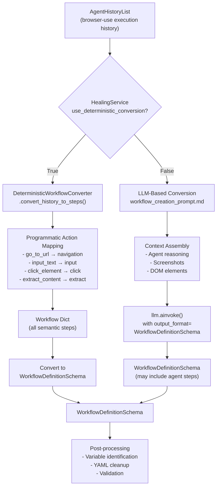
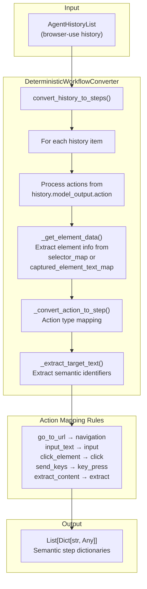
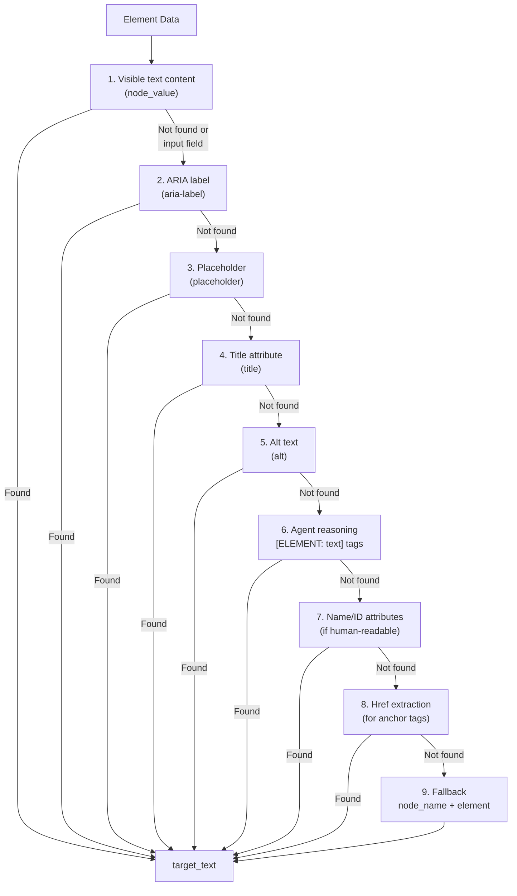
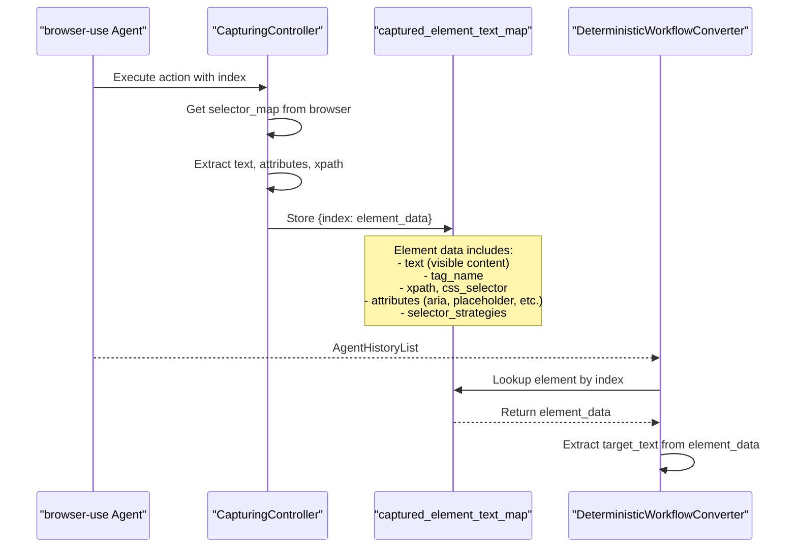
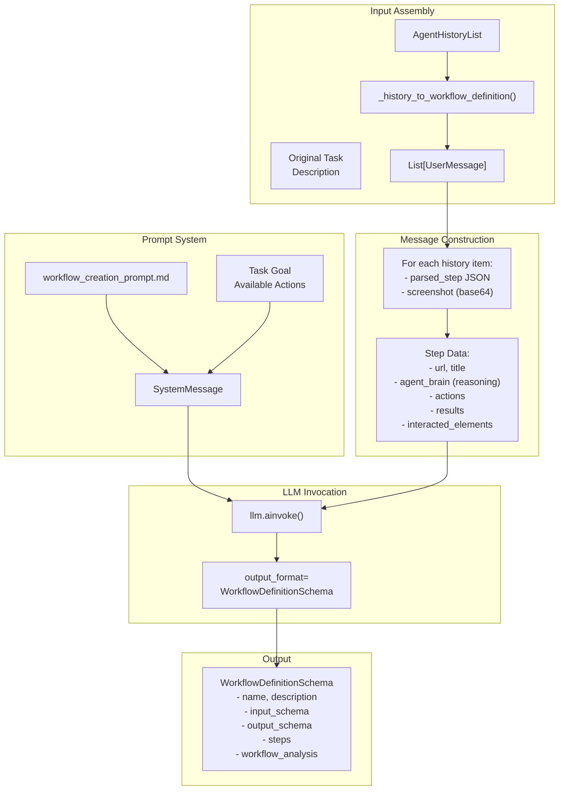
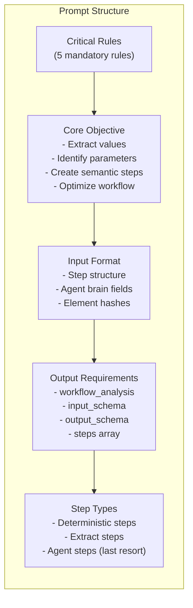
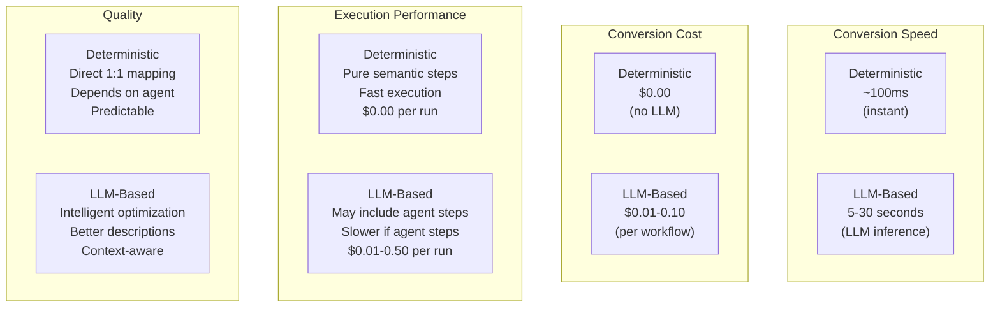
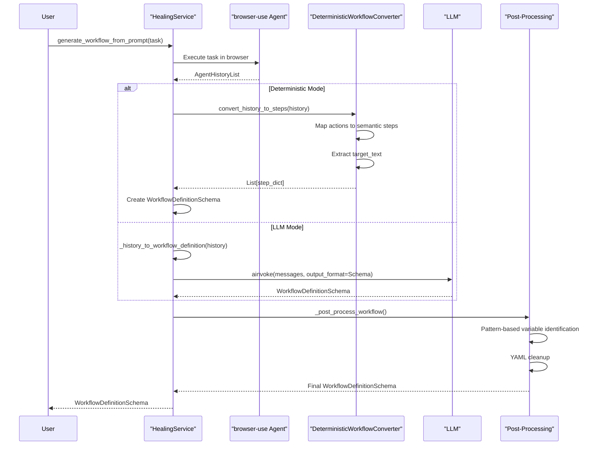

<!-- source: DeepWiki mcp.deepwiki.com · repo browser-use/workflow-use · page 3.3 Conversion Methods: Deterministic vs LLM-Based · fetched 2026-10-30 -->

# Conversion Methods: Deterministic vs LLM-Based

<details>
<summary>Relevant source files</summary>

The following files were used as context for generating this wiki page:

- [workflows/examples/scripts/generate_workflow.py](workflows/examples/scripts/generate_workflow.py)
- [workflows/examples/workflows/basic/example.workflow.yaml](workflows/examples/workflows/basic/example.workflow.yaml)
- [workflows/examples/workflows/basic/pure_semantic.workflow.yaml](workflows/examples/workflows/basic/pure_semantic.workflow.yaml)
- [workflows/examples/workflows/form_filling/semantic_form_fill.workflow.yaml](workflows/examples/workflows/form_filling/semantic_form_fill.workflow.yaml)
- [workflows/pyproject.toml](workflows/pyproject.toml)
- [workflows/tests/test_go_back.workflow.yaml](workflows/tests/test_go_back.workflow.yaml)
- [workflows/uv.lock](workflows/uv.lock)
- [workflows/workflow_use/healing/deterministic_converter.py](workflows/workflow_use/healing/deterministic_converter.py)
- [workflows/workflow_use/healing/prompts/workflow_creation_prompt.md](workflows/workflow_use/healing/prompts/workflow_creation_prompt.md)
- [workflows/workflow_use/healing/prompts/workflow_validation_prompt.md](workflows/workflow_use/healing/prompts/workflow_validation_prompt.md)
- [workflows/workflow_use/healing/service.py](workflows/workflow_use/healing/service.py)
- [workflows/workflow_use/healing/tests/test_validator.py](workflows/workflow_use/healing/tests/test_validator.py)
- [workflows/workflow_use/workflow/element_finder.py](workflows/workflow_use/workflow/element_finder.py)

</details>


## Purpose and Scope

This document explains the two approaches for converting browser-use agent execution history into reusable workflow definitions. After a browser-use agent completes a task (see [AI-Driven Generation with HealingService](#3.2)), the recorded action history must be transformed into structured workflow steps. The system offers two conversion strategies:

1. **Deterministic conversion** - Direct programmatic mapping from agent actions to semantic steps
2. **LLM-based conversion** - AI-powered interpretation of agent history into workflow structure

For information about the recording phase that produces the agent history, see [Browser Recording](#3.1). For details about the LLM prompts used in LLM-based conversion, see [Prompt Engineering for Workflow Creation](#3.4).

---

## Conversion Strategy Selection

The choice between deterministic and LLM-based conversion is controlled by the `use_deterministic_conversion` parameter in `HealingService`:

```python
healing_service = HealingService(
    llm=llm,
    use_deterministic_conversion=True,  # False for LLM-based
)
```

**Conversion Flow Diagram**



Sources: [workflows/workflow_use/healing/service.py:276-418](), [workflows/workflow_use/healing/service.py:419-428]()

---

## Deterministic Conversion

### Overview

`DeterministicWorkflowConverter` transforms browser-use agent actions directly into semantic workflow steps using programmatic rules, without involving an LLM for step creation. This produces pure semantic workflows with guaranteed structure and zero LLM cost for conversion.

**Key Characteristics:**
- **Speed**: Instant conversion (no LLM inference time)
- **Cost**: $0 for conversion (LLM only used for optional variable identification)
- **Predictability**: Deterministic output for same input
- **Step Types**: Produces only semantic steps (`navigation`, `input`, `click`, `key_press`, `extract`) - never `agent` steps

### Implementation Architecture



Sources: [workflows/workflow_use/healing/deterministic_converter.py:11-111](), [workflows/workflow_use/healing/service.py:331-417]()

### Action-to-Step Mapping

The converter implements a fixed mapping from browser-use action types to workflow step types:

| Browser-Use Action | Workflow Step Type | Key Fields Extracted |
|-------------------|-------------------|---------------------|
| `go_to_url` | `navigation` | `url` |
| `input_text` | `input` | `target_text`, `value` |
| `click_element` | `click` | `target_text` |
| `send_keys` | `key_press` | `target_text`, `key` |
| `extract_content` | `extract` or `extract_page_content` | `extractionGoal`, `output` |
| `go_back` | `go_back` | (none) |
| `scroll_down` | `scroll` | (none) |

Sources: [workflows/workflow_use/healing/deterministic_converter.py:535-650]()

### Semantic Target Text Extraction

The converter prioritizes human-readable element identifiers over technical selectors, extracting `target_text` in the following priority order:

**Priority Hierarchy:**



Sources: [workflows/workflow_use/healing/deterministic_converter.py:327-525]()

**Agent Reasoning Extraction:**

The converter extracts semantic context from agent reasoning using structured `[ELEMENT: "text"]` tags:

```python
# Example agent reasoning:
# "Click on the [ELEMENT: "Search"] button to submit the query"

# Extraction pattern:
matches = re.finditer(r'\[ELEMENT:\s*["\']([^"\']+)["\']\]', reasoning)
if matches:
    element_text = matches[-1].group(1)  # Use last match
    return element_text  # e.g., "Search"
```

Sources: [workflows/workflow_use/healing/deterministic_converter.py:370-395]()

### Element Data Capture

The converter relies on element information captured during agent execution via `CapturingController`:



Sources: [workflows/workflow_use/healing/service.py:456-640](), [workflows/workflow_use/healing/deterministic_converter.py:113-207]()

### Selector Strategy Generation

Although the deterministic converter focuses on semantic steps, it can also generate multi-strategy selectors when `SelectorGenerator` is enabled (see [Enhancement Pipeline](#3.5)):

```python
# Element data captured during execution includes selector_strategies
element_data = {
    'text': 'Search',
    'tag_name': 'button',
    'xpath': '/html/body/div[1]/button',
    'css_selector': 'button.search-btn',
    'selector_strategies': [
        {'type': 'text_exact', 'value': 'Search', 'priority': 1},
        {'type': 'role_text', 'value': 'Search', 'priority': 2, 'metadata': {'role': 'button'}},
        {'type': 'xpath', 'value': '/html/body/div[1]/button', 'priority': 10}
    ]
}
```

Sources: [workflows/workflow_use/healing/deterministic_converter.py:295-298](), [workflows/workflow_use/healing/selector_generator.py:1-100]()

### Benefits of Deterministic Conversion

| Benefit | Details |
|---------|---------|
| **Speed** | Instant conversion - no LLM inference latency |
| **Cost** | $0 for conversion (LLM only used for optional variable identification) |
| **Reliability** | Deterministic output - same input always produces same steps |
| **Pure Semantic** | Guaranteed to produce only semantic steps (no `agent` steps) |
| **Execution Performance** | Workflows execute at full speed with no LLM fallback needed |

### Limitations

| Limitation | Description | Workaround |
|-----------|-------------|-----------|
| **No Complex Reasoning** | Cannot interpret agent's strategic thinking | Use LLM-based for tasks requiring context understanding |
| **Single-Pass Only** | Maps actions 1:1 without optimization | Post-processing can merge redundant steps |
| **Limited Abstraction** | Cannot infer high-level intent from low-level actions | Agent must record clean, purposeful actions |
| **Dependency on Agent Quality** | Output quality depends on agent's action recording | Use well-tuned agent with clear reasoning |

Sources: [workflows/workflow_use/healing/deterministic_converter.py:1-650]()

---

## LLM-Based Conversion

### Overview

LLM-based conversion uses an AI model to interpret the agent's execution history, reasoning, and screenshots to generate a structured workflow. This approach can produce more intelligent workflows with better step descriptions and potentially more optimal step sequences.

**Key Characteristics:**
- **Flexibility**: Can interpret complex agent reasoning and context
- **Optimization**: May combine or reorder steps for better workflow structure
- **Abstraction**: Can generate higher-level semantic steps from low-level actions
- **Variable Extraction**: Identifies reusable parameters during conversion
- **May Include Agent Steps**: Can generate `agent` steps when semantic steps are insufficient

### Implementation Architecture



Sources: [workflows/workflow_use/healing/service.py:276-329](), [workflows/workflow_use/healing/service.py:171-240]()

### Message Construction

The LLM-based converter transforms agent history into structured messages containing both JSON data and visual context:

```python
# For each history item, create a UserMessage with:
content_blocks = [
    {
        'type': 'text',
        'text': json.dumps({
            'url': history.state.url,
            'title': history.state.title,
            'agent_brain': {
                'evaluation_previous_goal': '...',
                'memory': '...',
                'next_goal': '...'
            },
            'actions': [...],  # List of actions taken
            'results': [...],  # Action outcomes
            'interacted_elements': [...]  # DOM elements with hashes
        })
    },
    {
        'type': 'image_url',
        'image_url': {'url': f'data:image/jpeg;base64,{screenshot}'}
    }
]
```

Sources: [workflows/workflow_use/healing/service.py:171-240]()

### Prompt Structure

The LLM prompt (`workflow_creation_prompt.md`) guides the model through a structured workflow generation process:

**Critical Rules (Priority Order):**

1. **ALL workflows MUST end with an extract step** - AI processing always needed
2. **NEVER use `agent` steps for simple actions** - Use semantic steps instead
3. **ALWAYS use semantic `target_text`** - Look for visible text, labels, placeholders
4. **Variables use `{variable}` syntax** - Single pair of curly braces
5. **Prefer direct navigation over search engines** - When target URL is known

**Prompt Components:**



Sources: [workflows/workflow_use/healing/prompts/workflow_creation_prompt.md:1-242]()

### Workflow Analysis Field

The LLM must populate the `workflow_analysis` field first, which serves as the model's "thinking" phase:

```yaml
workflow_analysis: |
  1. Step Analysis: The agent navigated to GitHub, used the search, clicked results
  2. Task Definition: Search for repository and extract star count
  3. Action Plan: 
     - Navigate to github.com
     - Input search query
     - Click search result
     - Extract star count
  4. Variable Identification:
     - repo_name: string (required) - Repository to search for
  5. Step Optimization: Can combine navigation and search into semantic steps
```

This structured analysis ensures the LLM understands the workflow before generating steps.

Sources: [workflows/workflow_use/healing/prompts/workflow_creation_prompt.md:71-91]()

### Agent Step Avoidance

The prompt explicitly discourages `agent` steps with strong warnings:

**Common Mistakes to Avoid:**

```yaml
# ❌ BAD: Using agent step for simple search
steps:
  - type: agent
    task: "Search for {{repo_name}}"

# ✅ GOOD: Using semantic steps
steps:
  - type: input
    target_text: "Search"
    value: "{{repo_name}}"
  - type: keypress
    target_text: "Search"
    key: "Enter"
```

**When Agent Steps ARE Needed:**

- Dropdowns/select boxes with dynamic options
- Multi-select interfaces
- Search autocomplete
- Infinite scroll/lazy loading
- Dynamic form fields
- Complex filters
- Interactive maps/charts
- Rich text editors
- Modal dialogs with timing issues
- Time-sensitive content
- AJAX-powered interfaces

Sources: [workflows/workflow_use/healing/prompts/workflow_creation_prompt.md:158-196]()

### Structured Output Format

The LLM uses structured output to ensure valid `WorkflowDefinitionSchema`:

```python
# LLM invocation with structured output
response = await self.llm.ainvoke(
    all_messages,
    output_format=WorkflowDefinitionSchema  # Pydantic model
)
workflow_definition: WorkflowDefinitionSchema = response.completion
```

This guarantees the output matches the schema structure with proper typing.

Sources: [workflows/workflow_use/healing/service.py:292-295]()

### Benefits of LLM-Based Conversion

| Benefit | Details |
|---------|---------|
| **Intelligent Interpretation** | Understands agent reasoning and context |
| **Step Optimization** | Can combine, reorder, or simplify steps |
| **Better Descriptions** | Generates human-readable step descriptions |
| **Variable Identification** | Automatically identifies reusable parameters |
| **Flexible Abstraction** | Creates appropriate abstraction level for tasks |
| **Context-Aware** | Uses screenshots and DOM state for better decisions |

### Limitations

| Limitation | Description | Impact |
|-----------|-------------|--------|
| **Latency** | Requires LLM inference time (5-30 seconds) | Slower workflow generation |
| **Cost** | Uses LLM tokens for conversion | ~$0.01-0.10 per workflow depending on complexity |
| **Non-Deterministic** | Same input may produce slightly different outputs | Less reproducible |
| **May Include Agent Steps** | Can generate `agent` steps even when semantic steps would work | Slower execution |
| **Prompt Dependency** | Quality depends on prompt engineering | Requires maintenance |

Sources: [workflows/workflow_use/healing/service.py:276-329]()

---

## Comparison and Trade-offs

### Performance Comparison



### Decision Matrix

| Factor | Choose Deterministic When | Choose LLM-Based When |
|--------|--------------------------|----------------------|
| **Speed Priority** | Need instant conversion | Can tolerate 5-30s delay |
| **Cost Sensitivity** | Want $0 conversion cost | Willing to pay for quality |
| **Reproducibility** | Need deterministic output | Slight variation acceptable |
| **Task Complexity** | Agent recorded clean actions | Complex reasoning needed |
| **Step Quality** | Semantic steps sufficient | Need optimization/abstraction |
| **Execution Cost** | Want $0 per workflow run | Agent steps acceptable |
| **Development Phase** | Production workflows | Prototyping/experimentation |

### Output Comparison Example

**Same Agent History, Different Conversion Methods:**

**Deterministic Output:**
```yaml
steps:
  - type: navigation
    url: https://github.com
  - type: input
    target_text: Search
    value: "{repo_name}"
  - type: key_press
    target_text: Search
    key: Enter
  - type: click
    target_text: "{repo_name}"
  - type: extract_page_content
    goal: Extract star count
```

**LLM-Based Output (optimized):**
```yaml
workflow_analysis: |
  Navigate directly to GitHub repository using URL construction
  instead of search interface - more reliable and faster
steps:
  - type: navigation
    url: "https://github.com/{repo_name}"
    description: Navigate directly to repository page
  - type: extract_page_content
    goal: Extract the star count displayed on the repository page
    output: star_count
```

The LLM version:
- Recognized URL pattern optimization
- Eliminated search steps
- Added contextual descriptions
- More efficient execution path

Sources: [workflows/workflow_use/healing/service.py:331-417](), [workflows/workflow_use/healing/prompts/workflow_creation_prompt.md:1-242]()

---

## Configuration and Usage

### HealingService Configuration

```python
from browser_use.llm import ChatBrowserUse
from workflow_use.healing.service import HealingService

# Deterministic configuration (fastest, $0 cost)
healing_service_deterministic = HealingService(
    llm=llm,
    use_deterministic_conversion=True,  # Key parameter
    enable_variable_extraction=True,     # Optional: LLM for variable ID
    enable_ai_validation=False,          # Skip AI validation
    enable_pattern_variable_identification=True,  # Pattern-based, no LLM
    cleanup_yaml=True,                   # Remove verbose fields
    enable_xpath_optimization=True,      # Generate XPath fallbacks
)

# LLM-based configuration (flexible, higher cost)
healing_service_llm = HealingService(
    llm=llm,
    use_deterministic_conversion=False,  # Use LLM for conversion
    enable_variable_extraction=True,     # Additional variable analysis
    enable_ai_validation=True,           # Validate with WorkflowValidator
    enable_pattern_variable_identification=True,  # Pattern-based first
    cleanup_yaml=True,                   # Remove verbose fields
    enable_xpath_optimization=True,      # Generate XPath fallbacks
)
```

Sources: [workflows/workflow_use/healing/service.py:29-75]()

### Workflow Generation Flow



Sources: [workflows/workflow_use/healing/service.py:419-448]()

### Post-Processing Pipeline

Both conversion methods feed into the same post-processing pipeline:

```python
def _post_process_workflow(
    self, 
    workflow_definition: WorkflowDefinitionSchema
) -> WorkflowDefinitionSchema:
    """
    Post-process workflow:
    1. Pattern-based variable identification (no LLM)
    2. YAML cleanup (remove verbose fields)
    """
    
    # Step 1: Variable identification using patterns
    if self.enable_pattern_variable_identification:
        workflow_dict = identify_variables_in_workflow(
            workflow_dict,
            min_confidence=self.pattern_variable_confidence,
            use_llm=False  # Pattern-based only
        )
    
    # Step 2: Clean up YAML
    if self.cleanup_yaml:
        for step in workflow_dict.get('steps', []):
            if self.remove_descriptions:
                del step['description']
            if self.remove_verification_checks:
                del step['verification_checks']
            if self.remove_expected_outcomes:
                del step['expected_outcome']
    
    return WorkflowDefinitionSchema(**workflow_dict)
```

Sources: [workflows/workflow_use/healing/service.py:80-169]()

---

## Validation and Quality Assurance

### Agent Step Detection

Both conversion methods validate the final workflow for quality issues:

```python
def _validate_workflow_quality(
    self, 
    workflow_definition: WorkflowDefinitionSchema
) -> None:
    """Validate and warn about quality issues."""
    
    agent_steps = [
        (i, step) for i, step in enumerate(workflow_definition.steps)
        if hasattr(step, 'type') and step.type == 'agent'
    ]
    
    if agent_steps:
        print(f'\n⚠️  WARNING: Generated workflow contains {len(agent_steps)} agent step(s)!')
        print('   Agent steps are 10-30x slower and cost money per execution.')
        print('   Consider these alternatives:\n')
        
        for i, step in agent_steps:
            task = getattr(step, 'task', 'Unknown task')
            print(f'   Step {i + 1}: {task}')
            
            # Suggest semantic alternatives
            if 'search' in task.lower() or 'input' in task.lower():
                print("     → Suggestion: Use 'input' + 'keypress' steps instead")
            elif 'click' in task.lower():
                print("     → Suggestion: Use 'click' step with 'target_text' instead")
```

**Expected Output:**
- **Deterministic**: Should always show "✅ Pure semantic workflow (no agent steps)"
- **LLM-Based**: May show warnings if model generated agent steps

Sources: [workflows/workflow_use/healing/service.py:242-263]()

### AI-Powered Validation

When `enable_ai_validation=True`, the system uses `WorkflowValidator` to check for issues:

```python
# In HealingService.__init__
self.validator = WorkflowValidator(
    llm=llm,
    extraction_llm=extraction_llm
)

# After conversion
if self.enable_ai_validation:
    validation_result = await self.validator.validate_workflow(
        workflow=workflow_definition,
        original_task=prompt
    )
    
    if validation_result.issues:
        # Apply corrections
        workflow_definition = validation_result.corrected_workflow
```

See [Workflow Validation and Quality Assurance](#4.2) for details.

Sources: [workflows/workflow_use/healing/validator.py:1-200](), [workflows/examples/scripts/generate_workflow.py:1-188]()

---

## Recommendations

### Use Deterministic Conversion When:

1. **Production Workflows**: Deploying workflows that will run repeatedly
2. **Cost-Sensitive**: Operating on tight budget ($0 conversion cost)
3. **Speed-Critical**: Need instant workflow generation
4. **Predictable Output**: Require consistent, reproducible workflows
5. **Pure Semantic**: Want guaranteed semantic steps without agent fallback
6. **Agent Records Clean Actions**: Browser-use agent already produces clear, purposeful actions

### Use LLM-Based Conversion When:

1. **Complex Tasks**: Agent performed multi-step reasoning that needs interpretation
2. **Workflow Optimization**: Want intelligent step reordering/combination
3. **Better Descriptions**: Need human-readable documentation
4. **Exploration Phase**: Prototyping and experimenting with workflows
5. **Variable Discovery**: Want automatic identification of reusable parameters
6. **Context-Critical**: Task requires understanding of agent's strategic thinking

### Hybrid Approach:

```python
# Use deterministic for speed, then optionally validate with AI
healing_service = HealingService(
    llm=llm,
    use_deterministic_conversion=True,  # Fast, $0 conversion
    enable_ai_validation=True,           # Optional AI review
    enable_pattern_variable_identification=True  # Pattern-based variables
)
```

This provides fast conversion with optional AI quality checks, balancing speed and quality.

Sources: [workflows/workflow_use/healing/service.py:29-75](), [workflows/examples/scripts/generate_workflow.py:33-50]()

---

