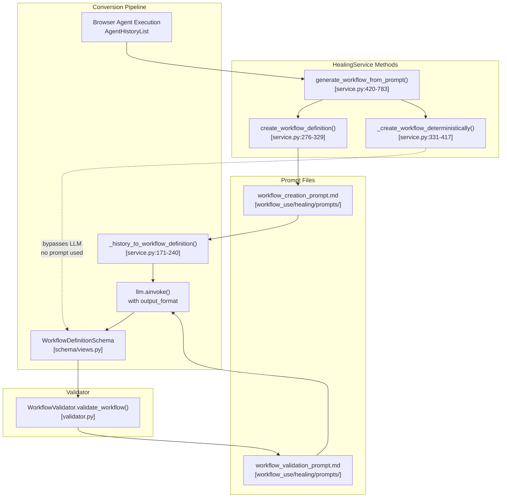
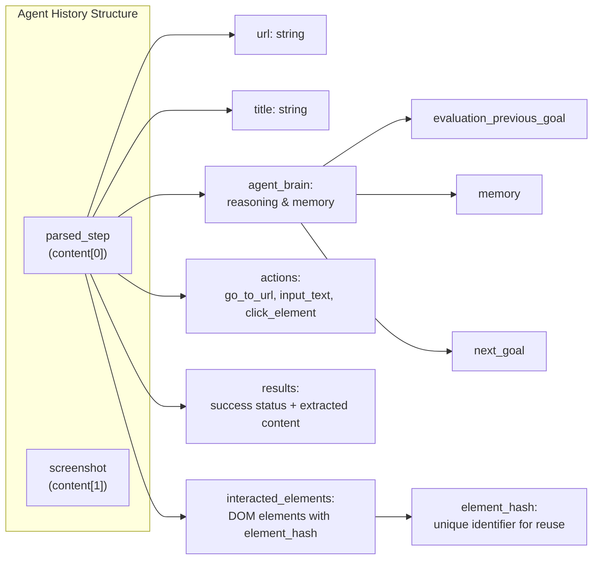
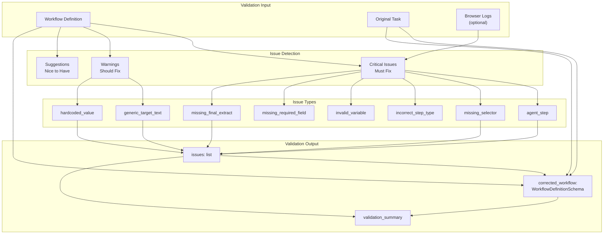
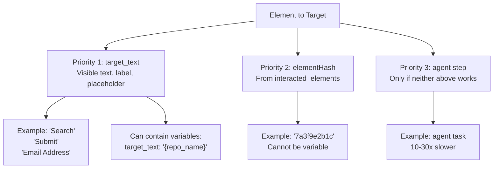
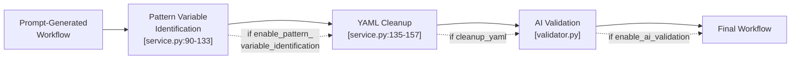

<!-- source: DeepWiki mcp.deepwiki.com · repo browser-use/workflow-use · page 3.4 Prompt Engineering for Workflow Creation · fetched 2026-10-30 -->

# Prompt Engineering for Workflow Creation

<details>
<summary>Relevant source files</summary>

The following files were used as context for generating this wiki page:

- [workflows/examples/scripts/generate_workflow.py](workflows/examples/scripts/generate_workflow.py)
- [workflows/examples/workflows/basic/example.workflow.yaml](workflows/examples/workflows/basic/example.workflow.yaml)
- [workflows/examples/workflows/basic/pure_semantic.workflow.yaml](workflows/examples/workflows/basic/pure_semantic.workflow.yaml)
- [workflows/examples/workflows/form_filling/semantic_form_fill.workflow.yaml](workflows/examples/workflows/form_filling/semantic_form_fill.workflow.yaml)
- [workflows/pyproject.toml](workflows/pyproject.toml)
- [workflows/tests/test_go_back.workflow.yaml](workflows/tests/test_go_back.workflow.yaml)
- [workflows/uv.lock](workflows/uv.lock)
- [workflows/workflow_use/healing/prompts/workflow_creation_prompt.md](workflows/workflow_use/healing/prompts/workflow_creation_prompt.md)
- [workflows/workflow_use/healing/prompts/workflow_validation_prompt.md](workflows/workflow_use/healing/prompts/workflow_validation_prompt.md)
- [workflows/workflow_use/healing/service.py](workflows/workflow_use/healing/service.py)
- [workflows/workflow_use/healing/tests/test_validator.py](workflows/workflow_use/healing/tests/test_validator.py)

</details>


This document covers the LLM prompts that power AI-driven workflow generation and validation in workflow-use. These prompts guide language models to convert browser interaction histories into structured, reusable workflows while enforcing quality standards and best practices.

For information about how these prompts are invoked during workflow generation, see [AI-Driven Generation with HealingService](#3.2). For details on the conversion strategies that use these prompts, see [Conversion Methods](#3.3).

## Overview

Workflow-use uses two primary prompt files to control LLM behavior during workflow creation:

| Prompt File | Purpose | Used By |
|-------------|---------|---------|
| `workflow_creation_prompt.md` | Converts browser agent history into workflow definitions | `HealingService.create_workflow_definition()` |
| `workflow_validation_prompt.md` | Validates and corrects generated workflows | `WorkflowValidator.validate_workflow()` |

These prompts are stored as Markdown files in [workflow_use/healing/prompts/](). The system loads them at runtime and formats them with task-specific context before sending to the LLM.

**Sources:** [workflow_use/healing/prompts/workflow_creation_prompt.md:1-242](), [workflow_use/healing/prompts/workflow_validation_prompt.md:1-228](), [workflow_use/healing/service.py:26-27]()

## Prompt Flow Architecture



**Prompt Loading and Usage Flow**

The system loads prompts using absolute paths and formats them with runtime context:

1. **Load prompt file**: [service.py:280-282]() reads the Markdown file
2. **Format with context**: [service.py:284]() inserts task goal and available actions
3. **Convert history to messages**: [service.py:287]() transforms agent steps into LLM messages
4. **Invoke LLM**: [service.py:293]() sends formatted prompt with structured output schema
5. **Parse response**: [service.py:294]() extracts `WorkflowDefinitionSchema` from completion

**Sources:** [workflow_use/healing/service.py:276-305](), [workflow_use/healing/prompts/workflow_creation_prompt.md:1-27]()

## Workflow Creation Prompt Structure

The `workflow_creation_prompt.md` file is a comprehensive instruction manual that teaches LLMs to generate high-quality workflows. It consists of several critical sections:

### Critical Rules Section

The prompt begins with **mandatory rules** that prevent common failure modes:

```markdown
## 🚨 CRITICAL RULES - READ FIRST 🚨

1. **ALL workflows MUST end with an extract step!**
2. **NEVER use `agent` steps for simple search/input/click actions!**
3. **ALWAYS use semantic `target_text` for element targeting!**
4. **Variables MUST use {variable} syntax (one pair of curly braces)**
5. **Prefer direct navigation over search engines!**
```

These rules are displayed prominently with warning emojis to ensure the LLM prioritizes them. Each rule addresses a specific quality issue:

| Rule | Problem Prevented | Impact |
|------|------------------|---------|
| Must end with extract | Incomplete workflows missing output | All workflows return structured data |
| No agent steps for simple actions | 10-30x slower execution, cost per run | Pure semantic workflows run fast and free |
| Use semantic `target_text` | Brittle CSS/XPath selectors that break | Self-healing through text-based matching |
| One pair of braces `{var}` | Template syntax errors | Python `str.format()` works correctly |
| Direct navigation | Unnecessary search engine steps | Faster execution, fewer dependencies |

**Sources:** [workflow_use/healing/prompts/workflow_creation_prompt.md:5-36]()

### Input Format Specification

The prompt defines how browser agent history is presented to the LLM:



**Key Fields Explained:**

- **`element_hash`**: A unique identifier for DOM elements that can be referenced in workflow steps. The prompt explicitly states: "You can't make it a variable or guess it" [workflow_creation_prompt.md:66]()
- **`agent_brain`**: Contains the agent's reasoning process, useful for understanding intent
- **`screenshot`**: Visual context for the LLM to verify element identification

**Sources:** [workflow_use/healing/prompts/workflow_creation_prompt.md:48-68]()

### Output Requirements

The prompt enforces a structured output format with four key components:

#### 1. Workflow Analysis (Required First Step)

```markdown
The `workflow_analysis` field **must be completed first** and contain:

1. **Step Analysis**: What the recorded steps accomplish overall
2. **Task Definition**: Clear purpose of the workflow being created
3. **Action Plan**: Detailed to-do list of all necessary workflow steps
4. **Variable Identification**:
   - Analyze ALL values entered/selected during the workflow
   - Identify which values are variables vs hardcoded
5. **Step Optimization**: Review if steps can be combined or simplified
```

This forces the LLM to think through the problem before generating steps, improving output quality.

**Sources:** [workflow_use/healing/prompts/workflow_creation_prompt.md:72-90]()

#### 2. Input Schema Definition

The prompt provides detailed guidance on creating the `input_schema`:

| Variable Category | Examples | Format Requirements |
|------------------|----------|-------------------|
| Personal Information | Names, emails, phone numbers | "user@domain.com", "(xxx) xxx-xxxx" |
| Search/Filter Criteria | Search terms, date ranges | "MM/DD/YYYY" |
| Form Data | User-entered text, numbers | Specific validation formats |
| Business Data | Amounts, quantities, IDs | Numeric formats |

Example schema from prompt:

```json
[
  {"name": "search_term", "type": "string", "required": true},
  {"name": "max_results", "type": "number", "required": false},
  {"name": "birth_date", "type": "string", "format": "MM/DD/YYYY", "required": true},
  {"name": "email", "type": "string", "format": "user@domain.com", "required": true}
]
```

**Sources:** [workflow_use/healing/prompts/workflow_creation_prompt.md:92-117]()

#### 3. Step Type Guidelines

The prompt provides a detailed taxonomy of available step types with prioritization:

**Semantic Steps (Preferred):**

```markdown
- **PREFERRED: Use semantic identification with `target_text`**
  - `target_text` (string): The visible text, label, or accessible name
  - **IMPORTANT**: `target_text` itself can contain variables!
  - Example (static): {"type": "click", "target_text": "Search"}
  - Example (variable in value): {"type": "input", "target_text": "Email", "value": "{email}"}
  - Example (variable in target_text): {"type": "click", "target_text": "{repo_name}"}
```

**Agent Steps (Last Resort):**

The prompt lists 13 specific UI patterns where agent steps are justified:
- Dropdowns/select boxes
- Multi-select interfaces
- Radio button groups
- Search autocomplete
- Infinite scroll/lazy loading
- Dynamic form fields
- Complex filters
- Interactive maps/charts
- File upload widgets
- Rich text editors
- Modal dialogs
- Time-sensitive content
- AJAX-powered interfaces

Each pattern includes justification: "These elements have dynamic content, unpredictable timing, or complex state that makes deterministic element hashing unreliable."

**Sources:** [workflow_use/healing/prompts/workflow_creation_prompt.md:133-196]()

### Variable Syntax Rules

The prompt heavily emphasizes correct variable syntax to prevent template errors:

```markdown
**CRITICAL**: Variables use `{var}` syntax (one pair of curly braces)
  - ✅ CORRECT: "value": "{email}" or "target_text": "{repo_name}"
  - ❌ WRONG: "value": "{{email}}" (double braces)
  - ❌ WRONG: "value": "{{{{email}}}}" (quadruple braces)
```

This rule appears **four times** in the prompt at strategic locations to prevent the LLM from generating incorrect syntax.

**Sources:** [workflow_use/healing/prompts/workflow_creation_prompt.md:26-29](), [workflow_use/healing/prompts/workflow_creation_prompt.md:141-142](), [workflow_use/healing/prompts/workflow_creation_prompt.md:146-149]()

## Workflow Validation Prompt Structure

The `workflow_validation_prompt.md` guides the LLM through quality assurance:



**Validation Rules:**

The prompt enforces a critical rule: **"You MUST provide a corrected workflow whenever you find ANY issues"** [workflow_validation_prompt.md:89](). This ensures the validator always returns actionable fixes.

**Sources:** [workflow_use/healing/prompts/workflow_validation_prompt.md:1-228]()

### Issue Severity Levels

The validator categorizes issues into three tiers:

| Severity | Description | Example |
|----------|-------------|---------|
| `critical` | Will cause workflow to fail | Missing `target_text` in click step |
| `warning` | May cause issues in some scenarios | Generic target text like "Click here" |
| `suggestion` | Nice to have improvement | Redundant navigation steps |

**Critical Issue: Missing Final Extract Step**

The most important critical issue is `missing_final_extract`:

```markdown
6. **Workflow Must End with Extract Step**
   - ALL workflows must end with an extract step (`extract` or `extract_page_content`)
   - This is CRITICAL because AI processing is always needed at the end
   - Even form-filling workflows should extract confirmation/success status
```

This ensures every workflow returns structured data, making them usable in larger automation pipelines.

**Sources:** [workflow_use/healing/prompts/workflow_validation_prompt.md:42-46]()

### Standardized Issue Types

The prompt defines 14 standardized issue types for consistent reporting:

```markdown
- `agent_step`: Agent step that should be semantic
- `missing_selector`: No target_text/xpath/cssSelector provided
- `incorrect_step_type`: Wrong step type for the action
- `invalid_variable`: Variable reference doesn't exist in input_schema
- `missing_required_field`: Required field is missing
- `missing_final_extract`: Workflow doesn't end with extract step (CRITICAL)
- `generic_target_text`: Target text is too generic
- `missing_error_handling`: No conditional logic for errors
- `hardcoded_value`: Value that should be a variable
- `missing_wait`: May need wait/delay step
- `optimization`: Could be more efficient
- `unclear_description`: Description needs improvement
- `vague_extraction`: Extraction goal too vague
```

These types map to methods in `WorkflowValidator` that generate appropriate error messages and corrections.

**Sources:** [workflow_use/healing/prompts/workflow_validation_prompt.md:118-133]()

### Correction Examples

The prompt includes before/after examples for common issues:

**Example: Agent Step → Semantic Step**

```markdown
**Issue:**
{"type": "agent", "task": "click the search button"}

**Correction:**
{"type": "click", "target_text": "Search", "description": "Click the search button"}
```

**Example: Hard-coded Value → Variable**

```markdown
**Issue:**
{"type": "input", "target_text": "First Name", "value": "John"}

**Correction:**
{"type": "input", "target_text": "First Name", "value": "{first_name}"}

And add to input_schema:
{"name": "first_name", "type": "string", "required": true}
```

**Sources:** [workflow_use/healing/prompts/workflow_validation_prompt.md:135-203]()

## Prompt Engineering Principles

The prompts embody several key principles that guide high-quality workflow generation:

### Principle 1: Semantic-First Element Targeting

The prompts strongly prefer `target_text` over CSS selectors or XPath:



**Rationale:** Semantic targeting survives UI changes better than technical selectors. When a button's CSS class changes from `btn-primary` to `btn-submit`, the workflow continues working if it targets "Submit" instead.

**Sources:** [workflow_use/healing/prompts/workflow_creation_prompt.md:133-145]()

### Principle 2: Variable Syntax Consistency

The prompts enforce Python `str.format()` syntax with single curly braces:

| Syntax | Status | Reason |
|--------|--------|--------|
| `{variable}` | ✅ Correct | Python `str.format()` substitutes correctly |
| `{{variable}}` | ❌ Wrong | Escapes to literal `{variable}` in format strings |
| `{{{{variable}}}}` | ❌ Wrong | Double escaping, produces `{{variable}}` |

The prompt includes explicit examples showing correct vs incorrect syntax in multiple sections to prevent this common error.

**Sources:** [workflow_use/healing/prompts/workflow_creation_prompt.md:26-29](), [workflow_use/healing/service.py:284]()

### Principle 3: Cost-Aware Step Selection

The prompts emphasize the performance and cost implications of different step types:

```markdown
**NEVER use `agent` steps for simple search/input/click actions!**
- Agent steps are 10-30x SLOWER and cost money per execution!
```

This principle is reinforced by:
1. Warning emojis (🚨) in critical rules section
2. Explicit cost warnings (money per execution)
3. Performance comparisons (10-30x slower)
4. Examples showing semantic alternatives

**Sources:** [workflow_use/healing/prompts/workflow_creation_prompt.md:15-19](), [workflow_use/healing/service.py:249-262]()

### Principle 4: Comprehensive Variable Identification

The prompts guide the LLM to analyze **all** values in the recorded workflow:

```markdown
**Variable Identification**:
   - Analyze ALL values entered/selected during the workflow
   - Identify which values are:
     - **SHOULD BE VARIABLES**: User-specific data (names, emails, search terms)
     - **SHOULD BE HARDCODED**: Navigation targets, UI element labels
```

This prevents workflows from being too specific (e.g., hardcoding "John" instead of `{first_name}`).

**Sources:** [workflow_use/healing/prompts/workflow_creation_prompt.md:79-89]()

## Customizing Prompts

The prompt files can be modified to customize workflow generation behavior:

### Customization Points

| Prompt Section | Customization Use Case | Example Change |
|----------------|----------------------|----------------|
| Critical Rules | Add domain-specific constraints | "All workflows must include authentication step" |
| Step Types | Add custom step types | Add `multi_select` or `drag_drop` types |
| Variable Categories | Support domain-specific data | Add "Medical Record Fields" category |
| Issue Types | Add custom validations | Add `missing_authentication` issue type |
| Examples | Show domain-specific patterns | Add healthcare form examples |

### Example: Adding Custom Validation Rule

To add a rule that all workflows must include error handling:

1. **Modify `workflow_creation_prompt.md`:**

```markdown
## 🚨 CRITICAL RULES - READ FIRST 🚨

6. **ALL workflows MUST include error handling!**
   - Use conditional checks after critical operations
   - Example: After login, check for "Invalid credentials" message
```

2. **Modify `workflow_validation_prompt.md`:**

```markdown
### Critical Issues (Must Fix)

7. **Missing Error Handling**
   - Critical operations without failure checks
   - Example: Login step without checking for error messages
```

3. **Update `WorkflowValidator` issue types:**

```python
# In validator.py
if not has_error_handling_after_login(workflow):
    issues.append(ValidationIssue(
        severity='critical',
        issue_type='missing_error_handling',
        step_index=login_step_index,
        description='Login step lacks error handling',
        suggestion='Add conditional check for error messages'
    ))
```

**Sources:** [workflow_use/healing/prompts/workflow_creation_prompt.md:5-36](), [workflow_use/healing/prompts/workflow_validation_prompt.md:14-46]()

### Testing Modified Prompts

After customizing prompts, test them using the validation test script:

```bash
# Test workflow creation with custom prompt
cd workflows
BROWSER_USE_API_KEY=your_key uv run python examples/scripts/generate_workflow.py

# Test validation with custom prompt
BROWSER_USE_API_KEY=your_key uv run python workflow_use/healing/tests/test_validator.py
```

The test validator creates a workflow with known issues and verifies the validation prompt catches them correctly.

**Sources:** [workflow_use/healing/tests/test_validator.py:1-76](), [examples/scripts/generate_workflow.py:1-188]()

## Prompt Loading Mechanism

The system loads prompts dynamically at runtime using absolute paths:

```python
# From service.py
_PROMPTS_DIR = Path(__file__).parent / 'prompts'

async def create_workflow_definition(self, task: str, history_list: AgentHistoryList):
    # Load prompt using absolute path
    prompt_file = _PROMPTS_DIR / 'workflow_creation_prompt.md'
    async with aiofiles.open(prompt_file, mode='r') as f:
        prompt_content = await f.read()
    
    # Format with runtime context
    prompt_content = prompt_content.format(
        goal=task,
        actions=BuilderService._get_available_actions_markdown()
    )
```

**Key Formatting Variables:**

- `{goal}`: The original task description (e.g., "Search GitHub for browser-use")
- `{actions}`: Markdown documentation of all available step types from `BuilderService`

The `{actions}` variable dynamically includes step type documentation, ensuring the prompt stays in sync with available actions even as new step types are added.

**Sources:** [workflow_use/healing/service.py:26-27](), [workflow_use/healing/service.py:280-285]()

## Integration with LLM Structured Output

The prompts work in tandem with LLM structured output to ensure valid responses:

```python
# From service.py:293-294
response = await self.llm.ainvoke(all_messages, output_format=WorkflowDefinitionSchema)
workflow_definition: WorkflowDefinitionSchema = response.completion
```

This approach combines:
1. **Natural language guidance** (the prompts) - teaches the LLM best practices
2. **Schema enforcement** (`output_format=WorkflowDefinitionSchema`) - ensures valid JSON structure

The LLM cannot return invalid JSON because the `output_format` parameter enforces schema validation. However, the LLM can still make logical errors (e.g., using agent steps unnecessarily), which the prompts prevent through natural language rules.

**Sources:** [workflow_use/healing/service.py:292-294]()

## Post-Processing Pipeline

After prompt-based generation, workflows undergo post-processing controlled by `HealingService` configuration:



These post-processing steps enhance the prompt-generated workflow without requiring changes to the prompts themselves:

1. **Pattern Variable Identification** [service.py:90-133]() - Finds variables using regex patterns (no LLM cost)
2. **YAML Cleanup** [service.py:135-157]() - Removes verbose fields like `description`, `verification_checks`
3. **AI Validation** (optional) - Applies validation prompt to fix issues

**Sources:** [workflow_use/healing/service.py:80-169]()

## Prompt Evolution Guidelines

When modifying prompts, follow these best practices:

### 1. Maintain Rule Hierarchy

Keep critical rules at the top with visual emphasis:
- Use emoji warnings (🚨, ⚠️, ✅, ❌)
- Number rules clearly (1, 2, 3...)
- Repeat critical rules in relevant sections

### 2. Include Concrete Examples

For every rule, provide both positive and negative examples:

```markdown
**Rule**: Use semantic target_text

✅ CORRECT: {"type": "click", "target_text": "Search"}
❌ WRONG: {"type": "agent", "task": "click the search button"}
```

### 3. Document Rationale

Explain *why* each rule exists:

```markdown
**Why**: Agent steps are 10-30x slower and cost money per execution!
```

This helps the LLM understand the importance of following the rule.

### 4. Test with Edge Cases

Create test workflows that violate rules to verify the prompt catches them:

```python
# Test that prompt prevents agent steps for simple actions
test_workflow = WorkflowDefinitionSchema(
    steps=[
        AgentTaskWorkflowStep(type='agent', task='click the search button')
    ]
)
result = await validator.validate_workflow(test_workflow, task='test')
assert any(issue.issue_type == 'agent_step' for issue in result.issues)
```

**Sources:** [workflow_use/healing/tests/test_validator.py:34-48]()

## Common Prompt Issues and Solutions

| Issue | Symptom | Solution |
|-------|---------|----------|
| LLM generates agent steps unnecessarily | Workflows have 5+ agent steps | Add more examples of semantic alternatives |
| Variable syntax errors | Workflows use `{{var}}` instead of `{var}` | Increase emphasis on single-brace syntax (repeat rule) |
| Missing extract steps | Workflows don't return data | Make "must end with extract" a critical rule |
| Hardcoded values | Workflows not reusable | Strengthen variable identification guidance |
| Generic target text | Element matching failures | Add examples of specific vs generic text |

The current prompts have evolved through testing to address these issues proactively.

**Sources:** [workflow_use/healing/prompts/workflow_creation_prompt.md:5-196](), [workflow_use/healing/prompts/workflow_validation_prompt.md:14-133]()

---

