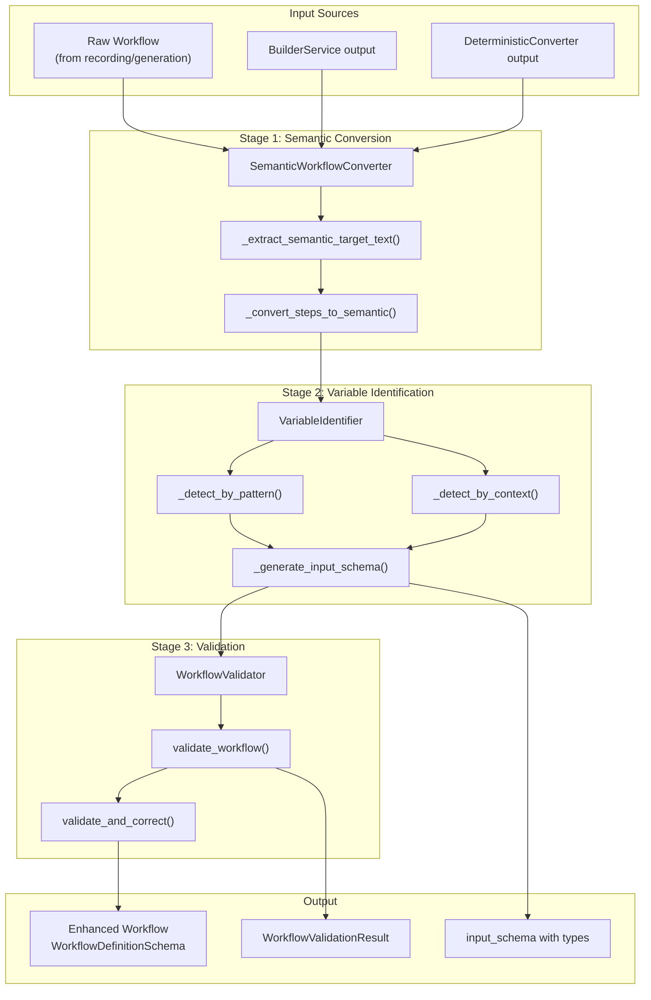
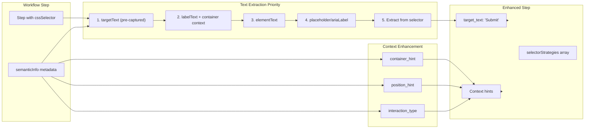
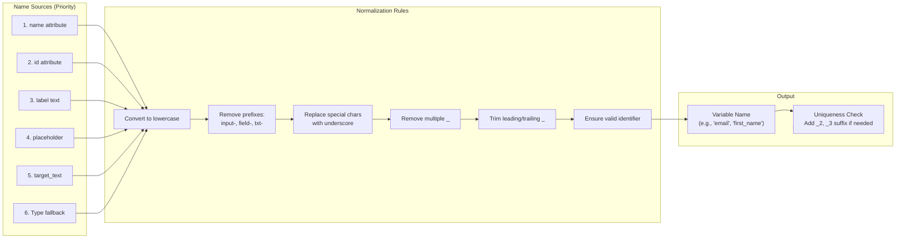
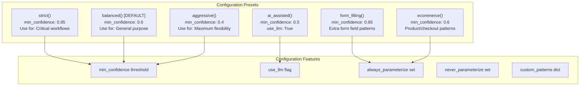
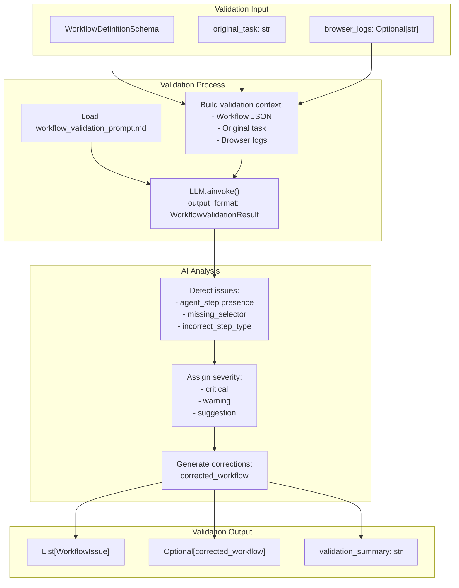
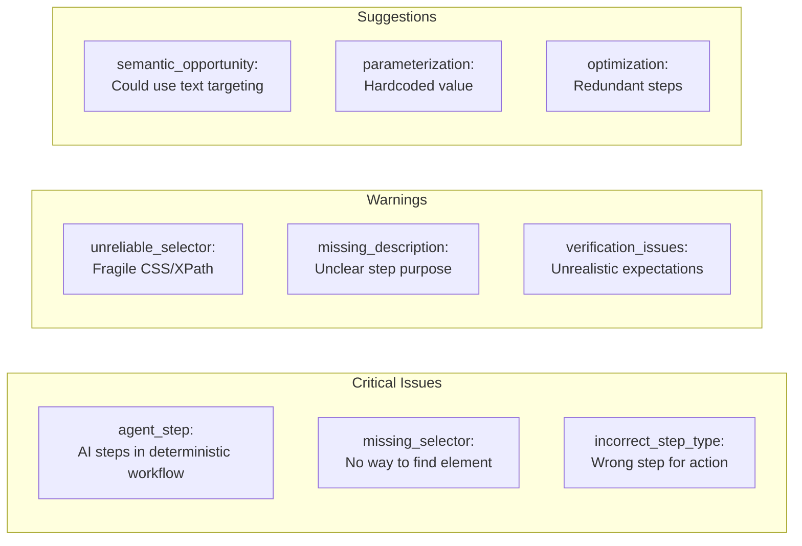
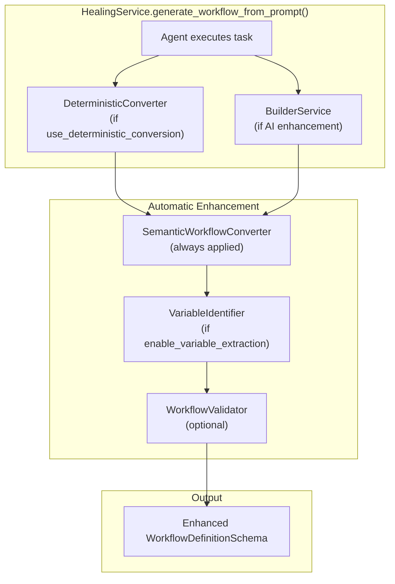

<!-- source: DeepWiki mcp.deepwiki.com · repo browser-use/workflow-use · page 3.5 Enhancement Pipeline · fetched 2026-10-30 -->

# Workflow Enhancement Pipeline

<details>
<summary>Relevant source files</summary>

The following files were used as context for generating this wiki page:

- [workflows/pyproject.toml](workflows/pyproject.toml)
- [workflows/test_max_alternatives_bug_fix.py](workflows/test_max_alternatives_bug_fix.py)
- [workflows/tests/test_selector_generator.py](workflows/tests/test_selector_generator.py)
- [workflows/tests/test_xpath_optimization.py](workflows/tests/test_xpath_optimization.py)
- [workflows/uv.lock](workflows/uv.lock)
- [workflows/workflow_use/healing/selector_generator.py](workflows/workflow_use/healing/selector_generator.py)
- [workflows/workflow_use/healing/service.py](workflows/workflow_use/healing/service.py)
- [workflows/workflow_use/healing/xpath_optimizer.py](workflows/workflow_use/healing/xpath_optimizer.py)
- [workflows/workflow_use/workflow/tests/test_variable_identifier.py](workflows/workflow_use/workflow/tests/test_variable_identifier.py)
- [workflows/workflow_use/workflow/validation_utils.py](workflows/workflow_use/workflow/validation_utils.py)
- [workflows/workflow_use/workflow/variable_config.py](workflows/workflow_use/workflow/variable_config.py)
- [workflows/workflow_use/workflow/variable_identifier.py](workflows/workflow_use/workflow/variable_identifier.py)

</details>


## Purpose and Scope

The Workflow Enhancement Pipeline is a multi-stage post-processing system that transforms raw workflow definitions into production-ready, parameterized, and robust automation scripts. This pipeline operates after the initial workflow creation (see [Browser Recording](#3.1) and [Natural Language Generation](#3.2)) and conversion (see [Deterministic vs AI-Enhanced Conversion](#3.3)), applying semantic targeting, variable parameterization, validation, and optimization.

The pipeline consists of three core stages:
1. **Semantic Conversion** - Transform CSS/XPath selectors into text-based targeting strategies
2. **Variable Identification** - Automatically detect and parameterize input values
3. **Workflow Validation** - AI-powered quality assurance and correction

For information about workflow execution after enhancement, see [Workflow Execution](#5).

---

## Enhancement Pipeline Architecture

The following diagram shows how the enhancement pipeline transforms workflows through its three stages:



**Sources:** [workflows/workflow_use/recorder/semantic_converter.py:1-311](), [workflows/workflow_use/workflow/variable_identifier.py:1-528](), [workflows/workflow_use/healing/validator.py:1-162]()

---

## Stage 1: Semantic Conversion

### Purpose

The `SemanticWorkflowConverter` transforms workflows that rely on brittle CSS selectors or XPath expressions into workflows that use semantic, text-based targeting. This improves workflow reliability when page structure changes but visible content remains consistent.

### Conversion Process



**Sources:** [workflows/workflow_use/recorder/semantic_converter.py:55-117]()

### SemanticWorkflowConverter Class

The converter is initialized with optional configuration:

| Parameter | Type | Default | Description |
|-----------|------|---------|-------------|
| `enable_variable_identification` | `bool` | `True` | Whether to automatically identify variables |
| `variable_config` | `Dict[str, Any]` | `{}` | Configuration for variable identification |

**Key Methods:**

- **`convert_workflow_to_semantic(workflow_data: Dict) -> Dict`** - Main conversion entry point [workflows/workflow_use/recorder/semantic_converter.py:22-43]()
- **`_convert_step_to_semantic(step: Dict) -> Dict`** - Converts individual steps [workflows/workflow_use/recorder/semantic_converter.py:55-117]()
- **`_extract_semantic_target_text(step: Dict) -> Optional[str]`** - Extracts best semantic target text [workflows/workflow_use/recorder/semantic_converter.py:119-248]()

### Semantic Target Text Extraction

The extraction logic follows a priority hierarchy to find the most reliable text-based identifier:

```python
# Priority 1: Pre-captured targetText (from updated extension)
if step.get('targetText'):
    return step['targetText'].strip()

# Priority 2: Hierarchical context (e.g., "Submit (in Login Form)")
semantic_info = step.get('semanticInfo', {})
if semantic_info and container_context:
    return f"{base_text} (in {container_text})"

# Priority 3: elementText (visible content)
# Priority 4: placeholder, ariaLabel
# Priority 5: Extract from CSS selector attributes
```

**Sources:** [workflows/workflow_use/recorder/semantic_converter.py:119-248]()

### Context Hints

The converter extracts three types of context hints to improve element identification:

| Hint Type | Source | Example Value | Purpose |
|-----------|--------|---------------|---------|
| `container_hint` | `semanticInfo.container_context.text` | `"Login Form"` | Provides hierarchical context |
| `position_hint` | `semanticInfo.sibling_context.position` | `"item 2 of 5"` | Disambiguates similar elements |
| `interaction_type` | `semanticInfo.interaction_hints[0]` | `"button"` | Specifies expected element type |

**Sources:** [workflows/workflow_use/recorder/semantic_converter.py:69-96]()

---

## Stage 2: Variable Identification

### Purpose

The `VariableIdentifier` automatically detects input values that should be parameterized as workflow variables, enabling workflow reuse with different input data. It uses pattern matching, context analysis, and heuristics to identify variables without requiring LLM calls.

### Variable Types

The system recognizes 12 distinct variable types:

```mermaid
graph TB
    subgraph PatternBased["Pattern-Based Types (Regex)"]
        Email["EMAIL<br/>pattern: email regex"]
        Phone["PHONE<br/>pattern: phone formats"]
        URL["URL<br/>pattern: http/https URLs"]
        SSN["SSN<br/>pattern: XXX-XX-XXXX"]
        CreditCard["CREDIT_CARD<br/>pattern: 16 digits"]
        Date["DATE<br/>pattern: various formats"]
        ZipCode["ZIP_CODE<br/>pattern: 5 or 9 digits"]
        Number["NUMBER<br/>pattern: numeric"]
    end
    
    subgraph ContextBased["Context-Based Types"]
        String["STRING<br/>keywords: name, address"]
        Password["PASSWORD<br/>keywords: password, pass"]
        Boolean["BOOLEAN<br/>true/false values"]
    end
    
    subgraph Detection["Detection Methods"]
        PatternMatch["Pattern Matching<br/>confidence: 0.95"]
        KeywordMatch["Keyword Matching<br/>confidence: 0.85"]
        Heuristic["Dynamic Heuristic<br/>confidence: 0.5"]
    end
    
    Email --> PatternMatch
    Phone --> PatternMatch
    URL --> PatternMatch
    SSN --> PatternMatch
    CreditCard --> PatternMatch
    Date --> PatternMatch
    ZipCode --> PatternMatch
    Number --> PatternMatch
    
    String --> KeywordMatch
    Password --> KeywordMatch
    Boolean --> Heuristic
```



**Sources:** [workflows/workflow_use/workflow/variable_identifier.py:18-31](), [workflows/workflow_use/workflow/variable_identifier.py:59-101]()

### Identification Process

The `VariableIdentifier` follows a three-stage detection process:

#### Stage 2A: Pattern-Based Detection (High Confidence)

```python
PATTERNS = {
    VariableType.EMAIL: r'^[a-zA-Z0-9._%+-]+@[a-zA-Z0-9.-]+\.[a-zA-Z]{2,}$',
    VariableType.PHONE: r'^[\+]?[(]?[0-9]{3}[)]?[-\s\.]?[0-9]{3}[-\s\.]?[0-9]{4,6}$',
    VariableType.URL: r'^https?://[^\s]+$',
    # ... more patterns
}
```

Pattern matches receive confidence score of **0.95** [workflows/workflow_use/workflow/variable_identifier.py:59-69](), [workflows/workflow_use/workflow/variable_identifier.py:255-262]()

#### Stage 2B: Context-Based Detection (Medium Confidence)

The identifier extracts context from multiple sources:

| Context Source | Priority | Examples |
|----------------|----------|----------|
| `semanticInfo.labelText` | Highest | `"Email Address"` |
| `semanticInfo.placeholder` | High | `"Enter your email"` |
| `semanticInfo.name` | High | `"email"` |
| `step.target_text` | Medium | `"Email"` |
| `step.description` | Medium | `"Input First Name"` |
| CSS selector attributes | Low | `[name="email"]` |

Context matches receive confidence score of **0.85** [workflows/workflow_use/workflow/variable_identifier.py:264-303]()

#### Stage 2C: Heuristic Detection (Lower Confidence)

For values that don't match patterns or context, the identifier uses heuristics:

```python
def _looks_dynamic(self, value: str) -> bool:
    has_mixed_case = value != value.lower() and value != value.upper()
    has_numbers = any(c.isdigit() for c in value)
    has_special = any(c in value for c in ['@', '#', '$', '%', '&', '*', '_', '-'])
    is_long = len(value) > 10
    
    score = sum([has_mixed_case, has_numbers, has_special, is_long])
    return score >= 2  # If 2+ indicators, likely a variable
```

Heuristic matches receive confidence score of **0.5** [workflows/workflow_use/workflow/variable_identifier.py:306-324]()

**Sources:** [workflows/workflow_use/workflow/variable_identifier.py:188-253]()

### VariableCandidate Data Structure

Each identified variable is represented as a `VariableCandidate`:

```python
@dataclass
class VariableCandidate:
    value: str                    # Original value from workflow
    variable_name: str            # Generated variable name
    variable_type: VariableType   # Detected type
    confidence: float             # 0.0 to 1.0
    context: Dict[str, Any]       # Context from step
    suggested_default: Optional[str] = None
    description: Optional[str] = None
    required: bool = True
```

**Sources:** [workflows/workflow_use/workflow/variable_identifier.py:34-46]()

### Variable Name Generation

Variable names are generated from context using normalization rules:



**Sources:** [workflows/workflow_use/workflow/variable_identifier.py:326-400]()

### Input Schema Generation

Identified variables are converted into a structured `input_schema`:

```python
{
    'name': 'email',
    'type': 'string',      # Maps to WorkflowInputSchemaDefinition types
    'format': 'email',     # Additional validation hint
    'required': True,
    'default': 'john@example.com',  # Original value as default
    'description': 'Email Address (email)'
}
```

Type mapping from `VariableType` to schema types:

| VariableType | Schema Type | Format |
|--------------|-------------|--------|
| `EMAIL` | `string` | `email` |
| `PHONE` | `string` | `phone` |
| `URL` | `string` | `url` |
| `SSN` | `string` | `ssn` |
| `CREDIT_CARD` | `string` | `credit-card` |
| `DATE` | `string` | `date` |
| `PASSWORD` | `string` | `password` |
| `NUMBER` | `number` | - |
| `BOOLEAN` | `bool` | - |
| `STRING` | `string` | - |

**Sources:** [workflows/workflow_use/workflow/variable_identifier.py:445-504]()

### Configuration Presets

The `VariableConfigPresets` class provides pre-configured identification strategies:



**Sources:** [workflows/workflow_use/workflow/variable_config.py:97-217]()

### Usage Example

```python
from workflow_use.workflow.variable_identifier import identify_variables_in_workflow

workflow_data = {
    'name': 'Contact Form',
    'steps': [
        {
            'type': 'input',
            'value': 'john.doe@example.com',  # Will be identified as email
            'cssSelector': 'input[name="email"]',
            'semanticInfo': {'name': 'email', 'labelText': 'Email Address'}
        },
        {
            'type': 'input', 
            'value': 'John',  # Will be identified from context
            'description': 'Input First Name'
        }
    ]
}

# Apply variable identification
enhanced = identify_variables_in_workflow(workflow_data, min_confidence=0.6)

# Result:
# - Step 1 value: '{email}' (confidence: 0.95, type: EMAIL)
# - Step 2 value: '{first_name}' (confidence: 0.75, type: STRING)
# - input_schema generated with both variables
```

**Sources:** [workflows/workflow_use/workflow/variable_identifier.py:512-527]()

---

## Stage 3: Workflow Validation

### Purpose

The `WorkflowValidator` uses AI to analyze workflows for quality issues, provide actionable feedback, and optionally apply automatic corrections. This stage catches problems that would otherwise cause execution failures.

### WorkflowValidator Class



**Sources:** [workflows/workflow_use/healing/validator.py:42-119]()

### WorkflowIssue Structure

Each detected issue is represented with full context:

```python
class WorkflowIssue(BaseModel):
    severity: str                # 'critical', 'warning', or 'suggestion'
    step_index: Optional[int]    # Which step has the issue
    issue_type: str              # Category: 'agent_step', 'missing_selector', etc.
    description: str             # Human-readable explanation
    suggestion: str              # How to fix it
```

**Sources:** [workflows/workflow_use/healing/validator.py:24-32]()

### Validation Methods

| Method | Parameters | Returns | Purpose |
|--------|------------|---------|---------|
| `validate_workflow()` | `workflow`, `original_task`, `browser_logs` | `WorkflowValidationResult` | Identify issues without correction |
| `validate_and_correct()` | `workflow`, `original_task`, `browser_logs` | `WorkflowDefinitionSchema` | Validate and apply corrections |
| `print_validation_report()` | `result` | `None` | Display formatted report |

**Sources:** [workflows/workflow_use/healing/validator.py:48-162]()

### Common Issue Types

The validator detects several categories of problems:



**Sources:** [workflows/workflow_use/healing/validator.py:24-40]()

### Validation Report Format

The validator generates structured reports with issue grouping:

```
================================================================================
WORKFLOW VALIDATION REPORT
================================================================================

Summary: Found 3 issues - 1 critical, 1 warning, 1 suggestion

🔴 CRITICAL ISSUES (1):

  1. agent_step (Step 3)
     Step uses AI-driven agent execution which is non-deterministic
     💡 Replace with deterministic click/input steps with explicit selectors

⚠️  WARNINGS (1):

  1. missing_selector (Step 5)
     Step has no selector strategy - cannot reliably find element
     💡 Add selectorStrategies array with text-based targeting

💡 SUGGESTIONS (1):

  1. semantic_opportunity (Step 2)
     Step uses CSS selector but has visible text available
     💡 Convert to use target_text: "Submit" for better reliability

================================================================================
```

**Sources:** [workflows/workflow_use/healing/validator.py:120-162]()

---

## Integration and Usage

### Complete Enhancement Pipeline

The three stages are typically executed in sequence:

```python
from workflow_use.recorder.semantic_converter import SemanticWorkflowConverter
from workflow_use.workflow.variable_identifier import identify_variables_in_workflow
from workflow_use.healing.validator import WorkflowValidator
from browser_use.llm import ChatBrowserUse

# Stage 1: Semantic Conversion
converter = SemanticWorkflowConverter(
    enable_variable_identification=False  # We'll do this separately
)
semantic_workflow = converter.convert_workflow_to_semantic(raw_workflow)

# Stage 2: Variable Identification
enhanced_workflow = identify_variables_in_workflow(
    semantic_workflow,
    min_confidence=0.6
)

# Stage 3: Validation (optional but recommended)
llm = ChatBrowserUse()
validator = WorkflowValidator(llm)
validation_result = await validator.validate_workflow(
    WorkflowDefinitionSchema(**enhanced_workflow),
    original_task="Fill contact form"
)

# Apply corrections if needed
if validation_result.corrected_workflow:
    final_workflow = validation_result.corrected_workflow
else:
    final_workflow = WorkflowDefinitionSchema(**enhanced_workflow)
```

**Sources:** [workflows/workflow_use/recorder/semantic_converter.py:281-311](), [workflows/workflow_use/workflow/variable_identifier.py:512-527](), [workflows/workflow_use/healing/validator.py:98-119]()

### Automated Enhancement in Healing Service

The `HealingService` integrates the enhancement pipeline automatically:



**Sources:** [workflows/workflow_use/healing/service.py]() (referenced in high-level diagrams)

### Configuration Options

The enhancement pipeline accepts configuration at multiple levels:

| Configuration | Location | Default | Purpose |
|---------------|----------|---------|---------|
| `enable_variable_identification` | `SemanticWorkflowConverter.__init__()` | `True` | Enable variable detection |
| `variable_config` | `SemanticWorkflowConverter.__init__()` | `{}` | Variable identification settings |
| `min_confidence` | `identify_variables_in_workflow()` | `0.6` | Confidence threshold |
| `use_llm` | `VariableIdentifier.__init__()` | `False` | Use LLM for ambiguous cases |

**Sources:** [workflows/workflow_use/recorder/semantic_converter.py:11-21](), [workflows/workflow_use/workflow/variable_identifier.py:120-130]()

---

## Error Detection and Reporting

### Validation Error Detection

The pipeline includes utilities for detecting runtime validation errors on web pages:

```python
from workflow_use.workflow.validation_utils import detect_validation_errors

# During workflow execution
has_errors, error_text = await detect_validation_errors(page)
if has_errors:
    # Handle validation failure
    logger.error(f"Form validation error: {error_text}")
```

The detector uses common CSS selectors across frameworks:

```python
VALIDATION_ERROR_SELECTORS = [
    '.error',
    '.error-message',
    '.validation-error',
    '[role="alert"]',
    '.alert-danger',
    '.text-red',
    '.invalid-feedback',
    # ... more patterns
]
```

**Sources:** [workflows/workflow_use/workflow/validation_utils.py:10-88]()

### Error Reporter Integration

The `ErrorReporter` provides structured error messages during workflow execution failures:

```python
from workflow_use.workflow.error_reporter import ErrorReporter, ErrorContext, ErrorCategory

reporter = ErrorReporter()

context = ErrorContext(
    step_type='input',
    step_description='Enter email',
    error_category=ErrorCategory.ELEMENT_NOT_FOUND,
    target_text='Email',
    strategies_attempted=[
        StrategyAttempt('text_exact', 'Email', 1, False, 'No match'),
        StrategyAttempt('placeholder', 'Enter email', 2, False, 'No match')
    ]
)

error_report = reporter.report_error(context)
```

**Sources:** [workflows/workflow_use/workflow/error_reporter.py:79-181]()

---

## Performance Characteristics

### Stage Execution Times

| Stage | Typical Duration | LLM Calls | Cost Impact |
|-------|-----------------|-----------|-------------|
| Semantic Conversion | 100-500ms | 0 | None |
| Variable Identification | 50-200ms | 0 (optional LLM) | None (or $0.01-0.05 if LLM) |
| Validation | 3-8s | 1 | $0.05-0.15 |
| **Total Pipeline** | **3-9s** | **1** | **$0.05-0.15** |

### Confidence Score Impact

Variable identification confidence thresholds affect parameterization rate:

| Threshold | Variables Identified | False Positives | Use Case |
|-----------|---------------------|-----------------|----------|
| 0.85 (strict) | ~40% of inputs | <5% | Critical workflows |
| 0.6 (balanced) | ~70% of inputs | ~10% | General use |
| 0.4 (aggressive) | ~85% of inputs | ~20% | Maximum flexibility |

**Sources:** [workflows/workflow_use/workflow/variable_config.py:100-141]()

---

## Testing

The enhancement pipeline includes comprehensive test coverage:

### Variable Identifier Tests

```python
from workflow_use.workflow.variable_identifier import VariableIdentifier

# Test pattern detection
identifier = VariableIdentifier()
candidate = identifier.identify_variable(
    'john@example.com',
    {'name': 'email'}
)
assert candidate.variable_type == VariableType.EMAIL
assert candidate.confidence >= 0.85
```

**Key test files:**
- [workflows/workflow_use/workflow/tests/test_variable_identifier.py:1-286]() - Pattern, context, and integration tests
- [workflows/tests/test_element_finder.py:1-331]() - Element finding strategy tests
- [workflows/tests/test_workflow_execution.py:1-233]() - End-to-end execution tests

**Sources:** [workflows/workflow_use/workflow/tests/test_variable_identifier.py:17-232]()

---

## Summary

The Workflow Enhancement Pipeline transforms raw workflows into production-ready automation scripts through three coordinated stages:

1. **Semantic Conversion** replaces brittle selectors with text-based targeting strategies
2. **Variable Identification** automatically detects and parameterizes input values without LLM calls
3. **Workflow Validation** provides AI-powered quality assurance and corrections

The pipeline executes in 3-9 seconds with minimal cost ($0.05-0.15), making it practical for all workflow creation paths. Configuration presets enable tuning for different use cases, from strict critical workflows to aggressive flexible automation.

For information about workflow execution after enhancement, see [Workflow Execution](#5). For details on the conversion strategies that feed into this pipeline, see [Deterministic vs AI-Enhanced Conversion](#3.3).

---

