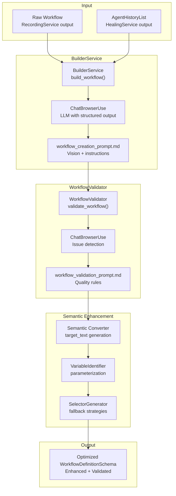
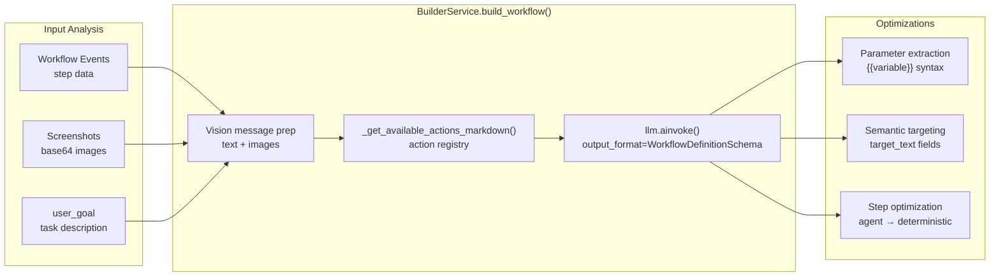
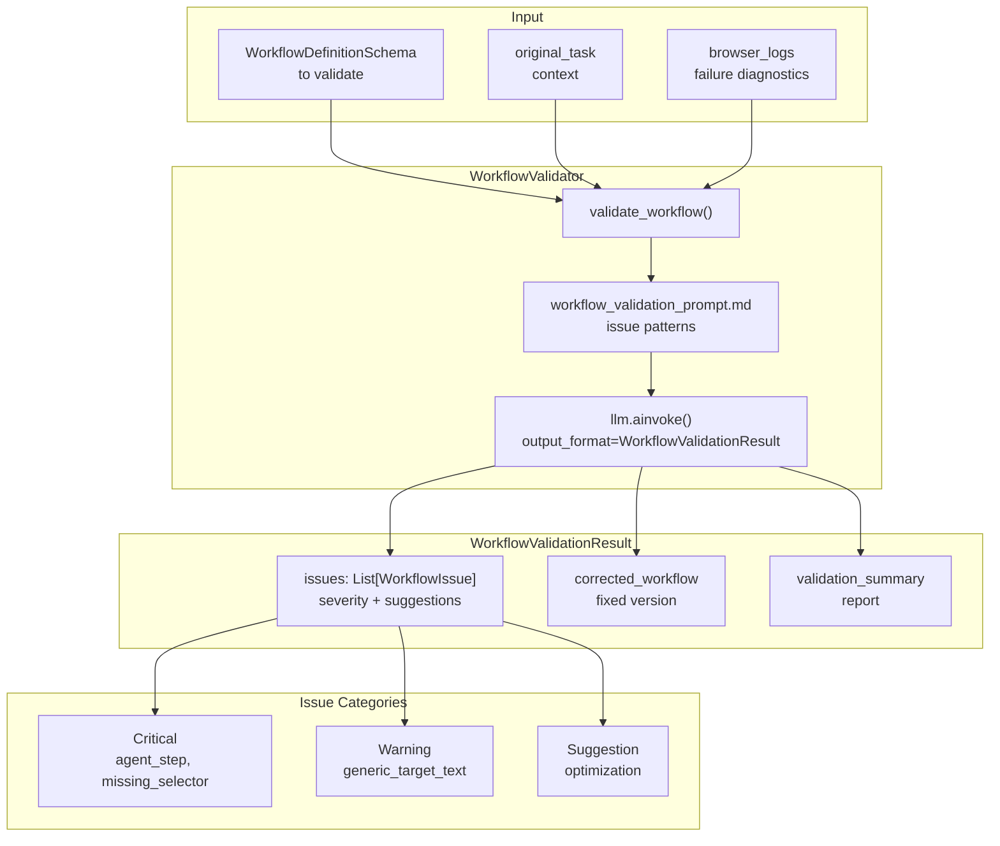
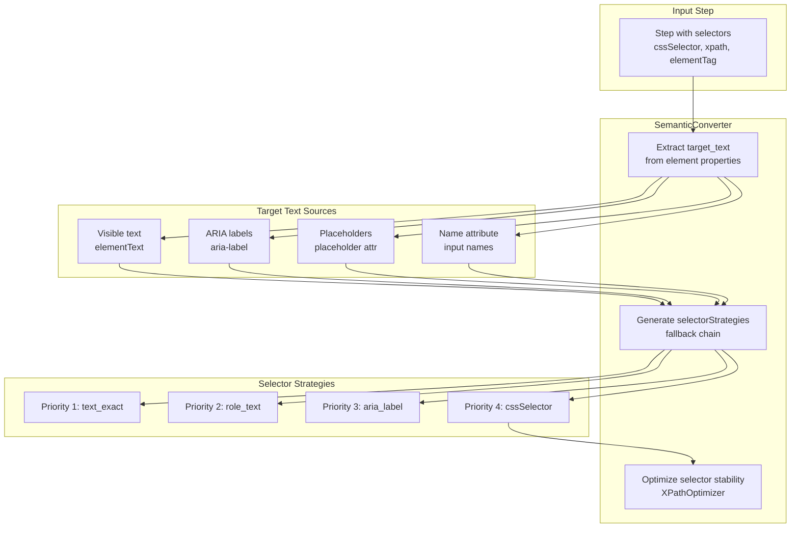
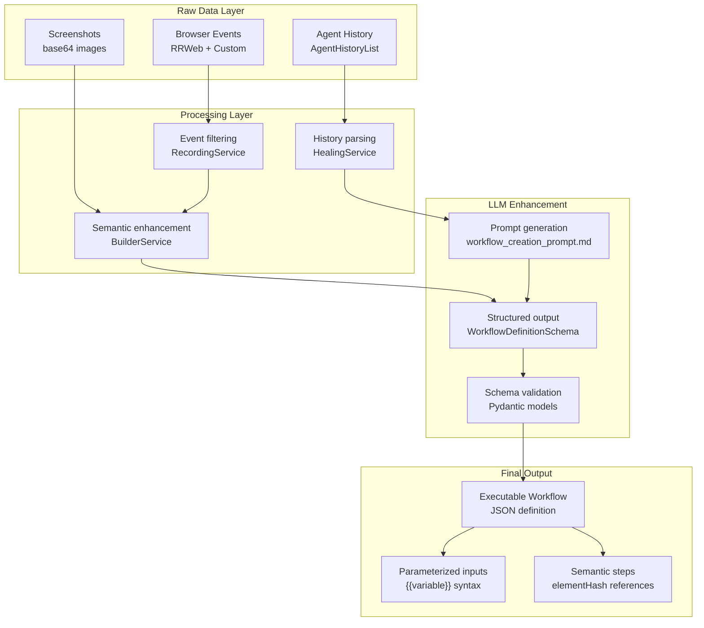

<!-- source: DeepWiki mcp.deepwiki.com · repo browser-use/workflow-use · page 4 Builder and Validation Services · fetched 2026-10-30 -->

# AI-Powered Healing and Building

<details>
<summary>Relevant source files</summary>

The following files were used as context for generating this wiki page:

- [workflows/cli.py](workflows/cli.py)
- [workflows/examples/scripts/generate_workflow.py](workflows/examples/scripts/generate_workflow.py)
- [workflows/examples/workflows/basic/example.workflow.yaml](workflows/examples/workflows/basic/example.workflow.yaml)
- [workflows/examples/workflows/basic/pure_semantic.workflow.yaml](workflows/examples/workflows/basic/pure_semantic.workflow.yaml)
- [workflows/examples/workflows/form_filling/semantic_form_fill.workflow.yaml](workflows/examples/workflows/form_filling/semantic_form_fill.workflow.yaml)
- [workflows/tests/test_element_finder.py](workflows/tests/test_element_finder.py)
- [workflows/tests/test_go_back.workflow.yaml](workflows/tests/test_go_back.workflow.yaml)
- [workflows/tests/test_go_back_fix.py](workflows/tests/test_go_back_fix.py)
- [workflows/tests/test_selector_generator_fix.py](workflows/tests/test_selector_generator_fix.py)
- [workflows/tests/test_wait_times.py](workflows/tests/test_wait_times.py)
- [workflows/tests/test_workflow_execution.py](workflows/tests/test_workflow_execution.py)
- [workflows/workflow_use/healing/prompts/workflow_creation_prompt.md](workflows/workflow_use/healing/prompts/workflow_creation_prompt.md)
- [workflows/workflow_use/healing/prompts/workflow_validation_prompt.md](workflows/workflow_use/healing/prompts/workflow_validation_prompt.md)
- [workflows/workflow_use/healing/tests/test_validator.py](workflows/workflow_use/healing/tests/test_validator.py)
- [workflows/workflow_use/recorder/semantic_converter.py](workflows/workflow_use/recorder/semantic_converter.py)
- [workflows/workflow_use/schema/views.py](workflows/workflow_use/schema/views.py)
- [workflows/workflow_use/workflow/service.py](workflows/workflow_use/workflow/service.py)

</details>


The AI-Powered Healing and Building system uses Large Language Models to transform raw workflow recordings and agent histories into optimized, maintainable workflow definitions. This system provides three key capabilities: workflow enhancement via `BuilderService`, quality assurance via `WorkflowValidator`, and semantic optimization for reliable element targeting. The AI layer intelligently analyzes recorded interactions, identifies reusable parameters, converts agent steps to deterministic actions, and validates workflows against best practices.

For information about workflow creation methods, see [Workflow Creation](#3). For execution details, see [Workflow Execution](#5). This page provides an overview of AI-powered enhancements; detailed documentation is available in [Builder Service](#4.1), [Workflow Validation](#4.2), and [Semantic Conversion](#4.3).

## AI Enhancement Architecture

The AI-powered enhancement system operates through three specialized services that work together to optimize workflow quality, reliability, and maintainability.

### AI Service Integration Pipeline



**Sources:** [workflows/workflow_use/builder/service.py:20-47](), [workflows/workflow_use/healing/validator.py:42-96](), [workflows/workflow_use/healing/prompts/workflow_creation_prompt.md:1-50]()

### LLM Integration Points

The system integrates LLMs at multiple stages for different optimization objectives:

| Component | LLM Model | Purpose | Output Format |
|-----------|-----------|---------|---------------|
| `BuilderService` | `ChatBrowserUse` | Transform recordings to workflows | `WorkflowDefinitionSchema` |
| `WorkflowValidator` | `ChatBrowserUse` | Detect and fix issues | `WorkflowValidationResult` |
| `HealingService` | `ChatBrowserUse` | Generate from agent history | `WorkflowDefinitionSchema` |
| `VariableIdentifier` | `ChatBrowserUse` | Extract parameters | `VariableExtractionResult` |

All LLM invocations use structured output via Pydantic models and function calling to ensure reliable parsing.

**Sources:** [workflows/workflow_use/builder/service.py:26-38](), [workflows/workflow_use/healing/validator.py:45-46](), [workflows/workflow_use/healing/service.py:19-26]()

## Workflow Enhancement with BuilderService

The `BuilderService` transforms raw workflow recordings into optimized workflow definitions using LLM-powered analysis. It processes both event data and screenshots to understand user intent and generate semantic, parameterized workflows.

### Enhancement Capabilities

The builder provides intelligent workflow optimization through multi-modal LLM analysis:



**Key Enhancement Features:**
- **Screenshot Context**: Includes up to 20 screenshots for visual understanding [workflows/workflow_use/builder/service.py:189-220]()
- **Action Registry Integration**: Provides available actions from `WorkflowController` [workflows/workflow_use/builder/service.py:44-83]()
- **Structured Output**: Uses Pydantic schema for reliable parsing [workflows/workflow_use/builder/service.py:228-230]()
- **Variable Identification**: Extracts reusable parameters from recorded values

**Sources:** [workflows/workflow_use/builder/service.py:132-237](), [workflows/workflow_use/builder/prompts.py:1-6]()

For detailed documentation of the builder prompt engineering and workflow enhancement process, see [Builder Service](#4.1).

## Workflow Validation and Quality Assurance

The `WorkflowValidator` analyzes generated workflows to detect issues and automatically apply corrections. This AI-powered validation ensures workflows follow best practices and avoid common failure patterns.

### Validation Architecture



**Sources:** [workflows/workflow_use/healing/validator.py:42-96](), [workflows/workflow_use/healing/prompts/workflow_validation_prompt.md:1-50]()

### Common Issue Detection

The validator checks for critical workflow problems that cause execution failures:

| Issue Type | Severity | Detection Pattern | Auto-Fix |
|------------|----------|-------------------|----------|
| `agent_step` | Critical | Agent step replaceable by semantic | Convert to `click`/`input` |
| `missing_selector` | Critical | No `target_text`/`xpath`/`cssSelector` | Add semantic selector |
| `incorrect_step_type` | Critical | Wrong action type used | Replace with correct type |
| `missing_final_extract` | Critical | No extract step at end | Add `extract_page_content` |
| `hardcoded_value` | Warning | Value should be variable | Parameterize with `{{var}}` |
| `generic_target_text` | Warning | Text like "Click here" | Make more specific |

**Validation Rules Enforced:**
1. **All workflows must end with an extract step** [workflows/workflow_use/healing/prompts/workflow_validation_prompt.md:42-45]()
2. **Prefer semantic steps over agent steps** (10-30x faster) [workflows/workflow_use/healing/prompts/workflow_validation_prompt.md:16-19]()
3. **Target elements must have identification** (`target_text` or selector) [workflows/workflow_use/healing/prompts/workflow_validation_prompt.md:21-24]()
4. **Variables must be declared in input_schema** [workflows/workflow_use/healing/prompts/workflow_validation_prompt.md:32-34]()

**Sources:** [workflows/workflow_use/healing/prompts/workflow_validation_prompt.md:14-80](), [workflows/workflow_use/healing/validator.py:24-40]()

### Automatic Correction

The validator generates corrected workflows when issues are detected:

```python
# Usage from validator.py
result = await validator.validate_workflow(
    workflow=workflow,
    original_task="Fill government form",
    browser_logs=execution_logs  # Optional
)

if result.corrected_workflow:
    # Use the corrected version
    workflow = result.corrected_workflow
```

**Correction Process:**
1. Identify all issues with severity levels [workflows/workflow_use/healing/validator.py:48-61]()
2. Generate complete corrected workflow [workflows/workflow_use/healing/prompts/workflow_validation_prompt.md:87-111]()
3. Preserve workflow intent while fixing implementation [workflows/workflow_use/healing/prompts/workflow_validation_prompt.md:93-95]()
4. Return both issue list and corrected workflow [workflows/workflow_use/healing/validator.py:34-39]()

**Sources:** [workflows/workflow_use/healing/validator.py:98-118](), [workflows/workflow_use/healing/prompts/workflow_validation_prompt.md:87-111]()

For complete validation prompt engineering details, see [Workflow Validation and Quality Assurance](#4.2).

## Semantic Conversion and Optimization

The semantic conversion process transforms workflows to use text-based element targeting instead of brittle CSS selectors and XPath expressions. This optimization dramatically improves workflow maintainability and resilience to page changes.

### Semantic Targeting Strategy



**Sources:** [workflows/workflow_use/controller/utils.py:12-49](), [workflows/examples/workflows/basic/pure_semantic.workflow.yaml:1-47]()

### Selector Stability Optimization

The `SelectorGenerator` and `XPathOptimizer` create stability-ranked selector strategies:

**Stability Ranking (Most → Least Stable):**

| Priority | Strategy Type | Example | Stability Rationale |
|----------|--------------|---------|---------------------|
| 1 | Attribute-based | `input[placeholder*="Email"]` | Semantic attributes rarely change |
| 2 | Text content | `button:has-text("Submit")` | User-facing text is stable |
| 3 | Role + text | `[role="button"]:has-text("Next")` | ARIA roles + visible text |
| 4 | Tag + classes | `button.submit-btn` | Structure-dependent but common |
| 5 | Full selector | Original CSS/XPath | Fallback for exact targeting |

**Selector Generation Process:**
1. Extract semantic information from element [workflows/workflow_use/controller/utils.py:51-102]()
2. Generate fallback selectors by stability [workflows/workflow_use/controller/utils.py:51-102]()
3. Remove dynamic parts (IDs, state classes) [workflows/workflow_use/controller/utils.py:89-96]()
4. Create text-based selectors when possible [workflows/workflow_use/controller/utils.py:98-100]()

**Sources:** [workflows/workflow_use/controller/utils.py:51-150](), [workflows/examples/workflows/form_filling/semantic_form_fill.workflow.yaml:1-47]()

### Variable Parameterization

The `VariableIdentifier` extracts reusable parameters from workflow values:

**Identification Criteria:**
- **User-specific data**: Names, emails, phone numbers, addresses
- **Search/filter terms**: Query strings, date ranges, categories  
- **Form inputs**: Any user-entered text, numbers, selections
- **Dynamic values**: Amounts, quantities, IDs, references

**Variable Syntax:**
- Template format: `{{variable_name}}` (single braces for Python `str.format()`)
- Input schema: JSON Schema draft-7 with `name`, `type`, `required` fields
- Format hints: Specify patterns like `"MM/DD/YYYY"` or `"user@domain.com"`

**Example Conversion:**
```yaml
# Before: Hard-coded value
- type: input
  target_text: "First Name"
  value: "John"

# After: Parameterized
- type: input
  target_text: "First Name"
  value: "{first_name}"

input_schema:
- name: first_name
  type: string
  required: true
```

**Sources:** [workflows/workflow_use/healing/prompts/workflow_creation_prompt.md:92-116](), [workflows/examples/workflows/basic/example.workflow.yaml:102-111]()

For detailed semantic conversion algorithms, see [Semantic Conversion and Optimization](#4.3).

## Data Transformation Pipeline

The workflow builder implements a comprehensive data transformation pipeline that converts raw browser events into executable workflow definitions through multiple processing stages.

### Event to Workflow Transformation



**Sources:** [workflows/workflow_use/healing/prompts/workflow_creation_prompt.md:1-25](), [workflows/workflow_use/builder/service.py:187-232]()

### Workflow Schema Generation

The transformation process creates structured workflow definitions with these key components:

| Schema Field | Purpose | Generation Method |
|--------------|---------|------------------|
| `workflow_analysis` | Task understanding | LLM reasoning about recorded steps |
| `input_schema` | Parameter definitions | JSON Schema draft-7 format |
| `output_schema` | Return data structure | Based on extraction steps |
| `steps` | Action sequence | Deterministic + agentic step mix |

**Step Type Mapping:**
- **Deterministic Steps**: Direct browser actions (`click_element`, `input_text`, `go_to_url`)
- **Agentic Steps**: AI-powered tasks for dynamic content (`agent` type with `task` parameter)
- **Extraction Steps**: Data gathering (`extract_page_content` with `goal` parameter)

**Sources:** [workflows/workflow_use/healing/prompts/workflow_creation_prompt.md:39-122](), [workflows/workflow_use/schema/views.py]()

The Workflow Builder system provides a robust foundation for converting browser interactions into reusable automation workflows, supporting both direct recording enhancement and AI-powered generation from natural language tasks.

---

