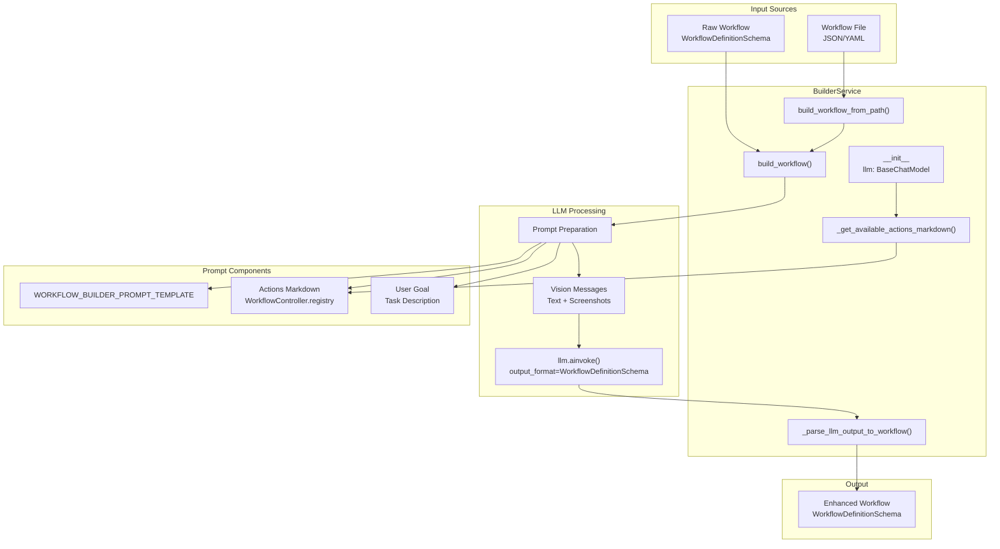
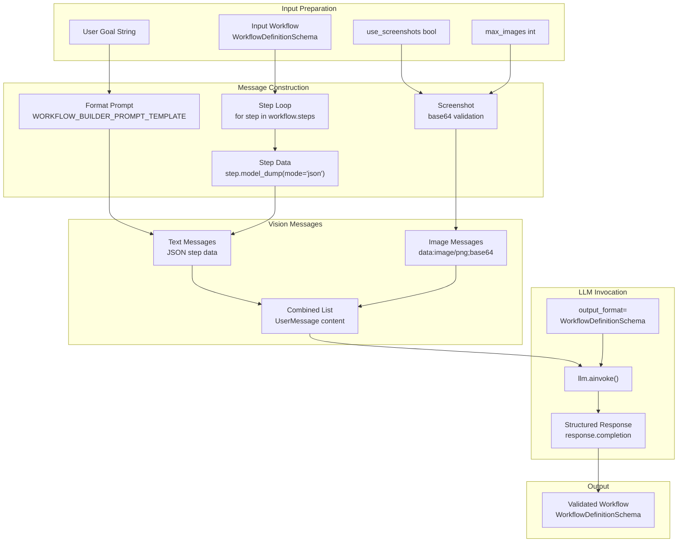
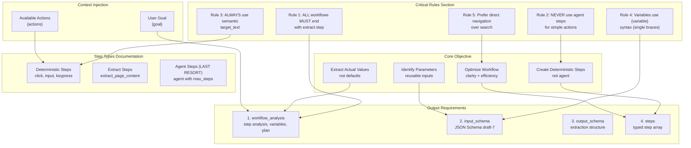
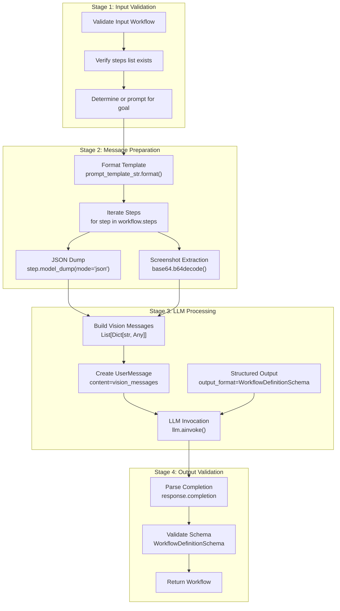
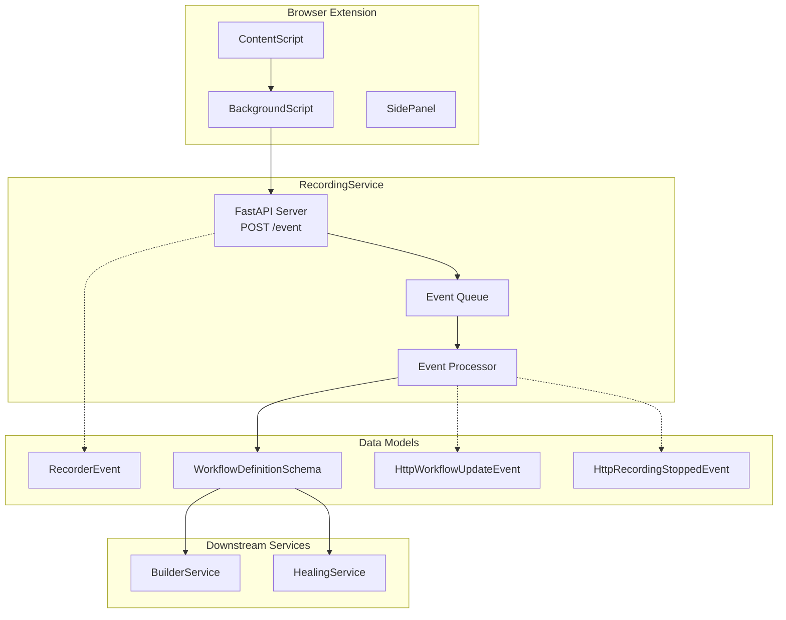

<!-- source: DeepWiki mcp.deepwiki.com · repo browser-use/workflow-use · page 4.1 BuilderService · fetched 2026-10-30 -->

# Builder Service

<details>
<summary>Relevant source files</summary>

The following files were used as context for generating this wiki page:

- [README.md](README.md)
- [workflows/.gitignore](workflows/.gitignore)
- [workflows/cli.py](workflows/cli.py)
- [workflows/workflow_use/schema/views.py](workflows/workflow_use/schema/views.py)
- [workflows/workflow_use/storage/__init__.py](workflows/workflow_use/storage/__init__.py)
- [workflows/workflow_use/workflow/service.py](workflows/workflow_use/workflow/service.py)

</details>


The Builder Service (`BuilderService`) enhances raw workflow definitions using LLM intelligence to create production-ready, semantic workflows. It transforms recorded browser interactions or agent execution histories into optimized workflow definitions with semantic targeting, proper variable parameterization, and deterministic steps that minimize AI usage during execution.

For information about how workflows are initially captured, see [Browser Recording](#3.1). For details on workflow validation and quality assurance, see [Workflow Validation](#4.2). For semantic conversion techniques, see [Semantic Conversion](#4.3).

## Core Architecture

The `BuilderService` class orchestrates LLM-based workflow enhancement, processing input workflows through a vision-enabled pipeline that produces optimized, semantic workflow definitions. The service integrates with `browser-use`'s LLM infrastructure and uses structured output to ensure type-safe workflow generation.

**BuilderService Architecture**



Sources: [workflows/workflow_use/builder/service.py:20-253]()

The architecture consists of four key layers:
- **Initialization Layer**: LLM setup and action registry documentation generation
- **Input Processing Layer**: Workflow loading from objects or file paths  
- **LLM Enhancement Layer**: Prompt construction, vision message preparation, structured output
- **Output Validation Layer**: Schema parsing and validation of LLM responses

## LLM Integration

The `BuilderService` uses `browser-use`'s `BaseChatModel` interface with structured output to ensure type-safe workflow generation. The service leverages vision capabilities to process both textual step data and optional screenshots for enhanced context understanding.

**LLM Integration Flow**



Sources: [workflows/workflow_use/builder/service.py:132-237]()

### Structured Output Configuration

The service uses `browser-use`'s structured output feature to enforce schema compliance:

```python
llm_response = await self.llm.ainvoke(
    [UserMessage(content=cast(Any, vision_messages))],
    output_format=WorkflowDefinitionSchema
)
workflow_data = llm_response.completion
```

This eliminates the need for manual JSON parsing and validation, as the LLM is constrained to output valid `WorkflowDefinitionSchema` objects.

Sources: [workflows/workflow_use/builder/service.py:228-231]()

### Vision Message Preparation

The service constructs multi-modal messages combining textual step data with optional screenshots:

| Message Type | Content | Usage |
|--------------|---------|-------|
| Text (Prompt) | Template with goal and actions | System instructions |
| Text (Step Data) | JSON-serialized step objects | Step-by-step context |
| Image (Screenshot) | Base64-encoded PNG | Visual page context |
| Text (Metadata) | Screenshot type descriptions | Image labeling |

The service validates base64 data before inclusion and respects the `max_images` limit to control token costs.

Sources: [workflows/workflow_use/builder/service.py:176-223]()

## Prompt Engineering

The `BuilderService` uses a comprehensive prompt template (`WORKFLOW_BUILDER_PROMPT_TEMPLATE`) that enforces critical workflow design principles through structured instructions. The prompt is loaded from `workflow_creation_prompt.md` and dynamically populated with available actions and user goals.

**Prompt Structure**



Sources: [workflows/workflow_use/healing/prompts/workflow_creation_prompt.md:1-242]()

### Critical Design Rules

The prompt enforces five mandatory rules that guide workflow generation:

| Rule | Enforcement | Rationale |
|------|------------|-----------|
| **Mandatory Extract Step** | All workflows must end with `extract` or `extract_page_content` | AI processing always needed for data extraction |
| **Avoid Agent Steps** | Use `input`/`click`/`keypress` instead of `agent` for simple actions | Agent steps are 10-30x slower and cost money |
| **Semantic Targeting** | Use `target_text` with visible labels/text | Most robust, maintainable element identification |
| **Variable Syntax** | Use `{variable}` (single braces) not `{{{{variable}}}}` | Python `str.format()` compatibility |
| **Direct Navigation** | Navigate to known URLs directly, avoid search engines | Faster, more reliable than search-based navigation |

Sources: [workflows/workflow_use/healing/prompts/workflow_creation_prompt.md:8-36]()

### Workflow Analysis Requirement

The prompt mandates a detailed `workflow_analysis` field that must be completed first:

1. **Step Analysis**: What the recorded steps accomplish
2. **Task Definition**: Clear workflow purpose  
3. **Action Plan**: Detailed to-do list of necessary steps
4. **Variable Identification**: Analysis of which values should be parameterized vs hardcoded
5. **Step Optimization**: Review for combining, simplifying, or missing steps

This structured analysis ensures the LLM thoroughly understands the workflow before generating steps.

Sources: [workflows/workflow_use/healing/prompts/workflow_creation_prompt.md:72-90]()

### Action Documentation Generation

The service dynamically generates action documentation from the `WorkflowController` registry:

```python
@staticmethod
def _get_available_actions_markdown() -> str:
    controller = WorkflowController()
    lines: List[str] = []
    for action in controller.registry.registry.actions.values():
        schema_info = action.param_model.model_json_schema()
        # Extract parameters with required markers
        param_details = []
        props = schema_info.get('properties', {})
        required = schema_info.get('required', [])
        for name, details in props.items():
            req_star = '*' if name in required else ''
            param_details.append(f'`{name}`{req_star} ({details.get("type", "any")})')
        
        lines.append(f'- **`{action.name}`**: {action.description}')
        if param_details:
            lines.append(f'  - Parameters: {", ".join(param_details)}')
```

This ensures the prompt always reflects the current action registry, preventing drift between available actions and LLM instructions.

Sources: [workflows/workflow_use/builder/service.py:43-83]()

## Workflow Enhancement Process

The `BuilderService` implements a multi-stage enhancement pipeline that transforms raw workflow definitions into production-ready, semantic workflows through LLM-powered analysis and optimization.

**Enhancement Pipeline Flow**



Sources: [workflows/workflow_use/builder/service.py:132-237]()

### Step Data Processing

The service processes each step in the input workflow, extracting both structured data and optional visual context:

| Processing Stage | Operation | Purpose |
|------------------|-----------|---------|
| **Model Serialization** | `step.model_dump(mode='json', exclude_none=True)` | Convert step to JSON-compatible dict |
| **Screenshot Extraction** | `step_dict.pop('screenshot', None)` | Extract and validate base64 image data |
| **Text Message Creation** | `json.dumps(step_dict, indent=2)` | Format step data for LLM consumption |
| **Image Message Creation** | Base64 validation + URL formatting | Attach visual context if available |
| **Image Count Limiting** | `images_used < max_images` | Control token costs |

Sources: [workflows/workflow_use/builder/service.py:180-223]()

### Screenshot Handling

The service implements careful screenshot validation to prevent LLM errors:

1. **Extraction**: Pop screenshot from step data to process separately
2. **Data URL Parsing**: Extract base64 payload from `data:image/png;base64,` prefix
3. **Base64 Validation**: Use `base64.b64decode(screenshot, validate=True)` to verify format
4. **Conditional Inclusion**: Only include for non-`input` step types
5. **Error Handling**: Log warnings for invalid screenshots, continue without them

Sources: [workflows/workflow_use/builder/service.py:189-219]()

### Goal Handling

The service supports multiple goal input modes:

- **Explicit Goal**: Passed as `user_goal` parameter
- **Interactive Input**: Prompts user if `goal=None` in interactive environments
- **Default Fallback**: Uses `"Automate the recorded browser actions."` if no input provided
- **EOFError Handling**: Gracefully handles non-interactive environments

Sources: [workflows/workflow_use/builder/service.py:161-168]()

## Integration Points

The Recording Service integrates with multiple system components through well-defined interfaces.

**Integration Architecture**



Sources: [workflows/workflow_use/recorder/service.py:59-77](), [workflows/workflow_use/recorder/views.py:1-41]()

### HTTP Event Interface

The service receives events via HTTP POST to `/event` endpoint:

- **Content-Type**: `application/json`
- **Port**: `7331`
- **Event Types**: `WORKFLOW_UPDATE`, `RECORDING_STARTED`, `RECORDING_STOPPED`

### Output Schema

The service produces `WorkflowDefinitionSchema` objects containing:
- **Workflow metadata**: name, description, version
- **Step definitions**: typed event objects with semantic targeting
- **Input schema**: parameter definitions for workflow execution

Sources: [workflows/workflow_use/recorder/recorder.py:536-556](), [workflows/workflow_use/schema/views.py]()

The Recording Service serves as the critical bridge between raw browser interactions and structured workflow definitions, enabling the downstream services to build and execute reliable browser automation workflows.

---

