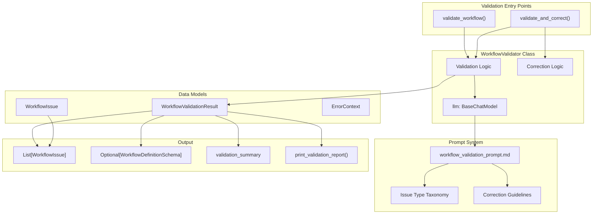
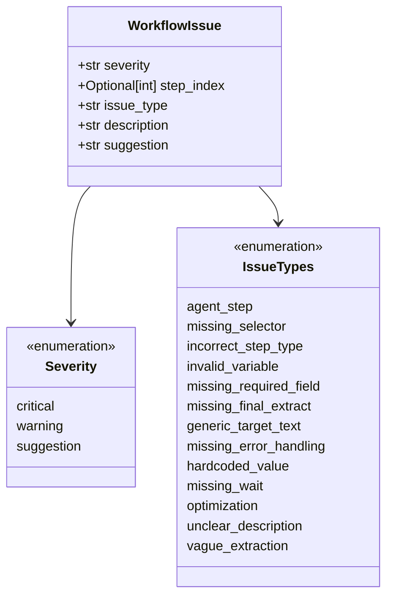
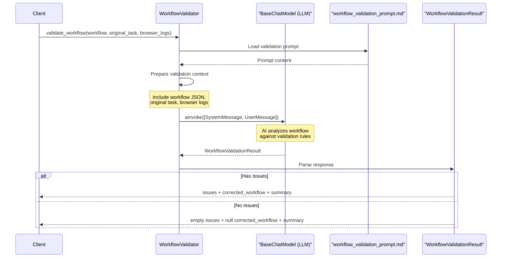
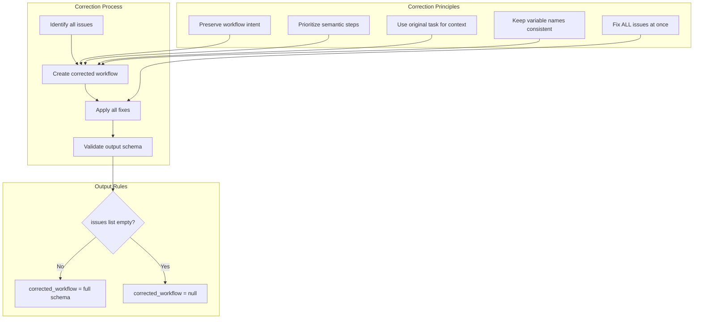
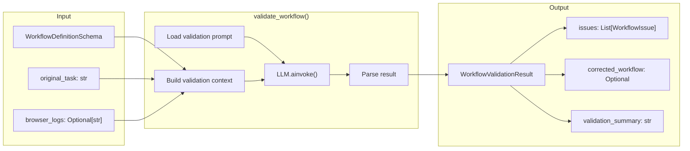
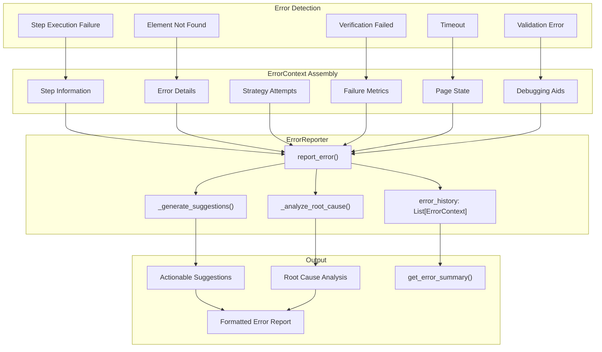
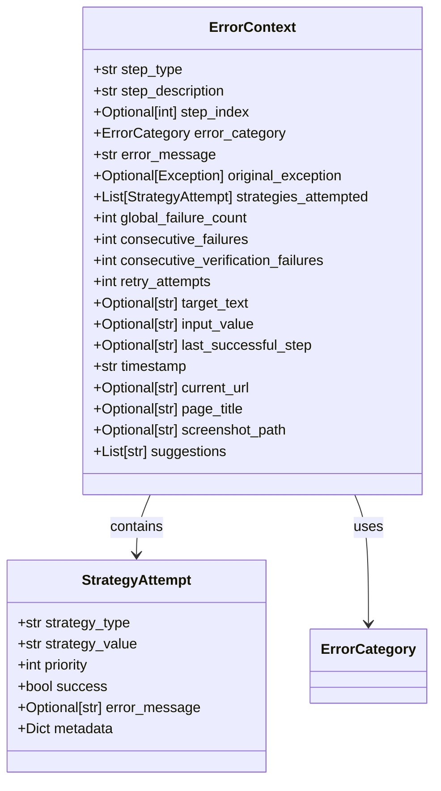

<!-- source: DeepWiki mcp.deepwiki.com · repo browser-use/workflow-use · page 4.2 Workflow Validation and Quality Assurance · fetched 2026-10-30 -->

# Workflow Validation and Quality Assurance

<details>
<summary>Relevant source files</summary>

The following files were used as context for generating this wiki page:

- [workflows/examples/scripts/generate_workflow.py](workflows/examples/scripts/generate_workflow.py)
- [workflows/examples/workflows/basic/example.workflow.yaml](workflows/examples/workflows/basic/example.workflow.yaml)
- [workflows/examples/workflows/basic/pure_semantic.workflow.yaml](workflows/examples/workflows/basic/pure_semantic.workflow.yaml)
- [workflows/examples/workflows/form_filling/semantic_form_fill.workflow.yaml](workflows/examples/workflows/form_filling/semantic_form_fill.workflow.yaml)
- [workflows/pyproject.toml](workflows/pyproject.toml)
- [workflows/tests/test_go_back.workflow.yaml](workflows/tests/test_go_back.workflow.yaml)
- [workflows/uv.lock](workflows/uv.lock)
- [workflows/workflow_use/healing/prompts/workflow_creation_prompt.md](workflows/workflow_use/healing/prompts/workflow_creation_prompt.md)
- [workflows/workflow_use/healing/prompts/workflow_validation_prompt.md](workflows/workflow_use/healing/prompts/workflow_validation_prompt.md)
- [workflows/workflow_use/healing/service.py](workflows/workflow_use/healing/service.py)
- [workflows/workflow_use/healing/tests/test_validator.py](workflows/workflow_use/healing/tests/test_validator.py)

</details>


## Purpose and Scope

This page covers the validation and quality assurance systems in workflow-use, including the `WorkflowValidator` class for AI-powered workflow validation, the issue detection framework, automatic correction capabilities, and runtime error reporting through `ErrorReporter`. 

For information about the workflow creation process that precedes validation, see [Builder Service](#4.1). For information about semantic conversion and optimization that occurs after validation, see [Semantic Conversion and Optimization](#4.3). For runtime error recovery and self-healing during execution, see [Error Recovery and Self-Healing](#5.3).

## Overview

The validation system ensures workflow quality through two complementary mechanisms:

1. **Post-Generation Validation**: AI-powered analysis of workflow definitions using `WorkflowValidator` to identify and correct issues before execution
2. **Runtime Error Reporting**: Comprehensive diagnostics through `ErrorReporter` to provide actionable feedback during workflow execution failures

---

## WorkflowValidator Architecture

The `WorkflowValidator` class provides AI-powered validation and automatic correction of workflow definitions.

### Core Components



**Sources**: [workflows/workflow_use/healing/validator.py:1-162]()

### WorkflowValidator Class Structure

The `WorkflowValidator` class is defined in [workflows/workflow_use/healing/validator.py:42-162]() with the following structure:

| Component | Type | Purpose |
|-----------|------|---------|
| `llm` | `BaseChatModel` | LLM instance for AI-powered validation |
| `validate_workflow()` | Method | Identifies issues without applying corrections |
| `validate_and_correct()` | Method | Automatically applies corrections to workflows |
| `print_validation_report()` | Method | Generates human-readable validation reports |

### Validation Data Models

#### WorkflowIssue



**Sources**: [workflows/workflow_use/healing/validator.py:24-31](), [workflows/workflow_use/healing/prompts/workflow_validation_prompt.md:113-133]()

#### WorkflowValidationResult

The `WorkflowValidationResult` model ([workflows/workflow_use/healing/validator.py:34-39]()) contains:

| Field | Type | Description |
|-------|------|-------------|
| `issues` | `List[WorkflowIssue]` | All issues identified during validation |
| `corrected_workflow` | `Optional[WorkflowDefinitionSchema]` | Corrected workflow if issues were found (REQUIRED when issues exist) |
| `validation_summary` | `str` | Summary of validation results |

---

## Validation Process

### Validation Flow



**Sources**: [workflows/workflow_use/healing/validator.py:48-96]()

### Validation Context Assembly

The validation request ([workflows/workflow_use/healing/validator.py:68-81]()) includes:

1. **Workflow JSON**: Complete workflow definition serialized as JSON
2. **Original Task**: The task description that was used to generate the workflow
3. **Browser Logs** (optional): Runtime logs from failed execution attempts for runtime validation

### LLM Invocation

The validator uses structured output through `output_format=WorkflowValidationResult` ([workflows/workflow_use/healing/validator.py:88]()), ensuring the LLM returns properly formatted validation results with issues and corrections.

---

## Issue Detection System

### Issue Severity Levels

The validation system categorizes issues into three severity levels:

| Severity | Definition | Handling |
|----------|------------|----------|
| `critical` | Will cause workflow to fail | Must be fixed before execution |
| `warning` | May cause issues in some scenarios | Should be fixed for reliability |
| `suggestion` | Nice to have improvement | Optional enhancement |

**Sources**: [workflows/workflow_use/healing/prompts/workflow_validation_prompt.md:113-117]()

### Critical Issues

Critical issues that will cause workflow failures:

#### 1. Agent Steps Instead of Semantic Steps

Agent steps are 10-30x slower and cost money per execution. The validator identifies agent steps that should be replaced with semantic steps.

**Example Issue**:
```json
{
  "type": "agent",
  "task": "click the search button"
}
```

**Correction**:
```json
{
  "type": "click",
  "target_text": "Search",
  "description": "Click the search button"
}
```

#### 2. Missing Target Information

Steps without `target_text`, `xpath`, or `cssSelector` will fail during execution.

**Example Issue**:
```json
{
  "type": "click"
}
```

**Correction**:
```json
{
  "type": "click",
  "target_text": "Submit"
}
```

#### 3. Incorrect Step Types

Using wrong step type for the action (e.g., using `click` when `input` is needed).

#### 4. Invalid Variable References

Steps referencing variables that don't exist in `input_schema`.

**Example Issue**:
```json
{
  "value": "{{user_name}}"
}
```
But `user_name` not present in workflow's `input_schema`.

#### 5. Missing Required Fields

- Navigation steps without `url`
- Input steps without `value`
- Extract steps without `extractionGoal`
- Key press steps without `key`

#### 6. Missing Final Extract Step

**CRITICAL RULE**: ALL workflows must end with an extract step (`extract` or `extract_page_content`). This is enforced in both the workflow creation prompt ([workflows/workflow_use/healing/prompts/workflow_creation_prompt.md:9-13]()) and validation prompt ([workflows/workflow_use/healing/prompts/workflow_validation_prompt.md:41-46]()).

**Sources**: [workflows/workflow_use/healing/prompts/workflow_validation_prompt.md:14-46]()

### Warning Issues

Issues that may cause problems in some scenarios:

| Issue Type | Description | Impact |
|------------|-------------|--------|
| `generic_target_text` | Very generic text like "Click here", "Link" | May match wrong elements |
| `missing_error_handling` | No conditional logic for common failures | Workflow brittle to variations |
| `hardcoded_value` | Values that should be parameterized | Reduces workflow reusability |
| `missing_wait` | No delay after actions needing page load | Race conditions possible |

**Sources**: [workflows/workflow_use/healing/prompts/workflow_validation_prompt.md:48-66]()

### Suggestion Issues

Optional improvements for better workflow quality:

- **Optimization opportunities**: Redundant steps that could be removed
- **Better descriptions**: Steps with unclear descriptions
- **Vague extraction goals**: Extraction goals that are too generic

**Sources**: [workflows/workflow_use/healing/prompts/workflow_validation_prompt.md:66-78]()

---

## Automatic Correction

### Correction Requirements

The validation system has a **MANDATORY** correction rule ([workflows/workflow_use/healing/prompts/workflow_validation_prompt.md:89-99]()):

> **CRITICAL: You MUST provide a corrected workflow whenever you find ANY issues (critical, warning, or suggestion).**

### Correction Guidelines



**Sources**: [workflows/workflow_use/healing/prompts/workflow_validation_prompt.md:88-111]()

### Correction Examples

#### Example 1: Hard-coded Value → Variable

**Issue**:
```json
{
  "type": "input",
  "target_text": "First Name",
  "value": "John"
}
```

**Correction**:
```json
{
  "type": "input",
  "target_text": "First Name",
  "value": "{{first_name}}"
}
```

Plus add to `input_schema`:
```json
{
  "name": "first_name",
  "type": "string",
  "required": true,
  "description": "The first name to search for"
}
```

**Sources**: [workflows/workflow_use/healing/prompts/workflow_validation_prompt.md:175-202]()

---

## Validation API Usage

### validate_workflow() Method



**Method Signature** ([workflows/workflow_use/healing/validator.py:48-96]()):
```python
async def validate_workflow(
    self,
    workflow: WorkflowDefinitionSchema,
    original_task: str = '',
    browser_logs: Optional[str] = None
) -> WorkflowValidationResult
```

**Sources**: [workflows/workflow_use/healing/validator.py:48-96]()

### validate_and_correct() Method

Convenience method that automatically applies corrections ([workflows/workflow_use/healing/validator.py:98-118]()):

```python
async def validate_and_correct(
    self,
    workflow: WorkflowDefinitionSchema,
    original_task: str = '',
    browser_logs: Optional[str] = None
) -> WorkflowDefinitionSchema
```

Returns the corrected workflow if issues were found, otherwise returns the original workflow unchanged.

**Sources**: [workflows/workflow_use/healing/validator.py:98-118]()

### print_validation_report() Method

Generates human-readable validation reports ([workflows/workflow_use/healing/validator.py:120-161]()):

```python
def print_validation_report(self, result: WorkflowValidationResult) -> None
```

The report includes:
- Validation summary
- Issues grouped by severity (critical, warnings, suggestions)
- Step-specific information for each issue
- Suggested fixes for each issue

**Sources**: [workflows/workflow_use/healing/validator.py:120-161]()

---

## Runtime Error Reporting

The `ErrorReporter` class provides comprehensive diagnostics during workflow execution failures, complementing the pre-execution validation.

### ErrorReporter Architecture



**Sources**: [workflows/workflow_use/workflow/error_reporter.py:1-303]()

### Error Categories

The `ErrorCategory` enum ([workflows/workflow_use/workflow/error_reporter.py:17-26]()) defines types of runtime errors:

| Category | Value | Description |
|----------|-------|-------------|
| `ELEMENT_NOT_FOUND` | `element_not_found` | Target element could not be located |
| `EXECUTION_FAILED` | `execution_failed` | Action execution failed |
| `VERIFICATION_FAILED` | `verification_failed` | Action completed but verification failed |
| `VALIDATION_ERROR` | `validation_error` | Form validation rejected input |
| `TIMEOUT` | `timeout` | Operation exceeded time limit |
| `SYSTEMATIC_FAILURE` | `systematic_failure` | Multiple consecutive failures |
| `UNKNOWN` | `unknown` | Unclassified error |

**Sources**: [workflows/workflow_use/workflow/error_reporter.py:17-26]()

### ErrorContext Data Model



**Sources**: [workflows/workflow_use/workflow/error_reporter.py:29-77]()

### Error Report Structure

The `report_error()` method ([workflows/workflow_use/workflow/error_reporter.py:94-181]()) generates comprehensive reports with:

1. **Step Information**: Step index, type, description, target, input value
2. **Error Details**: Category, message, original exception
3. **Page Context**: Current URL, page title
4. **Strategies Attempted**: All element finding strategies tried with results
5. **Failure Metrics**: Retry attempts, global/consecutive failures
6. **Last Successful Step**: For context on where failure occurred
7. **Debugging Information**: Screenshot path if available
8. **Suggested Next Steps**: Actionable recommendations
9. **Root Cause Analysis**: Likely underlying issue

**Sources**: [workflows/workflow_use/workflow/error_reporter.py:94-181]()

### Suggestion Generation

The `_generate_suggestions()` method ([workflows/workflow_use/workflow/error_reporter.py:183-237]()) provides context-specific actionable suggestions:

#### For ELEMENT_NOT_FOUND

- Verify element exists on current page
- Check if page structure has changed
- Ensure page has fully loaded
- Look for elements with similar text
- Consider adding wait/delay before step

#### For VERIFICATION_FAILED

- Check if verification criteria are too strict
- Verify expected outcome is still correct
- Increase wait times for page response
- Review verification logic

#### For VALIDATION_ERROR

- Review input data format
- Check if validation rules changed
- Look for specific validation error messages
- Verify input value is valid for field

**Sources**: [workflows/workflow_use/workflow/error_reporter.py:183-237]()

### Root Cause Analysis

The `_analyze_root_cause()` method ([workflows/workflow_use/workflow/error_reporter.py:239-274]()) identifies patterns:

| Pattern | Root Cause |
|---------|------------|
| All semantic strategies failed | Element structure changed but exists; XPath may work |
| High verification failures (≥2) | Actions execute but don't achieve expected results |
| Validation errors | Form validation rejecting input format |
| Systematic failures (≥3 consecutive) | Systematic issues; workflow may need regeneration |
| Element not found after retries | Page structure changed or element not visible |

**Sources**: [workflows/workflow_use/workflow/error_reporter.py:239-274]()

---

## Integration with Workflow Generation

### Validation in Generation Pipeline

```mermaid
graph LR
    subgraph "Generation Phase"
        agent_exec["Agent Execution"]
        conversion["Workflow Conversion"]
        builder["Builder Service"]
    end
    
    subgraph "Validation Phase"
        validator["WorkflowValidator"]
        issue_detection["Issue Detection"]
        auto_correct["Auto-Correction"]
    end
    
    subgraph "Enhancement Phase"
        semantic_conv["Semantic Conversion"]
        var_extract["Variable Extraction"]
        storage["Storage"]
    end
    
    agent_exec --> conversion
    conversion --> builder
    builder --> validator
    
    validator --> issue_detection
    issue_detection --> auto_correct
    
    auto_correct --> semantic_conv
    semantic_conv --> var_extract
    var_extract --> storage
```



The validator is invoked during workflow generation by the `BuilderService` to ensure quality before storage. See [Builder Service](#4.1) for details on the generation pipeline.

**Sources**: [workflows/workflow_use/healing/validator.py:1-162](), [workflows/examples/scripts/generate_workflow.py:1-187]()

---

## Quality Assurance Best Practices

### Validation Checklist

The validation system enforces these quality standards:

| Category | Check | Enforcement |
|----------|-------|-------------|
| **Step Types** | No agent steps for simple actions | Critical |
| **Targeting** | All interactive steps have target_text or selector | Critical |
| **Variables** | All referenced variables exist in input_schema | Critical |
| **Required Fields** | All step types have required fields | Critical |
| **Final Step** | Workflow ends with extract step | Critical |
| **Parameterization** | Dynamic values use variables | Warning |
| **Descriptions** | Steps have clear descriptions | Suggestion |
| **Error Handling** | Common failure cases handled | Warning |

### Example Validation Report

Output from `print_validation_report()` ([workflows/workflow_use/healing/validator.py:120-161]()):

```
================================================================================
WORKFLOW VALIDATION REPORT
================================================================================

Found 2 critical issues and 1 warning. Corrected workflow provided.

🔴 CRITICAL ISSUES (2):

  1. agent_step (Step 0)
     Agent step used for simple click action - should use semantic step
     💡 Replace with: {"type": "click", "target_text": "Search", "description": "Click the search button"}

  2. missing_final_extract
     Workflow does not end with an extract step
     💡 Add extract step at end: {"type": "extract_page_content", "goal": "Extract confirmation status"}

⚠️  WARNINGS (1):

  1. hardcoded_value (Step 2)
     Input has hard-coded value that should be parameterized
     💡 Replace "John" with variable: {"value": "{{first_name}}"}

================================================================================
```

**Sources**: [workflows/workflow_use/healing/validator.py:120-161]()

### Testing Validation

The test suite ([workflows/workflow_use/healing/tests/test_validator.py:1-76]()) demonstrates validation with workflows containing known issues:

```python
sample_workflow = WorkflowDefinitionSchema(
    name='Test Workflow with Issues',
    description='A test workflow with various issues to validate',
    version='1.0.0',
    steps=[
        # Issue 1: Agent step that should be semantic
        AgentTaskWorkflowStep(type='agent', task='click the search button'),
        # Issue 2: Navigation step (correct)
        NavigationStep(type='navigation', url='https://example.com'),
        # Issue 3: Hard-coded value that should be variable
        InputStep(type='input', target_text='First Name', value='John'),
        # Issue 4: Vague extraction goal
        ExtractStep(type='extract', extractionGoal='get the data', output='result'),
    ],
    input_schema=[],
)
```

**Sources**: [workflows/workflow_use/healing/tests/test_validator.py:25-76]()

---

## Summary

The validation and quality assurance system provides:

1. **Pre-Execution Validation**: AI-powered analysis through `WorkflowValidator` to identify and fix issues before workflows run
2. **Automatic Correction**: Mandatory correction of all identified issues with preservation of workflow intent
3. **Runtime Diagnostics**: Comprehensive error reporting through `ErrorReporter` with actionable suggestions and root cause analysis
4. **Quality Standards**: Enforcement of best practices including semantic-first targeting, proper parameterization, and mandatory extract steps
5. **Integration**: Seamless integration with workflow generation and execution pipelines

These systems work together to ensure workflows are reliable, maintainable, and cost-effective before and during execution.

**Sources**: [workflows/workflow_use/healing/validator.py:1-162](), [workflows/workflow_use/workflow/error_reporter.py:1-303](), [workflows/workflow_use/healing/prompts/workflow_validation_prompt.md:1-228]()

---

