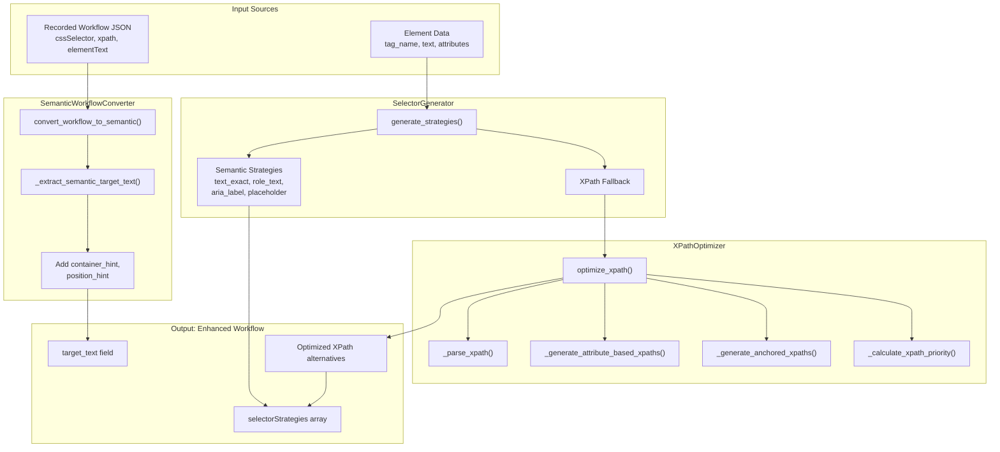
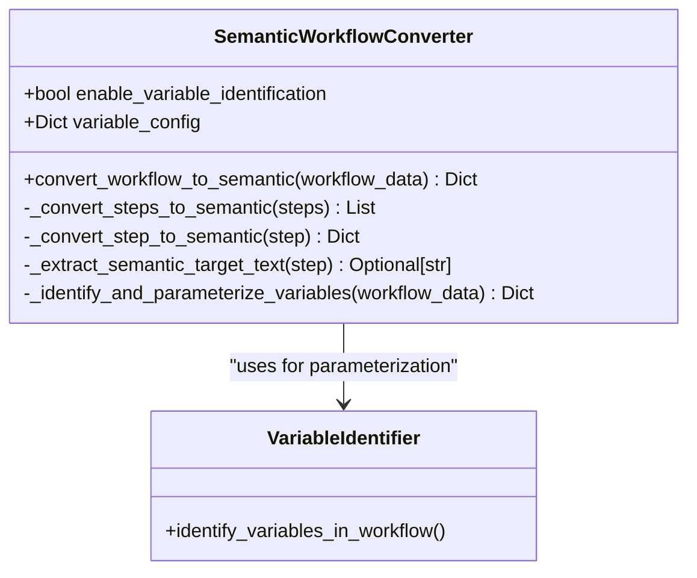
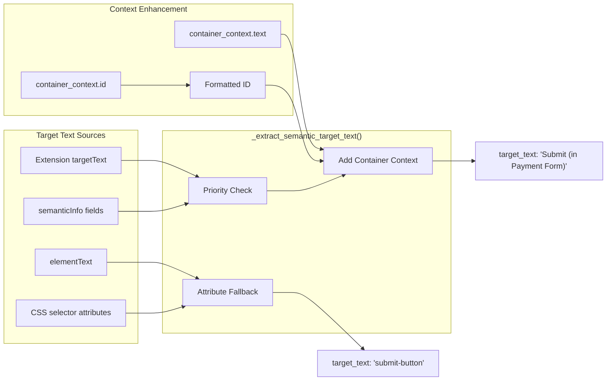
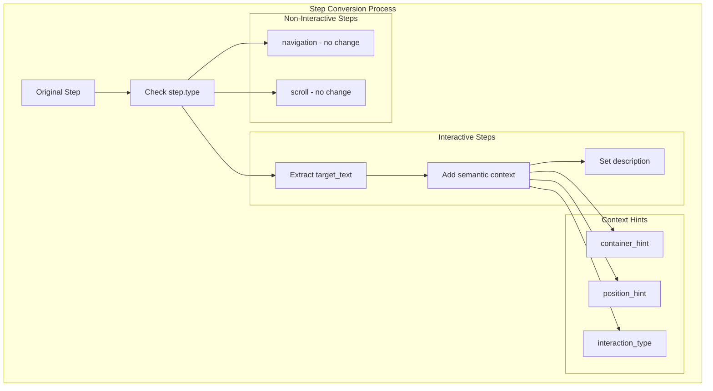
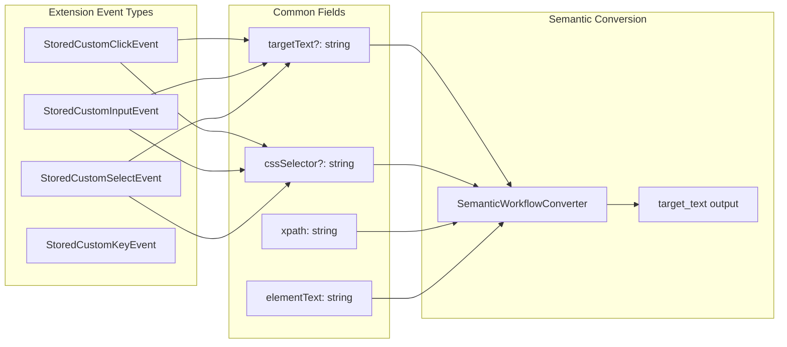
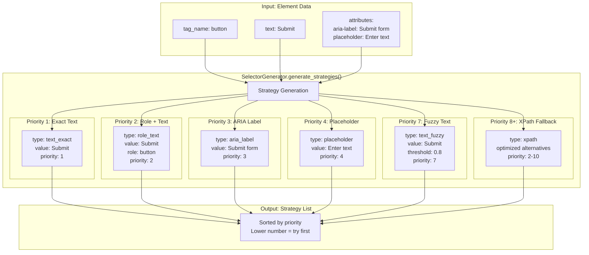
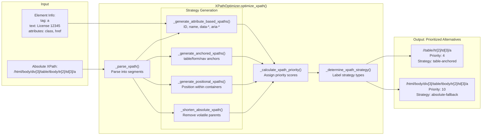

<!-- source: DeepWiki mcp.deepwiki.com · repo browser-use/workflow-use · page 4.3 Semantic Conversion and Optimization · fetched 2026-10-30 -->

# Semantic Conversion and Optimization

<details>
<summary>Relevant source files</summary>

The following files were used as context for generating this wiki page:

- [workflows/tests/test_element_finder.py](workflows/tests/test_element_finder.py)
- [workflows/tests/test_go_back_fix.py](workflows/tests/test_go_back_fix.py)
- [workflows/tests/test_selector_generator_fix.py](workflows/tests/test_selector_generator_fix.py)
- [workflows/tests/test_wait_times.py](workflows/tests/test_wait_times.py)
- [workflows/tests/test_workflow_execution.py](workflows/tests/test_workflow_execution.py)
- [workflows/workflow_use/recorder/recorder.py](workflows/workflow_use/recorder/recorder.py)
- [workflows/workflow_use/recorder/semantic_converter.py](workflows/workflow_use/recorder/semantic_converter.py)
- [workflows/workflow_use/workflow/semantic_executor.py](workflows/workflow_use/workflow/semantic_executor.py)
- [workflows/workflow_use/workflow/semantic_extractor.py](workflows/workflow_use/workflow/semantic_extractor.py)

</details>


The semantic conversion and optimization system transforms recorded workflows from brittle selector-based element targeting to resilient multi-strategy semantic targeting. This system encompasses three key components:

1. **SemanticWorkflowConverter** - Converts recorded steps to use semantic target text
2. **SelectorGenerator** - Generates prioritized selector strategies for element finding
3. **XPathOptimizer** - Optimizes XPath expressions for robustness

Together, these components enable workflows that identify elements using visible text, ARIA attributes, and semantic HTML roles, with intelligent fallback strategies for maximum reliability.

**Related Pages:** [Semantic Execution (No-AI Mode)](#5.1), [Element Finding Strategies](#5.2), [Workflow Creation](#3)

## System Architecture Overview

Diagram: Semantic Conversion and Optimization Pipeline



**Sources:** [workflows/workflow_use/recorder/semantic_converter.py:8-43](), [workflows/workflow_use/healing/selector_generator.py:47-83](), [workflows/workflow_use/healing/xpath_optimizer.py:62-155]()

## Semantic Workflow Converter

The `SemanticWorkflowConverter` class transforms recorded workflows to use semantic targeting instead of CSS selectors.

Diagram: SemanticWorkflowConverter Class Structure



### Key Methods

| Method | Purpose | Return |
|--------|---------|--------|
| `convert_workflow_to_semantic()` | Main entry point for conversion | Converted workflow dict |
| `_convert_steps_to_semantic()` | Convert all steps in workflow | List of semantic steps |
| `_convert_step_to_semantic()` | Convert individual step | Semantic step dict |
| `_extract_semantic_target_text()` | Extract target text from step data | Target text string or None |

**Sources:** [workflows/workflow_use/recorder/semantic_converter.py:8-43](), [workflows/workflow_use/recorder/semantic_converter.py:250-278]()

## Target Text Extraction Strategy

The converter uses a priority-based approach to extract the most reliable semantic target text:

| Priority | Source | Description | Code Location |
|----------|---------|-------------|---------------|
| 1 | `targetText` | Pre-captured semantic text from extension | [semantic_converter.py:124-125]() |
| 2 | Hierarchical Context | Combines base text with container context | [semantic_converter.py:128-154]() |
| 3 | Semantic Info Fields | `labelText`, `textContent`, `name`, `id` | [semantic_converter.py:134-139]() |
| 4 | Element Text | Visible text content | [semantic_converter.py:163-165]() |
| 5 | CSS Attribute Extraction | ID, name, value from selectors | [semantic_converter.py:167-217]() |

The extraction logic creates contextual target text when possible:



**Sources:** [workflows/workflow_use/recorder/semantic_converter.py:113-218](), [workflows/workflow_use/recorder/semantic_converter.py:128-154]()

## Conversion Logic for Different Step Types

The converter handles different interaction types with specific logic:

### Interactive Steps Conversion

For `click`, `input`, `select_change`, and `key_press` steps:



**Sources:** [workflows/workflow_use/recorder/semantic_converter.py:56-111](), [workflows/workflow_use/recorder/semantic_converter.py:58-101]()

### Context Hint Generation

The converter extracts additional context to improve element identification:

| Hint Type | Source | Example | Purpose |
|-----------|---------|---------|----------|
| `container_hint` | `semanticInfo.container_context.text` | "Payment Form" | Identifies parent container |
| `position_hint` | `semanticInfo.sibling_context.position` | "item 2 of 5" | Relative position among siblings |
| `interaction_type` | `semanticInfo.interaction_hints[0]` | "primary_button" | Expected interaction behavior |

**Sources:** [workflows/workflow_use/recorder/semantic_converter.py:66-91]()

## Integration with Extension Types

The converter works with event types captured by the browser extension:



**Sources:** [extension/src/lib/types.ts:1-27](), [extension/src/lib/types.ts:9](), [extension/src/lib/types.ts:23]()

## Selector Strategy Generation

The `SelectorGenerator` class creates prioritized strategies for finding elements during execution. Instead of relying on a single brittle CSS selector, it generates multiple fallback strategies ordered by reliability.

Diagram: SelectorGenerator Strategy Priority



### Strategy Types

The generator produces the following strategy types in priority order:

| Priority | Strategy Type | Value Source | Use Case |
|----------|--------------|--------------|----------|
| 1 | `text_exact` | Visible element text | Links, buttons with stable text |
| 2 | `role_text` | Inferred role + text | Semantic HTML elements |
| 3 | `aria_label` | `aria-label` attribute | Accessibility-labeled elements |
| 4 | `placeholder` | `placeholder` attribute | Input fields |
| 5 | `title` | `title` attribute | Elements with tooltips |
| 6 | `alt_text` | `alt` attribute | Images |
| 7 | `text_fuzzy` | Fuzzy text match (0.8 threshold) | Handles typos/variations |
| 8+ | `xpath` | Optimized XPath alternatives | Final fallback |

### Configuration

```python
# SelectorGenerator initialization options
generator = SelectorGenerator(
    enable_xpath_optimization=True,  # Use XPathOptimizer
    max_xpath_alternatives=2,        # Limit XPath strategies
    max_total_strategies=2           # Total strategy limit
)
```

**Sources:** [workflows/workflow_use/healing/selector_generator.py:47-83](), [workflows/workflow_use/healing/selector_generator.py:84-290](), [workflows/workflow_use/healing/selector_generator.py:118-194]()

## XPath Optimization

The `XPathOptimizer` class transforms brittle absolute XPath expressions into robust relative XPath alternatives that are resilient to page structure changes.

Diagram: XPath Optimization Process



### Optimization Strategies

The optimizer generates XPath alternatives using multiple strategies:

| Strategy | Description | Priority Range | Example |
|----------|-------------|----------------|---------|
| `id-based` | Uses `@id` attribute | 2 | `//button[@id='submit']` |
| `name-based` | Uses `@name` attribute | 2 | `//input[@name='email']` |
| `data-attribute` | Uses `data-*` attributes | 2 | `//button[@data-testid='submit']` |
| `aria-based` | Uses ARIA attributes | 3 | `//button[@aria-label='Close']` |
| `table-anchored` | Anchored to table structure | 4 | `//table//tr[2]/td[3]/a` |
| `form-anchored` | Anchored to form structure | 4 | `//form//input[@name='email']` |
| `text-contains` | Text-based with contains() | 7 | `//a[contains(text(),'Click')]` |
| `absolute-fallback` | Original absolute XPath | 10 | `/html/body/div[3]/button` |

### XPath Priority Calculation

The priority calculation ensures more stable XPath expressions are tried first:

```python
# Priority scoring logic (lower = higher priority)
def _calculate_xpath_priority(xpath: str, is_absolute: bool = False) -> int:
    if is_absolute or xpath.startswith('/html/body'):
        return 10  # Lowest priority
    if '@id=' in xpath or '@name=' in xpath or '@data-' in xpath:
        return 2   # Highest priority
    if '@aria-label=' in xpath or '@role=' in xpath:
        return 3   # High priority
    if '//table//' in xpath or '//form//' in xpath:
        return 4   # Medium-high priority
    # ... additional logic
```

**Sources:** [workflows/workflow_use/healing/xpath_optimizer.py:62-155](), [workflows/workflow_use/healing/xpath_optimizer.py:190-259](), [workflows/workflow_use/healing/xpath_optimizer.py:261-309](), [workflows/workflow_use/healing/xpath_optimizer.py:481-539]()

## Integration: Complete Workflow Transformation

Here's how a recorded workflow step transforms through the complete pipeline:

### Stage 1: Recorded Step
```json
{
  "type": "click",
  "cssSelector": "button.inline-flex.items-center[type='submit']",
  "xpath": "/html/body/div[3]/form/div[2]/button",
  "elementText": "Submit Application",
  "semanticInfo": {
    "container_context": {
      "text": "Application Form",
      "id": "application-form"
    },
    "interaction_hints": ["primary_button"]
  }
}
```

### Stage 2: After SemanticWorkflowConverter
```json
{
  "type": "click",
  "target_text": "Submit Application (in Application Form)",
  "container_hint": "Application Form",
  "interaction_type": "primary_button",
  "description": "Click element"
}
```

### Stage 3: After SelectorGenerator
```json
{
  "type": "click",
  "target_text": "Submit Application (in Application Form)",
  "selectorStrategies": [
    {
      "type": "text_exact",
      "value": "Submit Application",
      "priority": 1,
      "metadata": {"tag": "button"}
    },
    {
      "type": "role_text",
      "value": "Submit Application",
      "priority": 2,
      "metadata": {"role": "button", "tag": "button"}
    },
    {
      "type": "text_fuzzy",
      "value": "Submit Application",
      "priority": 7,
      "metadata": {"threshold": 0.8, "tag": "button"}
    },
    {
      "type": "xpath",
      "value": "//form//button[contains(text(),'Submit Application')]",
      "priority": 4,
      "metadata": {
        "tag": "button",
        "strategy": "form-anchored",
        "optimized": true
      }
    },
    {
      "type": "xpath",
      "value": "/html/body/div[3]/form/div[2]/button",
      "priority": 10,
      "metadata": {
        "tag": "button",
        "strategy": "absolute-fallback",
        "optimized": false
      }
    }
  ]
}
```

**Sources:** [workflows/workflow_use/recorder/semantic_converter.py:56-117](), [workflows/workflow_use/healing/selector_generator.py:84-290]()

## Convenience Functions

The module provides utility functions for easy workflow conversion:

| Function | Purpose | Usage |
|----------|---------|--------|
| `convert_recorded_workflow_to_semantic()` | Convert workflow dict to semantic | Direct conversion of loaded JSON |
| `convert_workflow_file_to_semantic()` | Convert and save workflow file | File-based conversion with automatic naming |

The file conversion function automatically generates semantic filenames:
- `workflow.json` → `workflow.semantic.json`
- Custom output paths supported

**Sources:** [workflows/workflow_use/recorder/semantic_converter.py:221-250](), [workflows/workflow_use/recorder/semantic_converter.py:227-249]()

---

