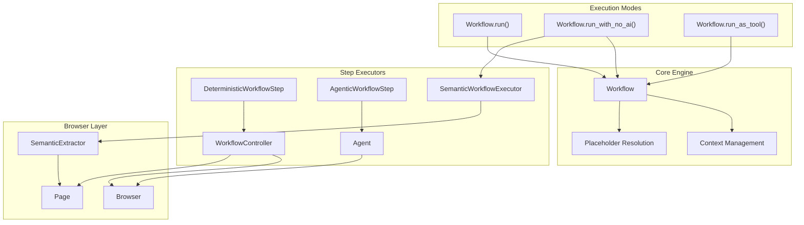
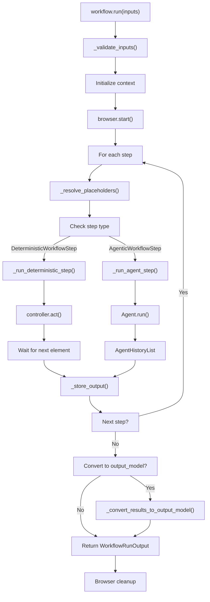
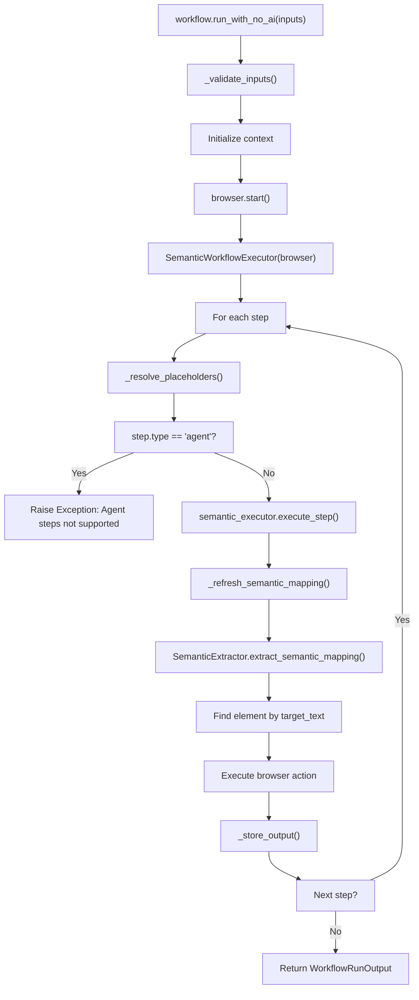
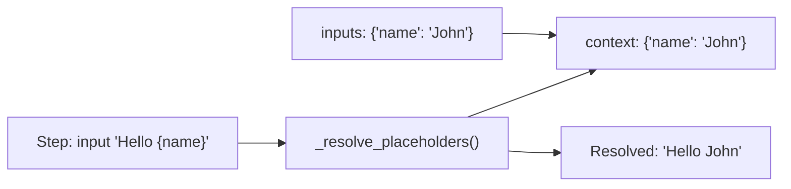
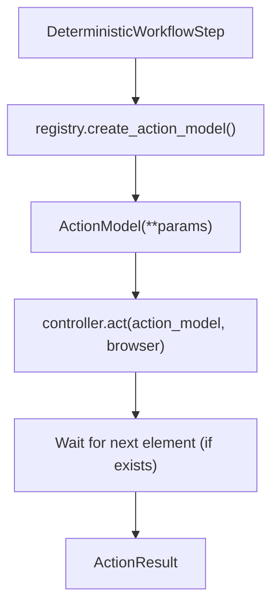
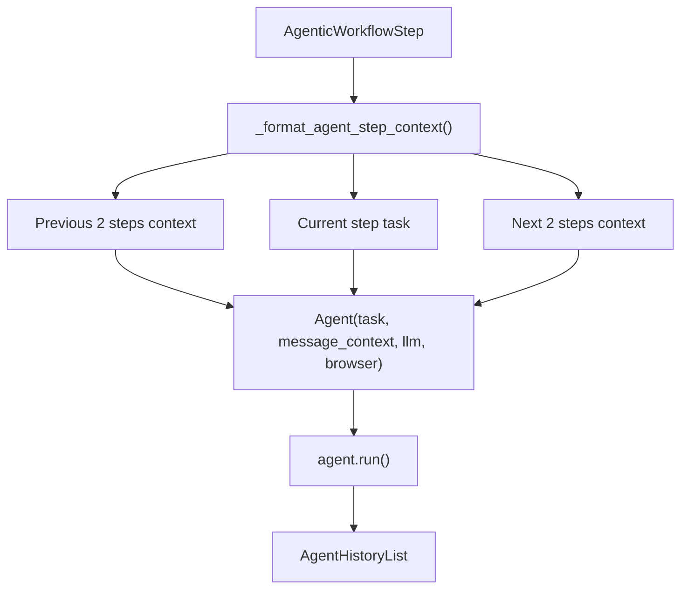
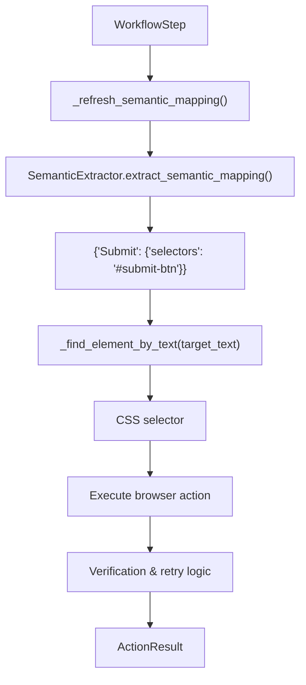
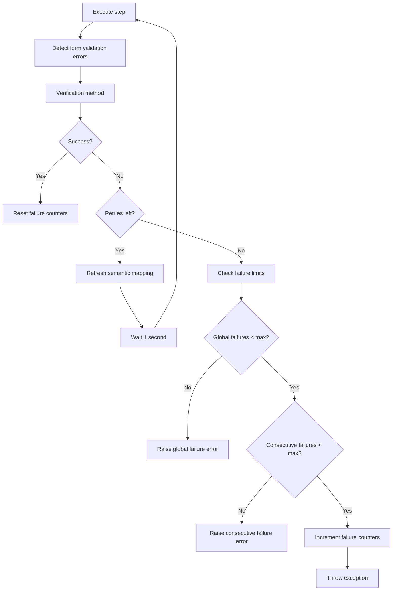
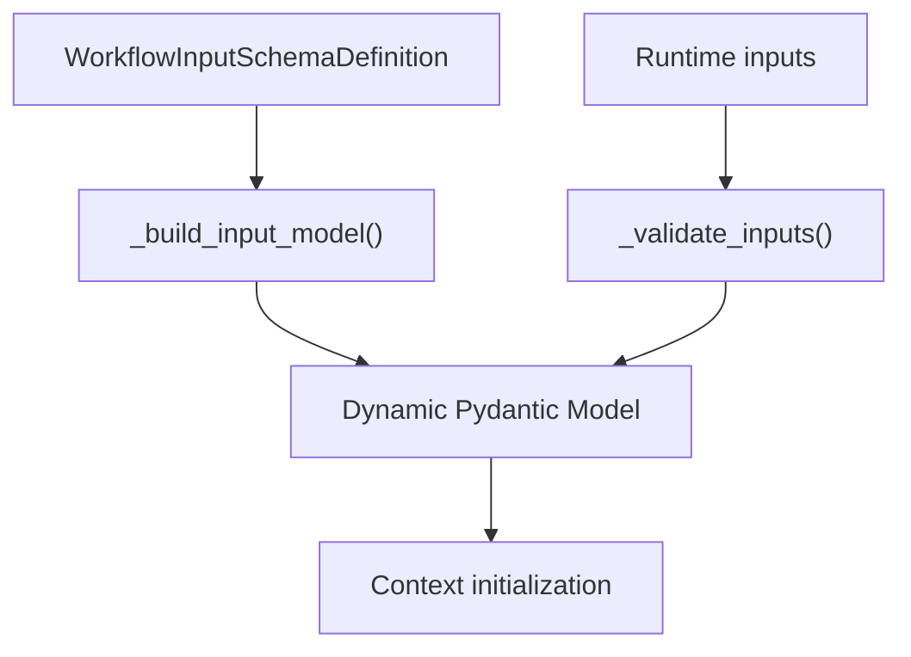
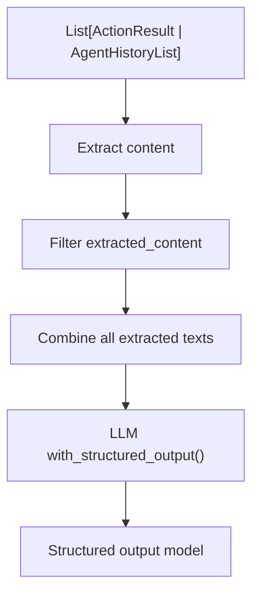

<!-- source: DeepWiki mcp.deepwiki.com · repo browser-use/workflow-use · page 5 Workflow Execution · fetched 2026-10-30 -->

# Workflow Execution

Relevant source files

The following files were used as context for generating this wiki page:

- [README.md](README.md)
- [workflows/.gitignore](workflows/.gitignore)
- [workflows/cli.py](workflows/cli.py)
- [workflows/workflow_use/recorder/recorder.py](workflows/workflow_use/recorder/recorder.py)
- [workflows/workflow_use/schema/views.py](workflows/workflow_use/schema/views.py)
- [workflows/workflow_use/storage/__init__.py](workflows/workflow_use/storage/__init__.py)
- [workflows/workflow_use/workflow/semantic_executor.py](workflows/workflow_use/workflow/semantic_executor.py)
- [workflows/workflow_use/workflow/semantic_extractor.py](workflows/workflow_use/workflow/semantic_extractor.py)
- [workflows/workflow_use/workflow/service.py](workflows/workflow_use/workflow/service.py)

This document covers the runtime execution of workflows, including the core execution engine, different execution strategies, error handling, and browser automation integration. For information about creating workflows, see [Workflow Builder](#4). For details about the workflow definition schema, see [Workflow Definition Schema](#2.1).

## Overview

Workflow execution is handled by the `Workflow` class, which orchestrates the execution of workflow steps through different strategies depending on the step type and execution mode. The system supports three primary execution modes:

- **Standard Execution**: Combines deterministic browser actions with AI-powered agent steps and fallback mechanisms
- **Semantic Execution**: Uses semantic text mapping for deterministic execution without AI dependencies
- **Tool Execution**: Exposes workflows as LangChain tools for integration with AI agents

### Execution Architecture

**Sources:** [workflows/workflow_use/workflow/service.py:40-816](), [workflows/workflow_use/workflow/semantic_executor.py:25-1094]()

## Execution Modes

### Standard Execution Mode

The standard execution mode (`Workflow.run()`) supports both deterministic and agentic workflow steps with AI-powered fallback mechanisms.

**Sources:** [workflows/workflow_use/workflow/service.py:548-612](), [workflows/workflow_use/workflow/service.py:108-147](), [workflows/workflow_use/workflow/service.py:193-216]()

### Semantic Execution Mode  

The semantic execution mode (`Workflow.run_with_no_ai()`) uses `SemanticWorkflowExecutor` to execute workflows without AI dependencies by mapping visible text to browser elements.

**Sources:** [workflows/workflow_use/workflow/service.py:716-790](), [workflows/workflow_use/workflow/semantic_executor.py:1071-1093]()

### Tool Execution Mode

Workflows can be exposed as LangChain tools using `Workflow.as_tool()` and executed via `Workflow.run_as_tool()`.

**Sources:** [workflows/workflow_use/workflow/service.py:680-715](), [workflows/workflow_use/workflow/service.py:792-815]()

## Core Execution Engine

### Workflow Class

The `Workflow` class serves as the main orchestrator for workflow execution. It manages browser sessions, step execution, context variables, and output generation.

| Component | Purpose |
|-----------|---------|
| `workflow_schema` | Parsed workflow definition |
| `controller` | Handles deterministic browser actions |
| `browser` | Browser automation instance |
| `context` | Runtime variables and state |
| `inputs_def` | Input schema validation |

**Sources:** [workflows/workflow_use/workflow/service.py:40-83]()

### Context Management and Placeholder Resolution

The execution engine maintains a context dictionary for storing variables and supports placeholder resolution using Python format syntax.

The `_resolve_placeholders()` method recursively processes workflow steps to replace `{variable}` placeholders with values from the context dictionary.

**Sources:** [workflows/workflow_use/workflow/service.py:305-357](), [workflows/workflow_use/workflow/service.py:292-303]()

### Output Storage and Variable Extraction

Steps can declare an `output` field to store execution results in the context for use by subsequent steps. The `_store_output()` method handles different result types.

**Sources:** [workflows/workflow_use/workflow/service.py:359-401]()

## Step Execution Strategies

### Deterministic Step Execution

Deterministic steps are executed through the `WorkflowController` which handles browser actions like navigation, clicking, input, and extraction.

The execution includes automatic waiting for the next step's target element to ensure page readiness.

**Sources:** [workflows/workflow_use/workflow/service.py:108-147]()

### Agentic Step Execution

Agentic steps create an AI agent with contextual information about surrounding workflow steps.

**Sources:** [workflows/workflow_use/workflow/service.py:149-191](), [workflows/workflow_use/workflow/service.py:193-216]()

### Semantic Step Execution

The `SemanticWorkflowExecutor` provides AI-free execution by mapping visible text to browser elements using the `SemanticExtractor`.

The semantic executor supports multiple fallback strategies:
1. Direct selector matching (ID/name attributes)
2. Semantic text mapping 
3. Hierarchical context matching
4. Fuzzy text matching with word overlap

**Sources:** [workflows/workflow_use/workflow/semantic_executor.py:25-40](), [workflows/workflow_use/workflow/semantic_executor.py:41-53](), [workflows/workflow_use/workflow/semantic_executor.py:54-174]()

## Error Recovery and Self-Healing

### Verification and Retry Logic

The semantic executor includes sophisticated verification and retry mechanisms to handle dynamic web applications.

**Sources:** [workflows/workflow_use/workflow/semantic_executor.py:1105-1230]()

### Failure Detection and Recovery

The system tracks multiple types of failures:

| Failure Type | Counter | Purpose |
|-------------|---------|---------|
| `global_failure_count` | Total failures across workflow | Detect systematic issues |
| `consecutive_failures` | Sequential step failures | Detect form/page issues |
| `consecutive_verification_failures` | Sequential verification failures | Detect expectation mismatches |

**Sources:** [workflows/workflow_use/workflow/semantic_executor.py:28-39]()

### Element Resolution Strategies

The semantic executor uses multiple strategies to find elements when the primary selector fails:

1. **Hierarchical selectors**: More specific DOM paths with positional information
2. **Fallback selectors**: Simpler selectors as backup
3. **XPath selectors**: Text-based XPath expressions
4. **Direct attribute matching**: ID and name attribute selectors

**Sources:** [workflows/workflow_use/workflow/semantic_executor.py:304-334](), [workflows/workflow_use/workflow/semantic_executor.py:176-255]()

## Input/Output Processing

### Input Validation

Workflow inputs are validated against the schema definition using dynamically generated Pydantic models.

**Sources:** [workflows/workflow_use/workflow/service.py:292-303](), [workflows/workflow_use/workflow/service.py:618-678]()

### Structured Output Generation

When an `output_model` is specified, the workflow results are converted to structured output using LLM processing.

**Sources:** [workflows/workflow_use/workflow/service.py:458-507]()

## Browser Session Management

The workflow execution engine manages browser sessions with automatic lifecycle handling:

- Browser startup before execution
- Session persistence across steps
- Optional cleanup at completion
- Keep-alive settings for agent integration

**Sources:** [workflows/workflow_use/workflow/service.py:69-77](), [workflows/workflow_use/workflow/service.py:576-611]()

---

