<!-- source: DeepWiki mcp.deepwiki.com · repo browser-use/workflow-use · page 5.1 Semantic Execution (No-AI Mode) · fetched 2026-10-30 -->

# Semantic Execution (No-AI Mode)

<details>
<summary>Relevant source files</summary>

The following files were used as context for generating this wiki page:

- [workflows/cli.py](workflows/cli.py)
- [workflows/workflow_use/recorder/recorder.py](workflows/workflow_use/recorder/recorder.py)
- [workflows/workflow_use/schema/views.py](workflows/workflow_use/schema/views.py)
- [workflows/workflow_use/workflow/semantic_executor.py](workflows/workflow_use/workflow/semantic_executor.py)
- [workflows/workflow_use/workflow/semantic_extractor.py](workflows/workflow_use/workflow/semantic_extractor.py)
- [workflows/workflow_use/workflow/service.py](workflows/workflow_use/workflow/service.py)

</details>


## Purpose and Scope

This document covers the **SemanticWorkflowExecutor**, workflow-use's deterministic, zero-cost execution engine that runs workflows without making LLM calls. The executor uses text-based semantic mappings to locate elements on web pages, enabling fast and reliable workflow execution.

For information about the multi-strategy element finding system that complements semantic execution, see [Element Finding Strategies](#5.2). For AI-driven execution modes, see [Workflow Execution](#5). For error recovery mechanisms, see [Error Recovery and Self-Healing](#5.3).

**Sources:** [workflows/workflow_use/workflow/semantic_executor.py:1-1300](), [README.md:167-174]()

---

## System Architecture

The semantic execution system consists of three primary components that work together to execute workflows deterministically:

**Diagram: Semantic Execution System Architecture**

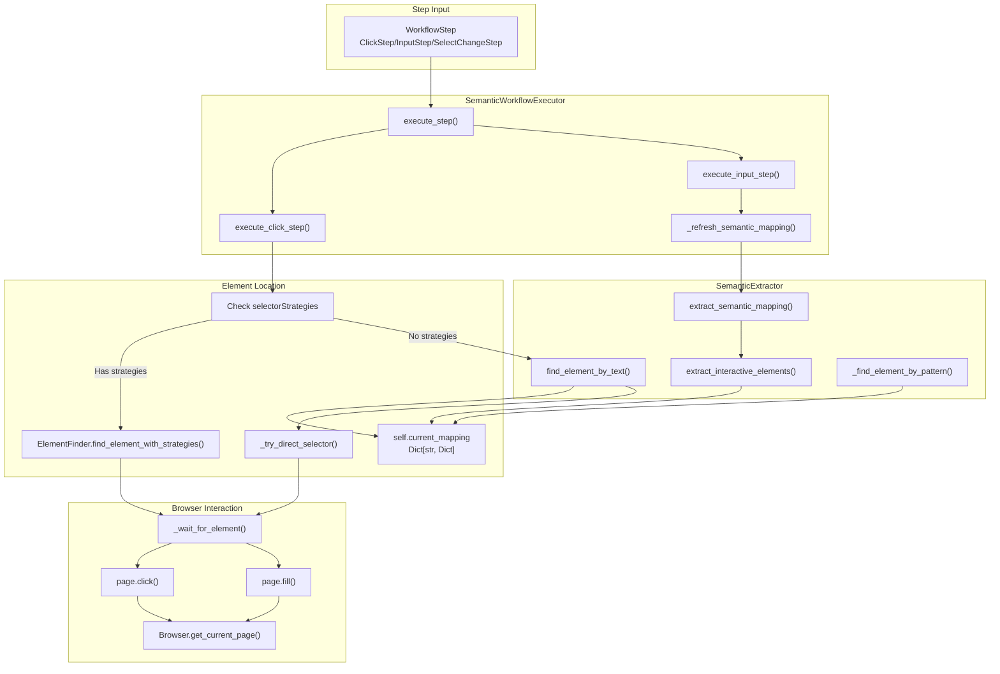

**Sources:** [workflows/workflow_use/workflow/semantic_executor.py:31-58](), [workflows/workflow_use/workflow/semantic_extractor.py:14-23]()

---

## Core Components

### SemanticWorkflowExecutor

The main execution class that orchestrates semantic workflow execution without AI.

| Component | Type | Description |
|-----------|------|-------------|
| `browser` | Browser | Browser instance from browser-use library |
| `semantic_extractor` | SemanticExtractor | Extracts text-to-selector mappings from pages |
| `current_mapping` | Dict[str, Dict] | Cached semantic mapping for current page |
| `max_retries` | int | Maximum retry attempts per step (default: 3) |
| `max_global_failures` | int | Global failure threshold (default: 5) |
| `enable_step_verification` | bool | Enable post-action verification (default: False) |
| `step_verifier` | StepVerifier | Optional verifier for action validation |

**Initialization:**

```python
executor = SemanticWorkflowExecutor(
    browser=browser,
    max_retries=3,
    max_global_failures=5,
    max_verification_failures=3,
    page_extraction_llm=None,  # LLM only for verification if enabled
    enable_step_verification=False
)
```

**Sources:** [workflows/workflow_use/workflow/semantic_executor.py:31-58]()

### SemanticExtractor

Extracts semantic information from web pages to build text-to-selector mappings.

**Diagram: SemanticExtractor Processing Pipeline**

```mermaid
graph LR
    Page["browser_use.Page"] -->|"page.evaluate()"| JSExtractor["extract_interactive_elements()"]
    JSExtractor -->|"List[Dict]"| GetElementType["_get_element_type_and_id()"]
    GetElementType -->|"element_type, element_id"| GetText["_get_element_text()"]
    GetText -->|"raw text"| Normalize["_normalize_text()"]
    Normalize -->|"normalized text"| HandleDupe["_handle_duplicate_text()"]
    HandleDupe -->|"unique text key"| BuildMapping["Dict[text, element_info]"]
```

**Key Methods:**

| Method | Purpose | Line Reference |
|--------|---------|----------------|
| `extract_interactive_elements()` | Executes JavaScript to extract all interactive elements with context | [206-814]() |
| `extract_semantic_mapping()` | Builds text → selector mapping for current page | [816-865]() |
| `find_element_by_text()` | Locates element by visible text with fuzzy matching | [867-1017]() |
| `find_element_by_hierarchy()` | Finds elements using hierarchical context hints | [1019-1079]() |

**Sources:** [workflows/workflow_use/workflow/semantic_extractor.py:14-1079]()

---

## Semantic Mapping System

### Mapping Structure

The semantic mapping is a dictionary that maps visible text to element information:

```python
{
    "Submit (in Contact Form)": {
        "class": "btn btn-primary",
        "id": "submit-btn",
        "selectors": "button#submit-btn",
        "hierarchical_selector": "form.contact > button#submit-btn:nth-of-type(1)",
        "fallback_selector": "button",
        "text_xpath": "//button[contains(text(), 'Submit')]",
        "element_type": "button",
        "deterministic_id": "button_1",
        "original_text": "Submit",
        "label_text": "",
        "dom_path": "form.contact > div.actions > button#submit-btn",
        "container_context": {...},
        "sibling_context": {...},
        "position": {"x": 100, "y": 200, "width": 80, "height": 30}
    }
}
```

**Sources:** [workflows/workflow_use/workflow/semantic_extractor.py:816-865]()

### Text Extraction Priority

The `_get_element_text()` method extracts text from multiple sources in priority order:

**Diagram: Text Extraction Waterfall in _get_element_text()**

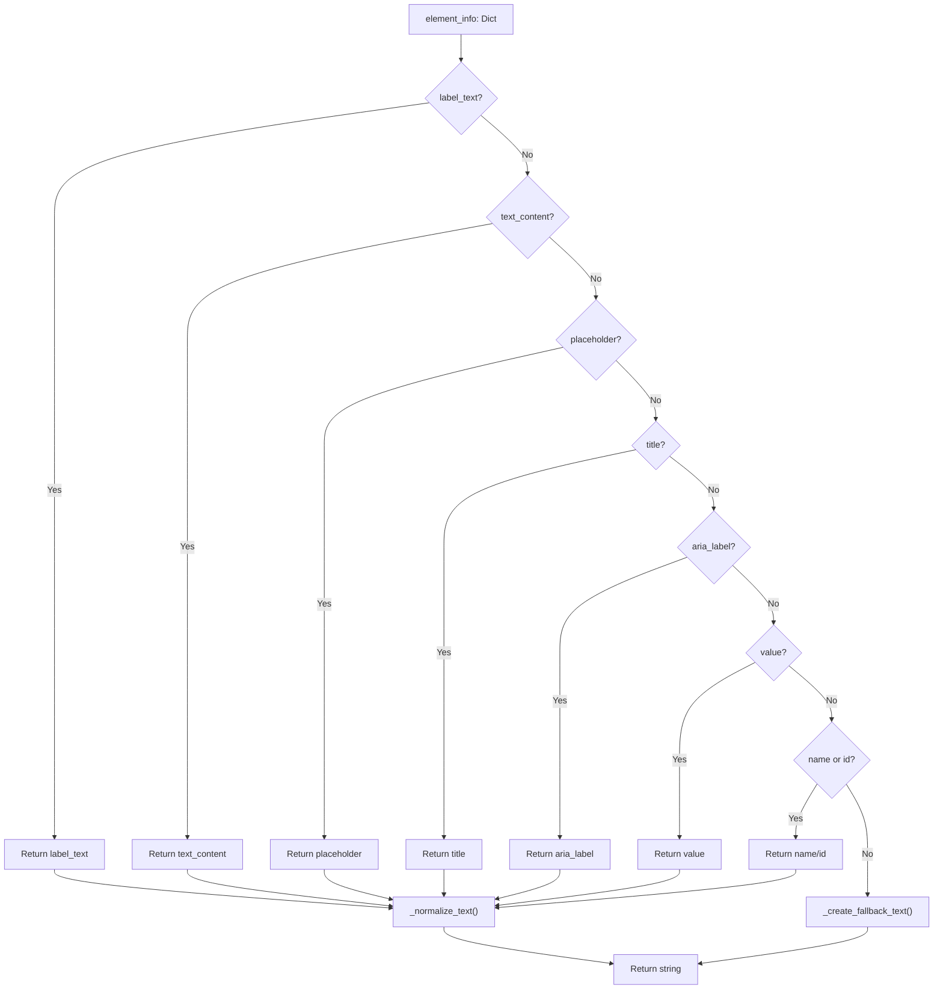

**Sources:** [workflows/workflow_use/workflow/semantic_extractor.py:67-105]()

### Duplicate Handling

When multiple elements have the same text, the system adds hierarchical context:

**Strategy Hierarchy:**

1. **Parent Context**: "Submit (in Contact Form)"
2. **Container Context**: "Submit (in section#contact)"
3. **Sibling Position**: "Submit (item 2 of 3)"
4. **DOM Path Context**: "Submit (in form > div.actions)"
5. **Position Context**: "Submit (at 100,200)"
6. **Attribute Context**: "Submit (id:submit-btn)"
7. **Numeric Fallback**: "Submit (2)"

**Sources:** [workflows/workflow_use/workflow/semantic_extractor.py:161-204]()

---

## Element Finding Strategies

The semantic executor uses a four-tier priority system to locate elements:

### Priority 1: Explicit Selector Strategies

When `step.selectorStrategies` field is present, `ElementFinder` takes highest priority:

**Diagram: Priority 1 - selectorStrategies Flow**

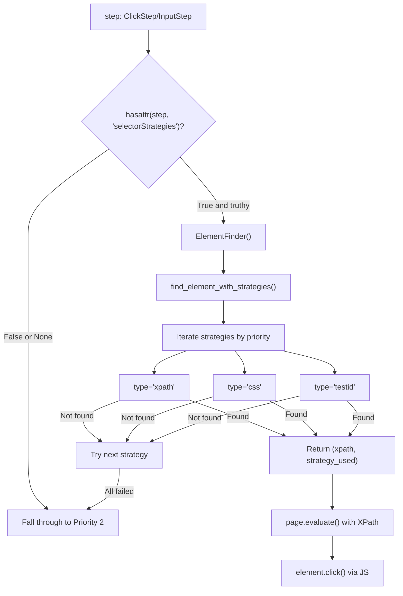

**Implementation in execute_click_step():**

```python
if hasattr(step, 'selectorStrategies') and step.selectorStrategies:
    element_finder = ElementFinder()
    result, strategy_attempts = await element_finder.find_element_with_strategies(
        step.selectorStrategies, self.browser, target_text
    )
    if result:
        xpath_or_selector, strategy_used = result
        # Click using XPath via JavaScript evaluation
```

**Sources:** [workflows/workflow_use/workflow/semantic_executor.py:756-813]()

### Priority 2: Semantic Text-Based Matching

Finds elements by matching `step.target_text` against `self.current_mapping`:

**Diagram: Priority 2 - Text-Based Matching in execute_click_step()**

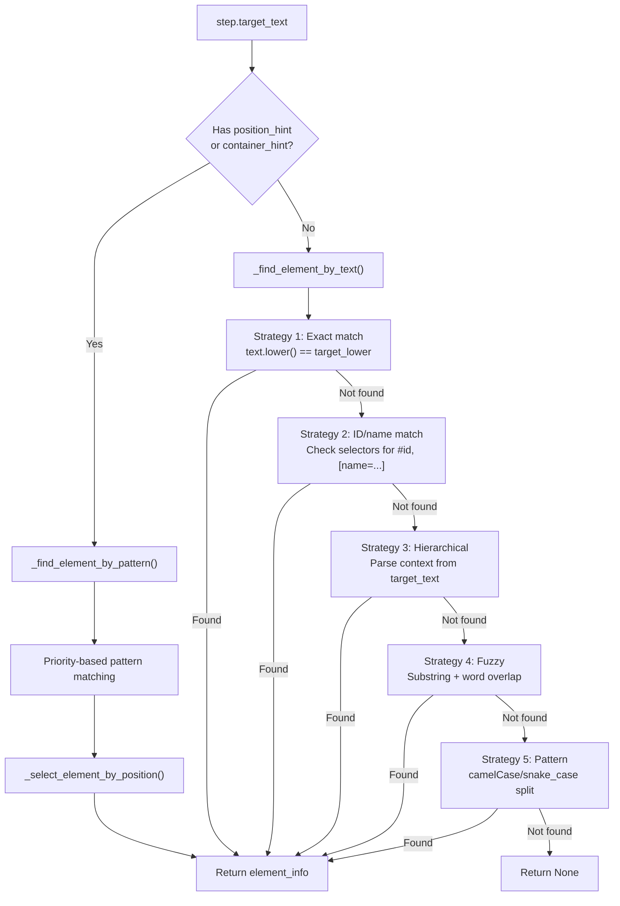

**Key Methods:**

| Method | Purpose | Line Reference |
|--------|---------|----------------|
| `_find_element_by_text()` | Main text search with 5 fallback strategies | [225-354]() |
| `_find_element_by_pattern()` | Pattern matching for dynamic IDs/codes | [356-481]() |
| `_select_element_by_position()` | Position-based selection from multiple matches | [483-524]() |

**Sources:** [workflows/workflow_use/workflow/semantic_executor.py:225-524]()

### Priority 3: Direct Selector Fallback

`_try_direct_selector()` attempts to use `target_text` as a direct CSS selector:

**Selector Variations Tried:**

1. `#target_text` (ID selector)
2. `[name='target_text']` (name attribute)
3. `[id='target_text']` (id attribute)
4. `[data-testid='target_text']` (test ID)
5. `[placeholder='target_text']` (placeholder)
6. CamelCase and lowercase variations

**Strict Mode Handling:**

If selector matches multiple elements, `_try_direct_selector()` attempts to make it more specific:
- `selector:not([type='hidden'])`
- `selector:visible`
- `selector:first-of-type`

**Sources:** [workflows/workflow_use/workflow/semantic_executor.py:526-597]()

### Priority 4: Legacy CSS/XPath Selectors

Final fallback to `step.cssSelector` or `step.xpath` fields:

```python
# In execute_click_step()
if not selector_to_use:
    if step.cssSelector:
        selector_to_use = step.cssSelector
        logger.info(f'Falling back to original CSS selector: {selector_to_use}')
    elif hasattr(step, 'xpath') and step.xpath:
        selector_to_use = f'xpath={step.xpath}'
        logger.info(f'Falling back to XPath selector: {step.xpath}')
    else:
        # No selector available - raise error with debugging info
        raise Exception(f"No selector available for click step: '{target_identifier}'")
```

**Note:** This is discouraged for new workflows. Use `target_text` or `selectorStrategies` instead.

**Sources:** [workflows/workflow_use/workflow/semantic_executor.py:865-893]()

---

## Pattern-Based Element Finding

For dynamic content (IDs, codes, dates), the system uses intelligent pattern matching:

### Pattern Detection

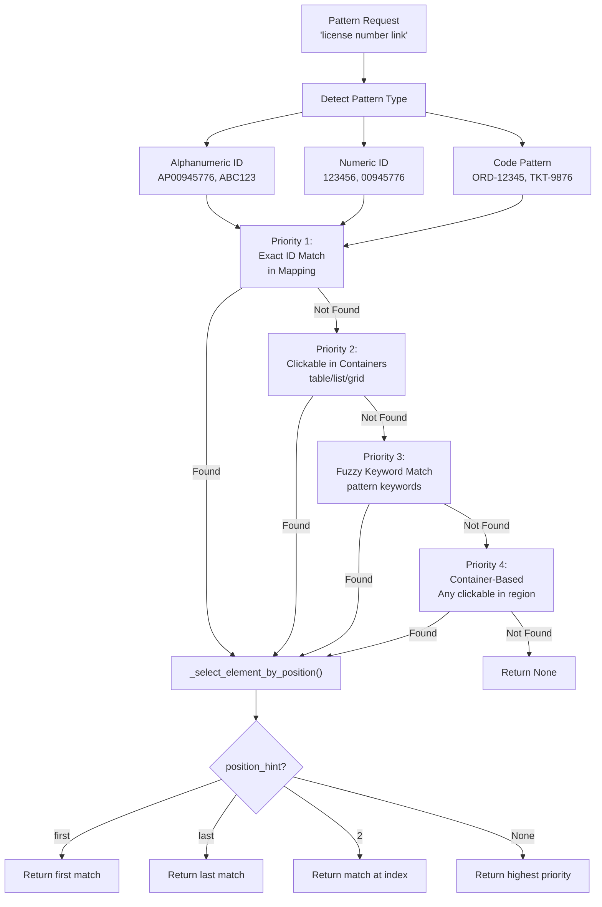

**Pattern Examples:**

| Pattern Type | Regex | Example Matches |
|-------------|-------|-----------------|
| Alphanumeric ID | `[A-Z]{2,}\d{3,}` | AP00945776, XYZ12345 |
| Numeric ID | `\d{3,}` | 123456, 00945776 |
| Code Pattern | `[A-Z0-9]+[-_][A-Z0-9]*\d+` | ORD-12345, user_456 |

**Sources:** [workflows/workflow_use/workflow/semantic_executor.py:356-524]()

---

## Step Execution

### Execution Flow

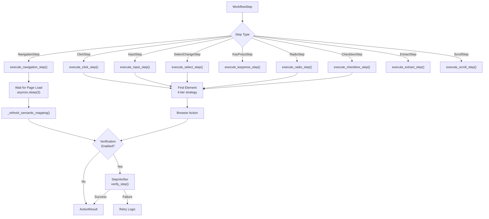

**Sources:** [workflows/workflow_use/workflow/semantic_executor.py:687-1300]()

### Navigation Step Execution

`execute_navigation_step()` optimizes page loads and refreshes mappings:

**Diagram: Navigation Step Flow**

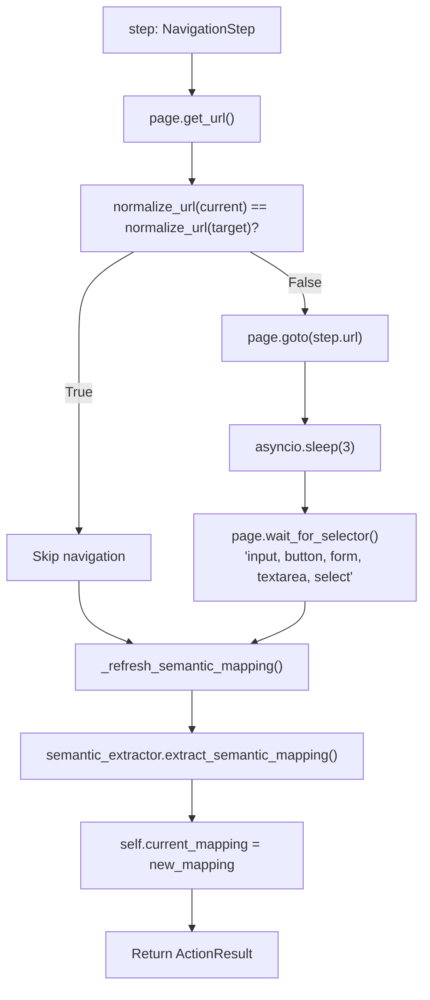

**URL Normalization:**

The `normalize_url()` helper removes fragments and trailing slashes to avoid redundant navigation:

```python
def normalize_url(url: str) -> str:
    if '#' in url:
        url = url.split('#')[0]
    return url.rstrip('/')
```

**Sources:** [workflows/workflow_use/workflow/semantic_executor.py:687-741]()

### Click Step Execution

`execute_click_step()` implements the full 4-priority element location hierarchy:

**Diagram: Click Step Execution Flow**

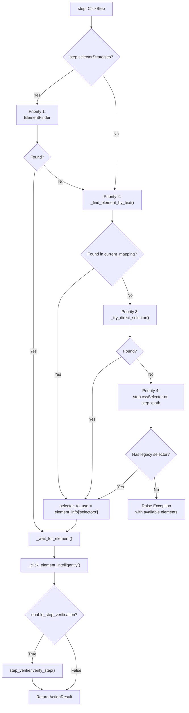

**Special Handling:**

- **Position Hints**: `step.position_hint` = `"first"`, `"last"`, or numeric index
- **Container Hints**: `step.container_hint` narrows search scope
- **Hierarchical Selectors**: Prefers selectors with `#id` or `:nth-of-type()`

**Sources:** [workflows/workflow_use/workflow/semantic_executor.py:743-937]()

### Input Step Execution

`execute_input_step()` locates input fields using the same 4-priority system as clicks:

**Diagram: Input Step Execution Flow**

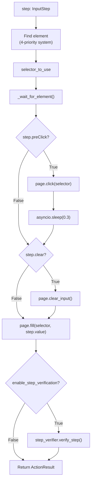

**Special Fields:**

- `step.preClick`: Whether to click field before filling (default: False)
- `step.clear`: Whether to clear existing value before filling (default: False)
- `step.value`: Text to input (may contain `{variable}` placeholders)
- `step.default_value`: Fallback if `value` is empty or unresolved

**Sources:** [workflows/workflow_use/workflow/semantic_executor.py:922-1040]()

### Radio/Checkbox Execution

Radio buttons and checkboxes require special handling for state management:

```python
async def execute_radio_step(self, step: RadioStep) -> ActionResult:
    # Find radio button by value and group
    element_info = self._find_element_by_text(step.target_text)
    
    # Check if already selected
    element = await self._get_elements_by_selector(selector)
    if await self._element_is_checked(element[0]):
        return ActionResult(extracted_content="Already selected")
    
    # Click to select
    await page.click(selector)
    
    # Verify selection
    if await self._element_is_checked(element[0]):
        return ActionResult(extracted_content="Selected")
```

**Sources:** [workflows/workflow_use/workflow/semantic_executor.py:1067-1166]()

---

## Error Handling and Retry

### Retry Mechanism

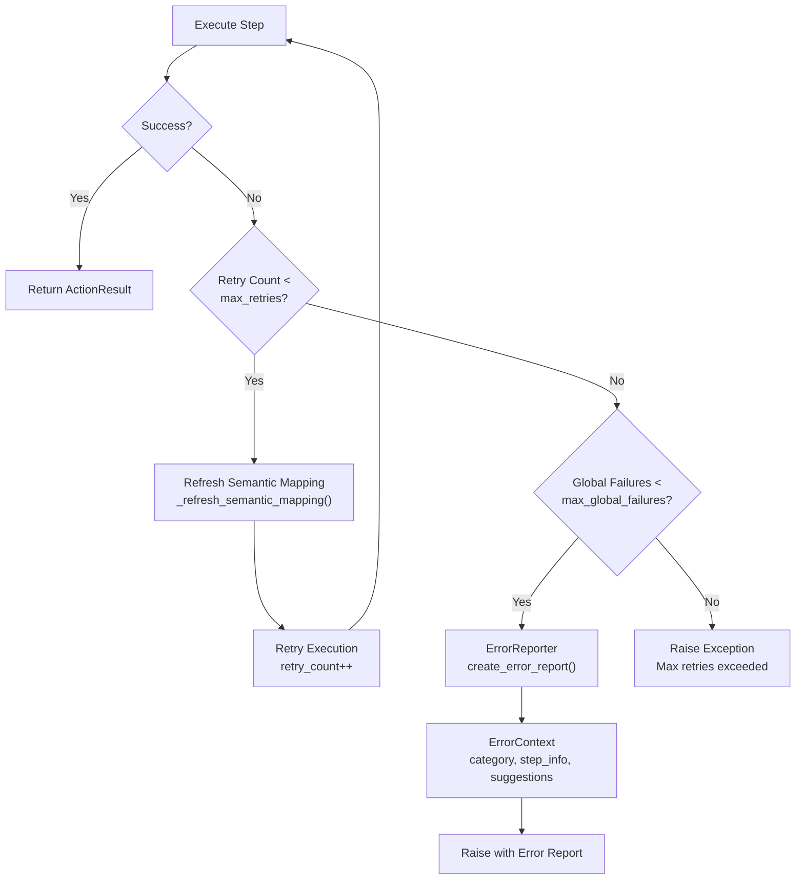

**Retry Configuration:**

| Parameter | Default | Purpose |
|-----------|---------|---------|
| `max_retries` | 3 | Retries per step |
| `max_global_failures` | 5 | Total failures before abort |
| `max_verification_failures` | 3 | Verification failures before abort |

**Sources:** [workflows/workflow_use/workflow/semantic_executor.py:34-49]()

### Error Reporting

The semantic executor integrates with `ErrorReporter` for detailed diagnostics:

```python
try:
    await self._execute_step(step)
except Exception as e:
    error_context = ErrorContext(
        step_type=step.type,
        step_index=self.current_step_index,
        target_text=step.target_text,
        available_elements=list(self.current_mapping.keys())[:20],
        error_message=str(e),
        traceback=traceback.format_exc()
    )
    
    error_report = self.error_reporter.create_error_report(error_context)
    raise Exception(f"Step execution failed: {error_report}")
```

**Sources:** [workflows/workflow_use/workflow/semantic_executor.py:54](), [workflows/workflow_use/workflow/error_reporter.py]()

### Strict Mode Violation Handling

When a selector matches multiple elements, the system attempts resolution:

```python
async def _handle_strict_mode_violation(self, selector: str, target_text: str) -> Optional[str]:
    elements = await page.get_elements_by_css_selector(selector)
    
    if len(elements) <= 1:
        return selector
    
    # For radio buttons, try to find by value
    if 'radio' in selector.lower() and target_text:
        value_selector = f'input[type="radio"][value="{target_text.lower()}"]'
        value_elements = await page.get_elements_by_css_selector(value_selector)
        if len(value_elements) == 1:
            return value_selector
    
    # Cannot resolve automatically
    return None
```

**Sources:** [workflows/workflow_use/workflow/semantic_executor.py:599-636]()

---

## Performance Characteristics

### Execution Speed

Semantic execution is significantly faster than AI-driven execution:

| Metric | Semantic Execution | AI Execution |
|--------|-------------------|--------------|
| **Average Step Time** | 0.5-2 seconds | 3-10 seconds |
| **Page Load Overhead** | 3 seconds (navigation) | 3 seconds + AI analysis |
| **Element Location** | ~100ms (mapping lookup) | 2-5 seconds (LLM query) |
| **Total Workflow** | 10-30 seconds (10 steps) | 60-180 seconds (10 steps) |

**Sources:** [README.md:167-174]()

### Cost Comparison

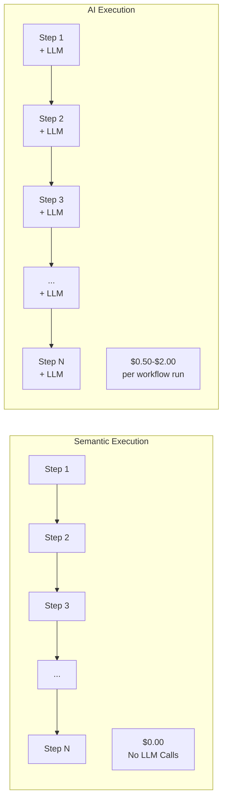

**Cost Breakdown:**

- **Semantic Mode**: $0.00 per execution (no LLM calls)
- **AI Mode**: $0.01-0.05 per step × N steps = $0.10-0.50+ per workflow
- **Savings**: 100% cost reduction for repeated executions

**Sources:** [README.md:15-17](), [README.md:167-174]()

### Reliability

Semantic execution provides deterministic results:

- **Consistent Element Location**: Same text always maps to same selector
- **No Model Variability**: No temperature/sampling randomness
- **Predictable Timing**: Execution time is consistent
- **No Rate Limits**: No API throttling or quota issues

**Sources:** [workflows/workflow_use/workflow/semantic_executor.py:31-33]()

---

## Integration with Workflow System

### Usage in Workflow Service

The `WorkflowService` uses semantic execution for no-AI mode:

```python
from workflow_use.workflow.semantic_executor import SemanticWorkflowExecutor

# In WorkflowService.run_with_no_ai()
semantic_executor = SemanticWorkflowExecutor(
    browser=self.browser,
    max_retries=3,
    max_global_failures=5,
    enable_step_verification=False
)

for step in self.workflow.steps:
    result = await semantic_executor.execute_step(step)
```

**Sources:** [workflows/workflow_use/workflow/service.py]()

### CLI Integration

The CLI provides direct access to semantic execution:

```bash
# Run workflow without AI
python cli.py run-workflow-no-ai workflow.json

# Run on cloud browser without AI
python cli.py run-workflow-no-ai workflow.json --use-cloud
```

**Sources:** [README.md:167-174]()

### Cloud Browser Support

Semantic execution works seamlessly with Browser-Use Cloud:

```python
from workflow_use import Workflow

workflow = Workflow.load_from_file("workflow.json", llm, use_cloud=True)
result = await workflow.run_with_no_ai()  # No LLM calls, uses semantic mapping
```

**Sources:** [README.md:165-174]()

---

## Advanced Features

### Step Verification

Optional post-action verification using LLM (disabled by default):

```python
executor = SemanticWorkflowExecutor(
    browser=browser,
    page_extraction_llm=ChatOpenAI(model='gpt-4'),
    enable_step_verification=True
)
```

**Verification Process:**

1. Execute step action
2. Capture page state
3. LLM validates action success
4. Retry if verification fails (up to `max_verification_failures`)

**Note:** This adds LLM cost but improves reliability for critical workflows.

**Sources:** [workflows/workflow_use/workflow/semantic_executor.py:40-57]()

### Hierarchical Context Matching

When multiple elements share the same text, hierarchical context resolves ambiguity:

```python
# Example: Multiple "Submit" buttons
mapping = {
    "Submit (in Contact Form)": {...},
    "Submit (in Newsletter Signup)": {...},
    "Submit (in Search Bar)": {...}
}

# Step specifies context
step.target_text = "Submit"
step.container_hint = "Contact Form"

# Executor finds correct element using hierarchical matching
element_info = self.semantic_extractor.find_element_by_hierarchy(
    mapping, "Submit", ["Contact Form"]
)
```

**Sources:** [workflows/workflow_use/workflow/semantic_extractor.py:867-936]()

### Dynamic Content Handling

Pattern-based matching handles dynamic IDs, dates, and codes:

```python
# Step for clicking dynamic license number
step = ClickStep(
    target_text="license number link",  # Generic pattern
    position_hint="first",  # Select first match
    container_hint="search results"  # Narrow scope
)

# Executor finds AP00945776, XYZ12345, etc.
element_info = await executor._find_element_by_pattern(
    pattern="license number link",
    position_hint="first",
    container_hint="search results"
)
```

**Sources:** [workflows/workflow_use/workflow/semantic_executor.py:356-524]()

---

## Limitations and Considerations

### When Semantic Execution Works Best

✅ **Ideal Scenarios:**
- Static website structure
- Text-based element identification
- Repeated workflow executions
- Form filling with known fields
- Navigation workflows
- Cost-sensitive applications

**Sources:** [README.md:236-242]()

### When AI Execution is Better

⚠️ **Limitations:**
- Complex dynamic UIs (SPAs with no semantic info)
- Elements without visible text
- Ambiguous element selection without context
- Workflows requiring reasoning/decisions
- Websites with frequent UI changes

**Solution:** Use AI-driven execution for complex steps, semantic for simple ones. See [Workflow Execution](#5) for hybrid approaches.

**Sources:** [README.md:251-256]()

### Semantic Mapping Refresh

Mappings must be refreshed after page changes:

```python
# Automatically refreshed after navigation
await self.execute_navigation_step(nav_step)
# -> calls _refresh_semantic_mapping()

# Manually refresh if page content changes dynamically
await self._refresh_semantic_mapping()
```

**Refresh Triggers:**
- Navigation to new URL
- Retry attempts
- After steps that modify page structure

**Sources:** [workflows/workflow_use/workflow/semantic_executor.py:210-223]()

---

## Debugging and Troubleshooting

### Logging

Enable debug logging to see semantic mapping details:

```python
import logging
logging.getLogger('workflow_use.workflow.semantic_executor').setLevel(logging.DEBUG)
logging.getLogger('workflow_use.workflow.semantic_extractor').setLevel(logging.DEBUG)
```

**Debug Output Example:**

```
DEBUG - === Current Semantic Mapping ===
DEBUG - 'Submit' -> button#submit-btn (fallback: button)
DEBUG - 'Email Address (in Contact Form)' -> input[name='email'] (fallback: input)
DEBUG - === End Semantic Mapping ===
DEBUG - Exact match found: 'Submit' -> 'Submit'
DEBUG - Using semantic mapping: 'Submit' -> button#submit-btn
DEBUG - Found element using direct selector: 'email' -> #email
```

**Key Debug Log Locations:**

| Log Message | Method | Purpose |
|-------------|--------|---------|
| `"=== Current Semantic Mapping ==="` | `_refresh_semantic_mapping()` | Shows all mapped elements |
| `"Found element by..."` | `_find_element_by_text()` | Shows match strategy used |
| `"Using hierarchical selector"` | `execute_click_step()` | Shows selector preference |
| `"Priority 1: Found..."` | `_find_element_by_pattern()` | Shows pattern matching priority |

**Sources:** [workflows/workflow_use/workflow/semantic_executor.py:216-223](), [workflows/workflow_use/workflow/semantic_extractor.py:863]()

### Common Issues

| Issue | Cause | Solution |
|-------|-------|----------|
| Element not found | Text doesn't match mapping | Check exact text in browser, use debug logging |
| Strict mode violation | Selector matches multiple elements | Add position/container hints, use hierarchical selector |
| Click doesn't work | Element not clickable | Check element visibility, try pre-click in input steps |
| Stale mapping | Page changed after mapping | Refresh mapping before step execution |

**Sources:** [workflows/workflow_use/workflow/semantic_executor.py:599-636]()

### Error Context

When execution fails, `ErrorReporter` creates detailed diagnostics:

```python
# In execute_click_step() when no selector found
available_texts = list(self.current_mapping.keys())[:15]
error_msg = f"No selector available for click step: '{target_identifier}'"
error_msg += f'\nAvailable elements on page: {available_texts}'
if len(self.current_mapping) > 15:
    error_msg += f' (and {len(self.current_mapping) - 15} more)'

# Try to find similar text matches for debugging
if target_identifier:
    similar_matches = []
    target_lower = target_identifier.lower()
    for text in self.current_mapping.keys():
        if any(word in text.lower() for word in target_lower.split()):
            similar_matches.append(text)
    
    if similar_matches:
        error_msg += f'\nSimilar text found: {similar_matches[:5]}'

raise Exception(error_msg)
```

**Error Message Components:**

- **Target identifier**: The text/selector being searched for
- **Available elements**: First 15-20 elements in `current_mapping`
- **Similar matches**: Elements with word overlap to target
- **Tried selectors**: All selectors attempted (from fallback chain)

**Sources:** [workflows/workflow_use/workflow/semantic_executor.py:874-891]()

---

## Summary

The `SemanticWorkflowExecutor` provides deterministic, zero-cost workflow execution by mapping visible text to browser elements without LLM calls. Its multi-tier element finding system offers resilience, while pattern matching handles dynamic content. With 10-100x faster execution and no API costs, semantic execution is ideal for production workflows with repeated runs.

**Key Takeaways:**

- **Zero LLM Cost**: No API calls during execution
- **Fast Performance**: 0.5-2 seconds per step vs 3-10 seconds with AI
- **Deterministic**: Consistent results every run
- **Multi-Strategy**: 4-tier element finding with fallbacks
- **Pattern Support**: Handles dynamic IDs, codes, dates
- **Error Resilient**: Retry, verification, and comprehensive error reporting

**Sources:** [workflows/workflow_use/workflow/semantic_executor.py:1-1300](), [workflows/workflow_use/workflow/semantic_extractor.py:1-936](), [README.md:1-268]()

---

