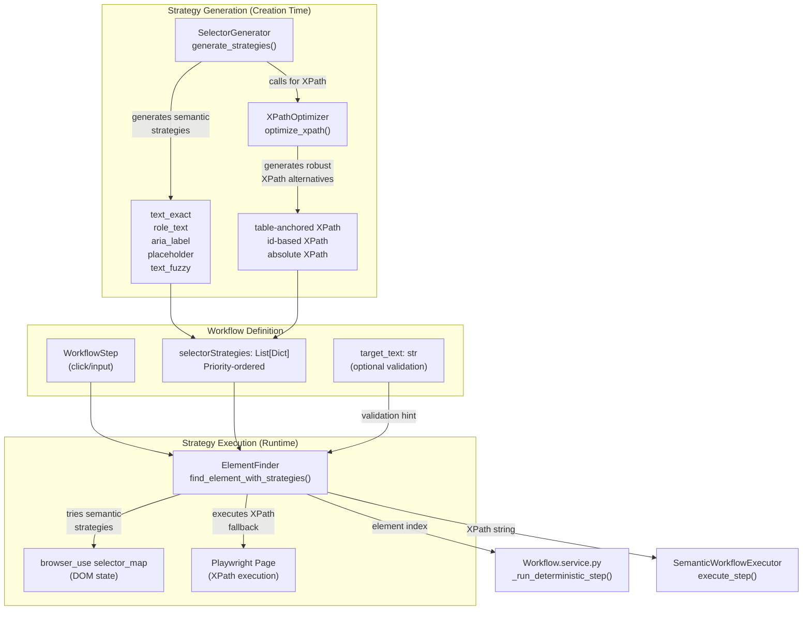
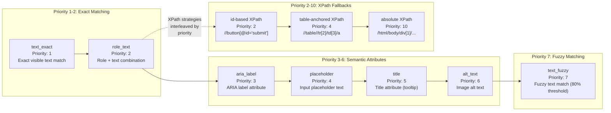
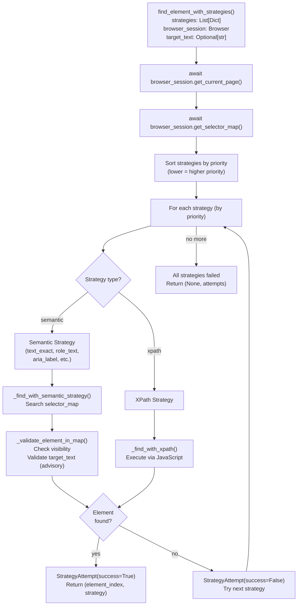
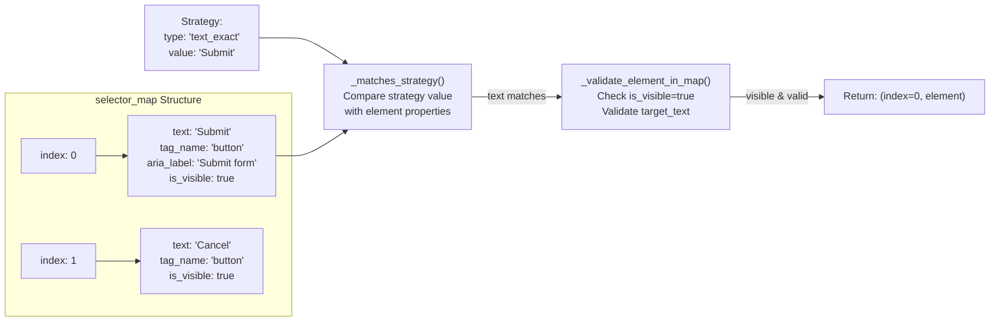
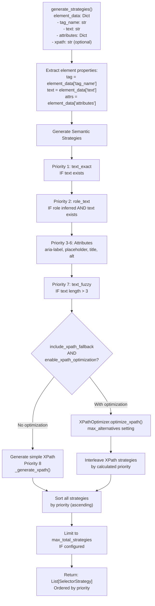
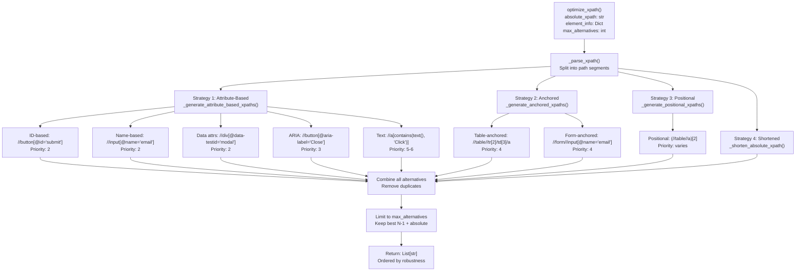

<!-- source: DeepWiki mcp.deepwiki.com · repo browser-use/workflow-use · page 5.2 Element Finding Strategies · fetched 2026-10-30 -->

# Element Finding Strategies

<details>
<summary>Relevant source files</summary>

The following files were used as context for generating this wiki page:

- [workflows/tests/test_element_finder.py](workflows/tests/test_element_finder.py)
- [workflows/tests/test_go_back_fix.py](workflows/tests/test_go_back_fix.py)
- [workflows/tests/test_selector_generator_fix.py](workflows/tests/test_selector_generator_fix.py)
- [workflows/tests/test_wait_times.py](workflows/tests/test_wait_times.py)
- [workflows/tests/test_workflow_execution.py](workflows/tests/test_workflow_execution.py)
- [workflows/workflow_use/healing/deterministic_converter.py](workflows/workflow_use/healing/deterministic_converter.py)
- [workflows/workflow_use/recorder/recorder.py](workflows/workflow_use/recorder/recorder.py)
- [workflows/workflow_use/recorder/semantic_converter.py](workflows/workflow_use/recorder/semantic_converter.py)
- [workflows/workflow_use/workflow/element_finder.py](workflows/workflow_use/workflow/element_finder.py)
- [workflows/workflow_use/workflow/semantic_executor.py](workflows/workflow_use/workflow/semantic_executor.py)
- [workflows/workflow_use/workflow/semantic_extractor.py](workflows/workflow_use/workflow/semantic_extractor.py)

</details>


## Purpose and Scope

This document explains the multi-strategy element finding system used during workflow execution to locate DOM elements reliably. The system provides a fallback hierarchy from semantic strategies (text-based) to XPath strategies, making workflows resilient to page structure changes.

For information about:
- How semantic execution uses these strategies: see [Semantic Execution (No-AI Mode)](#5.1)
- Error handling when strategies fail: see [Error Recovery and Self-Healing](#5.3)
- How strategies are generated during workflow creation: see [Natural Language Generation](#3.2) and [Deterministic vs AI-Enhanced Conversion](#3.3)

## Overview

The element finding system attempts multiple strategies in priority order to locate elements on a page. Instead of relying on brittle CSS selectors or absolute XPaths, workflows store multiple fallback strategies per element. During execution, the system tries each strategy until one successfully locates the target element.

**Key Components:**
- `ElementFinder`: Executes strategies against browser state
- `SelectorGenerator`: Creates prioritized strategies from element data
- `XPathOptimizer`: Generates robust XPath alternatives
- `selectorStrategies`: Schema field storing strategy lists

Sources: [workflow_use/workflow/element_finder.py:1-30](), [workflow_use/healing/selector_generator.py:47-65]()

## System Architecture



**Strategy Generation Flow:**
1. During workflow creation, `SelectorGenerator` analyzes element data
2. Generates semantic strategies (text, ARIA, role) with priority 1-7
3. Optionally calls `XPathOptimizer` to create 2-3 robust XPath alternatives
4. Strategies stored in `selectorStrategies` field, sorted by priority

**Strategy Execution Flow:**
1. `ElementFinder` receives strategy list from workflow step
2. Tries semantic strategies against browser-use's `selector_map`
3. Falls back to XPath execution via Playwright if semantic strategies fail
4. Returns element index (semantic) or XPath string (XPath strategy)

Sources: [workflow_use/workflow/element_finder.py:20-170](), [workflow_use/healing/selector_generator.py:84-290](), [workflow_use/workflow/service.py:167-228]()

## Strategy Types and Priority



### Strategy Type Reference

| Strategy Type | Priority | Matching Criteria | Use Case | Example Value |
|--------------|----------|-------------------|----------|---------------|
| `text_exact` | 1 | Exact visible text match | Links, buttons with stable text | `"Submit"` |
| `role_text` | 2 | Semantic role + text | Accessible elements | `role="button"`, text=`"Submit"` |
| `aria_label` | 3 | ARIA label attribute | Screen reader labels | `"Submit form"` |
| `placeholder` | 4 | Input placeholder text | Form inputs | `"Enter your email"` |
| `title` | 5 | Title attribute (tooltip) | Elements with tooltips | `"Close dialog"` |
| `alt_text` | 6 | Image alt attribute | Images | `"Company logo"` |
| `text_fuzzy` | 7 | Fuzzy match (80% similarity) | Text with minor variations | `"Submit Form"` |
| `xpath` | 2-10 | XPath expression | Fallback locator | `//table//tr[2]/td[3]/a` |

**XPath Priority Calculation:**
- ID-based: Priority 2 (`//button[@id='submit']`)
- Name-based: Priority 2 (`//input[@name='email']`)
- Data attributes: Priority 2 (`//div[@data-testid='modal']`)
- ARIA attributes: Priority 3 (`//button[@aria-label='Close']`)
- Table-anchored: Priority 4 (`//table//tr[2]/td[3]`)
- Form-anchored: Priority 4 (`//form//input[@placeholder='Email']`)
- Text-based: Priority 5-6 (`//a[contains(text(), 'Click')]`)
- Class-based: Priority 6 (`//div[contains(@class, 'modal')]`)
- Absolute: Priority 10 (`/html/body/div[1]/div[2]/...`)

Sources: [workflow_use/healing/selector_generator.py:84-195](), [workflow_use/healing/selector_generator.py:481-531]()

## ElementFinder Class

The `ElementFinder` class is the runtime component that executes strategies to locate elements during workflow execution.

### Core Method: find_element_with_strategies



**Key Features:**
- **Strategy attempts tracking**: Records each attempt (success/failure) for error reporting
- **Two execution paths**: Semantic strategies use `selector_map`, XPath uses Playwright
- **Advisory text validation**: `target_text` is used for validation but doesn't fail if missing
- **Priority-based execution**: Stops at first successful strategy

Sources: [workflow_use/workflow/element_finder.py:29-169]()

### Semantic Strategy Matching

Semantic strategies match against browser-use's `selector_map`, which contains DOM elements with their properties:



**Matching Logic by Type:**
- `text_exact`: `node.text.strip() == value`
- `role_text`: `node.role == metadata['role'] AND node.text == value`
- `aria_label`: `node.aria_label.strip() == value`
- `placeholder`: `node.placeholder.strip() == value`
- `title`: `node.title.strip() == value`
- `alt_text`: `node.alt.strip() == value`
- `text_fuzzy`: `fuzzy_match(value, node.text, threshold=0.8)`

Sources: [workflow_use/workflow/element_finder.py:171-213](), [workflow_use/workflow/element_finder.py:292-360]()

### XPath Strategy Execution

XPath strategies execute via Playwright's JavaScript evaluation rather than searching the `selector_map`:

```python
# Simplified from element_finder.py:442-529
async def _find_with_xpath(xpath, page, browser_session, target_text):
    """Find element using XPath via JavaScript evaluation."""
    
    # Normalize XPath (add leading / if missing)
    normalized_xpath = xpath if xpath.startswith('/') else '/' + xpath
    
    # Execute XPath query via JavaScript
    js_code = f"""() => {{
        const result = document.evaluate(
            '{normalized_xpath}',
            document,
            null,
            XPathResult.FIRST_ORDERED_NODE_TYPE,
            null
        );
        const element = result.singleNodeValue;
        
        // Check visibility
        const rect = element.getBoundingClientRect();
        const style = window.getComputedStyle(element);
        const isVisible = rect.width > 0 && rect.height > 0 &&
                          style.visibility !== 'hidden' &&
                          style.display !== 'none';
        
        return {{
            found: true,
            visible: isVisible,
            tag: element.tagName,
            text: element.textContent?.trim() || '',
            xpath: '{normalized_xpath}'
        }};
    }}"""
    
    result = await page.evaluate(js_code)
    
    if result.get('found') and result.get('visible'):
        return (normalized_xpath, normalized_xpath)  # Return XPath for JS click
    return None
```

**Why JavaScript execution?**
- XPath strategies can't be matched against `selector_map` (which only has semantic properties)
- Direct DOM query is more accurate for complex XPath expressions
- Returns XPath string (not element index) for semantic executor to click via JavaScript

Sources: [workflow_use/workflow/element_finder.py:442-529]()

## SelectorGenerator Class

The `SelectorGenerator` creates prioritized strategy lists during workflow creation. It analyzes element data captured during recording and generates multiple fallback strategies.

### Configuration Options

```python
# From selector_generator.py:67-82
SelectorGenerator(
    enable_xpath_optimization=True,    # Use XPathOptimizer for robust XPaths
    max_xpath_alternatives=2,          # Max XPath strategies (default: 2)
    max_total_strategies=2             # Max total strategies (semantic + xpath)
)
```

**Configuration Behavior:**
- `enable_xpath_optimization=True`: Generate 2-3 robust XPath alternatives
- `enable_xpath_optimization=False`: Generate 1 simple XPath fallback
- `max_xpath_alternatives=1`: Return only absolute XPath (no optimization)
- `max_xpath_alternatives=2`: Return 1 optimized + 1 absolute XPath
- `max_total_strategies=2`: Limit total strategies across all types

Sources: [workflow_use/healing/selector_generator.py:67-82]()

### Strategy Generation Flow



**Example Generation:**

For a button element:
```python
element_data = {
    'tag_name': 'button',
    'text': 'Submit Form',
    'attributes': {
        'aria-label': 'Submit the form',
        'id': 'submit-btn'
    },
    'xpath': '/html/body/form/div[3]/button'
}

# Generated strategies (with optimization):
strategies = [
    SelectorStrategy(type='text_exact', value='Submit Form', priority=1),
    SelectorStrategy(type='role_text', value='Submit Form', priority=2, 
                     metadata={'role': 'button'}),
    SelectorStrategy(type='xpath', value='//button[@id="submit-btn"]', priority=2,
                     metadata={'strategy': 'id-based', 'optimized': True}),
    SelectorStrategy(type='aria_label', value='Submit the form', priority=3),
    SelectorStrategy(type='text_fuzzy', value='Submit Form', priority=7,
                     metadata={'threshold': 0.8}),
    SelectorStrategy(type='xpath', value='/html/body/form/div[3]/button', priority=10,
                     metadata={'fallback': True})
]
```

Sources: [workflow_use/healing/selector_generator.py:84-290](), [tests/test_selector_generator.py:18-243]()

### Role Inference

The generator infers semantic roles from HTML tags and attributes:

```python
# From selector_generator.py:292-337
def _infer_role(tag: str, attrs: Dict) -> Optional[str]:
    """Infer semantic role from HTML tag and attributes."""
    
    # Explicit role attribute takes precedence
    if 'role' in attrs:
        return attrs['role']
    
    # Role map for HTML tags
    role_map = {
        'button': 'button',
        'a': 'link',
        'input': 'textbox',
        'select': 'combobox',
        'h1': 'heading',
        # ... etc
    }
    
    # Special handling for input types
    if tag == 'input' and 'type' in attrs:
        if attrs['type'] == 'checkbox': return 'checkbox'
        if attrs['type'] == 'radio': return 'radio'
        if attrs['type'] == 'submit': return 'button'
    
    return role_map.get(tag)
```

Sources: [workflow_use/healing/selector_generator.py:292-337]()

## XPathOptimizer Class

The `XPathOptimizer` transforms brittle absolute XPaths into multiple robust alternatives. This is a key innovation that reduces reliance on fragile selectors.

### Optimization Strategies



### Example Optimization

**Input:** Brittle absolute XPath from recording
```python
absolute_xpath = '/html/body/form/div[3]/div[1]/table/tbody/tr[2]/td[3]/a'
element_info = {
    'tag': 'a',
    'text': 'License 12345',
    'attributes': {
        'class': 'license-link',
        'href': '/license/12345'
    }
}
```

**Output:** Robust alternatives (max_alternatives=3)
```python
optimized = [
    # Priority 4: Table-anchored (most robust for table elements)
    '//table//tr[2]/td[3]/a',
    
    # Priority 5: Text-based
    '//a[contains(text(), "License 12345")]',
    
    # Priority 10: Absolute fallback
    '/html/body/form/div[3]/div[1]/table/tbody/tr[2]/td[3]/a'
]
```

**Robustness improvements:**
- Table-anchored XPath works even if wrapper divs change
- Text-based XPath works if table structure changes
- Absolute XPath as final fallback

Sources: [workflow_use/healing/xpath_optimizer.py:73-155](), [tests/test_xpath_optimization.py:23-181]()

### Attribute-Based XPath Generation

```python
# From xpath_optimizer.py:190-259
def _generate_attribute_based_xpaths(element_info: Dict, parts: List) -> List[str]:
    """Generate XPaths using element attributes in priority order."""
    
    xpaths = []
    tag = element_info.get('tag', '*')
    attrs = element_info.get('attributes', {})
    text = element_info.get('text', '').strip()
    
    # Priority 1: ID selector (most stable)
    if attrs.get('id'):
        xpaths.append(f'//{tag}[@id={escape_xpath_string(attrs["id"])}]')
    
    # Priority 2: Name attribute (good for forms)
    if attrs.get('name'):
        xpaths.append(f'//{tag}[@name={escape_xpath_string(attrs["name"])}]')
    
    # Priority 3: Data attributes (very stable, often unique)
    for attr_name, attr_value in attrs.items():
        if attr_name.startswith('data-') and attr_value:
            xpaths.append(f'//{tag}[@{attr_name}={escape_xpath_string(attr_value)}]')
    
    # Priority 4: ARIA attributes (semantic, stable)
    if attrs.get('aria-label'):
        xpaths.append(f'//{tag}[@aria-label={escape_xpath_string(attrs["aria-label"])}]')
    
    # Priority 5: Role + text combination
    if attrs.get('role') and text:
        xpaths.append(f'//{tag}[@role={escape_xpath_string(attrs["role"])} '
                     f'and contains(text(), {escape_xpath_string(text)})]')
    
    # Priority 6: Text content
    if text:
        xpaths.append(f'//{tag}[text()={escape_xpath_string(text)}]')
        if len(text) > 3:
            xpaths.append(f'//{tag}[contains(text(), {escape_xpath_string(text)})]')
    
    return xpaths
```

Sources: [workflow_use/healing/xpath_optimizer.py:190-259]()

### Anchored XPath Generation

Anchors to stable parent structures (tables, forms, nav):

```python
# From xpath_optimizer.py:261-309
def _generate_anchored_xpaths(parts: List[Dict], element_info: Dict) -> List[str]:
    """Generate XPaths anchored to stable parent structures."""
    
    xpaths = []
    anchor_tags = {'table', 'form', 'nav', 'header', 'footer', 'section', 'article', 'main'}
    
    # Find stable anchor points in path
    for i, part in enumerate(parts):
        if part['tag'] in anchor_tags:
            # Build path from this anchor point
            relative_path = _build_relative_path(parts[i:])
            xpaths.append(f'//{part["tag"]}{relative_path}')
    
    # Special case: Table cell targeting
    # Example: //table//tr[2]/td[3]/a
    for i in range(len(parts) - 2):
        if parts[i]['tag'] == 'table':
            # Find tr and td indices
            tr_idx = next((p['index'] for p in parts[i:] if p['tag'] == 'tr' and p['index']), None)
            td_idx = next((p['index'] for p in parts[i:] if p['tag'] == 'td' and p['index']), None)
            
            if tr_idx and td_idx:
                target_tag = parts[-1]['tag']
                xpaths.append(f'//table//tr[{tr_idx}]/td[{td_idx}]//{target_tag}')
    
    return xpaths
```

**Example:** `/html/body/div[3]/table/tbody/tr[2]/td[3]/a`
becomes `//table//tr[2]/td[3]/a` (stable even if outer divs change)

Sources: [workflow_use/healing/xpath_optimizer.py:261-309]()

## Integration with Workflow Execution

### Service.py Integration

The workflow service uses `ElementFinder` for multi-strategy element finding:

```python
# From service.py:167-228
async def _run_deterministic_step(self, step: DeterministicWorkflowStep, step_index: int):
    """Execute deterministic action with multi-strategy finding."""
    
    action_name = step.type
    all_params = step.model_dump(exclude_none=True)
    
    # Try multi-strategy element finding for click and input actions
    if action_name in ['click', 'input'] and all_params.get('selectorStrategies'):
        try:
            strategies = all_params['selectorStrategies']
            target_text = all_params.get('target_text')  # Optional validation
            
            logger.info(f'🎯 Attempting semantic multi-strategy finding '
                       f'({len(strategies)} strategies)')
            
            # Find element using strategy hierarchy
            result, strategy_attempts = await self.element_finder.find_element_with_strategies(
                strategies, self.browser, target_text
            )
            
            # Store attempts for error reporting
            self._current_strategy_attempts = strategy_attempts
            
            if result:
                element_index_or_xpath, strategy_used = result
                strategy_type = strategy_used.get('type')
                
                if strategy_type == 'xpath':
                    # XPath strategy - delegate to semantic executor
                    logger.info('⚠️ XPath strategy found - using semantic executor')
                    # Falls through to semantic executor path
                else:
                    # Semantic strategy - use element index
                    element_index = element_index_or_xpath
                    params['index'] = element_index
                    logger.info(f'✅ Will {action_name} element at index {element_index}')
            else:
                logger.warning('⚠️ Multi-strategy finding failed')
                if target_text:
                    raise RuntimeError(
                        f'Element with target text "{target_text}" not found. '
                        f'Tried {len(strategies)} strategies.'
                    )
        
        except Exception as e:
            logger.warning(f'⚠️ Error in multi-strategy finding: {e}')
            raise
    
    # Execute action via controller
    result = await self.controller.act(action_model, self.browser, ...)
    return result
```

**Execution Flow:**
1. Check if step has `selectorStrategies` field
2. Call `element_finder.find_element_with_strategies()`
3. If semantic strategy succeeds: Use element index with controller
4. If XPath strategy succeeds: Pass to semantic executor for JS click
5. If all strategies fail: Raise error with diagnostics

Sources: [workflow_use/workflow/service.py:167-228]()

### Semantic Executor Integration

For XPath strategies, the semantic executor performs JavaScript-based clicks:

```python
# Simplified concept from semantic_executor.py
async def execute_step(self, step):
    """Execute step using semantic strategies or XPath."""
    
    if step.selectorStrategies:
        # Try multi-strategy finding
        result, attempts = await element_finder.find_element_with_strategies(...)
        
        if result and strategy_type == 'xpath':
            xpath_string, strategy = result
            
            # Click via JavaScript using XPath
            js_code = f"""
                const xpath = '{xpath_string}';
                const result = document.evaluate(xpath, document, null, 
                                                 XPathResult.FIRST_ORDERED_NODE_TYPE, null);
                const element = result.singleNodeValue;
                element.click();
            """
            await page.evaluate(js_code)
```

Sources: [workflow_use/workflow/service.py:192-228]()

## Error Reporting and Diagnostics

When all strategies fail, the system provides detailed diagnostics:

```python
# From error_reporter.py (concept)
@dataclass
class StrategyAttempt:
    """Record of a single strategy attempt."""
    strategy_type: str           # 'text_exact', 'xpath', etc.
    strategy_value: str          # 'Submit', '//button[@id="submit"]'
    priority: int                # Strategy priority
    success: bool                # Whether it found the element
    error_message: Optional[str] # Error details if failed
    metadata: Dict[str, Any]     # Strategy metadata
```

**Error Report Example:**
```
❌ Element not found after trying 5 strategies:

Strategy 1 (Priority 1): text_exact
  Value: "Submit Form"
  Result: ⏭️ No matching element found in DOM
  
Strategy 2 (Priority 2): role_text
  Value: "Submit Form"
  Metadata: role=button
  Result: ⏭️ No matching element found in DOM
  
Strategy 3 (Priority 3): aria_label
  Value: "Submit the form"
  Result: ⏭️ No matching element found in DOM
  
Strategy 4 (Priority 4): xpath (table-anchored)
  Value: //table//tr[2]/td[3]/button
  Result: ⏭️ XPath query returned no results
  
Strategy 5 (Priority 10): xpath (absolute-fallback)
  Value: /html/body/form/div[3]/div[1]/table/tbody/tr[2]/td[3]/button
  Result: ⏭️ XPath query returned no results

Suggestion: Element may have moved or been removed from the page.
```

Sources: [workflow_use/workflow/element_finder.py:29-169](), [workflow_use/workflow/error_reporter.py:1-50]()

## Configuration and Best Practices

### Recommended Configuration

```python
# For maximum reliability (default)
SelectorGenerator(
    enable_xpath_optimization=True,
    max_xpath_alternatives=2,      # 1 optimized + 1 absolute
    max_total_strategies=2         # Limit to top 2 strategies overall
)

# For speed (fewer strategies)
SelectorGenerator(
    enable_xpath_optimization=True,
    max_xpath_alternatives=1,      # Only absolute XPath
    max_total_strategies=1         # Single best strategy
)

# For maximum robustness (more fallbacks)
SelectorGenerator(
    enable_xpath_optimization=True,
    max_xpath_alternatives=3,      # 2 optimized + 1 absolute
    max_total_strategies=5         # More semantic strategies
)
```

### Strategy Selection Guidelines

**Use semantic strategies when:**
- Element has stable visible text
- Element has accessible ARIA labels
- Element is a form input with placeholder
- Page structure changes frequently

**Use XPath strategies when:**
- Element lacks visible text or labels
- Position in table/form is stable
- Need precise structural targeting
- Semantic strategies insufficient

**Avoid:**
- Pure CSS class selectors (classes often change)
- Absolute XPaths as primary strategy (brittle)
- Single-strategy approaches (no fallback)

### Performance Considerations

**Strategy Execution Cost:**
- Semantic strategies: ~5-10ms (in-memory search)
- XPath strategies: ~20-50ms (JavaScript evaluation)
- Total with 2 strategies: ~30-60ms average

**Generation Cost:**
- Without optimization: ~5ms per element
- With optimization: ~20-40ms per element
- Amortized over workflow lifetime (generated once, used many times)

Sources: [workflow_use/healing/selector_generator.py:67-82](), [tests/test_xpath_optimization.py:372-415]()

## Summary

The multi-strategy element finding system provides:

1. **Semantic-first approach**: Prioritizes text-based, accessible strategies
2. **Robust fallbacks**: XPath alternatives for when semantic strategies fail
3. **Priority hierarchy**: Tries most reliable strategies first
4. **Detailed diagnostics**: Records all attempts for error analysis
5. **Configurable limits**: Control strategy count for speed vs. reliability tradeoff

**Key Classes:**
- `ElementFinder`: Runtime strategy execution ([workflow_use/workflow/element_finder.py:20-30]())
- `SelectorGenerator`: Strategy generation ([workflow_use/healing/selector_generator.py:47-65]())
- `XPathOptimizer`: Robust XPath creation ([workflow_use/healing/xpath_optimizer.py:62-72]())

**Integration Points:**
- `Workflow.service._run_deterministic_step()`: Uses ElementFinder for click/input actions
- `SemanticWorkflowExecutor`: Handles XPath strategy execution
- `WorkflowDefinitionSchema.selectorStrategies`: Stores strategy list per step

Sources: [workflow_use/workflow/element_finder.py:1-30](), [workflow_use/healing/selector_generator.py:1-65](), [workflow_use/workflow/service.py:167-228]()

---

