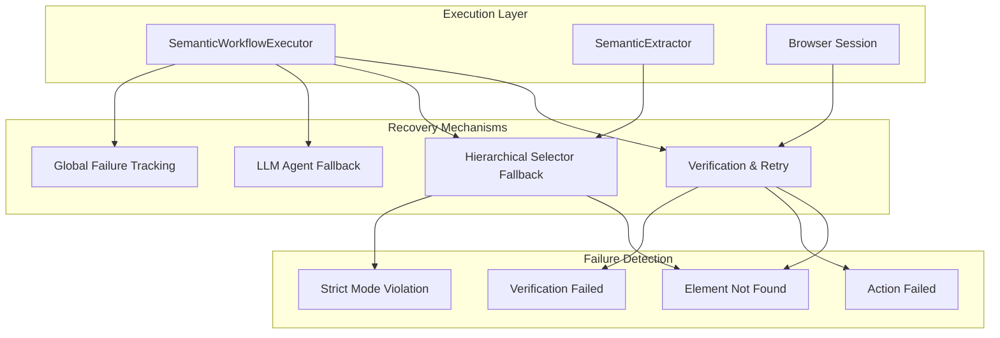
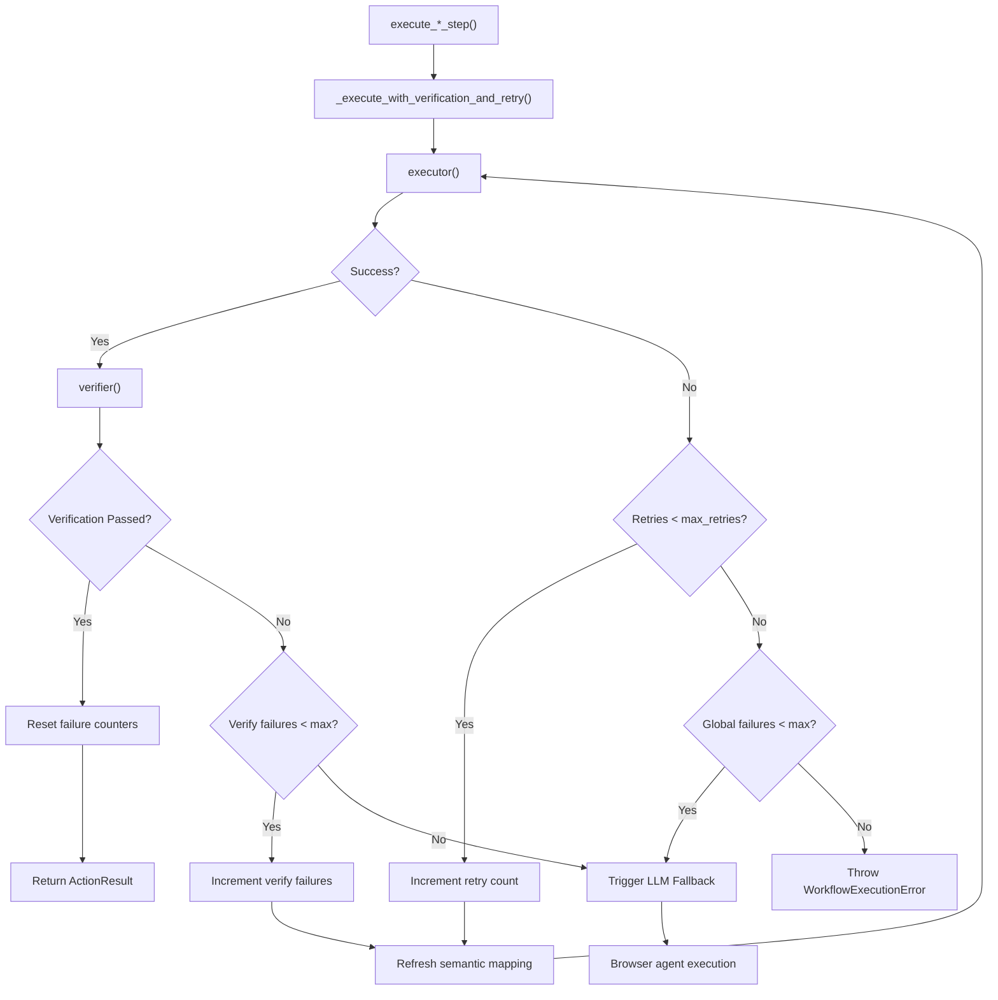
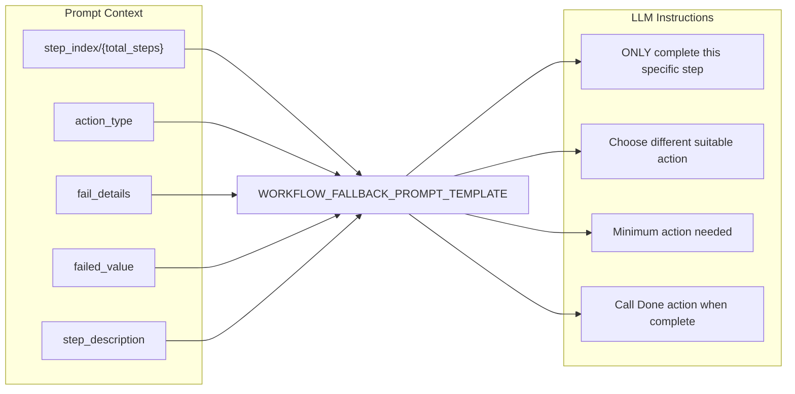
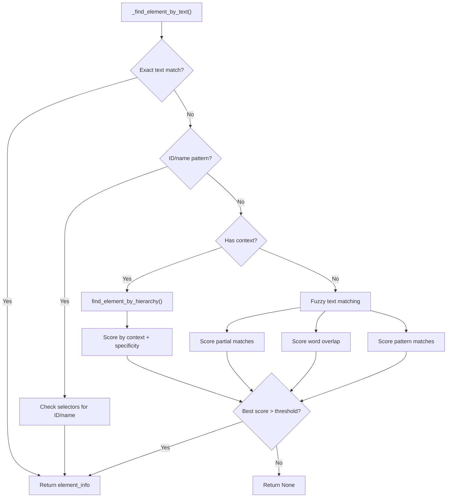
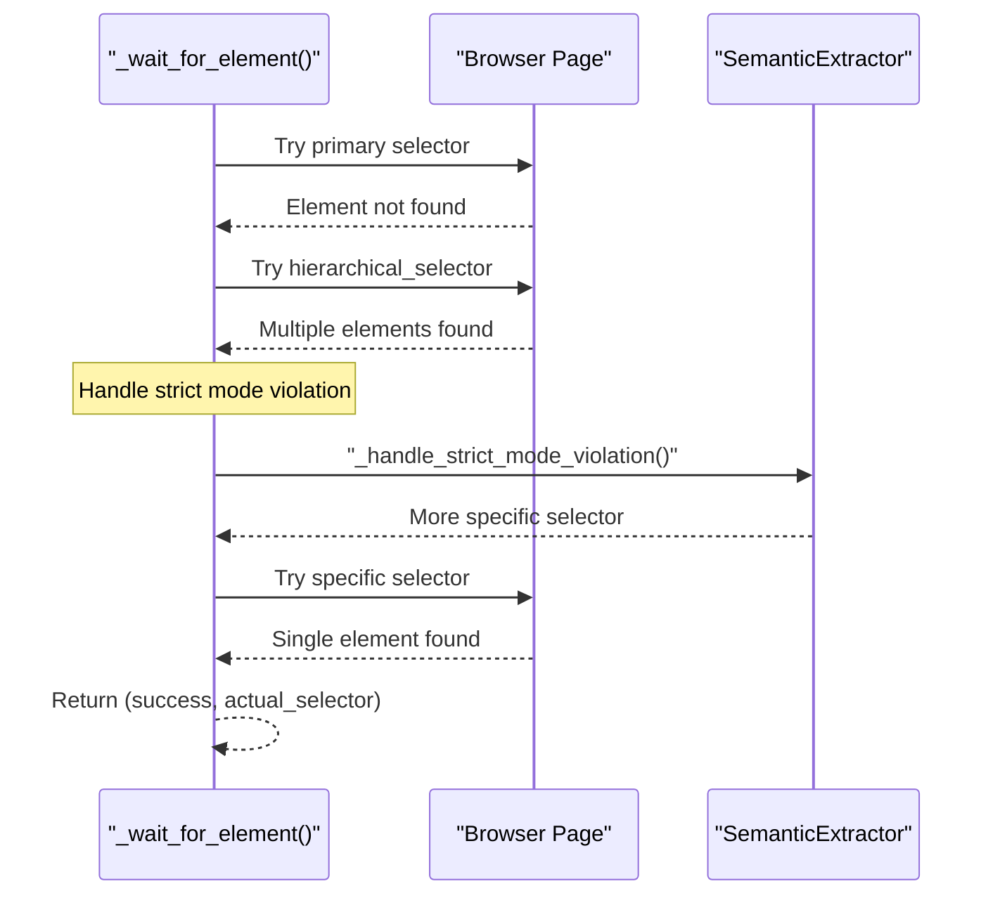
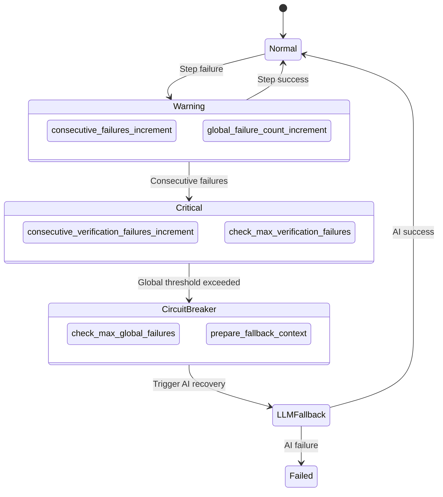
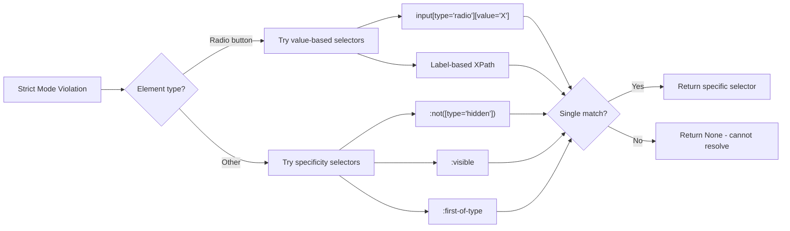

<!-- source: DeepWiki mcp.deepwiki.com · repo browser-use/workflow-use · page 5.3 Error Recovery and Self-Healing · fetched 2026-10-30 -->

# Error Recovery and Self-Healing

Relevant source files

The following files were used as context for generating this wiki page:

- [workflows/backend/api.py](workflows/backend/api.py)
- [workflows/backend/routers.py](workflows/backend/routers.py)
- [workflows/backend/service.py](workflows/backend/service.py)
- [workflows/backend/views.py](workflows/backend/views.py)
- [workflows/cli.py](workflows/cli.py)
- [workflows/workflow_use/recorder/recorder.py](workflows/workflow_use/recorder/recorder.py)
- [workflows/workflow_use/schema/views.py](workflows/workflow_use/schema/views.py)
- [workflows/workflow_use/workflow/prompts.py](workflows/workflow_use/workflow/prompts.py)
- [workflows/workflow_use/workflow/semantic_executor.py](workflows/workflow_use/workflow/semantic_executor.py)
- [workflows/workflow_use/workflow/semantic_extractor.py](workflows/workflow_use/workflow/semantic_extractor.py)
- [workflows/workflow_use/workflow/service.py](workflows/workflow_use/workflow/service.py)
- [workflows/workflow_use/workflow/tests/test_extract.py](workflows/workflow_use/workflow/tests/test_extract.py)

This document covers the sophisticated error recovery and self-healing mechanisms built into workflow-use's execution engine. These systems ensure that workflows remain resilient against UI changes, network issues, and other common failure modes in browser automation.

For information about semantic execution strategies, see [Semantic Execution](#5.1). For details about the underlying workflow structure, see [Workflow Definition Schema](#2.1).

## Overview

The workflow-use system implements multiple layers of error recovery, from element-level fallback selectors to AI-powered step recovery. The `SemanticWorkflowExecutor` coordinates these mechanisms to provide robust automation that can adapt to changing web interfaces.

**Sources:** [workflows/workflow_use/workflow/semantic_executor.py:25-40]()

## Verification and Retry Framework

The core recovery mechanism is implemented through the `_execute_with_verification_and_retry` method, which wraps each workflow step execution with configurable retry logic and post-action verification.

### Retry Configuration

The `SemanticWorkflowExecutor` maintains several failure counters and thresholds:

| Parameter | Default | Purpose |
|-----------|---------|----------|
| `max_retries` | 3 | Maximum retries per step |
| `max_global_failures` | 5 | Circuit breaker for total failures |
| `max_verification_failures` | 3 | Threshold for verification failures |
| `consecutive_failures` | - | Tracks sequential step failures |
| `consecutive_verification_failures` | - | Tracks verification failure patterns |

**Sources:** [workflows/workflow_use/workflow/semantic_executor.py:1046-1141]()

### Step-Specific Verification

Each action type implements its own verification strategy:

- **Navigation:** Validates current URL matches expected destination
- **Click:** Confirms element state changes or page transitions  
- **Input:** Verifies form field values were set correctly
- **Select:** Checks dropdown selection state

**Sources:** [workflows/workflow_use/workflow/semantic_executor.py:1143-1278]()

## LLM-Powered Fallback System

When deterministic step execution fails repeatedly, the system triggers an AI agent to complete the step using natural language understanding of the page content.

### Fallback Trigger Conditions

The LLM fallback activates when:
- Step retries are exhausted (`max_retries` reached)
- Global failure threshold exceeded (`max_global_failures` reached)  
- Verification consistently fails (`max_verification_failures` reached)

### Fallback Prompt Template

The system uses `WORKFLOW_FALLBACK_PROMPT_TEMPLATE` to provide context to the AI agent:

**Sources:** [workflows/workflow_use/workflow/prompts.py:6-21]()

## Hierarchical Selector Fallback

The `SemanticExtractor` provides multiple selector strategies for each element, creating a hierarchy of fallback options when the primary selector fails.

### Selector Hierarchy

1. **Primary Selector:** Optimized CSS selector (ID-based when possible)
2. **Hierarchical Selector:** Context-aware DOM path with positioning
3. **Fallback Selector:** Basic tag-based selector  
4. **XPath Selector:** Text-based XPath as final fallback

**Sources:** [workflows/workflow_use/workflow/semantic_extractor.py:851-997]()

### Element Resolution Strategies

The `_wait_for_element` method attempts selectors in order of preference:

**Sources:** [workflows/workflow_use/workflow/semantic_executor.py:304-334]()

## Global Failure Tracking

The executor maintains global state to detect systematic issues and prevent infinite retry loops.

### Failure State Management

The failure tracking logic resets counters on successful step completion and maintains separate counters for different failure types to enable targeted recovery strategies.

**Sources:** [workflows/workflow_use/workflow/semantic_executor.py:1046-1141]()

## Strict Mode Violation Handling

Playwright's strict mode requires selectors to match exactly one element. The system handles violations through `_handle_strict_mode_violation`:

### Resolution Strategies

1. **Radio Button Specific:** Uses value attributes and label association
2. **Generic Elements:** Attempts specificity improvements with `:not()`, `:visible`, `:first-of-type`
3. **Contextual Refinement:** Adds parent selectors or position-based qualifiers

**Sources:** [workflows/workflow_use/workflow/semantic_executor.py:257-302]()

## Element-Specific Recovery

Different UI elements require specialized recovery approaches based on their interaction patterns.

### Click Element Intelligence

The `_click_element_intelligently` method adapts click strategies based on element type:

| Element Type | Strategy | Fallback |
|--------------|----------|----------|
| Button | Text-based selector matching | Original selector with force |
| Radio/Checkbox | Label clicking → `.check()` → Direct click | Value-based selection |
| Generic | Standard click | Force click |

### Input Element Handling  

Input elements use specialized validation and retry:

- **Radio/Checkbox:** State verification with `.is_checked()`
- **Text Fields:** Value comparison with `.inputValue()`  
- **Select Dropdowns:** Option selection verification

**Sources:** [workflows/workflow_use/workflow/semantic_executor.py:493-651](), [workflows/workflow_use/workflow/semantic_executor.py:781-875]()

This multi-layered approach ensures that workflow-use can adapt to UI changes, handle edge cases, and maintain high success rates even in complex web applications with dynamic content.

---

