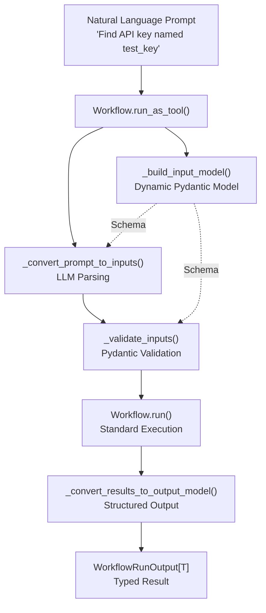
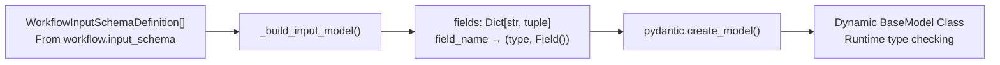
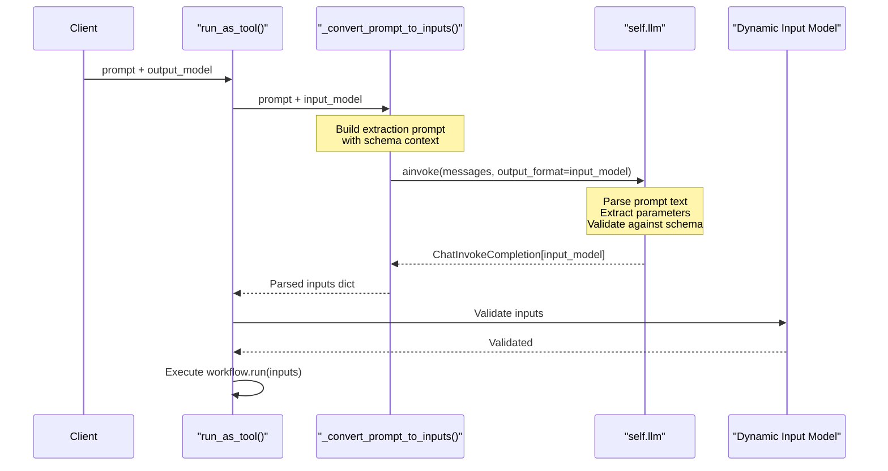
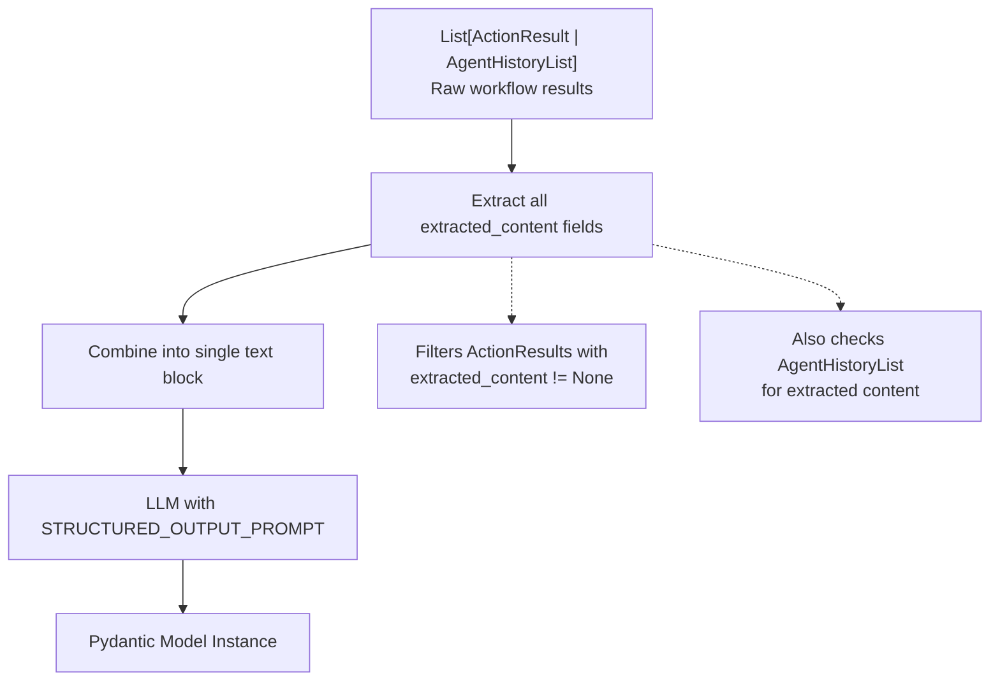
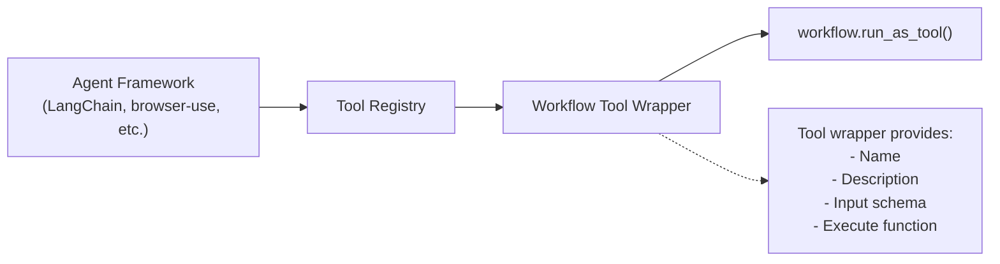
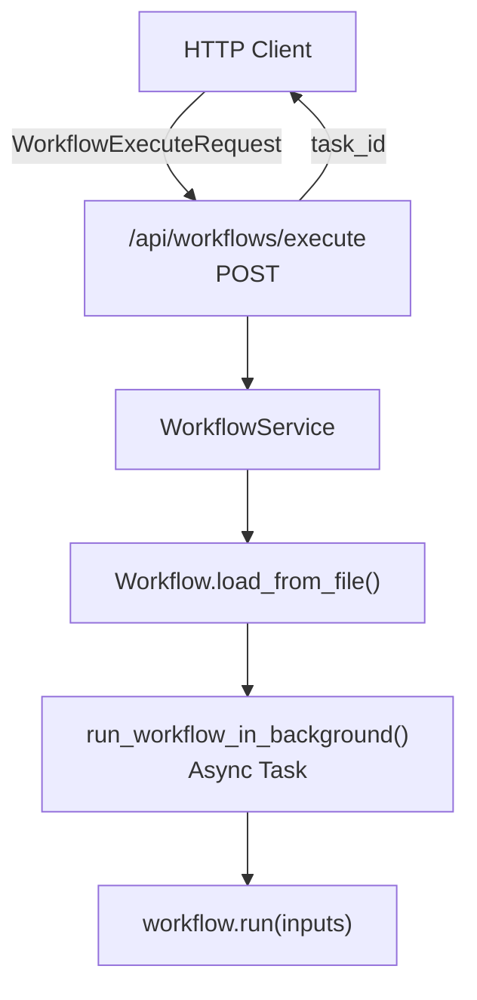

<!-- source: DeepWiki mcp.deepwiki.com · repo browser-use/workflow-use · page 5.4 Running Workflows as Tools · fetched 2026-10-30 -->

# Running Workflows as Tools

<details>
<summary>Relevant source files</summary>

The following files were used as context for generating this wiki page:

- [README.md](README.md)
- [workflows/.gitignore](workflows/.gitignore)
- [workflows/cli.py](workflows/cli.py)
- [workflows/workflow_use/schema/views.py](workflows/workflow_use/schema/views.py)
- [workflows/workflow_use/storage/__init__.py](workflows/workflow_use/storage/__init__.py)
- [workflows/workflow_use/workflow/service.py](workflows/workflow_use/workflow/service.py)

</details>


## Purpose and Scope

This page explains how to execute workflows using natural language prompts instead of structured input parameters. The `run_as_tool()` method enables workflows to function as callable tools within LLM agent systems, automatically parsing natural language descriptions into the workflow's required input schema. This is distinct from standard workflow execution (see [Workflow Execution](#5)) and natural language workflow generation (see [Natural Language Generation](#3.2)).

**Sources:** [workflows/workflow_use/workflow/service.py:1004-1096]()

---

## Overview

The tool-based execution system transforms workflows into LLM-compatible tools that:
- Accept natural language task descriptions as input
- Parse descriptions into structured parameters using LLM reasoning
- Execute the workflow with extracted parameters
- Return results in a specified output model format

This enables workflows to be embedded in agent frameworks, chatbots, or any system where natural language interfaces are required.

**Sources:** [workflows/workflow_use/workflow/service.py:947-1096]()

---

## System Architecture

### High-Level Flow



**Sources:** [workflows/workflow_use/workflow/service.py:1004-1096](), [workflows/workflow_use/workflow/service.py:951-1002](), [workflows/workflow_use/workflow/service.py:722-770]()

---

## Core Components

### Workflow.run_as_tool() Method

The primary entry point for tool-based execution. Orchestrates natural language parsing, input validation, workflow execution, and output conversion.

**Method Signature:**
```python
async def run_as_tool(
    self,
    prompt: str,
    output_model: type[T],
    close_browser_at_end: bool = True
) -> WorkflowRunOutput[T]
```

**Parameters:**

| Parameter | Type | Description |
|-----------|------|-------------|
| `prompt` | `str` | Natural language description of the task |
| `output_model` | `type[T]` | Pydantic model class for structured output |
| `close_browser_at_end` | `bool` | Whether to close browser after execution (default: True) |

**Returns:** `WorkflowRunOutput[T]` containing step results and typed output model instance

**Sources:** [workflows/workflow_use/workflow/service.py:1004-1041]()

---

### Dynamic Input Model Building

The `_build_input_model()` method creates a Pydantic model at runtime from the workflow's input schema definition. This model is used for both LLM-based parsing and runtime validation.



**Type Mapping:**

| Schema Type | Python Type |
|-------------|-------------|
| `"string"` | `str` |
| `"number"` | `float` |
| `"bool"` | `bool` |

**Field Configuration:**

The method processes each `WorkflowInputSchemaDefinition` to generate Pydantic field definitions:
- Converts `required: None` to `Optional[T]` types
- Applies default values when specified
- Adds field descriptions for documentation

**Sources:** [workflows/workflow_use/workflow/service.py:951-1002](), [workflows/workflow_use/schema/views.py:187-210]()

---

## Natural Language to Structured Inputs

### Conversion Process

The `_convert_prompt_to_inputs()` method uses LLM reasoning to extract structured parameters from natural language descriptions.



**LLM Prompt Construction:**

The conversion method constructs a specialized prompt that:
1. Describes the workflow's purpose and input requirements
2. Provides the input schema with field names, types, and descriptions
3. Requests extraction of parameters from the natural language prompt
4. Uses structured output mode to ensure type safety

**Sources:** [workflows/workflow_use/workflow/service.py:1043-1096]()

---

### Extraction Algorithm

**Step 1: Schema Serialization**

The input model schema is converted to a dictionary representation for the LLM:

```python
input_schema_dict = input_model.model_json_schema()
```

This produces a JSON Schema structure describing all required and optional fields.

**Step 2: Context-Aware Prompting**

The system constructs a prompt that includes:
- Workflow name and description from `self.schema.name` and `self.schema.description`
- Complete input schema with field metadata
- The user's natural language prompt
- Instructions to extract parameters and handle missing information

**Step 3: Structured LLM Invocation**

```python
response = await self.llm.ainvoke(
    messages=[
        SystemMessage(content=system_prompt),
        UserMessage(content=user_prompt)
    ],
    output_format=input_model
)
```

The LLM returns a structured response matching the input model schema.

**Step 4: Validation and Error Handling**

If the LLM cannot extract required parameters, it may:
- Return `None` for optional fields
- Use default values if specified in the schema
- Raise validation errors for missing required fields

**Sources:** [workflows/workflow_use/workflow/service.py:1043-1096](), [workflows/workflow_use/workflow/service.py:495-506]()

---

## Input Schema Definition

### WorkflowInputSchemaDefinition

Workflows specify their input parameters using the `input_schema` field in `WorkflowDefinitionSchema`. Each parameter is defined by a `WorkflowInputSchemaDefinition` object.

**Schema Structure:**

| Field | Type | Required | Description |
|-------|------|----------|-------------|
| `name` | `str` | Yes | Property name used as key in inputs dict |
| `type` | `Literal["string", "number", "bool"]` | Yes | Parameter data type |
| `format` | `str` | No | Format hint for string types (e.g., "email", "date") |
| `required` | `bool` | No | `None` for optional, `True` for required |
| `default` | `str \| int \| float \| bool` | No | Default value if not provided |

**Example Input Schema:**

```yaml
input_schema:
  - name: api_key_name
    type: string
    required: true
    description: Name of the API key to search for
  
  - name: max_results
    type: number
    required: null
    default: 10
    description: Maximum number of results to return
```

**Sources:** [workflows/workflow_use/schema/views.py:187-210](), [workflows/workflow_use/workflow/service.py:104-105]()

---

## Output Model Integration

### Structured Output Conversion

After workflow execution, the `_convert_results_to_output_model()` method transforms raw step results into a typed output model.



**Extraction Logic:**

1. **Content Collection**: Iterates through all step results and collects `extracted_content` from:
   - `ActionResult` objects with non-null `extracted_content`
   - `AgentHistoryList` items containing extraction actions

2. **Text Aggregation**: Combines all extracted content into a single text block with newline separators

3. **LLM Parsing**: Invokes LLM with:
   - System prompt: `STRUCTURED_OUTPUT_PROMPT` (guides structured extraction)
   - User content: Combined extracted text
   - Output format: Target Pydantic model class

4. **Type-Safe Return**: Returns validated instance of the output model

**Sources:** [workflows/workflow_use/workflow/service.py:722-770](), [workflows/workflow_use/workflow/prompts.py:23-29]()

---

## Usage Example

### Complete Tool-Based Execution

```python
from browser_use.llm import ChatBrowserUse
from pydantic import BaseModel
from workflow_use.workflow.service import Workflow

# Define output model
class ApiKeyResult(BaseModel):
    api_key: str
    key_name: str

# Load workflow
llm = ChatBrowserUse(model='bu-latest')
workflow = Workflow.load_from_file(
    'extract_api_key.workflow.yaml',
    llm=llm
)

# Execute with natural language prompt
result = await workflow.run_as_tool(
    prompt="Find the API key named 'production_key' from the dashboard",
    output_model=ApiKeyResult
)

# Access typed output
print(result.output_model.api_key)
print(result.output_model.key_name)
```

**Sources:** [workflows/workflow_use/workflow/tests/test_extract.py:1-34]()

---

## Integration Patterns

### Agent Framework Integration

Workflows can be registered as tools in agent frameworks by wrapping `run_as_tool()`:



**Tool Registration Example:**

The workflow's metadata can be used to auto-generate tool definitions:
- **Tool name**: `workflow.schema.name`
- **Tool description**: `workflow.schema.description`
- **Input schema**: `workflow._input_model.model_json_schema()`
- **Execute function**: `workflow.run_as_tool()`

**Sources:** [workflows/workflow_use/workflow/service.py:1004-1096](), [workflows/workflow_use/schema/views.py:216-258]()

---

## Execution Context

### Variable Resolution

When workflows are executed via `run_as_tool()`, the parsed inputs are used for placeholder resolution in workflow steps.

**Context Flow:**

1. **Input Parsing**: Natural language → structured inputs dict
2. **Context Initialization**: `self.context = inputs.copy()` in `run()`
3. **Placeholder Resolution**: `_resolve_placeholders()` replaces `{variable_name}` with context values
4. **Output Storage**: Step results stored back to context via `_store_output()`

**Example Workflow with Variables:**

```yaml
steps:
  - type: navigation
    url: https://example.com/api-keys
  
  - type: input
    target_text: Search
    value: "{api_key_name}"  # Resolved from parsed inputs
  
  - type: extract
    extractionGoal: "Extract the API key for {api_key_name}"
```

**Sources:** [workflows/workflow_use/workflow/service.py:508-585](), [workflows/workflow_use/workflow/service.py:871-876]()

---

## Error Handling

### Validation Failures

The system performs validation at multiple stages:

| Stage | Validation Method | Error Type |
|-------|------------------|------------|
| Input parsing | Pydantic model validation | `ValidationError` |
| Schema validation | `_validate_inputs()` | `ValueError` |
| Workflow execution | Step execution | `RuntimeError` |
| Output conversion | Output model validation | `ValidationError` |

**Input Validation Error Handling:**

```python
try:
    self._input_model(**inputs)
except Exception as e:
    raise ValueError(f'Invalid workflow inputs: {e}') from e
```

When the LLM fails to extract required parameters or provides invalid types, the Pydantic validation will raise descriptive errors indicating which fields are missing or incorrectly formatted.

**Sources:** [workflows/workflow_use/workflow/service.py:495-506]()

---

## Backend API Integration

### Running Workflows as Tools via REST API

The backend service provides HTTP endpoints for workflow execution, including support for natural language inputs.



**Request Structure:**

```python
class WorkflowExecuteRequest(BaseModel):
    name: str              # Workflow filename
    inputs: Dict[str, Any] # Structured inputs
```

**Note:** The backend API currently expects pre-structured inputs. To use natural language prompts, clients must either:
1. Call `run_as_tool()` directly in Python
2. Implement a pre-processing step that calls an LLM to parse the prompt
3. Extend the API to support a `prompt` field that triggers tool-based execution

**Sources:** [workflows/backend/views.py:25-28](), [workflows/backend/routers.py:51-86](), [workflows/backend/service.py:164-230]()

---

## Comparison: run() vs run_as_tool()

| Aspect | `run()` | `run_as_tool()` |
|--------|---------|-----------------|
| **Input Format** | Structured dict matching input schema | Natural language prompt |
| **Input Validation** | Direct Pydantic validation | LLM parsing + validation |
| **Output Format** | `WorkflowRunOutput` with optional output_model | Always requires output_model |
| **Use Case** | Programmatic workflows, CSV bulk execution | Agent integration, chatbots, NL interfaces |
| **Error Handling** | Immediate validation errors | May fail at parsing or validation stage |
| **Performance** | Faster (no LLM parsing overhead) | Slower (requires LLM call for parsing) |

**When to Use run_as_tool():**
- Integrating workflows into agent frameworks
- Building natural language interfaces
- Creating chatbot commands
- Dynamic task execution from user descriptions

**When to Use run():**
- Bulk CSV processing (see [Bulk CSV Execution](#5.5))
- Programmatic automation scripts
- Performance-critical applications
- Known, structured input sources

**Sources:** [workflows/workflow_use/workflow/service.py:851-945](), [workflows/workflow_use/workflow/service.py:1004-1041]()

---

## Best Practices

### Input Schema Design

1. **Clear Field Names**: Use descriptive names that LLMs can easily understand
   - Good: `api_key_name`, `search_query`, `max_results`
   - Avoid: `val`, `x`, `data`

2. **Comprehensive Descriptions**: Add descriptions to guide LLM extraction
   ```yaml
   - name: company_name
     type: string
     required: true
     description: Full legal name of the company to search for
   ```

3. **Appropriate Default Values**: Provide defaults for optional parameters
   ```yaml
   - name: timeout_seconds
     type: number
     default: 30
   ```

4. **Type Specificity**: Use format hints when available
   ```yaml
   - name: email
     type: string
     format: email
   ```

### Output Model Design

1. **Match Extraction Goals**: Design output models that align with workflow extraction steps
2. **Use Nested Models**: For complex outputs, use nested Pydantic models
3. **Optional Fields**: Mark fields as `Optional` if extraction may fail
4. **Field Descriptions**: Add docstrings to guide LLM output parsing

### Performance Optimization

1. **Minimize Parsing Calls**: Cache parsed inputs if executing multiple times
2. **Choose Appropriate LLM**: Use faster models for simple parsing tasks
3. **Provide Examples**: In field descriptions, include example values
4. **Fallback to run()**: For batch processing, parse once then use `run()` repeatedly

**Sources:** [workflows/workflow_use/workflow/service.py:1004-1096](), [workflows/workflow_use/schema/views.py:187-210]()

---

