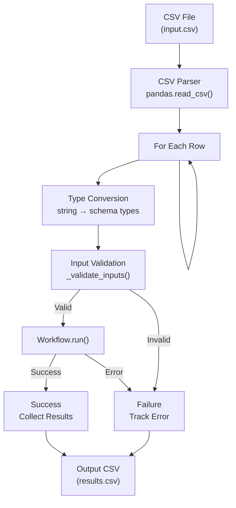
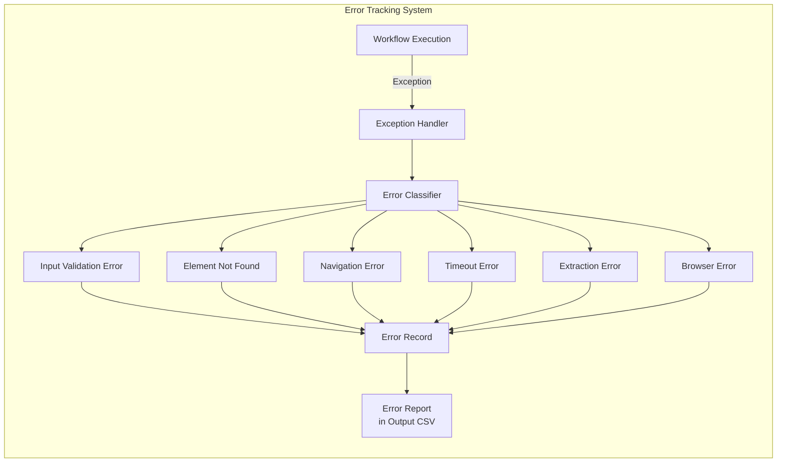
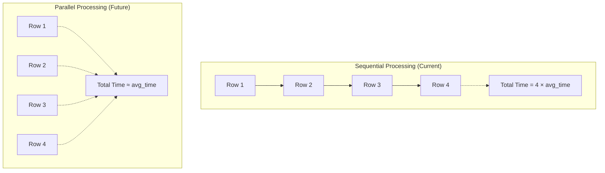

<!-- source: DeepWiki mcp.deepwiki.com · repo browser-use/workflow-use · page 5.5 Bulk CSV Execution · fetched 2026-10-30 -->

# Bulk CSV Execution

<details>
<summary>Relevant source files</summary>

The following files were used as context for generating this wiki page:

- [README.md](README.md)
- [workflows/.gitignore](workflows/.gitignore)
- [workflows/cli.py](workflows/cli.py)
- [workflows/workflow_use/schema/views.py](workflows/workflow_use/schema/views.py)
- [workflows/workflow_use/storage/__init__.py](workflows/workflow_use/storage/__init__.py)
- [workflows/workflow_use/workflow/service.py](workflows/workflow_use/workflow/service.py)

</details>


This page documents the CSV-based bulk workflow execution system, which enables running a single workflow against multiple input datasets in batch mode. This is useful for data processing tasks, automated testing with multiple test cases, and high-throughput workflow execution.

For information about running single workflow instances, see [Workflow Execution](#5). For natural language input parsing, see [Running Workflows as Tools](#5.4).

---

## Overview

Bulk CSV execution allows users to provide a CSV file containing rows of input data, where each row represents a separate workflow execution with different parameters. The system processes each row, executes the workflow with the corresponding inputs, tracks successes and failures, and generates an output CSV with results.

**Key Capabilities:**
- Execute workflows against multiple input datasets from CSV files
- Automatic type conversion and input validation per row
- Individual error tracking and failure analysis per execution
- Consolidated output CSV with execution results and extracted data
- Sequential processing with detailed logging

**Sources:** [cli.py:1-32](), [workflow/service.py:851-945](), Diagram 3 from architecture overview

---

## CSV Input Format

### File Structure

The input CSV file must contain column headers matching the workflow's `input_schema` parameter names. Each row represents one workflow execution instance.

**Example Input CSV:**

| name | email | phone |
|------|-------|-------|
| John Doe | john@example.com | 555-0100 |
| Jane Smith | jane@example.com | 555-0200 |
| Bob Johnson | bob@example.com | 555-0300 |

For a workflow with this `input_schema`:
```yaml
input_schema:
  - name: name
    type: string
    required: true
  - name: email
    type: string
    format: email
    required: true
  - name: phone
    type: string
    required: false
```

**Sources:** [schema/views.py:189-210](), [workflow/service.py:495-506]()

---

## Input Validation and Type Conversion

### Validation Process

Each CSV row undergoes validation against the workflow's input schema before execution:

1. **Column Mapping**: CSV columns are matched to workflow input parameters
2. **Type Conversion**: String values from CSV are converted to the expected types (string, number, bool)
3. **Required Field Checks**: Validates all required fields are present and non-empty
4. **Format Validation**: Applies format constraints (e.g., email format, number ranges)
5. **Default Values**: Applies default values from the schema when fields are empty



**Diagram: CSV Row Processing Pipeline**

The validation is performed by the `_validate_inputs` method, which uses Pydantic models built from the workflow's input schema.

**Sources:** [workflow/service.py:495-506](), [schema/views.py:189-210]()

---

## Execution Workflow

### Sequential Processing

The bulk execution system processes CSV rows sequentially to ensure reliable error tracking and resource management:

```mermaid
graph TB
    subgraph "Bulk CSV Execution"
        Start["Load CSV File"]
        LoadWorkflow["Load Workflow<br/>Workflow.load_from_file()"]
        ParseCSV["Parse CSV<br/>Extract Headers & Rows"]
        ValidateSchema["Validate CSV Columns<br/>vs input_schema"]
        
        LoopStart["For Each Row (i)"]
        PrepareInputs["Prepare Inputs<br/>{col: value}"]
        CreateContext["Create Execution Context<br/>Row #, Timestamp"]
        
        RunWorkflow["workflow.run(inputs)"]
        
        CheckResult{"Success?"}
        ExtractOutput["Extract Output<br/>WorkflowRunOutput"]
        RecordSuccess["Record Success<br/>+ Extracted Data"]
        CaptureError["Capture Error<br/>+ Stack Trace"]
        RecordFailure["Record Failure<br/>+ Error Message"]
        
        NextRow["Next Row"]
        Complete["Generate Output CSV<br/>results + errors"]
    end
    
    Start --> LoadWorkflow
    LoadWorkflow --> ParseCSV
    ParseCSV --> ValidateSchema
    ValidateSchema --> LoopStart
    
    LoopStart --> PrepareInputs
    PrepareInputs --> CreateContext
    CreateContext --> RunWorkflow
    
    RunWorkflow --> CheckResult
    CheckResult -->|Yes| ExtractOutput
    CheckResult -->|No| CaptureError
    
    ExtractOutput --> RecordSuccess
    CaptureError --> RecordFailure
    
    RecordSuccess --> NextRow
    RecordFailure --> NextRow
    NextRow -->|More Rows| LoopStart
    NextRow -->|Done| Complete
```



**Diagram: Sequential CSV Execution Flow**

**Sources:** [workflow/service.py:851-945](), [cli.py]()

---

## CLI Command Interface

### Basic Usage

Execute a workflow with CSV inputs using the `run-workflow-csv` command:

```bash
python cli.py run-workflow-csv <workflow-file> <csv-file> [OPTIONS]
```

**Arguments:**
- `workflow-file`: Path to the workflow definition file (`.json`, `.yaml`, or `.yml`)
- `csv-file`: Path to the CSV file containing input data

**Options:**
- `--output-file`: Path for output CSV file (default: `<csv-file>_results.csv`)
- `--use-cloud`: Use Browser-Use Cloud instead of local browser
- `--no-ai`: Execute workflows in semantic mode without AI
- `--debug`: Enable debug mode with screenshots for each execution
- `--debug-log-folder`: Custom folder for debug logs (default: `./logs/workflow_debug`)

**Example:**

```bash
# Execute workflow with CSV inputs
python cli.py run-workflow-csv \
  examples/contact_form.workflow.yaml \
  data/contacts.csv \
  --output-file results/contacts_results.csv

# Execute in no-AI semantic mode
python cli.py run-workflow-csv \
  examples/form.workflow.yaml \
  data/inputs.csv \
  --no-ai

# Execute with cloud browser and debug mode
python cli.py run-workflow-csv \
  examples/scraping.workflow.yaml \
  data/urls.csv \
  --use-cloud \
  --debug \
  --debug-log-folder ./debug_logs
```

**Sources:** [cli.py:1-54](), [README.md:130-152]()

---

## Error Handling and Failure Analysis

### Per-Row Error Tracking

Each workflow execution is isolated, meaning failures in one row don't affect subsequent rows. The system tracks detailed error information for each failed execution:

**Error Information Captured:**
- Row number from CSV
- Input parameters that caused the failure
- Exception type and error message
- Stack trace for debugging
- Timestamp of failure
- Step at which the workflow failed

**Error Categories:**
1. **Input Validation Errors**: Invalid input data types or missing required fields
2. **Element Not Found**: Selector or semantic target not found on page
3. **Navigation Errors**: Failed to navigate to target URL
4. **Timeout Errors**: Step exceeded timeout threshold
5. **Extraction Errors**: Failed to extract expected data
6. **Browser Errors**: Browser crashed or connection lost



**Diagram: Error Classification and Recording**

**Sources:** [workflow/service.py:630-720](), Error handling patterns in execution flow

---

## Output Format and Result Tracking

### Output CSV Structure

The output CSV contains all input columns plus additional columns for execution status and results:

**Standard Output Columns:**
- `_execution_status`: `SUCCESS` or `FAILED`
- `_error_message`: Error description (if failed)
- `_execution_time`: Time taken to execute workflow (seconds)
- `_row_number`: Original row number from input CSV
- `_timestamp`: ISO timestamp of execution

**Extracted Data Columns:**
- Additional columns for any data extracted by the workflow
- Column names derived from output keys in workflow steps
- Values populated from `extracted_content` in `ActionResult` objects

**Example Output CSV:**

| name | email | phone | _execution_status | _error_message | _execution_time | confirmation_number | status |
|------|-------|-------|-------------------|----------------|-----------------|---------------------|--------|
| John Doe | john@example.com | 555-0100 | SUCCESS | | 12.3 | CONF-12345 | Submitted |
| Jane Smith | jane@example.com | 555-0200 | SUCCESS | | 11.8 | CONF-12346 | Submitted |
| Bob Johnson | bob@example.com | (invalid) | FAILED | Input validation error: invalid phone format | 0.2 | | |

**Sources:** [workflow/service.py:586-628](), Output handling in workflow execution

---

## Programmatic Usage

### Python API

Execute bulk workflows programmatically using the `Workflow` class:

```python
import asyncio
import pandas as pd
from pathlib import Path
from workflow_use import Workflow
from browser_use.llm import ChatBrowserUse

# Load workflow
llm = ChatBrowserUse(model='bu-latest')
workflow = Workflow.load_from_file(
    'examples/form.workflow.yaml',
    llm=llm
)

# Read CSV
csv_data = pd.read_csv('data/inputs.csv')

# Execute for each row
results = []
for index, row in csv_data.iterrows():
    try:
        # Convert row to dict and execute
        inputs = row.to_dict()
        result = await workflow.run(
            inputs=inputs,
            close_browser_at_end=True
        )
        
        # Collect results
        results.append({
            **inputs,
            '_execution_status': 'SUCCESS',
            '_execution_time': result.execution_time,
            # Extract data from workflow output
            **result.extracted_data
        })
        
    except Exception as e:
        # Record failure
        results.append({
            **inputs,
            '_execution_status': 'FAILED',
            '_error_message': str(e)
        })

# Save results
results_df = pd.DataFrame(results)
results_df.to_csv('results/output.csv', index=False)
```

### Batch Processing with Context Manager

```python
from workflow_use import Workflow
from browser_use import Browser

# Share browser instance across executions for efficiency
browser = Browser()
workflow = Workflow.load_from_file(
    'workflow.yaml',
    llm=llm,
    browser=browser
)

async with browser:
    for row in csv_rows:
        result = await workflow.run(
            inputs=row,
            close_browser_at_end=False  # Keep browser open
        )
        # Process result...

# Browser closes when exiting context
```

**Sources:** [workflow/service.py:108-137](), [workflow/service.py:851-945]()

---

## Performance Considerations

### Resource Management

**Browser Instance Management:**
- By default, each workflow execution creates a new browser context
- For bulk operations, consider reusing browser instances (set `close_browser_at_end=False`)
- Monitor memory usage for long-running batch jobs
- Close browser instances periodically to prevent memory leaks

**Execution Time Factors:**
- Number of workflow steps
- Page load times and network latency
- Wait times between steps (configured via `default_wait_time` or per-step `wait_time`)
- Use of AI vs semantic execution mode (semantic is significantly faster)

### Throughput Optimization

**Sequential vs Parallel Execution:**

Currently, the system processes rows sequentially. This design ensures:
- Predictable resource usage
- Clear error attribution
- Simplified debugging
- Consistent browser state

For high-throughput requirements, consider:
- Using semantic execution mode (`--no-ai`) for 10-100x speed improvement
- Running multiple CLI instances with partitioned CSV files
- Using Browser-Use Cloud for distributed execution (`--use-cloud`)



**Diagram: Sequential vs Parallel Execution Patterns**

**Sources:** [workflow/service.py:851-945](), Performance patterns from execution architecture

---

## Best Practices

### CSV Preparation

1. **Validate Headers**: Ensure CSV column names exactly match workflow `input_schema` parameter names
2. **Handle Missing Data**: Use empty strings for optional fields or provide defaults in the workflow schema
3. **Escape Special Characters**: Properly escape commas, quotes, and newlines in CSV values
4. **Use Consistent Encoding**: UTF-8 encoding is recommended for international characters
5. **Pre-validate Data**: Run validation scripts before bulk execution to catch data quality issues

### Error Recovery

1. **Checkpoint Progress**: For large CSV files, split into smaller batches and process incrementally
2. **Retry Failed Rows**: Extract failed rows from output CSV and retry with corrected data
3. **Monitor Execution**: Use debug mode for the first few rows to verify workflow correctness
4. **Log Analysis**: Review error messages to identify common failure patterns

### Workflow Design for Bulk Execution

1. **Idempotency**: Design workflows to be safely re-runnable without side effects
2. **Semantic Targeting**: Use `target_text` instead of CSS selectors for better reliability across executions
3. **Explicit Waits**: Configure appropriate `wait_time` values to ensure page stability
4. **Output Keys**: Define clear output keys in workflow steps to structure extracted data
5. **Verification**: Enable verification checks to validate successful execution

**Sources:** [schema/views.py:30-61](), [workflow/service.py:138-283](), Best practices from workflow execution patterns

---

## Failure Analysis and Debugging

### Analyzing Output CSV

The output CSV provides comprehensive information for debugging failures:

```python
import pandas as pd

# Load results
results = pd.read_csv('results/output.csv')

# Identify failures
failures = results[results['_execution_status'] == 'FAILED']

# Group by error type
error_summary = failures.groupby('_error_message').size()
print(f"Error distribution:\n{error_summary}")

# Extract failed rows for retry
failed_inputs = failures[['name', 'email', 'phone']]
failed_inputs.to_csv('retry_inputs.csv', index=False)
```

### Debug Mode

Enable debug mode to capture screenshots at each step:

```bash
python cli.py run-workflow-csv \
  workflow.yaml \
  data.csv \
  --debug \
  --debug-log-folder ./debug_logs
```

Debug screenshots are saved with naming pattern:
```
step_01_before_<description>_<timestamp>.png
step_01_after_<description>_<timestamp>.png
step_01_error_<description>_<timestamp>.png
```

**Sources:** [workflow/service.py:810-849](), Debug functionality in workflow execution

---

## Future Enhancements

### Planned Features

1. **Parallel Execution**: Process multiple rows concurrently with configurable parallelism
2. **Streaming Results**: Write results to output CSV as each execution completes
3. **Resume from Checkpoint**: Resume interrupted bulk executions from last successful row
4. **Dynamic Batching**: Automatically partition large CSV files for optimal processing
5. **Progress Callbacks**: Real-time progress updates via callback functions
6. **Distributed Execution**: Submit bulk jobs to cloud workers for high-throughput processing

**Sources:** Architecture patterns and future roadmap considerations

---

