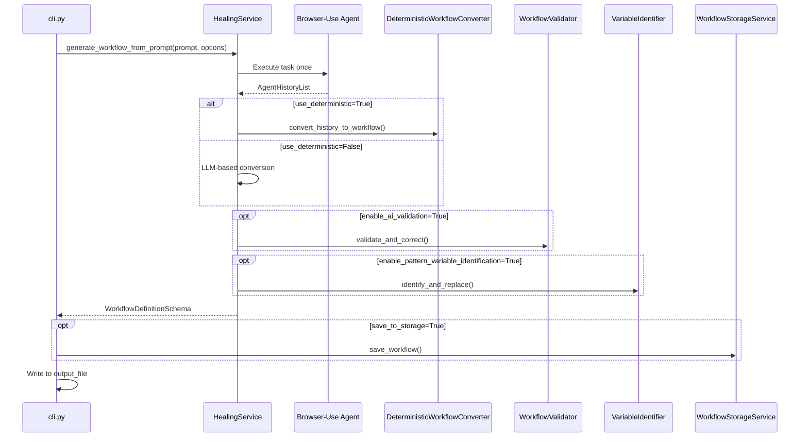
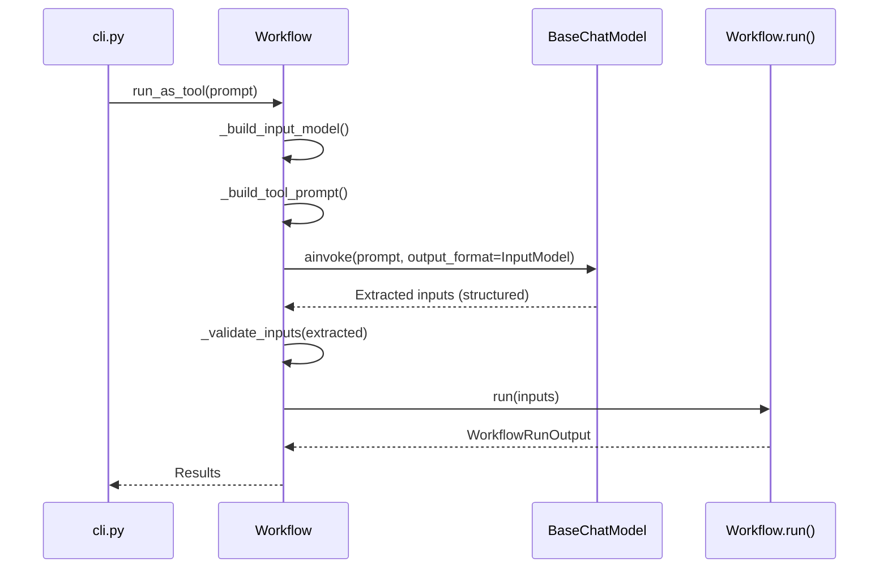
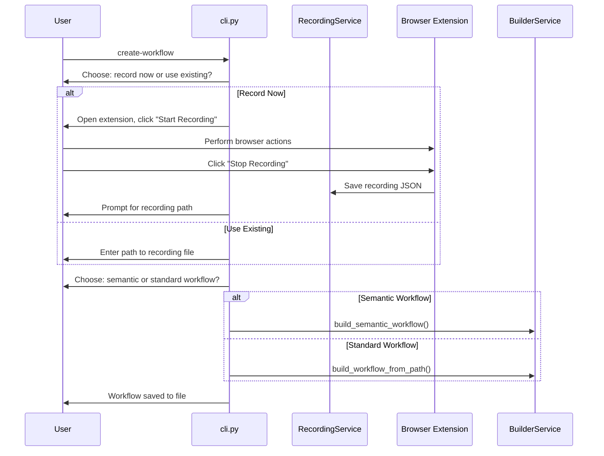
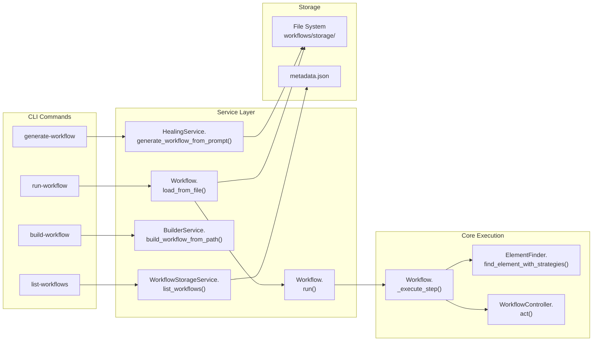

<!-- source: DeepWiki mcp.deepwiki.com · repo browser-use/workflow-use · page 6 Command Line Interface · fetched 2026-10-30 -->

# Command Line Interface

<details>
<summary>Relevant source files</summary>

The following files were used as context for generating this wiki page:

- [README.md](README.md)
- [workflows/.gitignore](workflows/.gitignore)
- [workflows/cli.py](workflows/cli.py)
- [workflows/workflow_use/schema/views.py](workflows/workflow_use/schema/views.py)
- [workflows/workflow_use/storage/__init__.py](workflows/workflow_use/storage/__init__.py)
- [workflows/workflow_use/workflow/service.py](workflows/workflow_use/workflow/service.py)

</details>


The Command Line Interface (CLI) serves as the primary programmatic interface for the workflow-use system. It provides commands for generating workflows from natural language, recording browser interactions, executing workflows, and managing stored workflows. The CLI is implemented using the Typer library and orchestrates calls to underlying services for workflow generation, execution, and storage.

For information about the Web UI interface, see [Web Interface](#7). For details on workflow execution without the CLI, see [Workflow Execution](#5). For programmatic API usage, see [Backend API](#7.1).

---

## CLI Architecture and Service Integration

The CLI acts as a thin orchestration layer that delegates to specialized services. Understanding this architecture helps clarify command purpose and data flow.

### CLI Command to Service Mapping

```mermaid
graph TB
    CLI["cli.py<br/>Typer Application"]
    
    subgraph "Generation Commands"
        GEN["generate-workflow"]
        GEN_BATCH["generate-workflow-batch"]
    end
    
    subgraph "Execution Commands"
        RUN["run-workflow"]
        RUN_TOOL["run-as-tool"]
        RUN_CSV["run-workflow-csv"]
        RUN_STORED["run-stored-workflow"]
        RUN_NO_AI["run-workflow-no-ai"]
    end
    
    subgraph "Recording Commands"
        CREATE["create-workflow"]
        BUILD["build-workflow"]
        BUILD_SEM["build-semantic-workflow"]
    end
    
    subgraph "Management Commands"
        LIST["list-workflows"]
        INFO["workflow-info"]
        DELETE["delete-workflow"]
    end
    
    subgraph "UI Commands"
        LAUNCH["launch-gui"]
        MCP["serve-mcp"]
    end
    
    subgraph "Services"
        HEAL[HealingService]
        WORKFLOW[Workflow]
        BUILDER[BuilderService]
        REC[RecordingService]
        STORAGE[WorkflowStorageService]
    end
    
    subgraph "External Systems"
        GUI_BE["backend.api<br/>FastAPI Server"]
        GUI_FE["ui/<br/>React Frontend"]
        MCP_SERVER["mcp.service<br/>MCP Server"]
    end
    
    CLI --> GEN
    CLI --> GEN_BATCH
    CLI --> RUN
    CLI --> RUN_TOOL
    CLI --> RUN_CSV
    CLI --> RUN_STORED
    CLI --> RUN_NO_AI
    CLI --> CREATE
    CLI --> BUILD
    CLI --> BUILD_SEM
    CLI --> LIST
    CLI --> INFO
    CLI --> DELETE
    CLI --> LAUNCH
    CLI --> MCP
    
    GEN --> HEAL
    GEN_BATCH --> HEAL
    RUN --> WORKFLOW
    RUN_TOOL --> WORKFLOW
    RUN_CSV --> WORKFLOW
    RUN_STORED --> WORKFLOW
    RUN_STORED --> STORAGE
    RUN_NO_AI --> WORKFLOW
    CREATE --> REC
    CREATE --> BUILDER
    BUILD --> BUILDER
    BUILD_SEM --> BUILDER
    LIST --> STORAGE
    INFO --> STORAGE
    DELETE --> STORAGE
    LAUNCH --> GUI_BE
    LAUNCH --> GUI_FE
    MCP --> MCP_SERVER
    
    HEAL --> STORAGE
    WORKFLOW --> STORAGE
    BUILDER --> STORAGE
```



**Sources:** [workflows/cli.py:1-100](), [workflows/workflow_use/workflow/service.py:39-106]()

---

## Installation and Setup

Before using the CLI, ensure the environment is properly configured:

```bash
# Clone repository
git clone https://github.com/browser-use/workflow-use
cd workflow-use/workflows

# Install dependencies
uv sync
source .venv/bin/activate  # Mac/Linux
# or
.venv\Scripts\activate  # Windows

# Install browser drivers
playwright install chromium

# Configure environment
cp .env.example .env
# Edit .env to add API keys:
# - OPENAI_API_KEY or other LLM provider keys
# - BROWSER_USE_API_KEY (optional, for cloud browser)
```

The CLI automatically initializes service instances with the default LLM configuration at module load time [workflows/cli.py:34-53](). If LLM initialization fails, it prompts for API key configuration interactively.

**Sources:** [README.md:108-128](), [workflows/cli.py:34-53]()

---

## Command Categories

### Workflow Generation Commands

These commands create new workflows using AI-driven generation or deterministic conversion.

#### `generate-workflow`

Generates a reusable workflow from a natural language task description. The system executes the task once using a browser-use agent, then converts the execution history into a semantic workflow stored in the database.

**Syntax:**
```bash
python cli.py generate-workflow "TASK_DESCRIPTION" [OPTIONS]
```

**Options:**

| Option | Type | Default | Description |
|--------|------|---------|-------------|
| `--agent-model` | str | `gpt-4o-mini` | LLM model for agent execution |
| `--extraction-model` | str | `gpt-4o-mini` | LLM model for page extraction |
| `--workflow-model` | str | `gpt-4o` | LLM model for workflow conversion |
| `--use-deterministic` | bool | `True` | Use deterministic converter (no LLM) |
| `--use-cloud` | bool | `False` | Use Browser-Use cloud browser |
| `--max-steps` | int | `20` | Maximum agent steps |
| `--output-file` | Path | None | Save to custom path |
| `--no-save-to-storage` | flag | - | Skip database storage |
| `--enable-ai-validation` | bool | `True` | Validate workflow with LLM |
| `--enable-pattern-variable-identification` | bool | `True` | Auto-detect variables |

**Examples:**

```bash
# Basic generation with defaults
python cli.py generate-workflow "Search GitHub for browser-use stars"

# Custom models for cost optimization
python cli.py generate-workflow "Fill contact form" \
  --agent-model "gpt-4.1-mini" \
  --workflow-model "gpt-4o"

# Cloud browser with custom output
python cli.py generate-workflow "Extract product prices" \
  --use-cloud \
  --output-file ./workflows/product_scraper.workflow.yaml

# Skip validation and variable detection for speed
python cli.py generate-workflow "Simple navigation task" \
  --enable-ai-validation false \
  --enable-pattern-variable-identification false
```

**Internal Flow:**



**Sources:** [workflows/cli.py:1291-1443](), [workflows/workflow_use/healing/service.py:1-100]()

---

#### `generate-workflow-batch`

Generates multiple workflows from a JSON batch file containing multiple task descriptions. Useful for bulk workflow creation.

**Syntax:**
```bash
python cli.py generate-workflow-batch BATCH_FILE [OPTIONS]
```

**Batch File Format:**
```json
{
  "workflows": [
    {
      "name": "search_github",
      "prompt": "Search GitHub for browser-use stars",
      "description": "Search workflow for GitHub stats"
    },
    {
      "name": "fill_form",
      "prompt": "Fill contact form on example.com",
      "description": "Contact form automation"
    }
  ]
}
```

**Options:** Inherits all options from `generate-workflow` command.

**Sources:** [workflows/cli.py:1446-1577]()

---

### Workflow Execution Commands

These commands execute existing workflows with various input modes.

#### `run-workflow`

Executes a workflow file with predefined input variables. Prompts for required inputs interactively or accepts them via command-line flags.

**Syntax:**
```bash
python cli.py run-workflow WORKFLOW_PATH [OPTIONS]
```

**Options:**

| Option | Type | Default | Description |
|--------|------|---------|-------------|
| `--use-cloud` | bool | `False` | Use Browser-Use cloud browser |
| `--debug` | bool | `False` | Enable debug mode with screenshots |
| `--debug-log-folder` | Path | `./logs/workflow_debug` | Custom debug output directory |
| `--step-wait-time` | float | `0.1` | Seconds to wait between steps |
| `--close-browser` | bool | `True` | Close browser after execution |

**Interactive Input Flow:**

When executed, the command:
1. Loads workflow from file using `Workflow.load_from_file()` [workflows/workflow_use/workflow/service.py:108-136]()
2. Parses `input_schema` from workflow definition
3. Prompts for each required input variable
4. Validates inputs against schema
5. Executes workflow using `Workflow.run()` [workflows/workflow_use/workflow/service.py:851-945]()
6. Displays execution results

**Examples:**

```bash
# Basic execution with interactive prompts
python cli.py run-workflow examples/form_filler.workflow.yaml

# Debug mode with custom screenshot folder
python cli.py run-workflow examples/scraper.workflow.yaml \
  --debug \
  --debug-log-folder ./debug_screenshots

# Cloud browser with custom step timing
python cli.py run-workflow examples/multi_page.workflow.yaml \
  --use-cloud \
  --step-wait-time 2.0

# Keep browser open after execution
python cli.py run-workflow examples/manual_check.workflow.yaml \
  --close-browser false
```

**Debug Mode Output:**

When `--debug` is enabled, the system captures screenshots at these points:
- Before each step execution: `step_01_before_description_timestamp.png`
- After successful step: `step_01_after_description_timestamp.png`
- On step error: `step_01_error_description_timestamp.png`

Screenshot capture logic is implemented in `Workflow._capture_debug_screenshot()` [workflows/workflow_use/workflow/service.py:810-849]().

**Sources:** [workflows/cli.py:1580-1670](), [workflows/workflow_use/workflow/service.py:851-945]()

---

#### `run-as-tool`

Executes a workflow using natural language prompt for input extraction. An LLM analyzes the prompt and extracts values for workflow input variables automatically.

**Syntax:**
```bash
python cli.py run-as-tool WORKFLOW_PATH --prompt "NATURAL_LANGUAGE_PROMPT" [OPTIONS]
```

**Options:**

| Option | Type | Required | Description |
|--------|------|----------|-------------|
| `--prompt` | str | Yes | Natural language description containing inputs |
| `--use-cloud` | bool | No | Use Browser-Use cloud browser |
| `--debug` | bool | No | Enable debug mode |

**Examples:**

```bash
# Extract inputs from prompt automatically
python cli.py run-as-tool examples/form_filler.workflow.yaml \
  --prompt "Fill the form with name John Doe, email john@example.com, and phone 555-1234"

# Complex extraction with cloud browser
python cli.py run-as-tool examples/job_application.workflow.yaml \
  --prompt "Apply to software engineer position with 5 years Python experience, located in San Francisco" \
  --use-cloud
```

**Input Extraction Mechanism:**

The command delegates to `Workflow.run_as_tool()` [workflows/workflow_use/workflow/service.py:971-1051]() which:
1. Builds a dynamic Pydantic model from `input_schema`
2. Creates a tool description with input requirements
3. Invokes LLM with structured output to extract inputs
4. Validates extracted inputs against schema
5. Executes workflow with extracted inputs



**Sources:** [workflows/cli.py:1673-1740](), [workflows/workflow_use/workflow/service.py:971-1051]()

---

#### `run-workflow-csv`

Bulk execution of workflows with inputs from a CSV file. Processes multiple rows in parallel and aggregates results.

**Syntax:**
```bash
python cli.py run-workflow-csv WORKFLOW_PATH CSV_PATH [OPTIONS]
```

**CSV Format Requirements:**
- Column names must match workflow `input_schema` field names
- Each row represents one workflow execution
- Values are automatically type-coerced per schema

**Options:**

| Option | Type | Default | Description |
|--------|------|---------|-------------|
| `--output-csv` | Path | Auto-generated | Output file for results |
| `--max-workers` | int | `5` | Parallel execution workers |
| `--use-cloud` | bool | `False` | Use cloud browser |
| `--continue-on-error` | bool | `True` | Continue if individual rows fail |

**Example CSV:**

```csv
name,email,phone
John Doe,john@example.com,555-1234
Jane Smith,jane@example.com,555-5678
Bob Johnson,bob@example.com,555-9012
```

**Execution:**

```bash
python cli.py run-workflow-csv examples/form_filler.workflow.yaml contacts.csv \
  --output-csv results.csv \
  --max-workers 10
```

**Output CSV Format:**

```csv
name,email,phone,execution_status,execution_result,error_message
John Doe,john@example.com,555-1234,success,"{""submitted"": true}",
Jane Smith,jane@example.com,555-5678,success,"{""submitted"": true}",
Bob Johnson,bob@example.com,555-9012,error,,Element not found: submit button
```

**Implementation Details:**

The command uses `asyncio.gather()` with a semaphore to limit concurrency [workflows/cli.py:1743-1892](). Each row:
1. Creates isolated `Workflow` instance
2. Executes asynchronously
3. Captures success/error state
4. Appends results to output CSV

**Sources:** [workflows/cli.py:1743-1892]()

---

#### `run-stored-workflow`

Executes a workflow from the storage database by ID. Supports both interactive input and prompt-based extraction.

**Syntax:**
```bash
python cli.py run-stored-workflow WORKFLOW_ID [OPTIONS]
```

**Options:**

| Option | Type | Description |
|--------|------|-------------|
| `--prompt` | str | Natural language prompt for input extraction |
| `--use-cloud` | bool | Use cloud browser |
| `--debug` | bool | Enable debug mode |

**Examples:**

```bash
# Interactive inputs
python cli.py run-stored-workflow abc123def

# Prompt-based extraction
python cli.py run-stored-workflow abc123def \
  --prompt "Search for Python tutorials on YouTube"

# Cloud browser execution
python cli.py run-stored-workflow abc123def \
  --use-cloud \
  --prompt "Find latest AI research papers"
```

**Workflow Retrieval:**

The command uses `WorkflowStorageService.get_workflow()` [workflows/workflow_use/storage/service.py:1-100]() to load the workflow file from `workflows/storage/workflows/{id}.workflow.yaml`.

**Sources:** [workflows/cli.py:1895-1985]()

---

#### `run-workflow-no-ai`

Executes a workflow in semantic-only mode without any LLM calls. Uses pure text-based element matching for maximum speed and cost efficiency.

**Syntax:**
```bash
python cli.py run-workflow-no-ai WORKFLOW_PATH [OPTIONS]
```

**Requirements:**
- Workflow must have `target_text` fields for all interactive steps
- Steps cannot include `agent` type (agentic steps)
- Recommended for production workflows after testing

**Options:**

| Option | Type | Description |
|--------|------|-------------|
| `--use-cloud` | bool | Use cloud browser (recommended) |
| `--debug` | bool | Enable debug mode |

**Examples:**

```bash
# Pure semantic execution
python cli.py run-workflow-no-ai examples/semantic_form.workflow.yaml

# Cloud browser for cost savings
python cli.py run-workflow-no-ai examples/semantic_form.workflow.yaml \
  --use-cloud
```

**Execution Mode:**

Delegates to `Workflow.run_with_no_ai()` [workflows/workflow_use/workflow/service.py:1054-1244]() which:
1. Validates all steps have semantic targeting (`target_text`)
2. Uses `SemanticWorkflowExecutor` for element finding
3. Falls back to `selectorStrategies` if available
4. Raises errors immediately if element not found (no agent fallback)

**Sources:** [workflows/cli.py:1988-2055](), [workflows/workflow_use/workflow/service.py:1054-1244]()

---

### Recording Commands

These commands facilitate manual workflow creation through browser recording.

#### `create-workflow`

Interactive command that guides users through recording browser interactions and building a workflow.

**Syntax:**
```bash
python cli.py create-workflow
```

**Interactive Flow:**



**Recording File Format:**

The browser extension generates JSON files with this structure:
```json
{
  "name": "Recorded Workflow",
  "steps": [
    {
      "type": "navigation",
      "url": "https://example.com",
      "timestamp": 1234567890
    },
    {
      "type": "click",
      "cssSelector": "button.submit",
      "target_text": "Submit",
      "semanticInfo": {...},
      "timestamp": 1234567895
    }
  ]
}
```

**Sources:** [workflows/cli.py:861-978]()

---

#### `build-workflow`

Builds a workflow from an existing recording file without interactive prompts. Useful for batch processing or automation.

**Syntax:**
```bash
python cli.py build-workflow RECORDING_PATH [OPTIONS]
```

**Options:**

| Option | Type | Description |
|--------|------|-------------|
| `--description` | str | Workflow description |
| `--output-dir` | Path | Output directory for workflow file |
| `--workflow-name` | str | Custom filename for workflow |

**Examples:**

```bash
# Basic build
python cli.py build-workflow recordings/my_recording.json \
  --description "Contact form submission"

# Custom output location
python cli.py build-workflow recordings/my_recording.json \
  --description "Product search workflow" \
  --output-dir ./production_workflows \
  --workflow-name product_search.workflow.yaml
```

**Sources:** [workflows/cli.py:981-1086]()

---

#### `build-semantic-workflow`

Builds a semantic workflow (using `target_text` instead of CSS selectors) from a recording file.

**Syntax:**
```bash
python cli.py build-semantic-workflow RECORDING_PATH [OPTIONS]
```

**Options:**

| Option | Type | Default | Description |
|--------|------|---------|-------------|
| `--description` | str | Required | Workflow description |
| `--output-dir` | Path | `./tmp` | Output directory |
| `--workflow-name` | str | Auto | Custom filename |
| `--simulate-interactions` | bool | `False` | Simulate interactions during conversion |
| `--auto-fix-navigation` | bool | `False` | Auto-detect missing navigation steps |

**Examples:**

```bash
# Basic semantic build
python cli.py build-semantic-workflow recordings/form_fill.json \
  --description "Semantic form filler"

# With auto-fix for multi-page forms
python cli.py build-semantic-workflow recordings/multi_step.json \
  --description "Multi-page application" \
  --auto-fix-navigation
```

**Semantic Conversion Process:**

The command uses helper functions to:
1. Filter redundant click events [workflows/cli.py:525-615]()
2. Extract semantic mapping from pages [workflows/cli.py:380-523]()
3. Convert steps to semantic format [workflows/cli.py:687-793]()
4. Optionally fix missing navigation steps [workflows/cli.py:245-378]()

**Sources:** [workflows/cli.py:1089-1190]()

---

### Workflow Management Commands

These commands interact with the workflow storage database.

#### `list-workflows`

Lists all workflows stored in the database with filtering options.

**Syntax:**
```bash
python cli.py list-workflows [OPTIONS]
```

**Options:**

| Option | Type | Description |
|--------|------|---------|
| `--generation-mode` | str | Filter by mode: `browser_use`, `recording`, `manual` |
| `--limit` | int | Maximum workflows to display |
| `--sort-by` | str | Sort field: `created_at`, `name`, `version` |

**Examples:**

```bash
# List all workflows
python cli.py list-workflows

# Filter by generation mode
python cli.py list-workflows --generation-mode browser_use

# Limit and sort
python cli.py list-workflows --limit 10 --sort-by created_at
```

**Output Format:**

```
ID: abc123def
Name: GitHub Star Search
Description: Search for repository stars on GitHub
Version: 1.0
Generation Mode: browser_use
Created: 2024-01-15 14:30:00
Steps: 5
Inputs: search_query
─────────────────────────────────────────────
```

**Sources:** [workflows/cli.py:1193-1243]()

---

#### `workflow-info`

Displays detailed information about a specific workflow.

**Syntax:**
```bash
python cli.py workflow-info WORKFLOW_ID
```

**Example:**

```bash
python cli.py workflow-info abc123def
```

**Output Includes:**
- Metadata (name, version, description)
- Generation mode and original task
- Input schema with types and requirements
- Output schema if defined
- Step count and step summaries
- File path and size
- Creation and modification timestamps

**Sources:** [workflows/cli.py:1246-1288]()

---

#### `delete-workflow`

Permanently removes a workflow from storage.

**Syntax:**
```bash
python cli.py delete-workflow WORKFLOW_ID [--force]
```

**Options:**

| Option | Type | Description |
|--------|------|-------------|
| `--force` | flag | Skip confirmation prompt |

**Examples:**

```bash
# With confirmation
python cli.py delete-workflow abc123def

# Skip confirmation
python cli.py delete-workflow abc123def --force
```

**Safety:**

Without `--force`, the command displays workflow details and prompts for confirmation before deletion.

**Sources:** [workflows/cli.py:2058-2104]()

---

### UI and Server Commands

#### `launch-gui`

Launches both the FastAPI backend server and React frontend development server, automatically opening the browser to the UI.

**Syntax:**
```bash
python cli.py launch-gui [OPTIONS]
```

**Options:**

| Option | Type | Default | Description |
|--------|------|---------|-------------|
| `--backend-port` | int | `8000` | FastAPI server port |
| `--frontend-port` | int | `5173` | Vite dev server port |
| `--no-browser` | flag | - | Don't open browser automatically |

**Process Management:**

The command:
1. Starts `uvicorn backend.api:app --reload` in subprocess
2. Starts `npm run dev` in ui/ directory in subprocess
3. Polls servers for readiness
4. Opens http://localhost:5173 in default browser
5. Redirects logs to `./tmp/logs/backend.log` and `./tmp/logs/frontend.log`
6. Handles Ctrl+C to gracefully shut down both servers

**Examples:**

```bash
# Default ports
python cli.py launch-gui

# Custom ports without auto-opening browser
python cli.py launch-gui \
  --backend-port 9000 \
  --frontend-port 3000 \
  --no-browser
```

**Sources:** [workflows/cli.py:2107-2256]()

---

#### `serve-mcp`

Starts the Model Context Protocol (MCP) server, exposing workflows as tools for LLM agents.

**Syntax:**
```bash
python cli.py serve-mcp [OPTIONS]
```

**Options:**

| Option | Type | Default | Description |
|--------|------|---------|-------------|
| `--transport` | str | `stdio` | Transport mode: `stdio` or `sse` |
| `--port` | int | `8001` | Port for SSE transport |

**Examples:**

```bash
# STDIO transport (for Claude Desktop)
python cli.py serve-mcp

# SSE transport for web integration
python cli.py serve-mcp --transport sse --port 8080
```

**MCP Integration:**

The command delegates to `get_mcp_server()` [workflows/workflow_use/mcp/service.py:1-100]() which:
1. Scans workflow storage for all workflows
2. Dynamically creates MCP tools for each workflow
3. Exposes tool interface via specified transport
4. Handles tool invocation by executing workflows

**Sources:** [workflows/cli.py:2259-2310]()

---

## Common CLI Patterns

### Command Chaining for Complete Workflows

```bash
# Generate → List → Execute workflow
python cli.py generate-workflow "Search GitHub repositories" \
  --output-file ./workflows/github_search.workflow.yaml

python cli.py list-workflows --generation-mode browser_use

python cli.py run-stored-workflow abc123def \
  --prompt "Find Vue.js repositories"
```

### Debug and Development Pattern

```bash
# Record with extension → Build semantic → Test with debug
python cli.py create-workflow  # Record in browser

python cli.py build-semantic-workflow ./tmp/recording.json \
  --description "Test workflow" \
  --auto-fix-navigation

python cli.py run-workflow ./tmp/test.workflow.yaml \
  --debug \
  --debug-log-folder ./debug_output
```

### Production Deployment Pattern

```bash
# Generate → Validate → Run without AI → CSV bulk execution
python cli.py generate-workflow "Process customer applications" \
  --enable-ai-validation true

python cli.py run-workflow-no-ai ./workflows/application.workflow.yaml

python cli.py run-workflow-csv ./workflows/application.workflow.yaml \
  customers.csv \
  --output-csv results.csv \
  --max-workers 20 \
  --use-cloud
```

**Sources:** General patterns observed across [workflows/cli.py:1-2500]()

---

## Environment Variables and Configuration

The CLI respects these environment variables:

| Variable | Purpose | Default |
|----------|---------|---------|
| `OPENAI_API_KEY` | OpenAI LLM access | Required |
| `ANTHROPIC_API_KEY` | Anthropic LLM access | Optional |
| `BROWSER_USE_API_KEY` | Cloud browser access | Optional |
| `WORKFLOW_STORAGE_PATH` | Storage directory | `./workflows/storage` |
| `DEFAULT_LLM_MODEL` | Default model for commands | `gpt-4o-mini` |

**LLM Initialization:**

The CLI initializes LLM instances at module load [workflows/cli.py:34-53]():
```python
llm_instance: BaseChatModel
try:
    llm_instance = ChatBrowserUse(model='bu-latest')
    page_extraction_llm = ChatBrowserUse(model='bu-latest')
except Exception as e:
    # Interactive prompt for API key
```

**Sources:** [workflows/cli.py:34-53](), [workflows/.env.example:1-10]()

---

## Error Handling and Diagnostics

### Common Error Messages

**1. LLM Initialization Failure**
```
Error initializing LLM: Authentication failed
```
**Solution:** Set `BROWSER_USE_API_KEY` or appropriate LLM provider key

**2. Workflow Not Found**
```
Workflow with id 'abc123' not found in storage
```
**Solution:** Verify ID with `list-workflows` command

**3. Invalid Input Schema**
```
Invalid workflow inputs: Field 'email' is required but not provided
```
**Solution:** Provide all required inputs or use `--prompt` for extraction

**4. Element Not Found (No-AI Mode)**
```
Element with target text "Submit Button" not found on the page
```
**Solution:** Update workflow with better `target_text` or use regular execution mode

### Debug Mode Output

When `--debug` is enabled, the CLI:
1. Creates timestamped screenshot files in debug log folder
2. Logs detailed step execution information
3. Captures page state before/after each step
4. Saves error screenshots with context

**Debug Output Structure:**
```
debug_log_folder/
├── step_01_before_navigate_to_form_20240115_143000.png
├── step_01_after_navigate_to_form_20240115_143002.png
├── step_02_before_fill_name_field_20240115_143003.png
├── step_02_after_fill_name_field_20240115_143004.png
└── step_03_error_submit_form_20240115_143005.png
```

**Sources:** [workflows/workflow_use/workflow/service.py:810-849](), [workflows/cli.py:1580-1740]()

---

## Integration with System Components

### CLI to Service Call Graph



**Sources:** [workflows/cli.py:1-2500](), [workflows/workflow_use/workflow/service.py:39-945]()

---

## Performance Considerations

### Command Execution Times

| Command | Typical Duration | Factors |
|---------|-----------------|---------|
| `generate-workflow` | 30-120 seconds | Task complexity, agent steps, model speed |
| `run-workflow` | 5-30 seconds | Step count, page load times, wait times |
| `run-workflow-no-ai` | 2-10 seconds | No LLM overhead, semantic matching only |
| `run-workflow-csv` | Variable | Parallel workers × per-workflow time |
| `build-workflow` | 1-5 seconds | Recording size, conversion complexity |
| `list-workflows` | <1 second | Metadata scan only |

### Optimization Strategies

**1. Use Deterministic Conversion:**
```bash
python cli.py generate-workflow "..." --use-deterministic true
```
Avoids LLM calls during workflow conversion, reducing generation time by 50-70%.

**2. Disable Optional Features:**
```bash
python cli.py generate-workflow "..." \
  --enable-ai-validation false \
  --enable-pattern-variable-identification false
```
Skips validation and variable detection phases.

**3. Use Cloud Browser for Parallel Execution:**
```bash
python cli.py run-workflow-csv workflow.yaml data.csv \
  --use-cloud \
  --max-workers 50
```
Cloud browsers have better parallelization than local browser instances.

**4. Run Workflows in No-AI Mode:**
```bash
python cli.py run-workflow-no-ai workflow.yaml
```
Eliminates all LLM API calls for 90%+ cost reduction.

**Sources:** [workflows/cli.py:1291-1892](), [workflows/workflow_use/workflow/service.py:1054-1244]()

---

