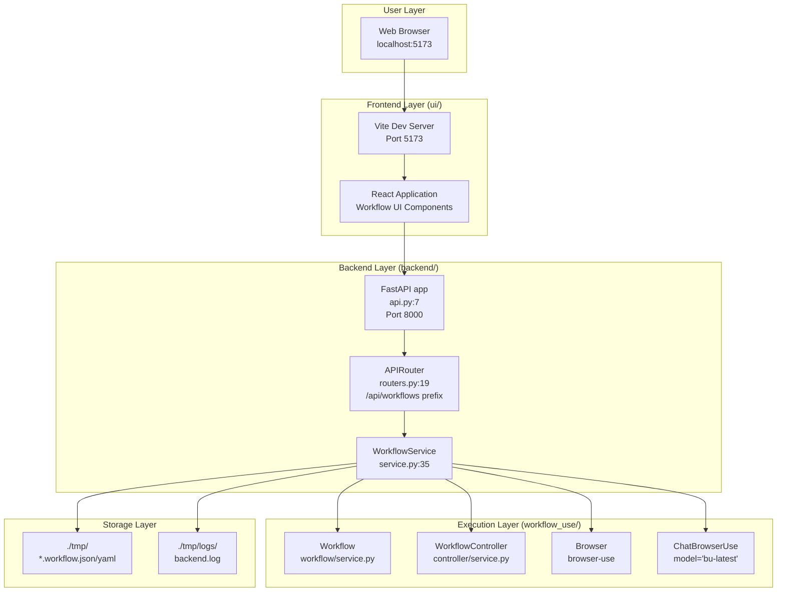
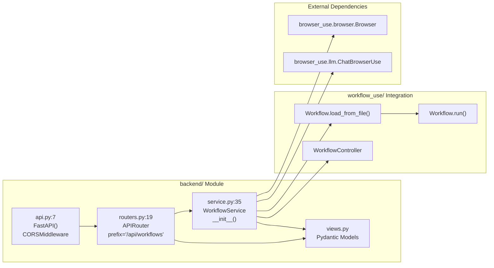
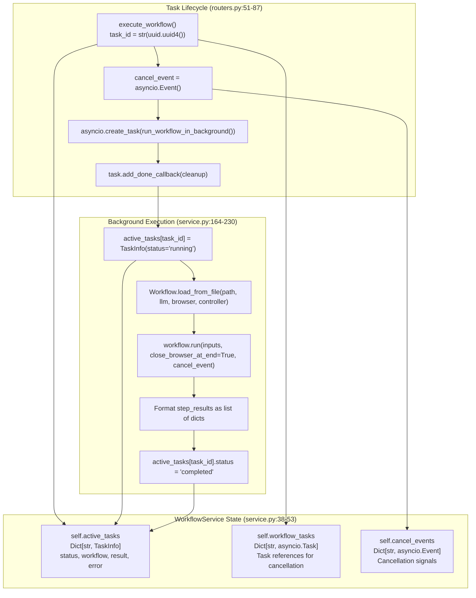
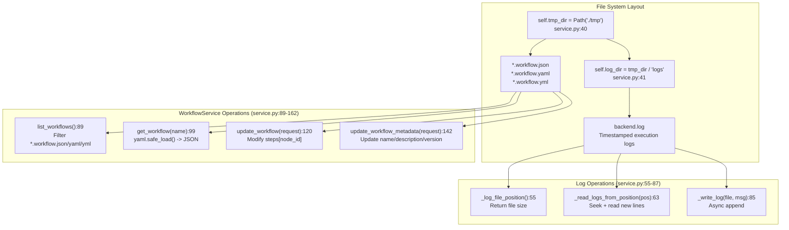
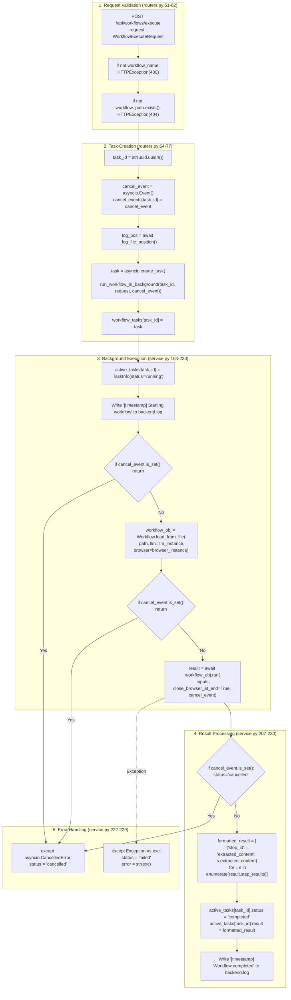
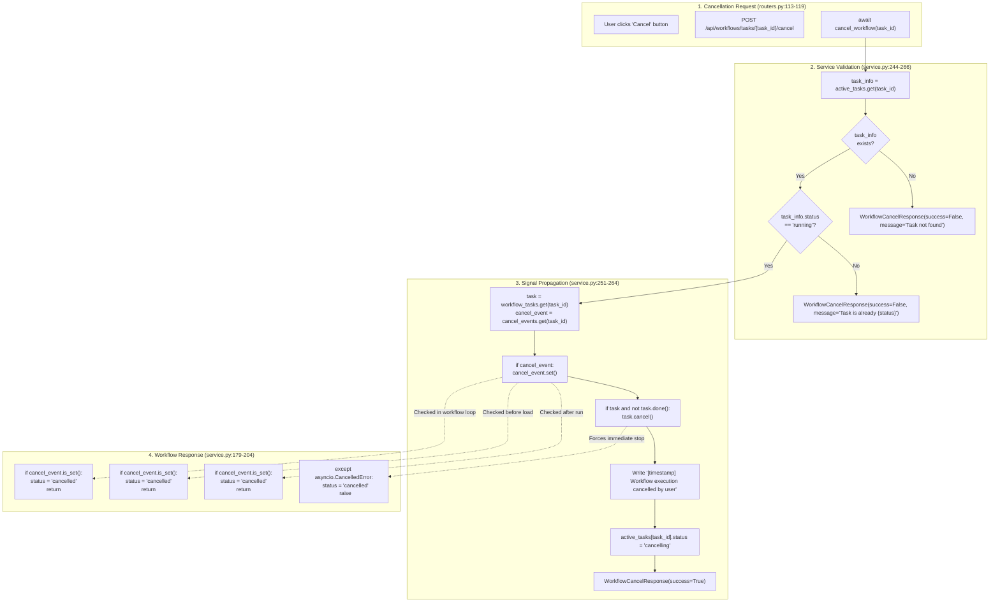
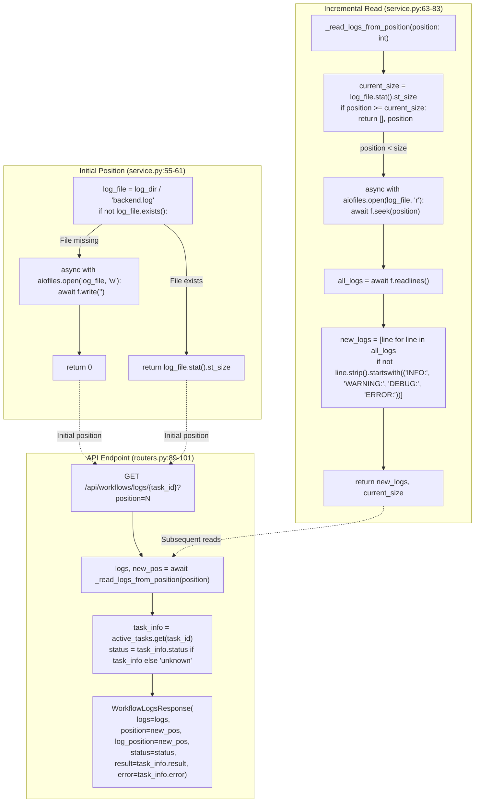
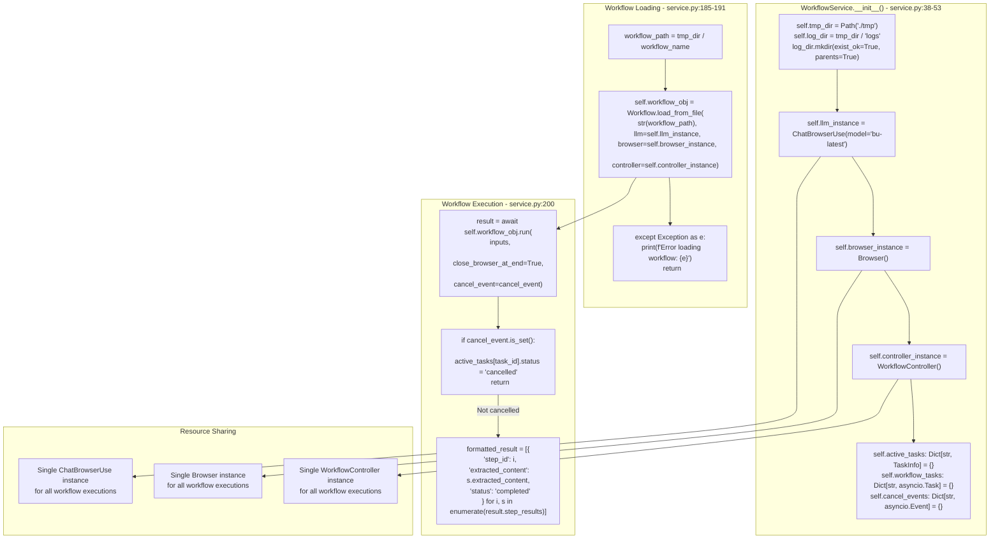
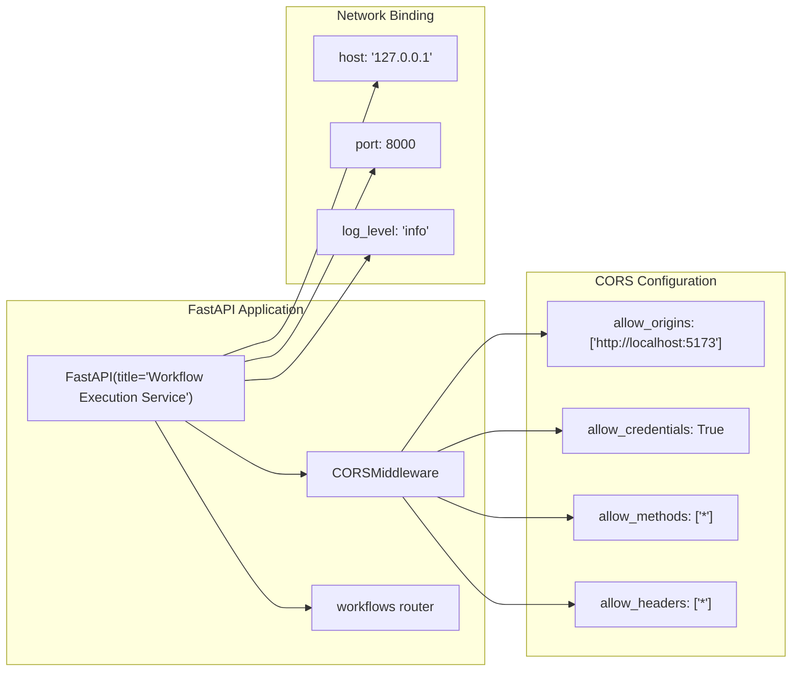

<!-- source: DeepWiki mcp.deepwiki.com · repo browser-use/workflow-use · page 7 Web Interface · fetched 2026-10-30 -->

# Web Interface

<details>
<summary>Relevant source files</summary>

The following files were used as context for generating this wiki page:

- [README.md](README.md)
- [workflows/.gitignore](workflows/.gitignore)
- [workflows/backend/api.py](workflows/backend/api.py)
- [workflows/backend/routers.py](workflows/backend/routers.py)
- [workflows/backend/service.py](workflows/backend/service.py)
- [workflows/backend/views.py](workflows/backend/views.py)
- [workflows/workflow_use/storage/__init__.py](workflows/workflow_use/storage/__init__.py)
- [workflows/workflow_use/workflow/prompts.py](workflows/workflow_use/workflow/prompts.py)
- [workflows/workflow_use/workflow/tests/test_extract.py](workflows/workflow_use/workflow/tests/test_extract.py)

</details>


The web interface is a browser-based GUI for workflow management, execution, and monitoring. It consists of two components:

1. **Backend**: FastAPI server ([workflows/backend/api.py:7-19]()) exposing REST endpoints at `http://127.0.0.1:8000`
2. **Frontend**: React/Vite development server ([ui/]()) serving the UI at `http://localhost:5173`

The system provides workflow visualization, execution with real-time log streaming, step editing, and metadata management. All workflow operations are performed through REST API calls, with background task execution for long-running workflows.

For detailed backend API endpoint documentation, see [Backend API](#7.1). For frontend component architecture, see [Frontend Architecture](#7.2).
</thinking>

Sources: [README.md:179-224](), [workflows/backend/api.py:1-25]()
</thinking>

## Launching the GUI

The easiest way to start the web interface is using the built-in CLI command:

```bash
cd workflows
python cli.py launch-gui
```

This command automatically:
- Starts the FastAPI backend server on `http://127.0.0.1:8000`
- Starts the frontend development server on `http://localhost:5173`
- Opens the GUI in the default browser
- Captures server logs to `./tmp/logs` directory

Press `Ctrl+C` to stop both servers. The GUI remains accessible at `http://localhost:5173` while the servers are running.

Sources: [README.md:179-198]()

## Main Features

The web interface provides the following capabilities through REST API endpoints:

| Feature | Endpoint | Method | Description |
|---------|----------|--------|-------------|
| **Workflow List** | `/api/workflows` | GET | List all valid workflow files from `./tmp` directory |
| **Workflow Retrieval** | `/api/workflows/{name}` | GET | Load workflow content (YAML converted to JSON) |
| **Workflow Execution** | `/api/workflows/execute` | POST | Start background workflow execution with `WorkflowExecuteRequest` |
| **Step Editing** | `/api/workflows/update` | POST | Update individual step data via `WorkflowUpdateRequest` |
| **Metadata Editing** | `/api/workflows/update-metadata` | POST | Update workflow name, description, version via `WorkflowMetadataUpdateRequest` |
| **Log Streaming** | `/api/workflows/logs/{task_id}` | GET | Retrieve incremental logs from `./tmp/logs/backend.log` |
| **Status Polling** | `/api/workflows/tasks/{task_id}/status` | GET | Get current task status and results |
| **Execution Control** | `/api/workflows/tasks/{task_id}/cancel` | POST | Cancel running workflow execution |

All request/response models are defined in [workflows/backend/views.py:1-69]() using Pydantic for type validation.

Sources: [workflows/backend/routers.py:19-120](), [workflows/backend/views.py:1-69]()

## System Architecture

The web interface implements a three-tier client-server architecture: a React frontend for user interaction, a FastAPI backend for workflow management, and the core workflow execution engine.

### High-Level Architecture Diagram



The architecture separates concerns into four layers: presentation (React/Vite), API routing (FastAPI/APIRouter), service logic (WorkflowService), and workflow execution (Workflow class). `WorkflowService` manages three dictionaries (`active_tasks`, `workflow_tasks`, `cancel_events`) for tracking background task execution state.

Sources: [workflows/backend/api.py:1-25](), [workflows/backend/routers.py:19-120](), [workflows/backend/service.py:35-53]()

### Communication Flow

```mermaid
sequenceDiagram
    participant User
    participant React["React Frontend"]
    participant execute_workflow["routers.py:51<br/>execute_workflow()"]
    participant Service["service.py:164<br/>run_workflow_in_background()"]
    participant WorkflowRun["Workflow.run()"]
    
    User->>React: "Select workflow & input parameters"
    React->>execute_workflow: "POST /api/workflows/execute<br/>WorkflowExecuteRequest"
    execute_workflow->>execute_workflow: "Generate UUID task_id"
    execute_workflow->>execute_workflow: "asyncio.create_task()"
    execute_workflow->>React: "WorkflowExecuteResponse<br/>{task_id, log_position}"
    React->>User: "Show execution started"
    
    Service->>Service: "active_tasks[task_id] = TaskInfo(status='running')"
    Service->>WorkflowRun: "workflow.run(inputs, close_browser_at_end=True)"
    
    loop "Real-time updates"
        React->>execute_workflow: "GET /api/workflows/logs/{task_id}?position=N"
        execute_workflow->>Service: "_read_logs_from_position(position)"
        Service->>Service: "Read from ./tmp/logs/backend.log"
        Service->>execute_workflow: "new_logs, new_position"
        execute_workflow->>React: "WorkflowLogsResponse<br/>{logs, position, status}"
        React->>User: "Display logs & status"
    end
    
    WorkflowRun->>Service: "Return WorkflowResult"
    Service->>Service: "active_tasks[task_id].status = 'completed'"
    React->>execute_workflow: "GET /api/workflows/logs/{task_id}"
    execute_workflow->>React: "status: 'completed', result: [...]"
    React->>User: "Show final results"
```

The frontend polls `/api/workflows/logs/{task_id}` to retrieve incremental logs. The `position` parameter enables efficient log retrieval by seeking to the last read position in `backend.log` and only returning new entries.

Sources: [workflows/backend/routers.py:51-87](), [workflows/backend/routers.py:89-101](), [workflows/backend/service.py:164-220](), [workflows/backend/service.py:63-83]()

## Core Components

The web interface consists of three primary components that work together to provide workflow management capabilities:

### Backend Component Structure



| Component | File Path | Key Responsibilities |
|-----------|-----------|---------------------|
| **FastAPI app** | [workflows/backend/api.py:7-19]() | App initialization, CORS middleware (`allow_origins=['http://localhost:5173']`), router registration |
| **APIRouter** | [workflows/backend/routers.py:19-120]() | 8 REST endpoints for workflow CRUD, execution, log streaming, task management |
| **WorkflowService** | [workflows/backend/service.py:35-53]() | Singleton instances (`llm_instance`, `browser_instance`, `controller_instance`), task tracking dictionaries |
| **Pydantic Models** | [workflows/backend/views.py:1-69]() | `WorkflowExecuteRequest`, `WorkflowLogsResponse`, `TaskInfo`, request/response validation |

Sources: [workflows/backend/api.py:1-25](), [workflows/backend/routers.py:1-120](), [workflows/backend/service.py:35-53](), [workflows/backend/views.py:1-69]()

### Task Management Architecture



`WorkflowService` maintains three dictionaries initialized in `__init__()`:
- `active_tasks`: `Dict[str, TaskInfo]` - stores execution status (`'running'`/`'completed'`/`'failed'`/`'cancelled'`), results, and errors
- `workflow_tasks`: `Dict[str, asyncio.Task]` - holds task references for cancellation via `task.cancel()`
- `cancel_events`: `Dict[str, asyncio.Event]` - provides graceful shutdown signals checked during `workflow.run()`

Each workflow execution receives a UUID task ID for tracking throughout its lifecycle. Cleanup callbacks automatically remove entries from `workflow_tasks` and `cancel_events` upon task completion.

Sources: [workflows/backend/service.py:38-53](), [workflows/backend/routers.py:64-77](), [workflows/backend/service.py:164-230]()

## File Storage and Workflow Management

The web interface works with workflows stored in the file system, specifically in the `./tmp` directory. Workflows must have the `.workflow.json`, `.workflow.yaml`, or `.workflow.yml` extension to be recognized by the system.

### Storage Structure



`WorkflowService.__init__()` creates two directories:
- `self.tmp_dir = Path('./tmp')` - stores workflow files
- `self.log_dir = self.tmp_dir / 'logs'` - stores `backend.log`

`list_workflows()` filters files by checking:
1. `f.is_file()` - is a file, not directory
2. `not f.name.startswith('temp_recording')` - excludes temporary recording files
3. `f.name.endswith(('.workflow.json', '.workflow.yaml', '.workflow.yml'))` - valid workflow extension

`get_workflow(name)` uses `yaml.safe_load()` to parse both JSON and YAML files, then returns `json.dumps()` output for frontend compatibility.

Sources: [workflows/backend/service.py:40-42](), [workflows/backend/service.py:89-118](), [workflows/backend/service.py:55-87]()

### Workflow File Format Support

| Format | Extension | Loading | Saving | Frontend Display |
|--------|-----------|---------|--------|------------------|
| JSON | `.workflow.json` | ✓ Direct | ✓ Direct | ✓ Native |
| YAML | `.workflow.yaml`, `.workflow.yml` | ✓ Converted | ✓ Preserved | ✓ Converted to JSON |

The system uses `yaml.safe_load()` to parse both JSON and YAML files, providing format flexibility while maintaining JSON compatibility for the frontend. When updating workflows, the original format is preserved.

Sources: [workflows/backend/service.py:89-118](), [workflows/backend/service.py:120-162]()

## Workflow Execution Flow

Workflow execution in the web interface follows an asynchronous pattern with background task management and real-time status updates.

### Execution Lifecycle



The execution flow has five stages:

1. **Request Validation**: Check `workflow_name` is provided and workflow file exists at `tmp_dir / workflow_name`
2. **Task Creation**: Generate UUID, create `asyncio.Event` for cancellation, get initial log position, create background task
3. **Background Execution**: Set status to `'running'`, log start event, check cancellation signals, load workflow, execute `workflow.run()`
4. **Result Processing**: Check cancellation, format `step_results` as list of dicts with `step_id` and `extracted_content`, update status to `'completed'`
5. **Error Handling**: Catch `asyncio.CancelledError` for forced cancellation, catch general exceptions for failed status

Cancellation signals are checked at three points before and during workflow execution to enable graceful shutdown.

Sources: [workflows/backend/routers.py:51-87](), [workflows/backend/service.py:164-230]()

### Cancellation Mechanism



The cancellation mechanism uses a two-pronged approach:

1. **Graceful Cancellation**: `cancel_event.set()` signals the workflow to stop gracefully. The event is checked at three points:
   - Before loading the workflow ([service.py:179-182]())
   - Before executing `workflow.run()` ([service.py:195-198]())
   - After execution completes ([service.py:202-205]())

2. **Forced Cancellation**: `task.cancel()` raises `asyncio.CancelledError` if the workflow hasn't responded to the event signal. This ensures workflows stop promptly even if stuck in long operations.

The status transitions are: `'running'` → `'cancelling'` (cancellation requested) → `'cancelled'` (workflow stopped). Both cancellation methods update `active_tasks[task_id].status` and log the cancellation event with timestamp to `backend.log`.

Sources: [workflows/backend/service.py:244-266](), [workflows/backend/routers.py:113-119](), [workflows/backend/service.py:179-198](), [workflows/backend/service.py:222-225]()

## Log Management System

The backend implements a file-based logging system with position tracking for efficient incremental log retrieval, enabling real-time log streaming to the frontend without re-reading the entire file.

### Log Position Tracking



The position tracking mechanism works as follows:

1. **Initialization** (`_log_file_position()`): Returns current file size in bytes. Creates empty `backend.log` if missing.

2. **Incremental Read** (`_read_logs_from_position(position)`):
   - If `position >= current_size`: returns empty list (no new logs)
   - Otherwise: seeks to `position`, reads all remaining lines, filters out lines starting with `'INFO:'`, `'WARNING:'`, `'DEBUG:'`, `'ERROR:'`
   - Returns `(new_logs, current_size)` tuple

3. **Client Polling**: Frontend calls `GET /api/workflows/logs/{task_id}?position=N` repeatedly, incrementing `N` with each response

This approach avoids re-reading the entire log file on each poll, reducing I/O overhead for long-running workflows.

Sources: [workflows/backend/service.py:55-83](), [workflows/backend/routers.py:89-101]()

### Log Writing with Timestamps

All workflow execution events are logged to `./tmp/logs/backend.log` with timestamps using the format `[YYYY-MM-DD HH:MM:SS]`. The `_write_log()` method appends log entries asynchronously using `aiofiles` for non-blocking I/O.

| Log Event | Example Format |
|-----------|----------------|
| Workflow start | `[2024-01-15 10:30:45] Starting workflow 'example.workflow.json'` |
| Input parameters | `[2024-01-15 10:30:45] Input parameters: {"key": "value"}` |
| Step completion | `[2024-01-15 10:30:50] Completed step 0: {"data": "result"}` |
| Workflow completion | `[2024-01-15 10:31:00] Workflow completed successfully with 5 steps` |
| Error | `[2024-01-15 10:30:55] Error: Element not found` |
| Cancellation | `[2024-01-15 10:30:58] Workflow execution cancelled by user` |

Sources: [workflows/backend/service.py:85-87](), [workflows/backend/service.py:174-220]()

## Integration with Workflow Engine

The web interface integrates with the core workflow execution system through the `Workflow.load_from_file()` method and shared browser/LLM instances.

### Service Initialization and Workflow Integration



`WorkflowService.__init__()` creates singleton instances of core dependencies:

| Instance | Type | Purpose |
|----------|------|---------|
| `self.llm_instance` | `ChatBrowserUse(model='bu-latest')` | LLM for workflow execution and extraction |
| `self.browser_instance` | `Browser()` | Browser automation via browser-use package |
| `self.controller_instance` | `WorkflowController()` | Controller for workflow actions |

These instances are passed to `Workflow.load_from_file()` during workflow loading ([service.py:185-191]()), enabling resource sharing across multiple concurrent workflow executions. Each workflow receives its own `cancel_event` for independent cancellation control.

The `workflow.run()` method ([service.py:200]()) accepts three key parameters:
- `inputs`: `Dict[str, Any]` - workflow input parameters
- `close_browser_at_end=True`: closes browser after execution
- `cancel_event`: `asyncio.Event` - for graceful cancellation

Results are formatted as a list of dicts with `step_id`, `extracted_content`, and `status` fields for frontend consumption.

Sources: [workflows/backend/service.py:38-53](), [workflows/backend/service.py:185-191](), [workflows/backend/service.py:200-220]()

## CORS Configuration and Security

The FastAPI application includes CORS middleware configured specifically for local development with the React frontend.



Sources: [workflows/backend/api.py:7-24]()

---

