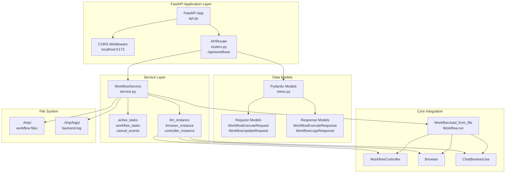
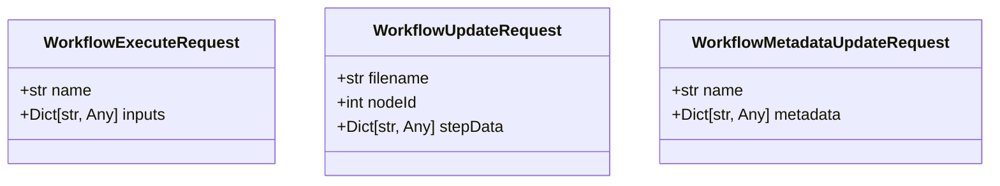
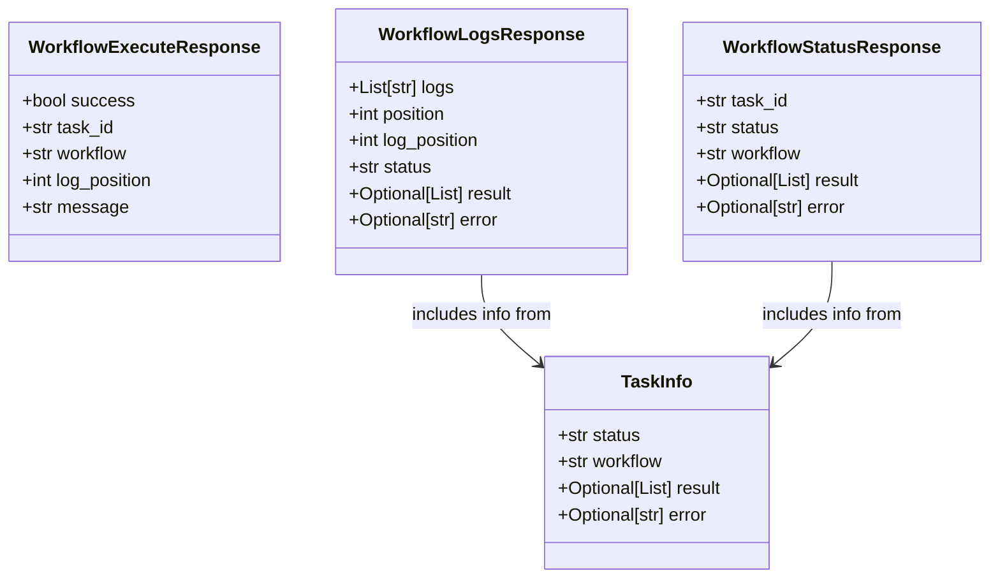
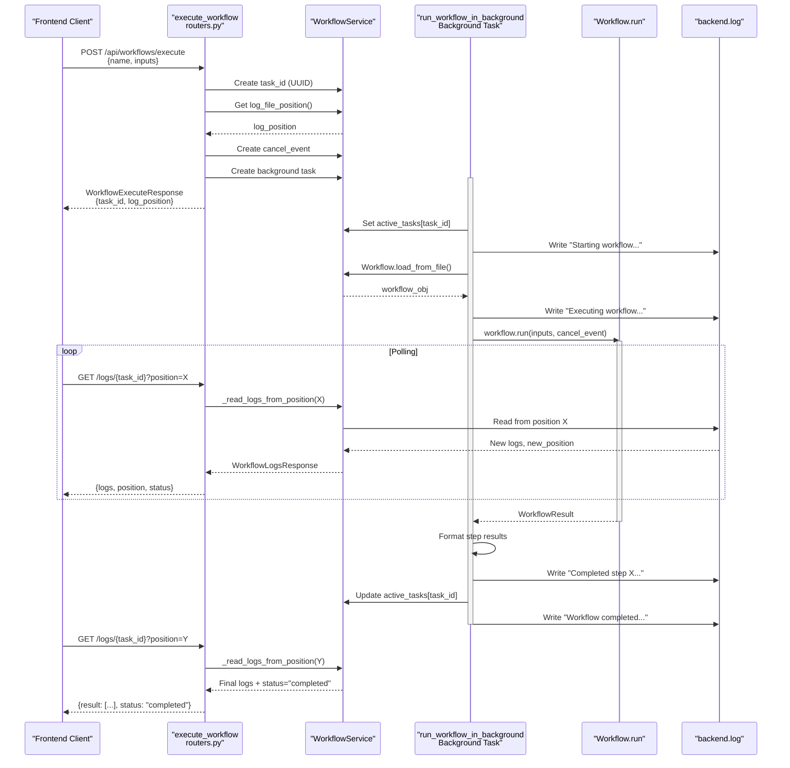
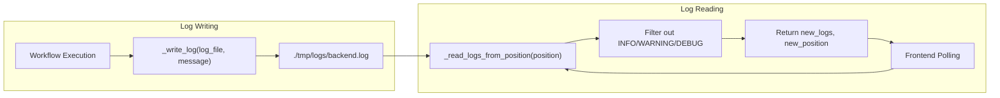
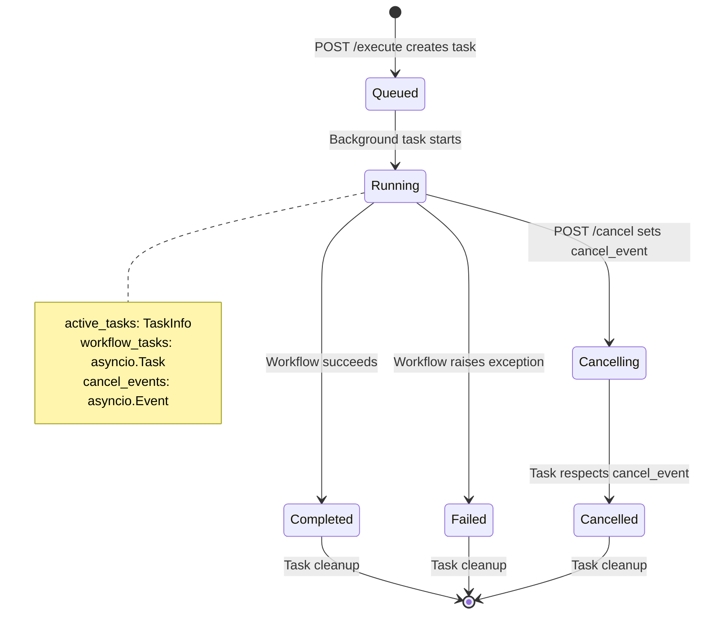
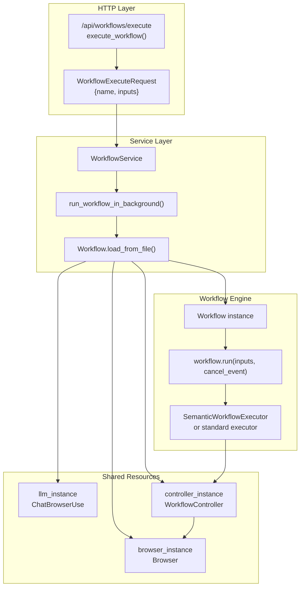

<!-- source: DeepWiki mcp.deepwiki.com · repo browser-use/workflow-use · page 7.1 Backend API · fetched 2026-10-30 -->

# Backend API

<details>
<summary>Relevant source files</summary>

The following files were used as context for generating this wiki page:

- [workflows/backend/api.py](workflows/backend/api.py)
- [workflows/backend/routers.py](workflows/backend/routers.py)
- [workflows/backend/service.py](workflows/backend/service.py)
- [workflows/backend/views.py](workflows/backend/views.py)
- [workflows/workflow_use/workflow/prompts.py](workflows/workflow_use/workflow/prompts.py)
- [workflows/workflow_use/workflow/tests/test_extract.py](workflows/workflow_use/workflow/tests/test_extract.py)

</details>


## Purpose and Scope

The Backend API provides a RESTful HTTP interface for managing and executing workflows through a FastAPI server. It exposes endpoints for workflow CRUD operations, asynchronous workflow execution, real-time log streaming, and task lifecycle management. The API serves as the integration layer between the React frontend (see [Frontend Architecture](#7.2)) and the core workflow execution engine.

The API does not include workflow generation or recording functionality—those are handled by the CLI (see [Command Line Interface](#6)) and browser extension (see [Browser Extension](#8)). This page focuses exclusively on the HTTP API layer that enables programmatic workflow management and execution.

**Sources:** [workflows/backend/api.py](), [workflows/backend/routers.py](), [workflows/backend/service.py]()

---

## FastAPI Application Architecture

The backend is structured as a modular FastAPI application with clear separation between routing, service logic, and data models.



**Application Entry Point:** [workflows/backend/api.py:1-24]()

The `FastAPI` app is configured with CORS middleware allowing requests from `localhost:5173` (the React frontend). All workflow-related routes are mounted under the `/api/workflows` prefix via `APIRouter`.

**Sources:** [workflows/backend/api.py:1-24](), [workflows/backend/routers.py:19]()

---

## API Endpoints Reference

### Workflow Management Endpoints

| Endpoint | Method | Purpose | Request Model | Response Model |
|----------|--------|---------|---------------|----------------|
| `/api/workflows` | GET | List all workflow files | None | `WorkflowListResponse` |
| `/api/workflows/{name}` | GET | Retrieve workflow content | Path param: `name` | JSON string |
| `/api/workflows/update` | POST | Update workflow step | `WorkflowUpdateRequest` | `WorkflowResponse` |
| `/api/workflows/update-metadata` | POST | Update workflow metadata | `WorkflowMetadataUpdateRequest` | `WorkflowResponse` |

### Workflow Execution Endpoints

| Endpoint | Method | Purpose | Request Model | Response Model |
|----------|--------|---------|---------------|----------------|
| `/api/workflows/execute` | POST | Start workflow execution | `WorkflowExecuteRequest` | `WorkflowExecuteResponse` |
| `/api/workflows/logs/{task_id}` | GET | Stream execution logs | Query param: `position` | `WorkflowLogsResponse` |
| `/api/workflows/tasks/{task_id}/status` | GET | Get task status | Path param: `task_id` | `WorkflowStatusResponse` |
| `/api/workflows/tasks/{task_id}/cancel` | POST | Cancel running task | Path param: `task_id` | `WorkflowCancelResponse` |

**Sources:** [workflows/backend/routers.py:19-119]()

---

## Request and Response Models

All API contracts are defined using Pydantic models in [workflows/backend/views.py]().

### Core Request Models



**`WorkflowExecuteRequest`:** [workflows/backend/views.py:26-28]()
- `name`: Workflow filename (e.g., `"example.workflow.yaml"`)
- `inputs`: Dictionary of input parameters matching the workflow's `input_schema`

**`WorkflowUpdateRequest`:** [workflows/backend/views.py:15-18]()
- `filename`: Workflow file to modify
- `nodeId`: Step index to update
- `stepData`: New step definition (must match step schema)

**`WorkflowMetadataUpdateRequest`:** [workflows/backend/views.py:21-23]()
- `name`: Workflow filename
- `metadata`: Updated name, description, version, and `input_schema`

### Core Response Models



**`WorkflowExecuteResponse`:** [workflows/backend/views.py:41-46]()
- Returns immediately upon task creation with a unique `task_id` for status tracking
- `log_position`: Initial file position for log streaming

**`WorkflowLogsResponse`:** [workflows/backend/views.py:49-55]()
- `logs`: New log lines since last poll
- `position`/`log_position`: Current file position for next poll
- `status`: Task state (`running`, `completed`, `failed`, `cancelled`)
- `result`: Step results when completed
- `error`: Error message if failed

**`TaskInfo`:** [workflows/backend/views.py:7-11]()
- Internal model tracking task state in `WorkflowService.active_tasks`

**Sources:** [workflows/backend/views.py:1-69]()

---

## WorkflowService Architecture

The `WorkflowService` class [workflows/backend/service.py:35-266]() is the core service layer implementing all backend logic.

```mermaid
graph TB
    subgraph "WorkflowService State"
        TMP["tmp_dir: Path<br/>./tmp/"]
        LOG["log_dir: Path<br/>./tmp/logs/"]
        LLM["llm_instance<br/>ChatBrowserUse"]
        BROWSER["browser_instance<br/>Browser"]
        CTRL["controller_instance<br/>WorkflowController"]
        TASKS["active_tasks<br/>Dict[str, TaskInfo]"]
        WF_TASKS["workflow_tasks<br/>Dict[str, asyncio.Task]"]
        CANCEL["cancel_events<br/>Dict[str, asyncio.Event]"]
    end
    
    subgraph "Workflow CRUD Operations"
        LIST["list_workflows()<br/>Filter .workflow.json/yaml"]
        GET["get_workflow(name)<br/>Load & convert to JSON"]
        UPDATE["update_workflow()<br/>Modify step in YAML"]
        META["update_workflow_metadata()<br/>Update top-level fields"]
    end
    
    subgraph "Execution Operations"
        RUN["run_workflow_in_background()<br/>Async task executor"]
        STATUS["get_task_status()<br/>Query active_tasks"]
        CANCEL_OP["cancel_workflow()<br/>Set cancel_event"]
    end
    
    subgraph "Logging Operations"
        POS["_log_file_position()<br/>Get file size"]
        READ["_read_logs_from_position()<br/>Incremental read"]
        WRITE["_write_log()<br/>Append log entry"]
    end
    
    TMP --> LIST
    TMP --> GET
    TMP --> UPDATE
    TMP --> META
    TMP --> RUN
    
    TASKS --> STATUS
    WF_TASKS --> CANCEL_OP
    CANCEL --> CANCEL_OP
    
    LOG --> POS
    LOG --> READ
    LOG --> WRITE
    
    RUN --> WRITE
    RUN --> LLM
    RUN --> BROWSER
    RUN --> CTRL
```



### Service Initialization

[workflows/backend/service.py:38-53]()

The service creates shared resources on initialization:
- `llm_instance`: `ChatBrowserUse` with model `'bu-latest'`
- `browser_instance`: `Browser` instance for workflow execution
- `controller_instance`: `WorkflowController` for browser actions
- `active_tasks`: In-memory task registry
- `workflow_tasks`: Asyncio task handles
- `cancel_events`: Cancellation signals per task

These resources are reused across all workflow executions to avoid initialization overhead.

**Sources:** [workflows/backend/service.py:35-53]()

---

## Workflow Execution Flow

The workflow execution system implements asynchronous, background task execution with real-time logging and cancellation support.



### Execution Lifecycle

**1. Task Creation:** [workflows/backend/routers.py:51-86]()

When `/api/workflows/execute` receives a request:
1. Generate unique `task_id` using `uuid.uuid4()`
2. Create `asyncio.Event` for cancellation signal
3. Record initial log file position
4. Create background task with `asyncio.create_task()`
5. Return immediately with `task_id` for polling

**2. Background Execution:** [workflows/backend/service.py:164-230]()

The `run_workflow_in_background()` coroutine:
1. Updates `active_tasks[task_id]` with status `'running'`
2. Logs workflow start with timestamp and input parameters
3. Loads workflow using `Workflow.load_from_file()` with shared LLM/browser/controller instances
4. Checks `cancel_event` before execution
5. Calls `workflow.run(inputs, close_browser_at_end=True, cancel_event=cancel_event)`
6. Formats `step_results` into response structure
7. Updates `active_tasks[task_id]` with status `'completed'` and results

**3. Error Handling:** [workflows/backend/service.py:222-229]()

Three error conditions are handled:
- `asyncio.CancelledError`: Task force-cancelled, status → `'cancelled'`
- `cancel_event.is_set()`: User-initiated cancellation, status → `'cancelled'`
- `Exception`: Any other error, status → `'failed'`, error message stored

**Sources:** [workflows/backend/service.py:164-230](), [workflows/backend/routers.py:51-86]()

---

## Real-Time Logging System

The API provides incremental log streaming through a file-based approach that avoids blocking operations.



### Log File Management

**`_log_file_position()`:** [workflows/backend/service.py:55-61]()
- Returns current file size as byte offset
- Creates log file if it doesn't exist
- Used to establish initial position before task starts

**`_write_log(log_file, message)`:** [workflows/backend/service.py:85-87]()
- Asynchronously appends message to log file
- Messages include timestamp: `[YYYY-MM-DD HH:MM:SS]`
- Used throughout workflow execution to record progress

**`_read_logs_from_position(position)`:** [workflows/backend/service.py:63-83]()
- Reads all lines from byte `position` to current file size
- Filters out lines starting with `INFO:`, `WARNING:`, `DEBUG:`, `ERROR:`
- Returns filtered logs and new file position
- Returns empty list if position ≥ current size

### Log Streaming Pattern

The frontend implements long-polling:

1. **Initial Request:** Receives `log_position` from `/execute` response
2. **Poll Loop:** Repeatedly calls `/logs/{task_id}?position=X`
3. **Incremental Update:** Receives only new log lines since position X
4. **Termination:** Stops polling when `status` is not `'running'`

This approach provides near-real-time updates without WebSocket complexity while keeping server stateless between polls.

**Sources:** [workflows/backend/service.py:55-87](), [workflows/backend/routers.py:89-101]()

---

## Task Lifecycle and Cancellation

The service maintains task state across three dictionaries for comprehensive lifecycle management.



### State Management

**`active_tasks: Dict[str, TaskInfo]`:** [workflows/backend/service.py:51]()
- Maps `task_id` → task metadata and status
- Updated by background task during execution
- Read by `/logs` and `/tasks/{task_id}/status` endpoints
- Never cleaned up (in-memory only, lost on restart)

**`workflow_tasks: Dict[str, asyncio.Task]`:** [workflows/backend/service.py:52]()
- Maps `task_id` → asyncio Task handle
- Used for force-cancellation via `task.cancel()`
- Cleaned up via callback when task completes: [workflows/backend/routers.py:72-77]()

**`cancel_events: Dict[str, asyncio.Event]`:** [workflows/backend/service.py:53]()
- Maps `task_id` → cancellation signal
- Set by `/cancel` endpoint
- Checked by workflow execution at step boundaries
- Cleaned up with workflow_tasks

### Cancellation Mechanism

**`cancel_workflow(task_id)`:** [workflows/backend/service.py:244-265]()

Cancellation is cooperative, not forced:

1. Validate task exists and status is `'running'`
2. Set `cancel_event` to signal workflow executor
3. Call `task.cancel()` for immediate asyncio cancellation
4. Update status to `'cancelling'`
5. Workflow checks `cancel_event` at safe points

The workflow execution respects cancellation at:
- Before loading workflow: [workflows/backend/service.py:179-182]()
- Before calling `workflow.run()`: [workflows/backend/service.py:195-198]()
- After `workflow.run()` returns: [workflows/backend/service.py:202-205]()
- Inside `Workflow.run()` between steps (passed as parameter)

This ensures workflows can clean up resources gracefully rather than being forcibly terminated mid-action.

**Sources:** [workflows/backend/service.py:244-265](), [workflows/backend/service.py:164-230](), [workflows/backend/routers.py:113-119]()

---

## Workflow File Operations

### Listing Workflows

**`list_workflows()`:** [workflows/backend/service.py:89-97]()

Returns filenames from `./tmp/` directory matching:
- Ends with `.workflow.json`, `.workflow.yaml`, or `.workflow.yml`
- Is a regular file (not directory)
- Does not start with `temp_recording` (excludes in-progress recordings)

**Endpoint:** [workflows/backend/routers.py:26-30]()

```
GET /api/workflows
→ WorkflowListResponse { workflows: ["example.workflow.yaml", ...] }
```

### Retrieving Workflow Content

**`get_workflow(name)`:** [workflows/backend/service.py:99-118]()

Loads workflow file and converts to JSON:

1. Validate file exists in `./tmp/`
2. Validate filename ends with `.workflow.json/yaml/yml`
3. Load content using `yaml.safe_load()` (handles both JSON and YAML)
4. Serialize to JSON string using custom serializer for datetime objects
5. Return JSON for frontend compatibility

The `json_serializer()` function [workflows/backend/service.py:26-32]() converts non-JSON types like datetime to ISO format strings.

**Endpoint:** [workflows/backend/routers.py:33-36]()

```
GET /api/workflows/example.workflow.yaml
→ JSON string of workflow definition
```

### Updating Workflow Steps

**`update_workflow(request)`:** [workflows/backend/service.py:120-140]()

Modifies a single step in workflow:

1. Load workflow YAML from `./tmp/{filename}`
2. Validate `nodeId` is valid step index
3. Replace `steps[nodeId]` with new `stepData`
4. Write back to file using `yaml.dump()`

Uses `default_flow_style=False` and `sort_keys=False` to maintain human-readable YAML formatting.

**Endpoint:** [workflows/backend/routers.py:39-42]()

```
POST /api/workflows/update
{
  "filename": "example.workflow.yaml",
  "nodeId": 2,
  "stepData": { "action_type": "click", ... }
}
→ WorkflowResponse { success: true }
```

### Updating Workflow Metadata

**`update_workflow_metadata(request)`:** [workflows/backend/service.py:142-162]()

Updates top-level workflow fields:

1. Load workflow YAML
2. Update `name`, `description`, `version` from `metadata` dict
3. Optionally update `input_schema` if provided
4. Write back to file

**Endpoint:** [workflows/backend/routers.py:45-48]()

```
POST /api/workflows/update-metadata
{
  "name": "example.workflow.yaml",
  "metadata": {
    "name": "New Workflow Name",
    "description": "Updated description",
    "version": "1.1.0",
    "input_schema": { ... }
  }
}
→ WorkflowResponse { success: true }
```

**Sources:** [workflows/backend/service.py:89-162](), [workflows/backend/routers.py:26-48]()

---

## Integration with Workflow Execution Engine

The backend API bridges HTTP requests to the core workflow execution system.



### Resource Sharing

The `WorkflowService` creates single instances of expensive resources [workflows/backend/service.py:45-48]():

```python
self.llm_instance = ChatBrowserUse(model='bu-latest')
self.browser_instance = Browser()
self.controller_instance = WorkflowController()
```

These are passed to `Workflow.load_from_file()` [workflows/backend/service.py:186-188]():

```python
self.workflow_obj = Workflow.load_from_file(
    str(workflow_path), 
    llm=self.llm_instance, 
    browser=self.browser_instance, 
    controller=self.controller_instance
)
```

This design:
- Avoids browser initialization overhead per request
- Maintains single browser context across workflows
- Reuses LLM client connection pooling
- Enables shared controller state

### Execution Parameters

The `workflow.run()` call [workflows/backend/service.py:200]() passes:

- `inputs`: User-provided input parameters
- `close_browser_at_end=True`: Clean up browser after execution
- `cancel_event`: Cooperative cancellation signal

For details on the workflow execution flow, see [Workflow Execution](#5).

**Sources:** [workflows/backend/service.py:164-230](), [workflows/workflow_use/workflow/service.py]()

---

## Error Handling and Status Codes

### HTTP Status Codes

| Status Code | Condition | Example |
|-------------|-----------|---------|
| 200 | Success | All successful operations |
| 400 | Bad Request | Missing workflow name in execute request |
| 404 | Not Found | Workflow file not found, task_id not found |
| 500 | Internal Server Error | Workflow loading error, execution exception |

### Error Response Format

Failed operations return models with `success: false` and error details:

```json
{
  "success": false,
  "error": "Workflow file 'missing.workflow.yaml' not found"
}
```

Task failures are tracked in `TaskInfo.error` field and returned via log/status endpoints:

```json
{
  "task_id": "abc-123",
  "status": "failed",
  "error": "Element not found: button with text 'Submit'"
}
```

### Validation Errors

**File Validation:** [workflows/backend/service.py:104-109]()
- Checks file exists
- Validates `.workflow.json/yaml/yml` extension
- Raises `FileNotFoundError` or `ValueError`

**YAML/JSON Parsing:** [workflows/backend/service.py:111-118]()
- Catches `yaml.YAMLError` for invalid syntax
- Catches `TypeError` for non-serializable objects

**Task Validation:** [workflows/backend/routers.py:56-62]()
- Validates workflow exists before creating task
- Returns 404 if workflow file not found

**Sources:** [workflows/backend/service.py:99-140](), [workflows/backend/routers.py:51-86]()

---

## Running the Backend Server

### Standalone Mode

The backend can run independently:

```bash
python -m workflows.backend.api
```

This executes [workflows/backend/api.py:23-24]():
```python
uvicorn.run('api:app', host='127.0.0.1', port=8000, log_level='info')
```

Server listens on `http://127.0.0.1:8000` with API endpoints under `/api/workflows`.

### Integrated with Frontend

The CLI command `wfuse gui` launches both backend and frontend servers together. See [Web Interface](#7) for integrated launch instructions.

**Sources:** [workflows/backend/api.py:22-24]()

---

## CORS Configuration

The API configures CORS middleware to allow requests from the React development server [workflows/backend/api.py:10-16]():

```python
app.add_middleware(
    CORSMiddleware,
    allow_origins=['http://localhost:5173'],
    allow_credentials=True,
    allow_methods=['*'],
    allow_headers=['*'],
)
```

This permits the frontend running on port 5173 to make cross-origin requests to the backend on port 8000. In production deployments, update `allow_origins` to match your deployment URLs.

**Sources:** [workflows/backend/api.py:9-16]()

---

