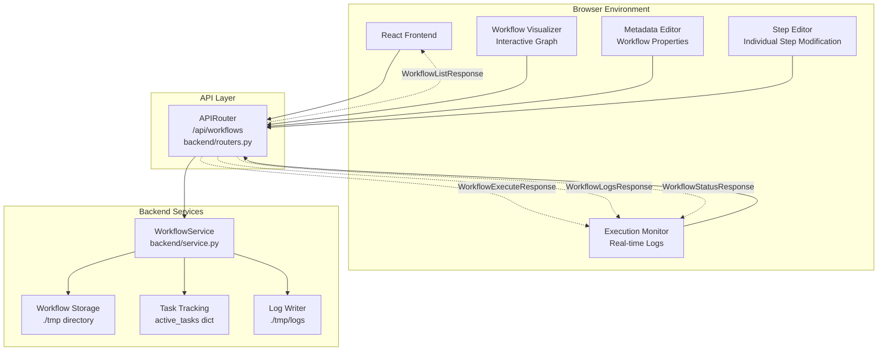
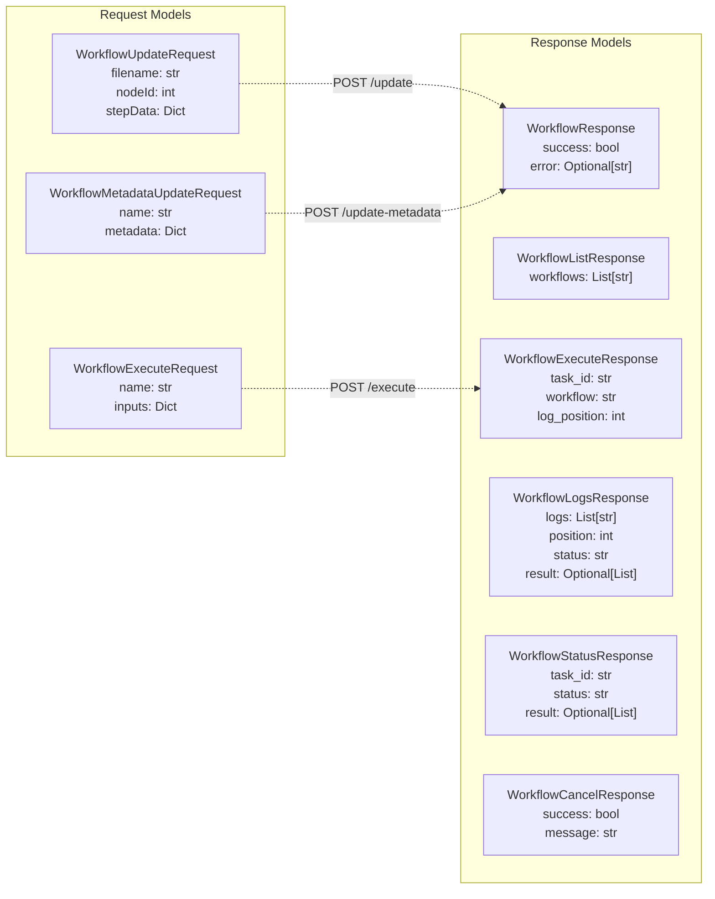
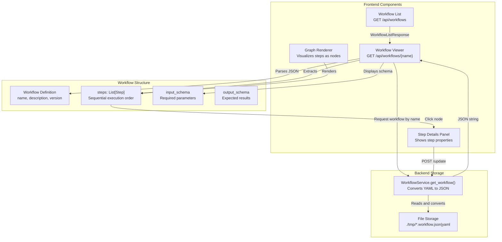
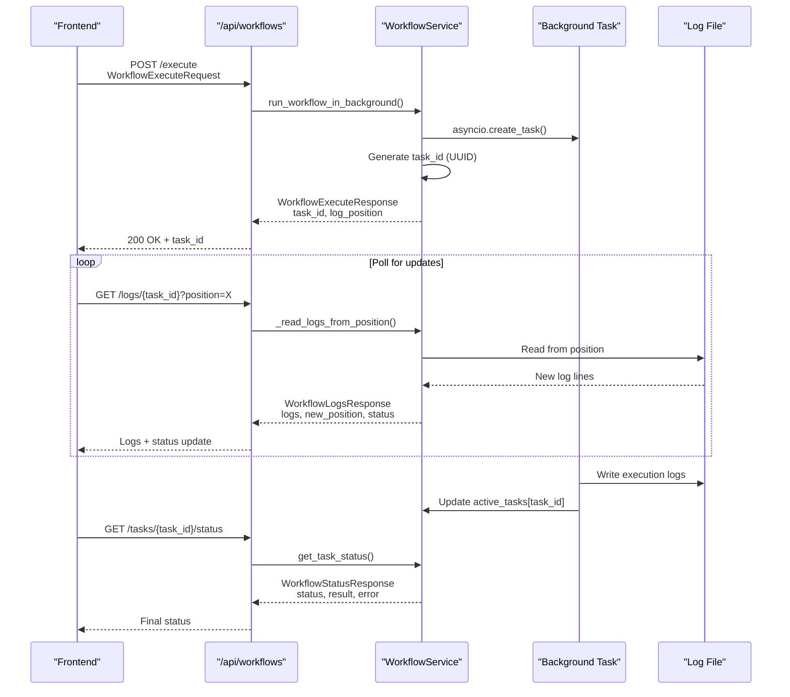
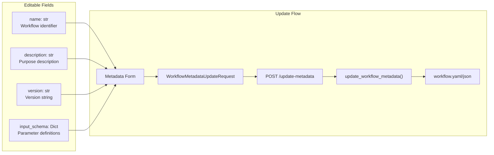
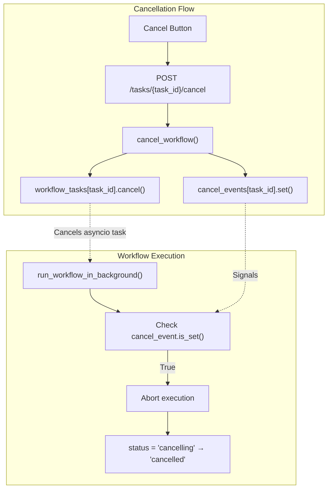
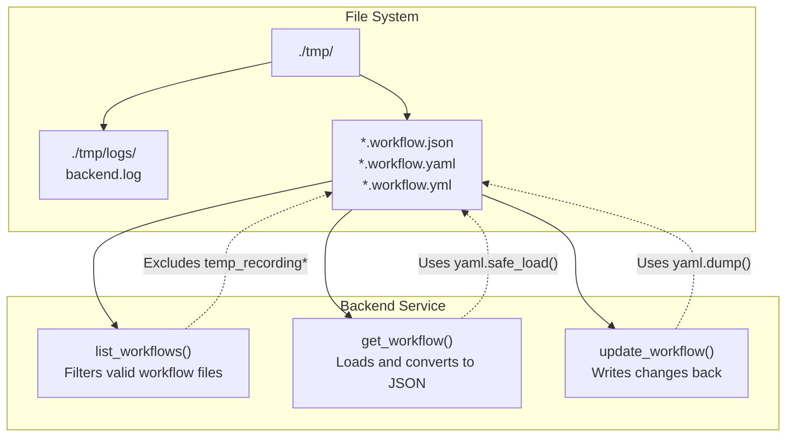

<!-- source: DeepWiki mcp.deepwiki.com · repo browser-use/workflow-use · page 7.2 Frontend Architecture · fetched 2026-10-30 -->

# Frontend Architecture

<details>
<summary>Relevant source files</summary>

The following files were used as context for generating this wiki page:

- [README.md](README.md)
- [workflows/.gitignore](workflows/.gitignore)
- [workflows/backend/api.py](workflows/backend/api.py)
- [workflows/backend/routers.py](workflows/backend/routers.py)
- [workflows/backend/service.py](workflows/backend/service.py)
- [workflows/backend/views.py](workflows/backend/views.py)
- [workflows/workflow_use/storage/__init__.py](workflows/workflow_use/storage/__init__.py)
- [workflows/workflow_use/workflow/prompts.py](workflows/workflow_use/workflow/prompts.py)
- [workflows/workflow_use/workflow/tests/test_extract.py](workflows/workflow_use/workflow/tests/test_extract.py)

</details>


## Purpose and Scope

This document describes the React-based web frontend for workflow-use, which provides a graphical interface for managing, visualizing, and executing workflows. The frontend communicates with the FastAPI backend to perform workflow operations and display real-time execution results.

For information about the backend API that powers this frontend, see [Backend API](#7.1). For details about the CLI commands that offer similar functionality via command line, see [Command Line Interface](#6).

**Sources:** [README.md:179-225]()

---

## Technology Stack and Project Structure

The frontend is built using modern web technologies optimized for development speed and runtime performance:

| Component | Technology | Purpose |
|-----------|-----------|---------|
| Framework | React | Component-based UI architecture |
| Build Tool | Vite | Fast development server and optimized production builds |
| Dev Server | Port 5173 | Local development environment |
| API Communication | Fetch/Axios | REST API calls to backend on port 8000 |
| CORS Configuration | Configured in backend | Allows cross-origin requests from localhost:5173 |

The frontend project is located in the `ui/` directory and is launched either via `npm run dev` directly or through the integrated CLI command `python cli.py launch-gui`, which starts both the backend and frontend servers simultaneously.

**Sources:** [README.md:179-225](), [backend/api.py:9-16]()

---

## System Architecture Overview



**Diagram: Frontend System Architecture and Backend Communication**

The frontend architecture is organized into specialized components that communicate with the FastAPI backend through well-defined REST endpoints. Each component handles a specific aspect of workflow management.

**Sources:** [README.md:219-225](), [backend/api.py:1-24](), [backend/routers.py:1-120]()

---

## API Communication Layer

### REST Endpoints and Data Models

The frontend communicates with the backend through the following REST API endpoints:

| HTTP Method | Endpoint | Purpose | Request Model | Response Model |
|-------------|----------|---------|---------------|----------------|
| GET | `/api/workflows` | List all workflows | None | `WorkflowListResponse` |
| GET | `/api/workflows/{name}` | Get workflow definition | None | JSON string |
| POST | `/api/workflows/update` | Update workflow step | `WorkflowUpdateRequest` | `WorkflowResponse` |
| POST | `/api/workflows/update-metadata` | Update workflow metadata | `WorkflowMetadataUpdateRequest` | `WorkflowResponse` |
| POST | `/api/workflows/execute` | Execute workflow | `WorkflowExecuteRequest` | `WorkflowExecuteResponse` |
| GET | `/api/workflows/logs/{task_id}` | Stream execution logs | Query param: `position` | `WorkflowLogsResponse` |
| GET | `/api/workflows/tasks/{task_id}/status` | Get task status | None | `WorkflowStatusResponse` |
| POST | `/api/workflows/tasks/{task_id}/cancel` | Cancel execution | None | `WorkflowCancelResponse` |

**Sources:** [backend/routers.py:19-120](), [backend/views.py:1-69]()

### Request and Response Models



**Diagram: API Request and Response Models**

All request and response models are defined using Pydantic for automatic validation and serialization. The `TaskInfo` model [backend/views.py:7-11]() is used internally by the backend to track execution state.

**Sources:** [backend/views.py:1-69](), [backend/routers.py:1-120]()

---

## Workflow Visualization System

### Interactive Graph Display

The frontend renders workflows as interactive graphs where each step is visualized as a node. The visualization system:

1. **Fetches workflow definition** via `GET /api/workflows/{name}` which returns workflow JSON
2. **Parses workflow structure** including steps, metadata, and input schema
3. **Renders graph representation** with nodes for each step and edges showing execution flow
4. **Enables step editing** by posting updates via `POST /api/workflows/update`



**Diagram: Workflow Visualization Data Flow**

The visualization system handles both JSON and YAML workflow files. The backend service [backend/service.py:99-119]() automatically converts YAML to JSON for frontend compatibility using `yaml.safe_load()` and `json.dumps()`.

**Sources:** [backend/service.py:89-119](), [backend/routers.py:33-37](), [README.md:221-225]()

---

## Execution Monitoring and Real-Time Updates

### Asynchronous Task Execution

When a workflow is executed, the frontend follows this pattern:



**Diagram: Execution Monitoring Sequence**

**Sources:** [backend/service.py:164-230](), [backend/routers.py:51-87](), [backend/routers.py:89-101]()

### Log Streaming Mechanism

The log streaming system uses position-based incremental reading:

1. **Initial position capture**: When execution starts, `_log_file_position()` [backend/service.py:55-61]() returns the current file size
2. **Incremental reading**: Frontend polls `GET /logs/{task_id}?position=X` with the last known position
3. **Position-based reads**: `_read_logs_from_position()` [backend/service.py:63-83]() reads only new content from the last position
4. **Filtered logs**: INFO/WARNING/DEBUG/ERROR prefixed lines are filtered out to show only workflow-specific messages
5. **Status bundling**: Each log response includes current task status and results if completed

The log file is written to `./tmp/logs/backend.log` [backend/service.py:40-42]() with timestamps for each entry.

**Sources:** [backend/service.py:55-88](), [backend/routers.py:89-101]()

### Task Tracking and Status Management

The backend maintains in-memory task tracking structures:

```python
# From backend/service.py:51-53
self.active_tasks: Dict[str, TaskInfo] = {}
self.workflow_tasks: Dict[str, asyncio.Task] = {}
self.cancel_events: Dict[str, asyncio.Event] = {}
```

**Task Status States:**
- `running`: Workflow is currently executing
- `completed`: Workflow finished successfully with results
- `failed`: Workflow encountered an error
- `cancelled`: User requested cancellation
- `cancelling`: Cancellation in progress

The `TaskInfo` model [backend/views.py:7-11]() stores:
- `status`: Current execution state
- `workflow`: Name of the workflow being executed
- `result`: List of step results with extracted content
- `error`: Error message if failed

**Sources:** [backend/service.py:35-54](), [backend/service.py:164-230](), [backend/views.py:7-11]()

---

## Workflow Editing Capabilities

### Metadata Editor

The frontend provides a metadata editor for updating workflow properties:



**Diagram: Metadata Editor Data Flow**

The `update_workflow_metadata()` method [backend/service.py:142-162]() preserves existing values for any fields not provided in the update request, ensuring partial updates don't lose data.

**Sources:** [backend/service.py:142-162](), [backend/routers.py:45-48](), [backend/views.py:21-24]()

### Step Editor

Individual workflow steps can be edited through the step editor:

1. **Node selection**: User clicks a node in the graph visualization
2. **Step data display**: Frontend shows the current step configuration
3. **Field editing**: User modifies step properties (action type, selector, description, etc.)
4. **Update submission**: Frontend posts `WorkflowUpdateRequest` with:
   - `filename`: Workflow file name
   - `nodeId`: Step index (0-based)
   - `stepData`: Complete updated step object
5. **Backend update**: `update_workflow()` [backend/service.py:120-140]() replaces the step at the specified index

The backend validates that `nodeId` is within bounds [backend/service.py:135-140]() before updating and writes back to the file in YAML format to maintain readability.

**Sources:** [backend/service.py:120-140](), [backend/routers.py:39-42](), [backend/views.py:15-18]()

---

## Workflow Execution Cancellation

The frontend can request cancellation of running workflows:



**Diagram: Workflow Cancellation Mechanism**

The cancellation system uses two mechanisms [backend/service.py:244-265]():

1. **Graceful cancellation**: Setting `cancel_events[task_id]` allows the workflow to check and cleanly exit
2. **Forced cancellation**: Calling `task.cancel()` on the asyncio task forces termination

The workflow execution checks the cancel event at multiple points [backend/service.py:179-180](), [backend/service.py:195-198](), [backend/service.py:202-205]() to enable responsive cancellation.

**Sources:** [backend/service.py:244-265](), [backend/routers.py:113-119](), [backend/views.py:66-68]()

---

## Launch and Development Workflow

### Integrated Launch Command

The recommended way to start the GUI is through the CLI:

```bash
python cli.py launch-gui
```

This command [README.md:187-198]():
- Starts the FastAPI backend server on port 8000
- Starts the Vite development server on port 5173  
- Automatically opens http://localhost:5173 in the default browser
- Captures both server logs to `./tmp/logs` directory
- Gracefully stops both servers on Ctrl+C

**Sources:** [README.md:179-199]()

### Manual Development Setup

For development work, servers can be started independently:

**Backend:**
```bash
cd workflows
uvicorn backend.api:app --reload
```

**Frontend:**
```bash
cd ui
npm install
npm run dev
```

The CORS configuration [backend/api.py:9-16]() explicitly allows requests from `http://localhost:5173`, enabling the development setup to work without additional proxy configuration.

**Sources:** [README.md:200-218](), [backend/api.py:9-16]()

---

## File Organization and Workflow Storage

The backend manages workflow files in the `./tmp` directory:



**Diagram: Workflow File Management**

The `list_workflows()` method [backend/service.py:89-97]() filters files to only include valid workflow files, excluding temporary recording files and non-workflow files. File format support includes JSON and YAML, with automatic conversion to JSON for frontend compatibility [backend/service.py:111-114]().

**Sources:** [backend/service.py:89-119](), [backend/service.py:120-162]()

---

## Error Handling and User Feedback

The frontend receives detailed error information through response models:

| Error Scenario | HTTP Status | Response | User Feedback |
|---------------|-------------|----------|---------------|
| Workflow not found | 404 | HTTPException | "Workflow not found" |
| Invalid request | 400 | HTTPException | "Missing required fields" |
| Execution failure | 200 | `error` field in response | Error message from exception |
| Task not found | 404 | HTTPException | "Task not found" |
| Cancellation of completed task | 200 | `success: false` | "Task is already {status}" |

The `json_serializer()` function [backend/service.py:26-32]() handles non-JSON-serializable objects (like datetime) by converting them to ISO format strings, ensuring all response data can be properly displayed in the frontend.

**Sources:** [backend/service.py:26-33](), [backend/service.py:226-229](), [backend/routers.py:57-62](), [backend/routers.py:85-86](), [backend/routers.py:108-119]()

---

