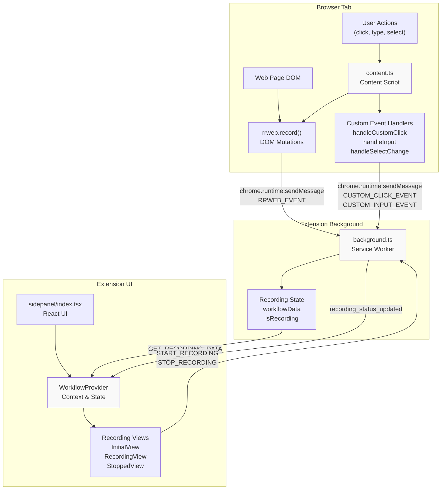
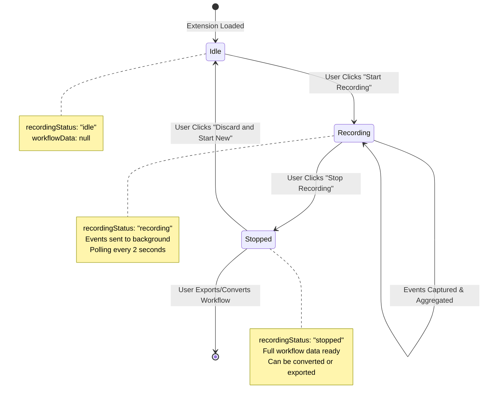
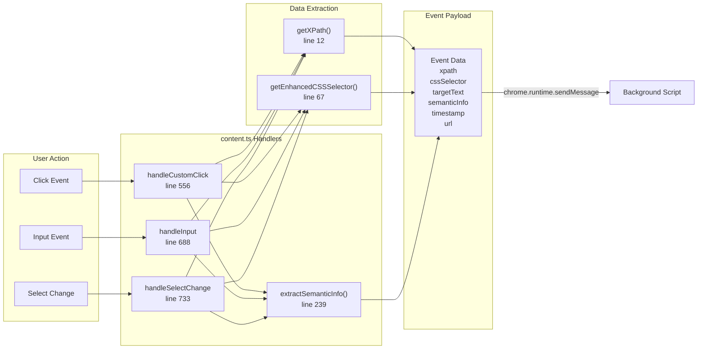
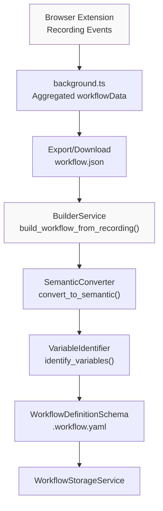

<!-- source: DeepWiki mcp.deepwiki.com · repo browser-use/workflow-use · page 8 Browser Extension · fetched 2026-10-30 -->

# Browser Extension

<details>
<summary>Relevant source files</summary>

The following files were used as context for generating this wiki page:

- [extension/package-lock.json](extension/package-lock.json)
- [extension/src/components/ui/button.tsx](extension/src/components/ui/button.tsx)
- [extension/src/entrypoints/content.ts](extension/src/entrypoints/content.ts)
- [extension/src/entrypoints/sidepanel/context/workflow-provider.tsx](extension/src/entrypoints/sidepanel/context/workflow-provider.tsx)
- [extension/src/entrypoints/sidepanel/index.tsx](extension/src/entrypoints/sidepanel/index.tsx)

</details>


The Browser Extension is a Chrome extension that enables users to record their browser interactions and convert them into reusable semantic workflows. It captures user actions such as clicks, inputs, and navigation in real-time, enriching them with semantic information (labels, aria attributes, text content) that makes workflows more robust and human-readable.

For detailed information about the extension's internal architecture and message passing system, see [Extension Architecture](#8.1). For specifics on event capture mechanisms and semantic extraction strategies, see [Event Capture and Semantic Extraction](#8.2).

## Purpose and Scope

The extension serves as one of three workflow creation methods in the workflow-use system (alongside AI-driven generation via [HealingService](#3.2) and manual creation). Unlike AI generation which requires LLM calls, the browser extension records actual user interactions in real-time, making it ideal for:

- Capturing complex multi-step workflows with exact timing
- Recording interactions on websites that require authentication or specific state
- Creating workflows without incurring LLM API costs
- Building workflows from existing manual processes

The extension outputs workflow data in JSON format that is processed by [BuilderService](#4.1) and [SemanticConverter](#4.3) to generate the final `WorkflowDefinitionSchema`.

## Extension Architecture Overview



**Architecture Components:**

| Component | Location | Purpose |
|-----------|----------|---------|
| Content Script | `extension/src/entrypoints/content.ts` | Injected into every web page; captures user interactions and DOM events |
| Background Script | `extension/src/entrypoints/background.ts` | Service worker that aggregates events, manages recording state, and coordinates messages |
| Sidepanel UI | `extension/src/entrypoints/sidepanel/` | React-based interface for controlling recordings and previewing workflows |
| rrweb Recorder | `rrweb` npm package | Records full DOM mutations and scroll events for complete session replay |
| Custom Handlers | Functions in `content.ts` | Captures semantic information (labels, text, ARIA) alongside raw DOM events |

**Sources:** [extension/src/entrypoints/content.ts:1-214](), [extension/src/entrypoints/sidepanel/index.tsx:1-59](), [extension/src/entrypoints/sidepanel/context/workflow-provider.tsx:1-241]()

## Recording Workflow Lifecycle



**State Management:**

The extension uses a message-passing architecture where:

1. **Content Script** ([content.ts:114-214]()) captures events and sends them to the background script via `chrome.runtime.sendMessage`
2. **Background Script** aggregates events into a `workflowData` object and maintains `isRecording` state
3. **Sidepanel UI** ([workflow-provider.tsx:46-108]()) polls for updates during recording and receives status broadcasts
4. **State Transitions** are broadcast via `recording_status_updated` messages ([workflow-provider.tsx:116-136]())

**Sources:** [extension/src/entrypoints/sidepanel/context/workflow-provider.tsx:40-161](), [extension/src/entrypoints/sidepanel/index.tsx:15-35]()

## Event Capture and Semantic Enrichment



The extension captures two layers of information:

1. **Structural Data** - XPath and CSS selectors for precise element identification
2. **Semantic Data** - Human-readable identifiers extracted via `extractSemanticInfo()` ([content.ts:239-553]())

**Semantic Information Extracted:**

- `labelText` - Associated `<label>` elements, ARIA labels, or parent container text
- `textContent` - Visible text within the element
- `placeholder` - Input placeholder text
- `ariaLabel` - ARIA accessibility attributes
- `value`, `name`, `id`, `type` - Standard HTML attributes
- `radioButtonInfo` - For radio buttons: field name, option value, all available options

This semantic enrichment enables the [SemanticConverter](#4.3) to transform CSS selectors into `target_text`-based workflows that are resilient to DOM structure changes.

**Sources:** [extension/src/entrypoints/content.ts:239-553](), [extension/src/entrypoints/content.ts:556-644](), [extension/src/entrypoints/content.ts:688-729](), [extension/src/entrypoints/content.ts:733-780]()

## Integration with Workflow Generation Pipeline



**Data Flow:**

1. **Recording Phase**: Extension captures events and stores them in `workflowData` JSON structure
2. **Export**: User downloads the recording as a JSON file from the sidepanel
3. **Conversion**: [BuilderService](#4.1) processes the recording via [SemanticConverter](#4.3)
4. **Enhancement**: [VariableIdentifier](#9.1) parameterizes inputs, [SelectorGenerator](#9.2) creates fallback strategies
5. **Storage**: Final workflow saved via [WorkflowStorageService](#9.3)

This pipeline is detailed in Diagram 4 of the system architecture overview.

**Sources:** [extension/src/entrypoints/sidepanel/context/workflow-provider.tsx:1-241]()

## Installation and Usage

**Installation:**

The extension is built using [WXT](https://wxt.dev/), a modern framework for browser extensions. Key dependencies include:

| Package | Version | Purpose |
|---------|---------|---------|
| `rrweb` | 2.0.0-alpha.4 | DOM mutation recording |
| `@rrweb/types` | 2.0.0-alpha.18 | TypeScript types for rrweb |
| `react` | 19.1.0 | Sidepanel UI framework |
| `wxt` | 0.20.6 | Extension build tooling |

**Basic Workflow:**

1. Install the extension in Chrome (developer mode, load unpacked)
2. Open the sidepanel (click extension icon)
3. Click "Start Recording" and perform actions in the browser tab
4. Click "Stop Recording" when finished
5. Export the workflow JSON and convert it using the CLI:

```bash
# Convert recording to semantic workflow
workflow-use build-workflow-from-recording recording.json --output workflow.yaml

# Execute the generated workflow
workflow-use run-workflow workflow.yaml --input '{"field": "value"}'
```

**Sources:** [extension/package-lock.json:1-50]()

## Key Features and Limitations

**Features:**

- **Real-time Visual Feedback**: Hover highlights (green overlay) and focus indicators (red overlay) show which elements are being tracked ([content.ts:865-1001]())
- **Intelligent Event Filtering**: Skips redundant events like hidden radio buttons ([content.ts:647-684]())
- **Scroll Debouncing**: Aggregates scroll events with 500ms debounce and direction change detection ([content.ts:6-186]())
- **Password Masking**: Automatically masks password input values ([content.ts:692]())
- **Multi-Frame Support**: Tracks both main page URL and iframe URLs ([content.ts:622-623]())
- **Radio Button Grouping**: Captures field name and all available options for radio button groups ([content.ts:246-398]())

**Limitations:**

- Chrome/Chromium-based browsers only (uses Chrome Extension Manifest V3)
- Requires manual export/import workflow (no direct integration with CLI yet)
- Does not capture browser-level actions (opening new tabs, downloads)
- May not capture interactions in shadow DOM elements
- Recording state persists only in memory (lost on extension reload)

**Sources:** [extension/src/entrypoints/content.ts:6-1001]()

## Relationship to Other Components

The Browser Extension is one of three workflow creation methods:

| Method | Entry Point | Use Case | Cost |
|--------|------------|----------|------|
| **Browser Extension** | `content.ts` recording | Complex authenticated workflows | Free |
| **AI Generation** | [HealingService](#3.2) | Quick workflow creation from prompts | LLM API costs |
| **Manual Creation** | YAML/JSON editing | Custom logic, advanced features | Free |

All three methods produce the same `WorkflowDefinitionSchema` output that can be executed by the [Workflow Execution](#5) system. The extension's recordings are processed by the same enhancement pipeline ([VariableIdentifier](#9.1), [SelectorGenerator](#9.2)) as AI-generated workflows, ensuring consistency across creation methods.

**Sources:** [extension/src/entrypoints/content.ts:1-1001](), [extension/src/entrypoints/sidepanel/context/workflow-provider.tsx:1-241]()

---

