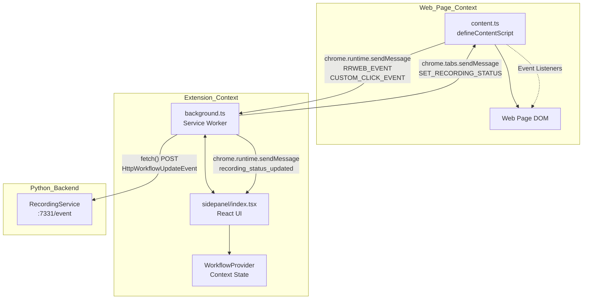
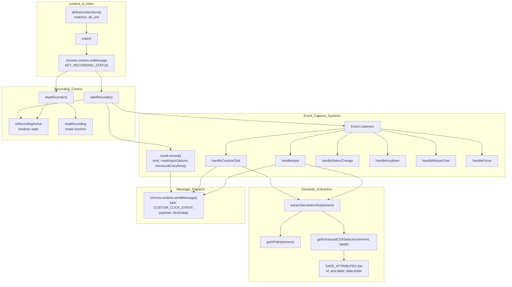
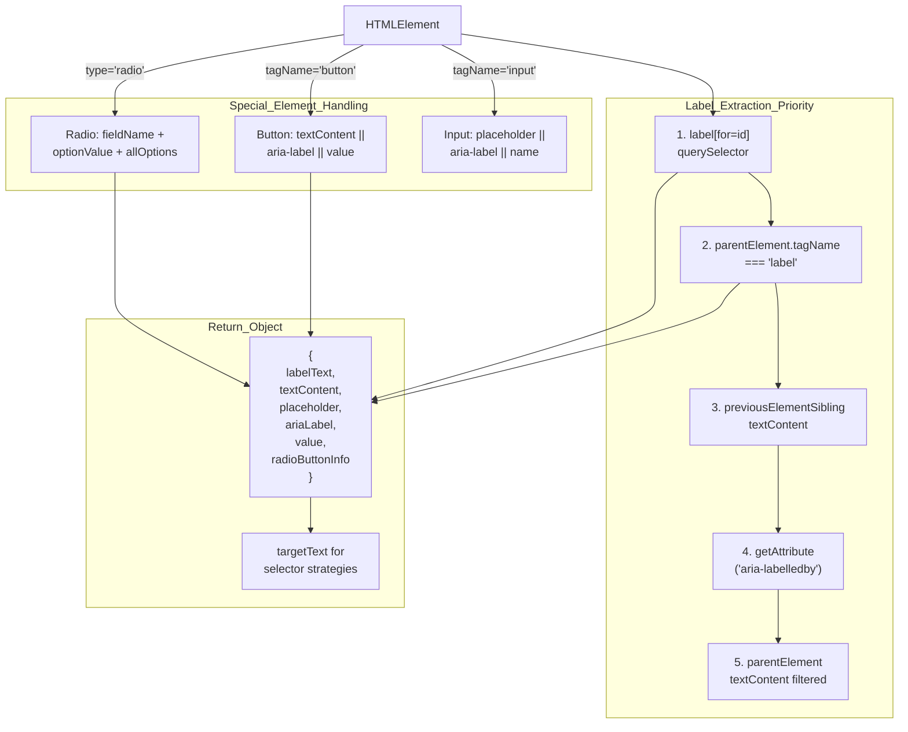
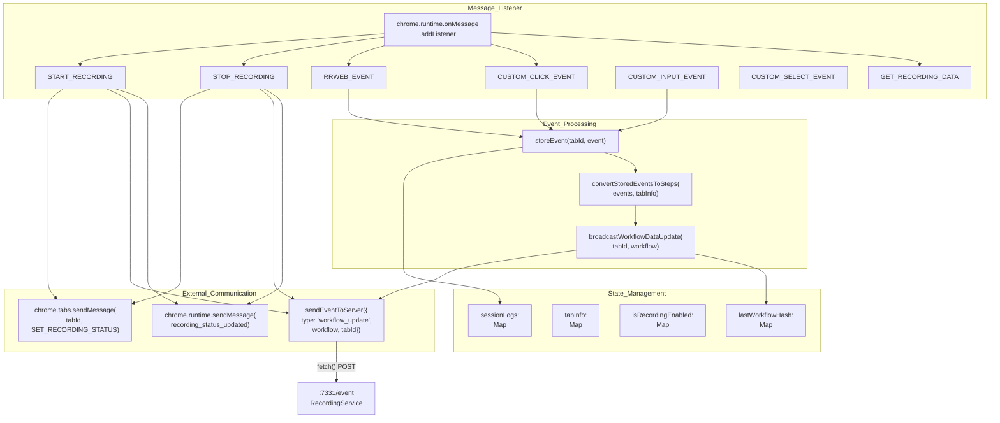
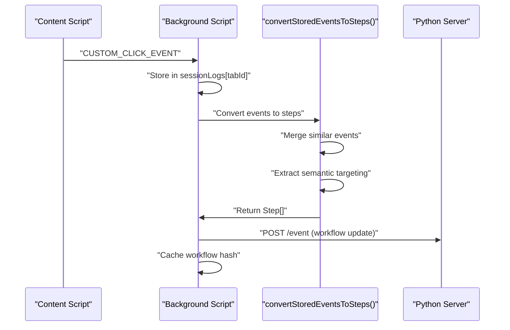
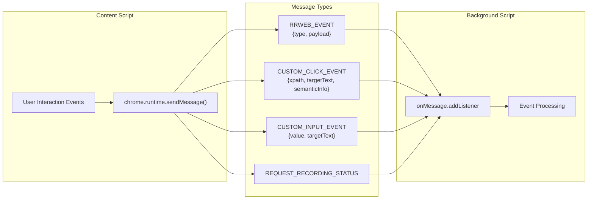
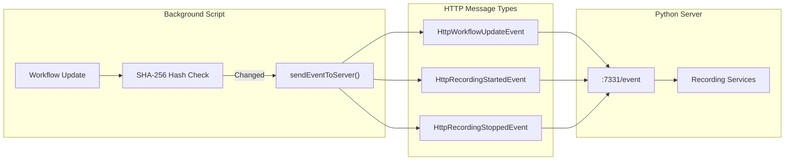

<!-- source: DeepWiki mcp.deepwiki.com · repo browser-use/workflow-use · page 8.1 Extension Architecture · fetched 2026-10-30 -->

# Extension Architecture

Relevant source files

The following files were used as context for generating this wiki page:

- [extension/package-lock.json](extension/package-lock.json)
- [extension/src/components/ui/button.tsx](extension/src/components/ui/button.tsx)
- [extension/src/entrypoints/content.ts](extension/src/entrypoints/content.ts)
- [extension/src/entrypoints/sidepanel/context/workflow-provider.tsx](extension/src/entrypoints/sidepanel/context/workflow-provider.tsx)
- [extension/src/entrypoints/sidepanel/index.tsx](extension/src/entrypoints/sidepanel/index.tsx)

This document details the internal architecture of the browser extension component, focusing on the content script, background script, and their communication patterns. The extension is built using the WXT framework and handles the recording of user interactions on web pages.

For information about how workflows are recorded and processed, see [Recording Workflows](#3.1). For details about the workflow execution engine, see [Core Engine Components](#2.2).

## Component Overview

The browser extension is built using the WXT framework and consists of four main components working together to capture and process user interactions:

**Extension Components Architecture**

The extension uses a four-tier architecture: content scripts capture interactions from the DOM, the background service worker processes and coordinates events, the side panel provides user interface controls via React, and the Python backend persists workflow data.

Sources: [extension/src/entrypoints/content.ts:1003-1045](), [extension/src/entrypoints/sidepanel/index.tsx:1-59](), [extension/src/entrypoints/sidepanel/context/workflow-provider.tsx:27-108]()

## Content Script Architecture

The content script (`content.ts`) runs in the context of each web page and is responsible for capturing user interactions. It is defined using WXT's `defineContentScript` and combines rrweb recording with custom event handlers for enhanced semantic information capture.

**Content Script Event Capture Architecture**

The content script uses `defineContentScript` from WXT, `rrweb.record()` for DOM mutations, and custom event listeners with `extractSemanticInfo()` for enhanced semantic targeting.

Sources: [extension/src/entrypoints/content.ts:1003-1045](), [extension/src/entrypoints/content.ts:114-214](), [extension/src/entrypoints/content.ts:216-236](), [extension/src/entrypoints/content.ts:238-553](), [extension/src/entrypoints/content.ts:555-644]()

### Event Handler Specialization

The content script implements specialized handlers for different interaction types:

| Handler | Purpose | Key Features |
|---------|---------|--------------|
| `handleCustomClick` | Click events with semantic context | Radio button detection, visibility filtering, target text extraction |
| `handleInput` | Text input with field identification | Label association, placeholder extraction, password masking |
| `handleSelectChange` | Dropdown selections | Option enumeration, field name extraction |
| `handleKeydown` | Special key combinations | Navigation keys, modifier combinations |

Each handler extracts semantic information through the `extractSemanticInfo()` function, which implements multiple strategies for associating interactive elements with their human-readable labels.

Sources: [extension/src/entrypoints/content.ts:534-619](), [extension/src/entrypoints/content.ts:660-701](), [extension/src/entrypoints/content.ts:704-752](), [extension/src/entrypoints/content.ts:772-829]()

### Semantic Information Extraction

The `extractSemanticInfo()` function uses multiple fallback strategies to identify elements by visible text rather than brittle CSS selectors:

**extractSemanticInfo() Function Flow**

The function implements a priority-based strategy system with special handling for radio buttons, buttons, and input fields, returning structured semantic data for use in selector strategies.

Sources: [extension/src/entrypoints/content.ts:238-553](), [extension/src/entrypoints/content.ts:242-426](), [extension/src/entrypoints/content.ts:428-518]()

## Background Script Architecture

The background script (`background.ts`) runs as a service worker and serves as the central coordinator, processing events from content scripts, managing recording state, and communicating with the Python backend server.

**Background Script Service Worker Architecture**

The background script maintains per-tab state in `Map` structures, processes incoming events through `convertStoredEventsToSteps()`, and broadcasts updates via `chrome.runtime.sendMessage()` and HTTP POST to the Python backend.

Sources: [extension/src/entrypoints/background.ts:28-70](), [extension/src/entrypoints/background.ts:296-527](), [extension/src/entrypoints/background.ts:531-790]()

### Event Storage and Conversion

The background script maintains in-memory storage of events organized by tab and converts them into structured workflow steps:

**Event Processing Flow**

Events flow from content scripts through storage, conversion, and distribution to maintain real-time workflow updates.

The conversion process handles event merging for continuous actions (like typing) and prioritizes semantic targeting over CSS selectors:

Sources: [extension/src/entrypoints/background.ts:298-527](), [extension/src/entrypoints/background.ts:303-345](), [extension/src/entrypoints/background.ts:347-416]()

## Message Communication Patterns

The extension uses Chrome's message passing APIs to coordinate between components:

### Content Script to Background Script

**Content to Background Message Flow**

Content scripts send structured event messages containing both traditional selector information and semantic targeting data.

Sources: [extension/src/entrypoints/content.ts:612-615](), [extension/src/entrypoints/content.ts:694-697](), [extension/src/entrypoints/background.ts:531-547]()

### Background Script to Python Server

The background script communicates with the Python backend using HTTP POST requests to the `/event` endpoint:

**Background to Server Communication**

The background script sends semantic workflow updates to the Python server, using hash-based deduplication to avoid redundant updates.

Sources: [extension/src/entrypoints/background.ts:56-70](), [extension/src/entrypoints/background.ts:182-189](), [extension/lib/message-bus-types.ts:5-39]()

### Recording State Management

Recording state is managed centrally in the background script and broadcast to all components:

| State | Triggers | Recipients |
|-------|----------|------------|
| `START_RECORDING` | Sidepanel user action | All content scripts, Python server |
| `STOP_RECORDING` | Sidepanel user action | All content scripts, Python server |
| `SET_RECORDING_STATUS` | State changes | Individual content scripts |
| `REQUEST_RECORDING_STATUS` | Content script initialization | Requesting content script |

The background script maintains the authoritative recording state and ensures all components stay synchronized through broadcast messaging.

Sources: [extension/src/entrypoints/background.ts:659-701](), [extension/src/entrypoints/background.ts:192-220](), [extension/src/entrypoints/content.ts:978-1016]()

---

