<!-- source: DeepWiki mcp.deepwiki.com · repo browser-use/workflow-use · page 8.2 Event Capture and Semantic Extraction · fetched 2026-10-30 -->

# Event Capture and Semantic Extraction

<details>
<summary>Relevant source files</summary>

The following files were used as context for generating this wiki page:

- [extension/package-lock.json](extension/package-lock.json)
- [extension/src/components/ui/button.tsx](extension/src/components/ui/button.tsx)
- [extension/src/entrypoints/content.ts](extension/src/entrypoints/content.ts)
- [extension/src/entrypoints/sidepanel/context/workflow-provider.tsx](extension/src/entrypoints/sidepanel/context/workflow-provider.tsx)
- [extension/src/entrypoints/sidepanel/index.tsx](extension/src/entrypoints/sidepanel/index.tsx)

</details>


## Purpose and Scope

This page documents the browser extension's event capture and semantic extraction system. This system records user interactions in the browser and enriches them with semantic information to enable robust, human-readable workflow generation. For the overall extension architecture and message passing, see [Extension Architecture](#8.1). For how recorded events are converted to workflow definitions, see [Semantic Conversion and Optimization](#4.3).

The event capture system operates in two parallel layers:
1. **rrweb recording** - Captures all DOM mutations and scroll events
2. **Custom event handlers** - Captures semantic-rich user interactions (clicks, inputs, selections)

This dual-layer approach ensures both complete page state recording and actionable semantic targeting information.

## Event Capture Architecture

The content script in [extension/src/entrypoints/content.ts]() implements a dual recording system that runs continuously during an active recording session.

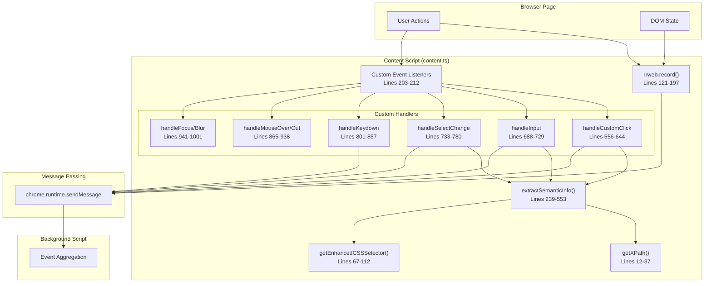

**Sources:** [extension/src/entrypoints/content.ts:1-1063]()

The content script maintains local state `isRecordingActive` to gate event capture and coordinates with the background script through message passing.

## rrweb Integration

The system uses **rrweb** (record and replay web) to capture complete DOM state and mutations. This provides a baseline recording of all page changes.

### rrweb Configuration

| Configuration | Value | Purpose |
|---------------|-------|---------|
| `maskInputOptions.password` | `true` | Masks password field values |
| `checkoutEveryNms` | `10000` | Full snapshot every 10 seconds |
| `checkoutEveryNth` | `200` | Full snapshot every 200 events |
| Scroll debouncing | `500ms` | Reduces scroll event noise |

**Sources:** [extension/src/entrypoints/content.ts:114-214]()

### Scroll Event Handling

The system implements intelligent scroll event debouncing with direction detection:

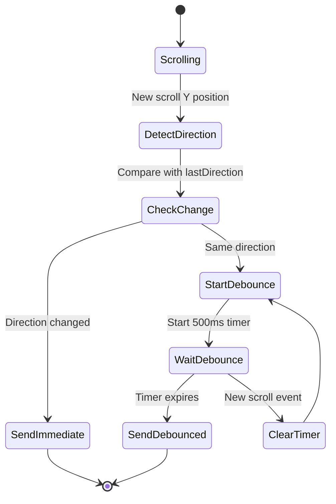

**Sources:** [extension/src/entrypoints/content.ts:126-186]()

This approach:
- Immediately records when scroll direction changes (up ↔ down)
- Debounces continuous scrolling in the same direction
- Rounds coordinates to reduce data volume
- Resets direction state after debounce completes

## Custom Event Handlers

Custom event handlers capture semantic-rich interactions that rrweb alone cannot provide. These handlers run in **capture phase** (`useCapture: true`) to intercept events before they reach their targets.

### Event Handler Registration

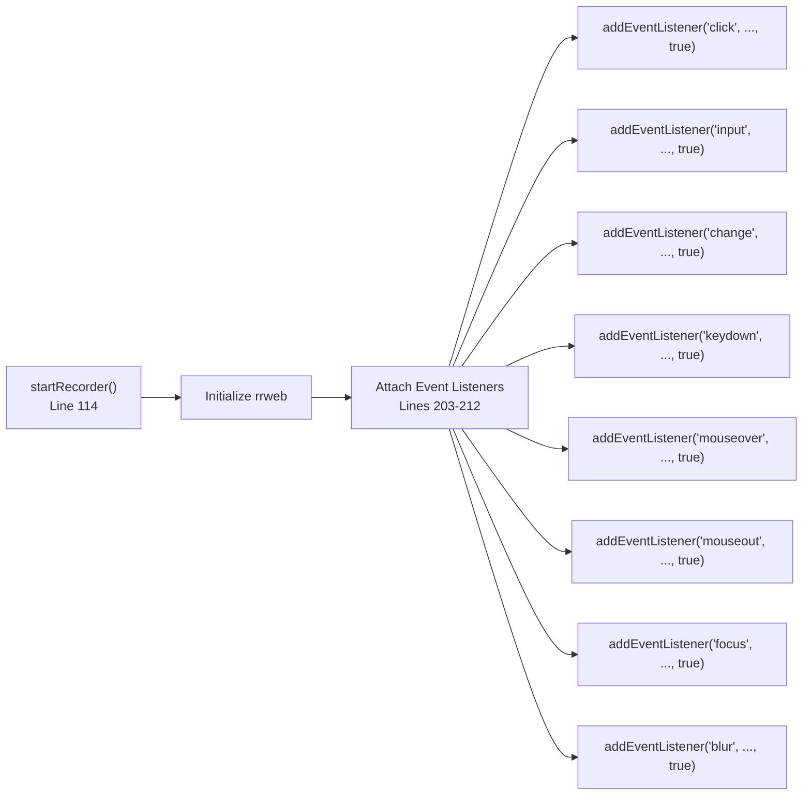

**Sources:** [extension/src/entrypoints/content.ts:203-213]()

### Click Event Capture

The `handleCustomClick` function captures click events with intelligent filtering:

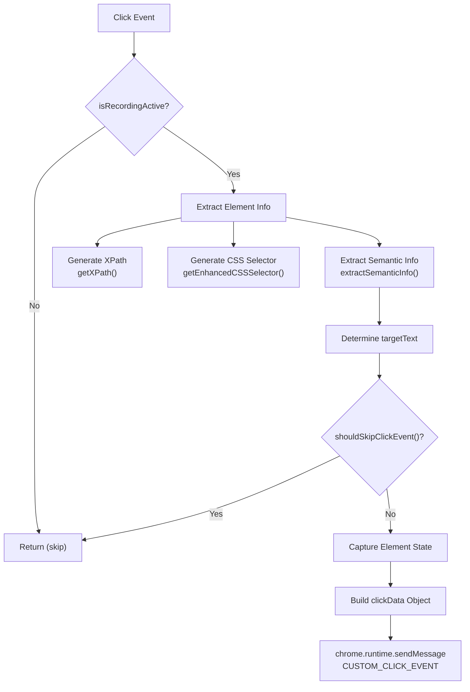

**Sources:** [extension/src/entrypoints/content.ts:556-644]()

**Click Event Data Structure:**

| Field | Type | Description |
|-------|------|-------------|
| `timestamp` | `number` | `Date.now()` |
| `url` | `string` | Document location (main page) |
| `frameUrl` | `string` | Window location (current frame) |
| `xpath` | `string` | Generated XPath |
| `cssSelector` | `string` | Enhanced CSS selector |
| `elementTag` | `string` | Tag name |
| `elementText` | `string` | Text content (truncated) |
| `elementType` | `string` | Input type if applicable |
| `targetText` | `string` | Human-readable identifier |
| `semanticInfo` | `object` | Full semantic extraction result |
| `radioButtonInfo` | `object \| null` | Radio button group info |
| `checked` | `boolean?` | Checkbox/radio state |

**Sources:** [extension/src/entrypoints/content.ts:620-640]()

### Click Filtering Logic

To reduce redundant events, the system skips certain clicks:

```typescript
// Implemented in shouldSkipClickEvent (lines 648-673)
function shouldSkipClickEvent(element, semanticInfo, targetText): boolean {
  // Skip hidden radio inputs (redundant with visible elements)
  if (tag === 'input' && type === 'radio' && !isElementVisible(element))
    return true;
  
  // Skip role="radio" buttons with no text (composite components)
  if (tag === 'button' && role === 'radio' && !targetText.trim())
    return true;
  
  // Skip hidden radios with no semantic value
  if (!targetText && tag === 'input' && type === 'radio' && display === 'none')
    return true;
  
  return false;
}
```

**Sources:** [extension/src/entrypoints/content.ts:646-674](), [extension/src/entrypoints/content.ts:677-684]()

### Input Event Capture

The `handleInput` function captures text input with password masking:

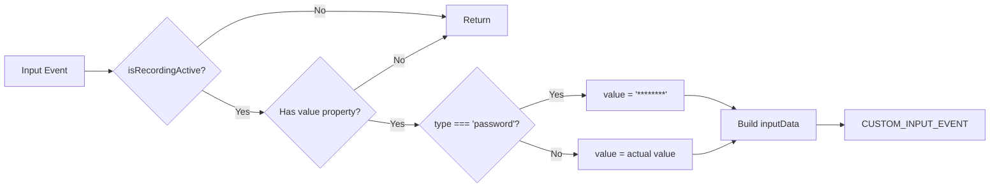

**Sources:** [extension/src/entrypoints/content.ts:688-729]()

**Input Event Data Structure:**

| Field | Value | Notes |
|-------|-------|-------|
| `xpath` | Generated XPath | For element location |
| `cssSelector` | Enhanced CSS selector | Alternative locator |
| `value` | String or `"********"` | Masked for passwords |
| `inputType` | `'text'`, `'password'`, etc. | Input type attribute |
| `targetText` | Semantic identifier | Label or placeholder |
| `semanticInfo` | Full extraction | For robust targeting |

**Sources:** [extension/src/entrypoints/content.ts:707-720]()

### Select Dropdown Capture

The `handleSelectChange` function captures dropdown selections with all available options:

```typescript
// Captures all options in dropdown (lines 744-751)
const allOptions: Array<{text: string, value: string}> = [];
for (let i = 0; i < targetElement.options.length; i++) {
  const option = targetElement.options[i];
  allOptions.push({
    text: option.text.trim(),
    value: option.value
  });
}
```

**Select Event Data:**
- `selectedValue` - The value attribute of selected option
- `selectedText` - The visible text of selected option
- `allOptions` - Complete list of available options
- `fieldName` - Extracted label or name
- `targetText` - Semantic field identifier

**Sources:** [extension/src/entrypoints/content.ts:733-780]()

### Keyboard Event Capture

The system captures specific keyboard events that affect workflow behavior:

**Captured Keys:**

| Category | Keys |
|----------|------|
| Navigation | `Enter`, `Tab`, `Escape` |
| Arrows | `ArrowUp`, `ArrowDown`, `ArrowLeft`, `ArrowRight` |
| Page Control | `Home`, `End`, `PageUp`, `PageDown` |
| Editing | `Backspace`, `Delete` |
| Shortcuts | `Ctrl/Cmd + [a-zA-Z0-9]` |

**Sources:** [extension/src/entrypoints/content.ts:784-857]()

The system normalizes modifier keys as `CmdOrCtrl+KEY` for cross-platform compatibility.

### Visual Feedback System

The extension provides real-time visual feedback during recording:

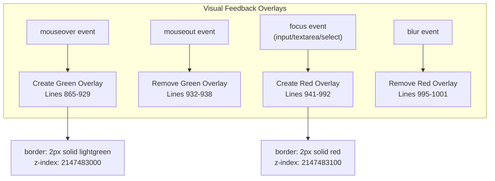

**Sources:** [extension/src/entrypoints/content.ts:861-1001]()

The red overlay has higher z-index (2147483100) than green (2147483000) so focused inputs appear highlighted above hover states.

## Semantic Information Extraction

The `extractSemanticInfo()` function is the core of semantic targeting. It employs multiple strategies to find human-readable identifiers for elements.

### Extraction Strategy Flow

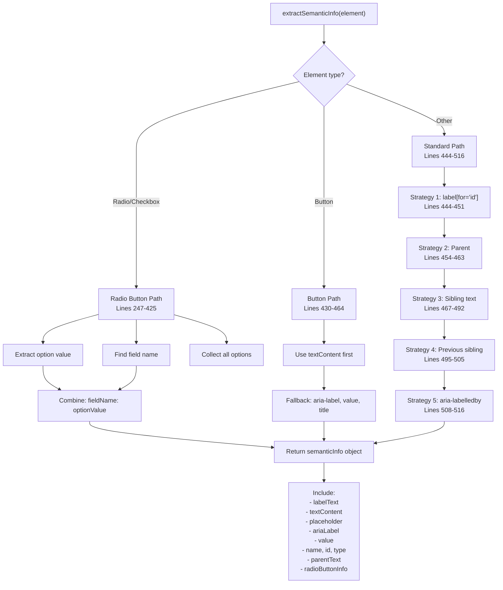

**Sources:** [extension/src/entrypoints/content.ts:239-553]()

### Label Discovery Strategies

The system attempts multiple strategies in priority order:

**Standard Element Label Discovery:**

1. **Direct `label[for="id"]` Association** (Lines 444-451)
   - Most reliable for properly associated labels
   - Uses element's `id` attribute to find label

2. **Parent `<label>` Element** (Lines 454-463)
   - Common pattern: `<label><input /></label>`
   - Walks up parent chain looking for label tag

3. **Sibling Text Extraction** (Lines 467-492)
   - Checks next/previous siblings for text nodes or elements
   - Filters out element's own text content
   - Length limits: 2-200 characters for parent text

4. **Previous Sibling Search** (Lines 495-505)
   - Specifically looks backward in sibling chain
   - Useful for label-then-input patterns

5. **aria-labelledby Reference** (Lines 508-516)
   - Follows ARIA references to labeled elements
   - Uses `document.getElementById(ariaLabelledBy)`

**Sources:** [extension/src/entrypoints/content.ts:444-516]()

### Button Element Handling

Buttons receive special treatment to avoid confusion:

```typescript
// Special handling for buttons (lines 430-441)
if (elementTag === 'button' || 
    (elementTag === 'input' && ['button', 'submit'].includes(elementType))) {
  // Prioritize the button's own text content
  labelText = element.textContent?.trim() || '';
  
  // Fallback chain for buttons
  if (!labelText) {
    labelText = element.getAttribute('aria-label') ||
                (element as any).value ||
                element.title || '';
  }
}
```

This ensures buttons use their visible text rather than container labels, preventing confusion in workflows.

**Sources:** [extension/src/entrypoints/content.ts:430-441]()

### Radio Button and Checkbox Handling

Radio buttons and checkboxes require sophisticated extraction due to their grouped nature:

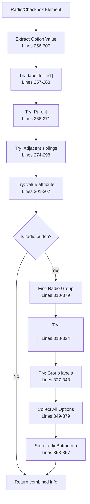

**Sources:** [extension/src/entrypoints/content.ts:246-398]()

**Radio Button Information Structure:**

```typescript
// Stored in element._radioButtonInfo (lines 393-397)
{
  fieldName: string;      // "Marital Status"
  optionValue: string;    // "Married"
  allOptions: string[];   // ["Single", "Married", "Divorced"]
}
```

This structure enables workflows to:
- Display meaningful labels like "Marital Status: Married"
- Validate available options during execution
- Provide better error messages when options change

**Sources:** [extension/src/entrypoints/content.ts:393-397]()

### Context Extraction

For additional robustness, the system captures parent context:

```typescript
// Parent context extraction (lines 520-528)
let parentText = '';
let parent = element.parentElement;
while (parent && !parentText && parent !== document.body) {
  const text = parent.textContent?.trim() || '';
  if (text && text.length < 100) {
    parentText = text;
  }
  parent = parent.parentElement;
}
```

This provides fallback information for matching when primary semantic info is insufficient.

**Sources:** [extension/src/entrypoints/content.ts:519-528]()

## Selector Generation

The system generates both XPath and CSS selectors for each interacted element, providing multiple targeting strategies.

### XPath Generation

The `getXPath()` function creates structural XPath expressions:

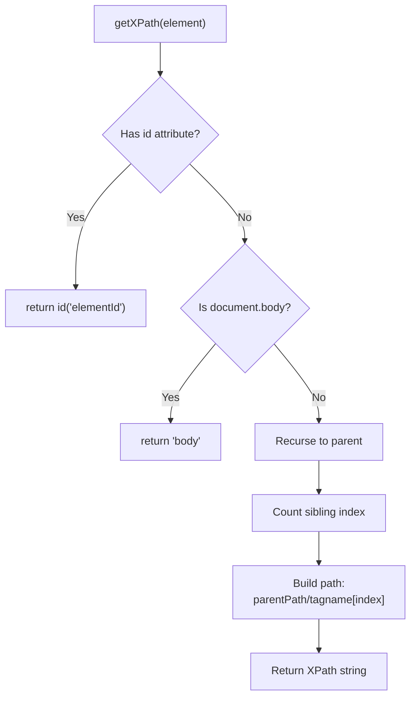

**Example Output:**
- Element with id: `id("submit-button")`
- Nested element: `body/div[1]/form[1]/input[3]`

**Sources:** [extension/src/entrypoints/content.ts:12-37]()

The XPath uses 1-based indexing and only indexes among same-tag siblings for clarity.

### Enhanced CSS Selector Generation

The `getEnhancedCSSSelector()` function builds robust CSS selectors using safe attributes:

**Safe Attributes List:**

| Category | Attributes |
|----------|-----------|
| Identity | `id`, `name` |
| Input | `type`, `placeholder`, `autocomplete`, `required`, `readonly` |
| Accessibility | `aria-label`, `aria-labelledby`, `aria-describedby`, `role` |
| Links | `href`, `target`, `for` |
| Media | `src`, `alt`, `title` |
| Testing | `data-id`, `data-qa`, `data-cy`, `data-testid` |

**Sources:** [extension/src/entrypoints/content.ts:42-65]()

### CSS Selector Construction

```typescript
// CSS selector building (lines 67-112)
function getEnhancedCSSSelector(element: HTMLElement, xpath: string): string {
  let cssSelector = element.tagName.toLowerCase();
  
  // 1. Add classes
  if (element.classList && element.classList.length > 0) {
    const validClassPattern = /^[a-zA-Z_][a-zA-Z0-9_-]*$/;
    element.classList.forEach((className) => {
      if (className && validClassPattern.test(className)) {
        cssSelector += `.${CSS.escape(className)}`;
      }
    });
  }
  
  // 2. Add safe attributes
  for (const attr of element.attributes) {
    if (attr.name === "class") continue;
    if (!SAFE_ATTRIBUTES.has(attr.name)) continue;
    
    if (attr.value === "") {
      cssSelector += `[${CSS.escape(attr.name)}]`;
    } else {
      const safeValue = attr.value.replace(/"/g, '"');
      if (/["'<>`\s]/.test(attr.value)) {
        cssSelector += `[${CSS.escape(attr.name)}*="${safeValue}"]`; // Contains
      } else {
        cssSelector += `[${CSS.escape(attr.name)}="${safeValue}"]`; // Exact
      }
    }
  }
  
  return cssSelector;
}
```

**Example Output:**
- `button.btn.btn-primary[type="submit"][aria-label="Submit form"]`
- `input[type="email"][name="user_email"][placeholder="Enter email"][required]`

**Sources:** [extension/src/entrypoints/content.ts:67-112]()

The function uses `CSS.escape()` for proper escaping and switches to substring matching (`*=`) when attribute values contain special characters.

## Target Text Determination

The `targetText` field is critical for semantic workflow execution. The system uses element-specific logic to determine the most appropriate identifier:

### Target Text Selection Logic

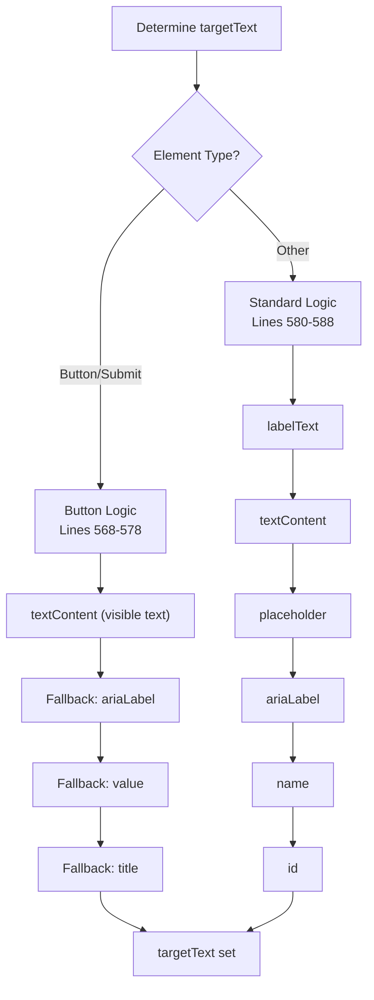

**Sources:** [extension/src/entrypoints/content.ts:566-588]()

This prioritization ensures:
- Buttons use visible text (avoiding container confusion)
- Inputs use labels or placeholders (user-facing identifiers)
- All elements fall back to structural attributes if needed

## Event Message Flow

All captured events flow from content script to background script via Chrome message passing:

### Message Types and Payloads

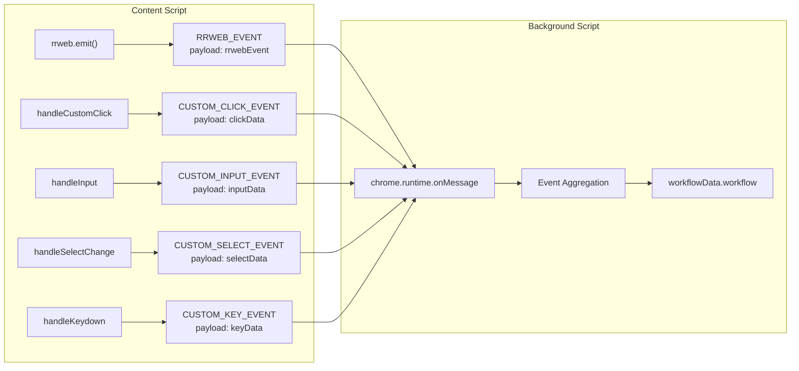

**Sources:** [extension/src/entrypoints/content.ts:156-157](), [extension/src/entrypoints/content.ts:189](), [extension/src/entrypoints/content.ts:637-640](), [extension/src/entrypoints/content.ts:722-725](), [extension/src/entrypoints/content.ts:772-776](), [extension/src/entrypoints/content.ts:849-852]()

### Message Types Table

| Message Type | Triggered By | Key Payload Fields |
|--------------|--------------|-------------------|
| `RRWEB_EVENT` | rrweb.emit() | Full rrweb event object (scroll, mutation, etc.) |
| `CUSTOM_CLICK_EVENT` | Click handler | xpath, cssSelector, targetText, semanticInfo, radioButtonInfo |
| `CUSTOM_INPUT_EVENT` | Input handler | xpath, value (masked if password), targetText, inputType |
| `CUSTOM_SELECT_EVENT` | Select change | selectedValue, selectedText, allOptions, fieldName |
| `CUSTOM_KEY_EVENT` | Keydown handler | key (e.g., "Enter", "CmdOrCtrl+S"), xpath of focused element |

All messages include `timestamp`, `url` (document location), and `frameUrl` (window location) for proper event ordering and frame identification.

## Recording Lifecycle Management

The content script responds to recording state changes from the background script:

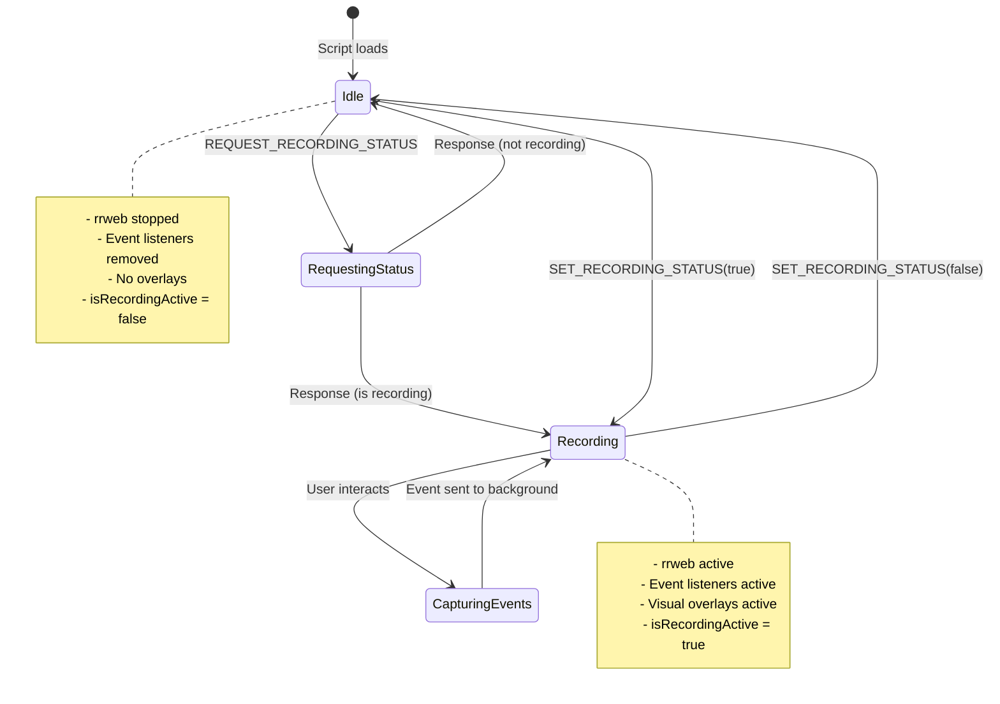

**Sources:** [extension/src/entrypoints/content.ts:1003-1034]()

When the content script loads, it immediately requests the current recording status from the background script. This ensures consistent state across page reloads and navigation.

### State Synchronization

```typescript
// Message listener (lines 1007-1016)
chrome.runtime.onMessage.addListener((message, _sender, _sendResponse) => {
  if (message.type === "SET_RECORDING_STATUS") {
    const shouldBeRecording = message.payload;
    if (shouldBeRecording && !isRecordingActive) {
      startRecorder();
    } else if (!shouldBeRecording && isRecordingActive) {
      stopRecorder();
    }
  }
});

// Initial status request (lines 1024-1036)
chrome.runtime.sendMessage(
  { type: "REQUEST_RECORDING_STATUS" },
  (response) => {
    if (response.isRecording) {
      startRecorder();
    }
  }
);
```

**Sources:** [extension/src/entrypoints/content.ts:1007-1036]()

This architecture ensures the content script's recording state always matches the global recording state managed by the background script, even across tab switches and page navigations.

## Summary of Captured Data

The event capture system produces rich, multi-layered event data:

**Data Completeness Matrix:**

| Data Category | rrweb | Custom Click | Custom Input | Custom Select | Custom Key |
|--------------|-------|--------------|--------------|---------------|------------|
| DOM Mutations | ✓ | - | - | - | - |
| Scroll Events | ✓ | - | - | - | - |
| XPath | - | ✓ | ✓ | ✓ | ✓ |
| CSS Selector | - | ✓ | ✓ | ✓ | ✓ |
| Semantic Info | - | ✓ | ✓ | ✓ | - |
| Target Text | - | ✓ | ✓ | ✓ | - |
| Element State | - | ✓ (checked) | - | - | - |
| Input Value | - | - | ✓ | - | - |
| Selected Option | - | - | - | ✓ | - |
| All Options | - | - | - | ✓ | - |
| Key Pressed | - | - | - | - | ✓ |
| Radio Group Info | - | ✓ | - | - | - |

This comprehensive capture enables the system to generate workflows that are both deterministic (via selectors) and semantically meaningful (via target text and semantic info).

**Sources:** [extension/src/entrypoints/content.ts:1-1063]()

---

