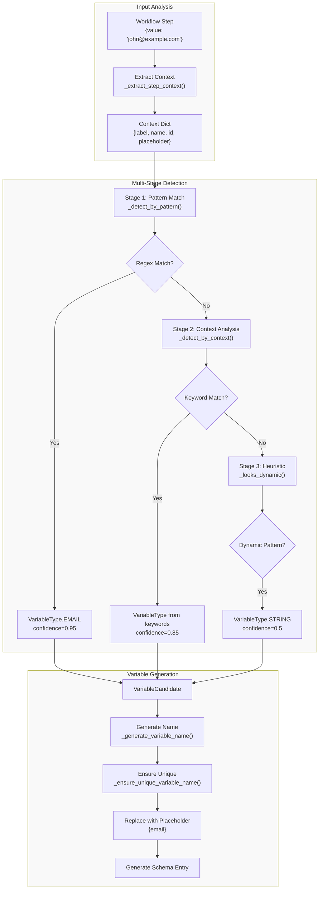
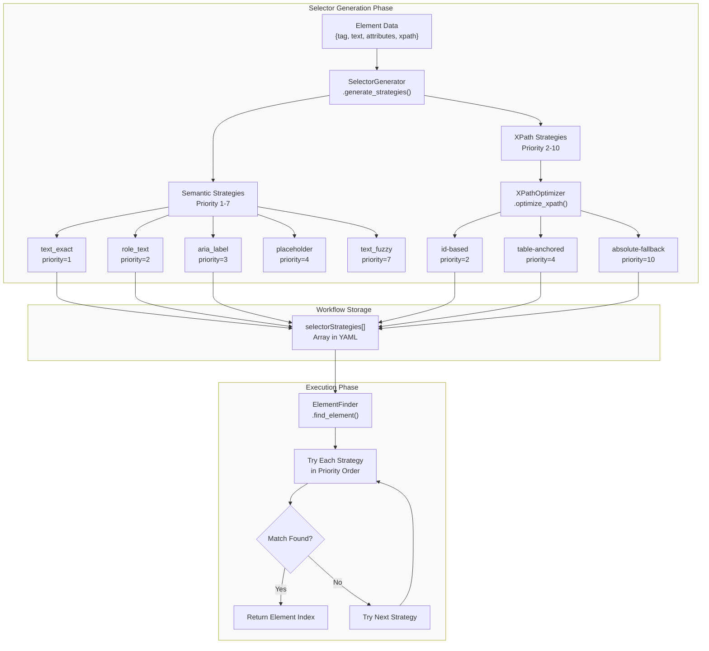
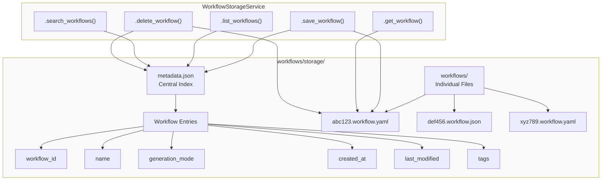
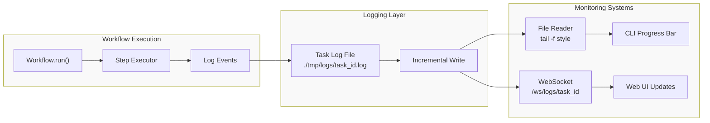
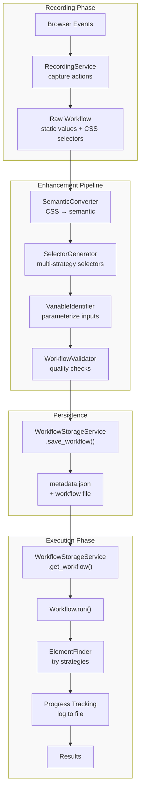
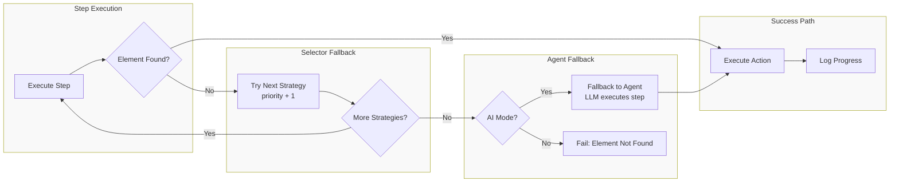

<!-- source: DeepWiki mcp.deepwiki.com · repo browser-use/workflow-use · page 9 Advanced Topics · fetched 2026-10-30 -->

# Advanced Topics

<details>
<summary>Relevant source files</summary>

The following files were used as context for generating this wiki page:

- [README.md](README.md)
- [workflows/.gitignore](workflows/.gitignore)
- [workflows/test_max_alternatives_bug_fix.py](workflows/test_max_alternatives_bug_fix.py)
- [workflows/tests/test_selector_generator.py](workflows/tests/test_selector_generator.py)
- [workflows/tests/test_xpath_optimization.py](workflows/tests/test_xpath_optimization.py)
- [workflows/workflow_use/healing/selector_generator.py](workflows/workflow_use/healing/selector_generator.py)
- [workflows/workflow_use/healing/xpath_optimizer.py](workflows/workflow_use/healing/xpath_optimizer.py)
- [workflows/workflow_use/storage/__init__.py](workflows/workflow_use/storage/__init__.py)
- [workflows/workflow_use/workflow/tests/test_variable_identifier.py](workflows/workflow_use/workflow/tests/test_variable_identifier.py)
- [workflows/workflow_use/workflow/validation_utils.py](workflows/workflow_use/workflow/validation_utils.py)
- [workflows/workflow_use/workflow/variable_config.py](workflows/workflow_use/workflow/variable_config.py)
- [workflows/workflow_use/workflow/variable_identifier.py](workflows/workflow_use/workflow/variable_identifier.py)

</details>


This page introduces advanced features of the workflow-use system designed for power users and developers who need fine-grained control over workflow behavior, robustness, and customization. These features enable deterministic execution, self-healing workflows, and sophisticated variable management.

**Scope**: This page covers the architectural foundations of four key advanced subsystems. For detailed implementation guidance, see the child pages: Variable Identification ([#9.1](#9.1)), Selector Generation ([#9.2](#9.2)), Workflow Storage ([#9.3](#9.3)), and Progress Tracking ([#9.4](#9.4)).

For basic workflow creation and execution, see [Workflow Generation](#3) and [Workflow Execution](#5).

---

## Advanced Features Overview

The workflow-use system includes four advanced subsystems that work together to create robust, reusable workflows:

| Feature | Purpose | Key Classes | Execution Phase |
|---------|---------|-------------|-----------------|
| Variable Identification | Automatically detect and parameterize input values | `VariableIdentifier`, `VariableIdentificationConfig` | Post-generation |
| Selector Generation | Create multi-strategy element locators with fallbacks | `SelectorGenerator`, `XPathOptimizer` | Generation / Recording |
| Workflow Storage | Persist workflows with metadata for retrieval | `WorkflowStorageService`, `WorkflowMetadata` | Post-generation |
| Progress Tracking | Monitor workflow execution in real-time | Task logging, WebSocket events | Runtime |

These subsystems operate at different stages of the workflow lifecycle:

```mermaid
flowchart LR
    subgraph Generation["Workflow Generation"]
        A["Browser Action Recording"] --> B["SelectorGenerator"]
        B --> C["Multi-Strategy Selectors"]
    end
    
    subgraph PostProcessing["Post-Processing"]
        C --> D["VariableIdentifier"]
        D --> E["Parameterized Workflow"]
        E --> F["WorkflowValidator"]
    end
    
    subgraph Storage["Persistence"]
        F --> G["WorkflowStorageService"]
        G --> H["metadata.json"]
        G --> I["workflow_id.workflow.yaml"]
    end
    
    subgraph Execution["Workflow Execution"]
        I --> J["Workflow.load_from_file"]
        J --> K["ElementFinder"]
        K --> L["Progress Tracking"]
        L --> M["Results"]
    end
    
    style Generation fill:#f9f9f9
    style PostProcessing fill:#f9f9f9
    style Storage fill:#f9f9f9
    style Execution fill:#f9f9f9
```



**Sources:** [README.md:1-268](), [workflows/workflow_use/healing/selector_generator.py:1-631](), [workflows/workflow_use/workflow/variable_identifier.py:1-528]()

---

## Variable Identification Architecture

The `VariableIdentifier` system automatically detects which input values in a workflow should be parameterized as variables, transforming static recordings into reusable templates. This enables workflows to accept different inputs on each execution without manual intervention.

### Core Variable Detection Pipeline



**Key Detection Strategies:**

1. **Pattern-Based (Highest Confidence)**: Uses regex patterns in `PATTERNS` dict to match emails, phone numbers, SSNs, credit cards, dates, URLs, and zip codes. [workflows/workflow_use/workflow/variable_identifier.py:60-69]()

2. **Context-Based (Medium Confidence)**: Analyzes semantic context from labels, placeholders, ARIA attributes, and field names using `VARIABLE_KEYWORDS` mapping. [workflows/workflow_use/workflow/variable_identifier.py:72-101]()

3. **Heuristic (Lower Confidence)**: Detects dynamic-looking values based on mixed case, numbers, special characters, and length. [workflows/workflow_use/workflow/variable_identifier.py:306-324]()

### Configuration Presets

The `VariableConfigPresets` class provides five preset configurations for different use cases:

| Preset | min_confidence | Use Case | Key Features |
|--------|---------------|----------|--------------|
| `strict()` | 0.85 | Production workflows | No defaults, high-confidence only |
| `balanced()` | 0.6 | General use (default) | Reasonable threshold, includes defaults |
| `aggressive()` | 0.4 | Maximum flexibility | Parameterizes more values |
| `ai_assisted()` | 0.5 | Best accuracy | Uses LLM for ambiguous cases |
| `form_filling()` | 0.65 | Form automation | Recognizes address, name, date fields |
| `ecommerce()` | 0.6 | Shopping workflows | Product, quantity, coupon fields |

[workflows/workflow_use/workflow/variable_config.py:100-217]()

**Example Usage:**
```python
from workflow_use.workflow.variable_identifier import VariableIdentifier
from workflow_use.workflow.variable_config import VariableConfigPresets

# Use form-filling preset
config = VariableConfigPresets.form_filling()
identifier = VariableIdentifier(min_confidence=config.min_confidence)
```

For detailed information on variable identification, including pattern customization and LLM integration, see [Variable Identification and Parameterization](#9.1).

**Sources:** [workflows/workflow_use/workflow/variable_identifier.py:48-528](), [workflows/workflow_use/workflow/variable_config.py:1-255](), [workflows/workflow_use/workflow/tests/test_variable_identifier.py:1-286]()

---

## Selector Generation and Self-Healing System

The selector generation subsystem creates multiple fallback strategies for locating elements, enabling workflows to survive minor UI changes without LLM intervention. This is the foundation of the "self-healing" capability.

### Multi-Strategy Selector Architecture



### Selector Strategy Priority System

The `SelectorGenerator` generates strategies with priorities (lower = try first):

| Priority | Strategy Type | Description | Example |
|----------|--------------|-------------|---------|
| 1 | `text_exact` | Exact text match | `"Submit"` |
| 2 | `role_text` | Role + text | `button: "Submit"` |
| 2 | `id-based xpath` | XPath with ID attribute | `//button[@id='submit-btn']` |
| 3 | `aria_label` | ARIA label match | `"Submit form"` |
| 4 | `placeholder` | Input placeholder | `"Enter email"` |
| 4 | `table-anchored xpath` | XPath anchored to table | `//table//tr[2]/td[3]/a` |
| 5 | `title` | Title attribute | `"Close dialog"` |
| 6 | `alt_text` | Image alt text | `"Company logo"` |
| 7 | `text_fuzzy` | Fuzzy text match (threshold=0.8) | `"Submit Form"` |
| 10 | `absolute-fallback xpath` | Full absolute XPath | `/html/body/div[1]/button` |

[workflows/workflow_use/healing/selector_generator.py:118-290]()

### XPath Optimization

The `XPathOptimizer` transforms brittle absolute XPaths into robust relative XPaths:

**Before (Absolute XPath):**
```
/html/body/form/div[3]/div/div/table/tbody/tr[2]/td[3]/a
```

**After (Optimized Alternatives):**
```
1. //table//tr[2]/td[3]/a           (table-anchored, priority=4)
2. /html/body/form/div[3]/.../a     (absolute fallback, priority=10)
```

The optimizer uses four optimization strategies:
1. **Attribute-based**: ID, name, data-*, aria-*, role attributes [workflows/workflow_use/healing/xpath_optimizer.py:190-259]()
2. **Anchored**: Relative to stable containers (table, form, nav) [workflows/workflow_use/healing/xpath_optimizer.py:261-309]()
3. **Positional**: Position within containers [workflows/workflow_use/healing/xpath_optimizer.py:311-332]()
4. **Shortened**: Remove volatile middle divs [workflows/workflow_use/healing/xpath_optimizer.py:354-389]()

**Configuration:**
```python
from workflow_use.healing.selector_generator import SelectorGenerator

# Enable XPath optimization with limits
generator = SelectorGenerator(
    enable_xpath_optimization=True,
    max_xpath_alternatives=2,      # 1 optimized + 1 absolute
    max_total_strategies=2         # Limit total strategies
)
```

For detailed information on selector generation, optimization algorithms, and custom strategy creation, see [Selector Generation and XPath Optimization](#9.2).

**Sources:** [workflows/workflow_use/healing/selector_generator.py:1-631](), [workflows/workflow_use/healing/xpath_optimizer.py:1-390](), [workflows/tests/test_selector_generator.py:1-294](), [workflows/tests/test_xpath_optimization.py:1-450]()

---

## Workflow Storage Architecture

The `WorkflowStorageService` provides file-based persistence for workflows with metadata indexing, enabling efficient retrieval and management of workflow libraries.

### Storage Structure



### Metadata Schema

The `WorkflowMetadata` dataclass defines the indexable properties:

```python
@dataclass
class WorkflowMetadata:
    id: str                          # Unique workflow ID (UUID)
    name: str                        # Human-readable name
    generation_mode: str             # 'browser_use', 'recording', 'manual'
    created_at: datetime
    last_modified: datetime
    tags: List[str] = field(default_factory=list)
    description: Optional[str] = None
    original_task: Optional[str] = None  # For AI-generated workflows
    url: Optional[str] = None            # Target URL
    file_path: Optional[str] = None      # Relative path to workflow file
```

[workflows/workflow_use/storage/service.py:15-50]() (referenced from imports)

### Key Operations

| Operation | Method | Purpose | Returns |
|-----------|--------|---------|---------|
| Save | `save_workflow()` | Store workflow with metadata | `WorkflowMetadata` |
| Retrieve | `get_workflow()` | Load workflow by ID | `WorkflowDefinitionSchema` |
| List | `list_workflows()` | Get all workflows (optional filter) | `List[WorkflowMetadata]` |
| Search | `search_workflows()` | Full-text search on name, description, tags | `List[WorkflowMetadata]` |
| Delete | `delete_workflow()` | Remove workflow and metadata | `bool` |
| Update Metadata | `update_metadata()` | Modify tags, description, name | `WorkflowMetadata` |

**Example Usage:**
```python
from workflow_use.storage import WorkflowStorageService
from workflow_use import Workflow

storage = WorkflowStorageService()

# Save workflow
workflow = Workflow.load_from_file("my_workflow.json")
metadata = storage.save_workflow(
    workflow=workflow.to_dict(),
    generation_mode='recording',
    tags=['form-filling', 'production']
)

# Retrieve later
workflow_dict = storage.get_workflow(metadata.id)

# Search
results = storage.search_workflows(query='form')
```

For detailed information on storage APIs, versioning, and metadata management, see [Workflow Storage and Management](#9.3).

**Sources:** [workflows/workflow_use/storage/__init__.py:1-4](), [README.md:73-77]()

---

## Real-Time Progress Tracking

The progress tracking system enables real-time monitoring of workflow execution through incremental log files and WebSocket events.

### Tracking Architecture



### Log Event Types

Workflow execution produces structured log events:

| Event Type | Purpose | Example |
|------------|---------|---------|
| Step Start | Beginning of step execution | `[STEP 1/5] navigate to https://example.com` |
| Step Complete | Successful step completion | `[STEP 1/5] ✓ navigate completed` |
| Step Error | Step failure | `[STEP 2/5] ✗ click failed: element not found` |
| Element Found | Element location success | `Found element using text_exact strategy` |
| Validation Error | Form validation detected | `Validation error: Invalid email format` |
| Extraction | Data extraction result | `Extracted: {"name": "John Doe"}` |

### Monitoring Interfaces

**CLI Progress Tracking:**
```bash
python cli.py run-workflow workflow.json
# Outputs:
# [1/5] ✓ navigate to https://example.com
# [2/5] ⏳ Finding element with text "Submit"...
# [2/5] ✓ click on Submit button
# ...
```

**Web UI WebSocket:**
```javascript
// Frontend connects to WebSocket
const ws = new WebSocket(`ws://localhost:8000/ws/logs/${taskId}`);
ws.onmessage = (event) => {
    const logLine = event.data;
    updateProgressUI(logLine);
};
```

**Programmatic Access:**
```python
from workflow_use import Workflow

async def progress_callback(step_index, total_steps, message):
    print(f"[{step_index}/{total_steps}] {message}")

workflow = Workflow.load_from_file("workflow.json")
result = await workflow.run(progress_callback=progress_callback)
```

For detailed information on progress tracking APIs, log formats, and custom monitoring integration, see [Real-Time Progress Tracking](#9.4).

**Sources:** [README.md:189-225](), [workflows/.gitignore:169-202]()

---

## Integration Patterns

These advanced subsystems work together to create robust, maintainable workflows. Understanding their integration points is crucial for advanced customization.

### Complete Workflow Enhancement Pipeline



### Configuration Integration

All advanced features can be configured together:

```python
from workflow_use.healing.service import HealingService
from workflow_use.healing.selector_generator import SelectorGenerator
from workflow_use.workflow.variable_config import VariableConfigPresets
from workflow_use.storage import WorkflowStorageService

# Configure selector generation
selector_gen = SelectorGenerator(
    enable_xpath_optimization=True,
    max_xpath_alternatives=2,
    max_total_strategies=2
)

# Configure variable identification
var_config = VariableConfigPresets.form_filling()

# Configure healing service with all options
healing_service = HealingService(
    llm=llm,
    selector_generator=selector_gen,
    enable_ai_validation=True,
    enable_pattern_variable_identification=True,
    variable_config=var_config
)

# Configure storage
storage = WorkflowStorageService(storage_dir='./workflows/storage')

# Generate workflow with all enhancements
workflow = await healing_service.generate_workflow_from_prompt(
    prompt="Fill registration form",
    agent_llm=llm,
    use_deterministic_conversion=True
)

# Save to storage
metadata = storage.save_workflow(
    workflow=workflow.to_dict(),
    generation_mode='browser_use',
    tags=['registration', 'production']
)
```

### Error Recovery Integration



This multi-layer error recovery ensures workflows are resilient:

1. **Strategy Fallback**: Try multiple selector strategies (no-AI)
2. **Agent Fallback**: Use LLM to locate element (AI mode only)
3. **Validation Recovery**: Detect form errors and retry

**Sources:** [README.md:1-268](), [workflows/workflow_use/healing/selector_generator.py:1-631](), [workflows/workflow_use/workflow/variable_identifier.py:1-528]()

---

## Summary

The advanced subsystems work together to provide:

| Capability | Benefit | Key Component |
|------------|---------|---------------|
| **Reusability** | Parameterized inputs enable workflow templates | `VariableIdentifier` |
| **Robustness** | Multi-strategy selectors survive UI changes | `SelectorGenerator` + `XPathOptimizer` |
| **Discoverability** | Metadata indexing enables workflow libraries | `WorkflowStorageService` |
| **Observability** | Real-time logs enable debugging and monitoring | Progress tracking system |

For detailed implementation guidance, see:
- [Variable Identification and Parameterization](#9.1)
- [Selector Generation and XPath Optimization](#9.2)
- [Workflow Storage and Management](#9.3)
- [Real-Time Progress Tracking](#9.4)

For development and extension patterns, see [Development Guide](#10).

---

