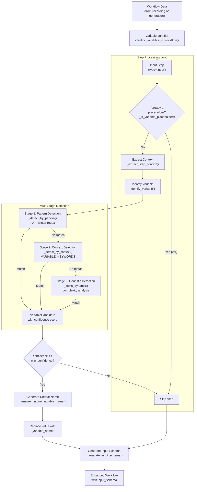
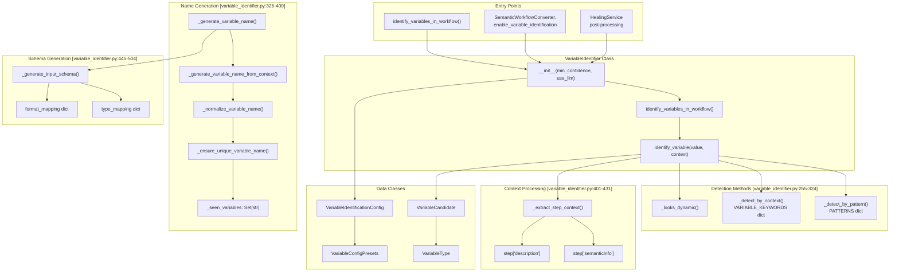
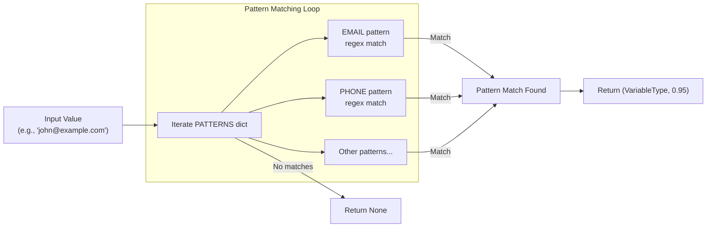
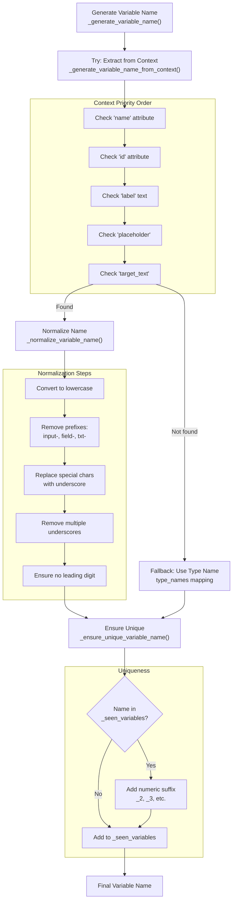
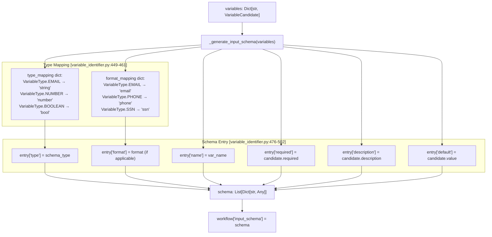
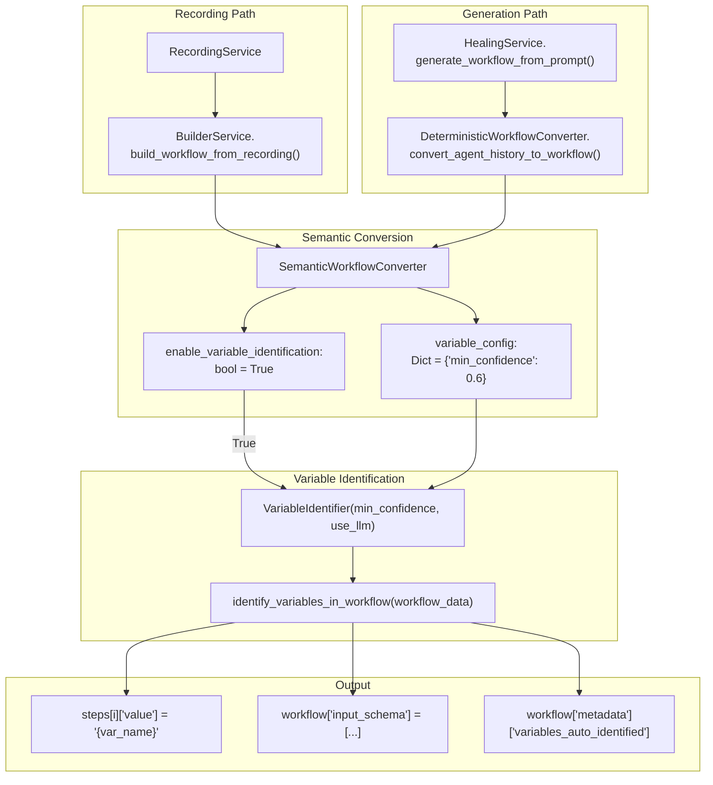

<!-- source: DeepWiki mcp.deepwiki.com · repo browser-use/workflow-use · page 9.1 Variable Identification and Parameterization · fetched 2026-10-30 -->

# Variable Identification and Parameterization

<details>
<summary>Relevant source files</summary>

The following files were used as context for generating this wiki page:

- [workflows/workflow_use/workflow/tests/test_variable_identifier.py](workflows/workflow_use/workflow/tests/test_variable_identifier.py)
- [workflows/workflow_use/workflow/validation_utils.py](workflows/workflow_use/workflow/validation_utils.py)
- [workflows/workflow_use/workflow/variable_config.py](workflows/workflow_use/workflow/variable_config.py)
- [workflows/workflow_use/workflow/variable_identifier.py](workflows/workflow_use/workflow/variable_identifier.py)

</details>


## Purpose and Scope

The `VariableIdentifier` system automatically detects and parameterizes input values in workflow definitions, transforming hardcoded values like `"john@example.com"` into variable placeholders like `{email}`. This enables workflow reusability by allowing the same workflow to execute with different input data.

Variable identification operates during the workflow enhancement phase after initial recording or generation. It integrates with `SemanticWorkflowConverter` (see [Semantic Conversion and Optimization](#4.3)) and runs before workflow validation (see [Workflow Validation and Quality Assurance](#4.2)).

**Sources:** [workflows/workflow_use/workflow/variable_identifier.py:1-10]()

---

## System Overview

The Variable Identification system provides intelligent detection of input values that should be parameterized, transforming hardcoded workflow values into reusable variable placeholders. It operates deterministically using pattern matching and contextual analysis, with optional LLM assistance for ambiguous cases.

### Key Components

| Component | Purpose | File Location |
|-----------|---------|---------------|
| `VariableIdentifier` | Main identification engine with multi-stage detection | [workflows/workflow_use/workflow/variable_identifier.py:48-509]() |
| `VariableCandidate` | Data structure for candidate variables with confidence scoring | [workflows/workflow_use/workflow/variable_identifier.py:34-46]() |
| `VariableType` | Enumeration of supported variable types | [workflows/workflow_use/workflow/variable_identifier.py:18-32]() |
| `VariableIdentificationConfig` | Configuration for detection behavior | [workflows/workflow_use/workflow/variable_config.py:13-94]() |
| `VariableConfigPresets` | Preset configurations for common use cases | [workflows/workflow_use/workflow/variable_config.py:97-217]() |

**Sources:** [workflows/workflow_use/workflow/variable_identifier.py:1-528](), [workflows/workflow_use/workflow/variable_config.py:1-255]()

---

## Architecture and Integration

### Variable Identification Pipeline



**Sources:** [workflows/workflow_use/workflow/variable_identifier.py:132-186](), [workflows/workflow_use/workflow/variable_identifier.py:188-253]()

---

### Code Entity Relationships



**Sources:** [workflows/workflow_use/workflow/variable_identifier.py:48-528](), [workflows/workflow_use/workflow/variable_config.py:13-94]()

---

## Variable Types

The system recognizes 11 distinct variable types, each with specific pattern matching rules:

### VariableType Enumeration

```python
class VariableType(str, Enum):
    STRING = 'string'
    EMAIL = 'email'
    PHONE = 'phone'
    NUMBER = 'number'
    BOOLEAN = 'boolean'
    URL = 'url'
    DATE = 'date'
    CREDIT_CARD = 'credit_card'
    SSN = 'ssn'
    ZIP_CODE = 'zip_code'
    PASSWORD = 'password'
```

### Pattern Definitions

| Variable Type | Regex Pattern | Example Match |
|--------------|---------------|---------------|
| `EMAIL` | `^[a-zA-Z0-9._%+-]+@[a-zA-Z0-9.-]+\.[a-zA-Z]{2,}$` | john.doe@example.com |
| `PHONE` | `^[\+]?[(]?[0-9]{3}[)]?[-\s\.]?[0-9]{3}[-\s\.]?[0-9]{4,6}$` | 555-123-4567 |
| `URL` | `^https?://[^\s]+$` | https://example.com |
| `ZIP_CODE` | `^\d{5}(-\d{4})?$` | 12345 or 12345-6789 |
| `SSN` | `^\d{3}-?\d{2}-?\d{4}$` | 123-45-6789 |
| `CREDIT_CARD` | `^\d{4}[\s-]?\d{4}[\s-]?\d{4}[\s-]?\d{4}$` | 1234-5678-9012-3456 |
| `DATE` | `^\d{1,2}[/-]\d{1,2}[/-]\d{2,4}$\|^\d{4}[/-]\d{1,2}[/-]\d{1,2}$` | 12/31/2024 |
| `NUMBER` | `^\d+(\.\d+)?$` | 42 or 3.14 |

**Sources:** [workflows/workflow_use/workflow/variable_identifier.py:18-32](), [workflows/workflow_use/workflow/variable_identifier.py:59-69]()

---

## Three-Stage Detection Pipeline

### Stage 1: Pattern-Based Detection

The highest-confidence detection method uses regex pattern matching defined in `PATTERNS` dictionary.

**Method:** `_detect_by_pattern(value: str) -> Optional[Tuple[VariableType, float]]`



**Confidence Score:** Pattern matches receive **0.95** confidence (high confidence).

**Sources:** [workflows/workflow_use/workflow/variable_identifier.py:255-262]()

---

### Stage 2: Context-Based Detection

When pattern matching fails, the system analyzes contextual clues from the workflow step.

**Method:** `_detect_by_context(value: str, context: Dict) -> Optional[Tuple[VariableType, float, str]]`

#### Context Extraction - _extract_step_context()

The method at [workflows/workflow_use/workflow/variable_identifier.py:401-431]() extracts context from:

| Step Field | Maps To Context Key | Priority | Example Value |
|-----------|---------------------|----------|---------------|
| `semanticInfo['name']` | `context['name']` | High | `"email"` |
| `semanticInfo['id']` | `context['id']` | High | `"user-email"` |
| `semanticInfo['labelText']` | `context['label']` | Medium | `"Email Address"` |
| `semanticInfo['placeholder']` | `context['placeholder']` | Medium | `"Enter your email"` |
| `description` | `context['description']` | Medium | `"First Name"` |
| `target_text` | `context['target_text']` | Low | `"Submit"` |
| `cssSelector` (name attribute) | `context['name']` | Low | Extracted via regex |
| `cssSelector` (id attribute) | `context['id']` | Low | Extracted via regex |

#### Keyword Matching - VARIABLE_KEYWORDS

The `_detect_by_context()` method at [workflows/workflow_use/workflow/variable_identifier.py:264-304]() matches context strings against the `VARIABLE_KEYWORDS` dictionary:

```python
VARIABLE_KEYWORDS = {
    'email': VariableType.EMAIL,
    'phone': VariableType.PHONE,
    'telephone': VariableType.PHONE,
    'mobile': VariableType.PHONE,
    'firstname': VariableType.STRING,
    'last_name': VariableType.STRING,
    'username': VariableType.STRING,
    'password': VariableType.PASSWORD,
    'address': VariableType.STRING,
    'ssn': VariableType.SSN,
    'zip': VariableType.ZIP_CODE,
    'card': VariableType.CREDIT_CARD,
    'date': VariableType.DATE,
    'amount': VariableType.NUMBER,
    # 20+ total mappings
}
```

**Confidence Score:** Context matches receive **0.85** confidence.

**Sources:** [workflows/workflow_use/workflow/variable_identifier.py:264-304](), [workflows/workflow_use/workflow/variable_identifier.py:401-431](), [workflows/workflow_use/workflow/variable_identifier.py:72-101]()

---

### Stage 3: Heuristic Detection

When both pattern and context detection fail, the system uses heuristics to identify dynamic-looking values.

**Method:** `_looks_dynamic(value: str) -> bool`

#### Dynamic Value Indicators

The heuristic assigns a score based on:

| Indicator | Description | Example |
|-----------|-------------|---------|
| Mixed case | Value has both upper and lowercase | `JohnDoe` |
| Contains numbers | Digits present in value | `User123` |
| Special characters | Contains `@#$%&*_-` | `Pass@123` |
| Length > 10 | Long values likely dynamic | `ComplexValue` |

A value is considered dynamic if **2 or more indicators** are present.

**Confidence Score:** Heuristic matches receive **0.5** confidence (lower confidence).

**Sources:** [workflows/workflow_use/workflow/variable_identifier.py:306-324]()

---

## Variable Name Generation

### Generation Strategy



**Sources:** [workflows/workflow_use/workflow/variable_identifier.py:326-400]()

---

## Configuration and Presets

### VariableIdentificationConfig Structure

```mermaid
graph TB
    Config["VariableIdentificationConfig<br/>@dataclass"]
    
    subgraph "Core Settings"
        MinConf["min_confidence: float<br/>default: 0.6"]
        UseLLM["use_llm: bool<br/>default: False"]
        MinLen["min_value_length: int<br/>default: 2"]
        MaxLen["max_value_length: int<br/>default: 500"]
    end
    
    subgraph "Pattern Control"
        AlwaysParam["always_parameterize: Set[str]<br/>email, password, username..."]
        NeverParam["never_parameterize: Set[str]<br/>submit, cancel, yes, no..."]
        CustomPatterns["custom_patterns: Dict<br/>domain-specific regex"]
    end
    
    subgraph "Behavior Flags"
        UseContext["use_context_hints: bool<br/>default: True"]
        IncludeDefaults["include_defaults: bool<br/>default: True"]
        MarkRequired["mark_as_required: bool<br/>default: True"]
        GroupFields["group_related_fields: bool<br/>default: True"]
    end
    
    subgraph "Mappings"
        VarNameMap["variable_name_mappings: Dict<br/>fname → first_name"]
        DomainConfig["domain_config: Dict<br/>custom configurations"]
    end
    
    Config --> MinConf
    Config --> UseLLM
    Config --> MinLen
    Config --> MaxLen
    Config --> AlwaysParam
    Config --> NeverParam
    Config --> CustomPatterns
    Config --> UseContext
    Config --> IncludeDefaults
    Config --> MarkRequired
    Config --> GroupFields
    Config --> VarNameMap
    Config --> DomainConfig
```



**Sources:** [workflows/workflow_use/workflow/variable_config.py:13-94]()

---

### Configuration Presets

The `VariableConfigPresets` class provides six preset configurations:

| Preset | `min_confidence` | `use_llm` | `include_defaults` | Use Case |
|--------|------------------|-----------|-------------------|----------|
| **strict()** | 0.85 | False | False | High-confidence matches only, minimal false positives |
| **balanced()** | 0.6 | False | True | Default recommended setting, reasonable threshold |
| **aggressive()** | 0.4 | False | True | Maximum flexibility, more variables detected |
| **ai_assisted()** | 0.5 | True | True | Uses LLM for ambiguous cases, best accuracy |
| **form_filling()** | 0.65 | False | True | Optimized for form workflows, expanded field patterns |
| **ecommerce()** | 0.6 | False | True | Handles product searches, checkout flows |

#### Form Filling Preset

The `form_filling()` preset adds common form field patterns to `always_parameterize`:

```python
config.always_parameterize.update({
    'address', 'city', 'state', 'zip', 'postal', 'country',
    'firstname', 'lastname', 'middlename', 'dateofbirth',
    'gender', 'company', 'occupation'
})
```

#### E-commerce Preset

The `ecommerce()` preset adds shopping-specific patterns:

```python
config.always_parameterize.update({
    'product', 'quantity', 'size', 'color',
    'shipping', 'billing', 'coupon', 'promo'
})
```

**Sources:** [workflows/workflow_use/workflow/variable_config.py:97-217]()

---

## Input Schema Generation

### Schema Generation Process - _generate_input_schema()



### Type and Format Mapping Dictionaries

The `_generate_input_schema()` method at [workflows/workflow_use/workflow/variable_identifier.py:445-504]() uses two internal mapping dictionaries:

**type_mapping** (lines 449-461) - Maps `VariableType` to schema type strings:

| VariableType | Schema Type | Note |
|-------------|-------------|------|
| `STRING`, `EMAIL`, `PHONE`, `URL`, `SSN`, `ZIP_CODE`, `CREDIT_CARD`, `DATE`, `PASSWORD` | `'string'` | All text-based types map to string |
| `NUMBER` | `'number'` | Numeric values |
| `BOOLEAN` | `'bool'` | Boolean values |

**format_mapping** (lines 464-473) - Adds format details for validation:

| VariableType | Format String |
|-------------|---------------|
| `EMAIL` | `'email'` |
| `PHONE` | `'phone'` |
| `URL` | `'url'` |
| `SSN` | `'ssn'` |
| `ZIP_CODE` | `'zip-code'` |
| `CREDIT_CARD` | `'credit-card'` |
| `DATE` | `'date'` |
| `PASSWORD` | `'password'` |

### Example Schema Output

For a workflow with email and phone inputs:

```json
{
  "input_schema": [
    {
      "name": "email",
      "type": "string",
      "format": "email",
      "required": true,
      "description": "Email Address",
      "default": "john.doe@example.com"
    },
    {
      "name": "phone_number",
      "type": "string",
      "format": "phone",
      "required": true,
      "description": "Phone Number",
      "default": "555-123-4567"
    }
  ]
}
```

**Sources:** [workflows/workflow_use/workflow/variable_identifier.py:445-504]()

---

## Integration with Workflow Creation

### Integration with Workflow Creation Pipeline



### SemanticWorkflowConverter Integration

The `SemanticWorkflowConverter` class in [workflows/workflow_use/recorder/semantic_converter.py]() accepts two parameters:

- `enable_variable_identification: bool = True` - Controls whether variable identification runs
- `variable_config: Dict = {'min_confidence': 0.6}` - Configuration passed to `VariableIdentifier`

When enabled, the converter calls `identify_variables_in_workflow()` after semantic conversion completes.

**Sources:** [workflows/workflow_use/workflow/variable_identifier.py:132-186](), [workflows/workflow_use/workflow/tests/test_variable_identifier.py:233-282]()

---

## Static Value Filtering

The system explicitly avoids parameterizing common static values:

### STATIC_VALUES Set

```python
STATIC_VALUES = {
    '',           # Empty strings
    ' ',          # Whitespace
    'true',       # Boolean literals
    'false',
    'yes',
    'no',
    'on',
    'off',
    '1',          # Simple numbers
    '0',
    'submit',     # Common button text
    'cancel',
    'ok',
}
```

These values are checked before any detection stages and immediately return `None` from `identify_variable()`.

**Sources:** [workflows/workflow_use/workflow/variable_identifier.py:104-118](), [workflows/workflow_use/workflow/variable_identifier.py:204-205]()

---

## VariableCandidate Data Structure

### Dataclass Definition

```python
@dataclass
class VariableCandidate:
    value: str                          # Original input value
    variable_name: str                  # Generated variable name
    variable_type: VariableType         # Detected type
    confidence: float                   # 0.0 to 1.0 confidence score
    context: Dict[str, Any]             # Step context (labels, etc.)
    suggested_default: Optional[str]    # Default value for schema
    description: Optional[str]          # Human-readable description
    required: bool = True               # Whether variable is required
```

### Confidence Scoring

| Detection Method | Confidence Score | Rationale |
|-----------------|------------------|-----------|
| Pattern match | 0.95 | High confidence - regex matched specific format |
| Context match | 0.85 | Good confidence - keyword found in context |
| Heuristic match | 0.5 | Lower confidence - based on value characteristics |

Candidates below `min_confidence` threshold (default: 0.6) are rejected.

**Sources:** [workflows/workflow_use/workflow/variable_identifier.py:34-46](), [workflows/workflow_use/workflow/variable_identifier.py:259](), [workflows/workflow_use/workflow/variable_identifier.py:288](), [workflows/workflow_use/workflow/variable_identifier.py:246]()

---

## Usage Examples

### Direct API Usage

The convenience function at [workflows/workflow_use/workflow/variable_identifier.py:512-528]():

```python
from workflow_use.workflow.variable_identifier import identify_variables_in_workflow

workflow_data = {
    'name': 'Login Form',
    'steps': [
        {
            'type': 'input',
            'value': 'john.doe@example.com',
            'cssSelector': 'input[name="email"]',
            'semanticInfo': {'name': 'email', 'labelText': 'Email Address'}
        },
        {
            'type': 'input',
            'value': 'MyPassword123',
            'cssSelector': 'input[type="password"]',
            'semanticInfo': {'name': 'password', 'labelText': 'Password'}
        }
    ]
}

# Automatically identify and parameterize variables
enhanced = identify_variables_in_workflow(
    workflow_data,
    min_confidence=0.6,
    use_llm=False
)

# Result:
# - Steps have values replaced: '{email}', '{password}'
# - input_schema generated with default values
# - metadata['variables_auto_identified'] = True
```

### Custom Configuration Usage

Using `VariableIdentificationConfig` from [workflows/workflow_use/workflow/variable_config.py:13-94]():

```python
from workflow_use.workflow.variable_identifier import VariableIdentifier
from workflow_use.workflow.variable_config import VariableIdentificationConfig

config = VariableIdentificationConfig(
    min_confidence=0.7,
    use_llm=False,
    always_parameterize={'order_id', 'tracking_number'},
    never_parameterize={'search', 'filter'},
    variable_name_mappings={'ord': 'order_id'},
    include_defaults=True,
    use_context_hints=True,
    mark_as_required=True
)

identifier = VariableIdentifier(
    min_confidence=config.min_confidence,
    use_llm=config.use_llm
)

result = identifier.identify_variables_in_workflow(workflow_data)
```

Note: The `VariableIdentifier.__init__()` only accepts `min_confidence` and `use_llm` parameters. Other configuration options in `VariableIdentificationConfig` are reserved for future use.

### Using Configuration Presets

Using `VariableConfigPresets` from [workflows/workflow_use/workflow/variable_config.py:97-217]():

```python
from workflow_use.workflow.variable_config import VariableConfigPresets, load_preset
from workflow_use.workflow.variable_identifier import VariableIdentifier

# Option 1: Use preset directly
config = VariableConfigPresets.form_filling()
identifier = VariableIdentifier(
    min_confidence=config.min_confidence,
    use_llm=config.use_llm
)

# Option 2: Load preset globally
load_preset('aggressive')
from workflow_use.workflow.variable_config import get_config
config = get_config()

# Available presets:
# - 'strict', 'balanced', 'aggressive'
# - 'ai_assisted', 'form_filling', 'ecommerce'
```

**Sources:** [workflows/workflow_use/workflow/variable_identifier.py:512-528](), [workflows/workflow_use/workflow/tests/test_variable_identifier.py:109-155]()

---

## Testing and Validation

### Test Coverage

The test suite at [workflows/workflow_use/workflow/tests/test_variable_identifier.py]() covers:

| Test Category | Example Tests |
|--------------|---------------|
| Pattern detection | `test_pattern_detection_email`, `test_pattern_detection_phone`, `test_pattern_detection_ssn` |
| Context detection | `test_context_based_detection` |
| Static value filtering | `test_static_value_rejection` |
| Name normalization | `test_variable_name_normalization` |
| Uniqueness | `test_unique_variable_names` |
| End-to-end | `test_workflow_identification` |
| Schema generation | `test_input_schema_generation` |
| Integration | `test_semantic_converter_with_variables` |
| Configuration presets | `test_config_presets` |

### Example Test Case

```python
def test_pattern_detection_email():
    """Test email pattern detection."""
    identifier = VariableIdentifier()
    context = {'name': 'email', 'label': 'Email Address'}
    
    candidate = identifier.identify_variable('john.doe@example.com', context)
    
    assert candidate is not None
    assert candidate.variable_type == VariableType.EMAIL
    assert candidate.confidence >= 0.85
    assert 'email' in candidate.variable_name.lower()
```

**Sources:** [workflows/workflow_use/workflow/tests/test_variable_identifier.py:17-231]()

---

## Performance Considerations

### Computational Complexity

The `identify_variables_in_workflow()` method at [workflows/workflow_use/workflow/variable_identifier.py:132-186]() operates deterministically:

| Operation | Complexity | Implementation |
|-----------|-----------|----------------|
| Pattern matching | O(n × p) | Iterate `PATTERNS` dict, regex match each value |
| Context extraction | O(1) | Dictionary lookups in `semanticInfo` |
| Name normalization | O(n) | String operations in `_normalize_variable_name()` |
| Uniqueness checking | O(1) | Set membership test in `_seen_variables` |

**Workflow processing:** For a workflow with `s` input steps:

- **Total complexity:** O(s × (p + c)) where p = pattern count, c = context keys
- **Typical execution time:** < 100ms for workflows with < 50 steps
- **Memory usage:** O(v) where v = number of unique variables (stored in `_seen_variables`)

### LLM-Assisted Mode (Future)

The `use_llm` parameter at [workflows/workflow_use/workflow/variable_identifier.py:120-130]() is defined but not currently implemented. When enabled in future versions:

- LLM calls would occur only for ambiguous cases (confidence < threshold but > minimum)
- Estimated cost: $0.001-0.01 per ambiguous variable
- Implementation would use existing LLM client infrastructure

**Sources:** [workflows/workflow_use/workflow/variable_identifier.py:120-130](), [workflows/workflow_use/workflow/variable_config.py:20-21]()

---

## Metadata and Tracking

### Workflow Metadata

After variable identification, the system adds metadata to the workflow:

```python
workflow['metadata'] = {
    'variables_auto_identified': True,
    'identified_variable_count': len(identified_vars)
}
```

This metadata indicates:

- Whether automatic variable identification was performed
- How many variables were successfully identified
- Can be used for analytics and workflow quality tracking

**Sources:** [workflows/workflow_use/workflow/variable_identifier.py:180-184]()

---

## Related Systems

- **Semantic Conversion:** See [Semantic Conversion and Optimization](#4.3) for how semantic targeting is added before variable identification
- **Workflow Validation:** See [Workflow Validation and Quality Assurance](#4.2) for validation of generated input schemas
- **Input Schema Usage:** Generated schemas are used during workflow execution for input validation and type conversion
- **Tool Mode:** See [Running Workflows as Tools](#5.4) for how variables enable natural language input parsing

**Sources:** [workflows/workflow_use/workflow/variable_identifier.py:1-528]()

---

