<!-- source: DeepWiki mcp.deepwiki.com · repo browser-use/workflow-use · page 9.2 Selector Generation and XPath Optimization · fetched 2026-10-30 -->

# Selector Generation and XPath Optimization

<details>
<summary>Relevant source files</summary>

The following files were used as context for generating this wiki page:

- [workflows/test_max_alternatives_bug_fix.py](workflows/test_max_alternatives_bug_fix.py)
- [workflows/tests/test_selector_generator.py](workflows/tests/test_selector_generator.py)
- [workflows/tests/test_xpath_optimization.py](workflows/tests/test_xpath_optimization.py)
- [workflows/workflow_use/healing/deterministic_converter.py](workflows/workflow_use/healing/deterministic_converter.py)
- [workflows/workflow_use/healing/selector_generator.py](workflows/workflow_use/healing/selector_generator.py)
- [workflows/workflow_use/healing/xpath_optimizer.py](workflows/workflow_use/healing/xpath_optimizer.py)
- [workflows/workflow_use/workflow/element_finder.py](workflows/workflow_use/workflow/element_finder.py)

</details>


This document covers the selector generation and XPath optimization systems that create robust, multi-strategy element locators for workflow execution. These systems generate prioritized fallback strategies to find elements on web pages, reducing brittleness and improving workflow reliability.

For information about how these selectors are used during workflow execution, see [Element Finding Strategies](#5.2). For details on how selectors are created during workflow recording, see [Browser Recording](#3.1).

---

## Overview

The selector generation system transforms captured element data into multiple prioritized strategies for locating elements during workflow execution. Rather than relying on a single brittle CSS selector or absolute XPath, the system generates semantic-first strategies with graceful fallbacks.

**Key Components:**
- **`SelectorGenerator`** - Generates semantic strategies (text, ARIA, role) and optional XPath alternatives
- **`XPathOptimizer`** - Converts absolute XPaths into robust relative XPaths anchored to stable page structures
- **Strategy Priority System** - Orders strategies from most to least reliable

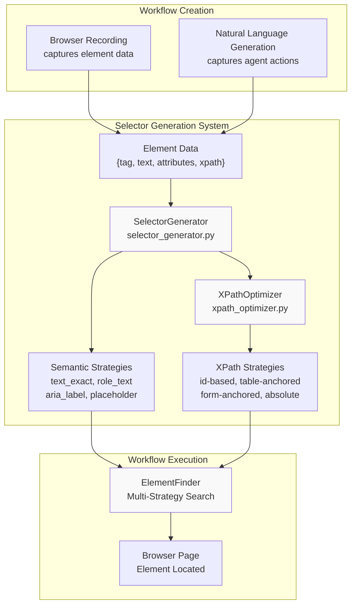

**Sources:** [workflow_use/healing/selector_generator.py:1-631](), [workflow_use/healing/xpath_optimizer.py:1-390]()

---

## SelectorGenerator Architecture

The `SelectorGenerator` class generates multiple selector strategies from element data captured during workflow recording or generation. It prioritizes semantic strategies (text, ARIA attributes, roles) over positional selectors (CSS, XPath).

### Initialization and Configuration

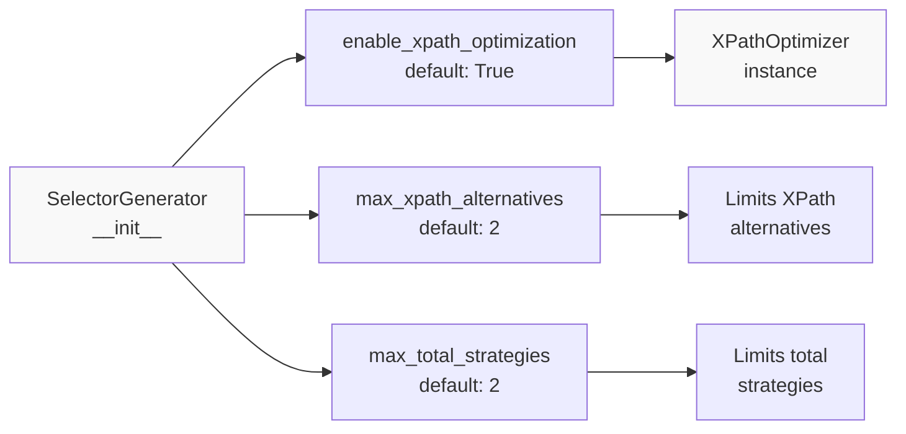

**Configuration Parameters:**

| Parameter | Type | Default | Description |
|-----------|------|---------|-------------|
| `enable_xpath_optimization` | `bool` | `True` | Use XPathOptimizer to generate robust XPath alternatives |
| `max_xpath_alternatives` | `int` | `2` | Maximum XPath alternatives (includes absolute fallback) |
| `max_total_strategies` | `int` | `2` | Maximum total strategies across all types |

**Sources:** [workflow_use/healing/selector_generator.py:67-82]()

### Strategy Types and Priority Ordering

The `SelectorGenerator.generate_strategies()` method creates a prioritized list of `SelectorStrategy` objects. Lower priority numbers are tried first (1 = highest priority).

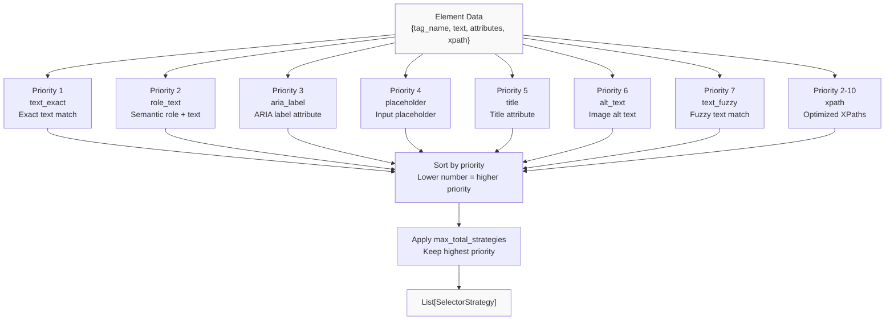

**Strategy Priority Table:**

| Priority | Strategy Type | Applicable Elements | Reliability |
|----------|---------------|---------------------|-------------|
| 1 | `text_exact` | Any with text | Very High - exact match |
| 2 | `role_text` | Semantic elements | Very High - role + text |
| 2 | `xpath` (id-based) | Elements with id | Very High - stable attribute |
| 2 | `xpath` (name-based) | Form elements | Very High - stable attribute |
| 3 | `aria_label` | Accessible elements | High - semantic attribute |
| 3 | `xpath` (ARIA-based) | Elements with ARIA | High - semantic attribute |
| 4 | `placeholder` | Input fields | High - stable for forms |
| 4 | `xpath` (table-anchored) | Table cells | Medium-High - structural |
| 5 | `title` | Elements with title | Medium - tooltip text |
| 6 | `alt_text` | Images | Medium - descriptive text |
| 7 | `text_fuzzy` | Text length > 3 | Medium-Low - tolerates changes |
| 8-10 | `xpath` (various) | All elements | Low-Fallback - positional |

**Sources:** [workflow_use/healing/selector_generator.py:84-290](), [workflow_use/healing/selector_generator.py:118-194]()

### SelectorStrategy Data Model

Each strategy is represented by a `SelectorStrategy` dataclass:

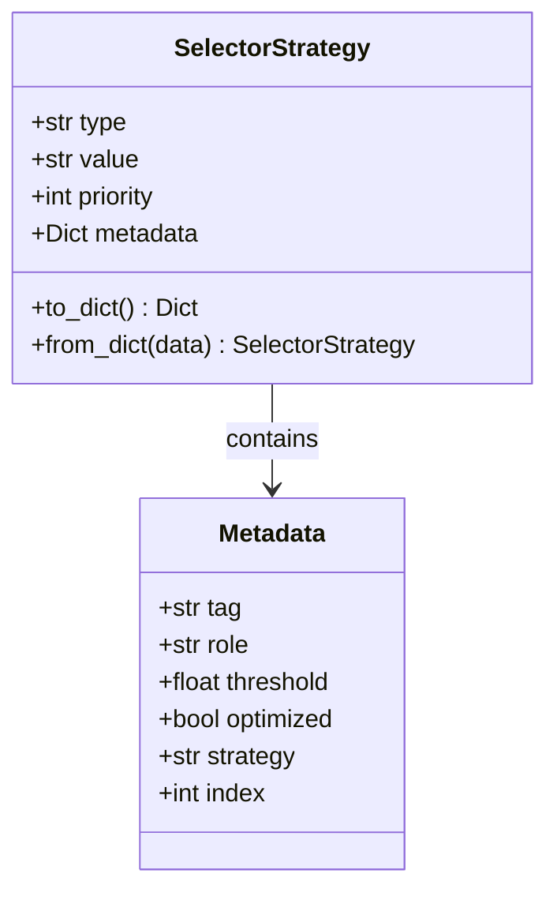

**Fields:**
- **`type`** - Strategy type (e.g., `text_exact`, `xpath`, `aria_label`)
- **`value`** - Selector value or matching text
- **`priority`** - Priority order (lower = higher priority)
- **`metadata`** - Additional information for matching (tag, role, threshold, etc.)

**Sources:** [workflow_use/healing/selector_generator.py:18-44]()

### Semantic Strategy Generation

The generator creates semantic strategies based on element properties:

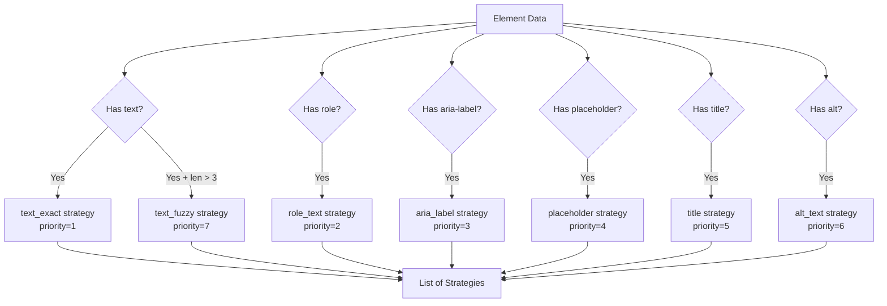

**Role Inference:** The `_infer_role()` method maps HTML tags to semantic roles:

| HTML Tag | Inferred Role | Special Cases |
|----------|---------------|---------------|
| `button` | `button` | - |
| `a` | `link` | - |
| `input` | `textbox` | `type="checkbox"` → `checkbox`<br/>`type="radio"` → `radio`<br/>`type="submit"` → `button` |
| `textarea` | `textbox` | - |
| `select` | `combobox` | - |
| `h1`-`h6` | `heading` | - |
| `img` | `img` | - |

**Sources:** [workflow_use/healing/selector_generator.py:118-194](), [workflow_use/healing/selector_generator.py:292-337]()

---

## XPath Optimization

The `XPathOptimizer` class transforms brittle absolute XPaths into robust relative XPaths that are more resilient to page structure changes. It generates multiple alternatives with different stability characteristics.

### XPathOptimizer Architecture

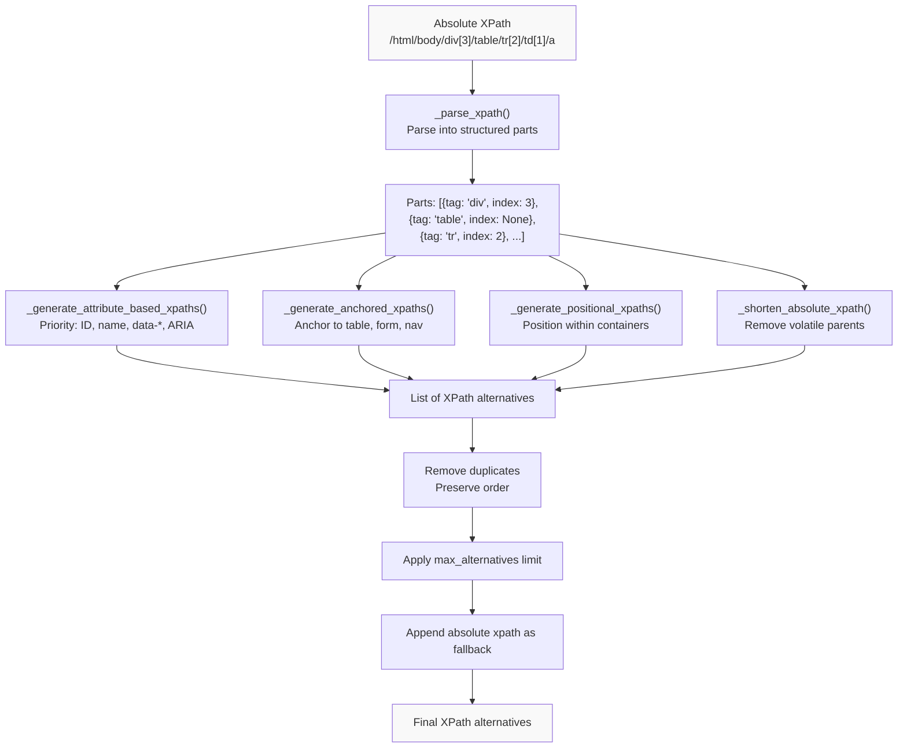

**Sources:** [workflow_use/healing/xpath_optimizer.py:73-155]()

### Optimization Strategies

The optimizer employs four main strategies to generate robust XPaths:

#### Strategy 1: Attribute-Based XPaths

Generates XPaths using stable element attributes:

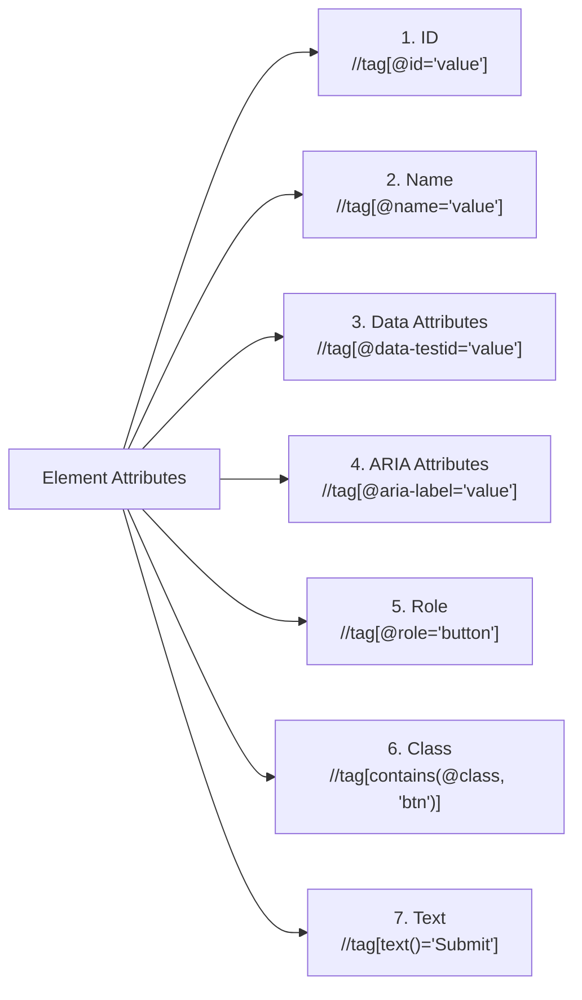

**Priority Order:**
1. `@id` - Most stable, unique identifier
2. `@name` - Stable for form elements
3. `@data-*` - Very stable, often unique (e.g., `data-testid`)
4. `@aria-label`, `@aria-labelledby` - Semantic, stable
5. `@role` - Semantic HTML role
6. `@class` - Less stable (can be dynamic)
7. `text()` or `contains(text(), ...)` - Fallback for text content

**Sources:** [workflow_use/healing/xpath_optimizer.py:190-259]()

#### Strategy 2: Anchored XPaths

Anchors XPaths to stable parent structures:

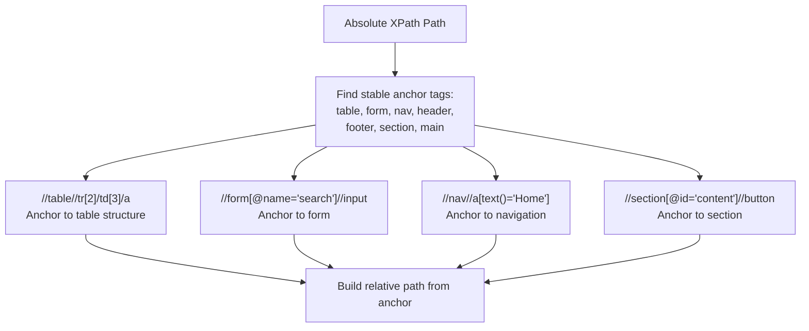

**Special Case - Table Cell Targeting:**

For table elements, the optimizer generates highly specific XPaths:
- `//table//tr[2]/td[3]//a` - Target by row and column index
- `//table//tr[2]/td[3]/a` - Direct child of specific cell

**Sources:** [workflow_use/healing/xpath_optimizer.py:261-309]()

#### Strategy 3: Positional XPaths

Uses position within stable containers:

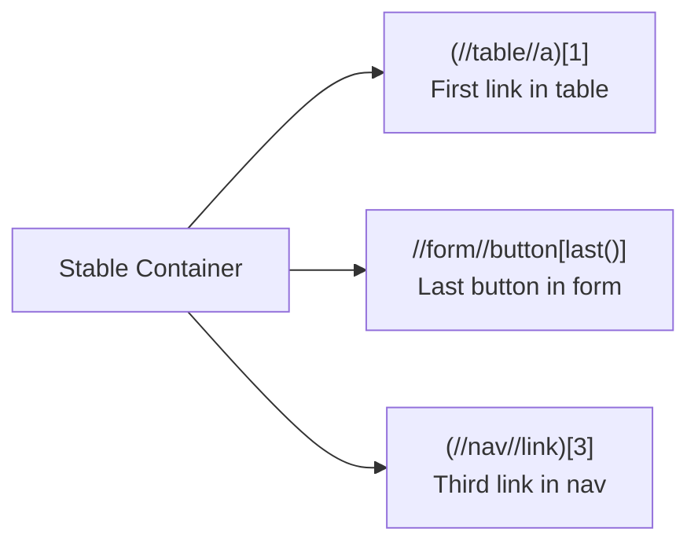

**Sources:** [workflow_use/healing/xpath_optimizer.py:311-332]()

#### Strategy 4: Shortened Absolute XPath

Removes volatile parent elements from absolute XPaths:

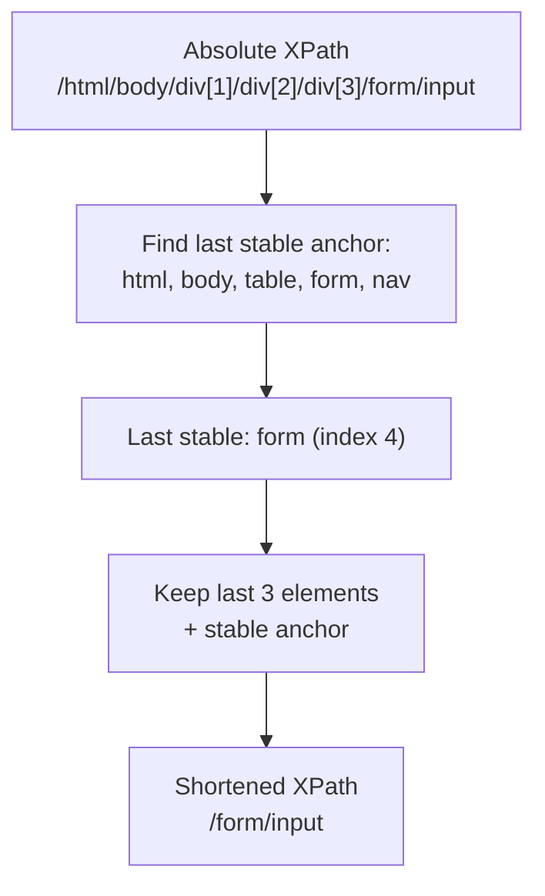

**Sources:** [workflow_use/healing/xpath_optimizer.py:354-389]()

### XPath Priority Calculation

The optimizer assigns priorities to generated XPaths based on stability characteristics:

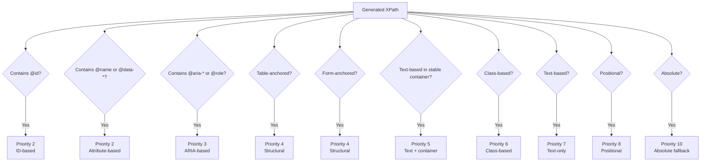

**Priority Scoring Table:**

| XPath Characteristic | Priority | Stability |
|----------------------|----------|-----------|
| ID-based (`@id=`) | 2 | Very High |
| Name-based (`@name=`) | 2 | Very High |
| Data attribute (`@data-*=`) | 2 | Very High |
| ARIA attribute (`@aria-label=`) | 3 | High |
| Table-anchored (`//table//tr[2]/td[3]`) | 4 | Medium-High |
| Form-anchored (`//form//input`) | 4 | Medium-High |
| Text + stable container | 5 | Medium |
| Class-based (`contains(@class, ...)`) | 6 | Medium-Low |
| Text-only (`contains(text(), ...)`) | 7 | Low |
| Positional with multiple indices | 8 | Very Low |
| Absolute (`/html/body/...`) | 10 | Fallback Only |

**Sources:** [workflow_use/healing/xpath_optimizer.py:481-539]()

### XPath String Escaping

The optimizer includes robust XPath string escaping via `escape_xpath_string()` to handle quotes in element text and attributes:

**Escaping Logic:**
- No single quotes: Use single quotes `'value'`
- No double quotes: Use double quotes `"value"`
- Both types of quotes: Use `concat()` function

**Example:**
```
"hello" → 'hello'
"it's" → concat("it", "'", "s")
'say "hello"' → 'say "hello"'
```

**Sources:** [workflow_use/healing/xpath_optimizer.py:15-59]()

---

## Integration with Workflow System

The selector generation system integrates with multiple workflow creation and execution components:

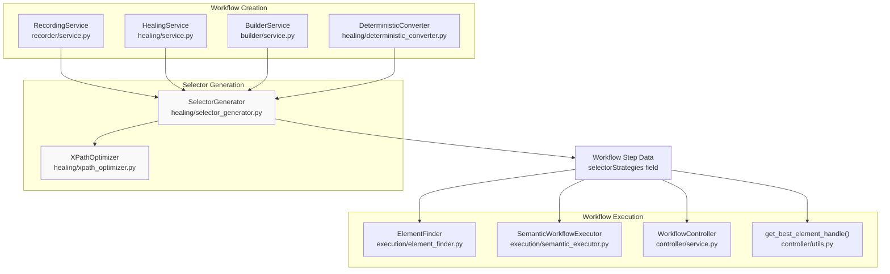

**Sources:** [workflow_use/healing/selector_generator.py:1-631](), [workflow_use/controller/utils.py:12-49]()

### Usage During Recording

When browser interactions are recorded, the extension captures element data which is processed by `SelectorGenerator`:

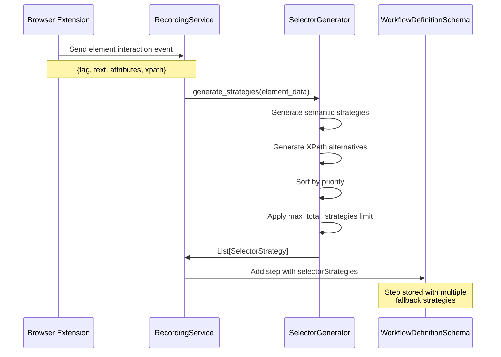

**Sources:** [workflow_use/recorder/service.py:1-267]()

### Usage During Deterministic Conversion

The `DeterministicConverter` uses `SelectorGenerator` to create selector strategies when converting agent history to workflows:

**Configuration:**
- `enable_xpath_optimization=True`
- `max_xpath_alternatives=2` (1 optimized + 1 absolute)
- `max_total_strategies=2` (limits total strategies)

This limits strategy generation for performance while maintaining robustness.

**Sources:** [workflow_use/healing/selector_generator.py:67-82]()

### Usage During Execution

During workflow execution, the generated selector strategies are used by `ElementFinder` and related components:

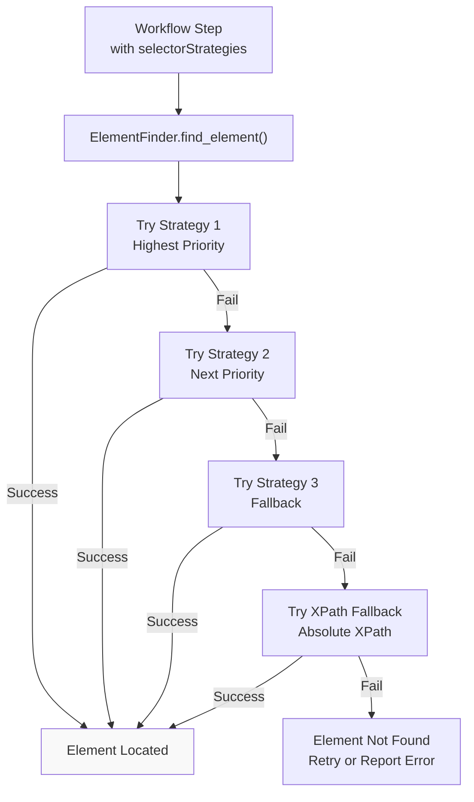

The `get_best_element_handle()` utility function in `controller/utils.py` implements similar fallback logic with stability-ranked selectors.

**Sources:** [workflow_use/controller/utils.py:12-49]()

---

## Configuration and Best Practices

### Configuring SelectorGenerator

**For Maximum Robustness (Recording):**
```python
generator = SelectorGenerator(
    enable_xpath_optimization=True,
    max_xpath_alternatives=3,  # More XPath alternatives
    max_total_strategies=None  # No limit on total strategies
)
```

**For Performance (Deterministic Conversion):**
```python
generator = SelectorGenerator(
    enable_xpath_optimization=True,
    max_xpath_alternatives=2,  # 1 optimized + 1 absolute
    max_total_strategies=2     # Limit total strategies
)
```

**For Debugging (Disable Optimization):**
```python
generator = SelectorGenerator(
    enable_xpath_optimization=False,  # Only absolute XPath
    max_xpath_alternatives=1,
    max_total_strategies=None
)
```

**Sources:** [workflow_use/healing/selector_generator.py:67-82]()

### XPath Alternatives Limit Behavior

The `max_alternatives` parameter in `XPathOptimizer.optimize_xpath()` controls the number of XPath alternatives:

| `max_alternatives` | Result |
|--------------------|--------|
| `1` | Only absolute XPath (no optimization) |
| `2` | 1 optimized + 1 absolute |
| `3` | 2 optimized + 1 absolute |
| `N` | (N-1) optimized + 1 absolute |

**Important:** When `max_alternatives <= 1`, XPath optimization is effectively disabled and only the absolute XPath is returned.

**Sources:** [workflow_use/healing/xpath_optimizer.py:73-155](), [test_max_alternatives_bug_fix.py:1-116]()

### Strategy Limiting Trade-offs

**`max_total_strategies` Configuration:**

| Value | Pros | Cons | Use Case |
|-------|------|------|----------|
| `None` | Maximum robustness, all strategies available | Larger workflow files, slower execution | Recording, debugging |
| `2` | Fast execution, minimal overhead | Fewer fallbacks | Deterministic conversion, production |
| `5` | Good balance | Medium file size | General purpose |

**Sources:** [workflow_use/healing/selector_generator.py:67-82](), [workflow_use/healing/selector_generator.py:285-289]()

### Selector Strategy Serialization

Selector strategies are serialized to workflow JSON using `SelectorStrategy.to_dict()`:

```json
{
  "type": "text_exact",
  "value": "Submit",
  "priority": 1,
  "metadata": {
    "tag": "button"
  }
}
```

**Round-Trip Support:**
- `SelectorStrategy.to_dict()` - Convert to dictionary
- `SelectorStrategy.from_dict()` - Restore from dictionary
- `SelectorGenerator.generate_strategies_dict()` - Generate and serialize in one step

**Sources:** [workflow_use/healing/selector_generator.py:27-44](), [workflow_use/healing/selector_generator.py:592-603]()

---

## Testing and Validation

The selector generation system includes comprehensive test coverage:

### SelectorGenerator Tests

**Test Coverage Areas:**
1. Semantic strategy generation (text, role, ARIA)
2. Priority ordering and sorting
3. Strategy type filtering (no CSS/ID strategies)
4. Role inference from HTML tags
5. Fuzzy text matching threshold
6. Strategy serialization/deserialization
7. Summary output formatting

**Key Test Files:**
- [tests/test_selector_generator.py:1-294]() - 14 test cases for `SelectorGenerator`

### XPath Optimization Tests

**Test Coverage Areas:**
1. XPath optimization enabled/disabled comparison
2. Priority calculation for different XPath types
3. Strategy determination (id-based, table-anchored, etc.)
4. `max_alternatives` parameter behavior
5. Integration with table elements, form inputs
6. Data attribute prioritization
7. XPath strategy metadata
8. No duplicate XPath generation

**Key Test Files:**
- [tests/test_xpath_optimization.py:1-450]() - 20 test cases for XPath optimization
- [test_max_alternatives_bug_fix.py:1-116]() - Bug fix validation for `max_alternatives=1`

**Sources:** [tests/test_selector_generator.py:1-294](), [tests/test_xpath_optimization.py:1-450]()

---

## Summary

The selector generation and XPath optimization systems provide a robust, multi-layered approach to element location:

**Key Design Principles:**
1. **Semantic-First** - Prioritize text, ARIA, and role-based strategies
2. **Multiple Fallbacks** - Generate prioritized alternatives for resilience
3. **Structural Anchoring** - Use stable page structures (tables, forms) as anchors
4. **Configurable Limits** - Balance robustness vs. performance with configuration options
5. **Priority-Based** - Lower priority numbers = higher reliability

**Integration Points:**
- Recording: [RecordingService](#3.1)
- Generation: [HealingService](#3.2)
- Building: [BuilderService](#4.1)
- Execution: [ElementFinder](#5.2), [SemanticExecutor](#5.1)

**Sources:** [workflow_use/healing/selector_generator.py:1-631](), [workflow_use/healing/xpath_optimizer.py:1-390](), [workflow_use/controller/utils.py:1-151]()

---

