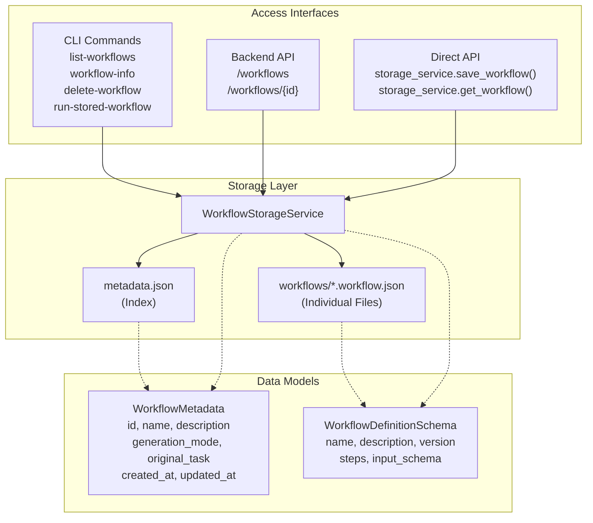
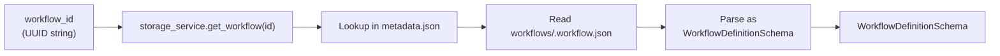
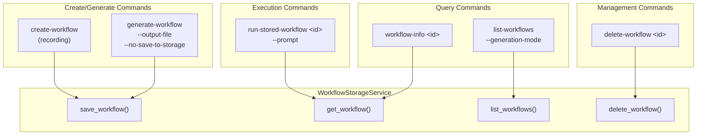
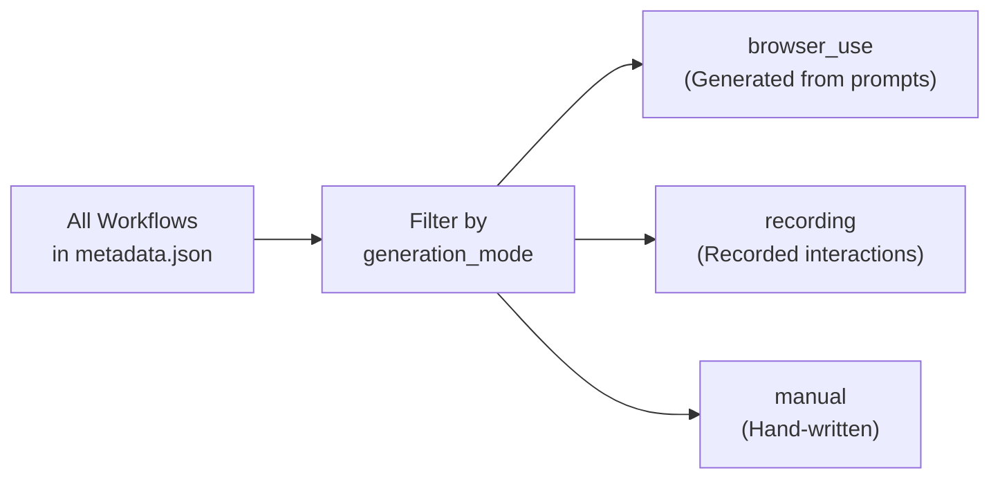
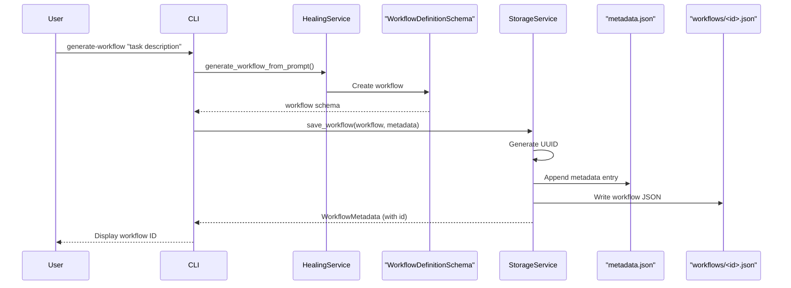
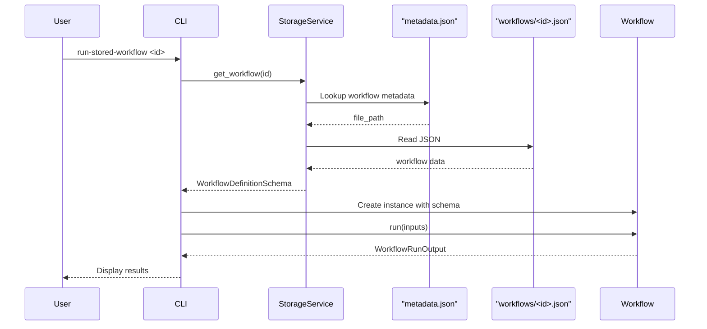
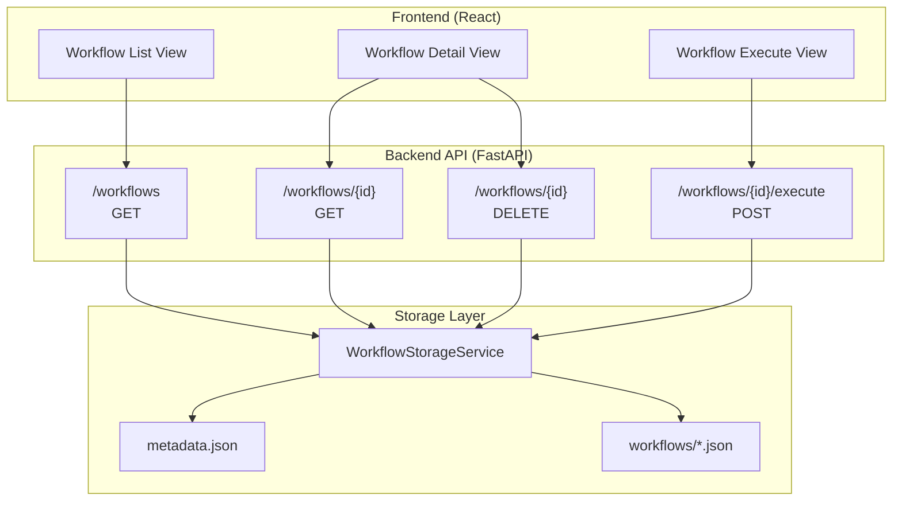

<!-- source: DeepWiki mcp.deepwiki.com · repo browser-use/workflow-use · page 9.3 Workflow Storage and Management · fetched 2026-10-30 -->

# Workflow Storage and Management

<details>
<summary>Relevant source files</summary>

The following files were used as context for generating this wiki page:

- [README.md](README.md)
- [workflows/.gitignore](workflows/.gitignore)
- [workflows/backend/api.py](workflows/backend/api.py)
- [workflows/backend/routers.py](workflows/backend/routers.py)
- [workflows/backend/service.py](workflows/backend/service.py)
- [workflows/backend/views.py](workflows/backend/views.py)
- [workflows/workflow_use/storage/__init__.py](workflows/workflow_use/storage/__init__.py)
- [workflows/workflow_use/workflow/prompts.py](workflows/workflow_use/workflow/prompts.py)
- [workflows/workflow_use/workflow/tests/test_extract.py](workflows/workflow_use/workflow/tests/test_extract.py)

</details>


This document covers the workflow storage and management system, which provides persistent storage, metadata indexing, and retrieval capabilities for workflow definitions. The storage service enables workflows to be saved once and reused multiple times with different inputs, supporting both file-based storage and searchable metadata.

For information about workflow creation and building, see [Workflow Creation](#3). For workflow execution, see [Workflow Execution](#5).

---

## Purpose and Scope

The storage system provides:
- **Persistent storage** of workflow definitions in JSON/YAML format
- **Metadata indexing** for fast searching and filtering
- **Workflow lifecycle management** including creation, retrieval, listing, and deletion
- **Integration points** for CLI, API, and programmatic access
- **Support for multiple generation modes** (recording vs. natural language generation)

The primary interface is the `WorkflowStorageService` class, which abstracts storage operations and maintains a searchable index of all workflows.

---

## Storage Architecture

### Directory Structure

The storage system uses a dual-storage approach with both metadata indexing and individual workflow files:

```
workflows/storage/
├── metadata.json          # Searchable index of all workflows
└── workflows/
    ├── <uuid-1>.workflow.json
    ├── <uuid-2>.workflow.json
    └── <uuid-N>.workflow.json
```

**Sources:** [README.md:72-76]()

### Storage Components



**Sources:** [workflows/workflow_use/storage/__init__.py:1-3](), [README.md:72-105]()

---

## WorkflowStorageService

The `WorkflowStorageService` class provides the core storage operations. It is instantiated without parameters and uses a default storage directory.

### Initialization

The service is typically initialized as a singleton in the CLI and API layers:

```python
from workflow_use.storage.service import WorkflowStorageService

storage_service = WorkflowStorageService()
```

**Sources:** [workflows/cli.py:53]()

### Core Operations

The storage service provides the following primary operations:

| Operation | Method | Purpose |
|-----------|--------|---------|
| **Save** | `save_workflow()` | Store a new workflow with metadata |
| **Retrieve** | `get_workflow()` | Load a workflow by ID |
| **List** | `list_workflows()` | Get all workflows with optional filtering |
| **Delete** | `delete_workflow()` | Remove a workflow and its metadata |
| **Search** | `search_workflows()` | Filter workflows by criteria |

### Save Workflow Operation

```mermaid
graph LR
    Input["WorkflowDefinitionSchema<br/>+ metadata fields"]
    
    SaveOp["storage_service.save_workflow()"]
    
    GenerateID["Generate UUID"]
    CreateMeta["Create WorkflowMetadata"]
    SaveFile["Write workflow JSON<br/>to workflows/<id>.workflow.json"]
    UpdateIndex["Update metadata.json<br/>index"]
    
    Output["WorkflowMetadata<br/>(with id)"]
    
    Input --> SaveOp
    SaveOp --> GenerateID
    GenerateID --> CreateMeta
    CreateMeta --> SaveFile
    SaveFile --> UpdateIndex
    UpdateIndex --> Output
```



**Usage Example:**

```python
# Generate or create workflow
workflow = await healing_service.generate_workflow_from_prompt(...)

# Save to storage with metadata
metadata = storage_service.save_workflow(
    workflow=workflow,
    generation_mode='browser_use',
    original_task="Fill contact form on example.com"
)
```

**Sources:** [README.md:96-101]()

### Retrieve Workflow Operation



**Usage Example:**

```python
# Load workflow by ID
loaded_workflow = storage_service.get_workflow(metadata.id)

# Execute the loaded workflow
workflow_instance = Workflow(
    workflow_schema=loaded_workflow,
    llm=llm_instance
)
result = await workflow_instance.run(inputs={"name": "John"})
```

**Sources:** [README.md:104-105]()

---

## WorkflowMetadata Structure

The `WorkflowMetadata` class contains searchable information about each stored workflow.

### Metadata Fields

Based on CLI usage and storage patterns, the metadata includes:

| Field | Type | Description |
|-------|------|-------------|
| `id` | `str` (UUID) | Unique identifier for the workflow |
| `name` | `str` | Human-readable workflow name |
| `description` | `str` | Detailed description of workflow purpose |
| `generation_mode` | `str` | Creation method: `"browser_use"`, `"recording"`, or `"manual"` |
| `original_task` | `str` | Original natural language task (for generated workflows) |
| `created_at` | `datetime` | Timestamp of creation |
| `updated_at` | `datetime` | Timestamp of last modification |
| `file_path` | `str` | Relative path to workflow file |

**Sources:** [workflows/cli.py:30-34](), [README.md:96-101]()

### Metadata Index Structure

The `metadata.json` file maintains an array of all workflow metadata entries:

```json
[
  {
    "id": "550e8400-e29b-41d4-a716-446655440000",
    "name": "Contact Form Workflow",
    "description": "Fill contact form with provided information",
    "generation_mode": "browser_use",
    "original_task": "Fill contact form on example.com",
    "created_at": "2024-01-15T10:30:00Z",
    "updated_at": "2024-01-15T10:30:00Z",
    "file_path": "workflows/550e8400-e29b-41d4-a716-446655440000.workflow.json"
  }
]
```

**Sources:** [README.md:72-76]()

---

## File Organization

### Naming Conventions

Workflow files follow a consistent naming pattern:

- **Pattern:** `<uuid>.workflow.json` or `<uuid>.workflow.yaml`
- **UUID Format:** Standard UUID v4 (e.g., `550e8400-e29b-41d4-a716-446655440000`)
- **Extension:** `.json` (default) or `.yaml` (supported via schema loader)

### Workflow File Format

Individual workflow files contain the complete `WorkflowDefinitionSchema`:

```json
{
  "name": "Contact Form Workflow",
  "description": "Fill contact form with provided information",
  "version": "1.0",
  "default_wait_time": 0.1,
  "input_schema": [
    {
      "name": "name",
      "type": "string",
      "required": true
    }
  ],
  "steps": [
    {
      "type": "navigation",
      "url": "https://example.com/contact",
      "description": "Navigate to contact form"
    },
    {
      "type": "input",
      "target_text": "Full Name",
      "value": "{name}",
      "description": "Enter name"
    }
  ]
}
```

**Sources:** [workflows/workflow_use/schema/views.py:216-238]()

### Storage Location Configuration

The default storage directory is configurable, but typically located at:

```
workflows/storage/
```

This path is excluded from version control to prevent committing generated workflows:

**Sources:** [workflows/.gitignore:190-191]()

---

## CLI Integration

### Storage-Related Commands

The CLI provides comprehensive storage management:



**Sources:** [workflows/cli.py:19-54](), [README.md:23-43]()

### Command Usage Examples

#### Generate and Store Workflow

```bash
# Generate workflow from task description
python cli.py generate-workflow "Find GitHub stars for browser-use repo"

# Generate without storing
python cli.py generate-workflow "Your task" --no-save-to-storage

# Generate with custom output file
python cli.py generate-workflow "Your task" --output-file ./my-workflow.json
```

#### List and Search Workflows

```bash
# List all workflows
python cli.py list-workflows

# Filter by generation mode
python cli.py list-workflows --generation-mode browser_use
python cli.py list-workflows --generation-mode recording
```

#### Workflow Information

```bash
# View detailed workflow information
python cli.py workflow-info <workflow-id>
```

#### Execute Stored Workflow

```bash
# Run workflow with natural language prompt
python cli.py run-stored-workflow <workflow-id> --prompt "Find stars for playwright repo"
```

#### Delete Workflow

```bash
# Remove workflow and its metadata
python cli.py delete-workflow <workflow-id>
```

**Sources:** [README.md:23-43]()

---

## Programmatic API Usage

### Basic Storage Operations

```python
from workflow_use.healing.service import HealingService
from workflow_use.storage.service import WorkflowStorageService
from browser_use.llm import ChatOpenAI

# Initialize services
healing_service = HealingService(llm=ChatOpenAI(model='gpt-4o'))
storage_service = WorkflowStorageService()

# Generate workflow
workflow = await healing_service.generate_workflow_from_prompt(
    prompt="Fill contact form on example.com",
    agent_llm=ChatOpenAI(model='gpt-4.1-mini'),
    extraction_llm=ChatOpenAI(model='gpt-4.1-mini'),
    use_cloud=True
)

# Save to storage
metadata = storage_service.save_workflow(
    workflow=workflow,
    generation_mode='browser_use',
    original_task="Fill contact form on example.com"
)

# Retrieve and execute later
loaded_workflow = storage_service.get_workflow(metadata.id)
```

**Sources:** [README.md:80-105]()

### Integration with Workflow Execution

```python
from workflow_use.workflow.service import Workflow

# Load workflow from storage
workflow_schema = storage_service.get_workflow(workflow_id)

# Create workflow instance
workflow = Workflow(
    workflow_schema=workflow_schema,
    llm=llm_instance,
    use_cloud=False
)

# Execute with inputs
result = await workflow.run(
    inputs={"name": "John Doe", "email": "john@example.com"}
)
```

**Sources:** [workflows/workflow_use/workflow/service.py:108-136]()

---

## Loading Workflows from Files

### Direct File Loading

The `Workflow.load_from_file()` class method provides an alternative to storage service loading:

```python
from workflow_use.workflow.service import Workflow
from browser_use.llm import ChatBrowserUse

llm = ChatBrowserUse(model='bu-latest')

# Load directly from file path
workflow = Workflow.load_from_file(
    file_path="examples/example.workflow.json",
    llm=llm,
    use_cloud=True,
    debug=True
)

# Execute
result = await workflow.run(inputs={"query": "workflow use"})
```

**Sources:** [workflows/workflow_use/workflow/service.py:108-136](), [README.md:156-163]()

### File Format Support

The workflow loader supports multiple formats through auto-detection:

| Extension | Parser | Schema Class |
|-----------|--------|--------------|
| `.json` | `json.load()` | `WorkflowDefinitionSchema` |
| `.yaml` | `yaml.safe_load()` | `WorkflowDefinitionSchema` |
| `.yml` | `yaml.safe_load()` | `WorkflowDefinitionSchema` |

**Sources:** [workflows/workflow_use/workflow/service.py:108-136](), [workflows/workflow_use/schema/views.py:266-279]()

---

## Search and Filtering

### Filter by Generation Mode

Workflows can be filtered based on how they were created:



**CLI Usage:**

```bash
python cli.py list-workflows --generation-mode browser_use
```

**Sources:** [README.md:30-33]()

### Search by Task Description

For workflows generated from natural language, the `original_task` field enables searching:

```python
# Find all workflows related to form filling
workflows = storage_service.search_workflows(
    query="fill form",
    search_fields=["original_task", "description"]
)
```

---

## Storage Service Lifecycle

### Workflow Storage Flow



**Sources:** [workflows/cli.py:47-54](), [README.md:80-105]()

### Workflow Retrieval Flow



**Sources:** [workflows/workflow_use/workflow/service.py:108-136]()

---

## Storage Considerations

### File System Organization

The storage system maintains a flat directory structure for workflow files:

- **Advantages:**
  - Simple to implement and maintain
  - Fast metadata indexing
  - Easy backup and migration
  
- **Considerations:**
  - No built-in versioning (single version per workflow)
  - No hierarchical organization (tags stored in metadata only)
  - File system limits on directory size (typically 10,000+ files)

### Metadata Index Performance

The `metadata.json` index is loaded entirely into memory for search operations:

- **Efficient for:** Small to medium workflow collections (<1000 workflows)
- **Scalability:** For large collections, consider database migration
- **Search complexity:** O(n) linear search through all metadata entries

### Storage Path Exclusions

The `.gitignore` configuration excludes runtime storage paths:

```
data/storage/
data/tmp/
```

This prevents committing generated workflows to version control while allowing example workflows in the repository.

**Sources:** [workflows/.gitignore:190-191]()

---

## Integration with Other Systems

### Backend API Integration

The storage service integrates with the FastAPI backend for web-based management:



**Sources:** [README.md:180-224]()

### MCP Server Integration

The storage service provides workflows as tools for Model Context Protocol (MCP) servers:

```python
from workflow_use.mcp.service import get_mcp_server

# MCP server automatically loads workflows from storage
mcp_server = get_mcp_server()
```

**Sources:** [workflows/cli.py:19]()

---

## Best Practices

### Workflow Naming

- Use descriptive, action-oriented names (e.g., "Fill Contact Form" not "Form1")
- Include the target domain or application (e.g., "GitHub - Get Repository Stars")
- Keep names concise but meaningful (3-6 words)

### Metadata Population

- Always provide `description` field with detailed workflow purpose
- Set `generation_mode` accurately for filtering and analytics
- Include `original_task` for generated workflows to enable search
- Update `updated_at` timestamp when modifying workflows

### Storage Organization

- Use storage service for production workflows
- Keep example workflows in `examples/` directory (version controlled)
- Use `--output-file` flag for one-off workflow exports
- Implement regular backup strategy for `storage/` directory

### Version Management

Since the current system stores a single version per workflow:

- Create new workflow IDs for major changes (workflow_v2)
- Use `description` field to document version history
- Consider external version control for critical workflows
- Plan for future versioning system integration

**Sources:** [workflows/cli.py:56-150](), [README.md:23-105]()

---

