# Page: Overview

# Overview

<details>
<summary>Relevant source files</summary>

The following files were used as context for generating this wiki page:

- [README.md](README.md)
- [workflows/.gitignore](workflows/.gitignore)
- [workflows/pyproject.toml](workflows/pyproject.toml)
- [workflows/uv.lock](workflows/uv.lock)
- [workflows/workflow_use/healing/service.py](workflows/workflow_use/healing/service.py)
- [workflows/workflow_use/storage/__init__.py](workflows/workflow_use/storage/__init__.py)

</details>


## Purpose and Scope

This document provides an overview of the workflow-use system, an RPA 2.0 solution that creates deterministic, self-healing workflows from browser interactions. It explains the system's purpose, architecture, and core components at a high level.

For detailed information about specific subsystems:
- Installation and configuration: see [Installation and Setup](#1.1)
- Workflow creation methods: see [Workflow Generation](#3)
- Running workflows: see [Workflow Execution](#5)
- CLI commands: see [Command Line Interface](#6)
- Web interface: see [Web Interface](#7)

**Sources:** [README.md:1-268](), [workflows/pyproject.toml:1-67]()

## What is workflow-use?

workflow-use is a system for creating and executing deterministic browser automation workflows. Unlike traditional RPA tools that rely on brittle CSS/XPath selectors, workflow-use generates **semantic workflows** that identify elements by visible text, ARIA labels, and other human-readable attributes. These workflows are self-healing—if one selector strategy fails, the system automatically tries alternative strategies.

The system is built on top of [browser-use](https://github.com/browser-use/browser-use), a browser automation framework that combines LLM agents with Playwright. workflow-use adds three critical capabilities:

1. **Recording** - Capture user interactions via browser extension
2. **Generation** - Create workflows from natural language using AI
3. **Deterministic Execution** - Run workflows without LLM calls (fast, low-cost)

**Key Principle:** Show the computer what to do once, then it repeats the task indefinitely without human intervention.

**Sources:** [README.md:7-17](), [README.md:237-246]()

## System Architecture Overview

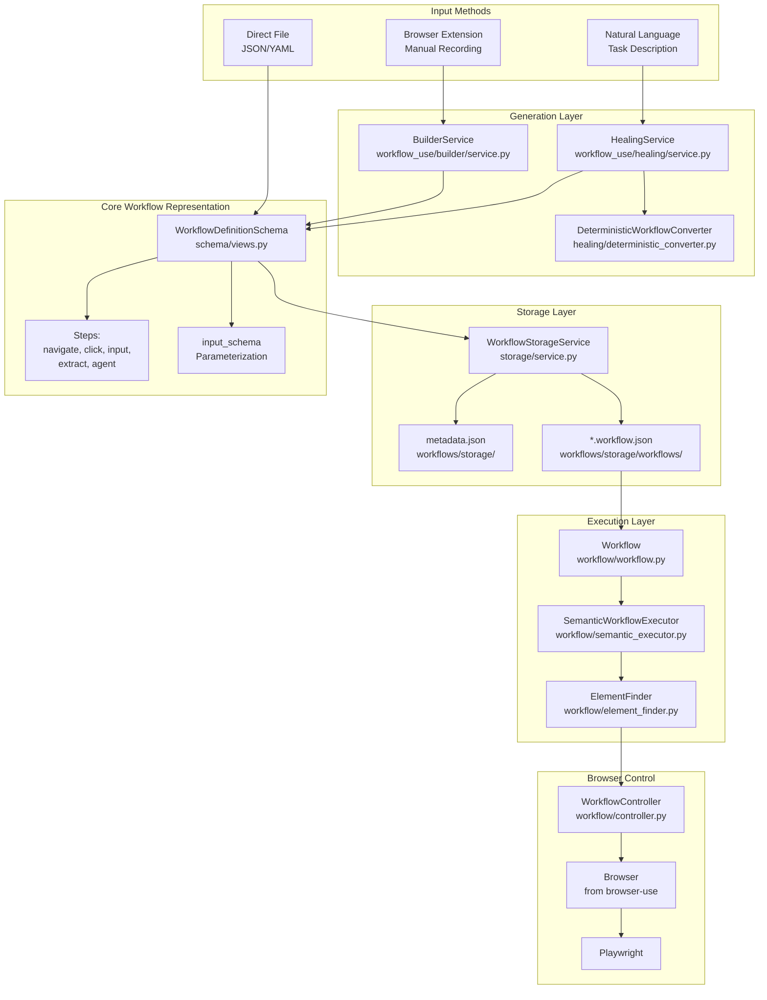

**Diagram: System Architecture and Component Relationships**

This architecture separates workflow creation from execution. Workflows pass through a common `WorkflowDefinitionSchema` representation regardless of how they were created, enabling uniform storage and execution.

**Sources:** [workflows/workflow_use/healing/service.py:29-74](), [workflows/workflow_use/storage/service.py:1-4](), [workflows/workflow_use/workflow/workflow.py](), [workflows/workflow_use/schema/views.py]()

## Three Workflow Creation Modes

workflow-use supports three distinct methods for creating workflows:

| Mode | Input | Process | Output | LLM Required | Speed |
|------|-------|---------|--------|--------------|-------|
| **Browser Recording** | User actions in browser | Extension captures DOM events + semantic info | Semantic workflow | Optional (for variables) | Fast |
| **AI Generation** | Natural language prompt | browser-use agent executes task once | Semantic workflow | Yes (for generation) | Slow (one-time) |
| **Manual Creation** | Hand-written JSON/YAML | Direct file editing | Custom workflow | No | Instant |

### Browser Recording Mode

The browser extension (`extension/`) captures:
- DOM mutations via rrweb
- User interactions (clicks, inputs, selects)
- Element semantic information (visible text, ARIA labels)
- XPath and CSS selectors

The `BuilderService` ([workflow_use/builder/service.py]()) converts recordings to workflows.

### AI Generation Mode

1. User provides natural language task (e.g., "Find GitHub stars for browser-use repo")
2. `HealingService.generate_workflow_from_prompt()` ([workflow_use/healing/service.py:420-841]()) creates a browser-use `Agent`
3. Agent executes task once, recording all actions in `AgentHistoryList`
4. History converted to workflow via:
   - **LLM-based conversion**: Uses `workflow_creation_prompt.md` to generate workflow (flexible, may include agent steps)
   - **Deterministic conversion**: `DeterministicWorkflowConverter` ([healing/deterministic_converter.py]()) maps actions to steps programmatically (fast, guaranteed semantic)

### Manual Creation Mode

Developers can write workflows directly in JSON/YAML format conforming to `WorkflowDefinitionSchema` ([schema/views.py]()).

**Sources:** [README.md:19-105](), [workflows/workflow_use/healing/service.py:420-450](), [workflows/workflow_use/builder/service.py]()

## Workflow Definition Schema

All workflows conform to `WorkflowDefinitionSchema`, which defines:

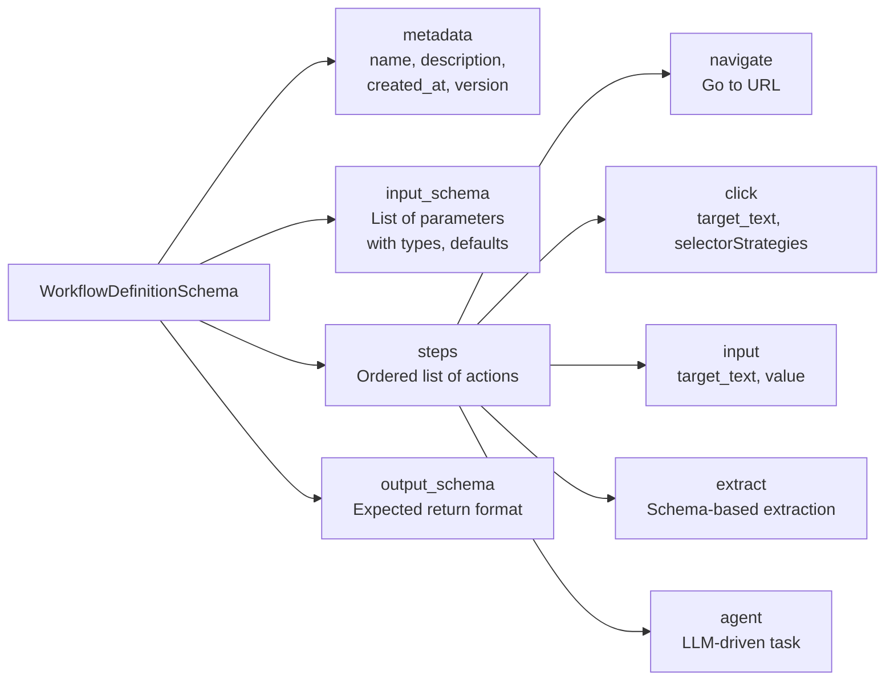

**Diagram: Workflow Definition Structure**

### Step Types

Each step in the workflow is one of:

- **navigate**: Load a URL
  - Fields: `url` (can contain `{variables}`)
  
- **click**: Click an element
  - Fields: `target_text` (visible text), `selectorStrategies` (fallback selectors)
  
- **input**: Enter text into a field
  - Fields: `target_text`, `value` (can contain `{variables}`)
  
- **select**: Choose from dropdown
  - Fields: `target_text`, `value`
  
- **extract**: Extract structured data from page
  - Fields: `schema` (defines data structure), `selector` (optional)
  
- **agent**: Delegate to LLM agent (slow, expensive)
  - Fields: `task` (natural language instruction)

### Semantic Selectors

Steps use **semantic targeting** via `target_text` instead of CSS/XPath. For example:

```json
{
  "type": "click",
  "target_text": "Search"
}
```

This matches any clickable element with visible text "Search" (button, link, etc.).

For robustness, the `SelectorGenerator` ([healing/selector_generator.py]()) creates multiple fallback strategies stored in `selectorStrategies`:

```json
{
  "type": "click",
  "target_text": "Submit",
  "selectorStrategies": [
    {
      "strategy": "text_exact",
      "value": "Submit",
      "priority": 1
    },
    {
      "strategy": "xpath_id",
      "value": "//button[@id='submit-btn']",
      "priority": 2
    },
    {
      "strategy": "xpath_absolute",
      "value": "/html/body/div[1]/form/button",
      "priority": 10
    }
  ]
}
```

The `ElementFinder` ([workflow/element_finder.py]()) tries strategies in priority order until one succeeds.

**Sources:** [workflows/workflow_use/schema/views.py](), [workflows/workflow_use/healing/selector_generator.py](), [workflows/workflow_use/workflow/element_finder.py]()

## Workflow Storage

The `WorkflowStorageService` ([storage/service.py]()) manages persistent storage:

```
workflows/storage/
├── metadata.json           # Index of all workflows
└── workflows/
    ├── <uuid1>.workflow.json
    ├── <uuid2>.workflow.json
    └── ...
```

**metadata.json** structure:
```json
{
  "workflows": [
    {
      "id": "550e8400-e29b-41d4-a716-446655440000",
      "name": "GitHub Stars Lookup",
      "generation_mode": "browser_use",
      "original_task": "Find stars for browser-use repo",
      "created_at": "2024-01-15T10:30:00Z",
      "file_path": "workflows/550e8400-e29b-41d4-a716-446655440000.workflow.json"
    }
  ]
}
```

CLI commands for storage:
- `python cli.py list-workflows` - List all stored workflows
- `python cli.py run-stored-workflow <id>` - Execute by ID
- `python cli.py workflow-info <id>` - View details
- `python cli.py delete-workflow <id>` - Remove workflow

**Sources:** [README.md:72-77](), [workflows/workflow_use/storage/__init__.py:1-4]()

## Execution Modes

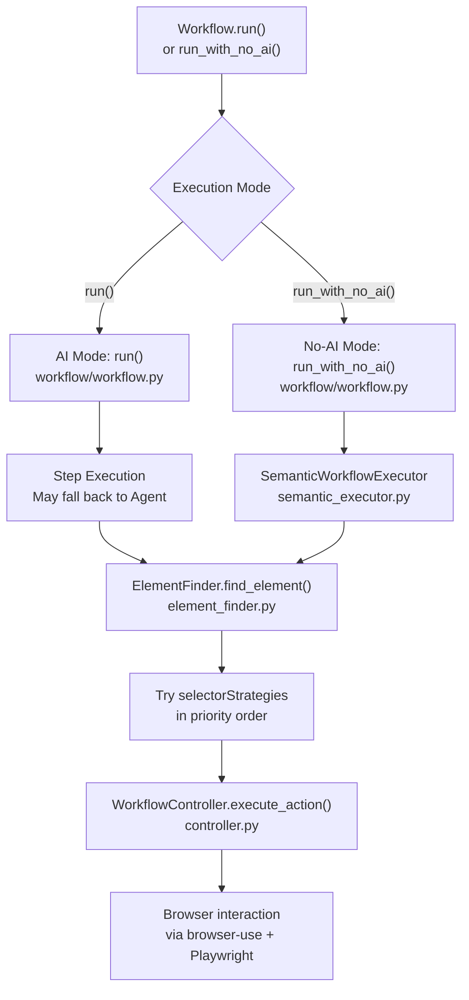

**Diagram: Workflow Execution Flow**

### AI Mode (`Workflow.run()`)

- Executes deterministic steps using semantic selectors
- Falls back to browser-use `Agent` if step fails
- LLM cost: $0.001-0.01 per step failure

### No-AI Mode (`Workflow.run_with_no_ai()`)

- Pure semantic execution via `SemanticWorkflowExecutor` ([workflow/semantic_executor.py]())
- Zero LLM calls
- Fails if no selector strategy matches
- Recommended for production when workflows are well-tested

Example usage:
```python
from workflow_use import Workflow

# Load workflow
workflow = Workflow.load_from_file("workflow.json")

# No-AI execution (fast, $0 cost)
result = await workflow.run_with_no_ai(inputs={"search_term": "playwright"})

# AI execution (with fallback)
result = await workflow.run(inputs={"search_term": "playwright"})
```

**Sources:** [README.md:165-174](), [workflows/workflow_use/workflow/workflow.py](), [workflows/workflow_use/workflow/semantic_executor.py]()

## Key Components

| Component | File Path | Purpose |
|-----------|-----------|---------|
| `HealingService` | [healing/service.py:29-841]() | Generate workflows from prompts using browser-use agents |
| `BuilderService` | [builder/service.py]() | Convert browser recordings to workflows |
| `DeterministicWorkflowConverter` | [healing/deterministic_converter.py]() | Map browser-use actions to semantic steps (no LLM) |
| `WorkflowStorageService` | [storage/service.py]() | Persist and retrieve workflows |
| `Workflow` | [workflow/workflow.py]() | Main orchestrator for workflow execution |
| `SemanticWorkflowExecutor` | [workflow/semantic_executor.py]() | Execute workflows without AI |
| `ElementFinder` | [workflow/element_finder.py]() | Locate elements using multi-strategy matching |
| `SelectorGenerator` | [healing/selector_generator.py]() | Generate fallback selector strategies |
| `WorkflowController` | [workflow/controller.py]() | Execute browser actions |
| `WorkflowValidator` | [healing/validator.py]() | Validate and improve workflow quality |
| `VariableIdentifier` | [workflow/variable_identifier.py]() | Extract variables from workflows |

**Sources:** [workflows/workflow_use/healing/service.py:29-74](), [workflows/workflow_use/storage/__init__.py:1-4]()

## Entry Points

workflow-use provides multiple interfaces:

### Command Line Interface

The CLI ([cli.py]()) provides commands for all workflow operations:

```bash
# Generate workflow
python cli.py generate-workflow "Your task"

# Run workflow
python cli.py run-workflow workflow.json

# Run as tool (LLM extracts inputs)
python cli.py run-as-tool workflow.json --prompt "Search for X"

# Bulk execution with CSV
python cli.py run-workflow-csv workflow.json inputs.csv
```

See [Command Line Interface](#6) for complete reference.

### Web Interface

FastAPI backend + React frontend provides visual workflow management:

```bash
python cli.py launch-gui
```

Opens http://localhost:5173 with:
- Workflow graph visualization
- Execution monitoring
- Real-time logs
- Parameter editing

See [Web Interface](#7) for details.

### Python API

```python
from workflow_use import Workflow
from workflow_use.healing.service import HealingService
from workflow_use.storage.service import WorkflowStorageService

# Execute existing workflow
workflow = Workflow.load_from_file("workflow.json")
result = await workflow.run_with_no_ai(inputs={"query": "test"})

# Generate new workflow
healing_service = HealingService(llm=my_llm)
workflow_def = await healing_service.generate_workflow_from_prompt(
    prompt="Fill contact form",
    agent_llm=agent_llm,
    extraction_llm=extraction_llm
)

# Store workflow
storage = WorkflowStorageService()
metadata = storage.save_workflow(workflow_def, generation_mode="browser_use")
```

**Sources:** [README.md:154-163](), [README.md:179-199](), [workflows/cli.py]()

## Dependencies

workflow-use is built on:

| Dependency | Purpose | Version |
|------------|---------|---------|
| `browser-use` | Browser automation with LLM agents | >=0.9.4 |
| `playwright` | Browser driver | Via browser-use |
| `pydantic` | Schema validation | Via browser-use |
| `fastapi` | Web API backend | >=0.115.12 |
| `aiofiles` | Async file I/O | >=24.1.0 |
| `typer` | CLI framework | >=0.15.3 |
| `pandas` | CSV bulk execution | >=2.3.0 |
| `faiss-cpu` | (Optional) Vector search | ==1.13.2 |

The system requires Python >=3.11.

**Sources:** [workflows/pyproject.toml:14-25](), [workflows/uv.lock:1-95]()

## Next Steps

- **Getting Started**: See [Installation and Setup](#1.1) to configure your environment
- **Learn Concepts**: See [Key Concepts](#1.2) for detailed terminology
- **Understand Architecture**: See [System Architecture](#2) for component relationships
- **Create Workflows**: See [Workflow Generation](#3) for creation methods
- **Execute Workflows**: See [Workflow Execution](#5) for running workflows
- **Extend System**: See [Development Guide](#10) for contributing

**Sources:** [README.md:1-268]()

---

# Page: Installation and Setup

# Installation and Setup

<details>
<summary>Relevant source files</summary>

The following files were used as context for generating this wiki page:

- [README.md](README.md)
- [workflows/.gitignore](workflows/.gitignore)
- [workflows/pyproject.toml](workflows/pyproject.toml)
- [workflows/uv.lock](workflows/uv.lock)
- [workflows/workflow_use/healing/service.py](workflows/workflow_use/healing/service.py)
- [workflows/workflow_use/storage/__init__.py](workflows/workflow_use/storage/__init__.py)

</details>


This page covers the installation, dependency management, and initial configuration required to run workflow-use on your local machine. For information about running workflows after installation, see [Workflow Execution](#5). For details about the browser extension architecture, see [Browser Extension](#8).

---

## Purpose and Scope

This guide provides step-by-step instructions for:
- Installing Python dependencies and system requirements
- Building and loading the browser extension for recording workflows
- Configuring environment variables and API keys
- Verifying the installation is functional
- Setting up optional components (GUI, cloud browser support)

---

## System Requirements

**Installation Prerequisites Diagram**

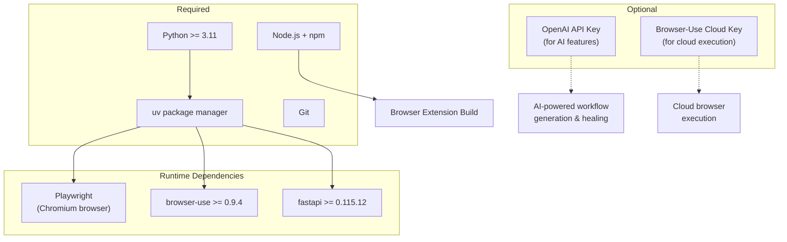

**Minimum Requirements:**
- **Python**: 3.11 or higher (3.12+ recommended)
- **Node.js**: 16+ (for building the browser extension)
- **uv**: Latest version for dependency management
- **Disk Space**: ~500MB for dependencies and browser binaries
- **Memory**: 4GB RAM minimum, 8GB recommended

Sources: [workflows/pyproject.toml:7](), [README.md:109-127]()

---

## Installation Process

### Step 1: Clone the Repository

```bash
git clone https://github.com/browser-use/workflow-use
cd workflow-use
```

**Repository Structure After Cloning:**

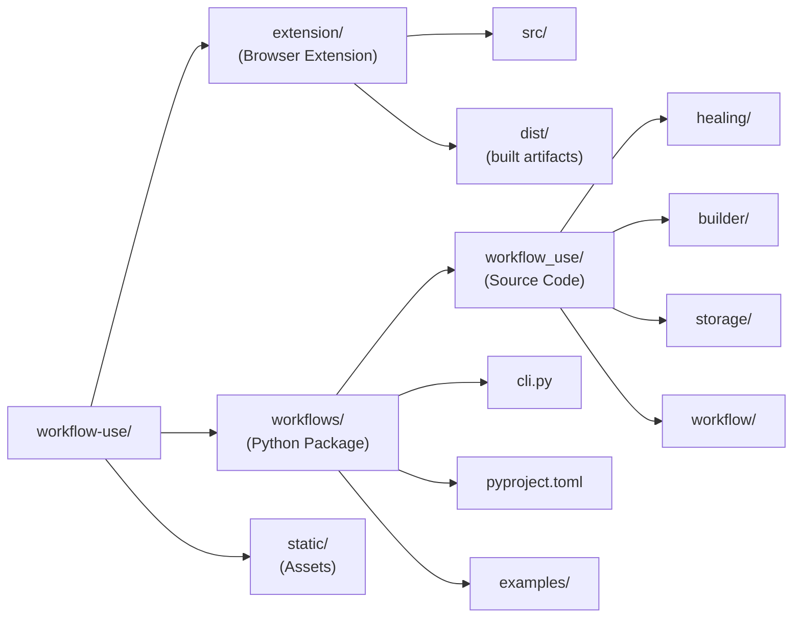

Sources: [README.md:109-111]()

---

### Step 2: Build the Browser Extension

The browser extension enables workflow recording by capturing user interactions in Chrome/Edge.

```bash
cd extension
npm install
npm run build
```

This creates the compiled extension in `extension/dist/`.

**Extension Build Dependencies:**

| Dependency | Purpose | Required By |
|------------|---------|-------------|
| TypeScript | Compilation | Content scripts, background service |
| Webpack | Bundling | Module packaging |
| React | UI Components | Side panel, popup |
| rrweb | Event Recording | User interaction capture |

**Loading the Extension:**
1. Open Chrome/Edge and navigate to `chrome://extensions/`
2. Enable "Developer mode"
3. Click "Load unpacked"
4. Select the `extension/dist/` directory

Sources: [README.md:114-117]()

---

### Step 3: Set Up Python Environment

Navigate to the workflows directory and initialize the Python environment:

```bash
cd ../workflows
uv sync
```

**Activation:**

```bash
# macOS / Linux
source .venv/bin/activate

# Windows
.venv\Scripts\activate
```

**What `uv sync` Does:**

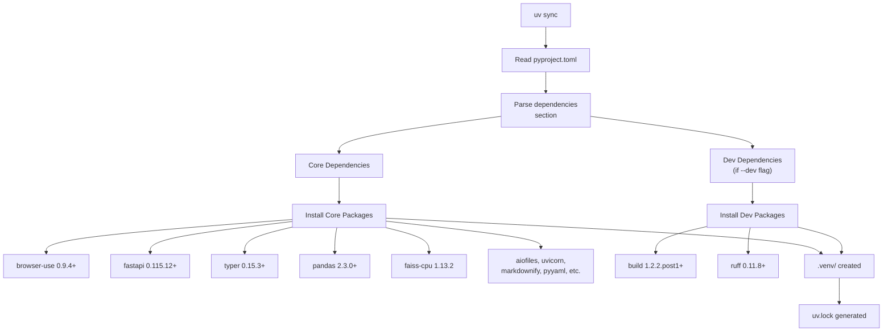

Sources: [workflows/pyproject.toml:14-32](), [README.md:122-124]()

---

### Step 4: Install Browser Automation Dependencies

Install Playwright's Chromium browser binary:

```bash
playwright install chromium
```

This downloads the Chromium browser (~200MB) used by Playwright for automation. The browser is installed to:
- **macOS**: `~/Library/Caches/ms-playwright/`
- **Linux**: `~/.cache/ms-playwright/`
- **Windows**: `%USERPROFILE%\AppData\Local\ms-playwright\`

**Why Chromium Only?**

The `browser-use` library (version 0.9.4+) that workflow-use depends on uses Playwright's Chromium implementation. Firefox and WebKit are not currently supported.

Sources: [README.md:125](), [workflows/pyproject.toml:16]()

---

### Step 5: Configure Environment Variables

Create and configure the `.env` file:

```bash
cp .env.example .env
```

**Required Environment Variables:**

| Variable | Purpose | Required For | Example |
|----------|---------|--------------|---------|
| `OPENAI_API_KEY` | OpenAI API authentication | `HealingService`, `BuilderService`, `WorkflowValidator`, AI-powered healing, LLM steps | `sk-proj-...` |
| `BROWSER_USE_API_KEY` | Browser-Use Cloud authentication | Cloud browser execution via `Browser(use_cloud=True)` | `bu-...` |

**Environment Variable Loading:**

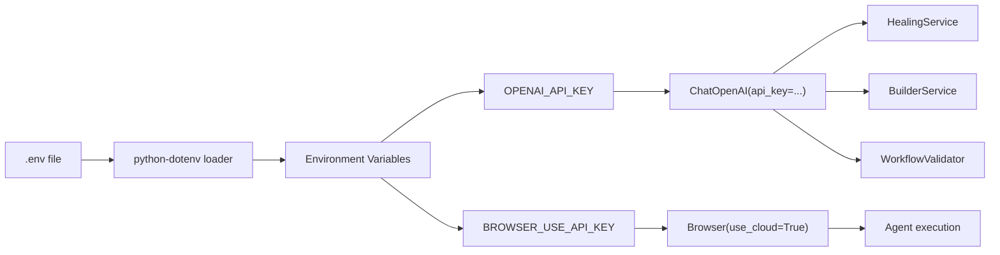

**Minimal `.env` Configuration:**

```bash
# Required for AI features (HealingService, variable extraction, workflow validation)
OPENAI_API_KEY=sk-proj-your-key-here

# Optional: for cloud browser execution (Browser(use_cloud=True))
BROWSER_USE_API_KEY=bu-your-key-here
```

**Configuration Loading Flow:**

The `python-dotenv` package (dependency of `browser-use`) automatically loads `.env` variables when the application starts. These are then accessed via `os.getenv()` in [workflow_use/healing/service.py]() and other services that require LLM or cloud browser access.

Sources: [README.md:126](), [workflows/pyproject.toml:16](), [workflows/workflow_use/healing/service.py:1-76]()

---

## Installation Verification

### Verify Core Installation

Test the CLI is functional:

```bash
python cli.py --help
```

**Expected Output Structure:**

```
Usage: cli.py [OPTIONS] COMMAND [ARGS]...

Commands:
  create-workflow          Record a new workflow
  generate-workflow        Generate workflow from task description
  run-workflow            Run workflow with predefined variables
  run-workflow-no-ai      Run workflow using semantic matching (no AI)
  run-as-tool             Run workflow with natural language input
  list-workflows          List all stored workflows
  launch-gui              Start the web UI
  ...
```

**CLI Command Routing:**

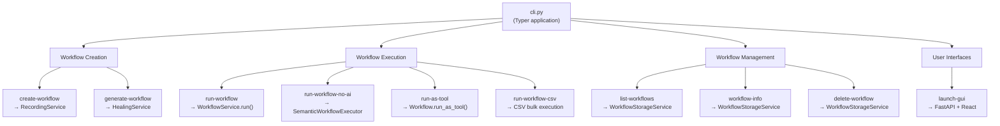

Sources: [README.md:148-152]()

---

### Verify Example Workflow Execution

Run a test workflow to verify the full stack:

```bash
python cli.py run-workflow examples/example.workflow.json
```

This validates:
- Python environment setup
- Playwright browser installation
- Workflow schema parsing
- Browser automation functionality

**Workflow Execution Dependencies:**

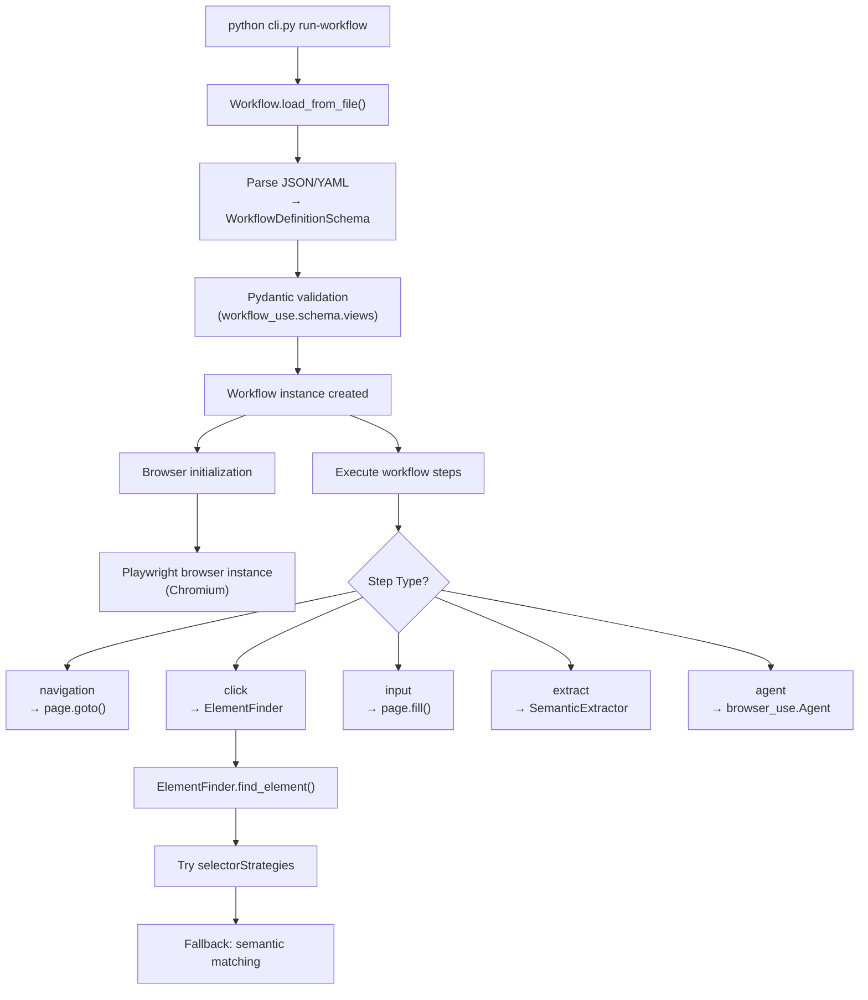

Sources: [workflows/workflow_use/healing/service.py:1-30]()

---

## Optional Components

### GUI Setup (Web Interface)

The GUI provides a visual interface for workflow management. For complete documentation, see [Web Interface](#7).

**Quick Start:**

```bash
python cli.py launch-gui
```

This command:
1. Starts the FastAPI backend on port 8000
2. Starts the React/Vite frontend on port 5173
3. Opens http://localhost:5173 in your browser

**Manual Setup:**

```bash
# Terminal 1: Backend
uvicorn backend.api:app --reload

# Terminal 2: Frontend
cd ui
npm install
npm run dev
```

**GUI Architecture Components:**

| Component | Technology | Port | File Path |
|-----------|-----------|------|-----------|
| Backend API | FastAPI + Uvicorn | 8000 | `backend/api.py` |
| Frontend | React + Vite | 5173 | `ui/src/` |
| Storage Service | File-based (JSON + YAML) | N/A | [workflow_use/storage/service.py]() |

**Storage Implementation:**

The `WorkflowStorageService` class uses a file-based storage approach (not SQLite):
- **Metadata Index**: `workflows/storage/metadata.json` - JSON index of all workflows with `WorkflowMetadata` entries
- **Individual Workflows**: `workflows/storage/workflows/<id>.workflow.yaml` - Each workflow stored as YAML

Sources: [README.md:179-224](), [workflows/workflow_use/storage/__init__.py:1-4]()

---

### Cloud Browser Configuration

To use Browser-Use Cloud for remote browser execution:

1. **Sign up**: Visit https://cloud.browser-use.com
2. **Get API Key**: New signups receive $10 free credits (OAuth) or $1 (email)
3. **Set Environment Variable**:
   ```bash
   export BROWSER_USE_API_KEY=bu-your-key-here
   ```

**Usage in Code:**

```python
from workflow_use import Workflow
from browser_use.llm import ChatOpenAI

llm = ChatOpenAI(model='gpt-4.1-mini')
workflow = Workflow.load_from_file(
    "workflow.json", 
    llm, 
    use_cloud=True  # Enable cloud browser
)

# Execute without local browser
result = await workflow.run_with_no_ai()
```

**Cloud vs Local Execution:**

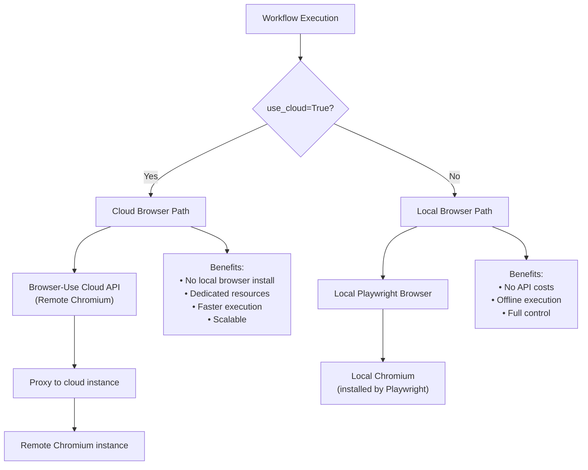

Sources: [README.md:165-177](), [workflows/pyproject.toml:16]()

---

## Dependency Resolution

### Core Python Dependencies

The dependency tree from `pyproject.toml`:

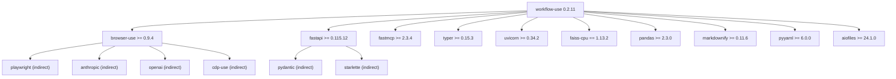

**Version Pinning Strategy:**

- **Exact pins** (`==`): `faiss-cpu==1.13.2` only (for reproducible vector similarity operations in semantic extraction)
- **Minimum pins** (`>=`): All other packages (allow compatible updates)
- **Python constraint**: `>=3.11` (uses modern async/typing features)

**Note**: While `pyproject.toml` specifies `browser-use>=0.9.4`, `uv` typically resolves to the latest compatible version (currently 0.9.5 in `uv.lock`).

Sources: [workflows/pyproject.toml:14-25](), [workflows/uv.lock:196-239]()

---

### Dev Dependencies

For development and contribution:

```bash
uv sync --dev
```

Installs additional tools:

| Package | Version | Purpose |
|---------|---------|---------|
| `build` | >= 1.2.2.post1 | Package building |
| `ruff` | >= 0.11.8 | Linting and formatting |

**Ruff Configuration:**

Key linting rules are configured in `pyproject.toml`:
- Line length: 130 characters
- Auto-fix enabled
- Selected rules: `ASYNC`, `E`, `F`, `FAST`, `I`, `PLE`
- Formatting: Single quotes, tabs for indentation

Sources: [workflows/pyproject.toml:29-50]()

---

## Troubleshooting Common Installation Issues

### Python Version Mismatch

**Error**: `requires-python = ">=3.11"`

**Solution**: Verify Python version:
```bash
python --version  # Should be 3.11+
```

If using older Python, install 3.11+ or use pyenv:
```bash
pyenv install 3.12.0
pyenv local 3.12.0
```

---

### Playwright Browser Not Found

**Error**: `Executable doesn't exist at ...ms-playwright/chromium-*/chrome`

**Solution**: Reinstall Chromium binary:
```bash
playwright install chromium --force
```

---

### UV Not Found

**Error**: `command not found: uv`

**Solution**: Install uv package manager:
```bash
# macOS/Linux
curl -LsSf https://astral.sh/uv/install.sh | sh

# Windows (PowerShell)
powershell -c "irm https://astral.sh/uv/install.ps1 | iex"
```

---

### Extension Build Failures

**Error**: `Module not found: Error: Can't resolve 'react'`

**Solution**: Clean install dependencies:
```bash
cd extension
rm -rf node_modules package-lock.json
npm install
npm run build
```

---

## Post-Installation: Next Steps

After successful installation:

1. **Record Your First Workflow**: See [Browser Recording](#3.1) to create workflows using the extension
2. **Generate From Natural Language**: See [Natural Language Generation](#3.2) to create workflows from task descriptions
3. **Execute Workflows**: See [Workflow Execution](#5) for running created workflows
4. **Explore Examples**: Check `workflows/examples/` directory for sample workflows

**File Structure After Installation:**

```
workflow-use/
├── extension/
│   ├── dist/              # Built extension (load this in Chrome)
│   └── node_modules/      # NPM dependencies
├── workflows/
│   ├── .venv/             # Python virtual environment
│   ├── workflow_use/      # Source code
│   ├── storage/           # Workflow storage (created on first run)
│   │   ├── metadata.json
│   │   └── workflows/
│   ├── examples/          # Example workflows
│   ├── cli.py             # Main CLI entry point
│   └── .env               # Your API keys (not committed)
```

Sources: [README.md:109-152](), [workflows/.gitignore:189-191]()

---

# Page: Key Concepts

# Key Concepts

<details>
<summary>Relevant source files</summary>

The following files were used as context for generating this wiki page:

- [README.md](README.md)
- [workflows/.gitignore](workflows/.gitignore)
- [workflows/cli.py](workflows/cli.py)
- [workflows/examples/scripts/generate_workflow.py](workflows/examples/scripts/generate_workflow.py)
- [workflows/examples/workflows/basic/example.workflow.yaml](workflows/examples/workflows/basic/example.workflow.yaml)
- [workflows/examples/workflows/basic/pure_semantic.workflow.yaml](workflows/examples/workflows/basic/pure_semantic.workflow.yaml)
- [workflows/examples/workflows/form_filling/semantic_form_fill.workflow.yaml](workflows/examples/workflows/form_filling/semantic_form_fill.workflow.yaml)
- [workflows/tests/test_go_back.workflow.yaml](workflows/tests/test_go_back.workflow.yaml)
- [workflows/workflow_use/healing/prompts/workflow_creation_prompt.md](workflows/workflow_use/healing/prompts/workflow_creation_prompt.md)
- [workflows/workflow_use/healing/prompts/workflow_validation_prompt.md](workflows/workflow_use/healing/prompts/workflow_validation_prompt.md)
- [workflows/workflow_use/healing/tests/test_validator.py](workflows/workflow_use/healing/tests/test_validator.py)
- [workflows/workflow_use/schema/views.py](workflows/workflow_use/schema/views.py)
- [workflows/workflow_use/storage/__init__.py](workflows/workflow_use/storage/__init__.py)
- [workflows/workflow_use/workflow/service.py](workflows/workflow_use/workflow/service.py)

</details>


This page introduces the fundamental concepts and terminology used throughout the workflow-use system. Understanding these concepts is essential for creating, executing, and debugging workflows.

For installation instructions, see [Installation and Setup](#1.1). For detailed architecture information, see [System Architecture](#2). For workflow creation methods, see [Workflow Generation](#3).

---

## What is a Workflow?

A **workflow** is a reusable, parameterized sequence of browser automation steps defined in YAML or JSON format. Workflows are parsed into the `WorkflowDefinitionSchema` class and executed by the `Workflow` orchestrator.

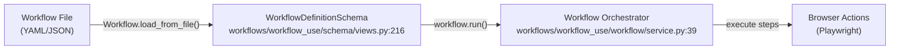

**Sources:** [workflows/workflow_use/workflow/service.py:108-136](), [workflows/workflow_use/schema/views.py:216-280]()

### Workflow Definition Structure

Every workflow contains:

| Field | Type | Description |
|-------|------|-------------|
| `name` | string | Human-readable workflow name |
| `description` | string | Purpose and functionality description |
| `version` | string | Version identifier (e.g., "1.0") |
| `steps` | array | Ordered list of workflow steps |
| `input_schema` | array | Input variable definitions |
| `default_wait_time` | float | Time between steps (seconds) |
| `workflow_analysis` | string | Optional reasoning about workflow design |

**Sources:** [workflows/workflow_use/schema/views.py:216-238]()

---

## Step Types: Deterministic vs Agentic

Workflow steps fall into two fundamental categories with drastically different performance characteristics:

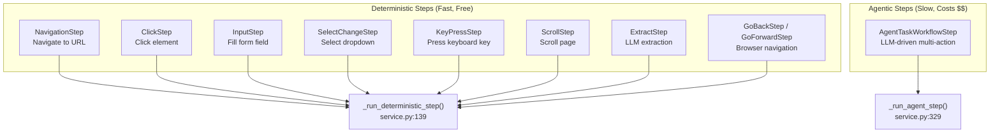

**Sources:** [workflows/workflow_use/schema/views.py:79-174](), [workflows/workflow_use/workflow/service.py:139-283](), [workflows/workflow_use/workflow/service.py:329-352]()

### Deterministic Steps

Deterministic steps execute **one specific action** with **no LLM calls** (except for `extract` steps). They are fast (milliseconds), free, and reliable.

**Common Deterministic Step Types:**

| Step Type | Code Class | Purpose | Required Fields |
|-----------|------------|---------|-----------------|
| `navigation` | `NavigationStep` | Navigate to URL | `url` |
| `click` | `ClickStep` | Click element | `target_text` or `cssSelector` |
| `input` | `InputStep` | Fill text field | `target_text`, `value` |
| `select_change` | `SelectChangeStep` | Select dropdown option | `target_text`, `selectedText` |
| `key_press` | `KeyPressStep` | Press keyboard key | `target_text`, `key` |
| `scroll` | `ScrollStep` | Scroll page | `scrollX`, `scrollY` |
| `extract` | `ExtractStep` | Extract data with LLM | `extractionGoal` |
| `go_back` | `GoBackStep` | Browser back button | (none) |
| `go_forward` | `GoForwardStep` | Browser forward button | (none) |

**Sources:** [workflows/workflow_use/schema/views.py:79-172]()

### Agentic Steps

Agentic steps delegate execution to a **browser-use Agent** that uses LLM reasoning to complete multi-step tasks. They are **10-30x slower** and **cost money per execution**.

```yaml
# Agent step example - AVOID when possible
- type: agent
  task: "Find the restaurant named {restaurant_name} and click on it"
  max_steps: 5
  description: "Complex search requiring AI reasoning"
```

**When to use agent steps:**
- Element has no stable visible text or label (rare)
- Complex multi-step conditional logic in dynamic UI
- Content evaluation requiring AI understanding
- **Last resort** when semantic targeting fails

**Sources:** [workflows/workflow_use/schema/views.py:64-73](), [workflows/workflow_use/workflow/service.py:329-352]()

---

## Semantic Targeting System

**Semantic targeting** identifies elements by **human-readable text** instead of brittle CSS selectors or XPath. This is the **primary method** for element location in workflow-use.

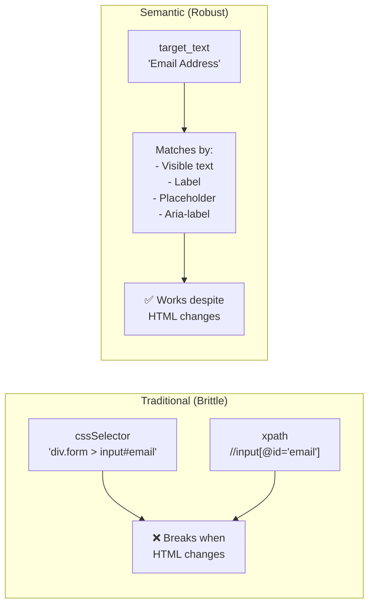

**Sources:** [workflows/workflow_use/schema/views.py:46-60](), [workflows/examples/workflows/basic/pure_semantic.workflow.yaml:1-47]()

### target_text Field

The `target_text` field is the **preferred** way to identify elements in modern workflows:

```yaml
# Semantic step - PREFERRED
- type: click
  target_text: "Submit"
  description: "Click submit button"

# Semantic step with variable
- type: input
  target_text: "Email Address"
  value: "{email}"
  description: "Enter email"

# Semantic step with variable IN target_text
- type: click
  target_text: "{repo_name}"
  container_hint: "Repositories"
  description: "Click repository (works for ANY repo name)"
```

**Key advantages:**
- Survives HTML structure changes
- Human-readable and maintainable
- Can contain variables for dynamic targeting
- No fragile DOM path dependencies

**Sources:** [workflows/workflow_use/schema/views.py:46-60](), [workflows/healing/prompts/workflow_creation_prompt.md:134-150]()

### Context Hints

Optional fields help disambiguate when multiple elements share the same text:

| Field | Purpose | Example |
|-------|---------|---------|
| `container_hint` | Parent section context | `"Personal Information"`, `"Billing Section"` |
| `position_hint` | Position among duplicates | `"item 2 of 3"`, `"first"`, `"last"` |
| `interaction_type` | Expected interaction pattern | `"form_submit"`, `"navigation"` |

**Sources:** [workflows/workflow_use/schema/views.py:52-60]()

---

## Element Finding Strategies

The system uses a **multi-strategy fallback mechanism** for robust element location. When a step executes, the `ElementFinder` tries strategies in priority order until one succeeds.

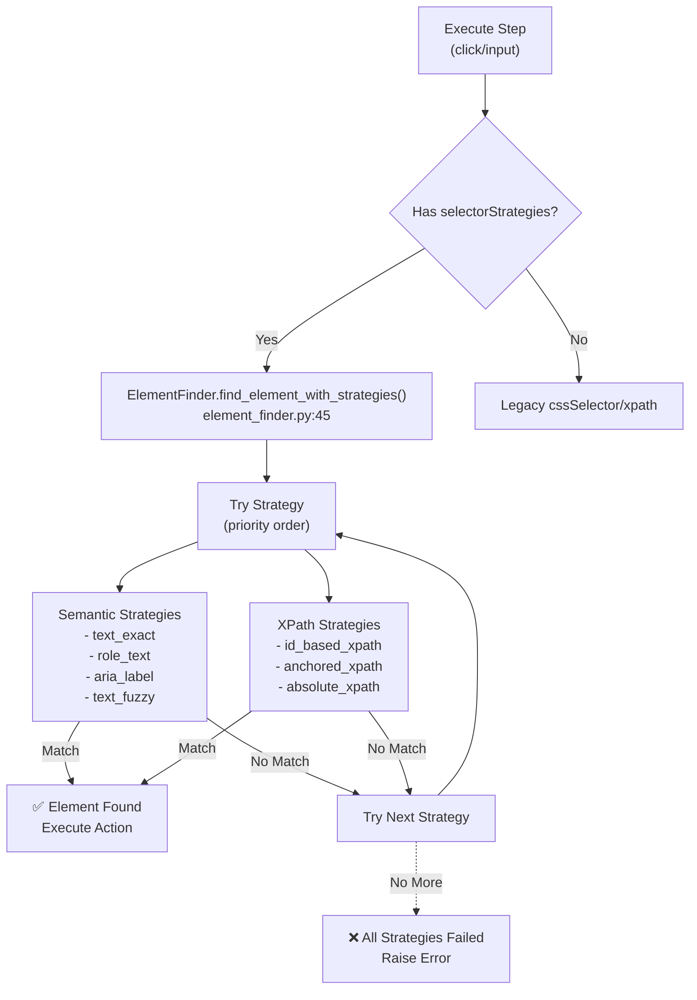

**Sources:** [workflows/workflow_use/workflow/element_finder.py:45-121](), [workflows/workflow_use/workflow/service.py:167-228]()

### selectorStrategies Array

Modern workflows include a `selectorStrategies` array with multiple fallback methods:

```yaml
- type: click
  target_text: "Submit"
  selectorStrategies:
    - type: "text_exact"
      value: "Submit"
      priority: 1
      metadata:
        role: "button"
    - type: "role_text"
      value: "button:Submit"
      priority: 2
    - type: "xpath"
      value: "//button[@id='submit-btn']"
      priority: 10
```

**Strategy Priority System:**

| Priority | Strategy Type | Description |
|----------|--------------|-------------|
| 1 | `text_exact` | Exact visible text match |
| 2 | `role_text` | ARIA role + text |
| 3 | `aria_label` | Aria-label attribute |
| 5 | `id_based_xpath` | XPath using stable IDs |
| 7 | `text_fuzzy` | Fuzzy text matching |
| 10 | `absolute_xpath` | Last resort XPath |

**Sources:** [workflows/workflow_use/workflow/element_finder.py:45-121](), [workflows/workflow_use/builder/selector_generator.py:15-187]()

### Self-Healing Behavior

When a strategy fails, the system **automatically tries the next one** without raising an error. This makes workflows resilient to minor UI changes:

```python
# Pseudocode of fallback logic
for strategy in sorted_by_priority(selectorStrategies):
    element = try_find_element(strategy)
    if element:
        return element  # Success!
# All strategies failed - only now raise error
```

**Sources:** [workflows/workflow_use/workflow/element_finder.py:91-121]()

---

## Variables and Parameterization

Workflows become **reusable** by replacing hardcoded values with variables. Variables use `{variable_name}` syntax (single curly braces) and are defined in the `input_schema`.

### Variable Syntax

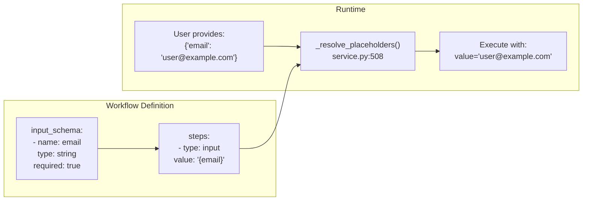

**Sources:** [workflows/workflow_use/workflow/service.py:508-584](), [workflows/workflow_use/schema/views.py:189-210]()

### Input Schema Definition

The `input_schema` array defines all workflow variables:

```yaml
input_schema:
  - name: email
    type: string
    format: "user@domain.com"
    required: true
  - name: birth_date
    type: string
    format: "MM/DD/YYYY"
    required: true
  - name: max_results
    type: number
    required: false
    default: 10
```

**Field Definitions:**

| Field | Type | Description |
|-------|------|-------------|
| `name` | string | Variable name (used in `{name}` placeholders) |
| `type` | enum | `"string"`, `"number"`, or `"bool"` |
| `format` | string | Expected format (e.g., "MM/DD/YYYY") |
| `required` | boolean | Whether variable must be provided |
| `default` | any | Default value if not provided |

**Sources:** [workflows/workflow_use/schema/views.py:189-210]()

### Variable Usage in Steps

Variables can appear in **any string field** within steps:

```yaml
# In value fields
- type: input
  target_text: "Email"
  value: "{email}"

# In target_text (dynamic element targeting!)
- type: click
  target_text: "{repo_name}"
  container_hint: "Repositories"

# In URLs
- type: navigation
  url: "https://github.com/{username}/{repo_name}"

# In extraction goals
- type: extract
  extractionGoal: "Extract the star count for {repo_name}"
```

**Critical rules:**
- Use `{variable}` syntax (one pair of curly braces)
- ❌ WRONG: `{{variable}}` (double braces)
- ❌ WRONG: `{{{{variable}}}}` (quadruple braces)
- Python's `str.format()` performs substitution at runtime

**Sources:** [workflows/workflow_use/workflow/service.py:508-584](), [workflows/healing/prompts/workflow_creation_prompt.md:26-29]()

---

## Execution Modes

The `Workflow` class supports two execution modes with different characteristics:

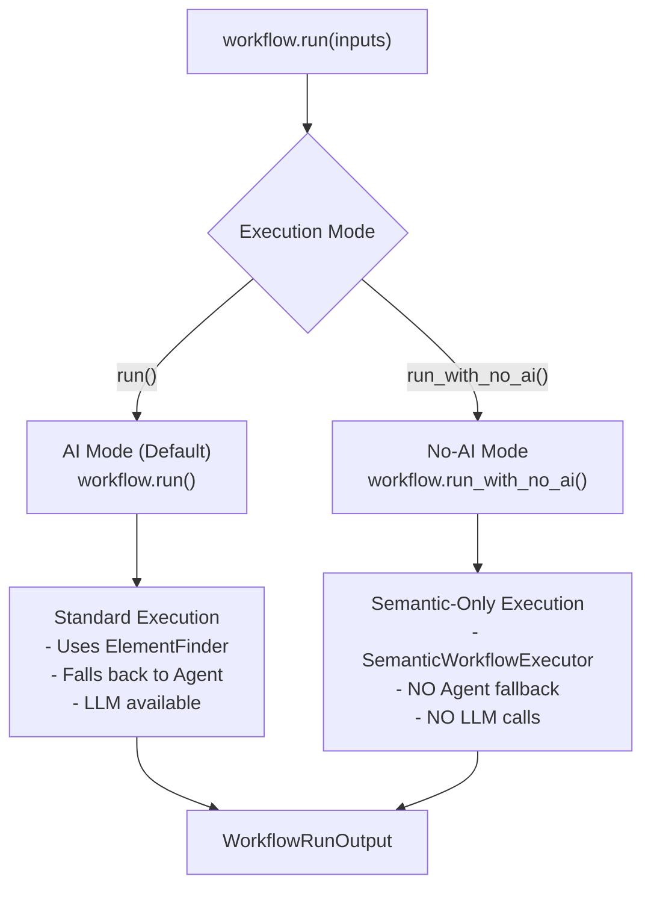

**Sources:** [workflows/workflow_use/workflow/service.py:851-945](), [workflows/workflow_use/workflow/semantic_executor.py:1-300]()

### AI Mode (Default)

```python
# AI mode - allows fallback to agent steps
workflow = Workflow.load_from_file("workflow.yaml", llm=llm)
result = await workflow.run(inputs={"email": "user@example.com"})
```

**Characteristics:**
- Uses `ElementFinder` with multi-strategy fallback
- Can execute agent steps if present
- Falls back to agent on deterministic step failure (if `fallback_to_agent=True`)
- Requires LLM for agent steps and extractions

**Sources:** [workflows/workflow_use/workflow/service.py:851-945]()

### No-AI Mode (Cloud-Optimized)

```python
# No-AI mode - pure semantic execution
workflow = Workflow.load_from_file("workflow.yaml", llm=llm, use_cloud=True)
result = await workflow.run_with_no_ai(inputs={"email": "user@example.com"})
```

**Characteristics:**
- Uses `SemanticWorkflowExecutor` 
- **No LLM calls** (except for extract steps)
- **No agent steps** allowed
- Purely deterministic execution
- Optimized for cloud browser execution
- **$0 per run** (except extraction costs)

**Sources:** [workflows/workflow_use/workflow/semantic_executor.py:1-300](), [README.md:165-174]()

### Mode Comparison

| Feature | AI Mode | No-AI Mode |
|---------|---------|------------|
| **Speed** | Medium | Fast |
| **Cost per run** | $$ (agent steps) | $0 (semantic only) |
| **Agent steps** | ✅ Allowed | ❌ Forbidden |
| **Fallback behavior** | LLM agent fallback | Error immediately |
| **Use case** | Complex workflows | Production-ready deterministic workflows |

**Sources:** [workflows/workflow_use/workflow/service.py:851-945](), [workflows/workflow_use/workflow/semantic_executor.py:1-300]()

---

## Self-Healing Mechanisms

Self-healing refers to the system's ability to **recover from element location failures** without human intervention. Multiple layers provide resilience:

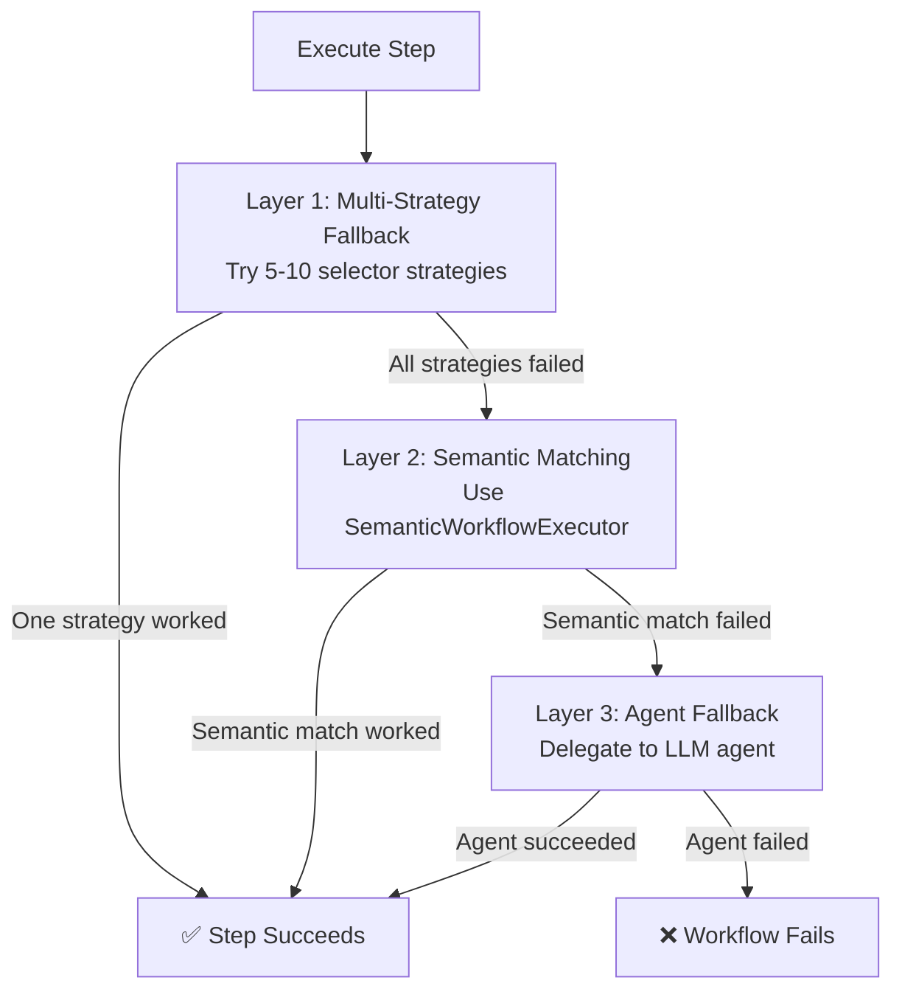

**Sources:** [workflows/workflow_use/workflow/element_finder.py:45-121](), [workflows/workflow_use/workflow/semantic_executor.py:1-300]()

### Multi-Strategy Selector Healing

The `SelectorGenerator` creates **multiple fallback strategies** during workflow generation:

```yaml
selectorStrategies:
  - type: "text_exact"      # Priority 1: Exact text
    value: "Submit"
  - type: "role_text"       # Priority 2: Role + text
    value: "button:Submit"
  - type: "aria_label"      # Priority 3: Aria label
    value: "submit-form"
  - type: "xpath"           # Priority 10: XPath fallback
    value: "//button[@id='submit']"
```

If the page HTML changes but "Submit" text remains, the workflow still works. If text changes but XPath remains valid, the workflow still works.

**Sources:** [workflows/workflow_use/builder/selector_generator.py:15-187]()

### Semantic Abstraction Layer

The `SemanticWorkflowExecutor` provides a **text-based matching layer** that works without CSS selectors:

1. Extracts `selector_map` from browser-use (visible interactive elements)
2. Matches `target_text` against visible text, labels, placeholders
3. Executes action using browser-use's semantic system

**Sources:** [workflows/workflow_use/workflow/semantic_executor.py:15-300]()

### Agent-Based Recovery

When enabled, failed deterministic steps can fall back to an LLM agent:

```python
workflow = Workflow(..., fallback_to_agent=True)
# If click fails, agent attempts task: "Click the element that says 'Submit'"
```

**Note:** This is **disabled by default** as it's slow and expensive. Multi-strategy selectors provide better healing.

**Sources:** [workflows/workflow_use/workflow/service.py:84-97]()

---

## Workflow Lifecycle

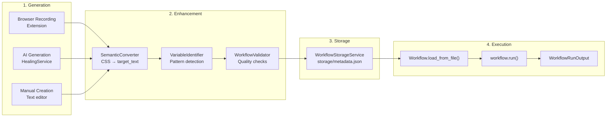

**Sources:** [workflows/workflow_use/healing/service.py:1-500](), [workflows/workflow_use/storage/service.py:1-300](), [workflows/workflow_use/workflow/service.py:39-945]()

### 1. Generation Phase

Three methods create workflows:

| Method | Class | Speed | Quality | Use Case |
|--------|-------|-------|---------|----------|
| **Browser Recording** | `RecordingService` | Fast | Manual | User records actions in extension |
| **AI Generation** | `HealingService` | Medium | Automatic | Describe task, AI generates workflow |
| **Manual Creation** | (Text editor) | Slow | Custom | Expert users write YAML |

**Sources:** [workflows/workflow_use/healing/service.py:1-500](), [workflows/workflow_use/recorder/service.py:1-200]()

### 2. Enhancement Phase

Generated workflows pass through enhancement pipeline:

1. **Semantic Conversion**: `SemanticWorkflowConverter` converts CSS selectors to `target_text`
2. **Variable Identification**: `VariableIdentifier` detects reusable values
3. **Selector Generation**: `SelectorGenerator` creates multi-strategy fallbacks
4. **Validation**: `WorkflowValidator` checks for issues and auto-corrects

**Sources:** [workflows/workflow_use/builder/semantic_converter.py:1-300](), [workflows/workflow_use/builder/variable_identifier.py:1-500](), [workflows/workflow_use/healing/validator.py:1-300]()

### 3. Storage Phase

Workflows are stored in file-based storage:

```
workflows/storage/
├── metadata.json              # Index of all workflows
└── workflows/
    ├── abc123.workflow.yaml   # Individual workflow files
    └── def456.workflow.yaml
```

**Sources:** [workflows/workflow_use/storage/service.py:1-300]()

### 4. Execution Phase

Workflows are loaded and executed:

```python
# Load workflow
workflow = Workflow.load_from_file("workflow.yaml", llm=llm)

# Execute with inputs
result = await workflow.run(inputs={"email": "user@example.com"})

# Access results
print(result.step_results)
print(result.output_model)  # If output model specified
```

**Sources:** [workflows/workflow_use/workflow/service.py:108-136](), [workflows/workflow_use/workflow/service.py:851-945]()

---

## Step Execution Flow

Understanding how individual steps execute helps debug workflows:

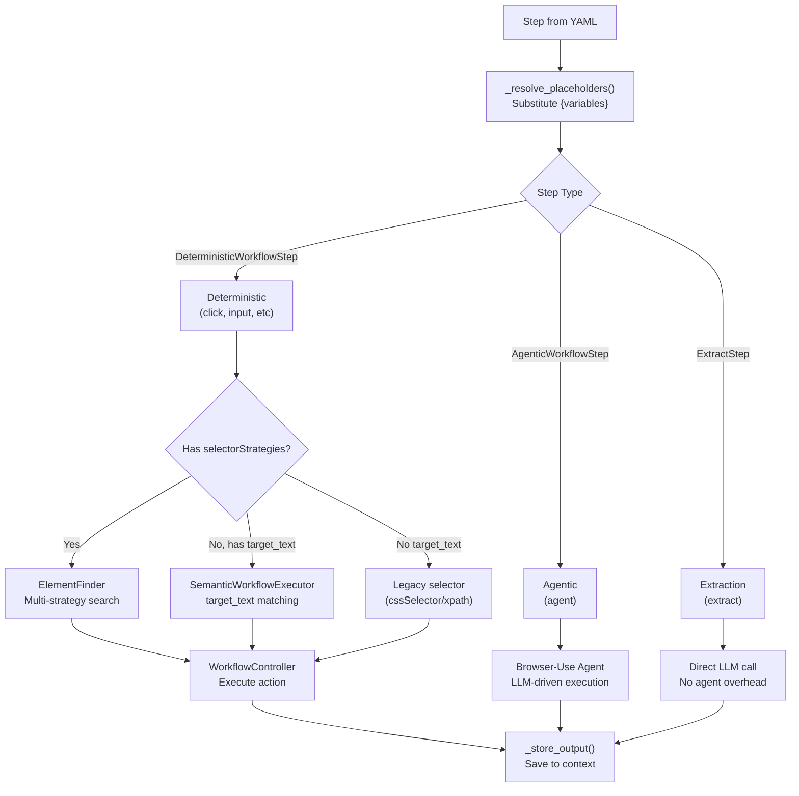

**Sources:** [workflows/workflow_use/workflow/service.py:630-720](), [workflows/workflow_use/workflow/service.py:139-283](), [workflows/workflow_use/workflow/service.py:329-352]()

### Placeholder Resolution

Before execution, all `{variable}` placeholders are replaced with actual values from the input context:

```python
# Input: {"email": "user@example.com"}
# Step before resolution:
{"type": "input", "value": "{email}"}

# Step after resolution (_resolve_placeholders):
{"type": "input", "value": "user@example.com"}
```

**Sources:** [workflows/workflow_use/workflow/service.py:508-584]()

### Output Storage

Steps with an `output` field store their result in the workflow context:

```yaml
- type: extract
  extractionGoal: "Get the star count"
  output: star_count  # Store result as {star_count}

- type: navigation
  url: "https://example.com/stars/{star_count}"  # Use stored value
```

**Sources:** [workflows/workflow_use/workflow/service.py:586-628]()

---

## Key Takeaways

### Design Principles

1. **Semantic-first**: Always prefer `target_text` over CSS selectors
2. **Deterministic-first**: Avoid agent steps unless absolutely necessary
3. **Multi-strategy**: Generate multiple fallback strategies for robustness
4. **Parameterize everything**: Extract variables for reusability
5. **Self-healing**: Let the system recover from UI changes automatically

### Performance Rules

| Pattern | Speed | Cost | Reliability |
|---------|-------|------|-------------|
| Semantic deterministic step | ⚡⚡⚡ Fast | $0 | ✅✅✅ High |
| Multi-strategy deterministic | ⚡⚡ Fast | $0 | ✅✅✅ Very High |
| Legacy CSS selector | ⚡⚡⚡ Fast | $0 | ❌ Low |
| Agent step | 🐌 10-30x slower | $$$ | ✅✅ Medium |

### Common Patterns

```yaml
# ✅ GOOD: Semantic step with variable
- type: input
  target_text: "Email Address"
  value: "{email}"

# ✅ GOOD: Variable in target_text
- type: click
  target_text: "{button_label}"
  container_hint: "Main Form"

# ❌ BAD: Agent step for simple input
- type: agent
  task: "Enter {email} into the email field"

# ❌ BAD: Hardcoded value
- type: input
  target_text: "Email"
  value: "hardcoded@example.com"
```

**Sources:** [workflows/healing/prompts/workflow_creation_prompt.md:1-242](), [workflows/examples/workflows/basic/pure_semantic.workflow.yaml:1-47]()

---

This completes the key concepts overview. For specific implementation details:
- Workflow generation techniques: [Workflow Generation](#3)
- Element finding implementation: [Element Finding Strategies](#5.2)
- Variable detection algorithms: [Variable Identification and Parameterization](#9.1)
- Storage internals: [Workflow Storage and Management](#9.3)

---

# Page: System Architecture

# System Architecture

<details>
<summary>Relevant source files</summary>

The following files were used as context for generating this wiki page:

- [README.md](README.md)
- [workflows/.gitignore](workflows/.gitignore)
- [workflows/cli.py](workflows/cli.py)
- [workflows/pyproject.toml](workflows/pyproject.toml)
- [workflows/uv.lock](workflows/uv.lock)
- [workflows/workflow_use/healing/service.py](workflows/workflow_use/healing/service.py)
- [workflows/workflow_use/schema/views.py](workflows/workflow_use/schema/views.py)
- [workflows/workflow_use/storage/__init__.py](workflows/workflow_use/storage/__init__.py)
- [workflows/workflow_use/workflow/service.py](workflows/workflow_use/workflow/service.py)

</details>


## Purpose and Scope

This document presents the high-level architecture of the workflow-use system, describing how its major components interact to enable workflow creation, storage, and execution. It covers the system's layered structure, data flow patterns, and integration points with external dependencies.

For detailed information about specific subsystems:
- For the structure of workflow definitions, see [Workflow Definition Schema](#2.1)
- For in-depth descriptions of individual components, see [Core Components Overview](#2.2)
- For the complete workflow lifecycle from creation to execution, see [Workflow Lifecycle](#2.3)

---

## System Overview

The workflow-use system is structured around three core phases: **workflow generation**, **workflow storage**, and **workflow execution**. The system accepts input through multiple interfaces (CLI, Web UI, Browser Extension) and produces deterministic, reusable workflows stored as YAML/JSON files.

```mermaid
graph TB
    subgraph "Entry Points"
        CLI["CLI<br/>(cli.py)"]
        WebAPI["Web Backend<br/>(backend/api.py)"]
        WebUI["Web Frontend<br/>(React)"]
        Extension["Browser Extension<br/>(content.ts, background.ts)"]
    end
    
    subgraph "Generation Services"
        HS["HealingService<br/>(healing/service.py)"]
        BS["BuilderService<br/>(builder/service.py)"]
        RS["RecordingService<br/>(recorder/service.py)"]
        DC["DeterministicWorkflowConverter<br/>(healing/deterministic_converter.py)"]
    end
    
    subgraph "Execution Services"
        WF["Workflow<br/>(workflow/service.py)"]
        SWE["SemanticWorkflowExecutor<br/>(workflow/semantic_executor.py)"]
        WC["WorkflowController<br/>(controller/service.py)"]
        EF["ElementFinder<br/>(workflow/element_finder.py)"]
    end
    
    subgraph "Supporting Services"
        SG["SelectorGenerator<br/>(healing/selector_generator.py)"]
        VI["VariableIdentifier<br/>(workflow/variable_identifier.py)"]
        WV["WorkflowValidator<br/>(healing/validator.py)"]
        SC["SemanticConverter<br/>(builder/semantic_converter.py)"]
    end
    
    subgraph "Storage Layer"
        WSS["WorkflowStorageService<br/>(storage/service.py)"]
        FS["File System<br/>(workflows/storage/)"]
    end
    
    subgraph "External Dependencies"
        BU["browser-use<br/>(Agent, Browser, Controller)"]
        PW["Playwright<br/>(Browser Driver)"]
        LLM["LLM Providers<br/>(OpenAI, Anthropic, etc.)"]
    end
    
    CLI --> HS
    CLI --> BS
    CLI --> WF
    CLI --> WSS
    WebAPI --> WF
    WebAPI --> WSS
    WebUI --> WebAPI
    Extension --> RS
    
    HS --> DC
    HS --> WV
    HS --> SG
    HS --> BU
    HS --> LLM
    RS --> BS
    BS --> SC
    BS --> VI
    BS --> SG
    
    WF --> SWE
    WF --> WC
    WF --> EF
    WF --> BU
    SWE --> EF
    WC --> BU
    
    HS --> WSS
    BS --> WSS
    WSS --> FS
    
    BU --> PW
    BU --> LLM
```

**Sources:** [workflows/cli.py:1-1000](), [workflows/workflow_use/workflow/service.py:1-100](), [workflows/workflow_use/healing/service.py:1-100](), [workflows/workflow_use/builder/service.py:1-50](), [workflows/workflow_use/storage/service.py:1-50]()

---

## Core Architectural Layers

The system is organized into distinct architectural layers, each with specific responsibilities:

```mermaid
graph TB
    subgraph "Presentation Layer"
        CLI_L["cli.py"]
        FastAPI["backend/api.py<br/>FastAPI Routes"]
        React["ui/<br/>React Components"]
        ExtUI["extension/sidepanel.tsx"]
    end
    
    subgraph "Application Services Layer"
        HealingSvc["HealingService"]
        BuilderSvc["BuilderService"]
        RecordingSvc["RecordingService"]
        StorageSvc["WorkflowStorageService"]
    end
    
    subgraph "Core Workflow Logic Layer"
        WorkflowSvc["Workflow<br/>run() / run_with_no_ai()"]
        SemanticExec["SemanticWorkflowExecutor<br/>execute_step()"]
        DeterministicConv["DeterministicWorkflowConverter<br/>convert_history_to_steps()"]
        SemanticConv["SemanticConverter<br/>convert_to_semantic()"]
    end
    
    subgraph "Element Location Layer"
        ElemFinder["ElementFinder<br/>find_element_with_strategies()"]
        SelectorGen["SelectorGenerator<br/>generate_selector_strategies()"]
        XPathOpt["XPathOptimizer<br/>optimize_xpath()"]
        SemanticExt["SemanticExtractor<br/>extract_semantic_mapping()"]
    end
    
    subgraph "Infrastructure Layer"
        WFController["WorkflowController<br/>act()"]
        BrowserWrap["Browser wrapper<br/>(browser-use)"]
        LLMClient["ChatBrowserUse<br/>(LLM client)"]
    end
    
    subgraph "External Systems"
        PlaywrightExt["Playwright"]
        LLMProviders["LLM APIs"]
        FileSystem["File System"]
    end
    
    CLI_L --> HealingSvc
    CLI_L --> BuilderSvc
    CLI_L --> WorkflowSvc
    CLI_L --> StorageSvc
    FastAPI --> WorkflowSvc
    FastAPI --> StorageSvc
    React --> FastAPI
    ExtUI --> RecordingSvc
    
    HealingSvc --> DeterministicConv
    HealingSvc --> SelectorGen
    BuilderSvc --> SemanticConv
    RecordingSvc --> SemanticConv
    
    WorkflowSvc --> SemanticExec
    WorkflowSvc --> WFController
    SemanticExec --> ElemFinder
    SemanticConv --> SelectorGen
    
    ElemFinder --> SelectorGen
    SelectorGen --> XPathOpt
    SemanticExec --> SemanticExt
    
    WorkflowSvc --> BrowserWrap
    WFController --> BrowserWrap
    HealingSvc --> LLMClient
    
    BrowserWrap --> PlaywrightExt
    LLMClient --> LLMProviders
    StorageSvc --> FileSystem
```

**Layer Responsibilities:**

| Layer | Purpose | Key Classes |
|-------|---------|-------------|
| Presentation | User interfaces and CLI commands | `cli.py`, `backend/api.py`, React components |
| Application Services | High-level business logic and orchestration | `HealingService`, `BuilderService`, `WorkflowStorageService` |
| Core Workflow Logic | Workflow conversion and execution strategies | `Workflow`, `SemanticWorkflowExecutor`, `DeterministicWorkflowConverter` |
| Element Location | Multi-strategy element finding and selector generation | `ElementFinder`, `SelectorGenerator`, `XPathOptimizer` |
| Infrastructure | Low-level browser and LLM interactions | `WorkflowController`, `Browser`, `ChatBrowserUse` |

**Sources:** [workflows/cli.py:1-100](), [workflows/workflow_use/workflow/service.py:39-106](), [workflows/workflow_use/healing/service.py:29-73](), [workflows/workflow_use/builder/service.py:1-50]()

---

## Data Flow Architecture

### Workflow Generation Flow

```mermaid
flowchart LR
    Input["User Input<br/>(Natural Language<br/>or Recording)"]
    
    Agent["browser-use Agent<br/>Agent.run()"]
    History["AgentHistoryList<br/>(Action History)"]
    
    Converter{"Conversion<br/>Strategy"}
    
    LLMConv["LLM-Based<br/>HealingService.create_workflow_definition()"]
    DetConv["Deterministic<br/>DeterministicWorkflowConverter.convert_history_to_steps()"]
    
    Schema["WorkflowDefinitionSchema<br/>(workflow/schema/views.py)"]
    
    Enrich["Enrichment Pipeline"]
    VarID["VariableIdentifier.identify_variables_in_workflow()"]
    SelGen["SelectorGenerator.generate_selector_strategies()"]
    Valid["WorkflowValidator.validate_and_correct()"]
    
    Final["Final Workflow<br/>(YAML/JSON)"]
    Storage["WorkflowStorageService.save_workflow()"]
    
    Input --> Agent
    Agent --> History
    History --> Converter
    
    Converter -->|"use_deterministic=True"| DetConv
    Converter -->|"use_deterministic=False"| LLMConv
    
    DetConv --> Schema
    LLMConv --> Schema
    
    Schema --> Enrich
    Enrich --> VarID
    Enrich --> SelGen
    Enrich --> Valid
    
    VarID --> Final
    SelGen --> Final
    Valid --> Final
    
    Final --> Storage
```

**Key Data Transformations:**

1. **Natural Language → Agent Actions**: `HealingService.generate_workflow_from_prompt()` creates an `Agent` that executes the task once
2. **Agent Actions → History**: Browser interactions are captured as `AgentHistoryList` containing `DOMInteractedElement` objects
3. **History → Steps**: Two conversion paths:
   - **LLM-based** ([healing/service.py:276-329]()): Uses `WorkflowDefinitionSchema` structured output
   - **Deterministic** ([healing/deterministic_converter.py:1-200]()): Direct mapping without LLM
4. **Steps → Enriched Workflow**: Post-processing adds:
   - Variables via `VariableIdentifier` ([workflow/variable_identifier.py:1-100]())
   - Multi-strategy selectors via `SelectorGenerator` ([healing/selector_generator.py:1-200]())
   - Quality validation via `WorkflowValidator` ([healing/validator.py:1-150]())

**Sources:** [workflows/workflow_use/healing/service.py:419-526](), [workflows/workflow_use/healing/deterministic_converter.py:1-100](), [workflows/workflow_use/healing/selector_generator.py:1-100]()

---

### Workflow Execution Flow

```mermaid
flowchart TB
    Start["Workflow.run()<br/>or run_with_no_ai()"]
    
    Load["Parse YAML/JSON<br/>WorkflowDefinitionSchema"]
    Validate["Validate Inputs<br/>_validate_inputs()"]
    
    StepLoop["For each step<br/>in workflow.steps"]
    
    Resolve["Resolve Placeholders<br/>_resolve_placeholders()"]
    
    StepType{"Step Type?"}
    
    Det["Deterministic Step<br/>_run_deterministic_step()"]
    Agent["Agent Step<br/>_run_agent_step()"]
    Extract["Extract Step<br/>_run_extraction_step()"]
    
    ElemFind{"Element<br/>Location"}
    
    Strategies["Has selectorStrategies?<br/>ElementFinder.find_element_with_strategies()"]
    Semantic["Has target_text?<br/>SemanticWorkflowExecutor.execute_step()"]
    Legacy["CSS/XPath<br/>WorkflowController.act()"]
    
    Execute["Browser Action<br/>via WorkflowController"]
    
    Store["Store Output<br/>_store_output()"]
    
    Result["WorkflowRunOutput"]
    
    Start --> Load
    Load --> Validate
    Validate --> StepLoop
    
    StepLoop --> Resolve
    Resolve --> StepType
    
    StepType -->|"NavigationStep,<br/>ClickStep, etc."| Det
    StepType -->|"AgenticWorkflowStep"| Agent
    StepType -->|"ExtractStep"| Extract
    
    Det --> ElemFind
    
    ElemFind -->|"Yes"| Strategies
    ElemFind -->|"No, has target_text"| Semantic
    ElemFind -->|"No"| Legacy
    
    Strategies --> Execute
    Semantic --> Execute
    Legacy --> Execute
    Agent --> Execute
    Extract --> Execute
    
    Execute --> Store
    Store --> StepLoop
    
    StepLoop --> Result
```

**Execution Modes:**

| Mode | Method | Uses AI? | Element Finding Strategy |
|------|--------|----------|--------------------------|
| Standard | `Workflow.run()` | Yes (fallback) | `selectorStrategies` → `target_text` → CSS/XPath |
| No-AI | `Workflow.run_with_no_ai()` | No | Pure semantic via `SemanticWorkflowExecutor` |
| Tool | `Workflow.run_as_tool()` | Yes (input parsing) | Standard mode with LLM-extracted inputs |

**Sources:** [workflows/workflow_use/workflow/service.py:851-1088](), [workflows/workflow_use/workflow/semantic_executor.py:1-200](), [workflows/workflow_use/workflow/element_finder.py:1-150]()

---

## Multi-Strategy Element Finding System

The element finding system implements a priority-based fallback mechanism for robust element location across page changes:

```mermaid
graph TB
    Start["Element Location Request<br/>(from workflow step)"]
    
    HasStrat{"Has<br/>selectorStrategies?"}
    
    ElemFinder["ElementFinder.find_element_with_strategies()"]
    StratLoop["Iterate strategies<br/>by priority"]
    
    StratType{"Strategy Type"}
    
    TextExact["text_exact<br/>(Priority 1)"]
    RoleText["role_text<br/>(Priority 2)"]
    AriaLabel["aria_label<br/>(Priority 3)"]
    XPathID["xpath_id<br/>(Priority 5)"]
    XPathAbs["xpath_absolute<br/>(Priority 10)"]
    
    Match{"Element<br/>Found?"}
    
    Success["Return element index"]
    NextStrat["Try next strategy"]
    
    Fallback["Fallback to<br/>SemanticWorkflowExecutor"]
    
    LegacyCSS["Legacy CSS selector"]
    
    Start --> HasStrat
    
    HasStrat -->|"Yes"| ElemFinder
    HasStrat -->|"No, has target_text"| Fallback
    HasStrat -->|"No"| LegacyCSS
    
    ElemFinder --> StratLoop
    StratLoop --> StratType
    
    StratType --> TextExact
    StratType --> RoleText
    StratType --> AriaLabel
    StratType --> XPathID
    StratType --> XPathAbs
    
    TextExact --> Match
    RoleText --> Match
    AriaLabel --> Match
    XPathID --> Match
    XPathAbs --> Match
    
    Match -->|"Yes"| Success
    Match -->|"No"| NextStrat
    NextStrat --> StratLoop
```

**Strategy Priority Table:**

| Priority | Strategy Type | Description | Robustness |
|----------|---------------|-------------|------------|
| 1 | `text_exact` | Exact visible text match | High |
| 2 | `role_text` | ARIA role + text combination | High |
| 3 | `aria_label` | ARIA label attribute | Medium |
| 5 | `xpath_id` | XPath using ID attributes | Medium |
| 7 | `text_fuzzy` | Fuzzy text matching | Low |
| 10 | `xpath_absolute` | Absolute XPath (fallback) | Very Low |

**Sources:** [workflows/workflow_use/workflow/element_finder.py:1-200](), [workflows/workflow_use/healing/selector_generator.py:1-250](), [workflows/workflow_use/healing/xpath_optimizer.py:1-150]()

---

## Storage and Persistence

The system uses a file-based storage system with JSON metadata and individual workflow files:

```mermaid
graph LR
    Service["WorkflowStorageService<br/>(storage/service.py)"]
    
    Meta["metadata.json<br/>(Storage Index)"]
    WFFiles["Individual Workflows<br/>(*.workflow.yaml/json)"]
    
    Storage["workflows/storage/"]
    WFDir["workflows/storage/workflows/"]
    
    Service -->|"save_workflow()"| Meta
    Service -->|"save_workflow()"| WFFiles
    Service -->|"get_workflow()"| WFFiles
    Service -->|"list_workflows()"| Meta
    
    Meta --> Storage
    WFFiles --> WFDir
```

**Storage Structure:**

```
workflows/storage/
├── metadata.json              # Searchable index of all workflows
└── workflows/
    ├── abc123.workflow.yaml   # Individual workflow files
    ├── def456.workflow.json
    └── ...
```

**Metadata Schema:**

Each entry in `metadata.json` contains:
- `id`: Unique workflow identifier
- `name`: Workflow name
- `description`: Workflow description
- `generation_mode`: One of `browser_use`, `recording`, `manual`
- `original_task`: Original task prompt (for generated workflows)
- `created_at`: ISO timestamp
- `tags`: List of tags
- `input_schema`: List of input parameters

**Sources:** [workflows/workflow_use/storage/service.py:1-200]()

---

## External Dependencies Integration

### Browser Automation Stack

```mermaid
graph TB
    WF["Workflow<br/>(workflow/service.py)"]
    WC["WorkflowController<br/>(controller/service.py)"]
    
    BU["browser-use Framework"]
    Agent["Agent class"]
    Browser["Browser class"]
    Controller["Controller base"]
    
    PW["Playwright"]
    BWP["Browser-Context-Page"]
    
    WF --> Browser
    WF --> Agent
    WC --> Controller
    
    Browser --> BU
    Agent --> BU
    Controller --> BU
    
    BU --> PW
    PW --> BWP
```

**Integration Points:**

| Component | browser-use Class | Purpose |
|-----------|-------------------|---------|
| `Workflow` | `Browser` | Browser session management |
| `Workflow` | `Agent` | AI-driven task execution (generation phase) |
| `WorkflowController` | `Controller` | Base class for action execution |
| `HealingService` | `Agent`, `AgentHistoryList` | Workflow generation from history |

**Sources:** [workflows/workflow_use/workflow/service.py:1-100](), [workflows/workflow_use/controller/service.py:1-100](), [workflows/pyproject.toml:14-25]()

---

### LLM Provider Integration

```mermaid
graph LR
    Services["Healing/Builder/Validator<br/>Services"]
    
    Client["ChatBrowserUse<br/>(LLM Client Wrapper)"]
    
    Providers["LLM Providers"]
    OpenAI["OpenAI"]
    Anthropic["Anthropic"]
    Others["Other Providers"]
    
    Services -->|"ainvoke()"| Client
    Client --> Providers
    Providers --> OpenAI
    Providers --> Anthropic
    Providers --> Others
```

**LLM Usage Points:**

1. **Workflow Generation** ([healing/service.py:276-329]()): `HealingService.create_workflow_definition()` uses structured output
2. **Variable Extraction** ([healing/variable_extractor.py:1-100]()): `VariableExtractor.suggest_variables()`
3. **Workflow Validation** ([healing/validator.py:1-150]()): `WorkflowValidator.validate_and_correct()`
4. **Content Extraction** ([workflow/service.py:354-420]()): `Workflow._run_extraction_step()`
5. **Tool Input Parsing** ([workflow/tool_executor.py:1-100]()): `run_as_tool()` extracts inputs from prompts

**Sources:** [workflows/workflow_use/healing/service.py:1-100](), [workflows/cli.py:34-45](), [workflows/workflow_use/workflow/service.py:354-420]()

---

## Entry Point Architecture

The system provides multiple entry points for different use cases:

### CLI Entry Points

| Command | Primary Service | Use Case |
|---------|----------------|----------|
| `generate-workflow` | `HealingService` | AI-driven workflow generation |
| `create-workflow` | `BuilderService`, `RecordingService` | Recording-based workflow creation |
| `run-workflow` | `Workflow.run()` | Execute with predefined inputs |
| `run-as-tool` | `Workflow.run_as_tool()` | Execute with LLM-parsed inputs |
| `run-workflow-csv` | Bulk execution | Parallel CSV-based execution |
| `launch-gui` | FastAPI + React | Start web interface |

**Sources:** [workflows/cli.py:1-1000]()

### Web API Entry Points

```mermaid
graph LR
    Routes["FastAPI Routes<br/>(backend/api.py)"]
    
    GetWF["GET /workflows"]
    GetDetail["GET /workflows/:id"]
    Execute["POST /workflows/:id/execute"]
    Logs["GET /tasks/:id/logs"]
    
    WSS["WorkflowStorageService"]
    WF["Workflow"]
    TaskMgr["TaskManager"]
    
    Routes --> GetWF
    Routes --> GetDetail
    Routes --> Execute
    Routes --> Logs
    
    GetWF --> WSS
    GetDetail --> WSS
    Execute --> WF
    Logs --> TaskMgr
```

**API Endpoints:**

- `GET /workflows`: List all workflows
- `GET /workflows/{workflow_id}`: Get workflow details
- `POST /workflows/{workflow_id}/execute`: Execute workflow with inputs
- `GET /tasks/{task_id}/logs`: Stream execution logs (WebSocket-compatible)

**Sources:** [workflows/backend/api.py:1-300]()

---

## Data Flow: Complete System Pipeline

```mermaid
flowchart TB
    Input["User Input"]
    
    Gen["Generation"]
    Rec["Recording"]
    Manual["Manual Creation"]
    
    Agent["browser-use Agent<br/>Execute Task Once"]
    Extension["Browser Extension<br/>Record Interactions"]
    
    History["AgentHistoryList"]
    RecData["Recording JSON"]
    
    Convert["Conversion"]
    
    LLMConv["LLM-Based<br/>HealingService"]
    DetConv["Deterministic<br/>DeterministicWorkflowConverter"]
    SemConv["Semantic<br/>SemanticConverter"]
    
    Schema["WorkflowDefinitionSchema"]
    
    Enrich["Enrichment"]
    VarID["VariableIdentifier"]
    SelGen["SelectorGenerator"]
    Valid["WorkflowValidator"]
    
    Final["Final Workflow<br/>(YAML/JSON)"]
    
    Storage["WorkflowStorageService<br/>metadata.json + files"]
    
    Execute["Execution"]
    
    Load["Load Workflow"]
    ParseInput["Parse/Validate Inputs"]
    Run["Workflow.run()"]
    
    Output["WorkflowRunOutput<br/>(Structured Results)"]
    
    Input --> Gen
    Input --> Rec
    Input --> Manual
    
    Gen --> Agent
    Rec --> Extension
    
    Agent --> History
    Extension --> RecData
    
    History --> Convert
    RecData --> Convert
    Manual --> Schema
    
    Convert --> LLMConv
    Convert --> DetConv
    Convert --> SemConv
    
    LLMConv --> Schema
    DetConv --> Schema
    SemConv --> Schema
    
    Schema --> Enrich
    
    Enrich --> VarID
    Enrich --> SelGen
    Enrich --> Valid
    
    VarID --> Final
    SelGen --> Final
    Valid --> Final
    
    Final --> Storage
    
    Storage --> Execute
    
    Execute --> Load
    Load --> ParseInput
    ParseInput --> Run
    
    Run --> Output
```

**Pipeline Stages:**

1. **Input** (3 modes): Natural language prompt, browser recording, or manual YAML/JSON
2. **Generation**: Task executed once to capture interaction patterns
3. **Conversion**: Transform captured data into `WorkflowDefinitionSchema`
4. **Enrichment**: Add variables, selector strategies, and validation
5. **Storage**: Persist to file system with metadata index
6. **Execution**: Load, validate inputs, execute steps, return results

**Sources:** [workflows/workflow_use/healing/service.py:419-526](), [workflows/workflow_use/builder/service.py:1-200](), [workflows/workflow_use/workflow/service.py:851-1088](), [workflows/workflow_use/storage/service.py:1-200]()

---

# Page: Workflow Definition Schema

# Workflow Definition Schema

<details>
<summary>Relevant source files</summary>

The following files were used as context for generating this wiki page:

- [workflows/cli.py](workflows/cli.py)
- [workflows/examples/scripts/generate_workflow.py](workflows/examples/scripts/generate_workflow.py)
- [workflows/examples/workflows/basic/example.workflow.yaml](workflows/examples/workflows/basic/example.workflow.yaml)
- [workflows/examples/workflows/basic/pure_semantic.workflow.yaml](workflows/examples/workflows/basic/pure_semantic.workflow.yaml)
- [workflows/examples/workflows/form_filling/semantic_form_fill.workflow.yaml](workflows/examples/workflows/form_filling/semantic_form_fill.workflow.yaml)
- [workflows/tests/test_go_back.workflow.yaml](workflows/tests/test_go_back.workflow.yaml)
- [workflows/workflow_use/healing/prompts/workflow_creation_prompt.md](workflows/workflow_use/healing/prompts/workflow_creation_prompt.md)
- [workflows/workflow_use/healing/prompts/workflow_validation_prompt.md](workflows/workflow_use/healing/prompts/workflow_validation_prompt.md)
- [workflows/workflow_use/healing/tests/test_validator.py](workflows/workflow_use/healing/tests/test_validator.py)
- [workflows/workflow_use/schema/views.py](workflows/workflow_use/schema/views.py)
- [workflows/workflow_use/workflow/service.py](workflows/workflow_use/workflow/service.py)

</details>


The Workflow Definition Schema is the structured JSON format that defines how workflows are stored, validated, and executed within the workflow-use system. This schema serves as the contract between the recording process, the workflow builder, and the execution engine.

For information about how workflows are recorded and converted to this schema, see [Recording Workflows](#3.1). For details on how this schema is executed, see [Workflow Execution](#5).

## Schema Overview

Workflow definitions are stored as JSON files that define the structure and execution sequence for browser automation tasks. The schema is validated through Pydantic models defined across multiple files, with step action models in [workflow_use/controller/views.py]() and execution result models in [workflow_use/workflow/views.py](). The schema defines a hierarchical structure with metadata, input parameters, and an ordered list of executable steps.

### Top-Level Workflow Structure

```mermaid
graph TB
    WorkflowDefinition["Workflow JSON File"]
    WorkflowDefinition --> workflow_analysis["workflow_analysis: string"]
    WorkflowDefinition --> name["name: string"]  
    WorkflowDefinition --> description["description: string"]
    WorkflowDefinition --> version["version: string"]
    WorkflowDefinition --> steps["steps: Array"]
    WorkflowDefinition --> input_schema["input_schema: Array"]
    
    steps --> StepTypes["Step Types"]
    StepTypes --> navigation["NavigationAction"]
    StepTypes --> click["ClickElementDeterministicAction"] 
    StepTypes --> input["InputTextDeterministicAction"]
    StepTypes --> select["SelectDropdownOptionDeterministicAction"]
    StepTypes --> keypress["KeyPressDeterministicAction"]
    StepTypes --> scroll["ScrollDeterministicAction"]
    StepTypes --> extract["PageExtractionAction"]
    StepTypes --> agent["AgenticWorkflowStep"]
    
    input_schema --> InputParam["Input Parameter"]
    InputParam --> param_name["name: string"]
    InputParam --> param_type["type: 'string'|'number'|'bool'"]
    InputParam --> required["required: boolean"]
```

**Workflow JSON Schema Structure**

Sources: [examples/form-filling/v1.json](), [workflow_use/controller/views.py:30-83]()

The workflow JSON file contains the following top-level fields:

| Field | Type | Description |
|-------|------|-------------|
| `workflow_analysis` | `string` | AI analysis of the workflow from the builder service |
| `name` | `string` | Human-readable workflow name |
| `description` | `string` | Brief description of workflow purpose |
| `version` | `string` | Version identifier (typically "1.0") |
| `steps` | `Array` | Ordered list of executable steps |
| `input_schema` | `Array` | Runtime input parameter definitions |

## Step Types and Actions

The schema supports deterministic browser actions and agentic AI-powered tasks. Each step corresponds to a registered action in the `WorkflowController` that performs the actual browser automation.

```mermaid
graph TB
    WorkflowStep["Workflow Step"]
    WorkflowStep --> type_field["type: string"]
    WorkflowStep --> description_field["description: string | null"]
    
    type_field --> navigation_type["'navigation'"]
    type_field --> click_type["'click'"] 
    type_field --> input_type["'input'"]
    type_field --> select_type["'select_change'"]
    type_field --> key_type["'key_press'"]
    type_field --> scroll_type["'scroll'"]
    type_field --> extract_type["'extract_page_content'"]
    type_field --> agent_type["'agent'"]
    
    navigation_type --> NavigationAction["NavigationAction"]
    click_type --> ClickElementDeterministicAction["ClickElementDeterministicAction"]
    input_type --> InputTextDeterministicAction["InputTextDeterministicAction"]
    select_type --> SelectDropdownOptionDeterministicAction["SelectDropdownOptionDeterministicAction"]
    key_type --> KeyPressDeterministicAction["KeyPressDeterministicAction"]
    scroll_type --> ScrollDeterministicAction["ScrollDeterministicAction"]
    extract_type --> PageExtractionAction["PageExtractionAction"]
```

**Step Type Mapping to Controller Actions**

Sources: [workflow_use/controller/service.py:64-242](), [workflow_use/controller/views.py:30-83]()

### Common Step Properties

All workflow steps include standard fields alongside action-specific parameters:

- **`type`**: String literal identifying the action type (required)
- **`description`**: Optional human-readable comment about the step's purpose
- **Recording metadata**: Steps may include `timestamp`, `tabId`, and other recording context

The Pydantic models use `extra = 'ignore'` configuration to allow additional recorder payload fields to pass through without validation errors.

### Browser Action Steps

These steps correspond directly to browser automation actions that can be executed deterministically. Each action type has specific required parameters for targeting elements and providing input.

```mermaid
graph TB
    ActionTypes["Browser Action Types"]
    
    ActionTypes --> navigation["NavigationAction"]
    navigation --> nav_url["url: string"]
    
    ActionTypes --> click["ClickElementDeterministicAction"] 
    click --> click_css["cssSelector: string"]
    click --> click_meta["xpath, elementTag, elementText (optional)"]
    
    ActionTypes --> input["InputTextDeterministicAction"]
    input --> input_css["cssSelector: string"]
    input --> input_value["value: string"]
    input --> input_meta["xpath, elementTag, elementText (optional)"]
    
    ActionTypes --> select["SelectDropdownOptionDeterministicAction"]
    select --> select_css["cssSelector: string"] 
    select --> select_value["selectedValue: string"]
    select --> select_text["selectedText: string"]
    
    ActionTypes --> keypress["KeyPressDeterministicAction"]
    keypress --> key_css["cssSelector: string"]
    keypress --> key_key["key: string"]
    
    ActionTypes --> scroll["ScrollDeterministicAction"]
    scroll --> scroll_x["scrollX: number"]
    scroll --> scroll_y["scrollY: number"]
    
    ActionTypes --> extract["PageExtractionAction"]
    extract --> extract_goal["goal: string"]
```

**Browser Action Parameters**

Sources: [workflow_use/controller/views.py:30-83]()

#### Navigation Steps
Navigate to a specific URL, supporting dynamic URL construction with input variables.

```json
{
  "type": "navigation",
  "url": "https://v0-complex-form-example.vercel.app/",
  "description": "Navigate to https://v0-complex-form-example.vercel.app/"
}
```

#### Element Interaction Steps  
Target and interact with page elements using CSS selectors or semantic text targeting.

```json
{
  "type": "click",
  "cssSelector": "#submit-button",
  "xpath": "//button[@id='submit-button']",
  "elementTag": "button", 
  "elementText": "Submit",
  "description": "Click element"
}
```

#### Text Input Steps
Fill form fields and input elements with specified values.

```json
{
  "type": "input",
  "cssSelector": "#username", 
  "value": "user@example.com",
  "description": "Input element"
}
```

### Agentic Steps

Agentic steps delegate complex tasks to AI agents when deterministic actions cannot handle dynamic or variable content. The workflow builder generates these automatically when tasks involve selecting from changing lists or evaluating content.

```json
{
  "type": "agent", 
  "task": "Select the restaurant named {{restaurant_name}} from the search results",
  "max_steps": 5,
  "description": "The list of restaurants varies with each search, requiring the agent to find the specified one"
}
```

Sources: [workflow_use/builder/prompts.py:26-36]()

## Element Targeting Strategies

The schema supports two primary targeting approaches: CSS selector-based and semantic text-based targeting. This dual approach provides both precision and reliability in different scenarios.

### CSS Selector Targeting

Traditional selector-based targeting uses precise CSS selectors with optional metadata for context:

| Field | Purpose | Required |
|-------|---------|----------|
| `cssSelector` | Primary element selector | Yes |
| `xpath` | Alternative XPath selector | No |
| `elementTag` | HTML tag type | No |
| `elementText` | Element visible text content | No |
| `frameUrl` | Frame context if in iframe | No |

### Semantic Text Targeting  

Semantic targeting identifies elements by their visible text content, providing better resilience to UI changes:

```json
{
  "type": "click",
  "target_text": "Start Application",
  "description": "Click element"
}
```

The `WorkflowController` uses the `get_best_element_handle` function to try multiple selector strategies, falling back from CSS selectors to semantic targeting when elements cannot be found.

Sources: [workflow_use/controller/utils.py](), [examples/form-filling/v1.fully-semantic.json:14-16]()

### Input Variable Interpolation

Steps support dynamic values through input variable interpolation using `{{variable_name}}` double-brace syntax:

```json
{
  "type": "input",
  "cssSelector": "#search",
  "value": "{{search_term}}",
  "description": "Enter search term from input"
}
```

This allows workflows to be parameterized with runtime inputs, making them reusable across different contexts and data.

Sources: [workflow_use/builder/prompts.py:44-49]()

### Page Content Extraction

The `extract_page_content` action type uses LLMs to extract specific information from web pages based on natural language goals:

```json
{
  "type": "extract_page_content",
  "goal": "Extract all company names and their descriptions in structured format",
  "description": "Extract page content to retrieve specific information"
}
```

The action converts page content to markdown and uses the specified goal to guide extraction, returning structured JSON data.

Sources: [workflow_use/controller/service.py:210-242]()

## Input Schema Definition

Workflows define runtime parameters through the `input_schema` array. This follows JSON Schema Draft-7 subset semantics for type validation and parameter specification:

```mermaid
graph TB
    InputSchema["input_schema Array"]
    InputSchema --> InputParam1["Input Parameter"]
    InputParam1 --> name["name: string"]
    InputParam1 --> type["type: 'string' | 'number' | 'bool'"]
    InputParam1 --> required["required: boolean (optional)"]
    
    InputSchema --> InputParam2["Additional Parameters..."]
```

**Input Parameter Structure**

Example input schema with various parameter types:
```json
{
  "input_schema": [
    {
      "name": "search_term", 
      "type": "string",
      "required": true
    },
    {
      "name": "max_results",
      "type": "number", 
      "required": false
    },
    {
      "name": "include_images",
      "type": "bool"
    }
  ]
}
```

The workflow builder automatically generates input schemas based on detected dynamic values and user goals, aiming to include at least one input parameter unless the workflow is explicitly static.

Sources: [workflow_use/builder/prompts.py:16-23](), [examples/form-filling/v1.json:325]()

## Schema Validation and Loading

The schema includes utility methods for loading and validating workflow files:

```python
# Load workflow from JSON file with validation
workflow = WorkflowDefinitionSchema.load_from_json("path/to/workflow.json")
```

The Pydantic models provide automatic validation ensuring:
- Required fields are present
- Type constraints are enforced
- At least one step is defined (`min_length=1`)
- Step types match the defined literals

Sources: [workflows/workflow_use/schema/views.py:163-166]()

---

# Page: Core Components Overview

# Core Engine Components

<details>
<summary>Relevant source files</summary>

The following files were used as context for generating this wiki page:

- [workflows/cli.py](workflows/cli.py)
- [workflows/pyproject.toml](workflows/pyproject.toml)
- [workflows/uv.lock](workflows/uv.lock)
- [workflows/workflow_use/healing/service.py](workflows/workflow_use/healing/service.py)
- [workflows/workflow_use/recorder/recorder.py](workflows/workflow_use/recorder/recorder.py)
- [workflows/workflow_use/schema/views.py](workflows/workflow_use/schema/views.py)
- [workflows/workflow_use/workflow/semantic_executor.py](workflows/workflow_use/workflow/semantic_executor.py)
- [workflows/workflow_use/workflow/semantic_extractor.py](workflows/workflow_use/workflow/semantic_extractor.py)
- [workflows/workflow_use/workflow/service.py](workflows/workflow_use/workflow/service.py)

</details>


This document covers the core execution engine that powers workflow automation in the workflow-use system. The primary component is the `Workflow` class, which orchestrates the execution of workflow steps by coordinating between deterministic actions, AI-powered agent steps, and multi-strategy element finding.

For information about workflow definition schemas and step types, see [Workflow Definition Schema](#2.1). For details about semantic execution and element finding strategies, see [Workflow Execution](#5).

## Component Overview

The core execution engine centers around the `Workflow` class, which coordinates several supporting components:

| Component | Class/Module | Purpose |
|-----------|-------------|---------|
| **Workflow Engine** | `Workflow` | Main orchestrator that executes workflow steps sequentially |
| **Workflow Controller** | `WorkflowController` | Executes deterministic browser actions |
| **Element Finder** | `ElementFinder` | Multi-strategy element location with fallbacks |
| **Semantic Executor** | `SemanticWorkflowExecutor` | Text-based element targeting (fallback mode) |

### Core Architecture

```mermaid
graph TB
    subgraph "Workflow Engine Core"
        Workflow["Workflow"]
        load_from_file["Workflow.load_from_file()"]
        run["Workflow.run()"]
        execute_step["Workflow._execute_step()"]
    end
    
    subgraph "Step Execution Paths"
        run_deterministic["_run_deterministic_step()"]
        run_agent["_run_agent_step()"]
        run_extraction["_run_extraction_step()"]
    end
    
    subgraph "Supporting Components"
        Controller["WorkflowController"]
        ElementFinder["ElementFinder"]
        SemanticExecutor["SemanticWorkflowExecutor"]
        Agent["browser_use.Agent"]
    end
    
    subgraph "External Dependencies"
        Browser["browser_use.Browser"]
        LLM["BaseChatModel"]
    end
    
    load_from_file --> Workflow
    Workflow --> run
    run --> execute_step
    
    execute_step --> run_deterministic
    execute_step --> run_agent
    execute_step --> run_extraction
    
    run_deterministic --> Controller
    run_deterministic --> ElementFinder
    run_deterministic --> SemanticExecutor
    
    run_agent --> Agent
    run_extraction --> LLM
    
    Controller --> Browser
    ElementFinder --> Browser
    Agent --> Browser
    Agent --> LLM
```

**Sources:** [workflows/workflow_use/workflow/service.py:39-106](), [workflows/workflow_use/workflow/service.py:851-945](), [workflows/workflow_use/workflow/service.py:630-720]()

## The Workflow Class

The `Workflow` class serves as the main orchestrator for workflow execution. It loads workflow definitions, validates inputs, manages execution context, and coordinates between different execution strategies.

### Initialization and Configuration

The `Workflow` class accepts extensive configuration options to control execution behavior:

```mermaid
graph TB
    subgraph "Workflow Initialization"
        init["Workflow.__init__()"]
        
        schema["workflow_schema: WorkflowDefinitionSchema"]
        controller["controller: WorkflowController | None"]
        browser["browser: Browser | None"]
        llm["llm: BaseChatModel"]
        page_llm["page_extraction_llm: BaseChatModel | None"]
        
        init --> schema
        init --> controller
        init --> browser
        init --> llm
        init --> page_llm
    end
    
    subgraph "Configuration Options"
        fallback["fallback_to_agent: bool = True"]
        cloud["use_cloud: bool = False"]
        debug["debug: bool = False"]
        wait_time["step_wait_time: float | None"]
        
        init --> fallback
        init --> cloud
        init --> debug
        init --> wait_time
    end
    
    subgraph "Internal Components"
        element_finder["ElementFinder()"]
        context["context: dict[str, Any]"]
        input_model["_build_input_model()"]
        
        init --> element_finder
        init --> context
        init --> input_model
    end
```

**Key Parameters:**

| Parameter | Type | Default | Purpose |
|-----------|------|---------|---------|
| `workflow_schema` | `WorkflowDefinitionSchema` | Required | The parsed workflow definition |
| `controller` | `WorkflowController \| None` | `WorkflowController()` | Handles deterministic actions |
| `browser` | `Browser \| None` | `Browser()` | Browser automation instance |
| `llm` | `BaseChatModel` | Required | LLM for agent steps and fallback |
| `page_extraction_llm` | `BaseChatModel \| None` | None | Optional separate LLM for page extraction |
| `fallback_to_agent` | `bool` | `True` | Whether to use agent fallback on failures |
| `use_cloud` | `bool` | `False` | Use browser-use cloud browser service |
| `debug` | `bool` | `False` | Enable debug mode with screenshots |
| `step_wait_time` | `float \| None` | `0.1` or from schema | Time to wait between steps |

**Sources:** [workflows/workflow_use/workflow/service.py:42-106]()

### Loading Workflows

The `Workflow` class provides a class method for loading workflows from files:

```python
# Class method signature
@classmethod
def load_from_file(
    cls,
    file_path: str | Path,
    llm: BaseChatModel,
    *,
    controller: WorkflowController | None = None,
    browser: Browser | None = None,
    page_extraction_llm: BaseChatModel | None = None,
    use_cloud: bool = False,
    debug: bool = False,
    debug_log_folder: str | Path | None = None,
    step_wait_time: float = 0.1,
) -> Workflow
```

This method:
1. Loads the workflow file (JSON or YAML)
2. Parses it into `WorkflowDefinitionSchema`
3. Initializes a `Workflow` instance with the schema

**Sources:** [workflows/workflow_use/workflow/service.py:108-136]()

## Step Execution Flow

The `Workflow.run()` method orchestrates the execution of all workflow steps sequentially. It manages context, handles errors, and provides optional debug capabilities.

### Main Execution Loop

```mermaid
sequenceDiagram
    participant Client
    participant Workflow
    participant Browser
    participant Step as "_execute_step()"
    
    Client->>Workflow: run(inputs, cancel_event, output_model)
    Workflow->>Workflow: _validate_inputs(inputs)
    Workflow->>Workflow: Initialize context with inputs
    Workflow->>Browser: start()
    
    loop For each step in schema.steps
        Workflow->>Workflow: Wait step_wait_time (if not first step)
        
        alt Cancel requested
            Workflow->>Client: Break execution
        end
        
        Workflow->>Workflow: _capture_debug_screenshot("before")
        Workflow->>Workflow: _resolve_placeholders(step)
        Workflow->>Step: _execute_step(step_index, step_resolved)
        
        alt Step succeeds
            Step-->>Workflow: ActionResult or AgentHistoryList
            Workflow->>Workflow: _store_output(step, result)
            Workflow->>Workflow: _capture_debug_screenshot("after")
        else Step fails
            Workflow->>Workflow: _capture_debug_screenshot("error")
            Step-->>Workflow: Exception
        end
    end
    
    alt output_model specified
        Workflow->>Workflow: _convert_results_to_output_model()
    end
    
    Workflow->>Browser: stop() (if close_browser_at_end)
    Workflow->>Client: WorkflowRunOutput
```

**Sources:** [workflows/workflow_use/workflow/service.py:851-945]()

### Step Execution Decision Tree

The `_execute_step()` method routes each step to the appropriate execution path based on step type and available selectors:

```mermaid
flowchart TD
    execute_step["_execute_step(step_index, step_resolved)"]
    
    step_type{Step Type?}
    execute_step --> step_type
    
    subgraph "DeterministicWorkflowStep Path"
        deterministic["DeterministicWorkflowStep"]
        action_check{Action Type?}
        
        step_type -->|"DeterministicWorkflowStep"| deterministic
        deterministic --> action_check
        
        extract_check["extract or extract_page_content?"]
        selector_check["click, input, key_press, select_change?"]
        other_actions["Other actions"]
        
        action_check --> extract_check
        action_check --> selector_check
        action_check --> other_actions
        
        extraction["_run_extraction_step()"]
        extract_check -->|Yes| extraction
        
        has_selector{Has cssSelector?}
        has_target{Has target_text?}
        
        selector_check --> has_selector
        has_selector -->|No| has_target
        
        semantic_exec["SemanticWorkflowExecutor.execute_step()"]
        deterministic_exec["_run_deterministic_step()"]
        
        has_target -->|Yes| semantic_exec
        has_selector -->|Yes| deterministic_exec
        other_actions --> deterministic_exec
    end
    
    subgraph "AgenticWorkflowStep Path"
        agentic["AgenticWorkflowStep"]
        agent_exec["_run_agent_step()"]
        
        step_type -->|"AgenticWorkflowStep"| agentic
        agentic --> agent_exec
    end
    
    subgraph "Execution Results"
        result["Return ActionResult or AgentHistoryList"]
        
        extraction --> result
        semantic_exec --> result
        deterministic_exec --> result
        agent_exec --> result
    end
```

**Sources:** [workflows/workflow_use/workflow/service.py:630-720]()

## Execution Paths

The `Workflow` class implements three distinct execution paths for different step types.

### Deterministic Step Execution

The `_run_deterministic_step()` method executes deterministic actions through the `WorkflowController`:

```mermaid
flowchart LR
    subgraph "Step Processing"
        step["DeterministicWorkflowStep"]
        extract_params["Extract action parameters"]
        filter_metadata["Filter workflow metadata fields"]
        
        step --> extract_params
        extract_params --> filter_metadata
    end
    
    subgraph "Multi-Strategy Element Finding"
        has_strategies{Has selectorStrategies?}
        find_element["ElementFinder.find_element_with_strategies()"]
        update_params["Update params with found index"]
        
        filter_metadata --> has_strategies
        has_strategies -->|Yes| find_element
        find_element --> update_params
    end
    
    subgraph "Controller Execution"
        create_model["registry.create_action_model()"]
        controller_act["controller.act()"]
        
        has_strategies -->|No| create_model
        update_params --> create_model
        create_model --> controller_act
    end
    
    subgraph "Post-Action Handling"
        wait_stable["Wait for page to stabilize"]
        wait_next["Wait for next step's element"]
        
        controller_act --> wait_stable
        wait_stable --> wait_next
    end
```

**Key Features:**

1. **Parameter Filtering**: Removes workflow metadata fields (`description`, `output`, `cssSelector`, `selectorStrategies`, etc.) before passing to controller
2. **Multi-Strategy Finding**: If `selectorStrategies` exists, attempts element location with multiple fallback strategies
3. **Page Stabilization**: Waits for network idle after navigation/click actions
4. **Next Element Pre-loading**: Proactively waits for the next step's target element

**Sources:** [workflows/workflow_use/workflow/service.py:139-283]()

### Agent Step Execution

The `_run_agent_step()` method delegates complex tasks to an AI agent:

```mermaid
flowchart TD
    subgraph "Context Building"
        agent_step["AgenticWorkflowStep"]
        format_context["_format_agent_step_context()"]
        
        agent_step --> format_context
        
        prev_steps["Last 2 steps (for context)"]
        current_step["Current step (your task)"]
        next_steps["Next 2 steps (for context)"]
        
        format_context --> prev_steps
        format_context --> current_step
        format_context --> next_steps
    end
    
    subgraph "Agent Initialization"
        create_agent["browser_use.Agent()"]
        
        task["task: step.task"]
        message_context["message_context: contextual_task"]
        controller["WorkflowStepAgentController()"]
        system_prompt["AGENT_STEP_SYSTEM_PROMPT"]
        
        current_step --> create_agent
        create_agent --> task
        create_agent --> message_context
        create_agent --> controller
        create_agent --> system_prompt
    end
    
    subgraph "Agent Execution"
        agent_run["agent.run()"]
        history["Return AgentHistoryList"]
        
        create_agent --> agent_run
        agent_run --> history
    end
```

**Context Window**: The agent receives a 5-step context window (2 before, current, 2 after) to understand its place in the workflow without executing additional steps.

**Sources:** [workflows/workflow_use/workflow/service.py:285-352](), [workflows/workflow_use/workflow/service.py:329-352]()

### Extraction Step Execution

The `_run_extraction_step()` method provides lightweight LLM-based content extraction without spawning a full agent:

```mermaid
flowchart LR
    subgraph "Extraction Setup"
        extract_step["ExtractStep"]
        get_goal["Get extractionGoal"]
        get_page["page._extract_clean_markdown()"]
        
        extract_step --> get_goal
        extract_step --> get_page
    end
    
    subgraph "LLM Processing"
        build_prompt["Build extraction prompt"]
        truncate["Truncate to 10,000 chars"]
        llm_call["llm.ainvoke()"]
        
        get_goal --> build_prompt
        get_page --> truncate
        truncate --> build_prompt
        build_prompt --> llm_call
    end
    
    subgraph "Result Handling"
        extract_content["Extract content from response"]
        action_result["Return ActionResult"]
        
        llm_call --> extract_content
        extract_content --> action_result
    end
```

**Performance Benefits**: This approach is 10-100x faster than agent-based extraction because it:
- Skips agent initialization overhead
- Makes a single LLM call instead of multiple iterations
- Uses simplified prompting without action selection

**Sources:** [workflows/workflow_use/workflow/service.py:354-419]()

## Component Interaction Flow

The core components work together to execute workflow steps with maximum reliability through layered fallback mechanisms:

### Execution Decision Tree

```mermaid
flowchart TD
    workflow_step[Workflow Step]
    
    subgraph "Execution Path Selection"
        semantic_check{"`Has target_text or 
        semantic targeting?`"}
        
        workflow_step --> semantic_check
    end
    
    subgraph "Semantic Execution Path"
        semantic_executor[SemanticWorkflowExecutor]
        refresh_mapping[Refresh Semantic Mapping]
        find_element[Find Element by Text]
        hierarchical_fallback[Try Hierarchical Context]
        direct_selector_try[Try Direct Selector]
        
        semantic_check -->|Yes| semantic_executor
        semantic_executor --> refresh_mapping
        refresh_mapping --> find_element
        find_element --> hierarchical_fallback
        find_element --> direct_selector_try
    end
    
    subgraph "Deterministic Execution Path"
        workflow_controller[WorkflowController]
        get_best_handle[get_best_element_handle]
        primary_selector[Try Primary Selector]
        fallback_selectors[Try Fallback Selectors]
        
        semantic_check -->|No| workflow_controller
        workflow_controller --> get_best_handle
        get_best_handle --> primary_selector
        primary_selector --> fallback_selectors
    end
    
    subgraph "Final Execution"
        intelligent_click[_click_element_intelligently]
        browser_action[Browser Action]
        verification[Action Verification]
        
        hierarchical_fallback --> intelligent_click
        direct_selector_try --> intelligent_click
        fallback_selectors --> intelligent_click
        
        intelligent_click --> browser_action
        browser_action --> verification
    end
    
    subgraph "Error Recovery"
        retry_logic[Retry with Different Strategy]
        llm_fallback[LLM Agent Fallback]
        
        verification -->|Failure| retry_logic
        retry_logic --> llm_fallback
    end
```

**Sources:** [workflows/workflow_use/workflow/semantic_executor.py:393-491](), [workflows/workflow_use/controller/service.py:81-101](), [workflows/workflow_use/workflow/semantic_executor.py:493-650]()

### Action Result Flow

Both execution paths return standardized `ActionResult` objects:

| Component | Success Result | Error Handling |
|-----------|----------------|----------------|
| `SemanticWorkflowExecutor` | `ActionResult(extracted_content=msg, include_in_memory=True)` | Raises `Exception` with detailed error context |
| `WorkflowController` | `ActionResult(extracted_content=msg, include_in_memory=True)` | Raises `Exception` with selector and error details |

**Sources:** [workflows/workflow_use/workflow/semantic_executor.py:485-490](), [workflows/workflow_use/controller/service.py:95-101](), [workflows/workflow_use/workflow/views.py:9-14]()

---

# Page: Workflow Lifecycle

# Workflow Lifecycle

<details>
<summary>Relevant source files</summary>

The following files were used as context for generating this wiki page:

- [README.md](README.md)
- [workflows/.gitignore](workflows/.gitignore)
- [workflows/cli.py](workflows/cli.py)
- [workflows/pyproject.toml](workflows/pyproject.toml)
- [workflows/uv.lock](workflows/uv.lock)
- [workflows/workflow_use/healing/service.py](workflows/workflow_use/healing/service.py)
- [workflows/workflow_use/schema/views.py](workflows/workflow_use/schema/views.py)
- [workflows/workflow_use/storage/__init__.py](workflows/workflow_use/storage/__init__.py)
- [workflows/workflow_use/workflow/service.py](workflows/workflow_use/workflow/service.py)

</details>


## Purpose and Scope

This page documents the complete lifecycle of a workflow in the workflow-use system, from initial creation through execution and result extraction. It traces how workflows are born (via recording, AI generation, or manual creation), transformed (through validation and enhancement), persisted (to storage), loaded, executed, and ultimately produce structured outputs.

For detailed information about the structure of workflow definitions themselves, see [Workflow Definition Schema](#2.1). For execution strategies and modes, see [Workflow Execution](#5). For storage implementation details, see [Workflow Storage and Management](#9.3).

---

## Lifecycle Overview

A workflow passes through six distinct phases during its lifetime:

| Phase | Description | Key Components | Output |
|-------|-------------|----------------|--------|
| **1. Creation** | Workflow generated from recording, AI prompt, or manual authoring | `HealingService`, `BuilderService`, `RecordingService` | Raw workflow definition |
| **2. Post-Processing** | Conversion, validation, variable extraction, selector generation | `DeterministicWorkflowConverter`, `WorkflowValidator`, `VariableIdentifier`, `SelectorGenerator` | Enhanced workflow definition |
| **3. Storage** | Persistence to file system with metadata indexing | `WorkflowStorageService` | Stored workflow file + metadata entry |
| **4. Loading** | Parsing from YAML/JSON and schema validation | `Workflow.load_from_file()`, `WorkflowDefinitionSchema` | In-memory `Workflow` object |
| **5. Execution** | Step-by-step browser automation with input resolution | `Workflow.run()`, `Workflow.run_with_no_ai()`, `SemanticWorkflowExecutor` | List of `ActionResult` or `AgentHistoryList` |
| **6. Result Extraction** | Converting execution results to structured output | `Workflow._convert_results_to_output_model()` | Typed Pydantic model instance |

```mermaid
graph TD
    subgraph "Phase 1: Creation"
        REC["Recording<br/>(RecordingService)"]
        GEN["AI Generation<br/>(HealingService)"]
        MAN["Manual Authoring"]
    end
    
    subgraph "Phase 2: Post-Processing"
        CONV["Conversion<br/>(DeterministicWorkflowConverter)"]
        VAR["Variable Identification<br/>(VariableIdentifier)"]
        SEL["Selector Generation<br/>(SelectorGenerator)"]
        VALID["Validation<br/>(WorkflowValidator)"]
    end
    
    subgraph "Phase 3: Storage"
        SAVE["WorkflowStorageService.save_workflow()"]
        FS[("File System<br/>workflows/storage/")]
    end
    
    subgraph "Phase 4: Loading"
        LOAD["Workflow.load_from_file()"]
        SCHEMA["WorkflowDefinitionSchema<br/>validation"]
    end
    
    subgraph "Phase 5: Execution"
        PREP["Input validation<br/>Context initialization"]
        EXEC["Step execution loop<br/>Workflow.run()"]
        RESULTS["ActionResult[]"]
    end
    
    subgraph "Phase 6: Result Extraction"
        EXTRACT["_convert_results_to_output_model()"]
        OUTPUT["Typed output model"]
    end
    
    REC --> CONV
    GEN --> CONV
    MAN --> CONV
    
    CONV --> VAR
    VAR --> SEL
    SEL --> VALID
    
    VALID --> SAVE
    SAVE --> FS
    
    FS --> LOAD
    LOAD --> SCHEMA
    
    SCHEMA --> PREP
    PREP --> EXEC
    EXEC --> RESULTS
    
    RESULTS --> EXTRACT
    EXTRACT --> OUTPUT
```

**Sources:** [workflow_use/workflow/service.py:39-1367](), [workflow_use/healing/service.py:29-551](), [workflow_use/storage/service.py:1-300]()

---

## Phase 1: Creation

Workflows are created through three distinct paths, all converging on a `WorkflowDefinitionSchema` object.

### Creation Path Comparison

```mermaid
graph LR
    subgraph "Path A: Browser Recording"
        A1["User records<br/>browser interactions"]
        A2["RecordingService<br/>captures events"]
        A3["BuilderService<br/>build_workflow_from_path()"]
    end
    
    subgraph "Path B: AI Generation"
        B1["User provides<br/>natural language task"]
        B2["Agent executes<br/>task once"]
        B3["HealingService<br/>generate_workflow_from_prompt()"]
    end
    
    subgraph "Path C: Manual"
        C1["Developer authors<br/>YAML/JSON"]
    end
    
    A1 --> A2
    A2 --> A3
    B1 --> B2
    B2 --> B3
    
    A3 --> WFS["WorkflowDefinitionSchema"]
    B3 --> WFS
    C1 --> WFS
```

**Sources:** [workflow_use/healing/service.py:420-551](), [workflow_use/builder/service.py:1-500](), [cli.py:65-150]()

### Recording Path

Browser recording uses the extension to capture user interactions, then converts them to workflow steps:

1. **Extension captures events** - `RecordingService` records DOM interactions with semantic information
2. **Recording saved as JSON** - Raw events stored with timestamps, CSS selectors, and target text
3. **BuilderService.build_workflow_from_path()** - Converts recording to `WorkflowDefinitionSchema`
4. **Semantic conversion** - CSS selectors transformed to `target_text` fields for robustness

The recording format includes:
- Navigation events with URLs
- Click events with `target_text` and container context
- Input events with field labels and values
- Scroll events with coordinates

**Sources:** [workflow_use/recorder/service.py:1-200](), [workflow_use/builder/service.py:50-300](), [cli.py:152-243]()

### AI Generation Path

AI-driven generation executes a task once to learn the workflow:

1. **HealingService.generate_workflow_from_prompt()** - Entry point accepting natural language task
2. **Agent execution** - `browser-use` Agent runs task with custom `CapturingController`
3. **History capture** - `AgentHistoryList` contains all actions, states, and interacted elements
4. **Conversion decision** - Two options:
   - **LLM-based**: `_history_to_workflow_definition()` → LLM analyzes history → `WorkflowDefinitionSchema`
   - **Deterministic**: `DeterministicWorkflowConverter.convert_history_to_steps()` → guaranteed semantic steps
5. **Element hash mapping** - `interacted_elements_hash_map` stores DOM elements for selector generation

The LLM-based path uses structured output with `workflow_creation_prompt.md` to guide generation. The deterministic path directly maps browser-use actions to workflow steps without LLM inference.

**Sources:** [workflow_use/healing/service.py:420-551](), [workflow_use/healing/service.py:171-241](), [workflow_use/healing/service.py:331-417]()

---

## Phase 2: Post-Processing

After initial creation, workflows pass through an enhancement pipeline that adds robustness and usability features.

### Post-Processing Pipeline

```mermaid
graph TD
    RAW["Raw WorkflowDefinitionSchema<br/>from creation"]
    
    CONV_CHECK{Use deterministic<br/>conversion?}
    
    LLM_CONV["LLM Conversion<br/>ainvoke() with<br/>workflow_creation_prompt.md"]
    DET_CONV["DeterministicWorkflowConverter<br/>convert_history_to_steps()"]
    
    SELECTOR["SelectorGenerator<br/>generate_selector_strategies()"]
    
    VAR_CHECK{enable_pattern_<br/>variable_identification?}
    VAR_ID["VariableIdentifier<br/>identify_variables_in_workflow()"]
    
    VALID_CHECK{enable_ai_validation?}
    VALID["WorkflowValidator<br/>validate_and_correct()"]
    
    CLEANUP_CHECK{cleanup_yaml?}
    CLEANUP["Remove verbose fields:<br/>description, verification_checks,<br/>expected_outcome"]
    
    FINAL["Enhanced WorkflowDefinitionSchema"]
    
    RAW --> CONV_CHECK
    CONV_CHECK -->|True| DET_CONV
    CONV_CHECK -->|False| LLM_CONV
    
    DET_CONV --> SELECTOR
    LLM_CONV --> SELECTOR
    
    SELECTOR --> VAR_CHECK
    VAR_CHECK -->|True| VAR_ID
    VAR_CHECK -->|False| VALID_CHECK
    VAR_ID --> VALID_CHECK
    
    VALID_CHECK -->|True| VALID
    VALID_CHECK -->|False| CLEANUP_CHECK
    VALID --> CLEANUP_CHECK
    
    CLEANUP_CHECK -->|True| CLEANUP
    CLEANUP_CHECK -->|False| FINAL
    CLEANUP --> FINAL
```

**Sources:** [workflow_use/healing/service.py:80-170](), [workflow_use/healing/service.py:264-417]()

### Conversion (LLM vs Deterministic)

**LLM-Based Conversion** (`use_deterministic_conversion=False`):
- Calls `_history_to_workflow_definition()` to format agent history as messages
- Invokes LLM with `workflow_creation_prompt.md` system prompt
- LLM produces `WorkflowDefinitionSchema` via structured output
- May include agent steps if LLM determines they're necessary
- Slower but more flexible interpretation of intent

**Deterministic Conversion** (`use_deterministic_conversion=True`):
- Calls `DeterministicWorkflowConverter.convert_history_to_steps()`
- Programmatically maps browser-use actions to semantic workflow steps
- Guaranteed zero agent steps (all deterministic)
- Faster generation, no LLM cost for step creation
- Preserves exact action sequence from agent execution

**Sources:** [workflow_use/healing/service.py:331-417](), [workflow_use/healing/deterministic_converter.py:1-400]()

### Variable Identification

`VariableIdentifier` detects input patterns and parameterizes workflows:

- **Pattern-based detection** (`enable_pattern_variable_identification=True`):
  - Analyzes `InputStep.value` fields for common patterns (email, phone, name, date, etc.)
  - Assigns confidence scores based on regex and heuristic matches
  - Creates `WorkflowInputSchemaDefinition` entries with inferred types
  - Zero LLM cost - purely programmatic analysis
- **Threshold filtering** - Only variables above `pattern_variable_confidence` are included
- **Schema generation** - Populates `workflow_definition.input_schema` with detected variables

This transforms static input values like `"john@example.com"` into parameterized `"{email}"` with corresponding input schema.

**Sources:** [workflow_use/healing/service.py:86-133](), [workflow_use/workflow/variable_identifier.py:1-500]()

### Selector Strategy Generation

`SelectorGenerator` creates multi-strategy selectors for element robustness:

1. **Per-element processing** - For each `ClickStep`, `InputStep`, `SelectChangeStep`, `KeyPressStep`
2. **Strategy generation** - Creates ordered list of fallback strategies:
   - Semantic strategies (text-based, ARIA attributes)
   - XPath strategies (ID-based, anchored, absolute)
3. **Priority assignment** - Lower numbers tried first (1 = highest priority)
4. **Storage in `selectorStrategies`** - Each step's `selectorStrategies` field populated with strategy objects
5. **XPath optimization** - `XPathOptimizer` generates multiple XPath variants if enabled

The result is self-healing element location: if the first strategy fails, the system automatically tries fallback strategies.

**Sources:** [workflow_use/healing/selector_generator.py:1-400](), [workflow_use/healing/xpath_optimizer.py:1-200]()

### Validation

`WorkflowValidator` (when `enable_ai_validation=True`) checks workflow quality:

- **Agent step detection** - Warns if workflow contains expensive agent steps
- **Missing selector detection** - Identifies steps lacking robust selectors
- **Hardcoded value detection** - Finds opportunities for parameterization
- **Auto-correction** - Attempts to fix issues using LLM (optional)
- **Quality warnings** - Logs suggestions for improvement

Validation occurs after conversion but before storage, allowing developers to review and refine generated workflows.

**Sources:** [workflow_use/healing/validator.py:1-300](), [workflow_use/healing/service.py:242-263]()

### YAML Cleanup

Optional cleanup pass removes verbose fields for production use:

```python
# Removed fields (when cleanup_yaml=True):
# - description: Human-readable step descriptions
# - verification_checks: Step validation rules
# - expected_outcome: Expected state after step
```

This produces cleaner, more maintainable workflow files focused on execution essentials.

**Sources:** [workflow_use/healing/service.py:135-158]()

---

## Phase 3: Storage

Workflows persist to a file-based storage system managed by `WorkflowStorageService`.

### Storage Architecture

```mermaid
graph TB
    API["WorkflowStorageService<br/>save_workflow()"]
    
    META_READ["Read metadata.json"]
    META_PARSE["Parse existing metadata"]
    
    GEN_ID["Generate workflow ID<br/>(timestamp-based)"]
    GEN_META["Create WorkflowMetadata<br/>(id, name, description, etc.)"]
    
    SAVE_WF["Save workflow file<br/>{id}.workflow.yaml"]
    UPDATE_META["Update metadata.json<br/>with new entry"]
    
    FS_META[("workflows/storage/<br/>metadata.json")]
    FS_WF[("workflows/storage/<br/>workflows/{id}.workflow.yaml")]
    
    API --> META_READ
    META_READ --> FS_META
    FS_META --> META_PARSE
    
    META_PARSE --> GEN_ID
    GEN_ID --> GEN_META
    GEN_META --> SAVE_WF
    SAVE_WF --> FS_WF
    SAVE_WF --> UPDATE_META
    UPDATE_META --> FS_META
```

**Sources:** [workflow_use/storage/service.py:1-300]()

### Storage Structure

The storage system uses a flat file hierarchy:

```
workflows/storage/
├── metadata.json          # Central index of all workflows
└── workflows/
    ├── {id1}.workflow.yaml
    ├── {id2}.workflow.yaml
    └── {id3}.workflow.yaml
```

**metadata.json format:**
```json
{
  "workflows": [
    {
      "id": "workflow_20250123_143052_abc123",
      "name": "Fill Contact Form",
      "description": "Automated form filling workflow",
      "version": "1.0",
      "generation_mode": "browser_use",
      "original_task": "Fill out the contact form on example.com",
      "created_at": "2025-01-23T14:30:52Z",
      "file_path": "workflows/workflow_20250123_143052_abc123.workflow.yaml",
      "input_schema_count": 5,
      "step_count": 12
    }
  ]
}
```

**Workflow file format:**
- YAML or JSON serialization of `WorkflowDefinitionSchema`
- Contains full workflow definition including steps and input schema
- Human-readable and version-controllable

**Sources:** [workflow_use/storage/service.py:50-150]()

### Metadata Management

`WorkflowStorageService` maintains the metadata index:

- **save_workflow()** - Adds new entry to `metadata.json` and writes workflow file
- **get_workflow()** - Loads workflow from storage by ID
- **list_workflows()** - Returns all metadata entries with optional filtering
- **delete_workflow()** - Removes workflow file and metadata entry
- **get_workflow_info()** - Retrieves metadata without loading full workflow

Metadata enables fast searching and filtering without parsing all workflow files.

**Sources:** [workflow_use/storage/service.py:100-250]()

---

## Phase 4: Loading

Loading transforms persisted workflow files back into executable `Workflow` objects.

### Loading Flow

```mermaid
graph TD
    ENTRY["Entry point:<br/>Workflow.load_from_file()"]
    
    READ["Read file from disk<br/>(YAML or JSON)"]
    
    PARSE_CHECK{File format?}
    PARSE_YAML["yaml.safe_load()"]
    PARSE_JSON["json.load()"]
    
    VALIDATE["WorkflowDefinitionSchema<br/>Pydantic validation"]
    
    CONSTRUCT["Workflow.__init__()<br/>with schema"]
    
    INIT_CTRL["Initialize WorkflowController"]
    INIT_BROWSER["Initialize Browser<br/>(local or cloud)"]
    INIT_FINDER["Initialize ElementFinder"]
    BUILD_MODEL["Build input validation model<br/>_build_input_model()"]
    
    READY["Workflow object<br/>ready for execution"]
    
    ENTRY --> READ
    READ --> PARSE_CHECK
    PARSE_CHECK -->|".yaml/.yml"| PARSE_YAML
    PARSE_CHECK -->|".json"| PARSE_JSON
    
    PARSE_YAML --> VALIDATE
    PARSE_JSON --> VALIDATE
    
    VALIDATE --> CONSTRUCT
    
    CONSTRUCT --> INIT_CTRL
    INIT_CTRL --> INIT_BROWSER
    INIT_BROWSER --> INIT_FINDER
    INIT_FINDER --> BUILD_MODEL
    
    BUILD_MODEL --> READY
```

**Sources:** [workflow_use/workflow/service.py:108-136](), [workflow_use/schema/views.py:261-280]()

### Schema Validation

`WorkflowDefinitionSchema` validation ensures:

- **Required fields present** - `name`, `description`, `version`, `steps`
- **Step type validation** - Each step matches a known type union member
- **Extract step requirement** - Workflow must end with `extract` or `extract_page_content` step
- **Input schema integrity** - Variable types and requirements properly defined
- **Selector field validation** - Multi-strategy selectors properly formatted

If validation fails, Pydantic raises `ValidationError` with detailed field errors.

**Sources:** [workflow_use/schema/views.py:216-280]()

### Workflow Initialization

`Workflow.__init__()` prepares the execution environment:

1. **Store schema** - `self.schema = workflow_schema`
2. **Initialize controller** - `WorkflowController()` for browser actions
3. **Initialize browser** - `Browser(use_cloud=use_cloud)` with keep-alive enabled
4. **Set LLMs** - Primary LLM and optional `page_extraction_llm`
5. **Configure timing** - `step_wait_time` from workflow or parameter
6. **Initialize ElementFinder** - For multi-strategy element location
7. **Build input model** - Dynamic Pydantic model from `input_schema` for runtime validation
8. **Initialize context** - Empty `self.context` dict for variable resolution

The resulting `Workflow` object is stateful and ready for execution with `run()` or `run_with_no_ai()`.

**Sources:** [workflow_use/workflow/service.py:42-106]()

---

## Phase 5: Execution

Execution transforms workflow definitions into browser actions and captures results.

### Execution Entry Points

```mermaid
graph LR
    subgraph "High-Level APIs"
        TOOL["run_as_tool()<br/>(LLM extracts inputs)"]
        RUN["run()<br/>(with fallback to agent)"]
        NO_AI["run_with_no_ai()<br/>(pure semantic)"]
        STEP["run_step()<br/>(single step)"]
        CSV["run_workflow_csv()<br/>(bulk execution)"]
    end
    
    subgraph "Core Execution Loop"
        VALIDATE["_validate_inputs()"]
        LOOP["Step iteration loop"]
        RESOLVE["_resolve_placeholders()"]
        EXECUTE["_execute_step()"]
        STORE["_store_output()"]
    end
    
    subgraph "Step Handlers"
        DET["_run_deterministic_step()<br/>(controller actions)"]
        AGENT["_run_agent_step()<br/>(LLM-driven tasks)"]
        EXTRACT["_run_extraction_step()<br/>(page content extraction)"]
    end
    
    TOOL --> VALIDATE
    RUN --> VALIDATE
    NO_AI --> VALIDATE
    STEP --> RESOLVE
    
    VALIDATE --> LOOP
    LOOP --> RESOLVE
    RESOLVE --> EXECUTE
    EXECUTE --> STORE
    STORE --> LOOP
    
    EXECUTE --> DET
    EXECUTE --> AGENT
    EXECUTE --> EXTRACT
```

**Sources:** [workflow_use/workflow/service.py:771-1070]()

### Execution Preparation

Before executing steps, `Workflow.run()` performs setup:

1. **Input validation** - `_validate_inputs()` checks inputs against `_input_model`
2. **Context initialization** - `self.context = runtime_inputs.copy()`
3. **Browser start** - `await self.browser.start()`
4. **Debug setup** - Create debug folder if `debug=True`

The context dict stores all runtime variables, allowing placeholder resolution in step parameters.

**Sources:** [workflow_use/workflow/service.py:851-889]()

### Step Execution Loop

The main execution loop in `Workflow.run()`:

```python
for step_index, step_dict in enumerate(self.schema.steps):
    # 1. Wait between steps (configurable)
    if step_index > 0:
        wait_time = getattr(previous_step, 'wait_time', None) or self.step_wait_time
        await asyncio.sleep(wait_time)
    
    # 2. Check cancellation
    if cancel_event and cancel_event.is_set():
        break
    
    # 3. Log step
    step_description = step_dict.description or 'No description provided'
    logger.info(f'Running Step {step_index + 1}/{len(self.schema.steps)} -- {step_description}')
    
    # 4. Capture debug screenshot (if enabled)
    await self._capture_debug_screenshot(step_index, step_description, prefix='before')
    
    # 5. Resolve placeholders
    step_resolved = self._resolve_placeholders(step_dict)
    
    # 6. Execute step
    result = await self._execute_step(step_index, step_resolved)
    
    # 7. Capture after screenshot
    await self._capture_debug_screenshot(step_index, step_description, prefix='after')
    
    # 8. Store result
    results.append(result)
    
    # 9. Store output in context
    self._store_output(step_resolved, result)
```

This loop continues until all steps complete, cancellation occurs, or an error is raised.

**Sources:** [workflow_use/workflow/service.py:890-933]()

### Placeholder Resolution

`_resolve_placeholders()` performs recursive variable substitution:

```python
# Example transformations:
"{email}" → "user@example.com"  # from context
"{name}" → "John Smith"          # from context
"Hello {name}!" → "Hello John Smith!"  # within strings

# Special handling for InputStep:
# If value is empty or unresolved, fallback to default_value
```

Resolution supports:
- String interpolation using Python `.format()` syntax
- Recursive resolution in dicts, lists, and Pydantic models
- Special `InputStep.default_value` fallback logic

**Sources:** [workflow_use/workflow/service.py:508-584]()

### Step Execution Branching

`_execute_step()` routes to appropriate handlers:

1. **Deterministic steps** - Actions that directly manipulate browser
   - Navigation, click, input, select, keypress, scroll, etc.
   - **Handler:** `_run_deterministic_step()`
   - **Multi-strategy element finding:** If `selectorStrategies` present, try each strategy until one succeeds
   - **Semantic fallback:** If no `cssSelector` but has `target_text`, use `SemanticWorkflowExecutor`
   - **Controller execution:** Pass action to `WorkflowController.act()`

2. **Agent steps** - LLM-driven task execution
   - Type: `agent`
   - **Handler:** `_run_agent_step()`
   - **Spawns Agent:** Creates browser-use `Agent` with step context
   - **Returns:** `AgentHistoryList` with full interaction history

3. **Extraction steps** - Page content extraction
   - Types: `extract`, `extract_page_content`
   - **Handler:** `_run_extraction_step()`
   - **Lightweight LLM call:** Direct LLM invocation without agent overhead
   - **Returns:** `ActionResult` with extracted content

**Sources:** [workflow_use/workflow/service.py:630-720](), [workflow_use/workflow/service.py:139-283](), [workflow_use/workflow/service.py:329-352](), [workflow_use/workflow/service.py:354-419]()

### Result Collection

After each step executes:

1. **Result appended** - `results.append(result)`
2. **Output stored** - `_store_output(step_resolved, result)` extracts data to context
3. **Context updated** - Extracted values available for subsequent step placeholders

The `results` list accumulates all `ActionResult` and `AgentHistoryList` objects for final processing.

**Sources:** [workflow_use/workflow/service.py:586-629]()

### Execution Modes

**Standard Mode (`run()`):**
- Allows agent step execution
- Supports fallback to agent on deterministic step failure (if `fallback_to_agent=True`)
- Requires LLM for agent steps and extraction
- Slower but handles complex, non-deterministic tasks

**No-AI Mode (`run_with_no_ai()`):**
- Routes to `SemanticWorkflowExecutor.execute()`
- Pure semantic element matching using `target_text`
- No LLM calls during execution (unless extraction step present)
- Fast, low-cost, fully deterministic
- Fails if agent steps present in workflow

**Sources:** [workflow_use/workflow/service.py:851-948](), [workflow_use/workflow/semantic_executor.py:1-500]()

---

## Phase 6: Result Extraction

The final phase converts execution results into structured, typed outputs.

### Output Conversion Flow

```mermaid
graph TD
    RESULTS["List of ActionResult<br/>and AgentHistoryList"]
    
    CHECK{output_model<br/>provided?}
    
    FILTER["Filter results with<br/>extracted_content"]
    
    COMBINE["Combine all<br/>extracted texts"]
    
    LLM_CONV["LLM conversion:<br/>ainvoke() with<br/>output_format=output_model"]
    
    TYPED["Typed Pydantic<br/>model instance"]
    
    RAW_OUT["WorkflowRunOutput<br/>(raw results list)"]
    
    RESULTS --> CHECK
    CHECK -->|Yes| FILTER
    CHECK -->|No| RAW_OUT
    
    FILTER --> COMBINE
    COMBINE --> LLM_CONV
    LLM_CONV --> TYPED
```

**Sources:** [workflow_use/workflow/service.py:722-770]()

### Structured Output Conversion

`_convert_results_to_output_model()` transforms raw results:

1. **Filter extracted content:**
   - Iterate through all `ActionResult` objects
   - Collect those with non-null `extracted_content`
   - Also check `AgentHistoryList` for agent-extracted content

2. **Combine extracted texts:**
   ```python
   combined_text = '\n\n'.join(extracted_contents)
   ```

3. **LLM parsing:**
   - System message: `STRUCTURED_OUTPUT_PROMPT`
   - User message: `combined_text`
   - Output format: `output_model` (Pydantic class)
   - LLM returns: Instance of `output_model` with fields populated

4. **Return typed result:**
   - Type-checked Pydantic model
   - Automatic validation of field types and constraints

This enables workflows to produce consistent, validated outputs like:
```python
class ContactFormOutput(BaseModel):
    submission_id: str
    confirmation_message: str
    timestamp: datetime

result = await workflow.run(inputs, output_model=ContactFormOutput)
# result.completion is ContactFormOutput instance
```

**Sources:** [workflow_use/workflow/service.py:722-770](), [workflow_use/workflow/prompts.py:1-100]()

### Context Variable Storage

During execution, `_store_output()` populates context for inter-step data flow:

```python
# If step has output field:
step_cfg.output = "submission_result"

# After execution, result stored:
self.context["submission_result"] = {
    "success": True,
    "extracted_content": {...}
}

# Available in subsequent steps:
# value: "{submission_result.extracted_content.id}"
```

This enables workflows to pass data between steps without re-extraction.

**Sources:** [workflow_use/workflow/service.py:586-629]()

---

## Complete Lifecycle Example

A concrete example tracing a workflow from creation to execution:

### Scenario: Contact Form Workflow

**Phase 1: Creation (Recording Path)**
```bash
# User records interaction in browser extension
# Recording saved to: recordings/contact_form_2025.json
```

**Phase 2: Post-Processing**
```python
# CLI invokes BuilderService
workflow_def = await BuilderService.build_workflow_from_path(
    "recordings/contact_form_2025.json",
    "Fill contact form with user information"
)

# Post-processing automatically:
# - Generates selectorStrategies for each interactive step
# - Identifies variables: {name}, {email}, {message}
# - Creates input_schema with 3 entries
# - Validates workflow structure
```

**Phase 3: Storage**
```python
# WorkflowStorageService persists
metadata = storage.save_workflow(
    workflow=workflow_def,
    generation_mode="recording",
    original_task="Manual recording of contact form"
)
# File: workflows/storage/workflows/workflow_20250123_143052_abc.workflow.yaml
# Entry added to: workflows/storage/metadata.json
```

**Phase 4: Loading**
```python
# Later execution loads from storage
workflow = Workflow.load_from_file(
    "workflows/storage/workflows/workflow_20250123_143052_abc.workflow.yaml",
    llm=ChatBrowserUse(model='bu-latest')
)
# Validates schema, initializes browser, builds input model
```

**Phase 5: Execution**
```python
# Execute with runtime inputs
result = await workflow.run(
    inputs={
        "name": "Alice Johnson",
        "email": "alice@example.com",
        "message": "I'm interested in your product"
    },
    output_model=ContactFormOutput
)

# Execution flow:
# 1. Navigate to form URL
# 2. Input "{name}" → "Alice Johnson" (placeholder resolved)
# 3. Input "{email}" → "alice@example.com"
# 4. Input "{message}" → "I'm interested in your product"
# 5. Click submit button
# 6. Extract confirmation (using LLM)
```

**Phase 6: Result Extraction**
```python
# Result contains typed output
print(result.completion.submission_id)      # "FORM-20250123-001"
print(result.completion.confirmation_message) # "Thank you for contacting us!"
print(result.completion.timestamp)         # datetime(2025, 1, 23, 14, 31, 5)
```

**Sources:** [cli.py:65-150](), [workflow_use/workflow/service.py:108-136](), [workflow_use/workflow/service.py:851-948]()

---

## Lifecycle State Transitions

The following table summarizes how workflow state evolves through each phase:

| Phase | Input State | Transformation | Output State | Persistent Artifacts |
|-------|-------------|----------------|--------------|---------------------|
| Creation | User actions or prompt | Recording → JSON or Agent execution → history | `WorkflowDefinitionSchema` | None (in-memory) |
| Post-Processing | Raw workflow definition | Variable extraction, validation, selector generation | Enhanced `WorkflowDefinitionSchema` | None (in-memory) |
| Storage | Enhanced workflow definition | Serialization + metadata indexing | Stored workflow | `{id}.workflow.yaml`, `metadata.json` entry |
| Loading | Workflow file path | Parsing + validation + initialization | `Workflow` object | None (in-memory) |
| Execution | `Workflow` + inputs | Step iteration + browser automation | `List[ActionResult]` | Debug screenshots (optional) |
| Result Extraction | Raw results | LLM parsing to structured format | Typed Pydantic model | None (returned to caller) |

**Sources:** [workflow_use/workflow/service.py:1-1367](), [workflow_use/healing/service.py:1-551](), [workflow_use/storage/service.py:1-300]()

---

## Key Lifecycle Characteristics

### Immutability After Storage
Once stored, workflow definitions are immutable. Updates require creating a new version with a new workflow ID. This ensures reproducibility and version tracking.

### Separation of Definition and Runtime
Workflow definitions are pure data structures (`WorkflowDefinitionSchema`). Runtime state (`Workflow` object with browser, controller, context) is ephemeral and constructed during loading.

### Dual Execution Paths
The same workflow definition supports both AI-assisted execution (`run()`) and pure semantic execution (`run_with_no_ai()`). This enables cost/speed tradeoffs without workflow duplication.

### Progressive Enhancement
Post-processing enhances workflows without changing their fundamental structure. A manually created workflow can benefit from variable identification and selector generation just like a generated one.

### Context-Driven Execution
The `context` dict serves as the workflow's memory, enabling:
- Placeholder resolution (`"{variable}"` → actual value)
- Inter-step data flow (output from step N → input for step N+1)
- Runtime parameterization (same workflow, different inputs)

**Sources:** [workflow_use/workflow/service.py:39-1367]()

---

# Page: Workflow Generation

# Workflow Generation

<details>
<summary>Relevant source files</summary>

The following files were used as context for generating this wiki page:

- [README.md](README.md)
- [extension/package-lock.json](extension/package-lock.json)
- [extension/src/components/ui/button.tsx](extension/src/components/ui/button.tsx)
- [extension/src/entrypoints/content.ts](extension/src/entrypoints/content.ts)
- [extension/src/entrypoints/sidepanel/context/workflow-provider.tsx](extension/src/entrypoints/sidepanel/context/workflow-provider.tsx)
- [extension/src/entrypoints/sidepanel/index.tsx](extension/src/entrypoints/sidepanel/index.tsx)
- [workflows/.gitignore](workflows/.gitignore)
- [workflows/pyproject.toml](workflows/pyproject.toml)
- [workflows/uv.lock](workflows/uv.lock)
- [workflows/workflow_use/healing/service.py](workflows/workflow_use/healing/service.py)
- [workflows/workflow_use/storage/__init__.py](workflows/workflow_use/storage/__init__.py)

</details>


This page provides an overview of the three primary methods for creating workflows in the workflow-use system. Each method produces a `WorkflowDefinitionSchema` that can be stored, executed, and reused across different contexts.

For details on executing generated workflows, see [Workflow Execution](#5). For information on how workflows are stored and managed, see [Workflow Storage and Management](#9.3).

## Purpose and Scope

Workflow generation is the process of creating reusable, deterministic workflow definitions from various input sources. This page covers:

- The three creation methods: browser recording, AI-driven generation, and manual creation
- The common output format (`WorkflowDefinitionSchema`)
- When to use each method
- The overall generation pipeline architecture

Child pages provide detailed documentation on specific generation methods and their components.

**Sources:** [README.md:15-106](), [workflows/workflow_use/healing/service.py:419-448]()

---

## Three Generation Methods

### Method 1: Browser Recording (Extension-Based)

The browser extension records user interactions in real-time, capturing both DOM events (via rrweb) and semantic information about interacted elements.

**Key Components:**
- `content.ts` - Captures click, input, scroll, and other events
- `background.ts` - Aggregates events and maintains workflow state
- `BuilderService` - Converts raw recording data to workflow definition
- `SemanticConverter` - Extracts semantic meaning from CSS selectors

**Process Flow:**
```
User Action → rrweb + Custom Handlers → Background Script → BuilderService → WorkflowDefinitionSchema
```

**Best For:**
- Creating workflows from existing manual processes
- Quick workflow prototyping without writing code
- Capturing complex interaction patterns that are hard to describe

**See:** [Browser Recording](#3.1) for detailed documentation.

**Sources:** [extension/src/entrypoints/content.ts:114-236](), [extension/src/entrypoints/content.ts:238-553]()

---

### Method 2: AI-Driven Generation (HealingService)

The `HealingService` generates workflows from natural language task descriptions by running a browser-use agent once and converting its execution history into a reusable workflow.

**Key Components:**
- `HealingService.generate_workflow_from_prompt()` - Main entry point
- `Agent` (from browser-use) - Executes task once to create history
- `DeterministicWorkflowConverter` (optional) - Fast, no-LLM conversion
- LLM-based conversion - Flexible conversion supporting agent steps

**Process Flow:**
```
Natural Language Prompt → Browser-Use Agent → AgentHistoryList → Converter → WorkflowDefinitionSchema
```

**Best For:**
- Generating workflows from task descriptions
- Creating workflows without manual interaction
- Programmatic workflow generation at scale

**See:** [AI-Driven Generation with HealingService](#3.2) for detailed documentation.

**Sources:** [workflows/workflow_use/healing/service.py:419-448](), [README.md:19-44]()

---

### Method 3: Manual Creation

Workflows can be manually authored by creating JSON/YAML files that conform to the `WorkflowDefinitionSchema` structure.

**Key Components:**
- `WorkflowDefinitionSchema` - Pydantic schema defining workflow structure
- Step types: `navigate`, `click`, `input`, `keypress`, `extract`, `agent`
- `input_schema` - Defines parameterized variables

**Process Flow:**
```
Developer → JSON/YAML Editor → WorkflowDefinitionSchema
```

**Best For:**
- Creating simple, well-understood workflows
- Fine-tuning generated workflows
- Learning the workflow schema structure

**See:** [Workflow Definition Schema](#2.1) for schema documentation.

**Sources:** [workflows/workflow_use/schema/views.py]()

---

## Workflow Generation Architecture

The following diagram shows how all three generation methods converge on a common workflow format:

```mermaid
flowchart TB
    subgraph "Input Methods"
        REC["Browser Recording<br/>(Extension)"]
        AI["AI Generation<br/>(Natural Language)"]
        MANUAL["Manual Creation<br/>(JSON/YAML)"]
    end
    
    subgraph "Recording Path"
        RRWEB["rrweb + Custom Events<br/>content.ts"]
        BG_SCRIPT["Background Script<br/>Event Aggregation"]
        REC_DATA["Recording JSON<br/>Raw Events"]
    end
    
    subgraph "AI Generation Path"
        AGENT["Browser-Use Agent<br/>Task Execution"]
        HISTORY["AgentHistoryList<br/>Action History"]
        CONV_CHOICE{"Conversion<br/>Mode?"}
        DET_CONV["DeterministicWorkflowConverter<br/>No LLM"]
        LLM_CONV["LLM Conversion<br/>workflow_creation_prompt.md"]
    end
    
    subgraph "Conversion Layer"
        BUILD["BuilderService"]
        SEM_CONV["SemanticConverter"]
    end
    
    subgraph "Enhancement Pipeline"
        VAR_ID["VariableIdentifier<br/>Pattern Detection"]
        SEL_GEN["SelectorGenerator<br/>Multi-Strategy"]
        VALID["WorkflowValidator<br/>Quality Checks"]
        CLEANUP["YAML Cleanup<br/>Remove Verbose Fields"]
    end
    
    subgraph "Output"
        WF_SCHEMA["WorkflowDefinitionSchema<br/>Common Format"]
        STORAGE["WorkflowStorageService<br/>Persistent Storage"]
    end
    
    REC --> RRWEB
    RRWEB --> BG_SCRIPT
    BG_SCRIPT --> REC_DATA
    REC_DATA --> BUILD
    
    AI --> AGENT
    AGENT --> HISTORY
    HISTORY --> CONV_CHOICE
    CONV_CHOICE -->|use_deterministic=True| DET_CONV
    CONV_CHOICE -->|use_deterministic=False| LLM_CONV
    
    BUILD --> SEM_CONV
    SEM_CONV --> WF_SCHEMA
    DET_CONV --> WF_SCHEMA
    LLM_CONV --> WF_SCHEMA
    MANUAL --> WF_SCHEMA
    
    WF_SCHEMA --> VAR_ID
    VAR_ID --> SEL_GEN
    SEL_GEN --> VALID
    VALID --> CLEANUP
    CLEANUP --> STORAGE
```

**Key Insights:**

1. **Convergence Point:** All three methods produce `WorkflowDefinitionSchema` objects
2. **Enhancement Pipeline:** Common post-processing applies to all generation methods
3. **Conversion Flexibility:** AI generation supports both deterministic (fast, no cost) and LLM-based (flexible) conversion
4. **Storage Integration:** All workflows can be persisted via `WorkflowStorageService`

**Sources:** [workflows/workflow_use/healing/service.py:276-329](), [workflows/workflow_use/healing/service.py:331-417](), [workflows/workflow_use/builder/service.py]()

---

## Common Output Format: WorkflowDefinitionSchema

All generation methods produce a `WorkflowDefinitionSchema` object with the following structure:

```python
class WorkflowDefinitionSchema(BaseModel):
    name: str                          # Workflow name
    description: str                   # Task description
    steps: List[StepDefinition]        # Ordered workflow steps
    input_schema: List[InputVariable]  # Parameterized inputs
    output_schema: Optional[List[OutputVariable]]
    metadata: Optional[Dict[str, Any]]
```

### Step Types

| Step Type | Purpose | Requires AI | Typical Use Case |
|-----------|---------|-------------|------------------|
| `navigate` | Load URL | No | Go to starting page |
| `click` | Click element | No | Submit forms, click buttons |
| `input` | Enter text | No | Fill form fields |
| `keypress` | Press key | No | Submit forms (Enter), escape dialogs (Escape) |
| `select` | Choose dropdown option | No | Select from dropdowns |
| `extract` | Extract data | Optional | Scrape page content |
| `agent` | LLM-driven task | Yes | Handle dynamic/complex interactions |

### Variable Parameterization

The `input_schema` defines variables that can be substituted at runtime:

```json
{
  "input_schema": [
    {
      "name": "search_query",
      "type": "string",
      "description": "Search term to query",
      "default": "workflow use"
    }
  ],
  "steps": [
    {
      "type": "input",
      "target_text": "Search",
      "value": "{search_query}"
    }
  ]
}
```

**Sources:** [workflows/workflow_use/schema/views.py]()

---

## Generation Method Comparison

The following diagram shows the trade-offs between generation methods:

```mermaid
graph TB
    subgraph "Decision Factors"
        INPUT["Input Type"]
        SPEED["Generation Speed"]
        COST["LLM Cost"]
        QUALITY["Workflow Quality"]
    end
    
    subgraph "Browser Recording"
        REC_INPUT["Manual Interaction"]
        REC_SPEED["Fast<br/>Real-time capture"]
        REC_COST["$0<br/>No LLM calls"]
        REC_QUALITY["High<br/>Captures exact interactions"]
    end
    
    subgraph "AI Generation (Deterministic)"
        DET_INPUT["Natural Language"]
        DET_SPEED["Medium<br/>Agent + conversion"]
        DET_COST["Low<br/>1 agent run only"]
        DET_QUALITY["High<br/>Pure semantic steps"]
    end
    
    subgraph "AI Generation (LLM-Based)"
        LLM_INPUT["Natural Language"]
        LLM_SPEED["Slow<br/>Agent + LLM conversion"]
        LLM_COST["High<br/>Agent + conversion"]
        LLM_QUALITY["Variable<br/>May include agent steps"]
    end
    
    INPUT --> REC_INPUT
    INPUT --> DET_INPUT
    INPUT --> LLM_INPUT
    
    SPEED --> REC_SPEED
    SPEED --> DET_SPEED
    SPEED --> LLM_SPEED
    
    COST --> REC_COST
    COST --> DET_COST
    COST --> LLM_COST
    
    QUALITY --> REC_QUALITY
    QUALITY --> DET_QUALITY
    QUALITY --> LLM_QUALITY
```

### Recommendations

**Use Browser Recording when:**
- You can manually perform the task
- You need precise selector capture
- You want zero LLM costs
- You're prototyping or learning the workflow structure

**Use AI Generation (Deterministic) when:**
- You can describe the task in natural language
- You want guaranteed semantic steps (no agent fallback)
- You want minimal LLM costs
- The task is straightforward and deterministic

**Use AI Generation (LLM-Based) when:**
- The task requires complex reasoning
- You need agent steps for dynamic content
- You prioritize flexibility over cost
- The workflow may need AI fallback during execution

**Sources:** [workflows/workflow_use/healing/service.py:30-73](), [README.md:45-70]()

---

## HealingService Configuration

The `HealingService` class is the primary interface for AI-driven workflow generation and provides extensive configuration options:

```python
class HealingService:
    def __init__(
        self,
        llm: BaseChatModel,
        enable_variable_extraction: bool = True,
        use_deterministic_conversion: bool = False,
        enable_ai_validation: bool = False,
        enable_pattern_variable_identification: bool = True,
        pattern_variable_confidence: float = 0.5,
        cleanup_yaml: bool = True,
        remove_descriptions: bool = True,
        remove_verification_checks: bool = True,
        remove_expected_outcomes: bool = True,
        enable_xpath_optimization: bool = True,
    ):
        # ... initialization
```

### Key Configuration Options

| Parameter | Default | Purpose | Cost Impact |
|-----------|---------|---------|-------------|
| `use_deterministic_conversion` | `False` | Use `DeterministicWorkflowConverter` instead of LLM | **Reduces cost** by eliminating LLM conversion call |
| `enable_variable_extraction` | `True` | Run LLM-based variable suggestion | Adds 1 LLM call |
| `enable_ai_validation` | `False` | Run `WorkflowValidator` to check quality | Adds 1 LLM call |
| `enable_pattern_variable_identification` | `True` | Use pattern-based variable detection (no LLM) | **$0 cost** |
| `cleanup_yaml` | `True` | Remove verbose fields from output | No cost |
| `enable_xpath_optimization` | `True` | Generate optimized XPath strategies | No cost |

### Cost Optimization Strategy

**Minimal Cost Configuration (Recommended):**
```python
service = HealingService(
    llm=llm,
    use_deterministic_conversion=True,      # No LLM for conversion
    enable_variable_extraction=False,       # Skip LLM variable extraction
    enable_ai_validation=False,             # Skip LLM validation
    enable_pattern_variable_identification=True,  # Use $0 pattern detection
    cleanup_yaml=True,                      # Clean output (no cost)
)
```

**This configuration results in:**
- 1 agent run (required)
- 0 additional LLM calls
- Pure semantic steps (no agent fallback)
- Pattern-based variable identification

**Sources:** [workflows/workflow_use/healing/service.py:29-73](), [workflows/workflow_use/healing/service.py:80-169]()

---

## CLI Usage Examples

The CLI provides commands for all generation methods:

### Generate Workflow from Task Description

```bash
# Basic usage (AI generation with deterministic conversion)
python cli.py generate-workflow "Find GitHub stars for browser-use repo"

# Custom models
python cli.py generate-workflow "Your task" \
  --agent-model "gpt-4.1-mini" \
  --extraction-model "gpt-4.1-mini" \
  --workflow-model "gpt-4o"

# Use cloud browser
python cli.py generate-workflow "Your task" --use-cloud

# Save to custom location (skip storage)
python cli.py generate-workflow "Your task" \
  --output-file ./my-workflow.json \
  --no-save-to-storage
```

### Record Workflow with Extension

```bash
# Start recording session (opens browser with extension)
python cli.py create-workflow

# Convert recording to semantic workflow
python cli.py build-workflow recording.json --output semantic.workflow.json
```

### List and Manage Workflows

```bash
# List all workflows
python cli.py list-workflows

# Filter by generation mode
python cli.py list-workflows --generation-mode browser_use
python cli.py list-workflows --generation-mode recording

# View workflow details
python cli.py workflow-info <workflow-id>

# Delete workflow
python cli.py delete-workflow <workflow-id>
```

**Sources:** [README.md:19-70](), [workflows/cli.py]()

---

## Programmatic Usage

### AI-Driven Generation

```python
from workflow_use.healing.service import HealingService
from workflow_use.storage.service import WorkflowStorageService
from browser_use.llm import ChatOpenAI

# Initialize services
healing_service = HealingService(
    llm=ChatOpenAI(model='gpt-4o'),
    use_deterministic_conversion=True,  # Fast, cheap conversion
)
storage_service = WorkflowStorageService()

# Generate workflow from prompt
workflow = await healing_service.generate_workflow_from_prompt(
    prompt="Fill contact form on example.com",
    agent_llm=ChatOpenAI(model='gpt-4.1-mini'),
    extraction_llm=ChatOpenAI(model='gpt-4.1-mini'),
    use_cloud=False,
)

# Save to storage
metadata = storage_service.save_workflow(
    workflow=workflow,
    generation_mode='browser_use',
    original_task="Fill contact form on example.com",
)

print(f"Workflow saved with ID: {metadata.id}")
```

### Recording-Based Generation

```python
from workflow_use.builder.service import BuilderService
from browser_use.llm import ChatOpenAI

builder = BuilderService(llm=ChatOpenAI(model='gpt-4o'))

# Load recording from extension
with open('recording.json', 'r') as f:
    recording_data = json.load(f)

# Convert to workflow
workflow = await builder.build_workflow_from_recording(
    recording_data=recording_data,
    workflow_name="Contact Form Submission",
)

# Save workflow
workflow.save_to_file('contact_form.workflow.json')
```

**Sources:** [README.md:78-105](), [workflows/workflow_use/healing/service.py:419-448]()

---

## Enhancement Pipeline

After initial workflow creation, all workflows pass through a common enhancement pipeline that adds robustness and parameterization:

```mermaid
flowchart LR
    INPUT["Raw Workflow<br/>Definition"]
    
    subgraph "Enhancement Stages"
        VAR["Variable Identification<br/>VariableIdentifier"]
        SEL["Selector Strategies<br/>SelectorGenerator"]
        VALID["Validation<br/>WorkflowValidator"]
        CLEAN["Cleanup<br/>Remove Verbose Fields"]
    end
    
    OUTPUT["Enhanced Workflow<br/>Definition"]
    
    INPUT --> VAR
    VAR --> SEL
    SEL --> VALID
    VALID --> CLEAN
    CLEAN --> OUTPUT
```

### Enhancement Components

**1. Variable Identification (`VariableIdentifier`)**
- Detects hardcoded values that should be parameters
- Pattern-based detection (no LLM, $0 cost)
- Optional LLM-based enhancement (additional cost)
- Generates `input_schema` with detected variables

**2. Selector Generation (`SelectorGenerator`)**
- Creates multi-strategy element selectors
- Combines semantic (text-based) and XPath strategies
- Provides fallback mechanisms for self-healing
- Optimizes XPath expressions for reliability

**3. Workflow Validation (`WorkflowValidator`)**
- Checks for agent steps (costly during execution)
- Detects hardcoded values missed by variable identification
- Validates selector presence and quality
- Auto-corrects common issues (optional)

**4. YAML Cleanup**
- Removes verbose fields: `description`, `verification_checks`, `expected_outcome`
- Reduces workflow file size by ~40%
- Improves readability and maintainability

**See:** [Enhancement Pipeline](#3.5) for detailed documentation.

**Sources:** [workflows/workflow_use/healing/service.py:80-169](), [workflows/workflow_use/workflow/variable_identifier.py]()

---

## Generation Pipeline Data Flow

The following diagram maps the complete data flow from input to stored workflow, showing which code entities handle each transformation:

```mermaid
flowchart TB
    subgraph "Input Layer"
        USER_PROMPT["User Prompt<br/>String"]
        USER_ACTIONS["User Actions<br/>Browser"]
        JSON_FILE["JSON/YAML File"]
    end
    
    subgraph "Capture Layer"
        AGENT_EXEC["Agent.run()<br/>browser-use"]
        RRWEB_REC["rrweb.record()<br/>content.ts"]
        JSON_PARSE["JSON.parse()"]
    end
    
    subgraph "History Layer"
        AGENT_HIST["AgentHistoryList<br/>browser-use"]
        REC_DATA["Recording JSON<br/>{events, steps}"]
        WF_DICT["Dict[str, Any]"]
    end
    
    subgraph "Conversion Layer"
        HIST_TO_MSG["_history_to_workflow_definition()<br/>service.py:171-240"]
        DET_CONV["DeterministicWorkflowConverter<br/>.convert_history_to_steps()"]
        LLM_CONV["llm.ainvoke()<br/>+ workflow_creation_prompt.md"]
        SEM_CONV["SemanticConverter<br/>.convert()"]
    end
    
    subgraph "Schema Layer"
        WF_SCHEMA["WorkflowDefinitionSchema<br/>Pydantic Model"]
    end
    
    subgraph "Enhancement Layer"
        POST_PROC["_post_process_workflow()<br/>service.py:80-169"]
        VAR_PATTERN["identify_variables_in_workflow()<br/>variable_identifier.py"]
        SEL_GEN["SelectorGenerator.generate()"]
    end
    
    subgraph "Storage Layer"
        STORAGE["WorkflowStorageService<br/>.save_workflow()"]
        METADATA["metadata.json"]
        WF_FILE["<id>.workflow.json"]
    end
    
    USER_PROMPT --> AGENT_EXEC
    USER_ACTIONS --> RRWEB_REC
    JSON_FILE --> JSON_PARSE
    
    AGENT_EXEC --> AGENT_HIST
    RRWEB_REC --> REC_DATA
    JSON_PARSE --> WF_DICT
    
    AGENT_HIST --> HIST_TO_MSG
    AGENT_HIST --> DET_CONV
    REC_DATA --> SEM_CONV
    WF_DICT --> WF_SCHEMA
    
    HIST_TO_MSG --> LLM_CONV
    DET_CONV --> WF_SCHEMA
    LLM_CONV --> WF_SCHEMA
    SEM_CONV --> WF_SCHEMA
    
    WF_SCHEMA --> POST_PROC
    POST_PROC --> VAR_PATTERN
    VAR_PATTERN --> SEL_GEN
    SEL_GEN --> WF_SCHEMA
    
    WF_SCHEMA --> STORAGE
    STORAGE --> METADATA
    STORAGE --> WF_FILE
```

**Key Functions by Stage:**

| Stage | Function/Class | File Location | Purpose |
|-------|---------------|---------------|---------|
| Capture | `Agent.run()` | browser-use | Execute task with LLM agent |
| Capture | `rrweb.record()` | content.ts:114-214 | Record DOM events |
| Conversion | `_history_to_workflow_definition()` | service.py:171-240 | Convert agent history to messages |
| Conversion | `DeterministicWorkflowConverter.convert_history_to_steps()` | deterministic_converter.py | Map actions to semantic steps |
| Conversion | `llm.ainvoke()` | service.py:292-305 | LLM-based workflow creation |
| Conversion | `SemanticConverter.convert()` | semantic_converter.py | CSS to semantic conversion |
| Enhancement | `_post_process_workflow()` | service.py:80-169 | Apply all enhancements |
| Enhancement | `identify_variables_in_workflow()` | variable_identifier.py | Pattern-based variable detection |
| Enhancement | `SelectorGenerator.generate()` | selector_generator.py | Multi-strategy selector creation |
| Storage | `WorkflowStorageService.save_workflow()` | storage/service.py | Persist to filesystem |

**Sources:** [workflows/workflow_use/healing/service.py:171-240](), [workflows/workflow_use/healing/service.py:276-329](), [workflows/workflow_use/healing/service.py:331-417](), [workflows/workflow_use/builder/service.py]()

---

## Quality Assurance

The system includes automatic quality checks during workflow generation:

### Agent Step Detection

The `_validate_workflow_quality()` method warns when generated workflows contain agent steps:

```python
def _validate_workflow_quality(self, workflow_definition: WorkflowDefinitionSchema) -> None:
    """Validate the generated workflow and warn about quality issues."""
    agent_steps = []
    for i, step in enumerate(workflow_definition.steps):
        if hasattr(step, 'type') and step.type == 'agent':
            agent_steps.append((i, step))
    
    if agent_steps:
        print(f'\n⚠️  WARNING: Generated workflow contains {len(agent_steps)} agent step(s)!')
        print('   Agent steps are 10-30x slower and cost money per execution.')
```

**Why This Matters:**
- Agent steps require LLM calls during execution (costly)
- Agent steps are 10-30x slower than semantic steps
- Deterministic conversion guarantees zero agent steps

### Selector Strategy Validation

The `SelectorGenerator` ensures every interactive step has fallback selectors:

- **Priority 1:** `text_exact` - Exact text match (most reliable)
- **Priority 2:** `role_text` - Role + text combination
- **Priority 3:** `aria_label` - ARIA label match
- **Priority 7:** `text_fuzzy` - Fuzzy text match (tolerant)
- **Priority 10:** `absolute_xpath` - Absolute XPath (last resort)

**Sources:** [workflows/workflow_use/healing/service.py:242-263](), [workflows/workflow_use/healing/selector_generator.py]()

---

## Next Steps

After generating a workflow:

1. **Review and Test:** Run the workflow with `python cli.py run-workflow <file>` to verify it works
2. **Refine Variables:** Edit `input_schema` to add defaults, descriptions, or constraints
3. **Store for Reuse:** Save to storage with `WorkflowStorageService` for centralized management
4. **Execute at Scale:** Use `run-workflow-csv` for bulk execution with different inputs

**Related Pages:**
- [Workflow Execution](#5) - Running and debugging workflows
- [Workflow Validation and Quality Assurance](#4.2) - Deep dive into validation
- [Variable Identification and Parameterization](#9.1) - Advanced variable configuration
- [Workflow Storage and Management](#9.3) - Storage system details

**Sources:** [README.md:107-153]()

---

# Page: Browser Recording

# Browser Recording

<details>
<summary>Relevant source files</summary>

The following files were used as context for generating this wiki page:

- [README.md](README.md)
- [extension/package-lock.json](extension/package-lock.json)
- [extension/src/components/ui/button.tsx](extension/src/components/ui/button.tsx)
- [extension/src/entrypoints/content.ts](extension/src/entrypoints/content.ts)
- [extension/src/entrypoints/sidepanel/context/workflow-provider.tsx](extension/src/entrypoints/sidepanel/context/workflow-provider.tsx)
- [extension/src/entrypoints/sidepanel/index.tsx](extension/src/entrypoints/sidepanel/index.tsx)
- [workflows/.gitignore](workflows/.gitignore)
- [workflows/workflow_use/storage/__init__.py](workflows/workflow_use/storage/__init__.py)

</details>


Browser recording captures user interactions through a Chrome extension and converts them into executable workflow definitions. The system consists of three main components: the browser extension's content script that monitors DOM events, the RecordingService that manages the recording session, and the SemanticWorkflowConverter that transforms raw events into semantic workflows.

For natural language workflow generation, see [Natural Language Generation](#3.2). For workflow enhancement and validation, see [Workflow Enhancement Pipeline](#3.4).

## Recording Architecture

The recording system operates across two processes: a Chrome extension running in the browser and a Python backend service. The extension captures and enriches events, while the RecordingService manages the browser lifecycle and receives workflow definitions.

**Recording System Components**

```mermaid
flowchart TB
    subgraph "Chrome Extension"
        ContentScript["content.ts<br/>startRecorder()"]
        EventHandlers["Event Handlers<br/>handleCustomClick()<br/>handleInput()<br/>handleSelectChange()"]
        SemanticExtractor["extractSemanticInfo()"]
        SelectorGen["getXPath()<br/>getEnhancedCSSSelector()"]
        Background["background.ts<br/>Event Queue"]
    end
    
    subgraph "Python Backend"
        RecordingService["RecordingService<br/>service.py"]
        FastAPIServer["FastAPI /event endpoint<br/>_handle_event_post()"]
        EventQueue["asyncio.Queue<br/>_process_event_queue()"]
        WorkflowOutput["WorkflowDefinitionSchema"]
    end
    
    UserAction["User Interaction"] --> ContentScript
    ContentScript --> EventHandlers
    EventHandlers --> SemanticExtractor
    SemanticExtractor --> SelectorGen
    SelectorGen --> Background
    Background -->|"HTTP POST<br/>localhost:7331/event"| FastAPIServer
    FastAPIServer --> EventQueue
    EventQueue --> RecordingService
    RecordingService --> WorkflowOutput
```

The content script in [extension/src/entrypoints/content.ts:114-214]() initializes rrweb recording for DOM mutation tracking and attaches custom event listeners for user interactions. Each event handler enriches captured data with semantic information before sending it to the background script.

Sources: [extension/src/entrypoints/content.ts:114-214](), [workflows/workflow_use/recorder/service.py:25-54]()

## Event Capture Pipeline

The content script captures six event types, each with a dedicated handler function that extracts semantic information and selector strategies.

**Event Handler Functions**

| Event Type | Handler Function | Captured Data | Line Reference |
|------------|------------------|---------------|----------------|
| Click | `handleCustomClick()` | `xpath`, `cssSelector`, `targetText`, `semanticInfo`, `radioButtonInfo` | [content.ts:556-644]() |
| Input | `handleInput()` | `value`, `inputType`, `targetText`, `semanticInfo` | [content.ts:688-729]() |
| Select | `handleSelectChange()` | `selectedValue`, `selectedText`, `allOptions`, `fieldName` | [content.ts:733-780]() |
| Keyboard | `handleKeydown()` | `key`, `xpath`, `cssSelector`, `elementTag` | [content.ts:801-857]() |
| Focus | `handleFocus()` | Element position, visual overlay | [content.ts:941-991]() |
| Blur | `handleBlur()` | Removes focus overlay | [content.ts:995-1001]() |

The event handlers use `extractSemanticInfo()` [content.ts:239-553]() to generate rich context for each interaction. This function implements multiple strategies to identify elements by their visible text, labels, and semantic attributes rather than brittle CSS selectors.

Sources: [extension/src/entrypoints/content.ts:556-857](), [extension/src/entrypoints/content.ts:239-553]()

## RecordingService Lifecycle

The `RecordingService` class manages the entire recording session, launching a browser with the extension loaded and receiving events via a temporary FastAPI server.

**RecordingService.capture_workflow() Flow**

```mermaid
sequenceDiagram
    participant Client
    participant RecordingService
    participant UvicornServer
    participant Browser
    participant Extension
    
    Client->>RecordingService: capture_workflow()
    RecordingService->>RecordingService: Reset state
    RecordingService->>UvicornServer: Start on port 7331
    RecordingService->>Browser: _launch_browser_and_wait()<br/>with extension loaded
    
    loop User Interactions
        Extension->>UvicornServer: POST /event<br/>HttpWorkflowUpdateEvent
        UvicornServer->>RecordingService: _handle_event_post()
        RecordingService->>RecordingService: Queue event
        RecordingService->>RecordingService: _process_event_queue()
        RecordingService->>RecordingService: Store last_workflow_update_event
    end
    
    Extension->>UvicornServer: POST /event<br/>HttpRecordingStoppedEvent
    UvicornServer->>RecordingService: _handle_event_post()
    RecordingService->>RecordingService: _capture_and_signal_final_workflow()
    RecordingService->>RecordingService: Set recording_complete_event
    
    RecordingService->>Browser: Stop browser
    RecordingService->>UvicornServer: Shutdown server
    RecordingService->>Client: Return WorkflowDefinitionSchema
```

The service uses three async tasks coordinated through an event-driven architecture:
1. **Server task**: Runs FastAPI on port 7331 to receive events from the extension
2. **Browser task**: Manages browser lifecycle with `_launch_browser_and_wait()` [service.py:104-164]()
3. **Event processor task**: Processes queued events with `_process_event_queue()` [service.py:64-80]()

The browser is launched with the extension directory loaded via Playwright's `--load-extension` argument [service.py:121-127](). When the extension sends a `HttpRecordingStoppedEvent`, the service captures the final workflow from `last_workflow_update_event` and signals completion.

Sources: [workflows/workflow_use/recorder/service.py:25-243]()

## Semantic Information Extraction

The `extractSemanticInfo()` function in the content script extracts multiple layers of semantic context from DOM elements to enable reliable element identification without brittle selectors.

**Semantic Extraction Strategy**

```mermaid
flowchart TB
    Element["DOM Element"] --> extractSemanticInfo
    extractSemanticInfo --> CheckElementType{"Element Type?"}
    
    CheckElementType -->|"Radio/Checkbox"| RadioStrategy["Radio Button Strategy<br/>Extract field name + option value<br/>Collect all options in group"]
    CheckElementType -->|"Button"| ButtonStrategy["Button Strategy<br/>Use direct text content<br/>Fallback to aria-label"]
    CheckElementType -->|"Other"| StandardStrategy["Standard Strategy<br/>Check label[for=id]<br/>Find parent label<br/>Check siblings"]
    
    RadioStrategy --> RadioOutput["labelText: 'Field: Option'<br/>radioButtonInfo: {<br/>  fieldName, optionValue,<br/>  allOptions<br/>}"]
    ButtonStrategy --> ButtonOutput["labelText: button text<br/>or aria-label"]
    StandardStrategy --> StandardOutput["labelText: from label<br/>or parent/sibling text"]
    
    RadioOutput --> FinalOutput
    ButtonOutput --> FinalOutput
    StandardOutput --> FinalOutput
    
    FinalOutput["Return {<br/>  labelText,<br/>  textContent,<br/>  placeholder,<br/>  ariaLabel,<br/>  value,<br/>  name,<br/>  id,<br/>  type,<br/>  parentText,<br/>  radioButtonInfo<br/>}"]
```

The function implements specialized extraction for different element types:

**Radio Button and Checkbox Handling** [content.ts:246-398]():
- Extracts both the field name (e.g., "Marital Status") and option value (e.g., "Married")
- Searches for parent `<fieldset>` with `<legend>` for field name
- Collects all options in the radio group for validation
- Combines field name and option: `"Marital Status: Married"`

**Button Element Handling** [content.ts:430-464]():
- Prioritizes direct `textContent` of the button
- Falls back to `aria-label` or `value` attribute
- Avoids parent container text that may include multiple buttons

**Standard Input Handling** [content.ts:444-516]():
1. Check for direct `label[for="id"]` association
2. Search for parent `<label>` element
3. Check preceding sibling elements for text
4. Use `aria-labelledby` references

Sources: [extension/src/entrypoints/content.ts:239-553]()

## Selector Generation

The content script generates two types of selectors for fallback element location: XPath and enhanced CSS selectors with safe attributes.

**Selector Generation Functions**

```mermaid
flowchart LR
    Element["HTML Element"] --> getXPath
    Element --> getEnhancedCSSSelector
    
    getXPath --> XPathLogic["1. Check for id<br/>2. Traverse to parent<br/>3. Count siblings<br/>4. Build path"]
    XPathLogic --> XPathOutput["id('element-id')<br/>or<br/>//div[1]/button[2]"]
    
    getEnhancedCSSSelector --> CSSLogic["1. Start with tag name<br/>2. Add valid classes<br/>3. Add safe attributes<br/>4. Escape special chars"]
    CSSLogic --> SafeAttrs["SAFE_ATTRIBUTES:<br/>id, name, type,<br/>placeholder, aria-label,<br/>role, data-testid"]
    SafeAttrs --> CSSOutput["button.primary[aria-label='Submit']"]
```

The `getXPath()` function [content.ts:12-37]() generates stable XPath expressions:
- Returns `id("element-id")` for elements with IDs
- Otherwise builds positional path: `//parent/tag[position]`
- Counts sibling elements with matching tag names

The `getEnhancedCSSSelector()` function [content.ts:67-112]() builds CSS selectors with:
- Tag name as base selector
- Valid CSS classes (matching `/^[a-zA-Z_][a-zA-Z0-9_-]*$/`)
- Safe attributes from whitelist [content.ts:42-65]()
- Proper escaping via `CSS.escape()` for attribute values

The `SAFE_ATTRIBUTES` set includes stable attributes like `data-testid`, `aria-label`, `placeholder`, avoiding dynamic attributes like `style` or auto-generated IDs.

Sources: [extension/src/entrypoints/content.ts:12-112]()

## Semantic Workflow Conversion

The `SemanticWorkflowConverter` class transforms raw recorded workflows into semantic-targeted workflows that use visible text instead of CSS selectors. This conversion happens post-recording to create more maintainable workflows.

**SemanticWorkflowConverter.convert_workflow_to_semantic()**

```mermaid
flowchart TB
    Input["WorkflowDefinitionSchema<br/>with CSS selectors"] --> Converter["SemanticWorkflowConverter"]
    
    Converter --> ConvertSteps["_convert_steps_to_semantic()"]
    ConvertSteps --> ProcessStep["For each step:<br/>_convert_step_to_semantic()"]
    
    ProcessStep --> ExtractTarget["_extract_semantic_target_text()"]
    ExtractTarget --> Priority1["1. step.targetText"]
    ExtractTarget --> Priority2["2. semanticInfo.labelText<br/>+ container_context"]
    ExtractTarget --> Priority3["3. step.elementText"]
    ExtractTarget --> Priority4["4. semanticInfo fields<br/>(placeholder, ariaLabel)"]
    ExtractTarget --> Priority5["5. Extract from cssSelector<br/>(id, name, value attrs)"]
    
    Priority1 --> SetTargetText["Set step.target_text"]
    Priority2 --> SetTargetText
    Priority3 --> SetTargetText
    Priority4 --> SetTargetText
    Priority5 --> SetTargetText
    
    SetTargetText --> AddHints["Add optional hints:<br/>container_hint<br/>position_hint<br/>interaction_type"]
    
    AddHints --> VariableID{"enable_variable_<br/>identification?"}
    VariableID -->|Yes| VarProcess["_identify_and_parameterize_variables()"]
    VariableID -->|No| Output
    VarProcess --> Output["Enhanced WorkflowDefinitionSchema<br/>with semantic targeting"]
```

The converter implements a priority cascade in `_extract_semantic_target_text()` [semantic_converter.py:119-248]():

1. **Direct targetText**: If captured by extension, use immediately
2. **Hierarchical context**: Combine `labelText` with `container_context.text` for disambiguation
3. **Element text**: Use visible text content if under 100 characters
4. **Semantic attributes**: Extract from `placeholder`, `ariaLabel`, `name`, `id`
5. **Selector parsing**: Extract meaningful identifiers from CSS selectors using regex

**Contextual Target Text Generation**

When semantic information includes container context, the converter creates hierarchical target text:

```python
# From semantic_converter.py:148-156
if base_text and container_context:
    container_text = container_context.get('text', '').strip()
    container_id = container_context.get('id', '').strip()
    
    # Create contextual target text
    if container_text and len(container_text) < 50:
        return f'{base_text} (in {container_text})'
    elif container_id and len(container_id) < 30:
        formatted_id = container_id.replace('-', ' ').replace('_', ' ').title()
        return f'{base_text} (in {formatted_id})'
```

This produces target text like `"Email (in Login Form)"` instead of just `"Email"`, improving disambiguation.

**CSS Selector Fallback Extraction**

For workflows recorded before semantic capture was added, the converter extracts meaningful identifiers from CSS selectors [semantic_converter.py:174-246]():

- ID attributes: `\[id=["']([^"']+)["']\]` → `"username-input"`
- Name attributes: `\[name=["']([^"']+)["']\]` → `"email"`
- Value attributes for radio buttons: `\[value=["']([^"']+)["']\]` → `"married"`
- Meaningful class names: Filters out utility classes like `btn`, `flex`, `bg-primary`

Sources: [workflows/workflow_use/recorder/semantic_converter.py:22-311]()

## Workflow Generation

The final step converts captured events into structured workflow JSON files. The `StoppedView` component handles workflow finalization and provides options for naming and describing the generated workflow.

**Workflow File Structure**

```mermaid
graph TB
    WorkflowJSON["Generated Workflow JSON"] --> Metadata["Workflow Metadata"]
    WorkflowJSON --> Steps["Workflow Steps Array"]
    WorkflowJSON --> InputSchema["Input Schema"]
    
    Metadata --> Name["name"]
    Metadata --> Description["description"] 
    Metadata --> Analysis["workflow_analysis"]
    
    Steps --> ClickStep["Click Steps"]
    Steps --> InputStep["Input Steps"]
    Steps --> NavigationStep["Navigation Steps"]
    Steps --> ExtractionStep["Extraction Steps"]
    
    ClickStep --> TargetText["target_text"]
    InputStep --> Value["value"]
    ExtractionStep --> ExtractionGoal["extractionGoal"]
```

The workflow generation process creates enhanced metadata including step counts and extraction capabilities:

```javascript
const enhancedWorkflow = {
  ...workflow,
  name: customName || workflow.name,
  description: customDescription || workflow.description,
  workflow_analysis: `Recorded workflow with ${workflow.steps?.length || 0} steps. ${
    workflow.steps?.some(s => s.type === 'extract') 
      ? 'Includes AI extraction steps for intelligent data gathering.' 
      : ''
  }`
};
```

**Generated Workflow Example**

A typical recorded workflow contains semantic targeting information and maintains compatibility with traditional selectors:

```json
{
  "workflow_analysis": "Semantic version of recorded workflow. Uses visible text to identify elements instead of CSS selectors for improved reliability.",
  "name": "Flight Search Workflow",
  "steps": [
    {
      "type": "click",
      "target_text": "From",
      "description": "Click element"
    },
    {
      "type": "input", 
      "target_text": "From",
      "value": "SFO",
      "description": "Input element"
    },
    {
      "type": "extract",
      "extractionGoal": "Extract all the available options and organize them in json",
      "description": "Extract information with AI"
    }
  ]
}
```

Sources: [extension/src/entrypoints/sidepanel/components/stopped-view.tsx:12-58](), [workflows/flight-test/v1.json:1-62](), [workflows/workflow_use/recorder/semantic_converter.py:24-39]()

---

# Page: AI-Driven Generation with HealingService

# AI-Driven Generation with HealingService

<details>
<summary>Relevant source files</summary>

The following files were used as context for generating this wiki page:

- [README.md](README.md)
- [workflows/.gitignore](workflows/.gitignore)
- [workflows/pyproject.toml](workflows/pyproject.toml)
- [workflows/uv.lock](workflows/uv.lock)
- [workflows/workflow_use/healing/_agent/controller.py](workflows/workflow_use/healing/_agent/controller.py)
- [workflows/workflow_use/healing/service.py](workflows/workflow_use/healing/service.py)
- [workflows/workflow_use/healing/tests/constants.py](workflows/workflow_use/healing/tests/constants.py)
- [workflows/workflow_use/healing/tests/test_exploration_agent.py](workflows/workflow_use/healing/tests/test_exploration_agent.py)
- [workflows/workflow_use/healing/tests/test_generate_workflow.py](workflows/workflow_use/healing/tests/test_generate_workflow.py)
- [workflows/workflow_use/healing/tests/test_workflow_creation.py](workflows/workflow_use/healing/tests/test_workflow_creation.py)
- [workflows/workflow_use/storage/__init__.py](workflows/workflow_use/storage/__init__.py)

</details>


## Purpose and Scope

This document covers the AI-driven workflow generation system provided by the `HealingService` class. The HealingService enables automatic creation of deterministic, reusable workflows from natural language task descriptions by executing a browser-use agent once, then converting its action history into a structured workflow definition.

For information about alternative workflow creation methods (browser recording and manual creation), see [Workflow Generation](#3). For details on the deterministic vs LLM-based conversion strategies, see [Conversion Methods](#3.3). For information about executing generated workflows, see [Workflow Execution](#5).

---

## Overview of AI-Driven Generation

The HealingService implements a "show once, reuse forever" pattern for workflow automation:

1. **Natural Language Input**: User provides a task description (e.g., "Fill out contact form on example.com")
2. **Single Agent Execution**: Browser-use agent completes the task once, recording all interactions
3. **History Conversion**: Agent action history is transformed into a structured workflow definition
4. **Post-Processing**: Workflow is enhanced with variables, cleaned up, and optionally validated
5. **Reusable Output**: Generated workflow can be executed infinitely without AI

```mermaid
graph TB
    NL["Natural Language Prompt"] --> GEN["HealingService.generate_workflow_from_prompt()"]
    GEN --> BROWSER["Browser + Agent Initialization"]
    BROWSER --> AGENT["Agent.run()"]
    AGENT --> HISTORY["AgentHistoryList"]
    
    HISTORY --> CONV_CHOICE{Conversion Mode}
    
    CONV_CHOICE -->|"use_deterministic=False"| LLM_CONV["create_workflow_definition()<br/>LLM-based conversion"]
    CONV_CHOICE -->|"use_deterministic=True"| DET_CONV["_create_workflow_deterministically()<br/>No-LLM conversion"]
    
    LLM_CONV --> WF_DEF["WorkflowDefinitionSchema"]
    DET_CONV --> WF_DEF
    
    WF_DEF --> POST["_post_process_workflow()"]
    
    POST --> VAR_ID["Pattern-based Variable<br/>Identification"]
    POST --> CLEANUP["YAML Cleanup"]
    POST --> VALID["Quality Validation"]
    
    VAR_ID --> FINAL["Final WorkflowDefinitionSchema"]
    CLEANUP --> FINAL
    VALID --> FINAL
    
    FINAL --> STORAGE["Optional: Save to<br/>WorkflowStorageService"]
```

**Diagram: End-to-End Generation Pipeline**

Sources: [workflows/workflow_use/healing/service.py:420-448](), [workflows/workflow_use/healing/service.py:276-329](), [workflows/workflow_use/healing/service.py:80-169]()

---

## The HealingService Class

### Constructor Parameters

The `HealingService` class is initialized with extensive configuration options:

| Parameter | Type | Default | Purpose |
|-----------|------|---------|---------|
| `llm` | `BaseChatModel` | *required* | LLM for workflow creation (structured output) |
| `enable_variable_extraction` | `bool` | `True` | Enable secondary LLM-based variable analysis |
| `use_deterministic_conversion` | `bool` | `False` | Use programmatic conversion (no LLM cost for steps) |
| `enable_ai_validation` | `bool` | `False` | Validate generated workflow quality with LLM |
| `enable_pattern_variable_identification` | `bool` | `True` | Pattern-based variable detection ($0 cost) |
| `pattern_variable_confidence` | `float` | `0.5` | Minimum confidence threshold for pattern variables |
| `cleanup_yaml` | `bool` | `True` | Remove verbose fields from generated workflow |
| `remove_descriptions` | `bool` | `True` | Remove step descriptions |
| `remove_verification_checks` | `bool` | `True` | Remove verification check fields |
| `remove_expected_outcomes` | `bool` | `True` | Remove expected outcome fields |
| `enable_xpath_optimization` | `bool` | `True` | Generate optimized XPath selectors |

Sources: [workflows/workflow_use/healing/service.py:29-76]()

### Key Components

The HealingService initializes and orchestrates several specialized components:

```mermaid
graph LR
    HS["HealingService"] --> VE["VariableExtractor"]
    HS --> DC["DeterministicWorkflowConverter"]
    HS --> SG["SelectorGenerator"]
    HS --> WV["WorkflowValidator"]
    
    VE -.->|"if enable_variable_extraction"| LLM1["LLM"]
    DC -.->|"if use_deterministic_conversion"| LLM2["LLM"]
    WV -.->|"if enable_ai_validation"| LLM3["extraction_llm"]
    
    SG --> XO["XPathOptimizer"]
```

**Diagram: HealingService Component Dependencies**

Sources: [workflows/workflow_use/healing/service.py:65-73]()

---

## Generation Pipeline

### Main Entry Point

The `generate_workflow_from_prompt()` method is the primary interface for AI-driven generation:

```mermaid
sequenceDiagram
    participant User
    participant HS as HealingService
    participant Browser
    participant Agent
    participant CC as CapturingController
    participant Conv as Converter
    participant Post as Post-Processor
    
    User->>HS: generate_workflow_from_prompt(prompt, agent_llm, extraction_llm)
    HS->>Browser: Initialize Browser(use_cloud)
    HS->>CC: Create CapturingController(SelectorGenerator)
    HS->>Agent: Create Agent(task, llm, controller)
    
    Agent->>Agent: run()
    loop For each action
        Agent->>CC: act(action)
        CC->>CC: Capture element data
        CC-->>HS: Store in element_text_map
    end
    
    Agent-->>HS: AgentHistoryList
    
    alt use_deterministic=True
        HS->>Conv: _create_workflow_deterministically()
    else use_deterministic=False
        HS->>Conv: create_workflow_definition()
    end
    
    Conv-->>HS: WorkflowDefinitionSchema
    
    HS->>Post: _post_process_workflow()
    Post->>Post: Pattern variable identification
    Post->>Post: YAML cleanup
    Post-->>HS: Enhanced workflow
    
    HS-->>User: Final WorkflowDefinitionSchema
```

**Diagram: generate_workflow_from_prompt() Sequence**

Sources: [workflows/workflow_use/healing/service.py:420-813]()

### Agent Execution with CapturingController

The `CapturingController` is a custom `Controller` subclass that records element interactions during agent execution:

**Key Responsibilities:**
- Intercepts all `act()` calls to capture element data
- Extracts text content, semantic attributes, and selectors
- Builds `element_text_map` for deterministic conversion
- Triggers `on_step_recorded` callbacks for real-time progress tracking

```mermaid
graph TD
    ACT["act(action, browser_session)"] --> GET_MAP["await browser_session.get_selector_map()"]
    GET_MAP --> SELECTOR_MAP["selector_map: dict[index, DOMInteractedElement]"]
    
    SELECTOR_MAP --> LOOP["For each element in map"]
    
    LOOP --> EXTRACT_TAG["Extract tag_name from node_name"]
    LOOP --> EXTRACT_TEXT["Extract text from multiple fields"]
    LOOP --> EXTRACT_ATTRS["Extract attributes"]
    
    EXTRACT_TEXT --> TEXT_FALLBACK["Fallback to semantic attributes<br/>(aria-label, title, alt, etc.)"]
    TEXT_FALLBACK --> INFER["Infer text from href/ID/class<br/>(for anchor tags)"]
    
    EXTRACT_TAG --> STORE["Store in element_text_map[index]"]
    INFER --> STORE
    EXTRACT_ATTRS --> STORE
    
    STORE --> GEN_SEL["SelectorGenerator.generate_strategies()"]
    GEN_SEL --> SEL_STRAT["Add selectorStrategies to element_data"]
    
    SEL_STRAT --> CALLBACK{on_step_recorded?}
    CALLBACK -->|Yes| CALL["Invoke callback with step data"]
    CALLBACK -->|No| CONTINUE["Continue to next element"]
```

**Diagram: CapturingController Element Data Flow**

**Text Extraction Priority (for interactive elements):**
1. Explicit text content from DOM (`.text`, `.inner_text`, `.node_value`)
2. Semantic attributes (`aria-label`, `title`, `alt`, `placeholder`, `value`)
3. Inferred from ID/class patterns (e.g., "search" → "Search", "submit" → "Submit")
4. Extracted from `href` path (e.g., `/releases` → "Releases")

**Special Handling:**
- JavaScript `href` values are filtered out for anchor tags
- Poor text quality triggers semantic attribute fallback
- Pattern-based inference for common UI elements (search buttons, submit buttons)

Sources: [workflows/workflow_use/healing/service.py:466-811](), [workflows/workflow_use/healing/service.py:509-641]()

### Callback System

The generation process supports two types of callbacks for real-time monitoring:

**`on_step_recorded` Callback:**
Fired when each agent action is recorded. Receives a dictionary with:

| Field | Type | Description |
|-------|------|-------------|
| `step_number` | `int` | 1-indexed step count |
| `action_type` | `str` | Action type (navigation, click, input_text, extract, etc.) |
| `description` | `str` | Human-readable description |
| `url` | `str` | Current page URL |
| `selector` | `Optional[str]` | CSS/XPath selector if applicable |
| `extracted_data` | `Optional[dict]` | For extract steps |
| `timestamp` | `str` | ISO 8601 timestamp |
| `target_text` | `Optional[str]` | Element text being interacted with |

**`on_status_update` Callback:**
Fired for non-step status updates (e.g., "Initializing browser...", "Converting history to workflow...")

Sources: [workflows/workflow_use/healing/service.py:21-23](), [workflows/workflow_use/healing/service.py:440-448](), [workflows/workflow_use/healing/service.py:762-791]()

---

## Conversion Methods

### LLM-Based Conversion

The default conversion method uses an LLM to interpret agent history and generate workflow steps:

**Process:**
1. Load prompt template from `workflow_use/healing/prompts/workflow_creation_prompt.md`
2. Convert `AgentHistoryList` to structured messages with screenshots
3. Invoke LLM with `output_format=WorkflowDefinitionSchema` for structured output
4. Validate and populate selector fields (deprecated - now relies on semantic matching)

**Advantages:**
- Can handle complex, context-dependent actions
- May include agent steps for ambiguous tasks
- Better at understanding user intent from history

**Disadvantages:**
- Slower generation (LLM inference time)
- Costs money per generation
- May produce inconsistent step sequences
- Can generate agent steps (10-30x slower execution)

```python
# Key method signature
async def create_workflow_definition(
    self, 
    task: str, 
    history_list: AgentHistoryList, 
    extract_variables: bool = True
) -> WorkflowDefinitionSchema
```

Sources: [workflows/workflow_use/healing/service.py:276-329](), [workflows/workflow_use/healing/service.py:171-240]()

### Deterministic Conversion

When `use_deterministic_conversion=True`, the service uses programmatic mapping instead of LLM inference:

**Process:**
1. `DeterministicWorkflowConverter.convert_history_to_steps()` maps browser-use actions to semantic steps
2. Transfer element data from `deterministic_converter.element_hash_map` to `interacted_elements_hash_map`
3. Create workflow definition dictionary programmatically
4. Convert to `WorkflowDefinitionSchema`

**Advantages:**
- Fast generation (no LLM call for step creation)
- $0 cost for conversion
- Guaranteed to produce only semantic steps (no agent steps)
- Deterministic output (same history → same workflow)

**Disadvantages:**
- Cannot interpret complex, context-dependent actions
- Simpler step mapping (direct browser action → workflow step)
- May miss nuanced user intent

```python
# Key method signature
async def _create_workflow_deterministically(
    self,
    task: str,
    history_list: AgentHistoryList,
    extract_variables: bool = True
) -> WorkflowDefinitionSchema
```

**Comparison Table:**

| Aspect | LLM-Based | Deterministic |
|--------|-----------|---------------|
| Generation Speed | Slow (LLM inference) | Fast (programmatic) |
| Cost | LLM API costs | $0 (no LLM for steps) |
| Step Types | May include agent steps | Only semantic steps |
| Consistency | Variable | Deterministic |
| Complexity Handling | Better | Basic |

Sources: [workflows/workflow_use/healing/service.py:331-417](), [workflows/workflow_use/healing/deterministic_converter.py:1-200]()

---

## Post-Processing Pipeline

After workflow conversion, `_post_process_workflow()` applies several enhancement steps:

### 1. Pattern-Based Variable Identification

When `enable_pattern_variable_identification=True` (default), the service detects variables in workflow steps without LLM calls:

**Process:**
- Uses `VariableIdentifier.identify_variables_in_workflow()` from `workflow_use/workflow/variable_identifier.py`
- Analyzes input/select/textarea steps for parameterization opportunities
- Applies confidence threshold filtering (`pattern_variable_confidence`)
- Generates `input_schema` with detected variables
- Replaces hardcoded values with `{variable_name}` placeholders

**Example:**
```yaml
# Before
- type: input
  selector: "#email"
  value: "test@example.com"

# After
- type: input
  selector: "#email"
  value: "{user_email}"
  
input_schema:
  - name: user_email
    type: string
    default: "test@example.com"
```

Sources: [workflows/workflow_use/healing/service.py:86-132]()

### 2. YAML Cleanup

When `cleanup_yaml=True` (default), removes verbose fields from workflow steps:

**Removed Fields (configurable):**
- `description` - Human-readable step descriptions
- `verification_checks` - Validation logic for step success
- `expected_outcome` - Expected results after step execution

**Purpose:**
- Reduces workflow file size
- Improves readability
- Removes redundant information for semantic execution

Sources: [workflows/workflow_use/healing/service.py:134-157]()

### 3. Workflow Quality Validation

The `_validate_workflow_quality()` method warns about potential performance issues:

**Checks:**
- Detects agent steps (type: "agent")
- Warns that agent steps are 10-30x slower and cost money
- Suggests semantic alternatives (input + keypress instead of agent search)

**Note:** This is a warning-only validation. It does not modify the workflow or prevent generation.

Sources: [workflows/workflow_use/healing/service.py:242-262]()

### 4. Selector Field Population (Deprecated)

The `_populate_selector_fields()` method previously populated `xpath` and `cssSelector` fields from captured element data. This is now **disabled** to rely purely on semantic matching via `target_text` and `selectorStrategies`.

**Current Behavior:**
- Returns workflow unchanged
- Logs that selector population is skipped
- Semantic executor uses `target_text` for element matching instead

Sources: [workflows/workflow_use/healing/service.py:264-274]()

---

## Configuration Strategies

### Cost vs Quality Tradeoffs

```mermaid
graph TD
    subgraph "Free Tier: $0 Generation"
        F1["use_deterministic_conversion=True"]
        F2["enable_pattern_variable_identification=True"]
        F3["enable_variable_extraction=False"]
        F4["enable_ai_validation=False"]
    end
    
    subgraph "Balanced: Minimal LLM Cost"
        B1["use_deterministic_conversion=False"]
        B2["enable_pattern_variable_identification=True"]
        B3["enable_variable_extraction=False"]
        B4["enable_ai_validation=False"]
    end
    
    subgraph "Premium: Maximum Quality"
        P1["use_deterministic_conversion=False"]
        P2["enable_pattern_variable_identification=True"]
        P3["enable_variable_extraction=True"]
        P4["enable_ai_validation=True"]
    end
    
    F1 --> FAST["Fast + Free"]
    B1 --> MED["Medium Speed + Low Cost"]
    P1 --> SLOW["Slower + Higher Cost"]
    
    FAST --> RESULT1["Guaranteed semantic steps<br/>Pattern variables only<br/>No validation"]
    MED --> RESULT2["May include agent steps<br/>Pattern variables<br/>No validation"]
    SLOW --> RESULT3["May include agent steps<br/>Pattern + LLM variables<br/>LLM validation"]
```

**Diagram: Configuration Strategy Decision Tree**

Sources: [workflows/workflow_use/healing/service.py:29-74]()

---

## Usage Examples

### Basic Generation

```python
from workflow_use.healing.service import HealingService
from browser_use.llm import ChatOpenAI

# Initialize service
healing_service = HealingService(
    llm=ChatOpenAI(model='gpt-4o'),
    use_deterministic_conversion=False,  # Use LLM for conversion
    enable_pattern_variable_identification=True  # Free variable detection
)

# Generate workflow
workflow = await healing_service.generate_workflow_from_prompt(
    prompt="Fill out contact form on example.com",
    agent_llm=ChatOpenAI(model='gpt-4o-mini'),  # For browser automation
    extraction_llm=ChatOpenAI(model='gpt-4o-mini'),  # For page extraction
    use_cloud=False  # Use local browser
)

print(f"Generated {len(workflow.steps)} steps")
```

Sources: [workflows/README.md:80-105]()

### Cost-Optimized Generation

```python
# Zero LLM cost for conversion
healing_service = HealingService(
    llm=ChatOpenAI(model='gpt-4o'),  # Only for initial agent execution
    use_deterministic_conversion=True,  # No LLM for step creation
    enable_variable_extraction=False,  # Skip LLM variable analysis
    enable_ai_validation=False,  # Skip LLM validation
    enable_pattern_variable_identification=True  # Free pattern detection
)

workflow = await healing_service.generate_workflow_from_prompt(
    prompt="Search GitHub for browser-use",
    agent_llm=ChatOpenAI(model='gpt-4o-mini'),
    extraction_llm=ChatOpenAI(model='gpt-4o-mini')
)
```

Sources: [workflows/workflow_use/healing/service.py:29-76]()

### With Real-Time Progress Tracking

```python
def on_step_recorded(step_data: dict):
    print(f"Step {step_data['step_number']}: {step_data['action_type']}")
    print(f"  Description: {step_data['description']}")
    print(f"  URL: {step_data['url']}")
    if step_data.get('target_text'):
        print(f"  Target: {step_data['target_text']}")

def on_status_update(status: str):
    print(f"Status: {status}")

workflow = await healing_service.generate_workflow_from_prompt(
    prompt="Login to example.com",
    agent_llm=agent_llm,
    extraction_llm=extraction_llm,
    on_step_recorded=on_step_recorded,
    on_status_update=on_status_update
)
```

Sources: [workflows/workflow_use/healing/service.py:420-448](), [workflows/workflow_use/healing/service.py:762-791]()

### Saving to Storage

```python
from workflow_use.storage.service import WorkflowStorageService

storage_service = WorkflowStorageService()

# Generate workflow
workflow = await healing_service.generate_workflow_from_prompt(...)

# Save to database
metadata = storage_service.save_workflow(
    workflow=workflow,
    generation_mode='browser_use',  # or 'recording' or 'manual'
    original_task="Fill contact form on example.com",
    tags=['form', 'contact', 'example.com']
)

print(f"Saved workflow with ID: {metadata.id}")
```

Sources: [workflows/README.md:89-105](), [workflows/workflow_use/storage/service.py:1-200]()

---

## Command-Line Interface

The CLI provides convenient access to workflow generation:

### Generate Workflow

```bash
# Basic generation
python cli.py generate-workflow "Find GitHub stars for browser-use repo"

# Custom models
python cli.py generate-workflow "Your task" \
  --agent-model "gpt-4o-mini" \
  --extraction-model "gpt-4o-mini" \
  --workflow-model "gpt-4o"

# Use cloud browser
python cli.py generate-workflow "Your task" --use-cloud

# Save to custom location
python cli.py generate-workflow "Your task" --output-file ./my-workflow.json

# Skip database storage
python cli.py generate-workflow "Your task" --no-save-to-storage
```

### Workflow Management

```bash
# List all workflows
python cli.py list-workflows

# Filter by generation mode
python cli.py list-workflows --generation-mode browser_use

# View workflow details
python cli.py workflow-info <workflow-id>

# Run stored workflow
python cli.py run-stored-workflow <workflow-id> --prompt "Find stars for playwright repo"

# Delete workflow
python cli.py delete-workflow <workflow-id>
```

Sources: [workflows/README.md:23-70]()

---

## Integration Points

### With WorkflowStorageService

The HealingService integrates with `WorkflowStorageService` for persistence:

```mermaid
graph LR
    HS["HealingService"] -->|generates| WF["WorkflowDefinitionSchema"]
    WF --> WSS["WorkflowStorageService"]
    WSS -->|saves to| META["metadata.json"]
    WSS -->|saves to| FILE["workflows/id.workflow.json"]
    
    WSS -->|retrieves from| META
    META -->|provides| WF_LIST["List of workflows"]
    FILE -->|loads| WF_LOADED["Workflow for execution"]
```

**Diagram: Storage Integration**

Sources: [workflows/workflow_use/storage/service.py:1-200](), [workflows/README.md:72-77]()

### With Browser-Use Framework

The HealingService is built on top of browser-use components:

- Uses `Browser` for browser automation
- Uses `Agent` for task execution with custom `HealingController`
- Uses `AgentHistoryList` for capturing execution history
- Integrates with browser-use LLM interface (`BaseChatModel`)

Sources: [workflows/workflow_use/healing/service.py:8-11](), [workflows/workflow_use/healing/_agent/controller.py:1-77]()

---

## Troubleshooting

### Common Issues

**Issue: Generated workflow contains agent steps**
- **Cause:** LLM-based conversion sometimes includes agent steps for complex tasks
- **Solution:** Use `use_deterministic_conversion=True` to guarantee semantic steps only
- **Validation:** Check warnings from `_validate_workflow_quality()`

**Issue: Variables not detected**
- **Cause:** Pattern confidence threshold too high or inputs don't match patterns
- **Solution:** Lower `pattern_variable_confidence` or enable `enable_variable_extraction=True`
- **Check:** Review `metadata.identified_variable_count` after generation

**Issue: Poor selector quality**
- **Cause:** Element text extraction failed during agent execution
- **Solution:** Enable `enable_xpath_optimization=True` and check `element_text_map` population
- **Debug:** Look for "📍 Populated selector" logs in output

**Issue: Generation fails with structured output error**
- **Cause:** LLM doesn't support structured output or returned invalid JSON
- **Solution:** Use a model that supports `output_format` parameter (e.g., gpt-4o, claude-3-5-sonnet)
- **Debug:** Check raw LLM response in error logs

Sources: [workflows/workflow_use/healing/service.py:242-262](), [workflows/workflow_use/healing/service.py:86-132](), [workflows/workflow_use/healing/service.py:292-305]()

---

## Performance Considerations

### Generation Time

| Step | Typical Duration | Cost Factor |
|------|------------------|-------------|
| Agent Execution | 30-120 seconds | Agent LLM calls (10-50 tokens/action) |
| LLM-based Conversion | 5-15 seconds | Workflow LLM call (large context) |
| Deterministic Conversion | <1 second | No LLM cost |
| Pattern Variable ID | <1 second | No LLM cost |
| LLM Variable Analysis | 3-10 seconds | Optional, analysis LLM call |
| AI Validation | 5-15 seconds | Optional, validation LLM call |

### Memory Usage

- `AgentHistoryList` stores screenshots (base64) in memory
- `element_text_map` stores captured element data
- `interacted_elements_hash_map` stores DOMInteractedElement objects
- Large workflows (50+ steps) can consume 100MB+ of memory

### Cost Optimization

**Minimize LLM Calls:**
1. Use `use_deterministic_conversion=True` (saves 1 LLM call)
2. Set `enable_variable_extraction=False` (saves 1 LLM call)
3. Set `enable_ai_validation=False` (saves 1 LLM call)
4. Use smaller models for `agent_llm` and `extraction_llm`

**Example Cost Breakdown (GPT-4o prices):**
- Agent execution: 10-50 actions × $0.01 = $0.10-$0.50
- LLM conversion: 1 call × $0.05 = $0.05
- Variable extraction (optional): 1 call × $0.02 = $0.02
- Validation (optional): 1 call × $0.03 = $0.03

**Total: $0.10-$0.60 per workflow generation**

With deterministic conversion: **$0.10-$0.50 per workflow** (no conversion/validation costs)

Sources: [workflows/workflow_use/healing/service.py:29-76]()

---

# Page: Conversion Methods: Deterministic vs LLM-Based

# Conversion Methods: Deterministic vs LLM-Based

<details>
<summary>Relevant source files</summary>

The following files were used as context for generating this wiki page:

- [workflows/examples/scripts/generate_workflow.py](workflows/examples/scripts/generate_workflow.py)
- [workflows/examples/workflows/basic/example.workflow.yaml](workflows/examples/workflows/basic/example.workflow.yaml)
- [workflows/examples/workflows/basic/pure_semantic.workflow.yaml](workflows/examples/workflows/basic/pure_semantic.workflow.yaml)
- [workflows/examples/workflows/form_filling/semantic_form_fill.workflow.yaml](workflows/examples/workflows/form_filling/semantic_form_fill.workflow.yaml)
- [workflows/pyproject.toml](workflows/pyproject.toml)
- [workflows/tests/test_go_back.workflow.yaml](workflows/tests/test_go_back.workflow.yaml)
- [workflows/uv.lock](workflows/uv.lock)
- [workflows/workflow_use/healing/deterministic_converter.py](workflows/workflow_use/healing/deterministic_converter.py)
- [workflows/workflow_use/healing/prompts/workflow_creation_prompt.md](workflows/workflow_use/healing/prompts/workflow_creation_prompt.md)
- [workflows/workflow_use/healing/prompts/workflow_validation_prompt.md](workflows/workflow_use/healing/prompts/workflow_validation_prompt.md)
- [workflows/workflow_use/healing/service.py](workflows/workflow_use/healing/service.py)
- [workflows/workflow_use/healing/tests/test_validator.py](workflows/workflow_use/healing/tests/test_validator.py)
- [workflows/workflow_use/workflow/element_finder.py](workflows/workflow_use/workflow/element_finder.py)

</details>


## Purpose and Scope

This document explains the two approaches for converting browser-use agent execution history into reusable workflow definitions. After a browser-use agent completes a task (see [AI-Driven Generation with HealingService](#3.2)), the recorded action history must be transformed into structured workflow steps. The system offers two conversion strategies:

1. **Deterministic conversion** - Direct programmatic mapping from agent actions to semantic steps
2. **LLM-based conversion** - AI-powered interpretation of agent history into workflow structure

For information about the recording phase that produces the agent history, see [Browser Recording](#3.1). For details about the LLM prompts used in LLM-based conversion, see [Prompt Engineering for Workflow Creation](#3.4).

---

## Conversion Strategy Selection

The choice between deterministic and LLM-based conversion is controlled by the `use_deterministic_conversion` parameter in `HealingService`:

```python
healing_service = HealingService(
    llm=llm,
    use_deterministic_conversion=True,  # False for LLM-based
)
```

**Conversion Flow Diagram**

```mermaid
flowchart TD
    START["AgentHistoryList\n(browser-use execution history)"]
    
    DECISION{"HealingService\nuse_deterministic_conversion?"}
    
    START --> DECISION
    
    DECISION -->|True| DET["DeterministicWorkflowConverter\n.convert_history_to_steps()"]
    DECISION -->|False| LLM["LLM-Based Conversion\nworkflow_creation_prompt.md"]
    
    DET --> DET_STEPS["Programmatic Action Mapping\n- go_to_url → navigation\n- input_text → input\n- click_element → click\n- extract_content → extract"]
    
    LLM --> LLM_CONTEXT["Context Assembly\n- Agent reasoning\n- Screenshots\n- DOM elements"]
    LLM_CONTEXT --> LLM_INVOKE["llm.ainvoke()\nwith output_format=\nWorkflowDefinitionSchema"]
    
    DET_STEPS --> DET_WF["Workflow Dict\n(all semantic steps)"]
    LLM_INVOKE --> LLM_WF["WorkflowDefinitionSchema\n(may include agent steps)"]
    
    DET_WF --> CONVERT["Convert to\nWorkflowDefinitionSchema"]
    CONVERT --> FINAL["WorkflowDefinitionSchema"]
    LLM_WF --> FINAL
    
    FINAL --> POST["Post-processing\n- Variable identification\n- YAML cleanup\n- Validation"]
```

Sources: [workflows/workflow_use/healing/service.py:276-418](), [workflows/workflow_use/healing/service.py:419-428]()

---

## Deterministic Conversion

### Overview

`DeterministicWorkflowConverter` transforms browser-use agent actions directly into semantic workflow steps using programmatic rules, without involving an LLM for step creation. This produces pure semantic workflows with guaranteed structure and zero LLM cost for conversion.

**Key Characteristics:**
- **Speed**: Instant conversion (no LLM inference time)
- **Cost**: $0 for conversion (LLM only used for optional variable identification)
- **Predictability**: Deterministic output for same input
- **Step Types**: Produces only semantic steps (`navigation`, `input`, `click`, `key_press`, `extract`) - never `agent` steps

### Implementation Architecture

```mermaid
graph TB
    subgraph "Input"
        HISTORY["AgentHistoryList\n(browser-use history)"]
    end
    
    subgraph "DeterministicWorkflowConverter"
        CONVERT["convert_history_to_steps()"]
        
        LOOP["For each history item"]
        
        ACTIONS["Process actions from\nhistory.model_output.action"]
        
        EXTRACT["_get_element_data()\nExtract element info from\nselector_map or\ncaptured_element_text_map"]
        
        MAP["_convert_action_to_step()\nAction type mapping"]
        
        SEMANTIC["_extract_target_text()\nExtract semantic identifiers"]
    end
    
    subgraph "Action Mapping Rules"
        RULES["go_to_url → navigation\ninput_text → input\nclick_element → click\nsend_keys → key_press\nextract_content → extract"]
    end
    
    subgraph "Output"
        STEPS["List[Dict[str, Any]]\nSemantic step dictionaries"]
    end
    
    HISTORY --> CONVERT
    CONVERT --> LOOP
    LOOP --> ACTIONS
    ACTIONS --> EXTRACT
    EXTRACT --> MAP
    MAP --> SEMANTIC
    SEMANTIC --> RULES
    RULES --> STEPS
```

Sources: [workflows/workflow_use/healing/deterministic_converter.py:11-111](), [workflows/workflow_use/healing/service.py:331-417]()

### Action-to-Step Mapping

The converter implements a fixed mapping from browser-use action types to workflow step types:

| Browser-Use Action | Workflow Step Type | Key Fields Extracted |
|-------------------|-------------------|---------------------|
| `go_to_url` | `navigation` | `url` |
| `input_text` | `input` | `target_text`, `value` |
| `click_element` | `click` | `target_text` |
| `send_keys` | `key_press` | `target_text`, `key` |
| `extract_content` | `extract` or `extract_page_content` | `extractionGoal`, `output` |
| `go_back` | `go_back` | (none) |
| `scroll_down` | `scroll` | (none) |

Sources: [workflows/workflow_use/healing/deterministic_converter.py:535-650]()

### Semantic Target Text Extraction

The converter prioritizes human-readable element identifiers over technical selectors, extracting `target_text` in the following priority order:

**Priority Hierarchy:**

```mermaid
graph TD
    START["Element Data"] --> P1["1. Visible text content\n(node_value)"]
    P1 -->|"Not found or\ninput field"| P2["2. ARIA label\n(aria-label)"]
    P2 -->|Not found| P3["3. Placeholder\n(placeholder)"]
    P3 -->|Not found| P4["4. Title attribute\n(title)"]
    P4 -->|Not found| P5["5. Alt text\n(alt)"]
    P5 -->|Not found| P6["6. Agent reasoning\n[ELEMENT: text] tags"]
    P6 -->|Not found| P7["7. Name/ID attributes\n(if human-readable)"]
    P7 -->|Not found| P8["8. Href extraction\n(for anchor tags)"]
    P8 -->|Not found| FALLBACK["9. Fallback\nnode_name + element"]
    
    P1 -->|Found| RESULT["target_text"]
    P2 -->|Found| RESULT
    P3 -->|Found| RESULT
    P4 -->|Found| RESULT
    P5 -->|Found| RESULT
    P6 -->|Found| RESULT
    P7 -->|Found| RESULT
    P8 -->|Found| RESULT
    FALLBACK --> RESULT
```

Sources: [workflows/workflow_use/healing/deterministic_converter.py:327-525]()

**Agent Reasoning Extraction:**

The converter extracts semantic context from agent reasoning using structured `[ELEMENT: "text"]` tags:

```python
# Example agent reasoning:
# "Click on the [ELEMENT: "Search"] button to submit the query"

# Extraction pattern:
matches = re.finditer(r'\[ELEMENT:\s*["\']([^"\']+)["\']\]', reasoning)
if matches:
    element_text = matches[-1].group(1)  # Use last match
    return element_text  # e.g., "Search"
```

Sources: [workflows/workflow_use/healing/deterministic_converter.py:370-395]()

### Element Data Capture

The converter relies on element information captured during agent execution via `CapturingController`:

```mermaid
sequenceDiagram
    participant Agent as "browser-use Agent"
    participant Controller as "CapturingController"
    participant Map as "captured_element_text_map"
    participant Converter as "DeterministicWorkflowConverter"
    
    Agent->>Controller: Execute action with index
    Controller->>Controller: Get selector_map from browser
    Controller->>Controller: Extract text, attributes, xpath
    Controller->>Map: Store {index: element_data}
    
    Note over Map: Element data includes:<br/>- text (visible content)<br/>- tag_name<br/>- xpath, css_selector<br/>- attributes (aria, placeholder, etc.)<br/>- selector_strategies
    
    Agent-->>Converter: AgentHistoryList
    Converter->>Map: Lookup element by index
    Map-->>Converter: Return element_data
    Converter->>Converter: Extract target_text from element_data
```

Sources: [workflows/workflow_use/healing/service.py:456-640](), [workflows/workflow_use/healing/deterministic_converter.py:113-207]()

### Selector Strategy Generation

Although the deterministic converter focuses on semantic steps, it can also generate multi-strategy selectors when `SelectorGenerator` is enabled (see [Enhancement Pipeline](#3.5)):

```python
# Element data captured during execution includes selector_strategies
element_data = {
    'text': 'Search',
    'tag_name': 'button',
    'xpath': '/html/body/div[1]/button',
    'css_selector': 'button.search-btn',
    'selector_strategies': [
        {'type': 'text_exact', 'value': 'Search', 'priority': 1},
        {'type': 'role_text', 'value': 'Search', 'priority': 2, 'metadata': {'role': 'button'}},
        {'type': 'xpath', 'value': '/html/body/div[1]/button', 'priority': 10}
    ]
}
```

Sources: [workflows/workflow_use/healing/deterministic_converter.py:295-298](), [workflows/workflow_use/healing/selector_generator.py:1-100]()

### Benefits of Deterministic Conversion

| Benefit | Details |
|---------|---------|
| **Speed** | Instant conversion - no LLM inference latency |
| **Cost** | $0 for conversion (LLM only used for optional variable identification) |
| **Reliability** | Deterministic output - same input always produces same steps |
| **Pure Semantic** | Guaranteed to produce only semantic steps (no `agent` steps) |
| **Execution Performance** | Workflows execute at full speed with no LLM fallback needed |

### Limitations

| Limitation | Description | Workaround |
|-----------|-------------|-----------|
| **No Complex Reasoning** | Cannot interpret agent's strategic thinking | Use LLM-based for tasks requiring context understanding |
| **Single-Pass Only** | Maps actions 1:1 without optimization | Post-processing can merge redundant steps |
| **Limited Abstraction** | Cannot infer high-level intent from low-level actions | Agent must record clean, purposeful actions |
| **Dependency on Agent Quality** | Output quality depends on agent's action recording | Use well-tuned agent with clear reasoning |

Sources: [workflows/workflow_use/healing/deterministic_converter.py:1-650]()

---

## LLM-Based Conversion

### Overview

LLM-based conversion uses an AI model to interpret the agent's execution history, reasoning, and screenshots to generate a structured workflow. This approach can produce more intelligent workflows with better step descriptions and potentially more optimal step sequences.

**Key Characteristics:**
- **Flexibility**: Can interpret complex agent reasoning and context
- **Optimization**: May combine or reorder steps for better workflow structure
- **Abstraction**: Can generate higher-level semantic steps from low-level actions
- **Variable Extraction**: Identifies reusable parameters during conversion
- **May Include Agent Steps**: Can generate `agent` steps when semantic steps are insufficient

### Implementation Architecture

```mermaid
graph TB
    subgraph "Input Assembly"
        HISTORY["AgentHistoryList"]
        TASK["Original Task\nDescription"]
        
        HISTORY --> PARSER["_history_to_workflow_definition()"]
        PARSER --> MESSAGES["List[UserMessage]"]
    end
    
    subgraph "Message Construction"
        MESSAGES --> MSG_FORMAT["For each history item:\n- parsed_step JSON\n- screenshot (base64)"]
        
        MSG_FORMAT --> STEP_DATA["Step Data:\n- url, title\n- agent_brain (reasoning)\n- actions\n- results\n- interacted_elements"]
    end
    
    subgraph "Prompt System"
        PROMPT["workflow_creation_prompt.md"]
        TASK_CONTEXT["Task Goal\nAvailable Actions"]
        
        PROMPT --> SYSTEM["SystemMessage"]
        TASK_CONTEXT --> SYSTEM
    end
    
    subgraph "LLM Invocation"
        SYSTEM --> LLM["llm.ainvoke()"]
        STEP_DATA --> LLM
        
        LLM --> STRUCTURED["output_format=\nWorkflowDefinitionSchema"]
    end
    
    subgraph "Output"
        STRUCTURED --> WF["WorkflowDefinitionSchema\n- name, description\n- input_schema\n- output_schema\n- steps\n- workflow_analysis"]
    end
```

Sources: [workflows/workflow_use/healing/service.py:276-329](), [workflows/workflow_use/healing/service.py:171-240]()

### Message Construction

The LLM-based converter transforms agent history into structured messages containing both JSON data and visual context:

```python
# For each history item, create a UserMessage with:
content_blocks = [
    {
        'type': 'text',
        'text': json.dumps({
            'url': history.state.url,
            'title': history.state.title,
            'agent_brain': {
                'evaluation_previous_goal': '...',
                'memory': '...',
                'next_goal': '...'
            },
            'actions': [...],  # List of actions taken
            'results': [...],  # Action outcomes
            'interacted_elements': [...]  # DOM elements with hashes
        })
    },
    {
        'type': 'image_url',
        'image_url': {'url': f'data:image/jpeg;base64,{screenshot}'}
    }
]
```

Sources: [workflows/workflow_use/healing/service.py:171-240]()

### Prompt Structure

The LLM prompt (`workflow_creation_prompt.md`) guides the model through a structured workflow generation process:

**Critical Rules (Priority Order):**

1. **ALL workflows MUST end with an extract step** - AI processing always needed
2. **NEVER use `agent` steps for simple actions** - Use semantic steps instead
3. **ALWAYS use semantic `target_text`** - Look for visible text, labels, placeholders
4. **Variables use `{variable}` syntax** - Single pair of curly braces
5. **Prefer direct navigation over search engines** - When target URL is known

**Prompt Components:**

```mermaid
graph LR
    subgraph "Prompt Structure"
        RULES["Critical Rules\n(5 mandatory rules)"]
        OBJECTIVE["Core Objective\n- Extract values\n- Identify parameters\n- Create semantic steps\n- Optimize workflow"]
        FORMAT["Input Format\n- Step structure\n- Agent brain fields\n- Element hashes"]
        OUTPUT["Output Requirements\n- workflow_analysis\n- input_schema\n- output_schema\n- steps array"]
        TYPES["Step Types\n- Deterministic steps\n- Extract steps\n- Agent steps (last resort)"]
    end
    
    RULES --> OBJECTIVE
    OBJECTIVE --> FORMAT
    FORMAT --> OUTPUT
    OUTPUT --> TYPES
```

Sources: [workflows/workflow_use/healing/prompts/workflow_creation_prompt.md:1-242]()

### Workflow Analysis Field

The LLM must populate the `workflow_analysis` field first, which serves as the model's "thinking" phase:

```yaml
workflow_analysis: |
  1. Step Analysis: The agent navigated to GitHub, used the search, clicked results
  2. Task Definition: Search for repository and extract star count
  3. Action Plan: 
     - Navigate to github.com
     - Input search query
     - Click search result
     - Extract star count
  4. Variable Identification:
     - repo_name: string (required) - Repository to search for
  5. Step Optimization: Can combine navigation and search into semantic steps
```

This structured analysis ensures the LLM understands the workflow before generating steps.

Sources: [workflows/workflow_use/healing/prompts/workflow_creation_prompt.md:71-91]()

### Agent Step Avoidance

The prompt explicitly discourages `agent` steps with strong warnings:

**Common Mistakes to Avoid:**

```yaml
# ❌ BAD: Using agent step for simple search
steps:
  - type: agent
    task: "Search for {{repo_name}}"

# ✅ GOOD: Using semantic steps
steps:
  - type: input
    target_text: "Search"
    value: "{{repo_name}}"
  - type: keypress
    target_text: "Search"
    key: "Enter"
```

**When Agent Steps ARE Needed:**

- Dropdowns/select boxes with dynamic options
- Multi-select interfaces
- Search autocomplete
- Infinite scroll/lazy loading
- Dynamic form fields
- Complex filters
- Interactive maps/charts
- Rich text editors
- Modal dialogs with timing issues
- Time-sensitive content
- AJAX-powered interfaces

Sources: [workflows/workflow_use/healing/prompts/workflow_creation_prompt.md:158-196]()

### Structured Output Format

The LLM uses structured output to ensure valid `WorkflowDefinitionSchema`:

```python
# LLM invocation with structured output
response = await self.llm.ainvoke(
    all_messages,
    output_format=WorkflowDefinitionSchema  # Pydantic model
)
workflow_definition: WorkflowDefinitionSchema = response.completion
```

This guarantees the output matches the schema structure with proper typing.

Sources: [workflows/workflow_use/healing/service.py:292-295]()

### Benefits of LLM-Based Conversion

| Benefit | Details |
|---------|---------|
| **Intelligent Interpretation** | Understands agent reasoning and context |
| **Step Optimization** | Can combine, reorder, or simplify steps |
| **Better Descriptions** | Generates human-readable step descriptions |
| **Variable Identification** | Automatically identifies reusable parameters |
| **Flexible Abstraction** | Creates appropriate abstraction level for tasks |
| **Context-Aware** | Uses screenshots and DOM state for better decisions |

### Limitations

| Limitation | Description | Impact |
|-----------|-------------|--------|
| **Latency** | Requires LLM inference time (5-30 seconds) | Slower workflow generation |
| **Cost** | Uses LLM tokens for conversion | ~$0.01-0.10 per workflow depending on complexity |
| **Non-Deterministic** | Same input may produce slightly different outputs | Less reproducible |
| **May Include Agent Steps** | Can generate `agent` steps even when semantic steps would work | Slower execution |
| **Prompt Dependency** | Quality depends on prompt engineering | Requires maintenance |

Sources: [workflows/workflow_use/healing/service.py:276-329]()

---

## Comparison and Trade-offs

### Performance Comparison

```mermaid
graph TB
    subgraph "Conversion Speed"
        DET_SPEED["Deterministic\n~100ms\n(instant)"]
        LLM_SPEED["LLM-Based\n5-30 seconds\n(LLM inference)"]
    end
    
    subgraph "Conversion Cost"
        DET_COST["Deterministic\n$0.00\n(no LLM)"]
        LLM_COST["LLM-Based\n$0.01-0.10\n(per workflow)"]
    end
    
    subgraph "Execution Performance"
        DET_EXEC["Deterministic\nPure semantic steps\nFast execution\n$0.00 per run"]
        LLM_EXEC["LLM-Based\nMay include agent steps\nSlower if agent steps\n$0.01-0.50 per run"]
    end
    
    subgraph "Quality"
        DET_QUAL["Deterministic\nDirect 1:1 mapping\nDepends on agent\nPredictable"]
        LLM_QUAL["LLM-Based\nIntelligent optimization\nBetter descriptions\nContext-aware"]
    end
```

### Decision Matrix

| Factor | Choose Deterministic When | Choose LLM-Based When |
|--------|--------------------------|----------------------|
| **Speed Priority** | Need instant conversion | Can tolerate 5-30s delay |
| **Cost Sensitivity** | Want $0 conversion cost | Willing to pay for quality |
| **Reproducibility** | Need deterministic output | Slight variation acceptable |
| **Task Complexity** | Agent recorded clean actions | Complex reasoning needed |
| **Step Quality** | Semantic steps sufficient | Need optimization/abstraction |
| **Execution Cost** | Want $0 per workflow run | Agent steps acceptable |
| **Development Phase** | Production workflows | Prototyping/experimentation |

### Output Comparison Example

**Same Agent History, Different Conversion Methods:**

**Deterministic Output:**
```yaml
steps:
  - type: navigation
    url: https://github.com
  - type: input
    target_text: Search
    value: "{repo_name}"
  - type: key_press
    target_text: Search
    key: Enter
  - type: click
    target_text: "{repo_name}"
  - type: extract_page_content
    goal: Extract star count
```

**LLM-Based Output (optimized):**
```yaml
workflow_analysis: |
  Navigate directly to GitHub repository using URL construction
  instead of search interface - more reliable and faster
steps:
  - type: navigation
    url: "https://github.com/{repo_name}"
    description: Navigate directly to repository page
  - type: extract_page_content
    goal: Extract the star count displayed on the repository page
    output: star_count
```

The LLM version:
- Recognized URL pattern optimization
- Eliminated search steps
- Added contextual descriptions
- More efficient execution path

Sources: [workflows/workflow_use/healing/service.py:331-417](), [workflows/workflow_use/healing/prompts/workflow_creation_prompt.md:1-242]()

---

## Configuration and Usage

### HealingService Configuration

```python
from browser_use.llm import ChatBrowserUse
from workflow_use.healing.service import HealingService

# Deterministic configuration (fastest, $0 cost)
healing_service_deterministic = HealingService(
    llm=llm,
    use_deterministic_conversion=True,  # Key parameter
    enable_variable_extraction=True,     # Optional: LLM for variable ID
    enable_ai_validation=False,          # Skip AI validation
    enable_pattern_variable_identification=True,  # Pattern-based, no LLM
    cleanup_yaml=True,                   # Remove verbose fields
    enable_xpath_optimization=True,      # Generate XPath fallbacks
)

# LLM-based configuration (flexible, higher cost)
healing_service_llm = HealingService(
    llm=llm,
    use_deterministic_conversion=False,  # Use LLM for conversion
    enable_variable_extraction=True,     # Additional variable analysis
    enable_ai_validation=True,           # Validate with WorkflowValidator
    enable_pattern_variable_identification=True,  # Pattern-based first
    cleanup_yaml=True,                   # Remove verbose fields
    enable_xpath_optimization=True,      # Generate XPath fallbacks
)
```

Sources: [workflows/workflow_use/healing/service.py:29-75]()

### Workflow Generation Flow

```mermaid
sequenceDiagram
    participant User
    participant HS as "HealingService"
    participant Agent as "browser-use Agent"
    participant DC as "DeterministicWorkflowConverter"
    participant LLM as "LLM"
    participant PP as "Post-Processing"
    
    User->>HS: generate_workflow_from_prompt(task)
    HS->>Agent: Execute task in browser
    Agent-->>HS: AgentHistoryList
    
    alt Deterministic Mode
        HS->>DC: convert_history_to_steps(history)
        DC->>DC: Map actions to semantic steps
        DC->>DC: Extract target_text
        DC-->>HS: List[step_dict]
        HS->>HS: Create WorkflowDefinitionSchema
    else LLM Mode
        HS->>HS: _history_to_workflow_definition(history)
        HS->>LLM: ainvoke(messages, output_format=Schema)
        LLM-->>HS: WorkflowDefinitionSchema
    end
    
    HS->>PP: _post_process_workflow()
    PP->>PP: Pattern-based variable identification
    PP->>PP: YAML cleanup
    PP-->>HS: Final WorkflowDefinitionSchema
    
    HS-->>User: WorkflowDefinitionSchema
```

Sources: [workflows/workflow_use/healing/service.py:419-448]()

### Post-Processing Pipeline

Both conversion methods feed into the same post-processing pipeline:

```python
def _post_process_workflow(
    self, 
    workflow_definition: WorkflowDefinitionSchema
) -> WorkflowDefinitionSchema:
    """
    Post-process workflow:
    1. Pattern-based variable identification (no LLM)
    2. YAML cleanup (remove verbose fields)
    """
    
    # Step 1: Variable identification using patterns
    if self.enable_pattern_variable_identification:
        workflow_dict = identify_variables_in_workflow(
            workflow_dict,
            min_confidence=self.pattern_variable_confidence,
            use_llm=False  # Pattern-based only
        )
    
    # Step 2: Clean up YAML
    if self.cleanup_yaml:
        for step in workflow_dict.get('steps', []):
            if self.remove_descriptions:
                del step['description']
            if self.remove_verification_checks:
                del step['verification_checks']
            if self.remove_expected_outcomes:
                del step['expected_outcome']
    
    return WorkflowDefinitionSchema(**workflow_dict)
```

Sources: [workflows/workflow_use/healing/service.py:80-169]()

---

## Validation and Quality Assurance

### Agent Step Detection

Both conversion methods validate the final workflow for quality issues:

```python
def _validate_workflow_quality(
    self, 
    workflow_definition: WorkflowDefinitionSchema
) -> None:
    """Validate and warn about quality issues."""
    
    agent_steps = [
        (i, step) for i, step in enumerate(workflow_definition.steps)
        if hasattr(step, 'type') and step.type == 'agent'
    ]
    
    if agent_steps:
        print(f'\n⚠️  WARNING: Generated workflow contains {len(agent_steps)} agent step(s)!')
        print('   Agent steps are 10-30x slower and cost money per execution.')
        print('   Consider these alternatives:\n')
        
        for i, step in agent_steps:
            task = getattr(step, 'task', 'Unknown task')
            print(f'   Step {i + 1}: {task}')
            
            # Suggest semantic alternatives
            if 'search' in task.lower() or 'input' in task.lower():
                print("     → Suggestion: Use 'input' + 'keypress' steps instead")
            elif 'click' in task.lower():
                print("     → Suggestion: Use 'click' step with 'target_text' instead")
```

**Expected Output:**
- **Deterministic**: Should always show "✅ Pure semantic workflow (no agent steps)"
- **LLM-Based**: May show warnings if model generated agent steps

Sources: [workflows/workflow_use/healing/service.py:242-263]()

### AI-Powered Validation

When `enable_ai_validation=True`, the system uses `WorkflowValidator` to check for issues:

```python
# In HealingService.__init__
self.validator = WorkflowValidator(
    llm=llm,
    extraction_llm=extraction_llm
)

# After conversion
if self.enable_ai_validation:
    validation_result = await self.validator.validate_workflow(
        workflow=workflow_definition,
        original_task=prompt
    )
    
    if validation_result.issues:
        # Apply corrections
        workflow_definition = validation_result.corrected_workflow
```

See [Workflow Validation and Quality Assurance](#4.2) for details.

Sources: [workflows/workflow_use/healing/validator.py:1-200](), [workflows/examples/scripts/generate_workflow.py:1-188]()

---

## Recommendations

### Use Deterministic Conversion When:

1. **Production Workflows**: Deploying workflows that will run repeatedly
2. **Cost-Sensitive**: Operating on tight budget ($0 conversion cost)
3. **Speed-Critical**: Need instant workflow generation
4. **Predictable Output**: Require consistent, reproducible workflows
5. **Pure Semantic**: Want guaranteed semantic steps without agent fallback
6. **Agent Records Clean Actions**: Browser-use agent already produces clear, purposeful actions

### Use LLM-Based Conversion When:

1. **Complex Tasks**: Agent performed multi-step reasoning that needs interpretation
2. **Workflow Optimization**: Want intelligent step reordering/combination
3. **Better Descriptions**: Need human-readable documentation
4. **Exploration Phase**: Prototyping and experimenting with workflows
5. **Variable Discovery**: Want automatic identification of reusable parameters
6. **Context-Critical**: Task requires understanding of agent's strategic thinking

### Hybrid Approach:

```python
# Use deterministic for speed, then optionally validate with AI
healing_service = HealingService(
    llm=llm,
    use_deterministic_conversion=True,  # Fast, $0 conversion
    enable_ai_validation=True,           # Optional AI review
    enable_pattern_variable_identification=True  # Pattern-based variables
)
```

This provides fast conversion with optional AI quality checks, balancing speed and quality.

Sources: [workflows/workflow_use/healing/service.py:29-75](), [workflows/examples/scripts/generate_workflow.py:33-50]()

---

# Page: Prompt Engineering for Workflow Creation

# Prompt Engineering for Workflow Creation

<details>
<summary>Relevant source files</summary>

The following files were used as context for generating this wiki page:

- [workflows/examples/scripts/generate_workflow.py](workflows/examples/scripts/generate_workflow.py)
- [workflows/examples/workflows/basic/example.workflow.yaml](workflows/examples/workflows/basic/example.workflow.yaml)
- [workflows/examples/workflows/basic/pure_semantic.workflow.yaml](workflows/examples/workflows/basic/pure_semantic.workflow.yaml)
- [workflows/examples/workflows/form_filling/semantic_form_fill.workflow.yaml](workflows/examples/workflows/form_filling/semantic_form_fill.workflow.yaml)
- [workflows/pyproject.toml](workflows/pyproject.toml)
- [workflows/tests/test_go_back.workflow.yaml](workflows/tests/test_go_back.workflow.yaml)
- [workflows/uv.lock](workflows/uv.lock)
- [workflows/workflow_use/healing/prompts/workflow_creation_prompt.md](workflows/workflow_use/healing/prompts/workflow_creation_prompt.md)
- [workflows/workflow_use/healing/prompts/workflow_validation_prompt.md](workflows/workflow_use/healing/prompts/workflow_validation_prompt.md)
- [workflows/workflow_use/healing/service.py](workflows/workflow_use/healing/service.py)
- [workflows/workflow_use/healing/tests/test_validator.py](workflows/workflow_use/healing/tests/test_validator.py)

</details>


This document covers the LLM prompts that power AI-driven workflow generation and validation in workflow-use. These prompts guide language models to convert browser interaction histories into structured, reusable workflows while enforcing quality standards and best practices.

For information about how these prompts are invoked during workflow generation, see [AI-Driven Generation with HealingService](#3.2). For details on the conversion strategies that use these prompts, see [Conversion Methods](#3.3).

## Overview

Workflow-use uses two primary prompt files to control LLM behavior during workflow creation:

| Prompt File | Purpose | Used By |
|-------------|---------|---------|
| `workflow_creation_prompt.md` | Converts browser agent history into workflow definitions | `HealingService.create_workflow_definition()` |
| `workflow_validation_prompt.md` | Validates and corrects generated workflows | `WorkflowValidator.validate_workflow()` |

These prompts are stored as Markdown files in [workflow_use/healing/prompts/](). The system loads them at runtime and formats them with task-specific context before sending to the LLM.

**Sources:** [workflow_use/healing/prompts/workflow_creation_prompt.md:1-242](), [workflow_use/healing/prompts/workflow_validation_prompt.md:1-228](), [workflow_use/healing/service.py:26-27]()

## Prompt Flow Architecture

```mermaid
graph TB
    subgraph "Prompt Files"
        WCP["workflow_creation_prompt.md<br/>[workflow_use/healing/prompts/]"]
        WVP["workflow_validation_prompt.md<br/>[workflow_use/healing/prompts/]"]
    end
    
    subgraph "HealingService Methods"
        CWFD["create_workflow_definition()<br/>[service.py:276-329]"]
        CWDC["_create_workflow_deterministically()<br/>[service.py:331-417]"]
        GWFP["generate_workflow_from_prompt()<br/>[service.py:420-783]"]
    end
    
    subgraph "Validator"
        VWF["WorkflowValidator.validate_workflow()<br/>[validator.py]"]
    end
    
    subgraph "Conversion Pipeline"
        AGENT["Browser Agent Execution<br/>AgentHistoryList"]
        HISTORY["_history_to_workflow_definition()<br/>[service.py:171-240]"]
        LLM_INVOKE["llm.ainvoke()<br/>with output_format"]
        WF_SCHEMA["WorkflowDefinitionSchema<br/>[schema/views.py]"]
    end
    
    AGENT --> GWFP
    GWFP --> CWFD
    GWFP --> CWDC
    
    CWFD --> WCP
    WCP --> HISTORY
    HISTORY --> LLM_INVOKE
    LLM_INVOKE --> WF_SCHEMA
    
    WF_SCHEMA --> VWF
    VWF --> WVP
    WVP --> LLM_INVOKE
    
    CWDC -.->|"bypasses LLM<br/>no prompt used"| WF_SCHEMA
```

**Prompt Loading and Usage Flow**

The system loads prompts using absolute paths and formats them with runtime context:

1. **Load prompt file**: [service.py:280-282]() reads the Markdown file
2. **Format with context**: [service.py:284]() inserts task goal and available actions
3. **Convert history to messages**: [service.py:287]() transforms agent steps into LLM messages
4. **Invoke LLM**: [service.py:293]() sends formatted prompt with structured output schema
5. **Parse response**: [service.py:294]() extracts `WorkflowDefinitionSchema` from completion

**Sources:** [workflow_use/healing/service.py:276-305](), [workflow_use/healing/prompts/workflow_creation_prompt.md:1-27]()

## Workflow Creation Prompt Structure

The `workflow_creation_prompt.md` file is a comprehensive instruction manual that teaches LLMs to generate high-quality workflows. It consists of several critical sections:

### Critical Rules Section

The prompt begins with **mandatory rules** that prevent common failure modes:

```markdown
## 🚨 CRITICAL RULES - READ FIRST 🚨

1. **ALL workflows MUST end with an extract step!**
2. **NEVER use `agent` steps for simple search/input/click actions!**
3. **ALWAYS use semantic `target_text` for element targeting!**
4. **Variables MUST use {variable} syntax (one pair of curly braces)**
5. **Prefer direct navigation over search engines!**
```

These rules are displayed prominently with warning emojis to ensure the LLM prioritizes them. Each rule addresses a specific quality issue:

| Rule | Problem Prevented | Impact |
|------|------------------|---------|
| Must end with extract | Incomplete workflows missing output | All workflows return structured data |
| No agent steps for simple actions | 10-30x slower execution, cost per run | Pure semantic workflows run fast and free |
| Use semantic `target_text` | Brittle CSS/XPath selectors that break | Self-healing through text-based matching |
| One pair of braces `{var}` | Template syntax errors | Python `str.format()` works correctly |
| Direct navigation | Unnecessary search engine steps | Faster execution, fewer dependencies |

**Sources:** [workflow_use/healing/prompts/workflow_creation_prompt.md:5-36]()

### Input Format Specification

The prompt defines how browser agent history is presented to the LLM:

```mermaid
graph LR
    subgraph "Agent History Structure"
        STEP["parsed_step<br/>(content[0])"]
        SCREEN["screenshot<br/>(content[1])"]
    end
    
    STEP --> URL["url: string"]
    STEP --> TITLE["title: string"]
    STEP --> BRAIN["agent_brain:<br/>reasoning & memory"]
    STEP --> ACTIONS["actions:<br/>go_to_url, input_text, click_element"]
    STEP --> RESULTS["results:<br/>success status + extracted content"]
    STEP --> ELEMENTS["interacted_elements:<br/>DOM elements with element_hash"]
    
    BRAIN --> EVAL["evaluation_previous_goal"]
    BRAIN --> MEM["memory"]
    BRAIN --> NEXT["next_goal"]
    
    ELEMENTS --> HASH["element_hash:<br/>unique identifier for reuse"]
```

**Key Fields Explained:**

- **`element_hash`**: A unique identifier for DOM elements that can be referenced in workflow steps. The prompt explicitly states: "You can't make it a variable or guess it" [workflow_creation_prompt.md:66]()
- **`agent_brain`**: Contains the agent's reasoning process, useful for understanding intent
- **`screenshot`**: Visual context for the LLM to verify element identification

**Sources:** [workflow_use/healing/prompts/workflow_creation_prompt.md:48-68]()

### Output Requirements

The prompt enforces a structured output format with four key components:

#### 1. Workflow Analysis (Required First Step)

```markdown
The `workflow_analysis` field **must be completed first** and contain:

1. **Step Analysis**: What the recorded steps accomplish overall
2. **Task Definition**: Clear purpose of the workflow being created
3. **Action Plan**: Detailed to-do list of all necessary workflow steps
4. **Variable Identification**:
   - Analyze ALL values entered/selected during the workflow
   - Identify which values are variables vs hardcoded
5. **Step Optimization**: Review if steps can be combined or simplified
```

This forces the LLM to think through the problem before generating steps, improving output quality.

**Sources:** [workflow_use/healing/prompts/workflow_creation_prompt.md:72-90]()

#### 2. Input Schema Definition

The prompt provides detailed guidance on creating the `input_schema`:

| Variable Category | Examples | Format Requirements |
|------------------|----------|-------------------|
| Personal Information | Names, emails, phone numbers | "user@domain.com", "(xxx) xxx-xxxx" |
| Search/Filter Criteria | Search terms, date ranges | "MM/DD/YYYY" |
| Form Data | User-entered text, numbers | Specific validation formats |
| Business Data | Amounts, quantities, IDs | Numeric formats |

Example schema from prompt:

```json
[
  {"name": "search_term", "type": "string", "required": true},
  {"name": "max_results", "type": "number", "required": false},
  {"name": "birth_date", "type": "string", "format": "MM/DD/YYYY", "required": true},
  {"name": "email", "type": "string", "format": "user@domain.com", "required": true}
]
```

**Sources:** [workflow_use/healing/prompts/workflow_creation_prompt.md:92-117]()

#### 3. Step Type Guidelines

The prompt provides a detailed taxonomy of available step types with prioritization:

**Semantic Steps (Preferred):**

```markdown
- **PREFERRED: Use semantic identification with `target_text`**
  - `target_text` (string): The visible text, label, or accessible name
  - **IMPORTANT**: `target_text` itself can contain variables!
  - Example (static): {"type": "click", "target_text": "Search"}
  - Example (variable in value): {"type": "input", "target_text": "Email", "value": "{email}"}
  - Example (variable in target_text): {"type": "click", "target_text": "{repo_name}"}
```

**Agent Steps (Last Resort):**

The prompt lists 13 specific UI patterns where agent steps are justified:
- Dropdowns/select boxes
- Multi-select interfaces
- Radio button groups
- Search autocomplete
- Infinite scroll/lazy loading
- Dynamic form fields
- Complex filters
- Interactive maps/charts
- File upload widgets
- Rich text editors
- Modal dialogs
- Time-sensitive content
- AJAX-powered interfaces

Each pattern includes justification: "These elements have dynamic content, unpredictable timing, or complex state that makes deterministic element hashing unreliable."

**Sources:** [workflow_use/healing/prompts/workflow_creation_prompt.md:133-196]()

### Variable Syntax Rules

The prompt heavily emphasizes correct variable syntax to prevent template errors:

```markdown
**CRITICAL**: Variables use `{var}` syntax (one pair of curly braces)
  - ✅ CORRECT: "value": "{email}" or "target_text": "{repo_name}"
  - ❌ WRONG: "value": "{{email}}" (double braces)
  - ❌ WRONG: "value": "{{{{email}}}}" (quadruple braces)
```

This rule appears **four times** in the prompt at strategic locations to prevent the LLM from generating incorrect syntax.

**Sources:** [workflow_use/healing/prompts/workflow_creation_prompt.md:26-29](), [workflow_use/healing/prompts/workflow_creation_prompt.md:141-142](), [workflow_use/healing/prompts/workflow_creation_prompt.md:146-149]()

## Workflow Validation Prompt Structure

The `workflow_validation_prompt.md` guides the LLM through quality assurance:

```mermaid
graph TB
    subgraph "Validation Input"
        WF["Workflow Definition"]
        TASK["Original Task"]
        LOGS["Browser Logs<br/>(optional)"]
    end
    
    subgraph "Issue Detection"
        CRITICAL["Critical Issues<br/>Must Fix"]
        WARNING["Warnings<br/>Should Fix"]
        SUGGESTION["Suggestions<br/>Nice to Have"]
    end
    
    subgraph "Issue Types"
        AGENT["agent_step"]
        MISSING["missing_selector"]
        WRONG["incorrect_step_type"]
        VAR["invalid_variable"]
        REQ["missing_required_field"]
        EXTRACT["missing_final_extract"]
        GENERIC["generic_target_text"]
        HARDCODE["hardcoded_value"]
    end
    
    subgraph "Validation Output"
        ISSUES["issues: list"]
        CORRECTED["corrected_workflow:<br/>WorkflowDefinitionSchema"]
        SUMMARY["validation_summary"]
    end
    
    WF --> CRITICAL
    WF --> WARNING
    WF --> SUGGESTION
    TASK --> CORRECTED
    LOGS --> CRITICAL
    
    CRITICAL --> AGENT
    CRITICAL --> MISSING
    CRITICAL --> WRONG
    CRITICAL --> VAR
    CRITICAL --> REQ
    CRITICAL --> EXTRACT
    
    WARNING --> GENERIC
    WARNING --> HARDCODE
    
    AGENT --> ISSUES
    MISSING --> ISSUES
    EXTRACT --> ISSUES
    GENERIC --> ISSUES
    HARDCODE --> ISSUES
    
    ISSUES --> CORRECTED
    TASK --> CORRECTED
    WF --> CORRECTED
    
    ISSUES --> SUMMARY
    CORRECTED --> SUMMARY
```

**Validation Rules:**

The prompt enforces a critical rule: **"You MUST provide a corrected workflow whenever you find ANY issues"** [workflow_validation_prompt.md:89](). This ensures the validator always returns actionable fixes.

**Sources:** [workflow_use/healing/prompts/workflow_validation_prompt.md:1-228]()

### Issue Severity Levels

The validator categorizes issues into three tiers:

| Severity | Description | Example |
|----------|-------------|---------|
| `critical` | Will cause workflow to fail | Missing `target_text` in click step |
| `warning` | May cause issues in some scenarios | Generic target text like "Click here" |
| `suggestion` | Nice to have improvement | Redundant navigation steps |

**Critical Issue: Missing Final Extract Step**

The most important critical issue is `missing_final_extract`:

```markdown
6. **Workflow Must End with Extract Step**
   - ALL workflows must end with an extract step (`extract` or `extract_page_content`)
   - This is CRITICAL because AI processing is always needed at the end
   - Even form-filling workflows should extract confirmation/success status
```

This ensures every workflow returns structured data, making them usable in larger automation pipelines.

**Sources:** [workflow_use/healing/prompts/workflow_validation_prompt.md:42-46]()

### Standardized Issue Types

The prompt defines 14 standardized issue types for consistent reporting:

```markdown
- `agent_step`: Agent step that should be semantic
- `missing_selector`: No target_text/xpath/cssSelector provided
- `incorrect_step_type`: Wrong step type for the action
- `invalid_variable`: Variable reference doesn't exist in input_schema
- `missing_required_field`: Required field is missing
- `missing_final_extract`: Workflow doesn't end with extract step (CRITICAL)
- `generic_target_text`: Target text is too generic
- `missing_error_handling`: No conditional logic for errors
- `hardcoded_value`: Value that should be a variable
- `missing_wait`: May need wait/delay step
- `optimization`: Could be more efficient
- `unclear_description`: Description needs improvement
- `vague_extraction`: Extraction goal too vague
```

These types map to methods in `WorkflowValidator` that generate appropriate error messages and corrections.

**Sources:** [workflow_use/healing/prompts/workflow_validation_prompt.md:118-133]()

### Correction Examples

The prompt includes before/after examples for common issues:

**Example: Agent Step → Semantic Step**

```markdown
**Issue:**
{"type": "agent", "task": "click the search button"}

**Correction:**
{"type": "click", "target_text": "Search", "description": "Click the search button"}
```

**Example: Hard-coded Value → Variable**

```markdown
**Issue:**
{"type": "input", "target_text": "First Name", "value": "John"}

**Correction:**
{"type": "input", "target_text": "First Name", "value": "{first_name}"}

And add to input_schema:
{"name": "first_name", "type": "string", "required": true}
```

**Sources:** [workflow_use/healing/prompts/workflow_validation_prompt.md:135-203]()

## Prompt Engineering Principles

The prompts embody several key principles that guide high-quality workflow generation:

### Principle 1: Semantic-First Element Targeting

The prompts strongly prefer `target_text` over CSS selectors or XPath:

```mermaid
graph TB
    ELEMENT["Element to Target"]
    
    ELEMENT --> PREF["Priority 1: target_text<br/>Visible text, label, placeholder"]
    ELEMENT --> ALT["Priority 2: elementHash<br/>From interacted_elements"]
    ELEMENT --> LAST["Priority 3: agent step<br/>Only if neither above works"]
    
    PREF --> EX1["Example: 'Search'<br/>'Submit'<br/>'Email Address'"]
    ALT --> EX2["Example: '7a3f9e2b1c'<br/>Cannot be variable"]
    LAST --> EX3["Example: agent task<br/>10-30x slower"]
    
    PREF --> VAR["Can contain variables:<br/>target_text: '{repo_name}'"]
```

**Rationale:** Semantic targeting survives UI changes better than technical selectors. When a button's CSS class changes from `btn-primary` to `btn-submit`, the workflow continues working if it targets "Submit" instead.

**Sources:** [workflow_use/healing/prompts/workflow_creation_prompt.md:133-145]()

### Principle 2: Variable Syntax Consistency

The prompts enforce Python `str.format()` syntax with single curly braces:

| Syntax | Status | Reason |
|--------|--------|--------|
| `{variable}` | ✅ Correct | Python `str.format()` substitutes correctly |
| `{{variable}}` | ❌ Wrong | Escapes to literal `{variable}` in format strings |
| `{{{{variable}}}}` | ❌ Wrong | Double escaping, produces `{{variable}}` |

The prompt includes explicit examples showing correct vs incorrect syntax in multiple sections to prevent this common error.

**Sources:** [workflow_use/healing/prompts/workflow_creation_prompt.md:26-29](), [workflow_use/healing/service.py:284]()

### Principle 3: Cost-Aware Step Selection

The prompts emphasize the performance and cost implications of different step types:

```markdown
**NEVER use `agent` steps for simple search/input/click actions!**
- Agent steps are 10-30x SLOWER and cost money per execution!
```

This principle is reinforced by:
1. Warning emojis (🚨) in critical rules section
2. Explicit cost warnings (money per execution)
3. Performance comparisons (10-30x slower)
4. Examples showing semantic alternatives

**Sources:** [workflow_use/healing/prompts/workflow_creation_prompt.md:15-19](), [workflow_use/healing/service.py:249-262]()

### Principle 4: Comprehensive Variable Identification

The prompts guide the LLM to analyze **all** values in the recorded workflow:

```markdown
**Variable Identification**:
   - Analyze ALL values entered/selected during the workflow
   - Identify which values are:
     - **SHOULD BE VARIABLES**: User-specific data (names, emails, search terms)
     - **SHOULD BE HARDCODED**: Navigation targets, UI element labels
```

This prevents workflows from being too specific (e.g., hardcoding "John" instead of `{first_name}`).

**Sources:** [workflow_use/healing/prompts/workflow_creation_prompt.md:79-89]()

## Customizing Prompts

The prompt files can be modified to customize workflow generation behavior:

### Customization Points

| Prompt Section | Customization Use Case | Example Change |
|----------------|----------------------|----------------|
| Critical Rules | Add domain-specific constraints | "All workflows must include authentication step" |
| Step Types | Add custom step types | Add `multi_select` or `drag_drop` types |
| Variable Categories | Support domain-specific data | Add "Medical Record Fields" category |
| Issue Types | Add custom validations | Add `missing_authentication` issue type |
| Examples | Show domain-specific patterns | Add healthcare form examples |

### Example: Adding Custom Validation Rule

To add a rule that all workflows must include error handling:

1. **Modify `workflow_creation_prompt.md`:**

```markdown
## 🚨 CRITICAL RULES - READ FIRST 🚨

6. **ALL workflows MUST include error handling!**
   - Use conditional checks after critical operations
   - Example: After login, check for "Invalid credentials" message
```

2. **Modify `workflow_validation_prompt.md`:**

```markdown
### Critical Issues (Must Fix)

7. **Missing Error Handling**
   - Critical operations without failure checks
   - Example: Login step without checking for error messages
```

3. **Update `WorkflowValidator` issue types:**

```python
# In validator.py
if not has_error_handling_after_login(workflow):
    issues.append(ValidationIssue(
        severity='critical',
        issue_type='missing_error_handling',
        step_index=login_step_index,
        description='Login step lacks error handling',
        suggestion='Add conditional check for error messages'
    ))
```

**Sources:** [workflow_use/healing/prompts/workflow_creation_prompt.md:5-36](), [workflow_use/healing/prompts/workflow_validation_prompt.md:14-46]()

### Testing Modified Prompts

After customizing prompts, test them using the validation test script:

```bash
# Test workflow creation with custom prompt
cd workflows
BROWSER_USE_API_KEY=your_key uv run python examples/scripts/generate_workflow.py

# Test validation with custom prompt
BROWSER_USE_API_KEY=your_key uv run python workflow_use/healing/tests/test_validator.py
```

The test validator creates a workflow with known issues and verifies the validation prompt catches them correctly.

**Sources:** [workflow_use/healing/tests/test_validator.py:1-76](), [examples/scripts/generate_workflow.py:1-188]()

## Prompt Loading Mechanism

The system loads prompts dynamically at runtime using absolute paths:

```python
# From service.py
_PROMPTS_DIR = Path(__file__).parent / 'prompts'

async def create_workflow_definition(self, task: str, history_list: AgentHistoryList):
    # Load prompt using absolute path
    prompt_file = _PROMPTS_DIR / 'workflow_creation_prompt.md'
    async with aiofiles.open(prompt_file, mode='r') as f:
        prompt_content = await f.read()
    
    # Format with runtime context
    prompt_content = prompt_content.format(
        goal=task,
        actions=BuilderService._get_available_actions_markdown()
    )
```

**Key Formatting Variables:**

- `{goal}`: The original task description (e.g., "Search GitHub for browser-use")
- `{actions}`: Markdown documentation of all available step types from `BuilderService`

The `{actions}` variable dynamically includes step type documentation, ensuring the prompt stays in sync with available actions even as new step types are added.

**Sources:** [workflow_use/healing/service.py:26-27](), [workflow_use/healing/service.py:280-285]()

## Integration with LLM Structured Output

The prompts work in tandem with LLM structured output to ensure valid responses:

```python
# From service.py:293-294
response = await self.llm.ainvoke(all_messages, output_format=WorkflowDefinitionSchema)
workflow_definition: WorkflowDefinitionSchema = response.completion
```

This approach combines:
1. **Natural language guidance** (the prompts) - teaches the LLM best practices
2. **Schema enforcement** (`output_format=WorkflowDefinitionSchema`) - ensures valid JSON structure

The LLM cannot return invalid JSON because the `output_format` parameter enforces schema validation. However, the LLM can still make logical errors (e.g., using agent steps unnecessarily), which the prompts prevent through natural language rules.

**Sources:** [workflow_use/healing/service.py:292-294]()

## Post-Processing Pipeline

After prompt-based generation, workflows undergo post-processing controlled by `HealingService` configuration:

```mermaid
graph LR
    PROMPT["Prompt-Generated<br/>Workflow"]
    
    PROMPT --> VAR_ID["Pattern Variable<br/>Identification<br/>[service.py:90-133]"]
    VAR_ID --> CLEANUP["YAML Cleanup<br/>[service.py:135-157]"]
    CLEANUP --> VALID["AI Validation<br/>[validator.py]"]
    VALID --> FINAL["Final Workflow"]
    
    VAR_ID -.->|"if enable_pattern_<br/>variable_identification"| CLEANUP
    CLEANUP -.->|"if cleanup_yaml"| VALID
    VALID -.->|"if enable_ai_validation"| FINAL
```

These post-processing steps enhance the prompt-generated workflow without requiring changes to the prompts themselves:

1. **Pattern Variable Identification** [service.py:90-133]() - Finds variables using regex patterns (no LLM cost)
2. **YAML Cleanup** [service.py:135-157]() - Removes verbose fields like `description`, `verification_checks`
3. **AI Validation** (optional) - Applies validation prompt to fix issues

**Sources:** [workflow_use/healing/service.py:80-169]()

## Prompt Evolution Guidelines

When modifying prompts, follow these best practices:

### 1. Maintain Rule Hierarchy

Keep critical rules at the top with visual emphasis:
- Use emoji warnings (🚨, ⚠️, ✅, ❌)
- Number rules clearly (1, 2, 3...)
- Repeat critical rules in relevant sections

### 2. Include Concrete Examples

For every rule, provide both positive and negative examples:

```markdown
**Rule**: Use semantic target_text

✅ CORRECT: {"type": "click", "target_text": "Search"}
❌ WRONG: {"type": "agent", "task": "click the search button"}
```

### 3. Document Rationale

Explain *why* each rule exists:

```markdown
**Why**: Agent steps are 10-30x slower and cost money per execution!
```

This helps the LLM understand the importance of following the rule.

### 4. Test with Edge Cases

Create test workflows that violate rules to verify the prompt catches them:

```python
# Test that prompt prevents agent steps for simple actions
test_workflow = WorkflowDefinitionSchema(
    steps=[
        AgentTaskWorkflowStep(type='agent', task='click the search button')
    ]
)
result = await validator.validate_workflow(test_workflow, task='test')
assert any(issue.issue_type == 'agent_step' for issue in result.issues)
```

**Sources:** [workflow_use/healing/tests/test_validator.py:34-48]()

## Common Prompt Issues and Solutions

| Issue | Symptom | Solution |
|-------|---------|----------|
| LLM generates agent steps unnecessarily | Workflows have 5+ agent steps | Add more examples of semantic alternatives |
| Variable syntax errors | Workflows use `{{var}}` instead of `{var}` | Increase emphasis on single-brace syntax (repeat rule) |
| Missing extract steps | Workflows don't return data | Make "must end with extract" a critical rule |
| Hardcoded values | Workflows not reusable | Strengthen variable identification guidance |
| Generic target text | Element matching failures | Add examples of specific vs generic text |

The current prompts have evolved through testing to address these issues proactively.

**Sources:** [workflow_use/healing/prompts/workflow_creation_prompt.md:5-196](), [workflow_use/healing/prompts/workflow_validation_prompt.md:14-133]()

---

# Page: Enhancement Pipeline

# Workflow Enhancement Pipeline

<details>
<summary>Relevant source files</summary>

The following files were used as context for generating this wiki page:

- [workflows/pyproject.toml](workflows/pyproject.toml)
- [workflows/test_max_alternatives_bug_fix.py](workflows/test_max_alternatives_bug_fix.py)
- [workflows/tests/test_selector_generator.py](workflows/tests/test_selector_generator.py)
- [workflows/tests/test_xpath_optimization.py](workflows/tests/test_xpath_optimization.py)
- [workflows/uv.lock](workflows/uv.lock)
- [workflows/workflow_use/healing/selector_generator.py](workflows/workflow_use/healing/selector_generator.py)
- [workflows/workflow_use/healing/service.py](workflows/workflow_use/healing/service.py)
- [workflows/workflow_use/healing/xpath_optimizer.py](workflows/workflow_use/healing/xpath_optimizer.py)
- [workflows/workflow_use/workflow/tests/test_variable_identifier.py](workflows/workflow_use/workflow/tests/test_variable_identifier.py)
- [workflows/workflow_use/workflow/validation_utils.py](workflows/workflow_use/workflow/validation_utils.py)
- [workflows/workflow_use/workflow/variable_config.py](workflows/workflow_use/workflow/variable_config.py)
- [workflows/workflow_use/workflow/variable_identifier.py](workflows/workflow_use/workflow/variable_identifier.py)

</details>


## Purpose and Scope

The Workflow Enhancement Pipeline is a multi-stage post-processing system that transforms raw workflow definitions into production-ready, parameterized, and robust automation scripts. This pipeline operates after the initial workflow creation (see [Browser Recording](#3.1) and [Natural Language Generation](#3.2)) and conversion (see [Deterministic vs AI-Enhanced Conversion](#3.3)), applying semantic targeting, variable parameterization, validation, and optimization.

The pipeline consists of three core stages:
1. **Semantic Conversion** - Transform CSS/XPath selectors into text-based targeting strategies
2. **Variable Identification** - Automatically detect and parameterize input values
3. **Workflow Validation** - AI-powered quality assurance and correction

For information about workflow execution after enhancement, see [Workflow Execution](#5).

---

## Enhancement Pipeline Architecture

The following diagram shows how the enhancement pipeline transforms workflows through its three stages:

```mermaid
graph TB
    subgraph Input["Input Sources"]
        RawWorkflow["Raw Workflow<br/>(from recording/generation)"]
        BuilderOutput["BuilderService output"]
        DeterministicOutput["DeterministicConverter output"]
    end
    
    subgraph Stage1["Stage 1: Semantic Conversion"]
        SemanticConverter["SemanticWorkflowConverter"]
        ExtractSemanticInfo["_extract_semantic_target_text()"]
        ConvertSteps["_convert_steps_to_semantic()"]
    end
    
    subgraph Stage2["Stage 2: Variable Identification"]
        VariableIdentifier["VariableIdentifier"]
        PatternDetect["_detect_by_pattern()"]
        ContextDetect["_detect_by_context()"]
        SchemaGen["_generate_input_schema()"]
    end
    
    subgraph Stage3["Stage 3: Validation"]
        WorkflowValidator["WorkflowValidator"]
        ValidateWorkflow["validate_workflow()"]
        CorrectWorkflow["validate_and_correct()"]
    end
    
    subgraph Output["Output"]
        EnhancedWorkflow["Enhanced Workflow<br/>WorkflowDefinitionSchema"]
        InputSchema["input_schema with types"]
        ValidationReport["WorkflowValidationResult"]
    end
    
    RawWorkflow --> SemanticConverter
    BuilderOutput --> SemanticConverter
    DeterministicOutput --> SemanticConverter
    
    SemanticConverter --> ExtractSemanticInfo
    ExtractSemanticInfo --> ConvertSteps
    ConvertSteps --> VariableIdentifier
    
    VariableIdentifier --> PatternDetect
    VariableIdentifier --> ContextDetect
    PatternDetect --> SchemaGen
    ContextDetect --> SchemaGen
    SchemaGen --> WorkflowValidator
    
    WorkflowValidator --> ValidateWorkflow
    ValidateWorkflow --> CorrectWorkflow
    
    CorrectWorkflow --> EnhancedWorkflow
    SchemaGen --> InputSchema
    ValidateWorkflow --> ValidationReport
```

**Sources:** [workflows/workflow_use/recorder/semantic_converter.py:1-311](), [workflows/workflow_use/workflow/variable_identifier.py:1-528](), [workflows/workflow_use/healing/validator.py:1-162]()

---

## Stage 1: Semantic Conversion

### Purpose

The `SemanticWorkflowConverter` transforms workflows that rely on brittle CSS selectors or XPath expressions into workflows that use semantic, text-based targeting. This improves workflow reliability when page structure changes but visible content remains consistent.

### Conversion Process

```mermaid
graph LR
    subgraph Input["Workflow Step"]
        OriginalStep["Step with cssSelector"]
        SemanticInfo["semanticInfo metadata"]
    end
    
    subgraph Extraction["Text Extraction Priority"]
        P1["1. targetText (pre-captured)"]
        P2["2. labelText + container context"]
        P3["3. elementText"]
        P4["4. placeholder/ariaLabel"]
        P5["5. Extract from selector"]
    end
    
    subgraph Enhancement["Context Enhancement"]
        ContainerHint["container_hint"]
        PositionHint["position_hint"]
        InteractionType["interaction_type"]
    end
    
    subgraph Output["Enhanced Step"]
        TargetText["target_text: 'Submit'"]
        Strategies["selectorStrategies array"]
        Hints["Context hints"]
    end
    
    OriginalStep --> P1
    SemanticInfo --> P1
    P1 --> P2
    P2 --> P3
    P3 --> P4
    P4 --> P5
    
    P5 --> TargetText
    SemanticInfo --> ContainerHint
    SemanticInfo --> PositionHint
    SemanticInfo --> InteractionType
    
    ContainerHint --> Hints
    PositionHint --> Hints
    InteractionType --> Hints
    
    TargetText --> Output
    Hints --> Output
```

**Sources:** [workflows/workflow_use/recorder/semantic_converter.py:55-117]()

### SemanticWorkflowConverter Class

The converter is initialized with optional configuration:

| Parameter | Type | Default | Description |
|-----------|------|---------|-------------|
| `enable_variable_identification` | `bool` | `True` | Whether to automatically identify variables |
| `variable_config` | `Dict[str, Any]` | `{}` | Configuration for variable identification |

**Key Methods:**

- **`convert_workflow_to_semantic(workflow_data: Dict) -> Dict`** - Main conversion entry point [workflows/workflow_use/recorder/semantic_converter.py:22-43]()
- **`_convert_step_to_semantic(step: Dict) -> Dict`** - Converts individual steps [workflows/workflow_use/recorder/semantic_converter.py:55-117]()
- **`_extract_semantic_target_text(step: Dict) -> Optional[str]`** - Extracts best semantic target text [workflows/workflow_use/recorder/semantic_converter.py:119-248]()

### Semantic Target Text Extraction

The extraction logic follows a priority hierarchy to find the most reliable text-based identifier:

```python
# Priority 1: Pre-captured targetText (from updated extension)
if step.get('targetText'):
    return step['targetText'].strip()

# Priority 2: Hierarchical context (e.g., "Submit (in Login Form)")
semantic_info = step.get('semanticInfo', {})
if semantic_info and container_context:
    return f"{base_text} (in {container_text})"

# Priority 3: elementText (visible content)
# Priority 4: placeholder, ariaLabel
# Priority 5: Extract from CSS selector attributes
```

**Sources:** [workflows/workflow_use/recorder/semantic_converter.py:119-248]()

### Context Hints

The converter extracts three types of context hints to improve element identification:

| Hint Type | Source | Example Value | Purpose |
|-----------|--------|---------------|---------|
| `container_hint` | `semanticInfo.container_context.text` | `"Login Form"` | Provides hierarchical context |
| `position_hint` | `semanticInfo.sibling_context.position` | `"item 2 of 5"` | Disambiguates similar elements |
| `interaction_type` | `semanticInfo.interaction_hints[0]` | `"button"` | Specifies expected element type |

**Sources:** [workflows/workflow_use/recorder/semantic_converter.py:69-96]()

---

## Stage 2: Variable Identification

### Purpose

The `VariableIdentifier` automatically detects input values that should be parameterized as workflow variables, enabling workflow reuse with different input data. It uses pattern matching, context analysis, and heuristics to identify variables without requiring LLM calls.

### Variable Types

The system recognizes 12 distinct variable types:

```mermaid
graph TB
    subgraph PatternBased["Pattern-Based Types (Regex)"]
        Email["EMAIL<br/>pattern: email regex"]
        Phone["PHONE<br/>pattern: phone formats"]
        URL["URL<br/>pattern: http/https URLs"]
        SSN["SSN<br/>pattern: XXX-XX-XXXX"]
        CreditCard["CREDIT_CARD<br/>pattern: 16 digits"]
        Date["DATE<br/>pattern: various formats"]
        ZipCode["ZIP_CODE<br/>pattern: 5 or 9 digits"]
        Number["NUMBER<br/>pattern: numeric"]
    end
    
    subgraph ContextBased["Context-Based Types"]
        String["STRING<br/>keywords: name, address"]
        Password["PASSWORD<br/>keywords: password, pass"]
        Boolean["BOOLEAN<br/>true/false values"]
    end
    
    subgraph Detection["Detection Methods"]
        PatternMatch["Pattern Matching<br/>confidence: 0.95"]
        KeywordMatch["Keyword Matching<br/>confidence: 0.85"]
        Heuristic["Dynamic Heuristic<br/>confidence: 0.5"]
    end
    
    Email --> PatternMatch
    Phone --> PatternMatch
    URL --> PatternMatch
    SSN --> PatternMatch
    CreditCard --> PatternMatch
    Date --> PatternMatch
    ZipCode --> PatternMatch
    Number --> PatternMatch
    
    String --> KeywordMatch
    Password --> KeywordMatch
    Boolean --> Heuristic
```

**Sources:** [workflows/workflow_use/workflow/variable_identifier.py:18-31](), [workflows/workflow_use/workflow/variable_identifier.py:59-101]()

### Identification Process

The `VariableIdentifier` follows a three-stage detection process:

#### Stage 2A: Pattern-Based Detection (High Confidence)

```python
PATTERNS = {
    VariableType.EMAIL: r'^[a-zA-Z0-9._%+-]+@[a-zA-Z0-9.-]+\.[a-zA-Z]{2,}$',
    VariableType.PHONE: r'^[\+]?[(]?[0-9]{3}[)]?[-\s\.]?[0-9]{3}[-\s\.]?[0-9]{4,6}$',
    VariableType.URL: r'^https?://[^\s]+$',
    # ... more patterns
}
```

Pattern matches receive confidence score of **0.95** [workflows/workflow_use/workflow/variable_identifier.py:59-69](), [workflows/workflow_use/workflow/variable_identifier.py:255-262]()

#### Stage 2B: Context-Based Detection (Medium Confidence)

The identifier extracts context from multiple sources:

| Context Source | Priority | Examples |
|----------------|----------|----------|
| `semanticInfo.labelText` | Highest | `"Email Address"` |
| `semanticInfo.placeholder` | High | `"Enter your email"` |
| `semanticInfo.name` | High | `"email"` |
| `step.target_text` | Medium | `"Email"` |
| `step.description` | Medium | `"Input First Name"` |
| CSS selector attributes | Low | `[name="email"]` |

Context matches receive confidence score of **0.85** [workflows/workflow_use/workflow/variable_identifier.py:264-303]()

#### Stage 2C: Heuristic Detection (Lower Confidence)

For values that don't match patterns or context, the identifier uses heuristics:

```python
def _looks_dynamic(self, value: str) -> bool:
    has_mixed_case = value != value.lower() and value != value.upper()
    has_numbers = any(c.isdigit() for c in value)
    has_special = any(c in value for c in ['@', '#', '$', '%', '&', '*', '_', '-'])
    is_long = len(value) > 10
    
    score = sum([has_mixed_case, has_numbers, has_special, is_long])
    return score >= 2  # If 2+ indicators, likely a variable
```

Heuristic matches receive confidence score of **0.5** [workflows/workflow_use/workflow/variable_identifier.py:306-324]()

**Sources:** [workflows/workflow_use/workflow/variable_identifier.py:188-253]()

### VariableCandidate Data Structure

Each identified variable is represented as a `VariableCandidate`:

```python
@dataclass
class VariableCandidate:
    value: str                    # Original value from workflow
    variable_name: str            # Generated variable name
    variable_type: VariableType   # Detected type
    confidence: float             # 0.0 to 1.0
    context: Dict[str, Any]       # Context from step
    suggested_default: Optional[str] = None
    description: Optional[str] = None
    required: bool = True
```

**Sources:** [workflows/workflow_use/workflow/variable_identifier.py:34-46]()

### Variable Name Generation

Variable names are generated from context using normalization rules:

```mermaid
graph LR
    subgraph Sources["Name Sources (Priority)"]
        S1["1. name attribute"]
        S2["2. id attribute"]
        S3["3. label text"]
        S4["4. placeholder"]
        S5["5. target_text"]
        S6["6. Type fallback"]
    end
    
    subgraph Normalization["Normalization Rules"]
        N1["Convert to lowercase"]
        N2["Remove prefixes:<br/>input-, field-, txt-"]
        N3["Replace special chars<br/>with underscore"]
        N4["Remove multiple _"]
        N5["Trim leading/trailing _"]
        N6["Ensure valid identifier"]
    end
    
    subgraph Output["Output"]
        VarName["Variable Name<br/>(e.g., 'email', 'first_name')"]
        UniqueCheck["Uniqueness Check<br/>Add _2, _3 suffix if needed"]
    end
    
    S1 --> N1
    S2 --> N1
    S3 --> N1
    S4 --> N1
    S5 --> N1
    S6 --> N1
    
    N1 --> N2
    N2 --> N3
    N3 --> N4
    N4 --> N5
    N5 --> N6
    
    N6 --> VarName
    VarName --> UniqueCheck
    UniqueCheck --> Output
```

**Sources:** [workflows/workflow_use/workflow/variable_identifier.py:326-400]()

### Input Schema Generation

Identified variables are converted into a structured `input_schema`:

```python
{
    'name': 'email',
    'type': 'string',      # Maps to WorkflowInputSchemaDefinition types
    'format': 'email',     # Additional validation hint
    'required': True,
    'default': 'john@example.com',  # Original value as default
    'description': 'Email Address (email)'
}
```

Type mapping from `VariableType` to schema types:

| VariableType | Schema Type | Format |
|--------------|-------------|--------|
| `EMAIL` | `string` | `email` |
| `PHONE` | `string` | `phone` |
| `URL` | `string` | `url` |
| `SSN` | `string` | `ssn` |
| `CREDIT_CARD` | `string` | `credit-card` |
| `DATE` | `string` | `date` |
| `PASSWORD` | `string` | `password` |
| `NUMBER` | `number` | - |
| `BOOLEAN` | `bool` | - |
| `STRING` | `string` | - |

**Sources:** [workflows/workflow_use/workflow/variable_identifier.py:445-504]()

### Configuration Presets

The `VariableConfigPresets` class provides pre-configured identification strategies:

```mermaid
graph TB
    subgraph Presets["Configuration Presets"]
        Strict["strict()<br/>min_confidence: 0.85<br/>Use for: Critical workflows"]
        Balanced["balanced() [DEFAULT]<br/>min_confidence: 0.6<br/>Use for: General purpose"]
        Aggressive["aggressive()<br/>min_confidence: 0.4<br/>Use for: Maximum flexibility"]
        AIAssisted["ai_assisted()<br/>min_confidence: 0.5<br/>use_llm: True"]
        FormFilling["form_filling()<br/>min_confidence: 0.65<br/>Extra form field patterns"]
        Ecommerce["ecommerce()<br/>min_confidence: 0.6<br/>Product/checkout patterns"]
    end
    
    subgraph Features["Configuration Features"]
        MinConf["min_confidence threshold"]
        UseLLM["use_llm flag"]
        AlwaysParam["always_parameterize set"]
        NeverParam["never_parameterize set"]
        CustomPatterns["custom_patterns dict"]
    end
    
    Strict --> MinConf
    Balanced --> MinConf
    Aggressive --> MinConf
    AIAssisted --> UseLLM
    FormFilling --> AlwaysParam
    Ecommerce --> AlwaysParam
```

**Sources:** [workflows/workflow_use/workflow/variable_config.py:97-217]()

### Usage Example

```python
from workflow_use.workflow.variable_identifier import identify_variables_in_workflow

workflow_data = {
    'name': 'Contact Form',
    'steps': [
        {
            'type': 'input',
            'value': 'john.doe@example.com',  # Will be identified as email
            'cssSelector': 'input[name="email"]',
            'semanticInfo': {'name': 'email', 'labelText': 'Email Address'}
        },
        {
            'type': 'input', 
            'value': 'John',  # Will be identified from context
            'description': 'Input First Name'
        }
    ]
}

# Apply variable identification
enhanced = identify_variables_in_workflow(workflow_data, min_confidence=0.6)

# Result:
# - Step 1 value: '{email}' (confidence: 0.95, type: EMAIL)
# - Step 2 value: '{first_name}' (confidence: 0.75, type: STRING)
# - input_schema generated with both variables
```

**Sources:** [workflows/workflow_use/workflow/variable_identifier.py:512-527]()

---

## Stage 3: Workflow Validation

### Purpose

The `WorkflowValidator` uses AI to analyze workflows for quality issues, provide actionable feedback, and optionally apply automatic corrections. This stage catches problems that would otherwise cause execution failures.

### WorkflowValidator Class

```mermaid
graph TB
    subgraph Input["Validation Input"]
        Workflow["WorkflowDefinitionSchema"]
        Task["original_task: str"]
        Logs["browser_logs: Optional[str]"]
    end
    
    subgraph Validation["Validation Process"]
        LoadPrompt["Load workflow_validation_prompt.md"]
        BuildContext["Build validation context:<br/>- Workflow JSON<br/>- Original task<br/>- Browser logs"]
        LLMCall["LLM.ainvoke()<br/>output_format: WorkflowValidationResult"]
    end
    
    subgraph Analysis["AI Analysis"]
        DetectIssues["Detect issues:<br/>- agent_step presence<br/>- missing_selector<br/>- incorrect_step_type"]
        AssignSeverity["Assign severity:<br/>- critical<br/>- warning<br/>- suggestion"]
        GenerateFixes["Generate corrections:<br/>corrected_workflow"]
    end
    
    subgraph Output["Validation Output"]
        Issues["List[WorkflowIssue]"]
        Corrected["Optional[corrected_workflow]"]
        Summary["validation_summary: str"]
    end
    
    Workflow --> BuildContext
    Task --> BuildContext
    Logs --> BuildContext
    
    LoadPrompt --> LLMCall
    BuildContext --> LLMCall
    
    LLMCall --> DetectIssues
    DetectIssues --> AssignSeverity
    AssignSeverity --> GenerateFixes
    
    GenerateFixes --> Issues
    GenerateFixes --> Corrected
    GenerateFixes --> Summary
```

**Sources:** [workflows/workflow_use/healing/validator.py:42-119]()

### WorkflowIssue Structure

Each detected issue is represented with full context:

```python
class WorkflowIssue(BaseModel):
    severity: str                # 'critical', 'warning', or 'suggestion'
    step_index: Optional[int]    # Which step has the issue
    issue_type: str              # Category: 'agent_step', 'missing_selector', etc.
    description: str             # Human-readable explanation
    suggestion: str              # How to fix it
```

**Sources:** [workflows/workflow_use/healing/validator.py:24-32]()

### Validation Methods

| Method | Parameters | Returns | Purpose |
|--------|------------|---------|---------|
| `validate_workflow()` | `workflow`, `original_task`, `browser_logs` | `WorkflowValidationResult` | Identify issues without correction |
| `validate_and_correct()` | `workflow`, `original_task`, `browser_logs` | `WorkflowDefinitionSchema` | Validate and apply corrections |
| `print_validation_report()` | `result` | `None` | Display formatted report |

**Sources:** [workflows/workflow_use/healing/validator.py:48-162]()

### Common Issue Types

The validator detects several categories of problems:

```mermaid
graph LR
    subgraph Critical["Critical Issues"]
        C1["agent_step:<br/>AI steps in deterministic workflow"]
        C2["missing_selector:<br/>No way to find element"]
        C3["incorrect_step_type:<br/>Wrong step for action"]
    end
    
    subgraph Warnings["Warnings"]
        W1["unreliable_selector:<br/>Fragile CSS/XPath"]
        W2["missing_description:<br/>Unclear step purpose"]
        W3["verification_issues:<br/>Unrealistic expectations"]
    end
    
    subgraph Suggestions["Suggestions"]
        S1["semantic_opportunity:<br/>Could use text targeting"]
        S2["parameterization:<br/>Hardcoded value"]
        S3["optimization:<br/>Redundant steps"]
    end
```

**Sources:** [workflows/workflow_use/healing/validator.py:24-40]()

### Validation Report Format

The validator generates structured reports with issue grouping:

```
================================================================================
WORKFLOW VALIDATION REPORT
================================================================================

Summary: Found 3 issues - 1 critical, 1 warning, 1 suggestion

🔴 CRITICAL ISSUES (1):

  1. agent_step (Step 3)
     Step uses AI-driven agent execution which is non-deterministic
     💡 Replace with deterministic click/input steps with explicit selectors

⚠️  WARNINGS (1):

  1. missing_selector (Step 5)
     Step has no selector strategy - cannot reliably find element
     💡 Add selectorStrategies array with text-based targeting

💡 SUGGESTIONS (1):

  1. semantic_opportunity (Step 2)
     Step uses CSS selector but has visible text available
     💡 Convert to use target_text: "Submit" for better reliability

================================================================================
```

**Sources:** [workflows/workflow_use/healing/validator.py:120-162]()

---

## Integration and Usage

### Complete Enhancement Pipeline

The three stages are typically executed in sequence:

```python
from workflow_use.recorder.semantic_converter import SemanticWorkflowConverter
from workflow_use.workflow.variable_identifier import identify_variables_in_workflow
from workflow_use.healing.validator import WorkflowValidator
from browser_use.llm import ChatBrowserUse

# Stage 1: Semantic Conversion
converter = SemanticWorkflowConverter(
    enable_variable_identification=False  # We'll do this separately
)
semantic_workflow = converter.convert_workflow_to_semantic(raw_workflow)

# Stage 2: Variable Identification
enhanced_workflow = identify_variables_in_workflow(
    semantic_workflow,
    min_confidence=0.6
)

# Stage 3: Validation (optional but recommended)
llm = ChatBrowserUse()
validator = WorkflowValidator(llm)
validation_result = await validator.validate_workflow(
    WorkflowDefinitionSchema(**enhanced_workflow),
    original_task="Fill contact form"
)

# Apply corrections if needed
if validation_result.corrected_workflow:
    final_workflow = validation_result.corrected_workflow
else:
    final_workflow = WorkflowDefinitionSchema(**enhanced_workflow)
```

**Sources:** [workflows/workflow_use/recorder/semantic_converter.py:281-311](), [workflows/workflow_use/workflow/variable_identifier.py:512-527](), [workflows/workflow_use/healing/validator.py:98-119]()

### Automated Enhancement in Healing Service

The `HealingService` integrates the enhancement pipeline automatically:

```mermaid
graph TB
    subgraph HealingService["HealingService.generate_workflow_from_prompt()"]
        AgentExec["Agent executes task"]
        DeterministicConv["DeterministicConverter<br/>(if use_deterministic_conversion)"]
        Builder["BuilderService<br/>(if AI enhancement)"]
    end
    
    subgraph EnhancementPipeline["Automatic Enhancement"]
        SemanticConv["SemanticWorkflowConverter<br/>(always applied)"]
        VarID["VariableIdentifier<br/>(if enable_variable_extraction)"]
        Validator["WorkflowValidator<br/>(optional)"]
    end
    
    subgraph Output["Output"]
        Final["Enhanced WorkflowDefinitionSchema"]
    end
    
    AgentExec --> DeterministicConv
    AgentExec --> Builder
    DeterministicConv --> SemanticConv
    Builder --> SemanticConv
    
    SemanticConv --> VarID
    VarID --> Validator
    Validator --> Final
```

**Sources:** [workflows/workflow_use/healing/service.py]() (referenced in high-level diagrams)

### Configuration Options

The enhancement pipeline accepts configuration at multiple levels:

| Configuration | Location | Default | Purpose |
|---------------|----------|---------|---------|
| `enable_variable_identification` | `SemanticWorkflowConverter.__init__()` | `True` | Enable variable detection |
| `variable_config` | `SemanticWorkflowConverter.__init__()` | `{}` | Variable identification settings |
| `min_confidence` | `identify_variables_in_workflow()` | `0.6` | Confidence threshold |
| `use_llm` | `VariableIdentifier.__init__()` | `False` | Use LLM for ambiguous cases |

**Sources:** [workflows/workflow_use/recorder/semantic_converter.py:11-21](), [workflows/workflow_use/workflow/variable_identifier.py:120-130]()

---

## Error Detection and Reporting

### Validation Error Detection

The pipeline includes utilities for detecting runtime validation errors on web pages:

```python
from workflow_use.workflow.validation_utils import detect_validation_errors

# During workflow execution
has_errors, error_text = await detect_validation_errors(page)
if has_errors:
    # Handle validation failure
    logger.error(f"Form validation error: {error_text}")
```

The detector uses common CSS selectors across frameworks:

```python
VALIDATION_ERROR_SELECTORS = [
    '.error',
    '.error-message',
    '.validation-error',
    '[role="alert"]',
    '.alert-danger',
    '.text-red',
    '.invalid-feedback',
    # ... more patterns
]
```

**Sources:** [workflows/workflow_use/workflow/validation_utils.py:10-88]()

### Error Reporter Integration

The `ErrorReporter` provides structured error messages during workflow execution failures:

```python
from workflow_use.workflow.error_reporter import ErrorReporter, ErrorContext, ErrorCategory

reporter = ErrorReporter()

context = ErrorContext(
    step_type='input',
    step_description='Enter email',
    error_category=ErrorCategory.ELEMENT_NOT_FOUND,
    target_text='Email',
    strategies_attempted=[
        StrategyAttempt('text_exact', 'Email', 1, False, 'No match'),
        StrategyAttempt('placeholder', 'Enter email', 2, False, 'No match')
    ]
)

error_report = reporter.report_error(context)
```

**Sources:** [workflows/workflow_use/workflow/error_reporter.py:79-181]()

---

## Performance Characteristics

### Stage Execution Times

| Stage | Typical Duration | LLM Calls | Cost Impact |
|-------|-----------------|-----------|-------------|
| Semantic Conversion | 100-500ms | 0 | None |
| Variable Identification | 50-200ms | 0 (optional LLM) | None (or $0.01-0.05 if LLM) |
| Validation | 3-8s | 1 | $0.05-0.15 |
| **Total Pipeline** | **3-9s** | **1** | **$0.05-0.15** |

### Confidence Score Impact

Variable identification confidence thresholds affect parameterization rate:

| Threshold | Variables Identified | False Positives | Use Case |
|-----------|---------------------|-----------------|----------|
| 0.85 (strict) | ~40% of inputs | <5% | Critical workflows |
| 0.6 (balanced) | ~70% of inputs | ~10% | General use |
| 0.4 (aggressive) | ~85% of inputs | ~20% | Maximum flexibility |

**Sources:** [workflows/workflow_use/workflow/variable_config.py:100-141]()

---

## Testing

The enhancement pipeline includes comprehensive test coverage:

### Variable Identifier Tests

```python
from workflow_use.workflow.variable_identifier import VariableIdentifier

# Test pattern detection
identifier = VariableIdentifier()
candidate = identifier.identify_variable(
    'john@example.com',
    {'name': 'email'}
)
assert candidate.variable_type == VariableType.EMAIL
assert candidate.confidence >= 0.85
```

**Key test files:**
- [workflows/workflow_use/workflow/tests/test_variable_identifier.py:1-286]() - Pattern, context, and integration tests
- [workflows/tests/test_element_finder.py:1-331]() - Element finding strategy tests
- [workflows/tests/test_workflow_execution.py:1-233]() - End-to-end execution tests

**Sources:** [workflows/workflow_use/workflow/tests/test_variable_identifier.py:17-232]()

---

## Summary

The Workflow Enhancement Pipeline transforms raw workflows into production-ready automation scripts through three coordinated stages:

1. **Semantic Conversion** replaces brittle selectors with text-based targeting strategies
2. **Variable Identification** automatically detects and parameterizes input values without LLM calls
3. **Workflow Validation** provides AI-powered quality assurance and corrections

The pipeline executes in 3-9 seconds with minimal cost ($0.05-0.15), making it practical for all workflow creation paths. Configuration presets enable tuning for different use cases, from strict critical workflows to aggressive flexible automation.

For information about workflow execution after enhancement, see [Workflow Execution](#5). For details on the conversion strategies that feed into this pipeline, see [Deterministic vs AI-Enhanced Conversion](#3.3).

---

# Page: Builder and Validation Services

# AI-Powered Healing and Building

<details>
<summary>Relevant source files</summary>

The following files were used as context for generating this wiki page:

- [workflows/cli.py](workflows/cli.py)
- [workflows/examples/scripts/generate_workflow.py](workflows/examples/scripts/generate_workflow.py)
- [workflows/examples/workflows/basic/example.workflow.yaml](workflows/examples/workflows/basic/example.workflow.yaml)
- [workflows/examples/workflows/basic/pure_semantic.workflow.yaml](workflows/examples/workflows/basic/pure_semantic.workflow.yaml)
- [workflows/examples/workflows/form_filling/semantic_form_fill.workflow.yaml](workflows/examples/workflows/form_filling/semantic_form_fill.workflow.yaml)
- [workflows/tests/test_element_finder.py](workflows/tests/test_element_finder.py)
- [workflows/tests/test_go_back.workflow.yaml](workflows/tests/test_go_back.workflow.yaml)
- [workflows/tests/test_go_back_fix.py](workflows/tests/test_go_back_fix.py)
- [workflows/tests/test_selector_generator_fix.py](workflows/tests/test_selector_generator_fix.py)
- [workflows/tests/test_wait_times.py](workflows/tests/test_wait_times.py)
- [workflows/tests/test_workflow_execution.py](workflows/tests/test_workflow_execution.py)
- [workflows/workflow_use/healing/prompts/workflow_creation_prompt.md](workflows/workflow_use/healing/prompts/workflow_creation_prompt.md)
- [workflows/workflow_use/healing/prompts/workflow_validation_prompt.md](workflows/workflow_use/healing/prompts/workflow_validation_prompt.md)
- [workflows/workflow_use/healing/tests/test_validator.py](workflows/workflow_use/healing/tests/test_validator.py)
- [workflows/workflow_use/recorder/semantic_converter.py](workflows/workflow_use/recorder/semantic_converter.py)
- [workflows/workflow_use/schema/views.py](workflows/workflow_use/schema/views.py)
- [workflows/workflow_use/workflow/service.py](workflows/workflow_use/workflow/service.py)

</details>


The AI-Powered Healing and Building system uses Large Language Models to transform raw workflow recordings and agent histories into optimized, maintainable workflow definitions. This system provides three key capabilities: workflow enhancement via `BuilderService`, quality assurance via `WorkflowValidator`, and semantic optimization for reliable element targeting. The AI layer intelligently analyzes recorded interactions, identifies reusable parameters, converts agent steps to deterministic actions, and validates workflows against best practices.

For information about workflow creation methods, see [Workflow Creation](#3). For execution details, see [Workflow Execution](#5). This page provides an overview of AI-powered enhancements; detailed documentation is available in [Builder Service](#4.1), [Workflow Validation](#4.2), and [Semantic Conversion](#4.3).

## AI Enhancement Architecture

The AI-powered enhancement system operates through three specialized services that work together to optimize workflow quality, reliability, and maintainability.

### AI Service Integration Pipeline

```mermaid
flowchart TB
    subgraph "Input"
        RAW_WF["Raw Workflow<br/>RecordingService output"]
        AGENT_HIST["AgentHistoryList<br/>HealingService output"]
    end
    
    subgraph "BuilderService"
        BUILDER["BuilderService<br/>build_workflow()"]
        BUILD_LLM["ChatBrowserUse<br/>LLM with structured output"]
        PROMPT_TPL["workflow_creation_prompt.md<br/>Vision + instructions"]
    end
    
    subgraph "WorkflowValidator"
        VALIDATOR["WorkflowValidator<br/>validate_workflow()"]
        VAL_LLM["ChatBrowserUse<br/>Issue detection"]
        VAL_PROMPT["workflow_validation_prompt.md<br/>Quality rules"]
    end
    
    subgraph "Semantic Enhancement"
        SEM_CONV["Semantic Converter<br/>target_text generation"]
        VAR_ID["VariableIdentifier<br/>parameterization"]
        SEL_GEN["SelectorGenerator<br/>fallback strategies"]
    end
    
    subgraph "Output"
        OPT_WF["Optimized WorkflowDefinitionSchema<br/>Enhanced + Validated"]
    end
    
    RAW_WF --> BUILDER
    AGENT_HIST --> BUILDER
    BUILDER --> BUILD_LLM
    BUILD_LLM --> PROMPT_TPL
    PROMPT_TPL --> VALIDATOR
    
    VALIDATOR --> VAL_LLM
    VAL_LLM --> VAL_PROMPT
    VAL_PROMPT --> SEM_CONV
    
    SEM_CONV --> VAR_ID
    VAR_ID --> SEL_GEN
    SEL_GEN --> OPT_WF
```

**Sources:** [workflows/workflow_use/builder/service.py:20-47](), [workflows/workflow_use/healing/validator.py:42-96](), [workflows/workflow_use/healing/prompts/workflow_creation_prompt.md:1-50]()

### LLM Integration Points

The system integrates LLMs at multiple stages for different optimization objectives:

| Component | LLM Model | Purpose | Output Format |
|-----------|-----------|---------|---------------|
| `BuilderService` | `ChatBrowserUse` | Transform recordings to workflows | `WorkflowDefinitionSchema` |
| `WorkflowValidator` | `ChatBrowserUse` | Detect and fix issues | `WorkflowValidationResult` |
| `HealingService` | `ChatBrowserUse` | Generate from agent history | `WorkflowDefinitionSchema` |
| `VariableIdentifier` | `ChatBrowserUse` | Extract parameters | `VariableExtractionResult` |

All LLM invocations use structured output via Pydantic models and function calling to ensure reliable parsing.

**Sources:** [workflows/workflow_use/builder/service.py:26-38](), [workflows/workflow_use/healing/validator.py:45-46](), [workflows/workflow_use/healing/service.py:19-26]()

## Workflow Enhancement with BuilderService

The `BuilderService` transforms raw workflow recordings into optimized workflow definitions using LLM-powered analysis. It processes both event data and screenshots to understand user intent and generate semantic, parameterized workflows.

### Enhancement Capabilities

The builder provides intelligent workflow optimization through multi-modal LLM analysis:

```mermaid
flowchart LR
    subgraph "Input Analysis"
        EVENTS["Workflow Events<br/>step data"]
        SCREENSHOTS["Screenshots<br/>base64 images"]
        USER_GOAL["user_goal<br/>task description"]
    end
    
    subgraph "BuilderService.build_workflow()"
        VISION_PREP["Vision message prep<br/>text + images"]
        ACTION_DOC["_get_available_actions_markdown()<br/>action registry"]
        LLM_INVOKE["llm.ainvoke()<br/>output_format=WorkflowDefinitionSchema"]
    end
    
    subgraph "Optimizations"
        PARAM["Parameter extraction<br/>{{variable}} syntax"]
        SEMANTIC["Semantic targeting<br/>target_text fields"]
        STEP_OPT["Step optimization<br/>agent → deterministic"]
    end
    
    EVENTS --> VISION_PREP
    SCREENSHOTS --> VISION_PREP
    USER_GOAL --> VISION_PREP
    VISION_PREP --> ACTION_DOC
    ACTION_DOC --> LLM_INVOKE
    LLM_INVOKE --> PARAM
    LLM_INVOKE --> SEMANTIC
    LLM_INVOKE --> STEP_OPT
```

**Key Enhancement Features:**
- **Screenshot Context**: Includes up to 20 screenshots for visual understanding [workflows/workflow_use/builder/service.py:189-220]()
- **Action Registry Integration**: Provides available actions from `WorkflowController` [workflows/workflow_use/builder/service.py:44-83]()
- **Structured Output**: Uses Pydantic schema for reliable parsing [workflows/workflow_use/builder/service.py:228-230]()
- **Variable Identification**: Extracts reusable parameters from recorded values

**Sources:** [workflows/workflow_use/builder/service.py:132-237](), [workflows/workflow_use/builder/prompts.py:1-6]()

For detailed documentation of the builder prompt engineering and workflow enhancement process, see [Builder Service](#4.1).

## Workflow Validation and Quality Assurance

The `WorkflowValidator` analyzes generated workflows to detect issues and automatically apply corrections. This AI-powered validation ensures workflows follow best practices and avoid common failure patterns.

### Validation Architecture

```mermaid
flowchart TB
    subgraph "Input"
        WF_TO_VAL["WorkflowDefinitionSchema<br/>to validate"]
        TASK_CTX["original_task<br/>context"]
        BROWSER_LOGS["browser_logs<br/>failure diagnostics"]
    end
    
    subgraph "WorkflowValidator"
        VAL_METHOD["validate_workflow()"]
        LOAD_PROMPT["workflow_validation_prompt.md<br/>issue patterns"]
        LLM_ANALYSIS["llm.ainvoke()<br/>output_format=WorkflowValidationResult"]
    end
    
    subgraph "WorkflowValidationResult"
        ISSUES["issues: List[WorkflowIssue]<br/>severity + suggestions"]
        CORRECTED["corrected_workflow<br/>fixed version"]
        SUMMARY["validation_summary<br/>report"]
    end
    
    subgraph "Issue Categories"
        CRITICAL["Critical<br/>agent_step, missing_selector"]
        WARNING["Warning<br/>generic_target_text"]
        SUGGESTION["Suggestion<br/>optimization"]
    end
    
    WF_TO_VAL --> VAL_METHOD
    TASK_CTX --> VAL_METHOD
    BROWSER_LOGS --> VAL_METHOD
    VAL_METHOD --> LOAD_PROMPT
    LOAD_PROMPT --> LLM_ANALYSIS
    LLM_ANALYSIS --> ISSUES
    LLM_ANALYSIS --> CORRECTED
    LLM_ANALYSIS --> SUMMARY
    
    ISSUES --> CRITICAL
    ISSUES --> WARNING
    ISSUES --> SUGGESTION
```

**Sources:** [workflows/workflow_use/healing/validator.py:42-96](), [workflows/workflow_use/healing/prompts/workflow_validation_prompt.md:1-50]()

### Common Issue Detection

The validator checks for critical workflow problems that cause execution failures:

| Issue Type | Severity | Detection Pattern | Auto-Fix |
|------------|----------|-------------------|----------|
| `agent_step` | Critical | Agent step replaceable by semantic | Convert to `click`/`input` |
| `missing_selector` | Critical | No `target_text`/`xpath`/`cssSelector` | Add semantic selector |
| `incorrect_step_type` | Critical | Wrong action type used | Replace with correct type |
| `missing_final_extract` | Critical | No extract step at end | Add `extract_page_content` |
| `hardcoded_value` | Warning | Value should be variable | Parameterize with `{{var}}` |
| `generic_target_text` | Warning | Text like "Click here" | Make more specific |

**Validation Rules Enforced:**
1. **All workflows must end with an extract step** [workflows/workflow_use/healing/prompts/workflow_validation_prompt.md:42-45]()
2. **Prefer semantic steps over agent steps** (10-30x faster) [workflows/workflow_use/healing/prompts/workflow_validation_prompt.md:16-19]()
3. **Target elements must have identification** (`target_text` or selector) [workflows/workflow_use/healing/prompts/workflow_validation_prompt.md:21-24]()
4. **Variables must be declared in input_schema** [workflows/workflow_use/healing/prompts/workflow_validation_prompt.md:32-34]()

**Sources:** [workflows/workflow_use/healing/prompts/workflow_validation_prompt.md:14-80](), [workflows/workflow_use/healing/validator.py:24-40]()

### Automatic Correction

The validator generates corrected workflows when issues are detected:

```python
# Usage from validator.py
result = await validator.validate_workflow(
    workflow=workflow,
    original_task="Fill government form",
    browser_logs=execution_logs  # Optional
)

if result.corrected_workflow:
    # Use the corrected version
    workflow = result.corrected_workflow
```

**Correction Process:**
1. Identify all issues with severity levels [workflows/workflow_use/healing/validator.py:48-61]()
2. Generate complete corrected workflow [workflows/workflow_use/healing/prompts/workflow_validation_prompt.md:87-111]()
3. Preserve workflow intent while fixing implementation [workflows/workflow_use/healing/prompts/workflow_validation_prompt.md:93-95]()
4. Return both issue list and corrected workflow [workflows/workflow_use/healing/validator.py:34-39]()

**Sources:** [workflows/workflow_use/healing/validator.py:98-118](), [workflows/workflow_use/healing/prompts/workflow_validation_prompt.md:87-111]()

For complete validation prompt engineering details, see [Workflow Validation and Quality Assurance](#4.2).

## Semantic Conversion and Optimization

The semantic conversion process transforms workflows to use text-based element targeting instead of brittle CSS selectors and XPath expressions. This optimization dramatically improves workflow maintainability and resilience to page changes.

### Semantic Targeting Strategy

```mermaid
flowchart TB
    subgraph "Input Step"
        OLD_STEP["Step with selectors<br/>cssSelector, xpath, elementTag"]
    end
    
    subgraph "SemanticConverter"
        EXTRACT_TEXT["Extract target_text<br/>from element properties"]
        GEN_STRAT["Generate selectorStrategies<br/>fallback chain"]
        OPTIMIZE["Optimize selector stability<br/>XPathOptimizer"]
    end
    
    subgraph "Target Text Sources"
        VIS_TEXT["Visible text<br/>elementText"]
        ARIA["ARIA labels<br/>aria-label"]
        PLACEHOLDER["Placeholders<br/>placeholder attr"]
        NAME["Name attribute<br/>input names"]
    end
    
    subgraph "Selector Strategies"
        STRATEGY_1["Priority 1: text_exact"]
        STRATEGY_2["Priority 2: role_text"]
        STRATEGY_3["Priority 3: aria_label"]
        STRATEGY_4["Priority 4: cssSelector"]
    end
    
    OLD_STEP --> EXTRACT_TEXT
    EXTRACT_TEXT --> VIS_TEXT
    EXTRACT_TEXT --> ARIA
    EXTRACT_TEXT --> PLACEHOLDER
    EXTRACT_TEXT --> NAME
    
    VIS_TEXT --> GEN_STRAT
    ARIA --> GEN_STRAT
    PLACEHOLDER --> GEN_STRAT
    NAME --> GEN_STRAT
    
    GEN_STRAT --> STRATEGY_1
    GEN_STRAT --> STRATEGY_2
    GEN_STRAT --> STRATEGY_3
    GEN_STRAT --> STRATEGY_4
    STRATEGY_4 --> OPTIMIZE
```

**Sources:** [workflows/workflow_use/controller/utils.py:12-49](), [workflows/examples/workflows/basic/pure_semantic.workflow.yaml:1-47]()

### Selector Stability Optimization

The `SelectorGenerator` and `XPathOptimizer` create stability-ranked selector strategies:

**Stability Ranking (Most → Least Stable):**

| Priority | Strategy Type | Example | Stability Rationale |
|----------|--------------|---------|---------------------|
| 1 | Attribute-based | `input[placeholder*="Email"]` | Semantic attributes rarely change |
| 2 | Text content | `button:has-text("Submit")` | User-facing text is stable |
| 3 | Role + text | `[role="button"]:has-text("Next")` | ARIA roles + visible text |
| 4 | Tag + classes | `button.submit-btn` | Structure-dependent but common |
| 5 | Full selector | Original CSS/XPath | Fallback for exact targeting |

**Selector Generation Process:**
1. Extract semantic information from element [workflows/workflow_use/controller/utils.py:51-102]()
2. Generate fallback selectors by stability [workflows/workflow_use/controller/utils.py:51-102]()
3. Remove dynamic parts (IDs, state classes) [workflows/workflow_use/controller/utils.py:89-96]()
4. Create text-based selectors when possible [workflows/workflow_use/controller/utils.py:98-100]()

**Sources:** [workflows/workflow_use/controller/utils.py:51-150](), [workflows/examples/workflows/form_filling/semantic_form_fill.workflow.yaml:1-47]()

### Variable Parameterization

The `VariableIdentifier` extracts reusable parameters from workflow values:

**Identification Criteria:**
- **User-specific data**: Names, emails, phone numbers, addresses
- **Search/filter terms**: Query strings, date ranges, categories  
- **Form inputs**: Any user-entered text, numbers, selections
- **Dynamic values**: Amounts, quantities, IDs, references

**Variable Syntax:**
- Template format: `{{variable_name}}` (single braces for Python `str.format()`)
- Input schema: JSON Schema draft-7 with `name`, `type`, `required` fields
- Format hints: Specify patterns like `"MM/DD/YYYY"` or `"user@domain.com"`

**Example Conversion:**
```yaml
# Before: Hard-coded value
- type: input
  target_text: "First Name"
  value: "John"

# After: Parameterized
- type: input
  target_text: "First Name"
  value: "{first_name}"

input_schema:
- name: first_name
  type: string
  required: true
```

**Sources:** [workflows/workflow_use/healing/prompts/workflow_creation_prompt.md:92-116](), [workflows/examples/workflows/basic/example.workflow.yaml:102-111]()

For detailed semantic conversion algorithms, see [Semantic Conversion and Optimization](#4.3).

## Data Transformation Pipeline

The workflow builder implements a comprehensive data transformation pipeline that converts raw browser events into executable workflow definitions through multiple processing stages.

### Event to Workflow Transformation

```mermaid
flowchart TD
    subgraph "Raw Data Layer"
        RAW_EVENTS["Browser Events<br/>RRWeb + Custom"]
        AGENT_HIST["Agent History<br/>AgentHistoryList"]
        SCREENSHOTS["Screenshots<br/>base64 images"]
    end
    
    subgraph "Processing Layer"
        EVENT_FILTER["Event filtering<br/>RecordingService"]
        SEMANTIC_ENHANCE["Semantic enhancement<br/>BuilderService"]
        HISTORY_PARSE["History parsing<br/>HealingService"]
    end
    
    subgraph "LLM Enhancement"
        PROMPT_GEN["Prompt generation<br/>workflow_creation_prompt.md"]
        STRUCT_OUTPUT["Structured output<br/>WorkflowDefinitionSchema"]
        VALIDATION["Schema validation<br/>Pydantic models"]
    end
    
    subgraph "Final Output"
        EXECUTABLE_WF["Executable Workflow<br/>JSON definition"]
        PARAM_INPUTS["Parameterized inputs<br/>{{variable}} syntax"]
        SEMANTIC_STEPS["Semantic steps<br/>elementHash references"]
    end
    
    RAW_EVENTS --> EVENT_FILTER
    AGENT_HIST --> HISTORY_PARSE
    SCREENSHOTS --> SEMANTIC_ENHANCE
    
    EVENT_FILTER --> SEMANTIC_ENHANCE
    HISTORY_PARSE --> PROMPT_GEN
    SEMANTIC_ENHANCE --> STRUCT_OUTPUT
    
    PROMPT_GEN --> STRUCT_OUTPUT
    STRUCT_OUTPUT --> VALIDATION
    VALIDATION --> EXECUTABLE_WF
    
    EXECUTABLE_WF --> PARAM_INPUTS
    EXECUTABLE_WF --> SEMANTIC_STEPS
```

**Sources:** [workflows/workflow_use/healing/prompts/workflow_creation_prompt.md:1-25](), [workflows/workflow_use/builder/service.py:187-232]()

### Workflow Schema Generation

The transformation process creates structured workflow definitions with these key components:

| Schema Field | Purpose | Generation Method |
|--------------|---------|------------------|
| `workflow_analysis` | Task understanding | LLM reasoning about recorded steps |
| `input_schema` | Parameter definitions | JSON Schema draft-7 format |
| `output_schema` | Return data structure | Based on extraction steps |
| `steps` | Action sequence | Deterministic + agentic step mix |

**Step Type Mapping:**
- **Deterministic Steps**: Direct browser actions (`click_element`, `input_text`, `go_to_url`)
- **Agentic Steps**: AI-powered tasks for dynamic content (`agent` type with `task` parameter)
- **Extraction Steps**: Data gathering (`extract_page_content` with `goal` parameter)

**Sources:** [workflows/workflow_use/healing/prompts/workflow_creation_prompt.md:39-122](), [workflows/workflow_use/schema/views.py]()

The Workflow Builder system provides a robust foundation for converting browser interactions into reusable automation workflows, supporting both direct recording enhancement and AI-powered generation from natural language tasks.

---

# Page: BuilderService

# Builder Service

<details>
<summary>Relevant source files</summary>

The following files were used as context for generating this wiki page:

- [README.md](README.md)
- [workflows/.gitignore](workflows/.gitignore)
- [workflows/cli.py](workflows/cli.py)
- [workflows/workflow_use/schema/views.py](workflows/workflow_use/schema/views.py)
- [workflows/workflow_use/storage/__init__.py](workflows/workflow_use/storage/__init__.py)
- [workflows/workflow_use/workflow/service.py](workflows/workflow_use/workflow/service.py)

</details>


The Builder Service (`BuilderService`) enhances raw workflow definitions using LLM intelligence to create production-ready, semantic workflows. It transforms recorded browser interactions or agent execution histories into optimized workflow definitions with semantic targeting, proper variable parameterization, and deterministic steps that minimize AI usage during execution.

For information about how workflows are initially captured, see [Browser Recording](#3.1). For details on workflow validation and quality assurance, see [Workflow Validation](#4.2). For semantic conversion techniques, see [Semantic Conversion](#4.3).

## Core Architecture

The `BuilderService` class orchestrates LLM-based workflow enhancement, processing input workflows through a vision-enabled pipeline that produces optimized, semantic workflow definitions. The service integrates with `browser-use`'s LLM infrastructure and uses structured output to ensure type-safe workflow generation.

**BuilderService Architecture**

```mermaid
graph TD
    subgraph "Input Sources"
        RW["Raw Workflow<br/>WorkflowDefinitionSchema"]
        RWF["Workflow File<br/>JSON/YAML"]
    end
    
    subgraph "BuilderService"
        INIT["__init__<br/>llm: BaseChatModel"]
        BW["build_workflow()"]
        BWFP["build_workflow_from_path()"]
        GAA["_get_available_actions_markdown()"]
        PLO["_parse_llm_output_to_workflow()"]
    end
    
    subgraph "LLM Processing"
        PM["Prompt Preparation"]
        VM["Vision Messages<br/>Text + Screenshots"]
        LLMC["llm.ainvoke()<br/>output_format=WorkflowDefinitionSchema"]
    end
    
    subgraph "Prompt Components"
        PT["WORKFLOW_BUILDER_PROMPT_TEMPLATE"]
        AM["Actions Markdown<br/>WorkflowController.registry"]
        UG["User Goal<br/>Task Description"]
    end
    
    subgraph "Output"
        EW["Enhanced Workflow<br/>WorkflowDefinitionSchema"]
    end
    
    RW --> BW
    RWF --> BWFP
    BWFP --> BW
    
    INIT --> GAA
    GAA --> AM
    
    BW --> PM
    PM --> PT
    PM --> AM
    PM --> UG
    PM --> VM
    
    VM --> LLMC
    LLMC --> PLO
    PLO --> EW
```

Sources: [workflows/workflow_use/builder/service.py:20-253]()

The architecture consists of four key layers:
- **Initialization Layer**: LLM setup and action registry documentation generation
- **Input Processing Layer**: Workflow loading from objects or file paths  
- **LLM Enhancement Layer**: Prompt construction, vision message preparation, structured output
- **Output Validation Layer**: Schema parsing and validation of LLM responses

## LLM Integration

The `BuilderService` uses `browser-use`'s `BaseChatModel` interface with structured output to ensure type-safe workflow generation. The service leverages vision capabilities to process both textual step data and optional screenshots for enhanced context understanding.

**LLM Integration Flow**

```mermaid
flowchart TD
    subgraph "Input Preparation"
        IW["Input Workflow<br/>WorkflowDefinitionSchema"]
        UG["User Goal String"]
        SI["use_screenshots bool"]
        MI["max_images int"]
    end
    
    subgraph "Message Construction"
        FP["Format Prompt<br/>WORKFLOW_BUILDER_PROMPT_TEMPLATE"]
        SL["Step Loop<br/>for step in workflow.steps"]
        SD["Step Data<br/>step.model_dump(mode='json')"]
        SS["Screenshot<br/>base64 validation"]
    end
    
    subgraph "Vision Messages"
        TM["Text Messages<br/>JSON step data"]
        IM["Image Messages<br/>data:image/png;base64"]
        VM["Combined List<br/>UserMessage content"]
    end
    
    subgraph "LLM Invocation"
        AI["llm.ainvoke()"]
        OF["output_format=<br/>WorkflowDefinitionSchema"]
        SR["Structured Response<br/>response.completion"]
    end
    
    subgraph "Output"
        VW["Validated Workflow<br/>WorkflowDefinitionSchema"]
    end
    
    IW --> SL
    UG --> FP
    SI --> SS
    MI --> SS
    
    FP --> TM
    SL --> SD
    SD --> TM
    SS --> IM
    
    TM --> VM
    IM --> VM
    VM --> AI
    OF --> AI
    AI --> SR
    SR --> VW
```

Sources: [workflows/workflow_use/builder/service.py:132-237]()

### Structured Output Configuration

The service uses `browser-use`'s structured output feature to enforce schema compliance:

```python
llm_response = await self.llm.ainvoke(
    [UserMessage(content=cast(Any, vision_messages))],
    output_format=WorkflowDefinitionSchema
)
workflow_data = llm_response.completion
```

This eliminates the need for manual JSON parsing and validation, as the LLM is constrained to output valid `WorkflowDefinitionSchema` objects.

Sources: [workflows/workflow_use/builder/service.py:228-231]()

### Vision Message Preparation

The service constructs multi-modal messages combining textual step data with optional screenshots:

| Message Type | Content | Usage |
|--------------|---------|-------|
| Text (Prompt) | Template with goal and actions | System instructions |
| Text (Step Data) | JSON-serialized step objects | Step-by-step context |
| Image (Screenshot) | Base64-encoded PNG | Visual page context |
| Text (Metadata) | Screenshot type descriptions | Image labeling |

The service validates base64 data before inclusion and respects the `max_images` limit to control token costs.

Sources: [workflows/workflow_use/builder/service.py:176-223]()

## Prompt Engineering

The `BuilderService` uses a comprehensive prompt template (`WORKFLOW_BUILDER_PROMPT_TEMPLATE`) that enforces critical workflow design principles through structured instructions. The prompt is loaded from `workflow_creation_prompt.md` and dynamically populated with available actions and user goals.

**Prompt Structure**

```mermaid
graph TD
    subgraph "Critical Rules Section"
        CR1["Rule 1: ALL workflows MUST end<br/>with extract step"]
        CR2["Rule 2: NEVER use agent steps<br/>for simple actions"]
        CR3["Rule 3: ALWAYS use semantic<br/>target_text"]
        CR4["Rule 4: Variables use {variable}<br/>syntax (single braces)"]
        CR5["Rule 5: Prefer direct navigation<br/>over search"]
    end
    
    subgraph "Core Objective"
        EV["Extract Actual Values<br/>not defaults"]
        IP["Identify Parameters<br/>reusable inputs"]
        DS["Create Deterministic Steps<br/>not agent"]
        OW["Optimize Workflow<br/>clarity + efficiency"]
    end
    
    subgraph "Output Requirements"
        WA["1. workflow_analysis<br/>step analysis, variables, plan"]
        IS["2. input_schema<br/>JSON Schema draft-7"]
        OS["3. output_schema<br/>extraction structure"]
        ST["4. steps<br/>typed step array"]
    end
    
    subgraph "Step Types Documentation"
        DST["Deterministic Steps<br/>click, input, keypress"]
        EST["Extract Steps<br/>extract_page_content"]
        AST["Agent Steps (LAST RESORT)<br/>agent with max_steps"]
    end
    
    subgraph "Context Injection"
        UG["User Goal<br/>{goal}"]
        AA["Available Actions<br/>{actions}"]
    end
    
    CR1 --> WA
    CR2 --> DS
    CR3 --> DST
    CR4 --> IS
    CR5 --> OW
    
    EV --> WA
    IP --> IS
    DS --> ST
    OW --> ST
    
    UG --> WA
    AA --> DST
```

Sources: [workflows/workflow_use/healing/prompts/workflow_creation_prompt.md:1-242]()

### Critical Design Rules

The prompt enforces five mandatory rules that guide workflow generation:

| Rule | Enforcement | Rationale |
|------|------------|-----------|
| **Mandatory Extract Step** | All workflows must end with `extract` or `extract_page_content` | AI processing always needed for data extraction |
| **Avoid Agent Steps** | Use `input`/`click`/`keypress` instead of `agent` for simple actions | Agent steps are 10-30x slower and cost money |
| **Semantic Targeting** | Use `target_text` with visible labels/text | Most robust, maintainable element identification |
| **Variable Syntax** | Use `{variable}` (single braces) not `{{{{variable}}}}` | Python `str.format()` compatibility |
| **Direct Navigation** | Navigate to known URLs directly, avoid search engines | Faster, more reliable than search-based navigation |

Sources: [workflows/workflow_use/healing/prompts/workflow_creation_prompt.md:8-36]()

### Workflow Analysis Requirement

The prompt mandates a detailed `workflow_analysis` field that must be completed first:

1. **Step Analysis**: What the recorded steps accomplish
2. **Task Definition**: Clear workflow purpose  
3. **Action Plan**: Detailed to-do list of necessary steps
4. **Variable Identification**: Analysis of which values should be parameterized vs hardcoded
5. **Step Optimization**: Review for combining, simplifying, or missing steps

This structured analysis ensures the LLM thoroughly understands the workflow before generating steps.

Sources: [workflows/workflow_use/healing/prompts/workflow_creation_prompt.md:72-90]()

### Action Documentation Generation

The service dynamically generates action documentation from the `WorkflowController` registry:

```python
@staticmethod
def _get_available_actions_markdown() -> str:
    controller = WorkflowController()
    lines: List[str] = []
    for action in controller.registry.registry.actions.values():
        schema_info = action.param_model.model_json_schema()
        # Extract parameters with required markers
        param_details = []
        props = schema_info.get('properties', {})
        required = schema_info.get('required', [])
        for name, details in props.items():
            req_star = '*' if name in required else ''
            param_details.append(f'`{name}`{req_star} ({details.get("type", "any")})')
        
        lines.append(f'- **`{action.name}`**: {action.description}')
        if param_details:
            lines.append(f'  - Parameters: {", ".join(param_details)}')
```

This ensures the prompt always reflects the current action registry, preventing drift between available actions and LLM instructions.

Sources: [workflows/workflow_use/builder/service.py:43-83]()

## Workflow Enhancement Process

The `BuilderService` implements a multi-stage enhancement pipeline that transforms raw workflow definitions into production-ready, semantic workflows through LLM-powered analysis and optimization.

**Enhancement Pipeline Flow**

```mermaid
flowchart TD
    subgraph "Stage 1: Input Validation"
        IV["Validate Input Workflow"]
        VE["Verify steps list exists"]
        DG["Determine or prompt for goal"]
    end
    
    subgraph "Stage 2: Message Preparation"
        FT["Format Template<br/>prompt_template_str.format()"]
        ISL["Iterate Steps<br/>for step in workflow.steps"]
        JD["JSON Dump<br/>step.model_dump(mode='json')"]
        SE["Screenshot Extraction<br/>base64.b64decode()"]
    end
    
    subgraph "Stage 3: LLM Processing"
        VM["Build Vision Messages<br/>List[Dict[str, Any]]"]
        UM["Create UserMessage<br/>content=vision_messages"]
        LI["LLM Invocation<br/>llm.ainvoke()"]
        SO["Structured Output<br/>output_format=WorkflowDefinitionSchema"]
    end
    
    subgraph "Stage 4: Output Validation"
        PC["Parse Completion<br/>response.completion"]
        VS["Validate Schema<br/>WorkflowDefinitionSchema"]
        RW["Return Workflow"]
    end
    
    IV --> VE
    VE --> DG
    DG --> FT
    
    FT --> ISL
    ISL --> JD
    ISL --> SE
    JD --> VM
    SE --> VM
    
    VM --> UM
    UM --> LI
    SO --> LI
    LI --> PC
    
    PC --> VS
    VS --> RW
```

Sources: [workflows/workflow_use/builder/service.py:132-237]()

### Step Data Processing

The service processes each step in the input workflow, extracting both structured data and optional visual context:

| Processing Stage | Operation | Purpose |
|------------------|-----------|---------|
| **Model Serialization** | `step.model_dump(mode='json', exclude_none=True)` | Convert step to JSON-compatible dict |
| **Screenshot Extraction** | `step_dict.pop('screenshot', None)` | Extract and validate base64 image data |
| **Text Message Creation** | `json.dumps(step_dict, indent=2)` | Format step data for LLM consumption |
| **Image Message Creation** | Base64 validation + URL formatting | Attach visual context if available |
| **Image Count Limiting** | `images_used < max_images` | Control token costs |

Sources: [workflows/workflow_use/builder/service.py:180-223]()

### Screenshot Handling

The service implements careful screenshot validation to prevent LLM errors:

1. **Extraction**: Pop screenshot from step data to process separately
2. **Data URL Parsing**: Extract base64 payload from `data:image/png;base64,` prefix
3. **Base64 Validation**: Use `base64.b64decode(screenshot, validate=True)` to verify format
4. **Conditional Inclusion**: Only include for non-`input` step types
5. **Error Handling**: Log warnings for invalid screenshots, continue without them

Sources: [workflows/workflow_use/builder/service.py:189-219]()

### Goal Handling

The service supports multiple goal input modes:

- **Explicit Goal**: Passed as `user_goal` parameter
- **Interactive Input**: Prompts user if `goal=None` in interactive environments
- **Default Fallback**: Uses `"Automate the recorded browser actions."` if no input provided
- **EOFError Handling**: Gracefully handles non-interactive environments

Sources: [workflows/workflow_use/builder/service.py:161-168]()

## Integration Points

The Recording Service integrates with multiple system components through well-defined interfaces.

**Integration Architecture**

```mermaid
graph TB
    subgraph "Browser Extension"
        CS["ContentScript"]
        BG["BackgroundScript"] 
        SP["SidePanel"]
    end
    
    subgraph "RecordingService"
        HTTP["FastAPI Server<br/>POST /event"]
        QUEUE["Event Queue"]
        PROC["Event Processor"]
    end
    
    subgraph "Downstream Services"
        BS["BuilderService"]
        HS["HealingService"]
    end
    
    subgraph "Data Models"
        RE["RecorderEvent"]
        WDS["WorkflowDefinitionSchema"]
        HWE["HttpWorkflowUpdateEvent"]
        HRE["HttpRecordingStoppedEvent"]
    end
    
    CS --> BG
    BG --> HTTP
    HTTP --> QUEUE
    QUEUE --> PROC
    PROC --> WDS
    WDS --> BS
    WDS --> HS
    
    HTTP -.-> RE
    PROC -.-> HWE
    PROC -.-> HRE
```

Sources: [workflows/workflow_use/recorder/service.py:59-77](), [workflows/workflow_use/recorder/views.py:1-41]()

### HTTP Event Interface

The service receives events via HTTP POST to `/event` endpoint:

- **Content-Type**: `application/json`
- **Port**: `7331`
- **Event Types**: `WORKFLOW_UPDATE`, `RECORDING_STARTED`, `RECORDING_STOPPED`

### Output Schema

The service produces `WorkflowDefinitionSchema` objects containing:
- **Workflow metadata**: name, description, version
- **Step definitions**: typed event objects with semantic targeting
- **Input schema**: parameter definitions for workflow execution

Sources: [workflows/workflow_use/recorder/recorder.py:536-556](), [workflows/workflow_use/schema/views.py]()

The Recording Service serves as the critical bridge between raw browser interactions and structured workflow definitions, enabling the downstream services to build and execute reliable browser automation workflows.

---

# Page: Workflow Validation and Quality Assurance

# Workflow Validation and Quality Assurance

<details>
<summary>Relevant source files</summary>

The following files were used as context for generating this wiki page:

- [workflows/examples/scripts/generate_workflow.py](workflows/examples/scripts/generate_workflow.py)
- [workflows/examples/workflows/basic/example.workflow.yaml](workflows/examples/workflows/basic/example.workflow.yaml)
- [workflows/examples/workflows/basic/pure_semantic.workflow.yaml](workflows/examples/workflows/basic/pure_semantic.workflow.yaml)
- [workflows/examples/workflows/form_filling/semantic_form_fill.workflow.yaml](workflows/examples/workflows/form_filling/semantic_form_fill.workflow.yaml)
- [workflows/pyproject.toml](workflows/pyproject.toml)
- [workflows/tests/test_go_back.workflow.yaml](workflows/tests/test_go_back.workflow.yaml)
- [workflows/uv.lock](workflows/uv.lock)
- [workflows/workflow_use/healing/prompts/workflow_creation_prompt.md](workflows/workflow_use/healing/prompts/workflow_creation_prompt.md)
- [workflows/workflow_use/healing/prompts/workflow_validation_prompt.md](workflows/workflow_use/healing/prompts/workflow_validation_prompt.md)
- [workflows/workflow_use/healing/service.py](workflows/workflow_use/healing/service.py)
- [workflows/workflow_use/healing/tests/test_validator.py](workflows/workflow_use/healing/tests/test_validator.py)

</details>


## Purpose and Scope

This page covers the validation and quality assurance systems in workflow-use, including the `WorkflowValidator` class for AI-powered workflow validation, the issue detection framework, automatic correction capabilities, and runtime error reporting through `ErrorReporter`. 

For information about the workflow creation process that precedes validation, see [Builder Service](#4.1). For information about semantic conversion and optimization that occurs after validation, see [Semantic Conversion and Optimization](#4.3). For runtime error recovery and self-healing during execution, see [Error Recovery and Self-Healing](#5.3).

## Overview

The validation system ensures workflow quality through two complementary mechanisms:

1. **Post-Generation Validation**: AI-powered analysis of workflow definitions using `WorkflowValidator` to identify and correct issues before execution
2. **Runtime Error Reporting**: Comprehensive diagnostics through `ErrorReporter` to provide actionable feedback during workflow execution failures

---

## WorkflowValidator Architecture

The `WorkflowValidator` class provides AI-powered validation and automatic correction of workflow definitions.

### Core Components

```mermaid
graph TB
    subgraph "Validation Entry Points"
        validate["validate_workflow()"]
        validate_correct["validate_and_correct()"]
    end
    
    subgraph "WorkflowValidator Class"
        llm_field["llm: BaseChatModel"]
        validation_logic["Validation Logic"]
        correction_logic["Correction Logic"]
    end
    
    subgraph "Prompt System"
        validation_prompt["workflow_validation_prompt.md"]
        issue_types["Issue Type Taxonomy"]
        correction_rules["Correction Guidelines"]
    end
    
    subgraph "Data Models"
        WorkflowIssue["WorkflowIssue"]
        ValidationResult["WorkflowValidationResult"]
        ErrorContext["ErrorContext"]
    end
    
    subgraph "Output"
        issues_list["List[WorkflowIssue]"]
        corrected_workflow["Optional[WorkflowDefinitionSchema]"]
        summary["validation_summary"]
        report["print_validation_report()"]
    end
    
    validate --> validation_logic
    validate_correct --> validation_logic
    validate_correct --> correction_logic
    
    validation_logic --> llm_field
    llm_field --> validation_prompt
    validation_prompt --> issue_types
    validation_prompt --> correction_rules
    
    validation_logic --> ValidationResult
    ValidationResult --> issues_list
    ValidationResult --> corrected_workflow
    ValidationResult --> summary
    
    ValidationResult --> report
    
    WorkflowIssue --> issues_list
```

**Sources**: [workflows/workflow_use/healing/validator.py:1-162]()

### WorkflowValidator Class Structure

The `WorkflowValidator` class is defined in [workflows/workflow_use/healing/validator.py:42-162]() with the following structure:

| Component | Type | Purpose |
|-----------|------|---------|
| `llm` | `BaseChatModel` | LLM instance for AI-powered validation |
| `validate_workflow()` | Method | Identifies issues without applying corrections |
| `validate_and_correct()` | Method | Automatically applies corrections to workflows |
| `print_validation_report()` | Method | Generates human-readable validation reports |

### Validation Data Models

#### WorkflowIssue

```mermaid
classDiagram
    class WorkflowIssue {
        +str severity
        +Optional[int] step_index
        +str issue_type
        +str description
        +str suggestion
    }
    
    class Severity {
        <<enumeration>>
        critical
        warning
        suggestion
    }
    
    class IssueTypes {
        <<enumeration>>
        agent_step
        missing_selector
        incorrect_step_type
        invalid_variable
        missing_required_field
        missing_final_extract
        generic_target_text
        missing_error_handling
        hardcoded_value
        missing_wait
        optimization
        unclear_description
        vague_extraction
    }
    
    WorkflowIssue --> Severity
    WorkflowIssue --> IssueTypes
```

**Sources**: [workflows/workflow_use/healing/validator.py:24-31](), [workflows/workflow_use/healing/prompts/workflow_validation_prompt.md:113-133]()

#### WorkflowValidationResult

The `WorkflowValidationResult` model ([workflows/workflow_use/healing/validator.py:34-39]()) contains:

| Field | Type | Description |
|-------|------|-------------|
| `issues` | `List[WorkflowIssue]` | All issues identified during validation |
| `corrected_workflow` | `Optional[WorkflowDefinitionSchema]` | Corrected workflow if issues were found (REQUIRED when issues exist) |
| `validation_summary` | `str` | Summary of validation results |

---

## Validation Process

### Validation Flow

```mermaid
sequenceDiagram
    participant Client
    participant WorkflowValidator
    participant LLM as "BaseChatModel (LLM)"
    participant Prompt as "workflow_validation_prompt.md"
    participant Result as "WorkflowValidationResult"
    
    Client->>WorkflowValidator: validate_workflow(workflow, original_task, browser_logs)
    
    WorkflowValidator->>Prompt: Load validation prompt
    Prompt-->>WorkflowValidator: Prompt content
    
    WorkflowValidator->>WorkflowValidator: Prepare validation context
    Note over WorkflowValidator: Include workflow JSON,<br/>original task, browser logs
    
    WorkflowValidator->>LLM: ainvoke([SystemMessage, UserMessage])
    Note over LLM: AI analyzes workflow<br/>against validation rules
    
    LLM-->>WorkflowValidator: WorkflowValidationResult
    
    WorkflowValidator->>Result: Parse response
    
    alt Has Issues
        Result-->>Client: issues + corrected_workflow + summary
    else No Issues
        Result-->>Client: empty issues + null corrected_workflow + summary
    end
```

**Sources**: [workflows/workflow_use/healing/validator.py:48-96]()

### Validation Context Assembly

The validation request ([workflows/workflow_use/healing/validator.py:68-81]()) includes:

1. **Workflow JSON**: Complete workflow definition serialized as JSON
2. **Original Task**: The task description that was used to generate the workflow
3. **Browser Logs** (optional): Runtime logs from failed execution attempts for runtime validation

### LLM Invocation

The validator uses structured output through `output_format=WorkflowValidationResult` ([workflows/workflow_use/healing/validator.py:88]()), ensuring the LLM returns properly formatted validation results with issues and corrections.

---

## Issue Detection System

### Issue Severity Levels

The validation system categorizes issues into three severity levels:

| Severity | Definition | Handling |
|----------|------------|----------|
| `critical` | Will cause workflow to fail | Must be fixed before execution |
| `warning` | May cause issues in some scenarios | Should be fixed for reliability |
| `suggestion` | Nice to have improvement | Optional enhancement |

**Sources**: [workflows/workflow_use/healing/prompts/workflow_validation_prompt.md:113-117]()

### Critical Issues

Critical issues that will cause workflow failures:

#### 1. Agent Steps Instead of Semantic Steps

Agent steps are 10-30x slower and cost money per execution. The validator identifies agent steps that should be replaced with semantic steps.

**Example Issue**:
```json
{
  "type": "agent",
  "task": "click the search button"
}
```

**Correction**:
```json
{
  "type": "click",
  "target_text": "Search",
  "description": "Click the search button"
}
```

#### 2. Missing Target Information

Steps without `target_text`, `xpath`, or `cssSelector` will fail during execution.

**Example Issue**:
```json
{
  "type": "click"
}
```

**Correction**:
```json
{
  "type": "click",
  "target_text": "Submit"
}
```

#### 3. Incorrect Step Types

Using wrong step type for the action (e.g., using `click` when `input` is needed).

#### 4. Invalid Variable References

Steps referencing variables that don't exist in `input_schema`.

**Example Issue**:
```json
{
  "value": "{{user_name}}"
}
```
But `user_name` not present in workflow's `input_schema`.

#### 5. Missing Required Fields

- Navigation steps without `url`
- Input steps without `value`
- Extract steps without `extractionGoal`
- Key press steps without `key`

#### 6. Missing Final Extract Step

**CRITICAL RULE**: ALL workflows must end with an extract step (`extract` or `extract_page_content`). This is enforced in both the workflow creation prompt ([workflows/workflow_use/healing/prompts/workflow_creation_prompt.md:9-13]()) and validation prompt ([workflows/workflow_use/healing/prompts/workflow_validation_prompt.md:41-46]()).

**Sources**: [workflows/workflow_use/healing/prompts/workflow_validation_prompt.md:14-46]()

### Warning Issues

Issues that may cause problems in some scenarios:

| Issue Type | Description | Impact |
|------------|-------------|--------|
| `generic_target_text` | Very generic text like "Click here", "Link" | May match wrong elements |
| `missing_error_handling` | No conditional logic for common failures | Workflow brittle to variations |
| `hardcoded_value` | Values that should be parameterized | Reduces workflow reusability |
| `missing_wait` | No delay after actions needing page load | Race conditions possible |

**Sources**: [workflows/workflow_use/healing/prompts/workflow_validation_prompt.md:48-66]()

### Suggestion Issues

Optional improvements for better workflow quality:

- **Optimization opportunities**: Redundant steps that could be removed
- **Better descriptions**: Steps with unclear descriptions
- **Vague extraction goals**: Extraction goals that are too generic

**Sources**: [workflows/workflow_use/healing/prompts/workflow_validation_prompt.md:66-78]()

---

## Automatic Correction

### Correction Requirements

The validation system has a **MANDATORY** correction rule ([workflows/workflow_use/healing/prompts/workflow_validation_prompt.md:89-99]()):

> **CRITICAL: You MUST provide a corrected workflow whenever you find ANY issues (critical, warning, or suggestion).**

### Correction Guidelines

```mermaid
graph TB
    subgraph "Correction Principles"
        preserve["Preserve workflow intent"]
        semantic_first["Prioritize semantic steps"]
        context["Use original task for context"]
        consistent["Keep variable names consistent"]
        fix_all["Fix ALL issues at once"]
    end
    
    subgraph "Correction Process"
        identify["Identify all issues"]
        create_corrected["Create corrected workflow"]
        apply_fixes["Apply all fixes"]
        validate_output["Validate output schema"]
    end
    
    subgraph "Output Rules"
        issues_empty{"issues list empty?"}
        provide_correction["corrected_workflow = full schema"]
        return_null["corrected_workflow = null"]
    end
    
    identify --> create_corrected
    create_corrected --> apply_fixes
    apply_fixes --> validate_output
    
    validate_output --> issues_empty
    issues_empty -->|No| provide_correction
    issues_empty -->|Yes| return_null
    
    preserve --> create_corrected
    semantic_first --> create_corrected
    context --> create_corrected
    consistent --> create_corrected
    fix_all --> apply_fixes
```

**Sources**: [workflows/workflow_use/healing/prompts/workflow_validation_prompt.md:88-111]()

### Correction Examples

#### Example 1: Hard-coded Value → Variable

**Issue**:
```json
{
  "type": "input",
  "target_text": "First Name",
  "value": "John"
}
```

**Correction**:
```json
{
  "type": "input",
  "target_text": "First Name",
  "value": "{{first_name}}"
}
```

Plus add to `input_schema`:
```json
{
  "name": "first_name",
  "type": "string",
  "required": true,
  "description": "The first name to search for"
}
```

**Sources**: [workflows/workflow_use/healing/prompts/workflow_validation_prompt.md:175-202]()

---

## Validation API Usage

### validate_workflow() Method

```mermaid
graph LR
    subgraph "Input"
        workflow["WorkflowDefinitionSchema"]
        task["original_task: str"]
        logs["browser_logs: Optional[str]"]
    end
    
    subgraph "validate_workflow()"
        load_prompt["Load validation prompt"]
        build_context["Build validation context"]
        llm_call["LLM.ainvoke()"]
        parse_result["Parse result"]
    end
    
    subgraph "Output"
        result["WorkflowValidationResult"]
        issues["issues: List[WorkflowIssue]"]
        corrected["corrected_workflow: Optional"]
        summary["validation_summary: str"]
    end
    
    workflow --> build_context
    task --> build_context
    logs --> build_context
    
    load_prompt --> llm_call
    build_context --> llm_call
    llm_call --> parse_result
    parse_result --> result
    
    result --> issues
    result --> corrected
    result --> summary
```

**Method Signature** ([workflows/workflow_use/healing/validator.py:48-96]()):
```python
async def validate_workflow(
    self,
    workflow: WorkflowDefinitionSchema,
    original_task: str = '',
    browser_logs: Optional[str] = None
) -> WorkflowValidationResult
```

**Sources**: [workflows/workflow_use/healing/validator.py:48-96]()

### validate_and_correct() Method

Convenience method that automatically applies corrections ([workflows/workflow_use/healing/validator.py:98-118]()):

```python
async def validate_and_correct(
    self,
    workflow: WorkflowDefinitionSchema,
    original_task: str = '',
    browser_logs: Optional[str] = None
) -> WorkflowDefinitionSchema
```

Returns the corrected workflow if issues were found, otherwise returns the original workflow unchanged.

**Sources**: [workflows/workflow_use/healing/validator.py:98-118]()

### print_validation_report() Method

Generates human-readable validation reports ([workflows/workflow_use/healing/validator.py:120-161]()):

```python
def print_validation_report(self, result: WorkflowValidationResult) -> None
```

The report includes:
- Validation summary
- Issues grouped by severity (critical, warnings, suggestions)
- Step-specific information for each issue
- Suggested fixes for each issue

**Sources**: [workflows/workflow_use/healing/validator.py:120-161]()

---

## Runtime Error Reporting

The `ErrorReporter` class provides comprehensive diagnostics during workflow execution failures, complementing the pre-execution validation.

### ErrorReporter Architecture

```mermaid
graph TB
    subgraph "Error Detection"
        step_failure["Step Execution Failure"]
        element_not_found["Element Not Found"]
        verification_failed["Verification Failed"]
        validation_error["Validation Error"]
        timeout["Timeout"]
    end
    
    subgraph "ErrorContext Assembly"
        step_info["Step Information"]
        error_details["Error Details"]
        strategies["Strategy Attempts"]
        metrics["Failure Metrics"]
        page_state["Page State"]
        debugging["Debugging Aids"]
    end
    
    subgraph "ErrorReporter"
        report_error["report_error()"]
        generate_suggestions["_generate_suggestions()"]
        analyze_root_cause["_analyze_root_cause()"]
        error_history["error_history: List[ErrorContext]"]
    end
    
    subgraph "Output"
        formatted_report["Formatted Error Report"]
        suggestions_list["Actionable Suggestions"]
        root_cause["Root Cause Analysis"]
        error_summary["get_error_summary()"]
    end
    
    step_failure --> step_info
    element_not_found --> error_details
    verification_failed --> metrics
    validation_error --> debugging
    timeout --> page_state
    
    step_info --> report_error
    error_details --> report_error
    strategies --> report_error
    metrics --> report_error
    page_state --> report_error
    debugging --> report_error
    
    report_error --> generate_suggestions
    report_error --> analyze_root_cause
    report_error --> error_history
    
    generate_suggestions --> suggestions_list
    analyze_root_cause --> root_cause
    
    suggestions_list --> formatted_report
    root_cause --> formatted_report
    error_history --> error_summary
```

**Sources**: [workflows/workflow_use/workflow/error_reporter.py:1-303]()

### Error Categories

The `ErrorCategory` enum ([workflows/workflow_use/workflow/error_reporter.py:17-26]()) defines types of runtime errors:

| Category | Value | Description |
|----------|-------|-------------|
| `ELEMENT_NOT_FOUND` | `element_not_found` | Target element could not be located |
| `EXECUTION_FAILED` | `execution_failed` | Action execution failed |
| `VERIFICATION_FAILED` | `verification_failed` | Action completed but verification failed |
| `VALIDATION_ERROR` | `validation_error` | Form validation rejected input |
| `TIMEOUT` | `timeout` | Operation exceeded time limit |
| `SYSTEMATIC_FAILURE` | `systematic_failure` | Multiple consecutive failures |
| `UNKNOWN` | `unknown` | Unclassified error |

**Sources**: [workflows/workflow_use/workflow/error_reporter.py:17-26]()

### ErrorContext Data Model

```mermaid
classDiagram
    class ErrorContext {
        +str step_type
        +str step_description
        +Optional[int] step_index
        +ErrorCategory error_category
        +str error_message
        +Optional[Exception] original_exception
        +List[StrategyAttempt] strategies_attempted
        +int global_failure_count
        +int consecutive_failures
        +int consecutive_verification_failures
        +int retry_attempts
        +Optional[str] target_text
        +Optional[str] input_value
        +Optional[str] last_successful_step
        +str timestamp
        +Optional[str] current_url
        +Optional[str] page_title
        +Optional[str] screenshot_path
        +List[str] suggestions
    }
    
    class StrategyAttempt {
        +str strategy_type
        +str strategy_value
        +int priority
        +bool success
        +Optional[str] error_message
        +Dict metadata
    }
    
    ErrorContext --> StrategyAttempt : contains
    ErrorContext --> ErrorCategory : uses
```

**Sources**: [workflows/workflow_use/workflow/error_reporter.py:29-77]()

### Error Report Structure

The `report_error()` method ([workflows/workflow_use/workflow/error_reporter.py:94-181]()) generates comprehensive reports with:

1. **Step Information**: Step index, type, description, target, input value
2. **Error Details**: Category, message, original exception
3. **Page Context**: Current URL, page title
4. **Strategies Attempted**: All element finding strategies tried with results
5. **Failure Metrics**: Retry attempts, global/consecutive failures
6. **Last Successful Step**: For context on where failure occurred
7. **Debugging Information**: Screenshot path if available
8. **Suggested Next Steps**: Actionable recommendations
9. **Root Cause Analysis**: Likely underlying issue

**Sources**: [workflows/workflow_use/workflow/error_reporter.py:94-181]()

### Suggestion Generation

The `_generate_suggestions()` method ([workflows/workflow_use/workflow/error_reporter.py:183-237]()) provides context-specific actionable suggestions:

#### For ELEMENT_NOT_FOUND

- Verify element exists on current page
- Check if page structure has changed
- Ensure page has fully loaded
- Look for elements with similar text
- Consider adding wait/delay before step

#### For VERIFICATION_FAILED

- Check if verification criteria are too strict
- Verify expected outcome is still correct
- Increase wait times for page response
- Review verification logic

#### For VALIDATION_ERROR

- Review input data format
- Check if validation rules changed
- Look for specific validation error messages
- Verify input value is valid for field

**Sources**: [workflows/workflow_use/workflow/error_reporter.py:183-237]()

### Root Cause Analysis

The `_analyze_root_cause()` method ([workflows/workflow_use/workflow/error_reporter.py:239-274]()) identifies patterns:

| Pattern | Root Cause |
|---------|------------|
| All semantic strategies failed | Element structure changed but exists; XPath may work |
| High verification failures (≥2) | Actions execute but don't achieve expected results |
| Validation errors | Form validation rejecting input format |
| Systematic failures (≥3 consecutive) | Systematic issues; workflow may need regeneration |
| Element not found after retries | Page structure changed or element not visible |

**Sources**: [workflows/workflow_use/workflow/error_reporter.py:239-274]()

---

## Integration with Workflow Generation

### Validation in Generation Pipeline

```mermaid
graph LR
    subgraph "Generation Phase"
        agent_exec["Agent Execution"]
        conversion["Workflow Conversion"]
        builder["Builder Service"]
    end
    
    subgraph "Validation Phase"
        validator["WorkflowValidator"]
        issue_detection["Issue Detection"]
        auto_correct["Auto-Correction"]
    end
    
    subgraph "Enhancement Phase"
        semantic_conv["Semantic Conversion"]
        var_extract["Variable Extraction"]
        storage["Storage"]
    end
    
    agent_exec --> conversion
    conversion --> builder
    builder --> validator
    
    validator --> issue_detection
    issue_detection --> auto_correct
    
    auto_correct --> semantic_conv
    semantic_conv --> var_extract
    var_extract --> storage
```

The validator is invoked during workflow generation by the `BuilderService` to ensure quality before storage. See [Builder Service](#4.1) for details on the generation pipeline.

**Sources**: [workflows/workflow_use/healing/validator.py:1-162](), [workflows/examples/scripts/generate_workflow.py:1-187]()

---

## Quality Assurance Best Practices

### Validation Checklist

The validation system enforces these quality standards:

| Category | Check | Enforcement |
|----------|-------|-------------|
| **Step Types** | No agent steps for simple actions | Critical |
| **Targeting** | All interactive steps have target_text or selector | Critical |
| **Variables** | All referenced variables exist in input_schema | Critical |
| **Required Fields** | All step types have required fields | Critical |
| **Final Step** | Workflow ends with extract step | Critical |
| **Parameterization** | Dynamic values use variables | Warning |
| **Descriptions** | Steps have clear descriptions | Suggestion |
| **Error Handling** | Common failure cases handled | Warning |

### Example Validation Report

Output from `print_validation_report()` ([workflows/workflow_use/healing/validator.py:120-161]()):

```
================================================================================
WORKFLOW VALIDATION REPORT
================================================================================

Found 2 critical issues and 1 warning. Corrected workflow provided.

🔴 CRITICAL ISSUES (2):

  1. agent_step (Step 0)
     Agent step used for simple click action - should use semantic step
     💡 Replace with: {"type": "click", "target_text": "Search", "description": "Click the search button"}

  2. missing_final_extract
     Workflow does not end with an extract step
     💡 Add extract step at end: {"type": "extract_page_content", "goal": "Extract confirmation status"}

⚠️  WARNINGS (1):

  1. hardcoded_value (Step 2)
     Input has hard-coded value that should be parameterized
     💡 Replace "John" with variable: {"value": "{{first_name}}"}

================================================================================
```

**Sources**: [workflows/workflow_use/healing/validator.py:120-161]()

### Testing Validation

The test suite ([workflows/workflow_use/healing/tests/test_validator.py:1-76]()) demonstrates validation with workflows containing known issues:

```python
sample_workflow = WorkflowDefinitionSchema(
    name='Test Workflow with Issues',
    description='A test workflow with various issues to validate',
    version='1.0.0',
    steps=[
        # Issue 1: Agent step that should be semantic
        AgentTaskWorkflowStep(type='agent', task='click the search button'),
        # Issue 2: Navigation step (correct)
        NavigationStep(type='navigation', url='https://example.com'),
        # Issue 3: Hard-coded value that should be variable
        InputStep(type='input', target_text='First Name', value='John'),
        # Issue 4: Vague extraction goal
        ExtractStep(type='extract', extractionGoal='get the data', output='result'),
    ],
    input_schema=[],
)
```

**Sources**: [workflows/workflow_use/healing/tests/test_validator.py:25-76]()

---

## Summary

The validation and quality assurance system provides:

1. **Pre-Execution Validation**: AI-powered analysis through `WorkflowValidator` to identify and fix issues before workflows run
2. **Automatic Correction**: Mandatory correction of all identified issues with preservation of workflow intent
3. **Runtime Diagnostics**: Comprehensive error reporting through `ErrorReporter` with actionable suggestions and root cause analysis
4. **Quality Standards**: Enforcement of best practices including semantic-first targeting, proper parameterization, and mandatory extract steps
5. **Integration**: Seamless integration with workflow generation and execution pipelines

These systems work together to ensure workflows are reliable, maintainable, and cost-effective before and during execution.

**Sources**: [workflows/workflow_use/healing/validator.py:1-162](), [workflows/workflow_use/workflow/error_reporter.py:1-303](), [workflows/workflow_use/healing/prompts/workflow_validation_prompt.md:1-228]()

---

# Page: Semantic Conversion and Optimization

# Semantic Conversion and Optimization

<details>
<summary>Relevant source files</summary>

The following files were used as context for generating this wiki page:

- [workflows/tests/test_element_finder.py](workflows/tests/test_element_finder.py)
- [workflows/tests/test_go_back_fix.py](workflows/tests/test_go_back_fix.py)
- [workflows/tests/test_selector_generator_fix.py](workflows/tests/test_selector_generator_fix.py)
- [workflows/tests/test_wait_times.py](workflows/tests/test_wait_times.py)
- [workflows/tests/test_workflow_execution.py](workflows/tests/test_workflow_execution.py)
- [workflows/workflow_use/recorder/recorder.py](workflows/workflow_use/recorder/recorder.py)
- [workflows/workflow_use/recorder/semantic_converter.py](workflows/workflow_use/recorder/semantic_converter.py)
- [workflows/workflow_use/workflow/semantic_executor.py](workflows/workflow_use/workflow/semantic_executor.py)
- [workflows/workflow_use/workflow/semantic_extractor.py](workflows/workflow_use/workflow/semantic_extractor.py)

</details>


The semantic conversion and optimization system transforms recorded workflows from brittle selector-based element targeting to resilient multi-strategy semantic targeting. This system encompasses three key components:

1. **SemanticWorkflowConverter** - Converts recorded steps to use semantic target text
2. **SelectorGenerator** - Generates prioritized selector strategies for element finding
3. **XPathOptimizer** - Optimizes XPath expressions for robustness

Together, these components enable workflows that identify elements using visible text, ARIA attributes, and semantic HTML roles, with intelligent fallback strategies for maximum reliability.

**Related Pages:** [Semantic Execution (No-AI Mode)](#5.1), [Element Finding Strategies](#5.2), [Workflow Creation](#3)

## System Architecture Overview

Diagram: Semantic Conversion and Optimization Pipeline

```mermaid
flowchart TB
    subgraph "Input Sources"
        REC["Recorded Workflow JSON<br/>cssSelector, xpath, elementText"]
        ELEM_DATA["Element Data<br/>tag_name, text, attributes"]
    end
    
    subgraph "SemanticWorkflowConverter"
        CONVERT["convert_workflow_to_semantic()"]
        EXTRACT_TEXT["_extract_semantic_target_text()"]
        ADD_CONTEXT["Add container_hint,<br/>position_hint"]
    end
    
    subgraph "SelectorGenerator"
        GEN_STRAT["generate_strategies()"]
        SEMANTIC_STRAT["Semantic Strategies<br/>text_exact, role_text,<br/>aria_label, placeholder"]
        XPATH_STRAT["XPath Fallback"]
    end
    
    subgraph "XPathOptimizer"
        OPTIMIZE["optimize_xpath()"]
        PARSE["_parse_xpath()"]
        ATTR_XPATH["_generate_attribute_based_xpaths()"]
        ANCHOR_XPATH["_generate_anchored_xpaths()"]
        PRIORITY["_calculate_xpath_priority()"]
    end
    
    subgraph "Output: Enhanced Workflow"
        TARGET_TEXT["target_text field"]
        STRATEGIES["selectorStrategies array"]
        OPTIMIZED["Optimized XPath alternatives"]
    end
    
    REC --> CONVERT
    ELEM_DATA --> GEN_STRAT
    
    CONVERT --> EXTRACT_TEXT
    EXTRACT_TEXT --> ADD_CONTEXT
    ADD_CONTEXT --> TARGET_TEXT
    
    GEN_STRAT --> SEMANTIC_STRAT
    GEN_STRAT --> XPATH_STRAT
    
    XPATH_STRAT --> OPTIMIZE
    OPTIMIZE --> PARSE
    OPTIMIZE --> ATTR_XPATH
    OPTIMIZE --> ANCHOR_XPATH
    OPTIMIZE --> PRIORITY
    
    SEMANTIC_STRAT --> STRATEGIES
    OPTIMIZE --> OPTIMIZED
    OPTIMIZED --> STRATEGIES
```

**Sources:** [workflows/workflow_use/recorder/semantic_converter.py:8-43](), [workflows/workflow_use/healing/selector_generator.py:47-83](), [workflows/workflow_use/healing/xpath_optimizer.py:62-155]()

## Semantic Workflow Converter

The `SemanticWorkflowConverter` class transforms recorded workflows to use semantic targeting instead of CSS selectors.

Diagram: SemanticWorkflowConverter Class Structure

```mermaid
classDiagram
    class SemanticWorkflowConverter {
        +bool enable_variable_identification
        +Dict variable_config
        +convert_workflow_to_semantic(workflow_data) Dict
        -_convert_steps_to_semantic(steps) List
        -_convert_step_to_semantic(step) Dict
        -_extract_semantic_target_text(step) Optional[str]
        -_identify_and_parameterize_variables(workflow_data) Dict
    }
    
    class VariableIdentifier {
        +identify_variables_in_workflow()
    }
    
    SemanticWorkflowConverter --> VariableIdentifier : "uses for parameterization"
```

### Key Methods

| Method | Purpose | Return |
|--------|---------|--------|
| `convert_workflow_to_semantic()` | Main entry point for conversion | Converted workflow dict |
| `_convert_steps_to_semantic()` | Convert all steps in workflow | List of semantic steps |
| `_convert_step_to_semantic()` | Convert individual step | Semantic step dict |
| `_extract_semantic_target_text()` | Extract target text from step data | Target text string or None |

**Sources:** [workflows/workflow_use/recorder/semantic_converter.py:8-43](), [workflows/workflow_use/recorder/semantic_converter.py:250-278]()

## Target Text Extraction Strategy

The converter uses a priority-based approach to extract the most reliable semantic target text:

| Priority | Source | Description | Code Location |
|----------|---------|-------------|---------------|
| 1 | `targetText` | Pre-captured semantic text from extension | [semantic_converter.py:124-125]() |
| 2 | Hierarchical Context | Combines base text with container context | [semantic_converter.py:128-154]() |
| 3 | Semantic Info Fields | `labelText`, `textContent`, `name`, `id` | [semantic_converter.py:134-139]() |
| 4 | Element Text | Visible text content | [semantic_converter.py:163-165]() |
| 5 | CSS Attribute Extraction | ID, name, value from selectors | [semantic_converter.py:167-217]() |

The extraction logic creates contextual target text when possible:

```mermaid
flowchart LR
    subgraph "Target Text Sources"
        EXT_TARGET["Extension targetText"]
        SEM_INFO["semanticInfo fields"]
        ELEM_TEXT["elementText"]
        CSS_ATTRS["CSS selector attributes"]
    end
    
    subgraph "_extract_semantic_target_text()"
        PRIORITY["Priority Check"]
        CONTEXT["Add Container Context"]
        FALLBACK["Attribute Fallback"]
    end
    
    subgraph "Context Enhancement"
        CONTAINER["container_context.text"]
        CONTAINER_ID["container_context.id"]
        FORMATTED["Formatted ID"]
    end
    
    EXT_TARGET --> PRIORITY
    SEM_INFO --> PRIORITY
    PRIORITY --> CONTEXT
    
    CONTAINER --> CONTEXT
    CONTAINER_ID --> FORMATTED
    FORMATTED --> CONTEXT
    
    ELEM_TEXT --> FALLBACK
    CSS_ATTRS --> FALLBACK
    
    CONTEXT --> TARGET_OUT["target_text: 'Submit (in Payment Form)'"]
    FALLBACK --> TARGET_OUT2["target_text: 'submit-button'"]
```

**Sources:** [workflows/workflow_use/recorder/semantic_converter.py:113-218](), [workflows/workflow_use/recorder/semantic_converter.py:128-154]()

## Conversion Logic for Different Step Types

The converter handles different interaction types with specific logic:

### Interactive Steps Conversion

For `click`, `input`, `select_change`, and `key_press` steps:

```mermaid
flowchart TD
    subgraph "Step Conversion Process"
        STEP["Original Step"]
        CHECK_TYPE["Check step.type"]
        
        subgraph "Interactive Steps"
            EXTRACT_TARGET["Extract target_text"]
            ADD_CONTEXT["Add semantic context"]
            SET_DESC["Set description"]
        end
        
        subgraph "Context Hints"
            CONTAINER["container_hint"]
            POSITION["position_hint"]  
            INTERACTION["interaction_type"]
        end
        
        subgraph "Non-Interactive Steps"
            NAV["navigation - no change"]
            SCROLL["scroll - no change"]
        end
    end
    
    STEP --> CHECK_TYPE
    CHECK_TYPE --> EXTRACT_TARGET
    CHECK_TYPE --> NAV
    CHECK_TYPE --> SCROLL
    
    EXTRACT_TARGET --> ADD_CONTEXT
    ADD_CONTEXT --> CONTAINER
    ADD_CONTEXT --> POSITION
    ADD_CONTEXT --> INTERACTION
    
    ADD_CONTEXT --> SET_DESC
```

**Sources:** [workflows/workflow_use/recorder/semantic_converter.py:56-111](), [workflows/workflow_use/recorder/semantic_converter.py:58-101]()

### Context Hint Generation

The converter extracts additional context to improve element identification:

| Hint Type | Source | Example | Purpose |
|-----------|---------|---------|----------|
| `container_hint` | `semanticInfo.container_context.text` | "Payment Form" | Identifies parent container |
| `position_hint` | `semanticInfo.sibling_context.position` | "item 2 of 5" | Relative position among siblings |
| `interaction_type` | `semanticInfo.interaction_hints[0]` | "primary_button" | Expected interaction behavior |

**Sources:** [workflows/workflow_use/recorder/semantic_converter.py:66-91]()

## Integration with Extension Types

The converter works with event types captured by the browser extension:

```mermaid
graph LR
    subgraph "Extension Event Types"
        CLICK["StoredCustomClickEvent"]
        INPUT["StoredCustomInputEvent"] 
        SELECT["StoredCustomSelectEvent"]
        KEY["StoredCustomKeyEvent"]
    end
    
    subgraph "Common Fields"
        TARGET["targetText?: string"]
        CSS["cssSelector?: string"]
        XPATH["xpath: string"]
        ELEM_TEXT["elementText: string"]
    end
    
    subgraph "Semantic Conversion"
        CONVERTER["SemanticWorkflowConverter"]
        TARGET_TEXT["target_text output"]
    end
    
    CLICK --> TARGET
    INPUT --> TARGET
    SELECT --> TARGET
    
    CLICK --> CSS
    INPUT --> CSS
    SELECT --> CSS
    
    TARGET --> CONVERTER
    CSS --> CONVERTER
    XPATH --> CONVERTER
    ELEM_TEXT --> CONVERTER
    
    CONVERTER --> TARGET_TEXT
```

**Sources:** [extension/src/lib/types.ts:1-27](), [extension/src/lib/types.ts:9](), [extension/src/lib/types.ts:23]()

## Selector Strategy Generation

The `SelectorGenerator` class creates prioritized strategies for finding elements during execution. Instead of relying on a single brittle CSS selector, it generates multiple fallback strategies ordered by reliability.

Diagram: SelectorGenerator Strategy Priority

```mermaid
flowchart TD
    subgraph "Input: Element Data"
        TAG["tag_name: button"]
        TEXT["text: Submit"]
        ATTRS["attributes:<br/>aria-label: Submit form<br/>placeholder: Enter text"]
    end
    
    subgraph "SelectorGenerator.generate_strategies()"
        STRAT_GEN["Strategy Generation"]
        
        subgraph "Priority 1: Exact Text"
            P1["type: text_exact<br/>value: Submit<br/>priority: 1"]
        end
        
        subgraph "Priority 2: Role + Text"
            P2["type: role_text<br/>value: Submit<br/>role: button<br/>priority: 2"]
        end
        
        subgraph "Priority 3: ARIA Label"
            P3["type: aria_label<br/>value: Submit form<br/>priority: 3"]
        end
        
        subgraph "Priority 4: Placeholder"
            P4["type: placeholder<br/>value: Enter text<br/>priority: 4"]
        end
        
        subgraph "Priority 7: Fuzzy Text"
            P7["type: text_fuzzy<br/>value: Submit<br/>threshold: 0.8<br/>priority: 7"]
        end
        
        subgraph "Priority 8+: XPath Fallback"
            P8["type: xpath<br/>optimized alternatives<br/>priority: 2-10"]
        end
    end
    
    subgraph "Output: Strategy List"
        SORTED["Sorted by priority<br/>Lower number = try first"]
    end
    
    TAG --> STRAT_GEN
    TEXT --> STRAT_GEN
    ATTRS --> STRAT_GEN
    
    STRAT_GEN --> P1
    STRAT_GEN --> P2
    STRAT_GEN --> P3
    STRAT_GEN --> P4
    STRAT_GEN --> P7
    STRAT_GEN --> P8
    
    P1 --> SORTED
    P2 --> SORTED
    P3 --> SORTED
    P4 --> SORTED
    P7 --> SORTED
    P8 --> SORTED
```

### Strategy Types

The generator produces the following strategy types in priority order:

| Priority | Strategy Type | Value Source | Use Case |
|----------|--------------|--------------|----------|
| 1 | `text_exact` | Visible element text | Links, buttons with stable text |
| 2 | `role_text` | Inferred role + text | Semantic HTML elements |
| 3 | `aria_label` | `aria-label` attribute | Accessibility-labeled elements |
| 4 | `placeholder` | `placeholder` attribute | Input fields |
| 5 | `title` | `title` attribute | Elements with tooltips |
| 6 | `alt_text` | `alt` attribute | Images |
| 7 | `text_fuzzy` | Fuzzy text match (0.8 threshold) | Handles typos/variations |
| 8+ | `xpath` | Optimized XPath alternatives | Final fallback |

### Configuration

```python
# SelectorGenerator initialization options
generator = SelectorGenerator(
    enable_xpath_optimization=True,  # Use XPathOptimizer
    max_xpath_alternatives=2,        # Limit XPath strategies
    max_total_strategies=2           # Total strategy limit
)
```

**Sources:** [workflows/workflow_use/healing/selector_generator.py:47-83](), [workflows/workflow_use/healing/selector_generator.py:84-290](), [workflows/workflow_use/healing/selector_generator.py:118-194]()

## XPath Optimization

The `XPathOptimizer` class transforms brittle absolute XPath expressions into robust relative XPath alternatives that are resilient to page structure changes.

Diagram: XPath Optimization Process

```mermaid
flowchart LR
    subgraph "Input"
        ABS["Absolute XPath:<br/>/html/body/div[3]/table/tbody/tr[2]/td[3]/a"]
        ELEM["Element Info:<br/>tag: a<br/>text: License 12345<br/>attributes: class, href"]
    end
    
    subgraph "XPathOptimizer.optimize_xpath()"
        PARSE["_parse_xpath()<br/>Parse into segments"]
        
        subgraph "Strategy Generation"
            ATTR["_generate_attribute_based_xpaths()<br/>ID, name, data-*, aria-*"]
            ANCHOR["_generate_anchored_xpaths()<br/>table/form/nav anchors"]
            POS["_generate_positional_xpaths()<br/>Position within containers"]
            SHORT["_shorten_absolute_xpath()<br/>Remove volatile parents"]
        end
        
        CALC["_calculate_xpath_priority()<br/>Assign priority scores"]
        STRAT["_determine_xpath_strategy()<br/>Label strategy types"]
    end
    
    subgraph "Output: Prioritized Alternatives"
        OPT1["//table//tr[2]/td[3]/a<br/>Priority: 4<br/>Strategy: table-anchored"]
        OPT2["/html/body/div[3]/table/tbody/tr[2]/td[3]/a<br/>Priority: 10<br/>Strategy: absolute-fallback"]
    end
    
    ABS --> PARSE
    ELEM --> ATTR
    
    PARSE --> ATTR
    PARSE --> ANCHOR
    PARSE --> POS
    PARSE --> SHORT
    
    ATTR --> CALC
    ANCHOR --> CALC
    POS --> CALC
    SHORT --> CALC
    
    CALC --> STRAT
    STRAT --> OPT1
    STRAT --> OPT2
```

### Optimization Strategies

The optimizer generates XPath alternatives using multiple strategies:

| Strategy | Description | Priority Range | Example |
|----------|-------------|----------------|---------|
| `id-based` | Uses `@id` attribute | 2 | `//button[@id='submit']` |
| `name-based` | Uses `@name` attribute | 2 | `//input[@name='email']` |
| `data-attribute` | Uses `data-*` attributes | 2 | `//button[@data-testid='submit']` |
| `aria-based` | Uses ARIA attributes | 3 | `//button[@aria-label='Close']` |
| `table-anchored` | Anchored to table structure | 4 | `//table//tr[2]/td[3]/a` |
| `form-anchored` | Anchored to form structure | 4 | `//form//input[@name='email']` |
| `text-contains` | Text-based with contains() | 7 | `//a[contains(text(),'Click')]` |
| `absolute-fallback` | Original absolute XPath | 10 | `/html/body/div[3]/button` |

### XPath Priority Calculation

The priority calculation ensures more stable XPath expressions are tried first:

```python
# Priority scoring logic (lower = higher priority)
def _calculate_xpath_priority(xpath: str, is_absolute: bool = False) -> int:
    if is_absolute or xpath.startswith('/html/body'):
        return 10  # Lowest priority
    if '@id=' in xpath or '@name=' in xpath or '@data-' in xpath:
        return 2   # Highest priority
    if '@aria-label=' in xpath or '@role=' in xpath:
        return 3   # High priority
    if '//table//' in xpath or '//form//' in xpath:
        return 4   # Medium-high priority
    # ... additional logic
```

**Sources:** [workflows/workflow_use/healing/xpath_optimizer.py:62-155](), [workflows/workflow_use/healing/xpath_optimizer.py:190-259](), [workflows/workflow_use/healing/xpath_optimizer.py:261-309](), [workflows/workflow_use/healing/xpath_optimizer.py:481-539]()

## Integration: Complete Workflow Transformation

Here's how a recorded workflow step transforms through the complete pipeline:

### Stage 1: Recorded Step
```json
{
  "type": "click",
  "cssSelector": "button.inline-flex.items-center[type='submit']",
  "xpath": "/html/body/div[3]/form/div[2]/button",
  "elementText": "Submit Application",
  "semanticInfo": {
    "container_context": {
      "text": "Application Form",
      "id": "application-form"
    },
    "interaction_hints": ["primary_button"]
  }
}
```

### Stage 2: After SemanticWorkflowConverter
```json
{
  "type": "click",
  "target_text": "Submit Application (in Application Form)",
  "container_hint": "Application Form",
  "interaction_type": "primary_button",
  "description": "Click element"
}
```

### Stage 3: After SelectorGenerator
```json
{
  "type": "click",
  "target_text": "Submit Application (in Application Form)",
  "selectorStrategies": [
    {
      "type": "text_exact",
      "value": "Submit Application",
      "priority": 1,
      "metadata": {"tag": "button"}
    },
    {
      "type": "role_text",
      "value": "Submit Application",
      "priority": 2,
      "metadata": {"role": "button", "tag": "button"}
    },
    {
      "type": "text_fuzzy",
      "value": "Submit Application",
      "priority": 7,
      "metadata": {"threshold": 0.8, "tag": "button"}
    },
    {
      "type": "xpath",
      "value": "//form//button[contains(text(),'Submit Application')]",
      "priority": 4,
      "metadata": {
        "tag": "button",
        "strategy": "form-anchored",
        "optimized": true
      }
    },
    {
      "type": "xpath",
      "value": "/html/body/div[3]/form/div[2]/button",
      "priority": 10,
      "metadata": {
        "tag": "button",
        "strategy": "absolute-fallback",
        "optimized": false
      }
    }
  ]
}
```

**Sources:** [workflows/workflow_use/recorder/semantic_converter.py:56-117](), [workflows/workflow_use/healing/selector_generator.py:84-290]()

## Convenience Functions

The module provides utility functions for easy workflow conversion:

| Function | Purpose | Usage |
|----------|---------|--------|
| `convert_recorded_workflow_to_semantic()` | Convert workflow dict to semantic | Direct conversion of loaded JSON |
| `convert_workflow_file_to_semantic()` | Convert and save workflow file | File-based conversion with automatic naming |

The file conversion function automatically generates semantic filenames:
- `workflow.json` → `workflow.semantic.json`
- Custom output paths supported

**Sources:** [workflows/workflow_use/recorder/semantic_converter.py:221-250](), [workflows/workflow_use/recorder/semantic_converter.py:227-249]()

---

# Page: Workflow Execution

# Workflow Execution

<details>
<summary>Relevant source files</summary>

The following files were used as context for generating this wiki page:

- [README.md](README.md)
- [workflows/.gitignore](workflows/.gitignore)
- [workflows/cli.py](workflows/cli.py)
- [workflows/workflow_use/recorder/recorder.py](workflows/workflow_use/recorder/recorder.py)
- [workflows/workflow_use/schema/views.py](workflows/workflow_use/schema/views.py)
- [workflows/workflow_use/storage/__init__.py](workflows/workflow_use/storage/__init__.py)
- [workflows/workflow_use/workflow/semantic_executor.py](workflows/workflow_use/workflow/semantic_executor.py)
- [workflows/workflow_use/workflow/semantic_extractor.py](workflows/workflow_use/workflow/semantic_extractor.py)
- [workflows/workflow_use/workflow/service.py](workflows/workflow_use/workflow/service.py)

</details>


This document covers the runtime execution of workflows, including the core execution engine, different execution strategies, error handling, and browser automation integration. For information about creating workflows, see [Workflow Builder](#4). For details about the workflow definition schema, see [Workflow Definition Schema](#2.1).

## Overview

Workflow execution is handled by the `Workflow` class, which orchestrates the execution of workflow steps through different strategies depending on the step type and execution mode. The system supports three primary execution modes:

- **Standard Execution**: Combines deterministic browser actions with AI-powered agent steps and fallback mechanisms
- **Semantic Execution**: Uses semantic text mapping for deterministic execution without AI dependencies
- **Tool Execution**: Exposes workflows as LangChain tools for integration with AI agents

### Execution Architecture

```mermaid
graph TB
    subgraph "Execution Modes"
        STANDARD["Workflow.run()"]
        SEMANTIC["Workflow.run_with_no_ai()"]
        TOOL["Workflow.run_as_tool()"]
    end
    
    subgraph "Core Engine"
        WORKFLOW["Workflow"]
        CONTEXT["Context Management"]
        PLACEHOLDER["Placeholder Resolution"]
    end
    
    subgraph "Step Executors"
        DETERMINISTIC["DeterministicWorkflowStep"]
        AGENTIC["AgenticWorkflowStep"]
        CONTROLLER["WorkflowController"]
        SEMANTIC_EXEC["SemanticWorkflowExecutor"]
        AGENT["Agent"]
    end
    
    subgraph "Browser Layer"
        BROWSER["Browser"]
        SEMANTIC_EXT["SemanticExtractor"]
        PAGE["Page"]
    end
    
    STANDARD --> WORKFLOW
    SEMANTIC --> WORKFLOW
    TOOL --> WORKFLOW
    
    WORKFLOW --> CONTEXT
    WORKFLOW --> PLACEHOLDER
    
    DETERMINISTIC --> CONTROLLER
    AGENTIC --> AGENT
    SEMANTIC --> SEMANTIC_EXEC
    
    CONTROLLER --> BROWSER
    SEMANTIC_EXEC --> SEMANTIC_EXT
    AGENT --> BROWSER
    
    SEMANTIC_EXT --> PAGE
    CONTROLLER --> PAGE
```

**Sources:** [workflows/workflow_use/workflow/service.py:40-816](), [workflows/workflow_use/workflow/semantic_executor.py:25-1094]()

## Execution Modes

### Standard Execution Mode

The standard execution mode (`Workflow.run()`) supports both deterministic and agentic workflow steps with AI-powered fallback mechanisms.

```mermaid
flowchart TD
    START["workflow.run(inputs)"] --> VALIDATE["_validate_inputs()"]
    VALIDATE --> INIT_CONTEXT["Initialize context"]
    INIT_CONTEXT --> BROWSER_START["browser.start()"]
    BROWSER_START --> STEP_LOOP["For each step"]
    
    STEP_LOOP --> RESOLVE["_resolve_placeholders()"]
    RESOLVE --> CHECK_TYPE["Check step type"]
    
    CHECK_TYPE -->|DeterministicWorkflowStep| DET_EXEC["_run_deterministic_step()"]
    CHECK_TYPE -->|AgenticWorkflowStep| AGENT_EXEC["_run_agent_step()"]
    
    DET_EXEC --> CONTROLLER_ACT["controller.act()"]
    CONTROLLER_ACT --> WAIT_ELEMENT["Wait for next element"]
    
    AGENT_EXEC --> AGENT_RUN["Agent.run()"]
    AGENT_RUN --> AGENT_RESULT["AgentHistoryList"]
    
    WAIT_ELEMENT --> STORE_OUTPUT["_store_output()"]
    AGENT_RESULT --> STORE_OUTPUT
    
    STORE_OUTPUT --> NEXT_STEP["Next step?"]
    NEXT_STEP -->|Yes| STEP_LOOP
    NEXT_STEP -->|No| OUTPUT_MODEL["Convert to output_model?"]
    
    OUTPUT_MODEL -->|Yes| CONVERT["_convert_results_to_output_model()"]
    OUTPUT_MODEL -->|No| RETURN_RESULTS["Return WorkflowRunOutput"]
    CONVERT --> RETURN_RESULTS
    
    RETURN_RESULTS --> CLEANUP["Browser cleanup"]
```

**Sources:** [workflows/workflow_use/workflow/service.py:548-612](), [workflows/workflow_use/workflow/service.py:108-147](), [workflows/workflow_use/workflow/service.py:193-216]()

### Semantic Execution Mode  

The semantic execution mode (`Workflow.run_with_no_ai()`) uses `SemanticWorkflowExecutor` to execute workflows without AI dependencies by mapping visible text to browser elements.

```mermaid
flowchart TD
    START["workflow.run_with_no_ai(inputs)"] --> VALIDATE["_validate_inputs()"]
    VALIDATE --> INIT_CONTEXT["Initialize context"]
    INIT_CONTEXT --> BROWSER_START["browser.start()"]
    BROWSER_START --> SEMANTIC_INIT["SemanticWorkflowExecutor(browser)"]
    
    SEMANTIC_INIT --> STEP_LOOP["For each step"]
    STEP_LOOP --> RESOLVE["_resolve_placeholders()"]
    RESOLVE --> CHECK_AGENT["step.type == 'agent'?"]
    
    CHECK_AGENT -->|Yes| ERROR["Raise Exception: Agent steps not supported"]
    CHECK_AGENT -->|No| SEMANTIC_EXEC["semantic_executor.execute_step()"]
    
    SEMANTIC_EXEC --> REFRESH_MAP["_refresh_semantic_mapping()"]
    REFRESH_MAP --> EXTRACT["SemanticExtractor.extract_semantic_mapping()"]
    EXTRACT --> FIND_ELEMENT["Find element by target_text"]
    FIND_ELEMENT --> EXECUTE_ACTION["Execute browser action"]
    
    EXECUTE_ACTION --> STORE_OUTPUT["_store_output()"]
    STORE_OUTPUT --> NEXT_STEP["Next step?"]
    NEXT_STEP -->|Yes| STEP_LOOP
    NEXT_STEP -->|No| RETURN_RESULTS["Return WorkflowRunOutput"]
```

**Sources:** [workflows/workflow_use/workflow/service.py:716-790](), [workflows/workflow_use/workflow/semantic_executor.py:1071-1093]()

### Tool Execution Mode

Workflows can be exposed as LangChain tools using `Workflow.as_tool()` and executed via `Workflow.run_as_tool()`.

**Sources:** [workflows/workflow_use/workflow/service.py:680-715](), [workflows/workflow_use/workflow/service.py:792-815]()

## Core Execution Engine

### Workflow Class

The `Workflow` class serves as the main orchestrator for workflow execution. It manages browser sessions, step execution, context variables, and output generation.

| Component | Purpose |
|-----------|---------|
| `workflow_schema` | Parsed workflow definition |
| `controller` | Handles deterministic browser actions |
| `browser` | Browser automation instance |
| `context` | Runtime variables and state |
| `inputs_def` | Input schema validation |

**Sources:** [workflows/workflow_use/workflow/service.py:40-83]()

### Context Management and Placeholder Resolution

The execution engine maintains a context dictionary for storing variables and supports placeholder resolution using Python format syntax.

```mermaid
graph LR
    INPUT["inputs: {'name': 'John'}"] --> CONTEXT["context: {'name': 'John'}"]
    STEP["Step: input 'Hello {name}'"] --> RESOLVE["_resolve_placeholders()"]
    RESOLVE --> CONTEXT
    RESOLVE --> RESOLVED["Resolved: 'Hello John'"]
```

The `_resolve_placeholders()` method recursively processes workflow steps to replace `{variable}` placeholders with values from the context dictionary.

**Sources:** [workflows/workflow_use/workflow/service.py:305-357](), [workflows/workflow_use/workflow/service.py:292-303]()

### Output Storage and Variable Extraction

Steps can declare an `output` field to store execution results in the context for use by subsequent steps. The `_store_output()` method handles different result types.

**Sources:** [workflows/workflow_use/workflow/service.py:359-401]()

## Step Execution Strategies

### Deterministic Step Execution

Deterministic steps are executed through the `WorkflowController` which handles browser actions like navigation, clicking, input, and extraction.

```mermaid
flowchart TD
    STEP["DeterministicWorkflowStep"] --> CREATE_MODEL["registry.create_action_model()"]
    CREATE_MODEL --> ACTION_MODEL["ActionModel(**params)"]
    ACTION_MODEL --> CONTROLLER_ACT["controller.act(action_model, browser)"]
    CONTROLLER_ACT --> WAIT_NEXT["Wait for next element (if exists)"]
    WAIT_NEXT --> RESULT["ActionResult"]
```

The execution includes automatic waiting for the next step's target element to ensure page readiness.

**Sources:** [workflows/workflow_use/workflow/service.py:108-147]()

### Agentic Step Execution

Agentic steps create an AI agent with contextual information about surrounding workflow steps.

```mermaid
flowchart TD
    AGENT_STEP["AgenticWorkflowStep"] --> FORMAT_CONTEXT["_format_agent_step_context()"]
    FORMAT_CONTEXT --> PREV_STEPS["Previous 2 steps context"]
    FORMAT_CONTEXT --> CURRENT_STEP["Current step task"]
    FORMAT_CONTEXT --> NEXT_STEPS["Next 2 steps context"]
    
    PREV_STEPS --> AGENT_CREATE["Agent(task, message_context, llm, browser)"]
    CURRENT_STEP --> AGENT_CREATE
    NEXT_STEPS --> AGENT_CREATE
    
    AGENT_CREATE --> AGENT_RUN["agent.run()"]
    AGENT_RUN --> HISTORY["AgentHistoryList"]
```

**Sources:** [workflows/workflow_use/workflow/service.py:149-191](), [workflows/workflow_use/workflow/service.py:193-216]()

### Semantic Step Execution

The `SemanticWorkflowExecutor` provides AI-free execution by mapping visible text to browser elements using the `SemanticExtractor`.

```mermaid
flowchart TD
    SEMANTIC_STEP["WorkflowStep"] --> REFRESH["_refresh_semantic_mapping()"]
    REFRESH --> EXTRACT["SemanticExtractor.extract_semantic_mapping()"]
    EXTRACT --> MAPPING["{'Submit': {'selectors': '#submit-btn'}}"]
    
    MAPPING --> FIND["_find_element_by_text(target_text)"]
    FIND --> SELECTOR["CSS selector"]
    SELECTOR --> EXECUTE["Execute browser action"]
    
    EXECUTE --> VERIFICATION["Verification & retry logic"]
    VERIFICATION --> RESULT["ActionResult"]
```

The semantic executor supports multiple fallback strategies:
1. Direct selector matching (ID/name attributes)
2. Semantic text mapping 
3. Hierarchical context matching
4. Fuzzy text matching with word overlap

**Sources:** [workflows/workflow_use/workflow/semantic_executor.py:25-40](), [workflows/workflow_use/workflow/semantic_executor.py:41-53](), [workflows/workflow_use/workflow/semantic_executor.py:54-174]()

## Error Recovery and Self-Healing

### Verification and Retry Logic

The semantic executor includes sophisticated verification and retry mechanisms to handle dynamic web applications.

```mermaid
flowchart TD
    EXECUTE["Execute step"] --> VALIDATE["Detect form validation errors"]
    VALIDATE --> VERIFY["Verification method"]
    VERIFY --> SUCCESS{"Success?"}
    
    SUCCESS -->|Yes| RESET["Reset failure counters"]
    SUCCESS -->|No| CHECK_RETRIES{"Retries left?"}
    
    CHECK_RETRIES -->|Yes| REFRESH["Refresh semantic mapping"]
    REFRESH --> DELAY["Wait 1 second"]
    DELAY --> EXECUTE
    
    CHECK_RETRIES -->|No| CHECK_LIMITS["Check failure limits"]
    CHECK_LIMITS --> GLOBAL_LIMIT{"Global failures < max?"}
    GLOBAL_LIMIT -->|No| GLOBAL_ERROR["Raise global failure error"]
    GLOBAL_LIMIT -->|Yes| CONSEC_LIMIT{"Consecutive failures < max?"}
    CONSEC_LIMIT -->|No| CONSEC_ERROR["Raise consecutive failure error"]
    CONSEC_LIMIT -->|Yes| INCREMENT["Increment failure counters"]
    INCREMENT --> THROW["Throw exception"]
```

**Sources:** [workflows/workflow_use/workflow/semantic_executor.py:1105-1230]()

### Failure Detection and Recovery

The system tracks multiple types of failures:

| Failure Type | Counter | Purpose |
|-------------|---------|---------|
| `global_failure_count` | Total failures across workflow | Detect systematic issues |
| `consecutive_failures` | Sequential step failures | Detect form/page issues |
| `consecutive_verification_failures` | Sequential verification failures | Detect expectation mismatches |

**Sources:** [workflows/workflow_use/workflow/semantic_executor.py:28-39]()

### Element Resolution Strategies

The semantic executor uses multiple strategies to find elements when the primary selector fails:

1. **Hierarchical selectors**: More specific DOM paths with positional information
2. **Fallback selectors**: Simpler selectors as backup
3. **XPath selectors**: Text-based XPath expressions
4. **Direct attribute matching**: ID and name attribute selectors

**Sources:** [workflows/workflow_use/workflow/semantic_executor.py:304-334](), [workflows/workflow_use/workflow/semantic_executor.py:176-255]()

## Input/Output Processing

### Input Validation

Workflow inputs are validated against the schema definition using dynamically generated Pydantic models.

```mermaid
graph TD
    SCHEMA["WorkflowInputSchemaDefinition"] --> BUILD["_build_input_model()"]
    BUILD --> PYDANTIC["Dynamic Pydantic Model"]
    INPUTS["Runtime inputs"] --> VALIDATE["_validate_inputs()"]
    VALIDATE --> PYDANTIC
    PYDANTIC --> CONTEXT["Context initialization"]
```

**Sources:** [workflows/workflow_use/workflow/service.py:292-303](), [workflows/workflow_use/workflow/service.py:618-678]()

### Structured Output Generation

When an `output_model` is specified, the workflow results are converted to structured output using LLM processing.

```mermaid
flowchart TD
    RESULTS["List[ActionResult | AgentHistoryList]"] --> EXTRACT["Extract content"]
    EXTRACT --> FILTER["Filter extracted_content"]
    FILTER --> COMBINE["Combine all extracted texts"]
    COMBINE --> LLM["LLM with_structured_output()"]
    LLM --> STRUCTURED["Structured output model"]
```

**Sources:** [workflows/workflow_use/workflow/service.py:458-507]()

## Browser Session Management

The workflow execution engine manages browser sessions with automatic lifecycle handling:

- Browser startup before execution
- Session persistence across steps
- Optional cleanup at completion
- Keep-alive settings for agent integration

**Sources:** [workflows/workflow_use/workflow/service.py:69-77](), [workflows/workflow_use/workflow/service.py:576-611]()

---

# Page: Semantic Execution (No-AI Mode)

# Semantic Execution (No-AI Mode)

<details>
<summary>Relevant source files</summary>

The following files were used as context for generating this wiki page:

- [workflows/cli.py](workflows/cli.py)
- [workflows/workflow_use/recorder/recorder.py](workflows/workflow_use/recorder/recorder.py)
- [workflows/workflow_use/schema/views.py](workflows/workflow_use/schema/views.py)
- [workflows/workflow_use/workflow/semantic_executor.py](workflows/workflow_use/workflow/semantic_executor.py)
- [workflows/workflow_use/workflow/semantic_extractor.py](workflows/workflow_use/workflow/semantic_extractor.py)
- [workflows/workflow_use/workflow/service.py](workflows/workflow_use/workflow/service.py)

</details>


## Purpose and Scope

This document covers the **SemanticWorkflowExecutor**, workflow-use's deterministic, zero-cost execution engine that runs workflows without making LLM calls. The executor uses text-based semantic mappings to locate elements on web pages, enabling fast and reliable workflow execution.

For information about the multi-strategy element finding system that complements semantic execution, see [Element Finding Strategies](#5.2). For AI-driven execution modes, see [Workflow Execution](#5). For error recovery mechanisms, see [Error Recovery and Self-Healing](#5.3).

**Sources:** [workflows/workflow_use/workflow/semantic_executor.py:1-1300](), [README.md:167-174]()

---

## System Architecture

The semantic execution system consists of three primary components that work together to execute workflows deterministically:

**Diagram: Semantic Execution System Architecture**

```mermaid
graph TB
    subgraph "Step Input"
        WorkflowStep["WorkflowStep<br/>ClickStep/InputStep/SelectChangeStep"]
    end
    
    subgraph "SemanticWorkflowExecutor"
        ExecuteStep["execute_step()"]
        ExecuteClick["execute_click_step()"]
        ExecuteInput["execute_input_step()"]
        RefreshMapping["_refresh_semantic_mapping()"]
    end
    
    subgraph "SemanticExtractor"
        ExtractMapping["extract_semantic_mapping()"]
        ExtractElements["extract_interactive_elements()"]
        FindByText["find_element_by_text()"]
        FindByPattern["_find_element_by_pattern()"]
    end
    
    subgraph "Element Location"
        CheckStrategies["Check selectorStrategies"]
        ElementFinder["ElementFinder.find_element_with_strategies()"]
        CurrentMapping["self.current_mapping<br/>Dict[str, Dict]"]
        TryDirectSelector["_try_direct_selector()"]
    end
    
    subgraph "Browser Interaction"
        BrowserPage["Browser.get_current_page()"]
        ClickElement["page.click()"]
        FillElement["page.fill()"]
        WaitForElement["_wait_for_element()"]
    end
    
    WorkflowStep --> ExecuteStep
    ExecuteStep --> ExecuteClick
    ExecuteStep --> ExecuteInput
    
    ExecuteClick --> CheckStrategies
    CheckStrategies -->|"Has strategies"| ElementFinder
    CheckStrategies -->|"No strategies"| FindByText
    
    ExecuteInput --> RefreshMapping
    RefreshMapping --> ExtractMapping
    ExtractMapping --> ExtractElements
    ExtractElements --> CurrentMapping
    
    FindByText --> CurrentMapping
    FindByPattern --> CurrentMapping
    
    ElementFinder --> WaitForElement
    FindByText --> TryDirectSelector
    TryDirectSelector --> WaitForElement
    
    WaitForElement --> ClickElement
    WaitForElement --> FillElement
    ClickElement --> BrowserPage
    FillElement --> BrowserPage
```

**Sources:** [workflows/workflow_use/workflow/semantic_executor.py:31-58](), [workflows/workflow_use/workflow/semantic_extractor.py:14-23]()

---

## Core Components

### SemanticWorkflowExecutor

The main execution class that orchestrates semantic workflow execution without AI.

| Component | Type | Description |
|-----------|------|-------------|
| `browser` | Browser | Browser instance from browser-use library |
| `semantic_extractor` | SemanticExtractor | Extracts text-to-selector mappings from pages |
| `current_mapping` | Dict[str, Dict] | Cached semantic mapping for current page |
| `max_retries` | int | Maximum retry attempts per step (default: 3) |
| `max_global_failures` | int | Global failure threshold (default: 5) |
| `enable_step_verification` | bool | Enable post-action verification (default: False) |
| `step_verifier` | StepVerifier | Optional verifier for action validation |

**Initialization:**

```python
executor = SemanticWorkflowExecutor(
    browser=browser,
    max_retries=3,
    max_global_failures=5,
    max_verification_failures=3,
    page_extraction_llm=None,  # LLM only for verification if enabled
    enable_step_verification=False
)
```

**Sources:** [workflows/workflow_use/workflow/semantic_executor.py:31-58]()

### SemanticExtractor

Extracts semantic information from web pages to build text-to-selector mappings.

**Diagram: SemanticExtractor Processing Pipeline**

```mermaid
graph LR
    Page["browser_use.Page"] -->|"page.evaluate()"| JSExtractor["extract_interactive_elements()"]
    JSExtractor -->|"List[Dict]"| GetElementType["_get_element_type_and_id()"]
    GetElementType -->|"element_type, element_id"| GetText["_get_element_text()"]
    GetText -->|"raw text"| Normalize["_normalize_text()"]
    Normalize -->|"normalized text"| HandleDupe["_handle_duplicate_text()"]
    HandleDupe -->|"unique text key"| BuildMapping["Dict[text, element_info]"]
```

**Key Methods:**

| Method | Purpose | Line Reference |
|--------|---------|----------------|
| `extract_interactive_elements()` | Executes JavaScript to extract all interactive elements with context | [206-814]() |
| `extract_semantic_mapping()` | Builds text → selector mapping for current page | [816-865]() |
| `find_element_by_text()` | Locates element by visible text with fuzzy matching | [867-1017]() |
| `find_element_by_hierarchy()` | Finds elements using hierarchical context hints | [1019-1079]() |

**Sources:** [workflows/workflow_use/workflow/semantic_extractor.py:14-1079]()

---

## Semantic Mapping System

### Mapping Structure

The semantic mapping is a dictionary that maps visible text to element information:

```python
{
    "Submit (in Contact Form)": {
        "class": "btn btn-primary",
        "id": "submit-btn",
        "selectors": "button#submit-btn",
        "hierarchical_selector": "form.contact > button#submit-btn:nth-of-type(1)",
        "fallback_selector": "button",
        "text_xpath": "//button[contains(text(), 'Submit')]",
        "element_type": "button",
        "deterministic_id": "button_1",
        "original_text": "Submit",
        "label_text": "",
        "dom_path": "form.contact > div.actions > button#submit-btn",
        "container_context": {...},
        "sibling_context": {...},
        "position": {"x": 100, "y": 200, "width": 80, "height": 30}
    }
}
```

**Sources:** [workflows/workflow_use/workflow/semantic_extractor.py:816-865]()

### Text Extraction Priority

The `_get_element_text()` method extracts text from multiple sources in priority order:

**Diagram: Text Extraction Waterfall in _get_element_text()**

```mermaid
graph TD
    Start["element_info: Dict"] --> Check1{"label_text?"}
    Check1 -->|"Yes"| Use1["Return label_text"]
    Check1 -->|"No"| Check2{"text_content?"}
    Check2 -->|"Yes"| Use2["Return text_content"]
    Check2 -->|"No"| Check3{"placeholder?"}
    Check3 -->|"Yes"| Use3["Return placeholder"]
    Check3 -->|"No"| Check4{"title?"}
    Check4 -->|"Yes"| Use4["Return title"]
    Check4 -->|"No"| Check5{"aria_label?"}
    Check5 -->|"Yes"| Use5["Return aria_label"]
    Check5 -->|"No"| Check6{"value?"}
    Check6 -->|"Yes"| Use6["Return value"]
    Check6 -->|"No"| Check7{"name or id?"}
    Check7 -->|"Yes"| Use7["Return name/id"]
    Check7 -->|"No"| Fallback["_create_fallback_text()"]
    
    Use1 --> Normalize["_normalize_text()"]
    Use2 --> Normalize
    Use3 --> Normalize
    Use4 --> Normalize
    Use5 --> Normalize
    Use6 --> Normalize
    Use7 --> Normalize
    Fallback --> Return["Return string"]
    Normalize --> Return
```

**Sources:** [workflows/workflow_use/workflow/semantic_extractor.py:67-105]()

### Duplicate Handling

When multiple elements have the same text, the system adds hierarchical context:

**Strategy Hierarchy:**

1. **Parent Context**: "Submit (in Contact Form)"
2. **Container Context**: "Submit (in section#contact)"
3. **Sibling Position**: "Submit (item 2 of 3)"
4. **DOM Path Context**: "Submit (in form > div.actions)"
5. **Position Context**: "Submit (at 100,200)"
6. **Attribute Context**: "Submit (id:submit-btn)"
7. **Numeric Fallback**: "Submit (2)"

**Sources:** [workflows/workflow_use/workflow/semantic_extractor.py:161-204]()

---

## Element Finding Strategies

The semantic executor uses a four-tier priority system to locate elements:

### Priority 1: Explicit Selector Strategies

When `step.selectorStrategies` field is present, `ElementFinder` takes highest priority:

**Diagram: Priority 1 - selectorStrategies Flow**

```mermaid
graph TD
    Step["step: ClickStep/InputStep"] --> CheckAttr{"hasattr(step, 'selectorStrategies')?"}
    CheckAttr -->|"True and truthy"| UseEF["ElementFinder()"]
    CheckAttr -->|"False or None"| Fallback["Fall through to Priority 2"]
    
    UseEF --> CallFinder["find_element_with_strategies()"]
    CallFinder --> TryStrat["Iterate strategies by priority"]
    
    TryStrat --> XPathStrat["type='xpath'"]
    TryStrat --> CSSStrat["type='css'"]
    TryStrat --> TestIDStrat["type='testid'"]
    
    XPathStrat -->|"Found"| ReturnResult["Return (xpath, strategy_used)"]
    CSSStrat -->|"Found"| ReturnResult
    TestIDStrat -->|"Found"| ReturnResult
    
    XPathStrat -->|"Not found"| NextStrat["Try next strategy"]
    CSSStrat -->|"Not found"| NextStrat
    TestIDStrat -->|"Not found"| NextStrat
    NextStrat -->|"All failed"| Fallback
    
    ReturnResult --> ExecuteXPath["page.evaluate() with XPath"]
    ExecuteXPath --> ClickJS["element.click() via JS"]
```

**Implementation in execute_click_step():**

```python
if hasattr(step, 'selectorStrategies') and step.selectorStrategies:
    element_finder = ElementFinder()
    result, strategy_attempts = await element_finder.find_element_with_strategies(
        step.selectorStrategies, self.browser, target_text
    )
    if result:
        xpath_or_selector, strategy_used = result
        # Click using XPath via JavaScript evaluation
```

**Sources:** [workflows/workflow_use/workflow/semantic_executor.py:756-813]()

### Priority 2: Semantic Text-Based Matching

Finds elements by matching `step.target_text` against `self.current_mapping`:

**Diagram: Priority 2 - Text-Based Matching in execute_click_step()**

```mermaid
graph TD
    TargetText["step.target_text"] --> CheckHints{"Has position_hint<br/>or container_hint?"}
    
    CheckHints -->|"Yes"| Pattern["_find_element_by_pattern()"]
    CheckHints -->|"No"| Direct["_find_element_by_text()"]
    
    Direct --> Exact["Strategy 1: Exact match<br/>text.lower() == target_lower"]
    Exact -->|"Found"| ReturnInfo["Return element_info"]
    Exact -->|"Not found"| IDName["Strategy 2: ID/name match<br/>Check selectors for #id, [name=...]"]
    
    IDName -->|"Found"| ReturnInfo
    IDName -->|"Not found"| Hierarchical["Strategy 3: Hierarchical<br/>Parse context from target_text"]
    
    Hierarchical -->|"Found"| ReturnInfo
    Hierarchical -->|"Not found"| Fuzzy["Strategy 4: Fuzzy<br/>Substring + word overlap"]
    
    Fuzzy -->|"Found"| ReturnInfo
    Fuzzy -->|"Not found"| PatternMatch["Strategy 5: Pattern<br/>camelCase/snake_case split"]
    
    PatternMatch -->|"Found"| ReturnInfo
    PatternMatch -->|"Not found"| Fail["Return None"]
    
    Pattern --> PriorityMatch["Priority-based pattern matching"]
    PriorityMatch --> SelectPos["_select_element_by_position()"]
    SelectPos --> ReturnInfo
```

**Key Methods:**

| Method | Purpose | Line Reference |
|--------|---------|----------------|
| `_find_element_by_text()` | Main text search with 5 fallback strategies | [225-354]() |
| `_find_element_by_pattern()` | Pattern matching for dynamic IDs/codes | [356-481]() |
| `_select_element_by_position()` | Position-based selection from multiple matches | [483-524]() |

**Sources:** [workflows/workflow_use/workflow/semantic_executor.py:225-524]()

### Priority 3: Direct Selector Fallback

`_try_direct_selector()` attempts to use `target_text` as a direct CSS selector:

**Selector Variations Tried:**

1. `#target_text` (ID selector)
2. `[name='target_text']` (name attribute)
3. `[id='target_text']` (id attribute)
4. `[data-testid='target_text']` (test ID)
5. `[placeholder='target_text']` (placeholder)
6. CamelCase and lowercase variations

**Strict Mode Handling:**

If selector matches multiple elements, `_try_direct_selector()` attempts to make it more specific:
- `selector:not([type='hidden'])`
- `selector:visible`
- `selector:first-of-type`

**Sources:** [workflows/workflow_use/workflow/semantic_executor.py:526-597]()

### Priority 4: Legacy CSS/XPath Selectors

Final fallback to `step.cssSelector` or `step.xpath` fields:

```python
# In execute_click_step()
if not selector_to_use:
    if step.cssSelector:
        selector_to_use = step.cssSelector
        logger.info(f'Falling back to original CSS selector: {selector_to_use}')
    elif hasattr(step, 'xpath') and step.xpath:
        selector_to_use = f'xpath={step.xpath}'
        logger.info(f'Falling back to XPath selector: {step.xpath}')
    else:
        # No selector available - raise error with debugging info
        raise Exception(f"No selector available for click step: '{target_identifier}'")
```

**Note:** This is discouraged for new workflows. Use `target_text` or `selectorStrategies` instead.

**Sources:** [workflows/workflow_use/workflow/semantic_executor.py:865-893]()

---

## Pattern-Based Element Finding

For dynamic content (IDs, codes, dates), the system uses intelligent pattern matching:

### Pattern Detection

```mermaid
graph TD
    Pattern["Pattern Request<br/>'license number link'"] --> Detect["Detect Pattern Type"]
    
    Detect --> ID["Alphanumeric ID<br/>AP00945776, ABC123"]
    Detect --> Numeric["Numeric ID<br/>123456, 00945776"]
    Detect --> Code["Code Pattern<br/>ORD-12345, TKT-9876"]
    
    ID --> P1["Priority 1:<br/>Exact ID Match<br/>in Mapping"]
    Numeric --> P1
    Code --> P1
    
    P1 -->|Found| Select["_select_element_by_position()"]
    P1 -->|Not Found| P2["Priority 2:<br/>Clickable in Containers<br/>table/list/grid"]
    
    P2 -->|Found| Select
    P2 -->|Not Found| P3["Priority 3:<br/>Fuzzy Keyword Match<br/>pattern keywords"]
    
    P3 -->|Found| Select
    P3 -->|Not Found| P4["Priority 4:<br/>Container-Based<br/>Any clickable in region"]
    
    P4 -->|Found| Select
    P4 -->|Not Found| None["Return None"]
    
    Select --> Position{"position_hint?"}
    Position -->|"first"| First["Return first match"]
    Position -->|"last"| Last["Return last match"]
    Position -->|"2"| Index["Return match at index"]
    Position -->|None| Default["Return highest priority"]
```

**Pattern Examples:**

| Pattern Type | Regex | Example Matches |
|-------------|-------|-----------------|
| Alphanumeric ID | `[A-Z]{2,}\d{3,}` | AP00945776, XYZ12345 |
| Numeric ID | `\d{3,}` | 123456, 00945776 |
| Code Pattern | `[A-Z0-9]+[-_][A-Z0-9]*\d+` | ORD-12345, user_456 |

**Sources:** [workflows/workflow_use/workflow/semantic_executor.py:356-524]()

---

## Step Execution

### Execution Flow

```mermaid
graph TB
    Step["WorkflowStep"] --> Type{"Step Type"}
    
    Type -->|NavigationStep| Nav["execute_navigation_step()"]
    Type -->|ClickStep| Click["execute_click_step()"]
    Type -->|InputStep| Input["execute_input_step()"]
    Type -->|SelectChangeStep| Select["execute_select_step()"]
    Type -->|KeyPressStep| KeyPress["execute_keypress_step()"]
    Type -->|RadioStep| Radio["execute_radio_step()"]
    Type -->|CheckboxStep| Checkbox["execute_checkbox_step()"]
    Type -->|ExtractStep| Extract["execute_extract_step()"]
    Type -->|ScrollStep| Scroll["execute_scroll_step()"]
    
    Nav --> Wait["Wait for Page Load<br/>asyncio.sleep(3)"]
    Click --> FindElement["Find Element<br/>4-tier strategy"]
    Input --> FindElement
    Select --> FindElement
    Radio --> FindElement
    Checkbox --> FindElement
    
    Wait --> Refresh["_refresh_semantic_mapping()"]
    FindElement --> Action["Browser Action"]
    Refresh --> Verify
    Action --> Verify{"Verification<br/>Enabled?"}
    
    Verify -->|Yes| StepVerify["StepVerifier<br/>verify_step()"]
    Verify -->|No| Result["ActionResult"]
    StepVerify -->|Success| Result
    StepVerify -->|Failure| Retry["Retry Logic"]
```

**Sources:** [workflows/workflow_use/workflow/semantic_executor.py:687-1300]()

### Navigation Step Execution

`execute_navigation_step()` optimizes page loads and refreshes mappings:

**Diagram: Navigation Step Flow**

```mermaid
graph TD
    NavStep["step: NavigationStep"] --> GetURL["page.get_url()"]
    GetURL --> Compare["normalize_url(current) == normalize_url(target)?"]
    
    Compare -->|"True"| Skip["Skip navigation"]
    Compare -->|"False"| Navigate["page.goto(step.url)"]
    
    Navigate --> Wait3["asyncio.sleep(3)"]
    Wait3 --> WaitForm["page.wait_for_selector()<br/>'input, button, form, textarea, select'"]
    
    Skip --> Refresh["_refresh_semantic_mapping()"]
    WaitForm --> Refresh
    
    Refresh --> Extract["semantic_extractor.extract_semantic_mapping()"]
    Extract --> UpdateMapping["self.current_mapping = new_mapping"]
    UpdateMapping --> Return["Return ActionResult"]
```

**URL Normalization:**

The `normalize_url()` helper removes fragments and trailing slashes to avoid redundant navigation:

```python
def normalize_url(url: str) -> str:
    if '#' in url:
        url = url.split('#')[0]
    return url.rstrip('/')
```

**Sources:** [workflows/workflow_use/workflow/semantic_executor.py:687-741]()

### Click Step Execution

`execute_click_step()` implements the full 4-priority element location hierarchy:

**Diagram: Click Step Execution Flow**

```mermaid
graph TD
    ClickStep["step: ClickStep"] --> P1Check{"step.selectorStrategies?"}
    
    P1Check -->|"Yes"| P1["Priority 1:<br/>ElementFinder"]
    P1Check -->|"No"| P2["Priority 2:<br/>_find_element_by_text()"]
    
    P1 --> P1Result{"Found?"}
    P1Result -->|"Yes"| Wait["_wait_for_element()"]
    P1Result -->|"No"| P2
    
    P2 --> P2Result{"Found in current_mapping?"}
    P2Result -->|"Yes"| Selector["selector_to_use = element_info['selectors']"]
    P2Result -->|"No"| P3["Priority 3:<br/>_try_direct_selector()"]
    
    P3 --> P3Result{"Found?"}
    P3Result -->|"Yes"| Selector
    P3Result -->|"No"| P4["Priority 4:<br/>step.cssSelector or step.xpath"]
    
    P4 --> P4Result{"Has legacy selector?"}
    P4Result -->|"Yes"| Selector
    P4Result -->|"No"| Error["Raise Exception<br/>with available elements"]
    
    Selector --> Wait
    Wait --> Click["_click_element_intelligently()"]
    Click --> Verify{"enable_step_verification?"}
    
    Verify -->|"True"| VerifyStep["step_verifier.verify_step()"]
    Verify -->|"False"| Return["Return ActionResult"]
    VerifyStep --> Return
```

**Special Handling:**

- **Position Hints**: `step.position_hint` = `"first"`, `"last"`, or numeric index
- **Container Hints**: `step.container_hint` narrows search scope
- **Hierarchical Selectors**: Prefers selectors with `#id` or `:nth-of-type()`

**Sources:** [workflows/workflow_use/workflow/semantic_executor.py:743-937]()

### Input Step Execution

`execute_input_step()` locates input fields using the same 4-priority system as clicks:

**Diagram: Input Step Execution Flow**

```mermaid
graph TD
    InputStep["step: InputStep"] --> FindElement["Find element<br/>(4-priority system)"]
    FindElement --> Selector["selector_to_use"]
    
    Selector --> Wait["_wait_for_element()"]
    Wait --> PreClick{"step.preClick?"}
    
    PreClick -->|"True"| Click["page.click(selector)"]
    PreClick -->|"False"| Clear
    
    Click --> Sleep["asyncio.sleep(0.3)"]
    Sleep --> Clear{"step.clear?"}
    
    Clear -->|"True"| ClearInput["page.clear_input()"]
    Clear -->|"False"| Fill
    
    ClearInput --> Fill["page.fill(selector, step.value)"]
    Fill --> Verify{"enable_step_verification?"}
    
    Verify -->|"True"| VerifyStep["step_verifier.verify_step()"]
    Verify -->|"False"| Return["Return ActionResult"]
    VerifyStep --> Return
```

**Special Fields:**

- `step.preClick`: Whether to click field before filling (default: False)
- `step.clear`: Whether to clear existing value before filling (default: False)
- `step.value`: Text to input (may contain `{variable}` placeholders)
- `step.default_value`: Fallback if `value` is empty or unresolved

**Sources:** [workflows/workflow_use/workflow/semantic_executor.py:922-1040]()

### Radio/Checkbox Execution

Radio buttons and checkboxes require special handling for state management:

```python
async def execute_radio_step(self, step: RadioStep) -> ActionResult:
    # Find radio button by value and group
    element_info = self._find_element_by_text(step.target_text)
    
    # Check if already selected
    element = await self._get_elements_by_selector(selector)
    if await self._element_is_checked(element[0]):
        return ActionResult(extracted_content="Already selected")
    
    # Click to select
    await page.click(selector)
    
    # Verify selection
    if await self._element_is_checked(element[0]):
        return ActionResult(extracted_content="Selected")
```

**Sources:** [workflows/workflow_use/workflow/semantic_executor.py:1067-1166]()

---

## Error Handling and Retry

### Retry Mechanism

```mermaid
graph TD
    Execute["Execute Step"] --> Success{"Success?"}
    
    Success -->|Yes| Return["Return ActionResult"]
    Success -->|No| CountRetries{"Retry Count <<br/>max_retries?"}
    
    CountRetries -->|Yes| Refresh["Refresh Semantic Mapping<br/>_refresh_semantic_mapping()"]
    CountRetries -->|No| CheckGlobal{"Global Failures <<br/>max_global_failures?"}
    
    Refresh --> Retry["Retry Execution<br/>retry_count++"]
    Retry --> Execute
    
    CheckGlobal -->|Yes| Report["ErrorReporter<br/>create_error_report()"]
    CheckGlobal -->|No| Fail["Raise Exception<br/>Max retries exceeded"]
    
    Report --> Context["ErrorContext<br/>category, step_info, suggestions"]
    Context --> RaiseFail["Raise with Error Report"]
```

**Retry Configuration:**

| Parameter | Default | Purpose |
|-----------|---------|---------|
| `max_retries` | 3 | Retries per step |
| `max_global_failures` | 5 | Total failures before abort |
| `max_verification_failures` | 3 | Verification failures before abort |

**Sources:** [workflows/workflow_use/workflow/semantic_executor.py:34-49]()

### Error Reporting

The semantic executor integrates with `ErrorReporter` for detailed diagnostics:

```python
try:
    await self._execute_step(step)
except Exception as e:
    error_context = ErrorContext(
        step_type=step.type,
        step_index=self.current_step_index,
        target_text=step.target_text,
        available_elements=list(self.current_mapping.keys())[:20],
        error_message=str(e),
        traceback=traceback.format_exc()
    )
    
    error_report = self.error_reporter.create_error_report(error_context)
    raise Exception(f"Step execution failed: {error_report}")
```

**Sources:** [workflows/workflow_use/workflow/semantic_executor.py:54](), [workflows/workflow_use/workflow/error_reporter.py]()

### Strict Mode Violation Handling

When a selector matches multiple elements, the system attempts resolution:

```python
async def _handle_strict_mode_violation(self, selector: str, target_text: str) -> Optional[str]:
    elements = await page.get_elements_by_css_selector(selector)
    
    if len(elements) <= 1:
        return selector
    
    # For radio buttons, try to find by value
    if 'radio' in selector.lower() and target_text:
        value_selector = f'input[type="radio"][value="{target_text.lower()}"]'
        value_elements = await page.get_elements_by_css_selector(value_selector)
        if len(value_elements) == 1:
            return value_selector
    
    # Cannot resolve automatically
    return None
```

**Sources:** [workflows/workflow_use/workflow/semantic_executor.py:599-636]()

---

## Performance Characteristics

### Execution Speed

Semantic execution is significantly faster than AI-driven execution:

| Metric | Semantic Execution | AI Execution |
|--------|-------------------|--------------|
| **Average Step Time** | 0.5-2 seconds | 3-10 seconds |
| **Page Load Overhead** | 3 seconds (navigation) | 3 seconds + AI analysis |
| **Element Location** | ~100ms (mapping lookup) | 2-5 seconds (LLM query) |
| **Total Workflow** | 10-30 seconds (10 steps) | 60-180 seconds (10 steps) |

**Sources:** [README.md:167-174]()

### Cost Comparison

```mermaid
graph LR
    subgraph "Semantic Execution"
        S1["Step 1"] --> S2["Step 2"]
        S2 --> S3["Step 3"]
        S3 --> S4["..."]
        S4 --> SN["Step N"]
        SNCost["$0.00<br/>No LLM Calls"]
    end
    
    subgraph "AI Execution"
        A1["Step 1<br/>+ LLM"] --> A2["Step 2<br/>+ LLM"]
        A2 --> A3["Step 3<br/>+ LLM"]
        A3 --> A4["...<br/>+ LLM"]
        A4 --> AN["Step N<br/>+ LLM"]
        ANCost["$0.50-$2.00<br/>per workflow run"]
    end
```

**Cost Breakdown:**

- **Semantic Mode**: $0.00 per execution (no LLM calls)
- **AI Mode**: $0.01-0.05 per step × N steps = $0.10-0.50+ per workflow
- **Savings**: 100% cost reduction for repeated executions

**Sources:** [README.md:15-17](), [README.md:167-174]()

### Reliability

Semantic execution provides deterministic results:

- **Consistent Element Location**: Same text always maps to same selector
- **No Model Variability**: No temperature/sampling randomness
- **Predictable Timing**: Execution time is consistent
- **No Rate Limits**: No API throttling or quota issues

**Sources:** [workflows/workflow_use/workflow/semantic_executor.py:31-33]()

---

## Integration with Workflow System

### Usage in Workflow Service

The `WorkflowService` uses semantic execution for no-AI mode:

```python
from workflow_use.workflow.semantic_executor import SemanticWorkflowExecutor

# In WorkflowService.run_with_no_ai()
semantic_executor = SemanticWorkflowExecutor(
    browser=self.browser,
    max_retries=3,
    max_global_failures=5,
    enable_step_verification=False
)

for step in self.workflow.steps:
    result = await semantic_executor.execute_step(step)
```

**Sources:** [workflows/workflow_use/workflow/service.py]()

### CLI Integration

The CLI provides direct access to semantic execution:

```bash
# Run workflow without AI
python cli.py run-workflow-no-ai workflow.json

# Run on cloud browser without AI
python cli.py run-workflow-no-ai workflow.json --use-cloud
```

**Sources:** [README.md:167-174]()

### Cloud Browser Support

Semantic execution works seamlessly with Browser-Use Cloud:

```python
from workflow_use import Workflow

workflow = Workflow.load_from_file("workflow.json", llm, use_cloud=True)
result = await workflow.run_with_no_ai()  # No LLM calls, uses semantic mapping
```

**Sources:** [README.md:165-174]()

---

## Advanced Features

### Step Verification

Optional post-action verification using LLM (disabled by default):

```python
executor = SemanticWorkflowExecutor(
    browser=browser,
    page_extraction_llm=ChatOpenAI(model='gpt-4'),
    enable_step_verification=True
)
```

**Verification Process:**

1. Execute step action
2. Capture page state
3. LLM validates action success
4. Retry if verification fails (up to `max_verification_failures`)

**Note:** This adds LLM cost but improves reliability for critical workflows.

**Sources:** [workflows/workflow_use/workflow/semantic_executor.py:40-57]()

### Hierarchical Context Matching

When multiple elements share the same text, hierarchical context resolves ambiguity:

```python
# Example: Multiple "Submit" buttons
mapping = {
    "Submit (in Contact Form)": {...},
    "Submit (in Newsletter Signup)": {...},
    "Submit (in Search Bar)": {...}
}

# Step specifies context
step.target_text = "Submit"
step.container_hint = "Contact Form"

# Executor finds correct element using hierarchical matching
element_info = self.semantic_extractor.find_element_by_hierarchy(
    mapping, "Submit", ["Contact Form"]
)
```

**Sources:** [workflows/workflow_use/workflow/semantic_extractor.py:867-936]()

### Dynamic Content Handling

Pattern-based matching handles dynamic IDs, dates, and codes:

```python
# Step for clicking dynamic license number
step = ClickStep(
    target_text="license number link",  # Generic pattern
    position_hint="first",  # Select first match
    container_hint="search results"  # Narrow scope
)

# Executor finds AP00945776, XYZ12345, etc.
element_info = await executor._find_element_by_pattern(
    pattern="license number link",
    position_hint="first",
    container_hint="search results"
)
```

**Sources:** [workflows/workflow_use/workflow/semantic_executor.py:356-524]()

---

## Limitations and Considerations

### When Semantic Execution Works Best

✅ **Ideal Scenarios:**
- Static website structure
- Text-based element identification
- Repeated workflow executions
- Form filling with known fields
- Navigation workflows
- Cost-sensitive applications

**Sources:** [README.md:236-242]()

### When AI Execution is Better

⚠️ **Limitations:**
- Complex dynamic UIs (SPAs with no semantic info)
- Elements without visible text
- Ambiguous element selection without context
- Workflows requiring reasoning/decisions
- Websites with frequent UI changes

**Solution:** Use AI-driven execution for complex steps, semantic for simple ones. See [Workflow Execution](#5) for hybrid approaches.

**Sources:** [README.md:251-256]()

### Semantic Mapping Refresh

Mappings must be refreshed after page changes:

```python
# Automatically refreshed after navigation
await self.execute_navigation_step(nav_step)
# -> calls _refresh_semantic_mapping()

# Manually refresh if page content changes dynamically
await self._refresh_semantic_mapping()
```

**Refresh Triggers:**
- Navigation to new URL
- Retry attempts
- After steps that modify page structure

**Sources:** [workflows/workflow_use/workflow/semantic_executor.py:210-223]()

---

## Debugging and Troubleshooting

### Logging

Enable debug logging to see semantic mapping details:

```python
import logging
logging.getLogger('workflow_use.workflow.semantic_executor').setLevel(logging.DEBUG)
logging.getLogger('workflow_use.workflow.semantic_extractor').setLevel(logging.DEBUG)
```

**Debug Output Example:**

```
DEBUG - === Current Semantic Mapping ===
DEBUG - 'Submit' -> button#submit-btn (fallback: button)
DEBUG - 'Email Address (in Contact Form)' -> input[name='email'] (fallback: input)
DEBUG - === End Semantic Mapping ===
DEBUG - Exact match found: 'Submit' -> 'Submit'
DEBUG - Using semantic mapping: 'Submit' -> button#submit-btn
DEBUG - Found element using direct selector: 'email' -> #email
```

**Key Debug Log Locations:**

| Log Message | Method | Purpose |
|-------------|--------|---------|
| `"=== Current Semantic Mapping ==="` | `_refresh_semantic_mapping()` | Shows all mapped elements |
| `"Found element by..."` | `_find_element_by_text()` | Shows match strategy used |
| `"Using hierarchical selector"` | `execute_click_step()` | Shows selector preference |
| `"Priority 1: Found..."` | `_find_element_by_pattern()` | Shows pattern matching priority |

**Sources:** [workflows/workflow_use/workflow/semantic_executor.py:216-223](), [workflows/workflow_use/workflow/semantic_extractor.py:863]()

### Common Issues

| Issue | Cause | Solution |
|-------|-------|----------|
| Element not found | Text doesn't match mapping | Check exact text in browser, use debug logging |
| Strict mode violation | Selector matches multiple elements | Add position/container hints, use hierarchical selector |
| Click doesn't work | Element not clickable | Check element visibility, try pre-click in input steps |
| Stale mapping | Page changed after mapping | Refresh mapping before step execution |

**Sources:** [workflows/workflow_use/workflow/semantic_executor.py:599-636]()

### Error Context

When execution fails, `ErrorReporter` creates detailed diagnostics:

```python
# In execute_click_step() when no selector found
available_texts = list(self.current_mapping.keys())[:15]
error_msg = f"No selector available for click step: '{target_identifier}'"
error_msg += f'\nAvailable elements on page: {available_texts}'
if len(self.current_mapping) > 15:
    error_msg += f' (and {len(self.current_mapping) - 15} more)'

# Try to find similar text matches for debugging
if target_identifier:
    similar_matches = []
    target_lower = target_identifier.lower()
    for text in self.current_mapping.keys():
        if any(word in text.lower() for word in target_lower.split()):
            similar_matches.append(text)
    
    if similar_matches:
        error_msg += f'\nSimilar text found: {similar_matches[:5]}'

raise Exception(error_msg)
```

**Error Message Components:**

- **Target identifier**: The text/selector being searched for
- **Available elements**: First 15-20 elements in `current_mapping`
- **Similar matches**: Elements with word overlap to target
- **Tried selectors**: All selectors attempted (from fallback chain)

**Sources:** [workflows/workflow_use/workflow/semantic_executor.py:874-891]()

---

## Summary

The `SemanticWorkflowExecutor` provides deterministic, zero-cost workflow execution by mapping visible text to browser elements without LLM calls. Its multi-tier element finding system offers resilience, while pattern matching handles dynamic content. With 10-100x faster execution and no API costs, semantic execution is ideal for production workflows with repeated runs.

**Key Takeaways:**

- **Zero LLM Cost**: No API calls during execution
- **Fast Performance**: 0.5-2 seconds per step vs 3-10 seconds with AI
- **Deterministic**: Consistent results every run
- **Multi-Strategy**: 4-tier element finding with fallbacks
- **Pattern Support**: Handles dynamic IDs, codes, dates
- **Error Resilient**: Retry, verification, and comprehensive error reporting

**Sources:** [workflows/workflow_use/workflow/semantic_executor.py:1-1300](), [workflows/workflow_use/workflow/semantic_extractor.py:1-936](), [README.md:1-268]()

---

# Page: Element Finding Strategies

# Element Finding Strategies

<details>
<summary>Relevant source files</summary>

The following files were used as context for generating this wiki page:

- [workflows/tests/test_element_finder.py](workflows/tests/test_element_finder.py)
- [workflows/tests/test_go_back_fix.py](workflows/tests/test_go_back_fix.py)
- [workflows/tests/test_selector_generator_fix.py](workflows/tests/test_selector_generator_fix.py)
- [workflows/tests/test_wait_times.py](workflows/tests/test_wait_times.py)
- [workflows/tests/test_workflow_execution.py](workflows/tests/test_workflow_execution.py)
- [workflows/workflow_use/healing/deterministic_converter.py](workflows/workflow_use/healing/deterministic_converter.py)
- [workflows/workflow_use/recorder/recorder.py](workflows/workflow_use/recorder/recorder.py)
- [workflows/workflow_use/recorder/semantic_converter.py](workflows/workflow_use/recorder/semantic_converter.py)
- [workflows/workflow_use/workflow/element_finder.py](workflows/workflow_use/workflow/element_finder.py)
- [workflows/workflow_use/workflow/semantic_executor.py](workflows/workflow_use/workflow/semantic_executor.py)
- [workflows/workflow_use/workflow/semantic_extractor.py](workflows/workflow_use/workflow/semantic_extractor.py)

</details>


## Purpose and Scope

This document explains the multi-strategy element finding system used during workflow execution to locate DOM elements reliably. The system provides a fallback hierarchy from semantic strategies (text-based) to XPath strategies, making workflows resilient to page structure changes.

For information about:
- How semantic execution uses these strategies: see [Semantic Execution (No-AI Mode)](#5.1)
- Error handling when strategies fail: see [Error Recovery and Self-Healing](#5.3)
- How strategies are generated during workflow creation: see [Natural Language Generation](#3.2) and [Deterministic vs AI-Enhanced Conversion](#3.3)

## Overview

The element finding system attempts multiple strategies in priority order to locate elements on a page. Instead of relying on brittle CSS selectors or absolute XPaths, workflows store multiple fallback strategies per element. During execution, the system tries each strategy until one successfully locates the target element.

**Key Components:**
- `ElementFinder`: Executes strategies against browser state
- `SelectorGenerator`: Creates prioritized strategies from element data
- `XPathOptimizer`: Generates robust XPath alternatives
- `selectorStrategies`: Schema field storing strategy lists

Sources: [workflow_use/workflow/element_finder.py:1-30](), [workflow_use/healing/selector_generator.py:47-65]()

## System Architecture

```mermaid
graph TB
    subgraph "Workflow Definition"
        Step["WorkflowStep<br/>(click/input)"]
        SelectorStrategies["selectorStrategies: List[Dict]<br/>Priority-ordered"]
        TargetText["target_text: str<br/>(optional validation)"]
    end
    
    subgraph "Strategy Generation (Creation Time)"
        SelectorGenerator["SelectorGenerator<br/>generate_strategies()"]
        XPathOptimizer["XPathOptimizer<br/>optimize_xpath()"]
        
        SelectorGenerator -->|"generates semantic<br/>strategies"| SemanticStrats["text_exact<br/>role_text<br/>aria_label<br/>placeholder<br/>text_fuzzy"]
        SelectorGenerator -->|"calls for XPath"| XPathOptimizer
        XPathOptimizer -->|"generates robust<br/>XPath alternatives"| XPathStrats["table-anchored XPath<br/>id-based XPath<br/>absolute XPath"]
        
        SemanticStrats --> SelectorStrategies
        XPathStrats --> SelectorStrategies
    end
    
    subgraph "Strategy Execution (Runtime)"
        ElementFinder["ElementFinder<br/>find_element_with_strategies()"]
        SelectorMap["browser_use selector_map<br/>(DOM state)"]
        PlaywrightPage["Playwright Page<br/>(XPath execution)"]
        
        ElementFinder -->|"tries semantic<br/>strategies"| SelectorMap
        ElementFinder -->|"executes XPath<br/>fallback"| PlaywrightPage
    end
    
    Step --> ElementFinder
    SelectorStrategies --> ElementFinder
    TargetText -->|"validation hint"| ElementFinder
    
    ElementFinder -->|"element index"| WorkflowService["Workflow.service.py<br/>_run_deterministic_step()"]
    ElementFinder -->|"XPath string"| SemanticExecutor["SemanticWorkflowExecutor<br/>execute_step()"]
```

**Strategy Generation Flow:**
1. During workflow creation, `SelectorGenerator` analyzes element data
2. Generates semantic strategies (text, ARIA, role) with priority 1-7
3. Optionally calls `XPathOptimizer` to create 2-3 robust XPath alternatives
4. Strategies stored in `selectorStrategies` field, sorted by priority

**Strategy Execution Flow:**
1. `ElementFinder` receives strategy list from workflow step
2. Tries semantic strategies against browser-use's `selector_map`
3. Falls back to XPath execution via Playwright if semantic strategies fail
4. Returns element index (semantic) or XPath string (XPath strategy)

Sources: [workflow_use/workflow/element_finder.py:20-170](), [workflow_use/healing/selector_generator.py:84-290](), [workflow_use/workflow/service.py:167-228]()

## Strategy Types and Priority

```mermaid
graph LR
    subgraph "Priority 1-2: Exact Matching"
        P1["text_exact<br/>Priority: 1<br/>Exact visible text match"]
        P2["role_text<br/>Priority: 2<br/>Role + text combination"]
    end
    
    subgraph "Priority 3-6: Semantic Attributes"
        P3["aria_label<br/>Priority: 3<br/>ARIA label attribute"]
        P4["placeholder<br/>Priority: 4<br/>Input placeholder text"]
        P5["title<br/>Priority: 5<br/>Title attribute (tooltip)"]
        P6["alt_text<br/>Priority: 6<br/>Image alt text"]
    end
    
    subgraph "Priority 7: Fuzzy Matching"
        P7["text_fuzzy<br/>Priority: 7<br/>Fuzzy text match (80% threshold)"]
    end
    
    subgraph "Priority 2-10: XPath Fallbacks"
        X1["id-based XPath<br/>Priority: 2<br/>//button[@id='submit']"]
        X2["table-anchored XPath<br/>Priority: 4<br/>//table//tr[2]/td[3]/a"]
        X3["absolute XPath<br/>Priority: 10<br/>/html/body/div[1]/..."]
    end
    
    P1 --> P2
    P2 --> P3
    P3 --> P4
    P4 --> P5
    P5 --> P6
    P6 --> P7
    
    P2 -.->|"XPath strategies<br/>interleaved by<br/>priority"| X1
    X1 --> X2
    X2 --> X3
```

### Strategy Type Reference

| Strategy Type | Priority | Matching Criteria | Use Case | Example Value |
|--------------|----------|-------------------|----------|---------------|
| `text_exact` | 1 | Exact visible text match | Links, buttons with stable text | `"Submit"` |
| `role_text` | 2 | Semantic role + text | Accessible elements | `role="button"`, text=`"Submit"` |
| `aria_label` | 3 | ARIA label attribute | Screen reader labels | `"Submit form"` |
| `placeholder` | 4 | Input placeholder text | Form inputs | `"Enter your email"` |
| `title` | 5 | Title attribute (tooltip) | Elements with tooltips | `"Close dialog"` |
| `alt_text` | 6 | Image alt attribute | Images | `"Company logo"` |
| `text_fuzzy` | 7 | Fuzzy match (80% similarity) | Text with minor variations | `"Submit Form"` |
| `xpath` | 2-10 | XPath expression | Fallback locator | `//table//tr[2]/td[3]/a` |

**XPath Priority Calculation:**
- ID-based: Priority 2 (`//button[@id='submit']`)
- Name-based: Priority 2 (`//input[@name='email']`)
- Data attributes: Priority 2 (`//div[@data-testid='modal']`)
- ARIA attributes: Priority 3 (`//button[@aria-label='Close']`)
- Table-anchored: Priority 4 (`//table//tr[2]/td[3]`)
- Form-anchored: Priority 4 (`//form//input[@placeholder='Email']`)
- Text-based: Priority 5-6 (`//a[contains(text(), 'Click')]`)
- Class-based: Priority 6 (`//div[contains(@class, 'modal')]`)
- Absolute: Priority 10 (`/html/body/div[1]/div[2]/...`)

Sources: [workflow_use/healing/selector_generator.py:84-195](), [workflow_use/healing/selector_generator.py:481-531]()

## ElementFinder Class

The `ElementFinder` class is the runtime component that executes strategies to locate elements during workflow execution.

### Core Method: find_element_with_strategies

```mermaid
graph TB
    Input["find_element_with_strategies()<br/>strategies: List[Dict]<br/>browser_session: Browser<br/>target_text: Optional[str]"]
    
    GetPage["await browser_session.get_current_page()"]
    GetMap["await browser_session.get_selector_map()"]
    
    Sort["Sort strategies by priority<br/>(lower = higher priority)"]
    
    Loop["For each strategy (by priority)"]
    
    CheckType{"Strategy type?"}
    
    SemanticPath["Semantic Strategy<br/>(text_exact, role_text,<br/>aria_label, etc.)"]
    XPathPath["XPath Strategy"]
    
    MatchSemantic["_find_with_semantic_strategy()<br/>Search selector_map"]
    ExecuteXPath["_find_with_xpath()<br/>Execute via JavaScript"]
    
    Validate["_validate_element_in_map()<br/>Check visibility<br/>Validate target_text (advisory)"]
    
    Found{"Element<br/>found?"}
    
    RecordSuccess["StrategyAttempt(success=True)<br/>Return (element_index, strategy)"]
    RecordFail["StrategyAttempt(success=False)<br/>Try next strategy"]
    
    AllFailed["All strategies failed<br/>Return (None, attempts)"]
    
    Input --> GetPage
    GetPage --> GetMap
    GetMap --> Sort
    Sort --> Loop
    Loop --> CheckType
    
    CheckType -->|"semantic"| SemanticPath
    CheckType -->|"xpath"| XPathPath
    
    SemanticPath --> MatchSemantic
    MatchSemantic --> Validate
    Validate --> Found
    
    XPathPath --> ExecuteXPath
    ExecuteXPath --> Found
    
    Found -->|"yes"| RecordSuccess
    Found -->|"no"| RecordFail
    
    RecordFail --> Loop
    Loop -->|"no more"| AllFailed
```

**Key Features:**
- **Strategy attempts tracking**: Records each attempt (success/failure) for error reporting
- **Two execution paths**: Semantic strategies use `selector_map`, XPath uses Playwright
- **Advisory text validation**: `target_text` is used for validation but doesn't fail if missing
- **Priority-based execution**: Stops at first successful strategy

Sources: [workflow_use/workflow/element_finder.py:29-169]()

### Semantic Strategy Matching

Semantic strategies match against browser-use's `selector_map`, which contains DOM elements with their properties:

```mermaid
graph LR
    subgraph "selector_map Structure"
        Index1["index: 0"]
        Elem1["text: 'Submit'<br/>tag_name: 'button'<br/>aria_label: 'Submit form'<br/>is_visible: true"]
        
        Index2["index: 1"]
        Elem2["text: 'Cancel'<br/>tag_name: 'button'<br/>is_visible: true"]
    end
    
    Strategy["Strategy:<br/>type: 'text_exact'<br/>value: 'Submit'"]
    
    Match["_matches_strategy()<br/>Compare strategy value<br/>with element properties"]
    
    Validate["_validate_element_in_map()<br/>Check is_visible=true<br/>Validate target_text"]
    
    Result["Return: (index=0, element)"]
    
    Index1 --> Elem1
    Index2 --> Elem2
    
    Strategy --> Match
    Elem1 --> Match
    Match -->|"text matches"| Validate
    Validate -->|"visible & valid"| Result
```

**Matching Logic by Type:**
- `text_exact`: `node.text.strip() == value`
- `role_text`: `node.role == metadata['role'] AND node.text == value`
- `aria_label`: `node.aria_label.strip() == value`
- `placeholder`: `node.placeholder.strip() == value`
- `title`: `node.title.strip() == value`
- `alt_text`: `node.alt.strip() == value`
- `text_fuzzy`: `fuzzy_match(value, node.text, threshold=0.8)`

Sources: [workflow_use/workflow/element_finder.py:171-213](), [workflow_use/workflow/element_finder.py:292-360]()

### XPath Strategy Execution

XPath strategies execute via Playwright's JavaScript evaluation rather than searching the `selector_map`:

```python
# Simplified from element_finder.py:442-529
async def _find_with_xpath(xpath, page, browser_session, target_text):
    """Find element using XPath via JavaScript evaluation."""
    
    # Normalize XPath (add leading / if missing)
    normalized_xpath = xpath if xpath.startswith('/') else '/' + xpath
    
    # Execute XPath query via JavaScript
    js_code = f"""() => {{
        const result = document.evaluate(
            '{normalized_xpath}',
            document,
            null,
            XPathResult.FIRST_ORDERED_NODE_TYPE,
            null
        );
        const element = result.singleNodeValue;
        
        // Check visibility
        const rect = element.getBoundingClientRect();
        const style = window.getComputedStyle(element);
        const isVisible = rect.width > 0 && rect.height > 0 &&
                          style.visibility !== 'hidden' &&
                          style.display !== 'none';
        
        return {{
            found: true,
            visible: isVisible,
            tag: element.tagName,
            text: element.textContent?.trim() || '',
            xpath: '{normalized_xpath}'
        }};
    }}"""
    
    result = await page.evaluate(js_code)
    
    if result.get('found') and result.get('visible'):
        return (normalized_xpath, normalized_xpath)  # Return XPath for JS click
    return None
```

**Why JavaScript execution?**
- XPath strategies can't be matched against `selector_map` (which only has semantic properties)
- Direct DOM query is more accurate for complex XPath expressions
- Returns XPath string (not element index) for semantic executor to click via JavaScript

Sources: [workflow_use/workflow/element_finder.py:442-529]()

## SelectorGenerator Class

The `SelectorGenerator` creates prioritized strategy lists during workflow creation. It analyzes element data captured during recording and generates multiple fallback strategies.

### Configuration Options

```python
# From selector_generator.py:67-82
SelectorGenerator(
    enable_xpath_optimization=True,    # Use XPathOptimizer for robust XPaths
    max_xpath_alternatives=2,          # Max XPath strategies (default: 2)
    max_total_strategies=2             # Max total strategies (semantic + xpath)
)
```

**Configuration Behavior:**
- `enable_xpath_optimization=True`: Generate 2-3 robust XPath alternatives
- `enable_xpath_optimization=False`: Generate 1 simple XPath fallback
- `max_xpath_alternatives=1`: Return only absolute XPath (no optimization)
- `max_xpath_alternatives=2`: Return 1 optimized + 1 absolute XPath
- `max_total_strategies=2`: Limit total strategies across all types

Sources: [workflow_use/healing/selector_generator.py:67-82]()

### Strategy Generation Flow

```mermaid
graph TB
    Input["generate_strategies()<br/>element_data: Dict<br/>- tag_name: str<br/>- text: str<br/>- attributes: Dict<br/>- xpath: str (optional)"]
    
    ExtractData["Extract element properties:<br/>tag = element_data['tag_name']<br/>text = element_data['text']<br/>attrs = element_data['attributes']"]
    
    GenSemantic["Generate Semantic Strategies"]
    
    S1["Priority 1: text_exact<br/>IF text exists"]
    S2["Priority 2: role_text<br/>IF role inferred AND text exists"]
    S3["Priority 3-6: Attributes<br/>aria-label, placeholder, title, alt"]
    S4["Priority 7: text_fuzzy<br/>IF text length > 3"]
    
    CheckXPath{"include_xpath_fallback<br/>AND<br/>enable_xpath_optimization?"}
    
    NoOptim["Generate simple XPath<br/>Priority 8<br/>_generate_xpath()"]
    
    WithOptim["XPathOptimizer.optimize_xpath()<br/>max_alternatives setting"]
    
    Interleave["Interleave XPath strategies<br/>by calculated priority"]
    
    SortAll["Sort all strategies<br/>by priority (ascending)"]
    
    LimitTotal["Limit to max_total_strategies<br/>IF configured"]
    
    Output["Return: List[SelectorStrategy]<br/>Ordered by priority"]
    
    Input --> ExtractData
    ExtractData --> GenSemantic
    
    GenSemantic --> S1
    S1 --> S2
    S2 --> S3
    S3 --> S4
    
    S4 --> CheckXPath
    
    CheckXPath -->|"No optimization"| NoOptim
    CheckXPath -->|"With optimization"| WithOptim
    
    NoOptim --> SortAll
    WithOptim --> Interleave
    Interleave --> SortAll
    
    SortAll --> LimitTotal
    LimitTotal --> Output
```

**Example Generation:**

For a button element:
```python
element_data = {
    'tag_name': 'button',
    'text': 'Submit Form',
    'attributes': {
        'aria-label': 'Submit the form',
        'id': 'submit-btn'
    },
    'xpath': '/html/body/form/div[3]/button'
}

# Generated strategies (with optimization):
strategies = [
    SelectorStrategy(type='text_exact', value='Submit Form', priority=1),
    SelectorStrategy(type='role_text', value='Submit Form', priority=2, 
                     metadata={'role': 'button'}),
    SelectorStrategy(type='xpath', value='//button[@id="submit-btn"]', priority=2,
                     metadata={'strategy': 'id-based', 'optimized': True}),
    SelectorStrategy(type='aria_label', value='Submit the form', priority=3),
    SelectorStrategy(type='text_fuzzy', value='Submit Form', priority=7,
                     metadata={'threshold': 0.8}),
    SelectorStrategy(type='xpath', value='/html/body/form/div[3]/button', priority=10,
                     metadata={'fallback': True})
]
```

Sources: [workflow_use/healing/selector_generator.py:84-290](), [tests/test_selector_generator.py:18-243]()

### Role Inference

The generator infers semantic roles from HTML tags and attributes:

```python
# From selector_generator.py:292-337
def _infer_role(tag: str, attrs: Dict) -> Optional[str]:
    """Infer semantic role from HTML tag and attributes."""
    
    # Explicit role attribute takes precedence
    if 'role' in attrs:
        return attrs['role']
    
    # Role map for HTML tags
    role_map = {
        'button': 'button',
        'a': 'link',
        'input': 'textbox',
        'select': 'combobox',
        'h1': 'heading',
        # ... etc
    }
    
    # Special handling for input types
    if tag == 'input' and 'type' in attrs:
        if attrs['type'] == 'checkbox': return 'checkbox'
        if attrs['type'] == 'radio': return 'radio'
        if attrs['type'] == 'submit': return 'button'
    
    return role_map.get(tag)
```

Sources: [workflow_use/healing/selector_generator.py:292-337]()

## XPathOptimizer Class

The `XPathOptimizer` transforms brittle absolute XPaths into multiple robust alternatives. This is a key innovation that reduces reliance on fragile selectors.

### Optimization Strategies

```mermaid
graph TB
    Input["optimize_xpath()<br/>absolute_xpath: str<br/>element_info: Dict<br/>max_alternatives: int"]
    
    Parse["_parse_xpath()<br/>Split into path segments"]
    
    Strategy1["Strategy 1: Attribute-Based<br/>_generate_attribute_based_xpaths()"]
    Strategy2["Strategy 2: Anchored<br/>_generate_anchored_xpaths()"]
    Strategy3["Strategy 3: Positional<br/>_generate_positional_xpaths()"]
    Strategy4["Strategy 4: Shortened<br/>_shorten_absolute_xpath()"]
    
    S1A["ID-based: //button[@id='submit']<br/>Priority: 2"]
    S1B["Name-based: //input[@name='email']<br/>Priority: 2"]
    S1C["Data attrs: //div[@data-testid='modal']<br/>Priority: 2"]
    S1D["ARIA: //button[@aria-label='Close']<br/>Priority: 3"]
    S1E["Text: //a[contains(text(), 'Click')]<br/>Priority: 5-6"]
    
    S2A["Table-anchored: //table//tr[2]/td[3]/a<br/>Priority: 4"]
    S2B["Form-anchored: //form//input[@name='email']<br/>Priority: 4"]
    
    S3A["Positional: (//table//a)[2]<br/>Priority: varies"]
    
    Combine["Combine all alternatives<br/>Remove duplicates"]
    
    LimitMax["Limit to max_alternatives<br/>Keep best N-1 + absolute"]
    
    Output["Return: List[str]<br/>Ordered by robustness"]
    
    Input --> Parse
    
    Parse --> Strategy1
    Parse --> Strategy2
    Parse --> Strategy3
    Parse --> Strategy4
    
    Strategy1 --> S1A
    Strategy1 --> S1B
    Strategy1 --> S1C
    Strategy1 --> S1D
    Strategy1 --> S1E
    
    Strategy2 --> S2A
    Strategy2 --> S2B
    
    Strategy3 --> S3A
    
    S1A --> Combine
    S1B --> Combine
    S1C --> Combine
    S1D --> Combine
    S1E --> Combine
    S2A --> Combine
    S2B --> Combine
    S3A --> Combine
    Strategy4 --> Combine
    
    Combine --> LimitMax
    LimitMax --> Output
```

### Example Optimization

**Input:** Brittle absolute XPath from recording
```python
absolute_xpath = '/html/body/form/div[3]/div[1]/table/tbody/tr[2]/td[3]/a'
element_info = {
    'tag': 'a',
    'text': 'License 12345',
    'attributes': {
        'class': 'license-link',
        'href': '/license/12345'
    }
}
```

**Output:** Robust alternatives (max_alternatives=3)
```python
optimized = [
    # Priority 4: Table-anchored (most robust for table elements)
    '//table//tr[2]/td[3]/a',
    
    # Priority 5: Text-based
    '//a[contains(text(), "License 12345")]',
    
    # Priority 10: Absolute fallback
    '/html/body/form/div[3]/div[1]/table/tbody/tr[2]/td[3]/a'
]
```

**Robustness improvements:**
- Table-anchored XPath works even if wrapper divs change
- Text-based XPath works if table structure changes
- Absolute XPath as final fallback

Sources: [workflow_use/healing/xpath_optimizer.py:73-155](), [tests/test_xpath_optimization.py:23-181]()

### Attribute-Based XPath Generation

```python
# From xpath_optimizer.py:190-259
def _generate_attribute_based_xpaths(element_info: Dict, parts: List) -> List[str]:
    """Generate XPaths using element attributes in priority order."""
    
    xpaths = []
    tag = element_info.get('tag', '*')
    attrs = element_info.get('attributes', {})
    text = element_info.get('text', '').strip()
    
    # Priority 1: ID selector (most stable)
    if attrs.get('id'):
        xpaths.append(f'//{tag}[@id={escape_xpath_string(attrs["id"])}]')
    
    # Priority 2: Name attribute (good for forms)
    if attrs.get('name'):
        xpaths.append(f'//{tag}[@name={escape_xpath_string(attrs["name"])}]')
    
    # Priority 3: Data attributes (very stable, often unique)
    for attr_name, attr_value in attrs.items():
        if attr_name.startswith('data-') and attr_value:
            xpaths.append(f'//{tag}[@{attr_name}={escape_xpath_string(attr_value)}]')
    
    # Priority 4: ARIA attributes (semantic, stable)
    if attrs.get('aria-label'):
        xpaths.append(f'//{tag}[@aria-label={escape_xpath_string(attrs["aria-label"])}]')
    
    # Priority 5: Role + text combination
    if attrs.get('role') and text:
        xpaths.append(f'//{tag}[@role={escape_xpath_string(attrs["role"])} '
                     f'and contains(text(), {escape_xpath_string(text)})]')
    
    # Priority 6: Text content
    if text:
        xpaths.append(f'//{tag}[text()={escape_xpath_string(text)}]')
        if len(text) > 3:
            xpaths.append(f'//{tag}[contains(text(), {escape_xpath_string(text)})]')
    
    return xpaths
```

Sources: [workflow_use/healing/xpath_optimizer.py:190-259]()

### Anchored XPath Generation

Anchors to stable parent structures (tables, forms, nav):

```python
# From xpath_optimizer.py:261-309
def _generate_anchored_xpaths(parts: List[Dict], element_info: Dict) -> List[str]:
    """Generate XPaths anchored to stable parent structures."""
    
    xpaths = []
    anchor_tags = {'table', 'form', 'nav', 'header', 'footer', 'section', 'article', 'main'}
    
    # Find stable anchor points in path
    for i, part in enumerate(parts):
        if part['tag'] in anchor_tags:
            # Build path from this anchor point
            relative_path = _build_relative_path(parts[i:])
            xpaths.append(f'//{part["tag"]}{relative_path}')
    
    # Special case: Table cell targeting
    # Example: //table//tr[2]/td[3]/a
    for i in range(len(parts) - 2):
        if parts[i]['tag'] == 'table':
            # Find tr and td indices
            tr_idx = next((p['index'] for p in parts[i:] if p['tag'] == 'tr' and p['index']), None)
            td_idx = next((p['index'] for p in parts[i:] if p['tag'] == 'td' and p['index']), None)
            
            if tr_idx and td_idx:
                target_tag = parts[-1]['tag']
                xpaths.append(f'//table//tr[{tr_idx}]/td[{td_idx}]//{target_tag}')
    
    return xpaths
```

**Example:** `/html/body/div[3]/table/tbody/tr[2]/td[3]/a`
becomes `//table//tr[2]/td[3]/a` (stable even if outer divs change)

Sources: [workflow_use/healing/xpath_optimizer.py:261-309]()

## Integration with Workflow Execution

### Service.py Integration

The workflow service uses `ElementFinder` for multi-strategy element finding:

```python
# From service.py:167-228
async def _run_deterministic_step(self, step: DeterministicWorkflowStep, step_index: int):
    """Execute deterministic action with multi-strategy finding."""
    
    action_name = step.type
    all_params = step.model_dump(exclude_none=True)
    
    # Try multi-strategy element finding for click and input actions
    if action_name in ['click', 'input'] and all_params.get('selectorStrategies'):
        try:
            strategies = all_params['selectorStrategies']
            target_text = all_params.get('target_text')  # Optional validation
            
            logger.info(f'🎯 Attempting semantic multi-strategy finding '
                       f'({len(strategies)} strategies)')
            
            # Find element using strategy hierarchy
            result, strategy_attempts = await self.element_finder.find_element_with_strategies(
                strategies, self.browser, target_text
            )
            
            # Store attempts for error reporting
            self._current_strategy_attempts = strategy_attempts
            
            if result:
                element_index_or_xpath, strategy_used = result
                strategy_type = strategy_used.get('type')
                
                if strategy_type == 'xpath':
                    # XPath strategy - delegate to semantic executor
                    logger.info('⚠️ XPath strategy found - using semantic executor')
                    # Falls through to semantic executor path
                else:
                    # Semantic strategy - use element index
                    element_index = element_index_or_xpath
                    params['index'] = element_index
                    logger.info(f'✅ Will {action_name} element at index {element_index}')
            else:
                logger.warning('⚠️ Multi-strategy finding failed')
                if target_text:
                    raise RuntimeError(
                        f'Element with target text "{target_text}" not found. '
                        f'Tried {len(strategies)} strategies.'
                    )
        
        except Exception as e:
            logger.warning(f'⚠️ Error in multi-strategy finding: {e}')
            raise
    
    # Execute action via controller
    result = await self.controller.act(action_model, self.browser, ...)
    return result
```

**Execution Flow:**
1. Check if step has `selectorStrategies` field
2. Call `element_finder.find_element_with_strategies()`
3. If semantic strategy succeeds: Use element index with controller
4. If XPath strategy succeeds: Pass to semantic executor for JS click
5. If all strategies fail: Raise error with diagnostics

Sources: [workflow_use/workflow/service.py:167-228]()

### Semantic Executor Integration

For XPath strategies, the semantic executor performs JavaScript-based clicks:

```python
# Simplified concept from semantic_executor.py
async def execute_step(self, step):
    """Execute step using semantic strategies or XPath."""
    
    if step.selectorStrategies:
        # Try multi-strategy finding
        result, attempts = await element_finder.find_element_with_strategies(...)
        
        if result and strategy_type == 'xpath':
            xpath_string, strategy = result
            
            # Click via JavaScript using XPath
            js_code = f"""
                const xpath = '{xpath_string}';
                const result = document.evaluate(xpath, document, null, 
                                                 XPathResult.FIRST_ORDERED_NODE_TYPE, null);
                const element = result.singleNodeValue;
                element.click();
            """
            await page.evaluate(js_code)
```

Sources: [workflow_use/workflow/service.py:192-228]()

## Error Reporting and Diagnostics

When all strategies fail, the system provides detailed diagnostics:

```python
# From error_reporter.py (concept)
@dataclass
class StrategyAttempt:
    """Record of a single strategy attempt."""
    strategy_type: str           # 'text_exact', 'xpath', etc.
    strategy_value: str          # 'Submit', '//button[@id="submit"]'
    priority: int                # Strategy priority
    success: bool                # Whether it found the element
    error_message: Optional[str] # Error details if failed
    metadata: Dict[str, Any]     # Strategy metadata
```

**Error Report Example:**
```
❌ Element not found after trying 5 strategies:

Strategy 1 (Priority 1): text_exact
  Value: "Submit Form"
  Result: ⏭️ No matching element found in DOM
  
Strategy 2 (Priority 2): role_text
  Value: "Submit Form"
  Metadata: role=button
  Result: ⏭️ No matching element found in DOM
  
Strategy 3 (Priority 3): aria_label
  Value: "Submit the form"
  Result: ⏭️ No matching element found in DOM
  
Strategy 4 (Priority 4): xpath (table-anchored)
  Value: //table//tr[2]/td[3]/button
  Result: ⏭️ XPath query returned no results
  
Strategy 5 (Priority 10): xpath (absolute-fallback)
  Value: /html/body/form/div[3]/div[1]/table/tbody/tr[2]/td[3]/button
  Result: ⏭️ XPath query returned no results

Suggestion: Element may have moved or been removed from the page.
```

Sources: [workflow_use/workflow/element_finder.py:29-169](), [workflow_use/workflow/error_reporter.py:1-50]()

## Configuration and Best Practices

### Recommended Configuration

```python
# For maximum reliability (default)
SelectorGenerator(
    enable_xpath_optimization=True,
    max_xpath_alternatives=2,      # 1 optimized + 1 absolute
    max_total_strategies=2         # Limit to top 2 strategies overall
)

# For speed (fewer strategies)
SelectorGenerator(
    enable_xpath_optimization=True,
    max_xpath_alternatives=1,      # Only absolute XPath
    max_total_strategies=1         # Single best strategy
)

# For maximum robustness (more fallbacks)
SelectorGenerator(
    enable_xpath_optimization=True,
    max_xpath_alternatives=3,      # 2 optimized + 1 absolute
    max_total_strategies=5         # More semantic strategies
)
```

### Strategy Selection Guidelines

**Use semantic strategies when:**
- Element has stable visible text
- Element has accessible ARIA labels
- Element is a form input with placeholder
- Page structure changes frequently

**Use XPath strategies when:**
- Element lacks visible text or labels
- Position in table/form is stable
- Need precise structural targeting
- Semantic strategies insufficient

**Avoid:**
- Pure CSS class selectors (classes often change)
- Absolute XPaths as primary strategy (brittle)
- Single-strategy approaches (no fallback)

### Performance Considerations

**Strategy Execution Cost:**
- Semantic strategies: ~5-10ms (in-memory search)
- XPath strategies: ~20-50ms (JavaScript evaluation)
- Total with 2 strategies: ~30-60ms average

**Generation Cost:**
- Without optimization: ~5ms per element
- With optimization: ~20-40ms per element
- Amortized over workflow lifetime (generated once, used many times)

Sources: [workflow_use/healing/selector_generator.py:67-82](), [tests/test_xpath_optimization.py:372-415]()

## Summary

The multi-strategy element finding system provides:

1. **Semantic-first approach**: Prioritizes text-based, accessible strategies
2. **Robust fallbacks**: XPath alternatives for when semantic strategies fail
3. **Priority hierarchy**: Tries most reliable strategies first
4. **Detailed diagnostics**: Records all attempts for error analysis
5. **Configurable limits**: Control strategy count for speed vs. reliability tradeoff

**Key Classes:**
- `ElementFinder`: Runtime strategy execution ([workflow_use/workflow/element_finder.py:20-30]())
- `SelectorGenerator`: Strategy generation ([workflow_use/healing/selector_generator.py:47-65]())
- `XPathOptimizer`: Robust XPath creation ([workflow_use/healing/xpath_optimizer.py:62-72]())

**Integration Points:**
- `Workflow.service._run_deterministic_step()`: Uses ElementFinder for click/input actions
- `SemanticWorkflowExecutor`: Handles XPath strategy execution
- `WorkflowDefinitionSchema.selectorStrategies`: Stores strategy list per step

Sources: [workflow_use/workflow/element_finder.py:1-30](), [workflow_use/healing/selector_generator.py:1-65](), [workflow_use/workflow/service.py:167-228]()

---

# Page: Error Recovery and Self-Healing

# Error Recovery and Self-Healing

<details>
<summary>Relevant source files</summary>

The following files were used as context for generating this wiki page:

- [workflows/backend/api.py](workflows/backend/api.py)
- [workflows/backend/routers.py](workflows/backend/routers.py)
- [workflows/backend/service.py](workflows/backend/service.py)
- [workflows/backend/views.py](workflows/backend/views.py)
- [workflows/cli.py](workflows/cli.py)
- [workflows/workflow_use/recorder/recorder.py](workflows/workflow_use/recorder/recorder.py)
- [workflows/workflow_use/schema/views.py](workflows/workflow_use/schema/views.py)
- [workflows/workflow_use/workflow/prompts.py](workflows/workflow_use/workflow/prompts.py)
- [workflows/workflow_use/workflow/semantic_executor.py](workflows/workflow_use/workflow/semantic_executor.py)
- [workflows/workflow_use/workflow/semantic_extractor.py](workflows/workflow_use/workflow/semantic_extractor.py)
- [workflows/workflow_use/workflow/service.py](workflows/workflow_use/workflow/service.py)
- [workflows/workflow_use/workflow/tests/test_extract.py](workflows/workflow_use/workflow/tests/test_extract.py)

</details>


This document covers the sophisticated error recovery and self-healing mechanisms built into workflow-use's execution engine. These systems ensure that workflows remain resilient against UI changes, network issues, and other common failure modes in browser automation.

For information about semantic execution strategies, see [Semantic Execution](#5.1). For details about the underlying workflow structure, see [Workflow Definition Schema](#2.1).

## Overview

The workflow-use system implements multiple layers of error recovery, from element-level fallback selectors to AI-powered step recovery. The `SemanticWorkflowExecutor` coordinates these mechanisms to provide robust automation that can adapt to changing web interfaces.

```mermaid
graph TB
    subgraph "Execution Layer"
        SWE["SemanticWorkflowExecutor"]
        SE["SemanticExtractor"]
        Browser["Browser Session"]
    end
    
    subgraph "Recovery Mechanisms"
        VR["Verification & Retry"]
        HSF["Hierarchical Selector Fallback"]
        LLM["LLM Agent Fallback"]
        GFT["Global Failure Tracking"]
    end
    
    subgraph "Failure Detection"
        ElementNotFound["Element Not Found"]
        ActionFailed["Action Failed"]
        VerificationFailed["Verification Failed"]
        StrictModeViolation["Strict Mode Violation"]
    end
    
    SWE --> VR
    SWE --> HSF
    SWE --> LLM
    SWE --> GFT
    
    VR --> ElementNotFound
    VR --> ActionFailed
    VR --> VerificationFailed
    
    HSF --> ElementNotFound
    HSF --> StrictModeViolation
    
    SE --> HSF
    Browser --> VR
```

**Sources:** [workflows/workflow_use/workflow/semantic_executor.py:25-40]()

## Verification and Retry Framework

The core recovery mechanism is implemented through the `_execute_with_verification_and_retry` method, which wraps each workflow step execution with configurable retry logic and post-action verification.

### Retry Configuration

The `SemanticWorkflowExecutor` maintains several failure counters and thresholds:

| Parameter | Default | Purpose |
|-----------|---------|----------|
| `max_retries` | 3 | Maximum retries per step |
| `max_global_failures` | 5 | Circuit breaker for total failures |
| `max_verification_failures` | 3 | Threshold for verification failures |
| `consecutive_failures` | - | Tracks sequential step failures |
| `consecutive_verification_failures` | - | Tracks verification failure patterns |

```mermaid
flowchart TD
    ExecuteStep["execute_*_step()"] --> ExecuteWithRetry["_execute_with_verification_and_retry()"]
    
    ExecuteWithRetry --> TryExecution["executor()"]
    TryExecution --> Success{Success?}
    Success -->|Yes| RunVerification["verifier()"]
    Success -->|No| CheckRetries{Retries < max_retries?}
    
    RunVerification --> VerifySuccess{Verification Passed?}
    VerifySuccess -->|Yes| ResetCounters["Reset failure counters"]
    VerifySuccess -->|No| CheckVerifyRetries{Verify failures < max?}
    
    CheckRetries -->|Yes| IncrementRetry["Increment retry count"]
    CheckRetries -->|No| CheckGlobalFailures{Global failures < max?}
    
    CheckVerifyRetries -->|Yes| IncrementVerifyFail["Increment verify failures"]
    CheckVerifyRetries -->|No| TriggerLLMFallback["Trigger LLM Fallback"]
    
    IncrementRetry --> RefreshMapping["Refresh semantic mapping"]
    IncrementVerifyFail --> RefreshMapping
    RefreshMapping --> TryExecution
    
    CheckGlobalFailures -->|Yes| TriggerLLMFallback
    CheckGlobalFailures -->|No| ThrowException["Throw WorkflowExecutionError"]
    
    TriggerLLMFallback --> LLMAgent["Browser agent execution"]
    ResetCounters --> ReturnResult["Return ActionResult"]
```

**Sources:** [workflows/workflow_use/workflow/semantic_executor.py:1046-1141]()

### Step-Specific Verification

Each action type implements its own verification strategy:

- **Navigation:** Validates current URL matches expected destination
- **Click:** Confirms element state changes or page transitions  
- **Input:** Verifies form field values were set correctly
- **Select:** Checks dropdown selection state

**Sources:** [workflows/workflow_use/workflow/semantic_executor.py:1143-1278]()

## LLM-Powered Fallback System

When deterministic step execution fails repeatedly, the system triggers an AI agent to complete the step using natural language understanding of the page content.

### Fallback Trigger Conditions

The LLM fallback activates when:
- Step retries are exhausted (`max_retries` reached)
- Global failure threshold exceeded (`max_global_failures` reached)  
- Verification consistently fails (`max_verification_failures` reached)

### Fallback Prompt Template

The system uses `WORKFLOW_FALLBACK_PROMPT_TEMPLATE` to provide context to the AI agent:

```mermaid
graph LR
    subgraph "Prompt Context"
        StepIndex["step_index/{total_steps}"]
        ActionType["action_type"]
        FailDetails["fail_details"]
        FailedValue["failed_value"]
        StepDescription["step_description"]
    end
    
    subgraph "LLM Instructions"
        OnlyThisStep["ONLY complete this specific step"]
        ChooseDifferent["Choose different suitable action"]
        MinimalAction["Minimum action needed"]
        CallDone["Call Done action when complete"]
    end
    
    StepIndex --> WORKFLOW_FALLBACK_PROMPT_TEMPLATE
    ActionType --> WORKFLOW_FALLBACK_PROMPT_TEMPLATE
    FailDetails --> WORKFLOW_FALLBACK_PROMPT_TEMPLATE
    FailedValue --> WORKFLOW_FALLBACK_PROMPT_TEMPLATE
    StepDescription --> WORKFLOW_FALLBACK_PROMPT_TEMPLATE
    
    WORKFLOW_FALLBACK_PROMPT_TEMPLATE --> OnlyThisStep
    WORKFLOW_FALLBACK_PROMPT_TEMPLATE --> ChooseDifferent
    WORKFLOW_FALLBACK_PROMPT_TEMPLATE --> MinimalAction
    WORKFLOW_FALLBACK_PROMPT_TEMPLATE --> CallDone
```

**Sources:** [workflows/workflow_use/workflow/prompts.py:6-21]()

## Hierarchical Selector Fallback

The `SemanticExtractor` provides multiple selector strategies for each element, creating a hierarchy of fallback options when the primary selector fails.

### Selector Hierarchy

1. **Primary Selector:** Optimized CSS selector (ID-based when possible)
2. **Hierarchical Selector:** Context-aware DOM path with positioning
3. **Fallback Selector:** Basic tag-based selector  
4. **XPath Selector:** Text-based XPath as final fallback

```mermaid
graph TD
    FindElement["_find_element_by_text()"] --> ExactMatch{Exact text match?}
    ExactMatch -->|Yes| ReturnElement["Return element_info"]
    ExactMatch -->|No| IdNameMatch{ID/name pattern?}
    
    IdNameMatch -->|Yes| CheckSelectors["Check selectors for ID/name"]
    IdNameMatch -->|No| HierarchicalMatch{Has context?}
    
    CheckSelectors --> ReturnElement
    
    HierarchicalMatch -->|Yes| HierarchicalStrategy["find_element_by_hierarchy()"]
    HierarchicalMatch -->|No| FuzzyMatch["Fuzzy text matching"]
    
    HierarchicalStrategy --> ScoreHierarchical["Score by context + specificity"]
    FuzzyMatch --> ScorePartial["Score partial matches"]
    FuzzyMatch --> ScoreWordOverlap["Score word overlap"]
    FuzzyMatch --> ScorePattern["Score pattern matches"]
    
    ScoreHierarchical --> BestMatch{Best score > threshold?}
    ScorePartial --> BestMatch
    ScoreWordOverlap --> BestMatch
    ScorePattern --> BestMatch
    
    BestMatch -->|Yes| ReturnElement
    BestMatch -->|No| NoMatch["Return None"]
```

**Sources:** [workflows/workflow_use/workflow/semantic_extractor.py:851-997]()

### Element Resolution Strategies

The `_wait_for_element` method attempts selectors in order of preference:

```mermaid
sequenceDiagram
    participant WFE as "_wait_for_element()"
    participant Browser as "Browser Page"
    participant SE as "SemanticExtractor"
    
    WFE->>Browser: Try primary selector
    Browser-->>WFE: Element not found
    
    WFE->>Browser: Try hierarchical_selector
    Browser-->>WFE: Multiple elements found
    
    Note over WFE: Handle strict mode violation
    WFE->>SE: "_handle_strict_mode_violation()"
    SE-->>WFE: More specific selector
    
    WFE->>Browser: Try specific selector
    Browser-->>WFE: Single element found
    
    WFE-->>WFE: Return (success, actual_selector)
```

**Sources:** [workflows/workflow_use/workflow/semantic_executor.py:304-334]()

## Global Failure Tracking

The executor maintains global state to detect systematic issues and prevent infinite retry loops.

### Failure State Management

```mermaid
stateDiagram-v2
    [*] --> Normal
    
    Normal --> Warning : Step failure
    Warning --> Normal : Step success
    Warning --> Critical : Consecutive failures
    Critical --> CircuitBreaker : Global threshold exceeded
    CircuitBreaker --> LLMFallback : Trigger AI recovery
    LLMFallback --> Normal : AI success
    LLMFallback --> Failed : AI failure
    
    state Warning {
        consecutive_failures_increment
        global_failure_count_increment
    }
    
    state Critical {
        consecutive_verification_failures_increment
        check_max_verification_failures
    }
    
    state CircuitBreaker {
        check_max_global_failures
        prepare_fallback_context
    }
```

The failure tracking logic resets counters on successful step completion and maintains separate counters for different failure types to enable targeted recovery strategies.

**Sources:** [workflows/workflow_use/workflow/semantic_executor.py:1046-1141]()

## Strict Mode Violation Handling

Playwright's strict mode requires selectors to match exactly one element. The system handles violations through `_handle_strict_mode_violation`:

### Resolution Strategies

1. **Radio Button Specific:** Uses value attributes and label association
2. **Generic Elements:** Attempts specificity improvements with `:not()`, `:visible`, `:first-of-type`
3. **Contextual Refinement:** Adds parent selectors or position-based qualifiers

```mermaid
flowchart LR
    StrictViolation["Strict Mode Violation"] --> DetectType{Element type?}
    
    DetectType -->|Radio button| RadioStrategy["Try value-based selectors"]
    DetectType -->|Other| GenericStrategy["Try specificity selectors"]
    
    RadioStrategy --> ValueSelector["input[type='radio'][value='X']"]
    RadioStrategy --> LabelSelector["Label-based XPath"]
    
    GenericStrategy --> NotHidden[":not([type='hidden'])"]
    GenericStrategy --> Visible[":visible"]  
    GenericStrategy --> FirstType[":first-of-type"]
    
    ValueSelector --> TestSelector{Single match?}
    LabelSelector --> TestSelector
    NotHidden --> TestSelector
    Visible --> TestSelector
    FirstType --> TestSelector
    
    TestSelector -->|Yes| UseSelector["Return specific selector"]
    TestSelector -->|No| ReturnNone["Return None - cannot resolve"]
```

**Sources:** [workflows/workflow_use/workflow/semantic_executor.py:257-302]()

## Element-Specific Recovery

Different UI elements require specialized recovery approaches based on their interaction patterns.

### Click Element Intelligence

The `_click_element_intelligently` method adapts click strategies based on element type:

| Element Type | Strategy | Fallback |
|--------------|----------|----------|
| Button | Text-based selector matching | Original selector with force |
| Radio/Checkbox | Label clicking → `.check()` → Direct click | Value-based selection |
| Generic | Standard click | Force click |

### Input Element Handling  

Input elements use specialized validation and retry:

- **Radio/Checkbox:** State verification with `.is_checked()`
- **Text Fields:** Value comparison with `.inputValue()`  
- **Select Dropdowns:** Option selection verification

**Sources:** [workflows/workflow_use/workflow/semantic_executor.py:493-651](), [workflows/workflow_use/workflow/semantic_executor.py:781-875]()

This multi-layered approach ensures that workflow-use can adapt to UI changes, handle edge cases, and maintain high success rates even in complex web applications with dynamic content.

---

# Page: Running Workflows as Tools

# Running Workflows as Tools

<details>
<summary>Relevant source files</summary>

The following files were used as context for generating this wiki page:

- [README.md](README.md)
- [workflows/.gitignore](workflows/.gitignore)
- [workflows/cli.py](workflows/cli.py)
- [workflows/workflow_use/schema/views.py](workflows/workflow_use/schema/views.py)
- [workflows/workflow_use/storage/__init__.py](workflows/workflow_use/storage/__init__.py)
- [workflows/workflow_use/workflow/service.py](workflows/workflow_use/workflow/service.py)

</details>


## Purpose and Scope

This page explains how to execute workflows using natural language prompts instead of structured input parameters. The `run_as_tool()` method enables workflows to function as callable tools within LLM agent systems, automatically parsing natural language descriptions into the workflow's required input schema. This is distinct from standard workflow execution (see [Workflow Execution](#5)) and natural language workflow generation (see [Natural Language Generation](#3.2)).

**Sources:** [workflows/workflow_use/workflow/service.py:1004-1096]()

---

## Overview

The tool-based execution system transforms workflows into LLM-compatible tools that:
- Accept natural language task descriptions as input
- Parse descriptions into structured parameters using LLM reasoning
- Execute the workflow with extracted parameters
- Return results in a specified output model format

This enables workflows to be embedded in agent frameworks, chatbots, or any system where natural language interfaces are required.

**Sources:** [workflows/workflow_use/workflow/service.py:947-1096]()

---

## System Architecture

### High-Level Flow

```mermaid
graph TD
    NLPrompt["Natural Language Prompt<br/>'Find API key named test_key'"]
    
    RunAsTool["Workflow.run_as_tool()"]
    
    InputModel["_build_input_model()<br/>Dynamic Pydantic Model"]
    
    ConvertPrompt["_convert_prompt_to_inputs()<br/>LLM Parsing"]
    
    ValidateInputs["_validate_inputs()<br/>Pydantic Validation"]
    
    WorkflowRun["Workflow.run()<br/>Standard Execution"]
    
    OutputConversion["_convert_results_to_output_model()<br/>Structured Output"]
    
    Result["WorkflowRunOutput[T]<br/>Typed Result"]
    
    NLPrompt --> RunAsTool
    RunAsTool --> InputModel
    RunAsTool --> ConvertPrompt
    ConvertPrompt --> ValidateInputs
    ValidateInputs --> WorkflowRun
    WorkflowRun --> OutputConversion
    OutputConversion --> Result
    
    InputModel -.->|"Schema"| ConvertPrompt
    InputModel -.->|"Schema"| ValidateInputs
```

**Sources:** [workflows/workflow_use/workflow/service.py:1004-1096](), [workflows/workflow_use/workflow/service.py:951-1002](), [workflows/workflow_use/workflow/service.py:722-770]()

---

## Core Components

### Workflow.run_as_tool() Method

The primary entry point for tool-based execution. Orchestrates natural language parsing, input validation, workflow execution, and output conversion.

**Method Signature:**
```python
async def run_as_tool(
    self,
    prompt: str,
    output_model: type[T],
    close_browser_at_end: bool = True
) -> WorkflowRunOutput[T]
```

**Parameters:**

| Parameter | Type | Description |
|-----------|------|-------------|
| `prompt` | `str` | Natural language description of the task |
| `output_model` | `type[T]` | Pydantic model class for structured output |
| `close_browser_at_end` | `bool` | Whether to close browser after execution (default: True) |

**Returns:** `WorkflowRunOutput[T]` containing step results and typed output model instance

**Sources:** [workflows/workflow_use/workflow/service.py:1004-1041]()

---

### Dynamic Input Model Building

The `_build_input_model()` method creates a Pydantic model at runtime from the workflow's input schema definition. This model is used for both LLM-based parsing and runtime validation.

```mermaid
graph LR
    InputSchemaDef["WorkflowInputSchemaDefinition[]<br/>From workflow.input_schema"]
    
    BuildModel["_build_input_model()"]
    
    FieldsDict["fields: Dict[str, tuple]<br/>field_name → (type, Field())"]
    
    CreateModel["pydantic.create_model()"]
    
    DynamicModel["Dynamic BaseModel Class<br/>Runtime type checking"]
    
    InputSchemaDef --> BuildModel
    BuildModel --> FieldsDict
    FieldsDict --> CreateModel
    CreateModel --> DynamicModel
```

**Type Mapping:**

| Schema Type | Python Type |
|-------------|-------------|
| `"string"` | `str` |
| `"number"` | `float` |
| `"bool"` | `bool` |

**Field Configuration:**

The method processes each `WorkflowInputSchemaDefinition` to generate Pydantic field definitions:
- Converts `required: None` to `Optional[T]` types
- Applies default values when specified
- Adds field descriptions for documentation

**Sources:** [workflows/workflow_use/workflow/service.py:951-1002](), [workflows/workflow_use/schema/views.py:187-210]()

---

## Natural Language to Structured Inputs

### Conversion Process

The `_convert_prompt_to_inputs()` method uses LLM reasoning to extract structured parameters from natural language descriptions.

```mermaid
sequenceDiagram
    participant Client
    participant RunAsTool as "run_as_tool()"
    participant Convert as "_convert_prompt_to_inputs()"
    participant LLM as "self.llm"
    participant InputModel as "Dynamic Input Model"
    
    Client->>RunAsTool: prompt + output_model
    RunAsTool->>Convert: prompt + input_model
    
    Note over Convert: Build extraction prompt<br/>with schema context
    
    Convert->>LLM: ainvoke(messages, output_format=input_model)
    
    Note over LLM: Parse prompt text<br/>Extract parameters<br/>Validate against schema
    
    LLM-->>Convert: ChatInvokeCompletion[input_model]
    Convert-->>RunAsTool: Parsed inputs dict
    
    RunAsTool->>InputModel: Validate inputs
    InputModel-->>RunAsTool: Validated
    
    RunAsTool->>RunAsTool: Execute workflow.run(inputs)
```

**LLM Prompt Construction:**

The conversion method constructs a specialized prompt that:
1. Describes the workflow's purpose and input requirements
2. Provides the input schema with field names, types, and descriptions
3. Requests extraction of parameters from the natural language prompt
4. Uses structured output mode to ensure type safety

**Sources:** [workflows/workflow_use/workflow/service.py:1043-1096]()

---

### Extraction Algorithm

**Step 1: Schema Serialization**

The input model schema is converted to a dictionary representation for the LLM:

```python
input_schema_dict = input_model.model_json_schema()
```

This produces a JSON Schema structure describing all required and optional fields.

**Step 2: Context-Aware Prompting**

The system constructs a prompt that includes:
- Workflow name and description from `self.schema.name` and `self.schema.description`
- Complete input schema with field metadata
- The user's natural language prompt
- Instructions to extract parameters and handle missing information

**Step 3: Structured LLM Invocation**

```python
response = await self.llm.ainvoke(
    messages=[
        SystemMessage(content=system_prompt),
        UserMessage(content=user_prompt)
    ],
    output_format=input_model
)
```

The LLM returns a structured response matching the input model schema.

**Step 4: Validation and Error Handling**

If the LLM cannot extract required parameters, it may:
- Return `None` for optional fields
- Use default values if specified in the schema
- Raise validation errors for missing required fields

**Sources:** [workflows/workflow_use/workflow/service.py:1043-1096](), [workflows/workflow_use/workflow/service.py:495-506]()

---

## Input Schema Definition

### WorkflowInputSchemaDefinition

Workflows specify their input parameters using the `input_schema` field in `WorkflowDefinitionSchema`. Each parameter is defined by a `WorkflowInputSchemaDefinition` object.

**Schema Structure:**

| Field | Type | Required | Description |
|-------|------|----------|-------------|
| `name` | `str` | Yes | Property name used as key in inputs dict |
| `type` | `Literal["string", "number", "bool"]` | Yes | Parameter data type |
| `format` | `str` | No | Format hint for string types (e.g., "email", "date") |
| `required` | `bool` | No | `None` for optional, `True` for required |
| `default` | `str \| int \| float \| bool` | No | Default value if not provided |

**Example Input Schema:**

```yaml
input_schema:
  - name: api_key_name
    type: string
    required: true
    description: Name of the API key to search for
  
  - name: max_results
    type: number
    required: null
    default: 10
    description: Maximum number of results to return
```

**Sources:** [workflows/workflow_use/schema/views.py:187-210](), [workflows/workflow_use/workflow/service.py:104-105]()

---

## Output Model Integration

### Structured Output Conversion

After workflow execution, the `_convert_results_to_output_model()` method transforms raw step results into a typed output model.

```mermaid
graph TB
    StepResults["List[ActionResult | AgentHistoryList]<br/>Raw workflow results"]
    
    ExtractContent["Extract all extracted_content fields"]
    
    CombineText["Combine into single text block"]
    
    LLMParse["LLM with STRUCTURED_OUTPUT_PROMPT"]
    
    OutputModel["Pydantic Model Instance"]
    
    StepResults --> ExtractContent
    ExtractContent --> CombineText
    CombineText --> LLMParse
    LLMParse --> OutputModel
    
    Note1["Filters ActionResults with<br/>extracted_content != None"]
    Note2["Also checks AgentHistoryList<br/>for extracted content"]
    
    ExtractContent -.-> Note1
    ExtractContent -.-> Note2
```

**Extraction Logic:**

1. **Content Collection**: Iterates through all step results and collects `extracted_content` from:
   - `ActionResult` objects with non-null `extracted_content`
   - `AgentHistoryList` items containing extraction actions

2. **Text Aggregation**: Combines all extracted content into a single text block with newline separators

3. **LLM Parsing**: Invokes LLM with:
   - System prompt: `STRUCTURED_OUTPUT_PROMPT` (guides structured extraction)
   - User content: Combined extracted text
   - Output format: Target Pydantic model class

4. **Type-Safe Return**: Returns validated instance of the output model

**Sources:** [workflows/workflow_use/workflow/service.py:722-770](), [workflows/workflow_use/workflow/prompts.py:23-29]()

---

## Usage Example

### Complete Tool-Based Execution

```python
from browser_use.llm import ChatBrowserUse
from pydantic import BaseModel
from workflow_use.workflow.service import Workflow

# Define output model
class ApiKeyResult(BaseModel):
    api_key: str
    key_name: str

# Load workflow
llm = ChatBrowserUse(model='bu-latest')
workflow = Workflow.load_from_file(
    'extract_api_key.workflow.yaml',
    llm=llm
)

# Execute with natural language prompt
result = await workflow.run_as_tool(
    prompt="Find the API key named 'production_key' from the dashboard",
    output_model=ApiKeyResult
)

# Access typed output
print(result.output_model.api_key)
print(result.output_model.key_name)
```

**Sources:** [workflows/workflow_use/workflow/tests/test_extract.py:1-34]()

---

## Integration Patterns

### Agent Framework Integration

Workflows can be registered as tools in agent frameworks by wrapping `run_as_tool()`:

```mermaid
graph LR
    AgentFramework["Agent Framework<br/>(LangChain, browser-use, etc.)"]
    
    ToolRegistry["Tool Registry"]
    
    WorkflowWrapper["Workflow Tool Wrapper"]
    
    RunAsTool["workflow.run_as_tool()"]
    
    AgentFramework --> ToolRegistry
    ToolRegistry --> WorkflowWrapper
    WorkflowWrapper --> RunAsTool
    
    Note["Tool wrapper provides:<br/>- Name<br/>- Description<br/>- Input schema<br/>- Execute function"]
    
    WorkflowWrapper -.-> Note
```

**Tool Registration Example:**

The workflow's metadata can be used to auto-generate tool definitions:
- **Tool name**: `workflow.schema.name`
- **Tool description**: `workflow.schema.description`
- **Input schema**: `workflow._input_model.model_json_schema()`
- **Execute function**: `workflow.run_as_tool()`

**Sources:** [workflows/workflow_use/workflow/service.py:1004-1096](), [workflows/workflow_use/schema/views.py:216-258]()

---

## Execution Context

### Variable Resolution

When workflows are executed via `run_as_tool()`, the parsed inputs are used for placeholder resolution in workflow steps.

**Context Flow:**

1. **Input Parsing**: Natural language → structured inputs dict
2. **Context Initialization**: `self.context = inputs.copy()` in `run()`
3. **Placeholder Resolution**: `_resolve_placeholders()` replaces `{variable_name}` with context values
4. **Output Storage**: Step results stored back to context via `_store_output()`

**Example Workflow with Variables:**

```yaml
steps:
  - type: navigation
    url: https://example.com/api-keys
  
  - type: input
    target_text: Search
    value: "{api_key_name}"  # Resolved from parsed inputs
  
  - type: extract
    extractionGoal: "Extract the API key for {api_key_name}"
```

**Sources:** [workflows/workflow_use/workflow/service.py:508-585](), [workflows/workflow_use/workflow/service.py:871-876]()

---

## Error Handling

### Validation Failures

The system performs validation at multiple stages:

| Stage | Validation Method | Error Type |
|-------|------------------|------------|
| Input parsing | Pydantic model validation | `ValidationError` |
| Schema validation | `_validate_inputs()` | `ValueError` |
| Workflow execution | Step execution | `RuntimeError` |
| Output conversion | Output model validation | `ValidationError` |

**Input Validation Error Handling:**

```python
try:
    self._input_model(**inputs)
except Exception as e:
    raise ValueError(f'Invalid workflow inputs: {e}') from e
```

When the LLM fails to extract required parameters or provides invalid types, the Pydantic validation will raise descriptive errors indicating which fields are missing or incorrectly formatted.

**Sources:** [workflows/workflow_use/workflow/service.py:495-506]()

---

## Backend API Integration

### Running Workflows as Tools via REST API

The backend service provides HTTP endpoints for workflow execution, including support for natural language inputs.

```mermaid
graph TB
    Client["HTTP Client"]
    
    ExecuteEndpoint["/api/workflows/execute<br/>POST"]
    
    BackendService["WorkflowService"]
    
    WorkflowLoad["Workflow.load_from_file()"]
    
    WorkflowRun["workflow.run(inputs)"]
    
    BgTask["run_workflow_in_background()<br/>Async Task"]
    
    Client -->|"WorkflowExecuteRequest"| ExecuteEndpoint
    ExecuteEndpoint --> BackendService
    BackendService --> WorkflowLoad
    WorkflowLoad --> BgTask
    BgTask --> WorkflowRun
    
    ExecuteEndpoint -->|"task_id"| Client
```

**Request Structure:**

```python
class WorkflowExecuteRequest(BaseModel):
    name: str              # Workflow filename
    inputs: Dict[str, Any] # Structured inputs
```

**Note:** The backend API currently expects pre-structured inputs. To use natural language prompts, clients must either:
1. Call `run_as_tool()` directly in Python
2. Implement a pre-processing step that calls an LLM to parse the prompt
3. Extend the API to support a `prompt` field that triggers tool-based execution

**Sources:** [workflows/backend/views.py:25-28](), [workflows/backend/routers.py:51-86](), [workflows/backend/service.py:164-230]()

---

## Comparison: run() vs run_as_tool()

| Aspect | `run()` | `run_as_tool()` |
|--------|---------|-----------------|
| **Input Format** | Structured dict matching input schema | Natural language prompt |
| **Input Validation** | Direct Pydantic validation | LLM parsing + validation |
| **Output Format** | `WorkflowRunOutput` with optional output_model | Always requires output_model |
| **Use Case** | Programmatic workflows, CSV bulk execution | Agent integration, chatbots, NL interfaces |
| **Error Handling** | Immediate validation errors | May fail at parsing or validation stage |
| **Performance** | Faster (no LLM parsing overhead) | Slower (requires LLM call for parsing) |

**When to Use run_as_tool():**
- Integrating workflows into agent frameworks
- Building natural language interfaces
- Creating chatbot commands
- Dynamic task execution from user descriptions

**When to Use run():**
- Bulk CSV processing (see [Bulk CSV Execution](#5.5))
- Programmatic automation scripts
- Performance-critical applications
- Known, structured input sources

**Sources:** [workflows/workflow_use/workflow/service.py:851-945](), [workflows/workflow_use/workflow/service.py:1004-1041]()

---

## Best Practices

### Input Schema Design

1. **Clear Field Names**: Use descriptive names that LLMs can easily understand
   - Good: `api_key_name`, `search_query`, `max_results`
   - Avoid: `val`, `x`, `data`

2. **Comprehensive Descriptions**: Add descriptions to guide LLM extraction
   ```yaml
   - name: company_name
     type: string
     required: true
     description: Full legal name of the company to search for
   ```

3. **Appropriate Default Values**: Provide defaults for optional parameters
   ```yaml
   - name: timeout_seconds
     type: number
     default: 30
   ```

4. **Type Specificity**: Use format hints when available
   ```yaml
   - name: email
     type: string
     format: email
   ```

### Output Model Design

1. **Match Extraction Goals**: Design output models that align with workflow extraction steps
2. **Use Nested Models**: For complex outputs, use nested Pydantic models
3. **Optional Fields**: Mark fields as `Optional` if extraction may fail
4. **Field Descriptions**: Add docstrings to guide LLM output parsing

### Performance Optimization

1. **Minimize Parsing Calls**: Cache parsed inputs if executing multiple times
2. **Choose Appropriate LLM**: Use faster models for simple parsing tasks
3. **Provide Examples**: In field descriptions, include example values
4. **Fallback to run()**: For batch processing, parse once then use `run()` repeatedly

**Sources:** [workflows/workflow_use/workflow/service.py:1004-1096](), [workflows/workflow_use/schema/views.py:187-210]()

---

# Page: Bulk CSV Execution

# Bulk CSV Execution

<details>
<summary>Relevant source files</summary>

The following files were used as context for generating this wiki page:

- [README.md](README.md)
- [workflows/.gitignore](workflows/.gitignore)
- [workflows/cli.py](workflows/cli.py)
- [workflows/workflow_use/schema/views.py](workflows/workflow_use/schema/views.py)
- [workflows/workflow_use/storage/__init__.py](workflows/workflow_use/storage/__init__.py)
- [workflows/workflow_use/workflow/service.py](workflows/workflow_use/workflow/service.py)

</details>


This page documents the CSV-based bulk workflow execution system, which enables running a single workflow against multiple input datasets in batch mode. This is useful for data processing tasks, automated testing with multiple test cases, and high-throughput workflow execution.

For information about running single workflow instances, see [Workflow Execution](#5). For natural language input parsing, see [Running Workflows as Tools](#5.4).

---

## Overview

Bulk CSV execution allows users to provide a CSV file containing rows of input data, where each row represents a separate workflow execution with different parameters. The system processes each row, executes the workflow with the corresponding inputs, tracks successes and failures, and generates an output CSV with results.

**Key Capabilities:**
- Execute workflows against multiple input datasets from CSV files
- Automatic type conversion and input validation per row
- Individual error tracking and failure analysis per execution
- Consolidated output CSV with execution results and extracted data
- Sequential processing with detailed logging

**Sources:** [cli.py:1-32](), [workflow/service.py:851-945](), Diagram 3 from architecture overview

---

## CSV Input Format

### File Structure

The input CSV file must contain column headers matching the workflow's `input_schema` parameter names. Each row represents one workflow execution instance.

**Example Input CSV:**

| name | email | phone |
|------|-------|-------|
| John Doe | john@example.com | 555-0100 |
| Jane Smith | jane@example.com | 555-0200 |
| Bob Johnson | bob@example.com | 555-0300 |

For a workflow with this `input_schema`:
```yaml
input_schema:
  - name: name
    type: string
    required: true
  - name: email
    type: string
    format: email
    required: true
  - name: phone
    type: string
    required: false
```

**Sources:** [schema/views.py:189-210](), [workflow/service.py:495-506]()

---

## Input Validation and Type Conversion

### Validation Process

Each CSV row undergoes validation against the workflow's input schema before execution:

1. **Column Mapping**: CSV columns are matched to workflow input parameters
2. **Type Conversion**: String values from CSV are converted to the expected types (string, number, bool)
3. **Required Field Checks**: Validates all required fields are present and non-empty
4. **Format Validation**: Applies format constraints (e.g., email format, number ranges)
5. **Default Values**: Applies default values from the schema when fields are empty

```mermaid
graph TB
    CSV["CSV File<br/>(input.csv)"]
    Parser["CSV Parser<br/>pandas.read_csv()"]
    RowLoop["For Each Row"]
    TypeConv["Type Conversion<br/>string → schema types"]
    Validate["Input Validation<br/>_validate_inputs()"]
    Execute["Workflow.run()"]
    Success["Success<br/>Collect Results"]
    Failure["Failure<br/>Track Error"]
    Output["Output CSV<br/>(results.csv)"]
    
    CSV --> Parser
    Parser --> RowLoop
    RowLoop --> TypeConv
    TypeConv --> Validate
    Validate -->|Valid| Execute
    Validate -->|Invalid| Failure
    Execute -->|Success| Success
    Execute -->|Error| Failure
    Success --> Output
    Failure --> Output
    RowLoop --> RowLoop
```

**Diagram: CSV Row Processing Pipeline**

The validation is performed by the `_validate_inputs` method, which uses Pydantic models built from the workflow's input schema.

**Sources:** [workflow/service.py:495-506](), [schema/views.py:189-210]()

---

## Execution Workflow

### Sequential Processing

The bulk execution system processes CSV rows sequentially to ensure reliable error tracking and resource management:

```mermaid
graph TB
    subgraph "Bulk CSV Execution"
        Start["Load CSV File"]
        LoadWorkflow["Load Workflow<br/>Workflow.load_from_file()"]
        ParseCSV["Parse CSV<br/>Extract Headers & Rows"]
        ValidateSchema["Validate CSV Columns<br/>vs input_schema"]
        
        LoopStart["For Each Row (i)"]
        PrepareInputs["Prepare Inputs<br/>{col: value}"]
        CreateContext["Create Execution Context<br/>Row #, Timestamp"]
        
        RunWorkflow["workflow.run(inputs)"]
        
        CheckResult{"Success?"}
        ExtractOutput["Extract Output<br/>WorkflowRunOutput"]
        RecordSuccess["Record Success<br/>+ Extracted Data"]
        CaptureError["Capture Error<br/>+ Stack Trace"]
        RecordFailure["Record Failure<br/>+ Error Message"]
        
        NextRow["Next Row"]
        Complete["Generate Output CSV<br/>results + errors"]
    end
    
    Start --> LoadWorkflow
    LoadWorkflow --> ParseCSV
    ParseCSV --> ValidateSchema
    ValidateSchema --> LoopStart
    
    LoopStart --> PrepareInputs
    PrepareInputs --> CreateContext
    CreateContext --> RunWorkflow
    
    RunWorkflow --> CheckResult
    CheckResult -->|Yes| ExtractOutput
    CheckResult -->|No| CaptureError
    
    ExtractOutput --> RecordSuccess
    CaptureError --> RecordFailure
    
    RecordSuccess --> NextRow
    RecordFailure --> NextRow
    NextRow -->|More Rows| LoopStart
    NextRow -->|Done| Complete
```

**Diagram: Sequential CSV Execution Flow**

**Sources:** [workflow/service.py:851-945](), [cli.py]()

---

## CLI Command Interface

### Basic Usage

Execute a workflow with CSV inputs using the `run-workflow-csv` command:

```bash
python cli.py run-workflow-csv <workflow-file> <csv-file> [OPTIONS]
```

**Arguments:**
- `workflow-file`: Path to the workflow definition file (`.json`, `.yaml`, or `.yml`)
- `csv-file`: Path to the CSV file containing input data

**Options:**
- `--output-file`: Path for output CSV file (default: `<csv-file>_results.csv`)
- `--use-cloud`: Use Browser-Use Cloud instead of local browser
- `--no-ai`: Execute workflows in semantic mode without AI
- `--debug`: Enable debug mode with screenshots for each execution
- `--debug-log-folder`: Custom folder for debug logs (default: `./logs/workflow_debug`)

**Example:**

```bash
# Execute workflow with CSV inputs
python cli.py run-workflow-csv \
  examples/contact_form.workflow.yaml \
  data/contacts.csv \
  --output-file results/contacts_results.csv

# Execute in no-AI semantic mode
python cli.py run-workflow-csv \
  examples/form.workflow.yaml \
  data/inputs.csv \
  --no-ai

# Execute with cloud browser and debug mode
python cli.py run-workflow-csv \
  examples/scraping.workflow.yaml \
  data/urls.csv \
  --use-cloud \
  --debug \
  --debug-log-folder ./debug_logs
```

**Sources:** [cli.py:1-54](), [README.md:130-152]()

---

## Error Handling and Failure Analysis

### Per-Row Error Tracking

Each workflow execution is isolated, meaning failures in one row don't affect subsequent rows. The system tracks detailed error information for each failed execution:

**Error Information Captured:**
- Row number from CSV
- Input parameters that caused the failure
- Exception type and error message
- Stack trace for debugging
- Timestamp of failure
- Step at which the workflow failed

**Error Categories:**
1. **Input Validation Errors**: Invalid input data types or missing required fields
2. **Element Not Found**: Selector or semantic target not found on page
3. **Navigation Errors**: Failed to navigate to target URL
4. **Timeout Errors**: Step exceeded timeout threshold
5. **Extraction Errors**: Failed to extract expected data
6. **Browser Errors**: Browser crashed or connection lost

```mermaid
graph LR
    subgraph "Error Tracking System"
        Execution["Workflow Execution"]
        Catch["Exception Handler"]
        Classify["Error Classifier"]
        
        InputErr["Input Validation Error"]
        ElemErr["Element Not Found"]
        NavErr["Navigation Error"]
        TimeErr["Timeout Error"]
        ExtErr["Extraction Error"]
        BrowserErr["Browser Error"]
        
        Record["Error Record"]
        Output["Error Report<br/>in Output CSV"]
    end
    
    Execution -->|Exception| Catch
    Catch --> Classify
    
    Classify --> InputErr
    Classify --> ElemErr
    Classify --> NavErr
    Classify --> TimeErr
    Classify --> ExtErr
    Classify --> BrowserErr
    
    InputErr --> Record
    ElemErr --> Record
    NavErr --> Record
    TimeErr --> Record
    ExtErr --> Record
    BrowserErr --> Record
    
    Record --> Output
```

**Diagram: Error Classification and Recording**

**Sources:** [workflow/service.py:630-720](), Error handling patterns in execution flow

---

## Output Format and Result Tracking

### Output CSV Structure

The output CSV contains all input columns plus additional columns for execution status and results:

**Standard Output Columns:**
- `_execution_status`: `SUCCESS` or `FAILED`
- `_error_message`: Error description (if failed)
- `_execution_time`: Time taken to execute workflow (seconds)
- `_row_number`: Original row number from input CSV
- `_timestamp`: ISO timestamp of execution

**Extracted Data Columns:**
- Additional columns for any data extracted by the workflow
- Column names derived from output keys in workflow steps
- Values populated from `extracted_content` in `ActionResult` objects

**Example Output CSV:**

| name | email | phone | _execution_status | _error_message | _execution_time | confirmation_number | status |
|------|-------|-------|-------------------|----------------|-----------------|---------------------|--------|
| John Doe | john@example.com | 555-0100 | SUCCESS | | 12.3 | CONF-12345 | Submitted |
| Jane Smith | jane@example.com | 555-0200 | SUCCESS | | 11.8 | CONF-12346 | Submitted |
| Bob Johnson | bob@example.com | (invalid) | FAILED | Input validation error: invalid phone format | 0.2 | | |

**Sources:** [workflow/service.py:586-628](), Output handling in workflow execution

---

## Programmatic Usage

### Python API

Execute bulk workflows programmatically using the `Workflow` class:

```python
import asyncio
import pandas as pd
from pathlib import Path
from workflow_use import Workflow
from browser_use.llm import ChatBrowserUse

# Load workflow
llm = ChatBrowserUse(model='bu-latest')
workflow = Workflow.load_from_file(
    'examples/form.workflow.yaml',
    llm=llm
)

# Read CSV
csv_data = pd.read_csv('data/inputs.csv')

# Execute for each row
results = []
for index, row in csv_data.iterrows():
    try:
        # Convert row to dict and execute
        inputs = row.to_dict()
        result = await workflow.run(
            inputs=inputs,
            close_browser_at_end=True
        )
        
        # Collect results
        results.append({
            **inputs,
            '_execution_status': 'SUCCESS',
            '_execution_time': result.execution_time,
            # Extract data from workflow output
            **result.extracted_data
        })
        
    except Exception as e:
        # Record failure
        results.append({
            **inputs,
            '_execution_status': 'FAILED',
            '_error_message': str(e)
        })

# Save results
results_df = pd.DataFrame(results)
results_df.to_csv('results/output.csv', index=False)
```

### Batch Processing with Context Manager

```python
from workflow_use import Workflow
from browser_use import Browser

# Share browser instance across executions for efficiency
browser = Browser()
workflow = Workflow.load_from_file(
    'workflow.yaml',
    llm=llm,
    browser=browser
)

async with browser:
    for row in csv_rows:
        result = await workflow.run(
            inputs=row,
            close_browser_at_end=False  # Keep browser open
        )
        # Process result...

# Browser closes when exiting context
```

**Sources:** [workflow/service.py:108-137](), [workflow/service.py:851-945]()

---

## Performance Considerations

### Resource Management

**Browser Instance Management:**
- By default, each workflow execution creates a new browser context
- For bulk operations, consider reusing browser instances (set `close_browser_at_end=False`)
- Monitor memory usage for long-running batch jobs
- Close browser instances periodically to prevent memory leaks

**Execution Time Factors:**
- Number of workflow steps
- Page load times and network latency
- Wait times between steps (configured via `default_wait_time` or per-step `wait_time`)
- Use of AI vs semantic execution mode (semantic is significantly faster)

### Throughput Optimization

**Sequential vs Parallel Execution:**

Currently, the system processes rows sequentially. This design ensures:
- Predictable resource usage
- Clear error attribution
- Simplified debugging
- Consistent browser state

For high-throughput requirements, consider:
- Using semantic execution mode (`--no-ai`) for 10-100x speed improvement
- Running multiple CLI instances with partitioned CSV files
- Using Browser-Use Cloud for distributed execution (`--use-cloud`)

```mermaid
graph TB
    subgraph "Sequential Processing (Current)"
        Seq1["Row 1"] --> Seq2["Row 2"] --> Seq3["Row 3"] --> Seq4["Row 4"]
        
        Time1["Total Time = 4 × avg_time"]
    end
    
    subgraph "Parallel Processing (Future)"
        Par1["Row 1"]
        Par2["Row 2"]
        Par3["Row 3"]
        Par4["Row 4"]
        
        Time2["Total Time ≈ avg_time"]
    end
    
    Seq4 -.-> Time1
    Par1 -.-> Time2
    Par2 -.-> Time2
    Par3 -.-> Time2
    Par4 -.-> Time2
```

**Diagram: Sequential vs Parallel Execution Patterns**

**Sources:** [workflow/service.py:851-945](), Performance patterns from execution architecture

---

## Best Practices

### CSV Preparation

1. **Validate Headers**: Ensure CSV column names exactly match workflow `input_schema` parameter names
2. **Handle Missing Data**: Use empty strings for optional fields or provide defaults in the workflow schema
3. **Escape Special Characters**: Properly escape commas, quotes, and newlines in CSV values
4. **Use Consistent Encoding**: UTF-8 encoding is recommended for international characters
5. **Pre-validate Data**: Run validation scripts before bulk execution to catch data quality issues

### Error Recovery

1. **Checkpoint Progress**: For large CSV files, split into smaller batches and process incrementally
2. **Retry Failed Rows**: Extract failed rows from output CSV and retry with corrected data
3. **Monitor Execution**: Use debug mode for the first few rows to verify workflow correctness
4. **Log Analysis**: Review error messages to identify common failure patterns

### Workflow Design for Bulk Execution

1. **Idempotency**: Design workflows to be safely re-runnable without side effects
2. **Semantic Targeting**: Use `target_text` instead of CSS selectors for better reliability across executions
3. **Explicit Waits**: Configure appropriate `wait_time` values to ensure page stability
4. **Output Keys**: Define clear output keys in workflow steps to structure extracted data
5. **Verification**: Enable verification checks to validate successful execution

**Sources:** [schema/views.py:30-61](), [workflow/service.py:138-283](), Best practices from workflow execution patterns

---

## Failure Analysis and Debugging

### Analyzing Output CSV

The output CSV provides comprehensive information for debugging failures:

```python
import pandas as pd

# Load results
results = pd.read_csv('results/output.csv')

# Identify failures
failures = results[results['_execution_status'] == 'FAILED']

# Group by error type
error_summary = failures.groupby('_error_message').size()
print(f"Error distribution:\n{error_summary}")

# Extract failed rows for retry
failed_inputs = failures[['name', 'email', 'phone']]
failed_inputs.to_csv('retry_inputs.csv', index=False)
```

### Debug Mode

Enable debug mode to capture screenshots at each step:

```bash
python cli.py run-workflow-csv \
  workflow.yaml \
  data.csv \
  --debug \
  --debug-log-folder ./debug_logs
```

Debug screenshots are saved with naming pattern:
```
step_01_before_<description>_<timestamp>.png
step_01_after_<description>_<timestamp>.png
step_01_error_<description>_<timestamp>.png
```

**Sources:** [workflow/service.py:810-849](), Debug functionality in workflow execution

---

## Future Enhancements

### Planned Features

1. **Parallel Execution**: Process multiple rows concurrently with configurable parallelism
2. **Streaming Results**: Write results to output CSV as each execution completes
3. **Resume from Checkpoint**: Resume interrupted bulk executions from last successful row
4. **Dynamic Batching**: Automatically partition large CSV files for optimal processing
5. **Progress Callbacks**: Real-time progress updates via callback functions
6. **Distributed Execution**: Submit bulk jobs to cloud workers for high-throughput processing

**Sources:** Architecture patterns and future roadmap considerations

---

# Page: Command Line Interface

# Command Line Interface

<details>
<summary>Relevant source files</summary>

The following files were used as context for generating this wiki page:

- [README.md](README.md)
- [workflows/.gitignore](workflows/.gitignore)
- [workflows/cli.py](workflows/cli.py)
- [workflows/workflow_use/schema/views.py](workflows/workflow_use/schema/views.py)
- [workflows/workflow_use/storage/__init__.py](workflows/workflow_use/storage/__init__.py)
- [workflows/workflow_use/workflow/service.py](workflows/workflow_use/workflow/service.py)

</details>


The Command Line Interface (CLI) serves as the primary programmatic interface for the workflow-use system. It provides commands for generating workflows from natural language, recording browser interactions, executing workflows, and managing stored workflows. The CLI is implemented using the Typer library and orchestrates calls to underlying services for workflow generation, execution, and storage.

For information about the Web UI interface, see [Web Interface](#7). For details on workflow execution without the CLI, see [Workflow Execution](#5). For programmatic API usage, see [Backend API](#7.1).

---

## CLI Architecture and Service Integration

The CLI acts as a thin orchestration layer that delegates to specialized services. Understanding this architecture helps clarify command purpose and data flow.

### CLI Command to Service Mapping

```mermaid
graph TB
    CLI["cli.py<br/>Typer Application"]
    
    subgraph "Generation Commands"
        GEN["generate-workflow"]
        GEN_BATCH["generate-workflow-batch"]
    end
    
    subgraph "Execution Commands"
        RUN["run-workflow"]
        RUN_TOOL["run-as-tool"]
        RUN_CSV["run-workflow-csv"]
        RUN_STORED["run-stored-workflow"]
        RUN_NO_AI["run-workflow-no-ai"]
    end
    
    subgraph "Recording Commands"
        CREATE["create-workflow"]
        BUILD["build-workflow"]
        BUILD_SEM["build-semantic-workflow"]
    end
    
    subgraph "Management Commands"
        LIST["list-workflows"]
        INFO["workflow-info"]
        DELETE["delete-workflow"]
    end
    
    subgraph "UI Commands"
        LAUNCH["launch-gui"]
        MCP["serve-mcp"]
    end
    
    subgraph "Services"
        HEAL[HealingService]
        WORKFLOW[Workflow]
        BUILDER[BuilderService]
        REC[RecordingService]
        STORAGE[WorkflowStorageService]
    end
    
    subgraph "External Systems"
        GUI_BE["backend.api<br/>FastAPI Server"]
        GUI_FE["ui/<br/>React Frontend"]
        MCP_SERVER["mcp.service<br/>MCP Server"]
    end
    
    CLI --> GEN
    CLI --> GEN_BATCH
    CLI --> RUN
    CLI --> RUN_TOOL
    CLI --> RUN_CSV
    CLI --> RUN_STORED
    CLI --> RUN_NO_AI
    CLI --> CREATE
    CLI --> BUILD
    CLI --> BUILD_SEM
    CLI --> LIST
    CLI --> INFO
    CLI --> DELETE
    CLI --> LAUNCH
    CLI --> MCP
    
    GEN --> HEAL
    GEN_BATCH --> HEAL
    RUN --> WORKFLOW
    RUN_TOOL --> WORKFLOW
    RUN_CSV --> WORKFLOW
    RUN_STORED --> WORKFLOW
    RUN_STORED --> STORAGE
    RUN_NO_AI --> WORKFLOW
    CREATE --> REC
    CREATE --> BUILDER
    BUILD --> BUILDER
    BUILD_SEM --> BUILDER
    LIST --> STORAGE
    INFO --> STORAGE
    DELETE --> STORAGE
    LAUNCH --> GUI_BE
    LAUNCH --> GUI_FE
    MCP --> MCP_SERVER
    
    HEAL --> STORAGE
    WORKFLOW --> STORAGE
    BUILDER --> STORAGE
```

**Sources:** [workflows/cli.py:1-100](), [workflows/workflow_use/workflow/service.py:39-106]()

---

## Installation and Setup

Before using the CLI, ensure the environment is properly configured:

```bash
# Clone repository
git clone https://github.com/browser-use/workflow-use
cd workflow-use/workflows

# Install dependencies
uv sync
source .venv/bin/activate  # Mac/Linux
# or
.venv\Scripts\activate  # Windows

# Install browser drivers
playwright install chromium

# Configure environment
cp .env.example .env
# Edit .env to add API keys:
# - OPENAI_API_KEY or other LLM provider keys
# - BROWSER_USE_API_KEY (optional, for cloud browser)
```

The CLI automatically initializes service instances with the default LLM configuration at module load time [workflows/cli.py:34-53](). If LLM initialization fails, it prompts for API key configuration interactively.

**Sources:** [README.md:108-128](), [workflows/cli.py:34-53]()

---

## Command Categories

### Workflow Generation Commands

These commands create new workflows using AI-driven generation or deterministic conversion.

#### `generate-workflow`

Generates a reusable workflow from a natural language task description. The system executes the task once using a browser-use agent, then converts the execution history into a semantic workflow stored in the database.

**Syntax:**
```bash
python cli.py generate-workflow "TASK_DESCRIPTION" [OPTIONS]
```

**Options:**

| Option | Type | Default | Description |
|--------|------|---------|-------------|
| `--agent-model` | str | `gpt-4o-mini` | LLM model for agent execution |
| `--extraction-model` | str | `gpt-4o-mini` | LLM model for page extraction |
| `--workflow-model` | str | `gpt-4o` | LLM model for workflow conversion |
| `--use-deterministic` | bool | `True` | Use deterministic converter (no LLM) |
| `--use-cloud` | bool | `False` | Use Browser-Use cloud browser |
| `--max-steps` | int | `20` | Maximum agent steps |
| `--output-file` | Path | None | Save to custom path |
| `--no-save-to-storage` | flag | - | Skip database storage |
| `--enable-ai-validation` | bool | `True` | Validate workflow with LLM |
| `--enable-pattern-variable-identification` | bool | `True` | Auto-detect variables |

**Examples:**

```bash
# Basic generation with defaults
python cli.py generate-workflow "Search GitHub for browser-use stars"

# Custom models for cost optimization
python cli.py generate-workflow "Fill contact form" \
  --agent-model "gpt-4.1-mini" \
  --workflow-model "gpt-4o"

# Cloud browser with custom output
python cli.py generate-workflow "Extract product prices" \
  --use-cloud \
  --output-file ./workflows/product_scraper.workflow.yaml

# Skip validation and variable detection for speed
python cli.py generate-workflow "Simple navigation task" \
  --enable-ai-validation false \
  --enable-pattern-variable-identification false
```

**Internal Flow:**

```mermaid
sequenceDiagram
    participant CLI as cli.py
    participant HEAL as HealingService
    participant AGENT as Browser-Use Agent
    participant CONV as DeterministicWorkflowConverter
    participant VALID as WorkflowValidator
    participant VAR as VariableIdentifier
    participant STORAGE as WorkflowStorageService
    
    CLI->>HEAL: generate_workflow_from_prompt(prompt, options)
    HEAL->>AGENT: Execute task once
    AGENT-->>HEAL: AgentHistoryList
    
    alt use_deterministic=True
        HEAL->>CONV: convert_history_to_workflow()
    else use_deterministic=False
        HEAL->>HEAL: LLM-based conversion
    end
    
    opt enable_ai_validation=True
        HEAL->>VALID: validate_and_correct()
    end
    
    opt enable_pattern_variable_identification=True
        HEAL->>VAR: identify_and_replace()
    end
    
    HEAL-->>CLI: WorkflowDefinitionSchema
    
    opt save_to_storage=True
        CLI->>STORAGE: save_workflow()
    end
    
    CLI->>CLI: Write to output_file
```

**Sources:** [workflows/cli.py:1291-1443](), [workflows/workflow_use/healing/service.py:1-100]()

---

#### `generate-workflow-batch`

Generates multiple workflows from a JSON batch file containing multiple task descriptions. Useful for bulk workflow creation.

**Syntax:**
```bash
python cli.py generate-workflow-batch BATCH_FILE [OPTIONS]
```

**Batch File Format:**
```json
{
  "workflows": [
    {
      "name": "search_github",
      "prompt": "Search GitHub for browser-use stars",
      "description": "Search workflow for GitHub stats"
    },
    {
      "name": "fill_form",
      "prompt": "Fill contact form on example.com",
      "description": "Contact form automation"
    }
  ]
}
```

**Options:** Inherits all options from `generate-workflow` command.

**Sources:** [workflows/cli.py:1446-1577]()

---

### Workflow Execution Commands

These commands execute existing workflows with various input modes.

#### `run-workflow`

Executes a workflow file with predefined input variables. Prompts for required inputs interactively or accepts them via command-line flags.

**Syntax:**
```bash
python cli.py run-workflow WORKFLOW_PATH [OPTIONS]
```

**Options:**

| Option | Type | Default | Description |
|--------|------|---------|-------------|
| `--use-cloud` | bool | `False` | Use Browser-Use cloud browser |
| `--debug` | bool | `False` | Enable debug mode with screenshots |
| `--debug-log-folder` | Path | `./logs/workflow_debug` | Custom debug output directory |
| `--step-wait-time` | float | `0.1` | Seconds to wait between steps |
| `--close-browser` | bool | `True` | Close browser after execution |

**Interactive Input Flow:**

When executed, the command:
1. Loads workflow from file using `Workflow.load_from_file()` [workflows/workflow_use/workflow/service.py:108-136]()
2. Parses `input_schema` from workflow definition
3. Prompts for each required input variable
4. Validates inputs against schema
5. Executes workflow using `Workflow.run()` [workflows/workflow_use/workflow/service.py:851-945]()
6. Displays execution results

**Examples:**

```bash
# Basic execution with interactive prompts
python cli.py run-workflow examples/form_filler.workflow.yaml

# Debug mode with custom screenshot folder
python cli.py run-workflow examples/scraper.workflow.yaml \
  --debug \
  --debug-log-folder ./debug_screenshots

# Cloud browser with custom step timing
python cli.py run-workflow examples/multi_page.workflow.yaml \
  --use-cloud \
  --step-wait-time 2.0

# Keep browser open after execution
python cli.py run-workflow examples/manual_check.workflow.yaml \
  --close-browser false
```

**Debug Mode Output:**

When `--debug` is enabled, the system captures screenshots at these points:
- Before each step execution: `step_01_before_description_timestamp.png`
- After successful step: `step_01_after_description_timestamp.png`
- On step error: `step_01_error_description_timestamp.png`

Screenshot capture logic is implemented in `Workflow._capture_debug_screenshot()` [workflows/workflow_use/workflow/service.py:810-849]().

**Sources:** [workflows/cli.py:1580-1670](), [workflows/workflow_use/workflow/service.py:851-945]()

---

#### `run-as-tool`

Executes a workflow using natural language prompt for input extraction. An LLM analyzes the prompt and extracts values for workflow input variables automatically.

**Syntax:**
```bash
python cli.py run-as-tool WORKFLOW_PATH --prompt "NATURAL_LANGUAGE_PROMPT" [OPTIONS]
```

**Options:**

| Option | Type | Required | Description |
|--------|------|----------|-------------|
| `--prompt` | str | Yes | Natural language description containing inputs |
| `--use-cloud` | bool | No | Use Browser-Use cloud browser |
| `--debug` | bool | No | Enable debug mode |

**Examples:**

```bash
# Extract inputs from prompt automatically
python cli.py run-as-tool examples/form_filler.workflow.yaml \
  --prompt "Fill the form with name John Doe, email john@example.com, and phone 555-1234"

# Complex extraction with cloud browser
python cli.py run-as-tool examples/job_application.workflow.yaml \
  --prompt "Apply to software engineer position with 5 years Python experience, located in San Francisco" \
  --use-cloud
```

**Input Extraction Mechanism:**

The command delegates to `Workflow.run_as_tool()` [workflows/workflow_use/workflow/service.py:971-1051]() which:
1. Builds a dynamic Pydantic model from `input_schema`
2. Creates a tool description with input requirements
3. Invokes LLM with structured output to extract inputs
4. Validates extracted inputs against schema
5. Executes workflow with extracted inputs

```mermaid
sequenceDiagram
    participant CLI as cli.py
    participant WF as Workflow
    participant LLM as BaseChatModel
    participant EXEC as Workflow.run()
    
    CLI->>WF: run_as_tool(prompt)
    WF->>WF: _build_input_model()
    WF->>WF: _build_tool_prompt()
    WF->>LLM: ainvoke(prompt, output_format=InputModel)
    LLM-->>WF: Extracted inputs (structured)
    WF->>WF: _validate_inputs(extracted)
    WF->>EXEC: run(inputs)
    EXEC-->>WF: WorkflowRunOutput
    WF-->>CLI: Results
```

**Sources:** [workflows/cli.py:1673-1740](), [workflows/workflow_use/workflow/service.py:971-1051]()

---

#### `run-workflow-csv`

Bulk execution of workflows with inputs from a CSV file. Processes multiple rows in parallel and aggregates results.

**Syntax:**
```bash
python cli.py run-workflow-csv WORKFLOW_PATH CSV_PATH [OPTIONS]
```

**CSV Format Requirements:**
- Column names must match workflow `input_schema` field names
- Each row represents one workflow execution
- Values are automatically type-coerced per schema

**Options:**

| Option | Type | Default | Description |
|--------|------|---------|-------------|
| `--output-csv` | Path | Auto-generated | Output file for results |
| `--max-workers` | int | `5` | Parallel execution workers |
| `--use-cloud` | bool | `False` | Use cloud browser |
| `--continue-on-error` | bool | `True` | Continue if individual rows fail |

**Example CSV:**

```csv
name,email,phone
John Doe,john@example.com,555-1234
Jane Smith,jane@example.com,555-5678
Bob Johnson,bob@example.com,555-9012
```

**Execution:**

```bash
python cli.py run-workflow-csv examples/form_filler.workflow.yaml contacts.csv \
  --output-csv results.csv \
  --max-workers 10
```

**Output CSV Format:**

```csv
name,email,phone,execution_status,execution_result,error_message
John Doe,john@example.com,555-1234,success,"{""submitted"": true}",
Jane Smith,jane@example.com,555-5678,success,"{""submitted"": true}",
Bob Johnson,bob@example.com,555-9012,error,,Element not found: submit button
```

**Implementation Details:**

The command uses `asyncio.gather()` with a semaphore to limit concurrency [workflows/cli.py:1743-1892](). Each row:
1. Creates isolated `Workflow` instance
2. Executes asynchronously
3. Captures success/error state
4. Appends results to output CSV

**Sources:** [workflows/cli.py:1743-1892]()

---

#### `run-stored-workflow`

Executes a workflow from the storage database by ID. Supports both interactive input and prompt-based extraction.

**Syntax:**
```bash
python cli.py run-stored-workflow WORKFLOW_ID [OPTIONS]
```

**Options:**

| Option | Type | Description |
|--------|------|-------------|
| `--prompt` | str | Natural language prompt for input extraction |
| `--use-cloud` | bool | Use cloud browser |
| `--debug` | bool | Enable debug mode |

**Examples:**

```bash
# Interactive inputs
python cli.py run-stored-workflow abc123def

# Prompt-based extraction
python cli.py run-stored-workflow abc123def \
  --prompt "Search for Python tutorials on YouTube"

# Cloud browser execution
python cli.py run-stored-workflow abc123def \
  --use-cloud \
  --prompt "Find latest AI research papers"
```

**Workflow Retrieval:**

The command uses `WorkflowStorageService.get_workflow()` [workflows/workflow_use/storage/service.py:1-100]() to load the workflow file from `workflows/storage/workflows/{id}.workflow.yaml`.

**Sources:** [workflows/cli.py:1895-1985]()

---

#### `run-workflow-no-ai`

Executes a workflow in semantic-only mode without any LLM calls. Uses pure text-based element matching for maximum speed and cost efficiency.

**Syntax:**
```bash
python cli.py run-workflow-no-ai WORKFLOW_PATH [OPTIONS]
```

**Requirements:**
- Workflow must have `target_text` fields for all interactive steps
- Steps cannot include `agent` type (agentic steps)
- Recommended for production workflows after testing

**Options:**

| Option | Type | Description |
|--------|------|-------------|
| `--use-cloud` | bool | Use cloud browser (recommended) |
| `--debug` | bool | Enable debug mode |

**Examples:**

```bash
# Pure semantic execution
python cli.py run-workflow-no-ai examples/semantic_form.workflow.yaml

# Cloud browser for cost savings
python cli.py run-workflow-no-ai examples/semantic_form.workflow.yaml \
  --use-cloud
```

**Execution Mode:**

Delegates to `Workflow.run_with_no_ai()` [workflows/workflow_use/workflow/service.py:1054-1244]() which:
1. Validates all steps have semantic targeting (`target_text`)
2. Uses `SemanticWorkflowExecutor` for element finding
3. Falls back to `selectorStrategies` if available
4. Raises errors immediately if element not found (no agent fallback)

**Sources:** [workflows/cli.py:1988-2055](), [workflows/workflow_use/workflow/service.py:1054-1244]()

---

### Recording Commands

These commands facilitate manual workflow creation through browser recording.

#### `create-workflow`

Interactive command that guides users through recording browser interactions and building a workflow.

**Syntax:**
```bash
python cli.py create-workflow
```

**Interactive Flow:**

```mermaid
sequenceDiagram
    participant USER as User
    participant CLI as cli.py
    participant REC as RecordingService
    participant EXT as Browser Extension
    participant BUILDER as BuilderService
    
    USER->>CLI: create-workflow
    CLI->>USER: Choose: record now or use existing?
    
    alt Record Now
        CLI->>USER: Open extension, click "Start Recording"
        USER->>EXT: Perform browser actions
        USER->>EXT: Click "Stop Recording"
        EXT->>REC: Save recording JSON
        CLI->>USER: Prompt for recording path
    else Use Existing
        CLI->>USER: Enter path to recording file
    end
    
    CLI->>USER: Choose: semantic or standard workflow?
    
    alt Semantic Workflow
        CLI->>BUILDER: build_semantic_workflow()
    else Standard Workflow
        CLI->>BUILDER: build_workflow_from_path()
    end
    
    CLI->>USER: Workflow saved to file
```

**Recording File Format:**

The browser extension generates JSON files with this structure:
```json
{
  "name": "Recorded Workflow",
  "steps": [
    {
      "type": "navigation",
      "url": "https://example.com",
      "timestamp": 1234567890
    },
    {
      "type": "click",
      "cssSelector": "button.submit",
      "target_text": "Submit",
      "semanticInfo": {...},
      "timestamp": 1234567895
    }
  ]
}
```

**Sources:** [workflows/cli.py:861-978]()

---

#### `build-workflow`

Builds a workflow from an existing recording file without interactive prompts. Useful for batch processing or automation.

**Syntax:**
```bash
python cli.py build-workflow RECORDING_PATH [OPTIONS]
```

**Options:**

| Option | Type | Description |
|--------|------|-------------|
| `--description` | str | Workflow description |
| `--output-dir` | Path | Output directory for workflow file |
| `--workflow-name` | str | Custom filename for workflow |

**Examples:**

```bash
# Basic build
python cli.py build-workflow recordings/my_recording.json \
  --description "Contact form submission"

# Custom output location
python cli.py build-workflow recordings/my_recording.json \
  --description "Product search workflow" \
  --output-dir ./production_workflows \
  --workflow-name product_search.workflow.yaml
```

**Sources:** [workflows/cli.py:981-1086]()

---

#### `build-semantic-workflow`

Builds a semantic workflow (using `target_text` instead of CSS selectors) from a recording file.

**Syntax:**
```bash
python cli.py build-semantic-workflow RECORDING_PATH [OPTIONS]
```

**Options:**

| Option | Type | Default | Description |
|--------|------|---------|-------------|
| `--description` | str | Required | Workflow description |
| `--output-dir` | Path | `./tmp` | Output directory |
| `--workflow-name` | str | Auto | Custom filename |
| `--simulate-interactions` | bool | `False` | Simulate interactions during conversion |
| `--auto-fix-navigation` | bool | `False` | Auto-detect missing navigation steps |

**Examples:**

```bash
# Basic semantic build
python cli.py build-semantic-workflow recordings/form_fill.json \
  --description "Semantic form filler"

# With auto-fix for multi-page forms
python cli.py build-semantic-workflow recordings/multi_step.json \
  --description "Multi-page application" \
  --auto-fix-navigation
```

**Semantic Conversion Process:**

The command uses helper functions to:
1. Filter redundant click events [workflows/cli.py:525-615]()
2. Extract semantic mapping from pages [workflows/cli.py:380-523]()
3. Convert steps to semantic format [workflows/cli.py:687-793]()
4. Optionally fix missing navigation steps [workflows/cli.py:245-378]()

**Sources:** [workflows/cli.py:1089-1190]()

---

### Workflow Management Commands

These commands interact with the workflow storage database.

#### `list-workflows`

Lists all workflows stored in the database with filtering options.

**Syntax:**
```bash
python cli.py list-workflows [OPTIONS]
```

**Options:**

| Option | Type | Description |
|--------|------|---------|
| `--generation-mode` | str | Filter by mode: `browser_use`, `recording`, `manual` |
| `--limit` | int | Maximum workflows to display |
| `--sort-by` | str | Sort field: `created_at`, `name`, `version` |

**Examples:**

```bash
# List all workflows
python cli.py list-workflows

# Filter by generation mode
python cli.py list-workflows --generation-mode browser_use

# Limit and sort
python cli.py list-workflows --limit 10 --sort-by created_at
```

**Output Format:**

```
ID: abc123def
Name: GitHub Star Search
Description: Search for repository stars on GitHub
Version: 1.0
Generation Mode: browser_use
Created: 2024-01-15 14:30:00
Steps: 5
Inputs: search_query
─────────────────────────────────────────────
```

**Sources:** [workflows/cli.py:1193-1243]()

---

#### `workflow-info`

Displays detailed information about a specific workflow.

**Syntax:**
```bash
python cli.py workflow-info WORKFLOW_ID
```

**Example:**

```bash
python cli.py workflow-info abc123def
```

**Output Includes:**
- Metadata (name, version, description)
- Generation mode and original task
- Input schema with types and requirements
- Output schema if defined
- Step count and step summaries
- File path and size
- Creation and modification timestamps

**Sources:** [workflows/cli.py:1246-1288]()

---

#### `delete-workflow`

Permanently removes a workflow from storage.

**Syntax:**
```bash
python cli.py delete-workflow WORKFLOW_ID [--force]
```

**Options:**

| Option | Type | Description |
|--------|------|-------------|
| `--force` | flag | Skip confirmation prompt |

**Examples:**

```bash
# With confirmation
python cli.py delete-workflow abc123def

# Skip confirmation
python cli.py delete-workflow abc123def --force
```

**Safety:**

Without `--force`, the command displays workflow details and prompts for confirmation before deletion.

**Sources:** [workflows/cli.py:2058-2104]()

---

### UI and Server Commands

#### `launch-gui`

Launches both the FastAPI backend server and React frontend development server, automatically opening the browser to the UI.

**Syntax:**
```bash
python cli.py launch-gui [OPTIONS]
```

**Options:**

| Option | Type | Default | Description |
|--------|------|---------|-------------|
| `--backend-port` | int | `8000` | FastAPI server port |
| `--frontend-port` | int | `5173` | Vite dev server port |
| `--no-browser` | flag | - | Don't open browser automatically |

**Process Management:**

The command:
1. Starts `uvicorn backend.api:app --reload` in subprocess
2. Starts `npm run dev` in ui/ directory in subprocess
3. Polls servers for readiness
4. Opens http://localhost:5173 in default browser
5. Redirects logs to `./tmp/logs/backend.log` and `./tmp/logs/frontend.log`
6. Handles Ctrl+C to gracefully shut down both servers

**Examples:**

```bash
# Default ports
python cli.py launch-gui

# Custom ports without auto-opening browser
python cli.py launch-gui \
  --backend-port 9000 \
  --frontend-port 3000 \
  --no-browser
```

**Sources:** [workflows/cli.py:2107-2256]()

---

#### `serve-mcp`

Starts the Model Context Protocol (MCP) server, exposing workflows as tools for LLM agents.

**Syntax:**
```bash
python cli.py serve-mcp [OPTIONS]
```

**Options:**

| Option | Type | Default | Description |
|--------|------|---------|-------------|
| `--transport` | str | `stdio` | Transport mode: `stdio` or `sse` |
| `--port` | int | `8001` | Port for SSE transport |

**Examples:**

```bash
# STDIO transport (for Claude Desktop)
python cli.py serve-mcp

# SSE transport for web integration
python cli.py serve-mcp --transport sse --port 8080
```

**MCP Integration:**

The command delegates to `get_mcp_server()` [workflows/workflow_use/mcp/service.py:1-100]() which:
1. Scans workflow storage for all workflows
2. Dynamically creates MCP tools for each workflow
3. Exposes tool interface via specified transport
4. Handles tool invocation by executing workflows

**Sources:** [workflows/cli.py:2259-2310]()

---

## Common CLI Patterns

### Command Chaining for Complete Workflows

```bash
# Generate → List → Execute workflow
python cli.py generate-workflow "Search GitHub repositories" \
  --output-file ./workflows/github_search.workflow.yaml

python cli.py list-workflows --generation-mode browser_use

python cli.py run-stored-workflow abc123def \
  --prompt "Find Vue.js repositories"
```

### Debug and Development Pattern

```bash
# Record with extension → Build semantic → Test with debug
python cli.py create-workflow  # Record in browser

python cli.py build-semantic-workflow ./tmp/recording.json \
  --description "Test workflow" \
  --auto-fix-navigation

python cli.py run-workflow ./tmp/test.workflow.yaml \
  --debug \
  --debug-log-folder ./debug_output
```

### Production Deployment Pattern

```bash
# Generate → Validate → Run without AI → CSV bulk execution
python cli.py generate-workflow "Process customer applications" \
  --enable-ai-validation true

python cli.py run-workflow-no-ai ./workflows/application.workflow.yaml

python cli.py run-workflow-csv ./workflows/application.workflow.yaml \
  customers.csv \
  --output-csv results.csv \
  --max-workers 20 \
  --use-cloud
```

**Sources:** General patterns observed across [workflows/cli.py:1-2500]()

---

## Environment Variables and Configuration

The CLI respects these environment variables:

| Variable | Purpose | Default |
|----------|---------|---------|
| `OPENAI_API_KEY` | OpenAI LLM access | Required |
| `ANTHROPIC_API_KEY` | Anthropic LLM access | Optional |
| `BROWSER_USE_API_KEY` | Cloud browser access | Optional |
| `WORKFLOW_STORAGE_PATH` | Storage directory | `./workflows/storage` |
| `DEFAULT_LLM_MODEL` | Default model for commands | `gpt-4o-mini` |

**LLM Initialization:**

The CLI initializes LLM instances at module load [workflows/cli.py:34-53]():
```python
llm_instance: BaseChatModel
try:
    llm_instance = ChatBrowserUse(model='bu-latest')
    page_extraction_llm = ChatBrowserUse(model='bu-latest')
except Exception as e:
    # Interactive prompt for API key
```

**Sources:** [workflows/cli.py:34-53](), [workflows/.env.example:1-10]()

---

## Error Handling and Diagnostics

### Common Error Messages

**1. LLM Initialization Failure**
```
Error initializing LLM: Authentication failed
```
**Solution:** Set `BROWSER_USE_API_KEY` or appropriate LLM provider key

**2. Workflow Not Found**
```
Workflow with id 'abc123' not found in storage
```
**Solution:** Verify ID with `list-workflows` command

**3. Invalid Input Schema**
```
Invalid workflow inputs: Field 'email' is required but not provided
```
**Solution:** Provide all required inputs or use `--prompt` for extraction

**4. Element Not Found (No-AI Mode)**
```
Element with target text "Submit Button" not found on the page
```
**Solution:** Update workflow with better `target_text` or use regular execution mode

### Debug Mode Output

When `--debug` is enabled, the CLI:
1. Creates timestamped screenshot files in debug log folder
2. Logs detailed step execution information
3. Captures page state before/after each step
4. Saves error screenshots with context

**Debug Output Structure:**
```
debug_log_folder/
├── step_01_before_navigate_to_form_20240115_143000.png
├── step_01_after_navigate_to_form_20240115_143002.png
├── step_02_before_fill_name_field_20240115_143003.png
├── step_02_after_fill_name_field_20240115_143004.png
└── step_03_error_submit_form_20240115_143005.png
```

**Sources:** [workflows/workflow_use/workflow/service.py:810-849](), [workflows/cli.py:1580-1740]()

---

## Integration with System Components

### CLI to Service Call Graph

```mermaid
graph LR
    subgraph "CLI Commands"
        GEN["generate-workflow"]
        RUN["run-workflow"]
        BUILD["build-workflow"]
        LIST["list-workflows"]
    end
    
    subgraph "Service Layer"
        HEAL["HealingService.<br/>generate_workflow_from_prompt()"]
        WF_LOAD["Workflow.<br/>load_from_file()"]
        WF_RUN["Workflow.<br/>run()"]
        BUILD_SVC["BuilderService.<br/>build_workflow_from_path()"]
        STORAGE_LIST["WorkflowStorageService.<br/>list_workflows()"]
    end
    
    subgraph "Core Execution"
        EXEC["Workflow.<br/>_execute_step()"]
        ELEM["ElementFinder.<br/>find_element_with_strategies()"]
        CTRL["WorkflowController.<br/>act()"]
    end
    
    subgraph "Storage"
        FS["File System<br/>workflows/storage/"]
        META["metadata.json"]
    end
    
    GEN --> HEAL
    RUN --> WF_LOAD
    WF_LOAD --> WF_RUN
    WF_RUN --> EXEC
    EXEC --> ELEM
    EXEC --> CTRL
    BUILD --> BUILD_SVC
    LIST --> STORAGE_LIST
    STORAGE_LIST --> META
    HEAL --> FS
    WF_LOAD --> FS
```

**Sources:** [workflows/cli.py:1-2500](), [workflows/workflow_use/workflow/service.py:39-945]()

---

## Performance Considerations

### Command Execution Times

| Command | Typical Duration | Factors |
|---------|-----------------|---------|
| `generate-workflow` | 30-120 seconds | Task complexity, agent steps, model speed |
| `run-workflow` | 5-30 seconds | Step count, page load times, wait times |
| `run-workflow-no-ai` | 2-10 seconds | No LLM overhead, semantic matching only |
| `run-workflow-csv` | Variable | Parallel workers × per-workflow time |
| `build-workflow` | 1-5 seconds | Recording size, conversion complexity |
| `list-workflows` | <1 second | Metadata scan only |

### Optimization Strategies

**1. Use Deterministic Conversion:**
```bash
python cli.py generate-workflow "..." --use-deterministic true
```
Avoids LLM calls during workflow conversion, reducing generation time by 50-70%.

**2. Disable Optional Features:**
```bash
python cli.py generate-workflow "..." \
  --enable-ai-validation false \
  --enable-pattern-variable-identification false
```
Skips validation and variable detection phases.

**3. Use Cloud Browser for Parallel Execution:**
```bash
python cli.py run-workflow-csv workflow.yaml data.csv \
  --use-cloud \
  --max-workers 50
```
Cloud browsers have better parallelization than local browser instances.

**4. Run Workflows in No-AI Mode:**
```bash
python cli.py run-workflow-no-ai workflow.yaml
```
Eliminates all LLM API calls for 90%+ cost reduction.

**Sources:** [workflows/cli.py:1291-1892](), [workflows/workflow_use/workflow/service.py:1054-1244]()

---

# Page: Web Interface

# Web Interface

<details>
<summary>Relevant source files</summary>

The following files were used as context for generating this wiki page:

- [README.md](README.md)
- [workflows/.gitignore](workflows/.gitignore)
- [workflows/backend/api.py](workflows/backend/api.py)
- [workflows/backend/routers.py](workflows/backend/routers.py)
- [workflows/backend/service.py](workflows/backend/service.py)
- [workflows/backend/views.py](workflows/backend/views.py)
- [workflows/workflow_use/storage/__init__.py](workflows/workflow_use/storage/__init__.py)
- [workflows/workflow_use/workflow/prompts.py](workflows/workflow_use/workflow/prompts.py)
- [workflows/workflow_use/workflow/tests/test_extract.py](workflows/workflow_use/workflow/tests/test_extract.py)

</details>


The web interface is a browser-based GUI for workflow management, execution, and monitoring. It consists of two components:

1. **Backend**: FastAPI server ([workflows/backend/api.py:7-19]()) exposing REST endpoints at `http://127.0.0.1:8000`
2. **Frontend**: React/Vite development server ([ui/]()) serving the UI at `http://localhost:5173`

The system provides workflow visualization, execution with real-time log streaming, step editing, and metadata management. All workflow operations are performed through REST API calls, with background task execution for long-running workflows.

For detailed backend API endpoint documentation, see [Backend API](#7.1). For frontend component architecture, see [Frontend Architecture](#7.2).
</thinking>

Sources: [README.md:179-224](), [workflows/backend/api.py:1-25]()
</thinking>

## Launching the GUI

The easiest way to start the web interface is using the built-in CLI command:

```bash
cd workflows
python cli.py launch-gui
```

This command automatically:
- Starts the FastAPI backend server on `http://127.0.0.1:8000`
- Starts the frontend development server on `http://localhost:5173`
- Opens the GUI in the default browser
- Captures server logs to `./tmp/logs` directory

Press `Ctrl+C` to stop both servers. The GUI remains accessible at `http://localhost:5173` while the servers are running.

Sources: [README.md:179-198]()

## Main Features

The web interface provides the following capabilities through REST API endpoints:

| Feature | Endpoint | Method | Description |
|---------|----------|--------|-------------|
| **Workflow List** | `/api/workflows` | GET | List all valid workflow files from `./tmp` directory |
| **Workflow Retrieval** | `/api/workflows/{name}` | GET | Load workflow content (YAML converted to JSON) |
| **Workflow Execution** | `/api/workflows/execute` | POST | Start background workflow execution with `WorkflowExecuteRequest` |
| **Step Editing** | `/api/workflows/update` | POST | Update individual step data via `WorkflowUpdateRequest` |
| **Metadata Editing** | `/api/workflows/update-metadata` | POST | Update workflow name, description, version via `WorkflowMetadataUpdateRequest` |
| **Log Streaming** | `/api/workflows/logs/{task_id}` | GET | Retrieve incremental logs from `./tmp/logs/backend.log` |
| **Status Polling** | `/api/workflows/tasks/{task_id}/status` | GET | Get current task status and results |
| **Execution Control** | `/api/workflows/tasks/{task_id}/cancel` | POST | Cancel running workflow execution |

All request/response models are defined in [workflows/backend/views.py:1-69]() using Pydantic for type validation.

Sources: [workflows/backend/routers.py:19-120](), [workflows/backend/views.py:1-69]()

## System Architecture

The web interface implements a three-tier client-server architecture: a React frontend for user interaction, a FastAPI backend for workflow management, and the core workflow execution engine.

### High-Level Architecture Diagram

```mermaid
graph TB
    subgraph "User Layer"
        Browser["Web Browser<br/>localhost:5173"]
    end
    
    subgraph "Frontend Layer (ui/)"
        ViteServer["Vite Dev Server<br/>Port 5173"]
        ReactApp["React Application<br/>Workflow UI Components"]
        ViteServer --> ReactApp
    end
    
    subgraph "Backend Layer (backend/)"
        FastAPI["FastAPI app<br/>api.py:7<br/>Port 8000"]
        APIRouter["APIRouter<br/>routers.py:19<br/>/api/workflows prefix"]
        WorkflowService["WorkflowService<br/>service.py:35"]
        
        FastAPI --> APIRouter
        APIRouter --> WorkflowService
    end
    
    subgraph "Execution Layer (workflow_use/)"
        WorkflowClass["Workflow<br/>workflow/service.py"]
        WorkflowController["WorkflowController<br/>controller/service.py"]
        BrowserInstance["Browser<br/>browser-use"]
        LLMInstance["ChatBrowserUse<br/>model='bu-latest'"]
        
        WorkflowService --> WorkflowClass
        WorkflowService --> WorkflowController
        WorkflowService --> BrowserInstance
        WorkflowService --> LLMInstance
    end
    
    subgraph "Storage Layer"
        TmpDir["./tmp/<br/>*.workflow.json/yaml"]
        LogDir["./tmp/logs/<br/>backend.log"]
        
        WorkflowService --> TmpDir
        WorkflowService --> LogDir
    end
    
    Browser --> ViteServer
    ReactApp --> FastAPI
```

The architecture separates concerns into four layers: presentation (React/Vite), API routing (FastAPI/APIRouter), service logic (WorkflowService), and workflow execution (Workflow class). `WorkflowService` manages three dictionaries (`active_tasks`, `workflow_tasks`, `cancel_events`) for tracking background task execution state.

Sources: [workflows/backend/api.py:1-25](), [workflows/backend/routers.py:19-120](), [workflows/backend/service.py:35-53]()

### Communication Flow

```mermaid
sequenceDiagram
    participant User
    participant React["React Frontend"]
    participant execute_workflow["routers.py:51<br/>execute_workflow()"]
    participant Service["service.py:164<br/>run_workflow_in_background()"]
    participant WorkflowRun["Workflow.run()"]
    
    User->>React: "Select workflow & input parameters"
    React->>execute_workflow: "POST /api/workflows/execute<br/>WorkflowExecuteRequest"
    execute_workflow->>execute_workflow: "Generate UUID task_id"
    execute_workflow->>execute_workflow: "asyncio.create_task()"
    execute_workflow->>React: "WorkflowExecuteResponse<br/>{task_id, log_position}"
    React->>User: "Show execution started"
    
    Service->>Service: "active_tasks[task_id] = TaskInfo(status='running')"
    Service->>WorkflowRun: "workflow.run(inputs, close_browser_at_end=True)"
    
    loop "Real-time updates"
        React->>execute_workflow: "GET /api/workflows/logs/{task_id}?position=N"
        execute_workflow->>Service: "_read_logs_from_position(position)"
        Service->>Service: "Read from ./tmp/logs/backend.log"
        Service->>execute_workflow: "new_logs, new_position"
        execute_workflow->>React: "WorkflowLogsResponse<br/>{logs, position, status}"
        React->>User: "Display logs & status"
    end
    
    WorkflowRun->>Service: "Return WorkflowResult"
    Service->>Service: "active_tasks[task_id].status = 'completed'"
    React->>execute_workflow: "GET /api/workflows/logs/{task_id}"
    execute_workflow->>React: "status: 'completed', result: [...]"
    React->>User: "Show final results"
```

The frontend polls `/api/workflows/logs/{task_id}` to retrieve incremental logs. The `position` parameter enables efficient log retrieval by seeking to the last read position in `backend.log` and only returning new entries.

Sources: [workflows/backend/routers.py:51-87](), [workflows/backend/routers.py:89-101](), [workflows/backend/service.py:164-220](), [workflows/backend/service.py:63-83]()

## Core Components

The web interface consists of three primary components that work together to provide workflow management capabilities:

### Backend Component Structure

```mermaid
graph LR
    subgraph "backend/ Module"
        API["api.py:7<br/>FastAPI()<br/>CORSMiddleware"]
        Routers["routers.py:19<br/>APIRouter<br/>prefix='/api/workflows'"]
        Service["service.py:35<br/>WorkflowService<br/>__init__()"]
        Views["views.py<br/>Pydantic Models"]
        
        API --> Routers
        Routers --> Service
        Routers --> Views
        Service --> Views
    end
    
    subgraph "workflow_use/ Integration"
        WorkflowLoad["Workflow.load_from_file()"]
        WorkflowRun["Workflow.run()"]
        WorkflowController["WorkflowController"]
        
        Service --> WorkflowLoad
        WorkflowLoad --> WorkflowRun
        Service --> WorkflowController
    end
    
    subgraph "External Dependencies"
        Browser["browser_use.browser.Browser"]
        ChatBrowserUse["browser_use.llm.ChatBrowserUse"]
        
        Service --> Browser
        Service --> ChatBrowserUse
    end
```

| Component | File Path | Key Responsibilities |
|-----------|-----------|---------------------|
| **FastAPI app** | [workflows/backend/api.py:7-19]() | App initialization, CORS middleware (`allow_origins=['http://localhost:5173']`), router registration |
| **APIRouter** | [workflows/backend/routers.py:19-120]() | 8 REST endpoints for workflow CRUD, execution, log streaming, task management |
| **WorkflowService** | [workflows/backend/service.py:35-53]() | Singleton instances (`llm_instance`, `browser_instance`, `controller_instance`), task tracking dictionaries |
| **Pydantic Models** | [workflows/backend/views.py:1-69]() | `WorkflowExecuteRequest`, `WorkflowLogsResponse`, `TaskInfo`, request/response validation |

Sources: [workflows/backend/api.py:1-25](), [workflows/backend/routers.py:1-120](), [workflows/backend/service.py:35-53](), [workflows/backend/views.py:1-69]()

### Task Management Architecture

```mermaid
graph TB
    subgraph "WorkflowService State (service.py:38-53)"
        ActiveTasks["self.active_tasks<br/>Dict[str, TaskInfo]<br/>status, workflow, result, error"]
        WorkflowTasks["self.workflow_tasks<br/>Dict[str, asyncio.Task]<br/>Task references for cancellation"]
        CancelEvents["self.cancel_events<br/>Dict[str, asyncio.Event]<br/>Cancellation signals"]
    end
    
    subgraph "Task Lifecycle (routers.py:51-87)"
        Create["execute_workflow()<br/>task_id = str(uuid.uuid4())"]
        CreateEvent["cancel_event = asyncio.Event()"]
        CreateTask["asyncio.create_task(run_workflow_in_background())"]
        AddCallback["task.add_done_callback(cleanup)"]
        
        Create --> CreateEvent
        CreateEvent --> CreateTask
        CreateTask --> AddCallback
    end
    
    subgraph "Background Execution (service.py:164-230)"
        SetRunning["active_tasks[task_id] = TaskInfo(status='running')"]
        LoadWF["Workflow.load_from_file(path, llm, browser, controller)"]
        RunWF["workflow.run(inputs, close_browser_at_end=True, cancel_event)"]
        FormatResults["Format step_results as list of dicts"]
        SetComplete["active_tasks[task_id].status = 'completed'"]
        
        AddCallback --> SetRunning
        SetRunning --> LoadWF
        LoadWF --> RunWF
        RunWF --> FormatResults
        FormatResults --> SetComplete
    end
    
    Create --> ActiveTasks
    Create --> WorkflowTasks
    CreateEvent --> CancelEvents
    SetRunning --> ActiveTasks
    SetComplete --> ActiveTasks
```

`WorkflowService` maintains three dictionaries initialized in `__init__()`:
- `active_tasks`: `Dict[str, TaskInfo]` - stores execution status (`'running'`/`'completed'`/`'failed'`/`'cancelled'`), results, and errors
- `workflow_tasks`: `Dict[str, asyncio.Task]` - holds task references for cancellation via `task.cancel()`
- `cancel_events`: `Dict[str, asyncio.Event]` - provides graceful shutdown signals checked during `workflow.run()`

Each workflow execution receives a UUID task ID for tracking throughout its lifecycle. Cleanup callbacks automatically remove entries from `workflow_tasks` and `cancel_events` upon task completion.

Sources: [workflows/backend/service.py:38-53](), [workflows/backend/routers.py:64-77](), [workflows/backend/service.py:164-230]()

## File Storage and Workflow Management

The web interface works with workflows stored in the file system, specifically in the `./tmp` directory. Workflows must have the `.workflow.json`, `.workflow.yaml`, or `.workflow.yml` extension to be recognized by the system.

### Storage Structure

```mermaid
graph TB
    subgraph "File System Layout"
        TmpDir["self.tmp_dir = Path('./tmp')<br/>service.py:40"]
        WorkflowFiles["*.workflow.json<br/>*.workflow.yaml<br/>*.workflow.yml"]
        LogsDir["self.log_dir = tmp_dir / 'logs'<br/>service.py:41"]
        BackendLog["backend.log<br/>Timestamped execution logs"]
        
        TmpDir --> WorkflowFiles
        TmpDir --> LogsDir
        LogsDir --> BackendLog
    end
    
    subgraph "WorkflowService Operations (service.py:89-162)"
        List["list_workflows():89<br/>Filter *.workflow.json/yaml/yml"]
        Get["get_workflow(name):99<br/>yaml.safe_load() -> JSON"]
        Update["update_workflow(request):120<br/>Modify steps[node_id]"]
        UpdateMeta["update_workflow_metadata(request):142<br/>Update name/description/version"]
        
        WorkflowFiles --> List
        WorkflowFiles --> Get
        WorkflowFiles --> Update
        WorkflowFiles --> UpdateMeta
    end
    
    subgraph "Log Operations (service.py:55-87)"
        Position["_log_file_position():55<br/>Return file size"]
        Read["_read_logs_from_position(pos):63<br/>Seek + read new lines"]
        Write["_write_log(file, msg):85<br/>Async append"]
        
        BackendLog --> Position
        BackendLog --> Read
        BackendLog --> Write
    end
```

`WorkflowService.__init__()` creates two directories:
- `self.tmp_dir = Path('./tmp')` - stores workflow files
- `self.log_dir = self.tmp_dir / 'logs'` - stores `backend.log`

`list_workflows()` filters files by checking:
1. `f.is_file()` - is a file, not directory
2. `not f.name.startswith('temp_recording')` - excludes temporary recording files
3. `f.name.endswith(('.workflow.json', '.workflow.yaml', '.workflow.yml'))` - valid workflow extension

`get_workflow(name)` uses `yaml.safe_load()` to parse both JSON and YAML files, then returns `json.dumps()` output for frontend compatibility.

Sources: [workflows/backend/service.py:40-42](), [workflows/backend/service.py:89-118](), [workflows/backend/service.py:55-87]()

### Workflow File Format Support

| Format | Extension | Loading | Saving | Frontend Display |
|--------|-----------|---------|--------|------------------|
| JSON | `.workflow.json` | ✓ Direct | ✓ Direct | ✓ Native |
| YAML | `.workflow.yaml`, `.workflow.yml` | ✓ Converted | ✓ Preserved | ✓ Converted to JSON |

The system uses `yaml.safe_load()` to parse both JSON and YAML files, providing format flexibility while maintaining JSON compatibility for the frontend. When updating workflows, the original format is preserved.

Sources: [workflows/backend/service.py:89-118](), [workflows/backend/service.py:120-162]()

## Workflow Execution Flow

Workflow execution in the web interface follows an asynchronous pattern with background task management and real-time status updates.

### Execution Lifecycle

```mermaid
graph TD
    subgraph "1. Request Validation (routers.py:51-62)"
        APICall["POST /api/workflows/execute<br/>request: WorkflowExecuteRequest"]
        ValidateName["if not workflow_name:<br/>HTTPException(400)"]
        ValidateFile["if not workflow_path.exists():<br/>HTTPException(404)"]
        
        APICall --> ValidateName
        ValidateName --> ValidateFile
    end
    
    subgraph "2. Task Creation (routers.py:64-77)"
        CreateTaskID["task_id = str(uuid.uuid4())"]
        CreateEvent["cancel_event = asyncio.Event()<br/>cancel_events[task_id] = cancel_event"]
        GetLogPos["log_pos = await _log_file_position()"]
        CreateBGTask["task = asyncio.create_task(<br/>  run_workflow_in_background(task_id, request, cancel_event))"]
        StoreTask["workflow_tasks[task_id] = task"]
        
        ValidateFile --> CreateTaskID
        CreateTaskID --> CreateEvent
        CreateEvent --> GetLogPos
        GetLogPos --> CreateBGTask
        CreateBGTask --> StoreTask
    end
    
    subgraph "3. Background Execution (service.py:164-220)"
        SetRunning["active_tasks[task_id] = TaskInfo(status='running')"]
        LogStart["Write '[timestamp] Starting workflow' to backend.log"]
        CheckCancel1{"if cancel_event.is_set():<br/>return"}
        LoadWF["workflow_obj = Workflow.load_from_file(<br/>  path, llm=llm_instance, browser=browser_instance)"]
        CheckCancel2{"if cancel_event.is_set():<br/>return"}
        RunWF["result = await workflow_obj.run(<br/>  inputs, close_browser_at_end=True, cancel_event)"]
        
        StoreTask --> SetRunning
        SetRunning --> LogStart
        LogStart --> CheckCancel1
        CheckCancel1 -->|No| LoadWF
        LoadWF --> CheckCancel2
        CheckCancel2 -->|No| RunWF
    end
    
    subgraph "4. Result Processing (service.py:207-220)"
        CheckCancel3{"if cancel_event.is_set():<br/>status='cancelled'"}
        FormatResult["formatted_result = [<br/>  {'step_id': i, 'extracted_content': s.extracted_content}<br/>  for i, s in enumerate(result.step_results)]"]
        SetComplete["active_tasks[task_id].status = 'completed'<br/>active_tasks[task_id].result = formatted_result"]
        LogComplete["Write '[timestamp] Workflow completed' to backend.log"]
        
        RunWF --> CheckCancel3
        CheckCancel3 -->|No| FormatResult
        FormatResult --> SetComplete
        SetComplete --> LogComplete
    end
    
    subgraph "5. Error Handling (service.py:222-229)"
        CatchCancelled["except asyncio.CancelledError:<br/>status = 'cancelled'"]
        CatchError["except Exception as exc:<br/>status = 'failed'<br/>error = str(exc)"]
    end
    
    RunWF -.->|Exception| CatchError
    CheckCancel1 -->|Yes| CatchCancelled
    CheckCancel2 -->|Yes| CatchCancelled
    CheckCancel3 -->|Yes| CatchCancelled
```

The execution flow has five stages:

1. **Request Validation**: Check `workflow_name` is provided and workflow file exists at `tmp_dir / workflow_name`
2. **Task Creation**: Generate UUID, create `asyncio.Event` for cancellation, get initial log position, create background task
3. **Background Execution**: Set status to `'running'`, log start event, check cancellation signals, load workflow, execute `workflow.run()`
4. **Result Processing**: Check cancellation, format `step_results` as list of dicts with `step_id` and `extracted_content`, update status to `'completed'`
5. **Error Handling**: Catch `asyncio.CancelledError` for forced cancellation, catch general exceptions for failed status

Cancellation signals are checked at three points before and during workflow execution to enable graceful shutdown.

Sources: [workflows/backend/routers.py:51-87](), [workflows/backend/service.py:164-230]()

### Cancellation Mechanism

```mermaid
graph TB
    subgraph "1. Cancellation Request (routers.py:113-119)"
        UserAction["User clicks 'Cancel' button"]
        CancelAPI["POST /api/workflows/tasks/{task_id}/cancel"]
        RouterCall["await cancel_workflow(task_id)"]
    end
    
    subgraph "2. Service Validation (service.py:244-266)"
        GetTaskInfo["task_info = active_tasks.get(task_id)"]
        CheckExists{"task_info<br/>exists?"}
        CheckRunning{"task_info.status<br/>== 'running'?"}
        
        RouterCall --> GetTaskInfo
        GetTaskInfo --> CheckExists
        CheckExists -->|Yes| CheckRunning
        CheckExists -->|No| ReturnNotFound["WorkflowCancelResponse(success=False, message='Task not found')"]
        CheckRunning -->|No| ReturnBadStatus["WorkflowCancelResponse(success=False, message='Task is already {status}')"]
    end
    
    subgraph "3. Signal Propagation (service.py:251-264)"
        GetRefs["task = workflow_tasks.get(task_id)<br/>cancel_event = cancel_events.get(task_id)"]
        SetEvent["if cancel_event:<br/>  cancel_event.set()"]
        CancelTask["if task and not task.done():<br/>  task.cancel()"]
        LogCancel["Write '[timestamp] Workflow execution cancelled by user'"]
        SetCancelling["active_tasks[task_id].status = 'cancelling'"]
        
        CheckRunning -->|Yes| GetRefs
        GetRefs --> SetEvent
        SetEvent --> CancelTask
        CancelTask --> LogCancel
        LogCancel --> SetCancelling
        SetCancelling --> ReturnSuccess["WorkflowCancelResponse(success=True)"]
    end
    
    subgraph "4. Workflow Response (service.py:179-204)"
        CheckSignal1["if cancel_event.is_set():<br/>  status = 'cancelled'<br/>  return"]
        CheckSignal2["if cancel_event.is_set():<br/>  status = 'cancelled'<br/>  return"]
        CheckSignal3["if cancel_event.is_set():<br/>  status = 'cancelled'<br/>  return"]
        CatchCancelError["except asyncio.CancelledError:<br/>  status = 'cancelled'<br/>  raise"]
    end
    
    SetEvent -.->|"Checked in workflow loop"| CheckSignal1
    SetEvent -.->|"Checked before load"| CheckSignal2
    SetEvent -.->|"Checked after run"| CheckSignal3
    CancelTask -.->|"Forces immediate stop"| CatchCancelError
```

The cancellation mechanism uses a two-pronged approach:

1. **Graceful Cancellation**: `cancel_event.set()` signals the workflow to stop gracefully. The event is checked at three points:
   - Before loading the workflow ([service.py:179-182]())
   - Before executing `workflow.run()` ([service.py:195-198]())
   - After execution completes ([service.py:202-205]())

2. **Forced Cancellation**: `task.cancel()` raises `asyncio.CancelledError` if the workflow hasn't responded to the event signal. This ensures workflows stop promptly even if stuck in long operations.

The status transitions are: `'running'` → `'cancelling'` (cancellation requested) → `'cancelled'` (workflow stopped). Both cancellation methods update `active_tasks[task_id].status` and log the cancellation event with timestamp to `backend.log`.

Sources: [workflows/backend/service.py:244-266](), [workflows/backend/routers.py:113-119](), [workflows/backend/service.py:179-198](), [workflows/backend/service.py:222-225]()

## Log Management System

The backend implements a file-based logging system with position tracking for efficient incremental log retrieval, enabling real-time log streaming to the frontend without re-reading the entire file.

### Log Position Tracking

```mermaid
graph TB
    subgraph "Initial Position (service.py:55-61)"
        CheckExists["log_file = log_dir / 'backend.log'<br/>if not log_file.exists():"]
        CreateFile["async with aiofiles.open(log_file, 'w'):<br/>  await f.write('')"]
        ReturnZero["return 0"]
        ReturnSize["return log_file.stat().st_size"]
        
        CheckExists -->|File missing| CreateFile
        CreateFile --> ReturnZero
        CheckExists -->|File exists| ReturnSize
    end
    
    subgraph "Incremental Read (service.py:63-83)"
        ReadCall["_read_logs_from_position(position: int)"]
        CheckSize["current_size = log_file.stat().st_size<br/>if position >= current_size:<br/>  return [], position"]
        SeekPos["async with aiofiles.open(log_file, 'r'):<br/>  await f.seek(position)"]
        ReadAll["all_logs = await f.readlines()"]
        FilterLogs["new_logs = [line for line in all_logs<br/>  if not line.strip().startswith(('INFO:', 'WARNING:', 'DEBUG:', 'ERROR:'))]"]
        ReturnData["return new_logs, current_size"]
        
        ReadCall --> CheckSize
        CheckSize -->|position < size| SeekPos
        SeekPos --> ReadAll
        ReadAll --> FilterLogs
        FilterLogs --> ReturnData
    end
    
    subgraph "API Endpoint (routers.py:89-101)"
        GetLogsAPI["GET /api/workflows/logs/{task_id}?position=N"]
        CallRead["logs, new_pos = await _read_logs_from_position(position)"]
        GetStatus["task_info = active_tasks.get(task_id)<br/>status = task_info.status if task_info else 'unknown'"]
        BuildResponse["WorkflowLogsResponse(<br/>  logs=logs, position=new_pos, log_position=new_pos,<br/>  status=status, result=task_info.result, error=task_info.error)"]
        
        GetLogsAPI --> CallRead
        CallRead --> GetStatus
        GetStatus --> BuildResponse
    end
    
    ReturnZero -.->|"Initial position"| GetLogsAPI
    ReturnSize -.->|"Initial position"| GetLogsAPI
    ReturnData -.->|"Subsequent reads"| CallRead
```

The position tracking mechanism works as follows:

1. **Initialization** (`_log_file_position()`): Returns current file size in bytes. Creates empty `backend.log` if missing.

2. **Incremental Read** (`_read_logs_from_position(position)`):
   - If `position >= current_size`: returns empty list (no new logs)
   - Otherwise: seeks to `position`, reads all remaining lines, filters out lines starting with `'INFO:'`, `'WARNING:'`, `'DEBUG:'`, `'ERROR:'`
   - Returns `(new_logs, current_size)` tuple

3. **Client Polling**: Frontend calls `GET /api/workflows/logs/{task_id}?position=N` repeatedly, incrementing `N` with each response

This approach avoids re-reading the entire log file on each poll, reducing I/O overhead for long-running workflows.

Sources: [workflows/backend/service.py:55-83](), [workflows/backend/routers.py:89-101]()

### Log Writing with Timestamps

All workflow execution events are logged to `./tmp/logs/backend.log` with timestamps using the format `[YYYY-MM-DD HH:MM:SS]`. The `_write_log()` method appends log entries asynchronously using `aiofiles` for non-blocking I/O.

| Log Event | Example Format |
|-----------|----------------|
| Workflow start | `[2024-01-15 10:30:45] Starting workflow 'example.workflow.json'` |
| Input parameters | `[2024-01-15 10:30:45] Input parameters: {"key": "value"}` |
| Step completion | `[2024-01-15 10:30:50] Completed step 0: {"data": "result"}` |
| Workflow completion | `[2024-01-15 10:31:00] Workflow completed successfully with 5 steps` |
| Error | `[2024-01-15 10:30:55] Error: Element not found` |
| Cancellation | `[2024-01-15 10:30:58] Workflow execution cancelled by user` |

Sources: [workflows/backend/service.py:85-87](), [workflows/backend/service.py:174-220]()

## Integration with Workflow Engine

The web interface integrates with the core workflow execution system through the `Workflow.load_from_file()` method and shared browser/LLM instances.

### Service Initialization and Workflow Integration

```mermaid
graph TB
    subgraph "WorkflowService.__init__() - service.py:38-53"
        CreateDirs["self.tmp_dir = Path('./tmp')<br/>self.log_dir = tmp_dir / 'logs'<br/>log_dir.mkdir(exist_ok=True, parents=True)"]
        InitLLM["self.llm_instance = ChatBrowserUse(model='bu-latest')"]
        InitBrowser["self.browser_instance = Browser()"]
        InitController["self.controller_instance = WorkflowController()"]
        InitTracking["self.active_tasks: Dict[str, TaskInfo] = {}<br/>self.workflow_tasks: Dict[str, asyncio.Task] = {}<br/>self.cancel_events: Dict[str, asyncio.Event] = {}"]
        
        CreateDirs --> InitLLM
        InitLLM --> InitBrowser
        InitBrowser --> InitController
        InitController --> InitTracking
    end
    
    subgraph "Workflow Loading - service.py:185-191"
        LoadPath["workflow_path = tmp_dir / workflow_name"]
        LoadCall["self.workflow_obj = Workflow.load_from_file(<br/>  str(workflow_path),<br/>  llm=self.llm_instance,<br/>  browser=self.browser_instance,<br/>  controller=self.controller_instance)"]
        CatchLoadError["except Exception as e:<br/>  print(f'Error loading workflow: {e}')<br/>  return"]
        
        LoadPath --> LoadCall
        LoadCall --> CatchLoadError
    end
    
    subgraph "Workflow Execution - service.py:200"
        RunCall["result = await self.workflow_obj.run(<br/>  inputs,<br/>  close_browser_at_end=True,<br/>  cancel_event=cancel_event)"]
        CheckResult["if cancel_event.is_set():<br/>  active_tasks[task_id].status = 'cancelled'<br/>  return"]
        FormatSteps["formatted_result = [{<br/>  'step_id': i,<br/>  'extracted_content': s.extracted_content,<br/>  'status': 'completed'<br/>} for i, s in enumerate(result.step_results)]"]
        
        LoadCall --> RunCall
        RunCall --> CheckResult
        CheckResult -->|Not cancelled| FormatSteps
    end
    
    subgraph "Resource Sharing"
        SharedLLM["Single ChatBrowserUse instance<br/>for all workflow executions"]
        SharedBrowser["Single Browser instance<br/>for all workflow executions"]
        SharedController["Single WorkflowController instance<br/>for all workflow executions"]
        
        InitLLM --> SharedLLM
        InitBrowser --> SharedBrowser
        InitController --> SharedController
    end
```

`WorkflowService.__init__()` creates singleton instances of core dependencies:

| Instance | Type | Purpose |
|----------|------|---------|
| `self.llm_instance` | `ChatBrowserUse(model='bu-latest')` | LLM for workflow execution and extraction |
| `self.browser_instance` | `Browser()` | Browser automation via browser-use package |
| `self.controller_instance` | `WorkflowController()` | Controller for workflow actions |

These instances are passed to `Workflow.load_from_file()` during workflow loading ([service.py:185-191]()), enabling resource sharing across multiple concurrent workflow executions. Each workflow receives its own `cancel_event` for independent cancellation control.

The `workflow.run()` method ([service.py:200]()) accepts three key parameters:
- `inputs`: `Dict[str, Any]` - workflow input parameters
- `close_browser_at_end=True`: closes browser after execution
- `cancel_event`: `asyncio.Event` - for graceful cancellation

Results are formatted as a list of dicts with `step_id`, `extracted_content`, and `status` fields for frontend consumption.

Sources: [workflows/backend/service.py:38-53](), [workflows/backend/service.py:185-191](), [workflows/backend/service.py:200-220]()

## CORS Configuration and Security

The FastAPI application includes CORS middleware configured specifically for local development with the React frontend.

```mermaid
graph LR
    subgraph "FastAPI Application"
        APP["FastAPI(title='Workflow Execution Service')"]
        MIDDLEWARE["CORSMiddleware"]
        ROUTER["workflows router"]
        
        APP --> MIDDLEWARE
        APP --> ROUTER
    end
    
    subgraph "CORS Configuration"
        ORIGINS["allow_origins: ['http://localhost:5173']"]
        CREDENTIALS["allow_credentials: True"]
        METHODS["allow_methods: ['*']"]
        HEADERS["allow_headers: ['*']"]
        
        MIDDLEWARE --> ORIGINS
        MIDDLEWARE --> CREDENTIALS  
        MIDDLEWARE --> METHODS
        MIDDLEWARE --> HEADERS
    end
    
    subgraph "Network Binding"
        HOST["host: '127.0.0.1'"]
        PORT["port: 8000"]
        LOGLEVEL["log_level: 'info'"]
        
        APP --> HOST
        APP --> PORT
        APP --> LOGLEVEL
    end
```

Sources: [workflows/backend/api.py:7-24]()

---

# Page: Backend API

# Backend API

<details>
<summary>Relevant source files</summary>

The following files were used as context for generating this wiki page:

- [workflows/backend/api.py](workflows/backend/api.py)
- [workflows/backend/routers.py](workflows/backend/routers.py)
- [workflows/backend/service.py](workflows/backend/service.py)
- [workflows/backend/views.py](workflows/backend/views.py)
- [workflows/workflow_use/workflow/prompts.py](workflows/workflow_use/workflow/prompts.py)
- [workflows/workflow_use/workflow/tests/test_extract.py](workflows/workflow_use/workflow/tests/test_extract.py)

</details>


## Purpose and Scope

The Backend API provides a RESTful HTTP interface for managing and executing workflows through a FastAPI server. It exposes endpoints for workflow CRUD operations, asynchronous workflow execution, real-time log streaming, and task lifecycle management. The API serves as the integration layer between the React frontend (see [Frontend Architecture](#7.2)) and the core workflow execution engine.

The API does not include workflow generation or recording functionality—those are handled by the CLI (see [Command Line Interface](#6)) and browser extension (see [Browser Extension](#8)). This page focuses exclusively on the HTTP API layer that enables programmatic workflow management and execution.

**Sources:** [workflows/backend/api.py](), [workflows/backend/routers.py](), [workflows/backend/service.py]()

---

## FastAPI Application Architecture

The backend is structured as a modular FastAPI application with clear separation between routing, service logic, and data models.

```mermaid
graph TB
    subgraph "FastAPI Application Layer"
        APP["FastAPI App<br/>api.py"]
        CORS["CORS Middleware<br/>localhost:5173"]
        ROUTER["APIRouter<br/>routers.py<br/>/api/workflows"]
    end
    
    subgraph "Service Layer"
        SERVICE["WorkflowService<br/>service.py"]
        TASKS["active_tasks<br/>workflow_tasks<br/>cancel_events"]
        RESOURCES["llm_instance<br/>browser_instance<br/>controller_instance"]
    end
    
    subgraph "Data Models"
        VIEWS["Pydantic Models<br/>views.py"]
        REQ["Request Models<br/>WorkflowExecuteRequest<br/>WorkflowUpdateRequest"]
        RES["Response Models<br/>WorkflowExecuteResponse<br/>WorkflowLogsResponse"]
    end
    
    subgraph "Core Integration"
        WF["Workflow.load_from_file<br/>Workflow.run"]
        CTRL["WorkflowController"]
        BROWSER["Browser"]
        LLM["ChatBrowserUse"]
    end
    
    subgraph "File System"
        TMP["./tmp/<br/>workflow files"]
        LOGS["./tmp/logs/<br/>backend.log"]
    end
    
    APP --> CORS
    APP --> ROUTER
    ROUTER --> SERVICE
    SERVICE --> TASKS
    SERVICE --> RESOURCES
    SERVICE --> WF
    SERVICE --> TMP
    SERVICE --> LOGS
    
    ROUTER --> VIEWS
    VIEWS --> REQ
    VIEWS --> RES
    
    RESOURCES --> CTRL
    RESOURCES --> BROWSER
    RESOURCES --> LLM
    
    WF --> CTRL
    WF --> BROWSER
    WF --> LLM
```

**Application Entry Point:** [workflows/backend/api.py:1-24]()

The `FastAPI` app is configured with CORS middleware allowing requests from `localhost:5173` (the React frontend). All workflow-related routes are mounted under the `/api/workflows` prefix via `APIRouter`.

**Sources:** [workflows/backend/api.py:1-24](), [workflows/backend/routers.py:19]()

---

## API Endpoints Reference

### Workflow Management Endpoints

| Endpoint | Method | Purpose | Request Model | Response Model |
|----------|--------|---------|---------------|----------------|
| `/api/workflows` | GET | List all workflow files | None | `WorkflowListResponse` |
| `/api/workflows/{name}` | GET | Retrieve workflow content | Path param: `name` | JSON string |
| `/api/workflows/update` | POST | Update workflow step | `WorkflowUpdateRequest` | `WorkflowResponse` |
| `/api/workflows/update-metadata` | POST | Update workflow metadata | `WorkflowMetadataUpdateRequest` | `WorkflowResponse` |

### Workflow Execution Endpoints

| Endpoint | Method | Purpose | Request Model | Response Model |
|----------|--------|---------|---------------|----------------|
| `/api/workflows/execute` | POST | Start workflow execution | `WorkflowExecuteRequest` | `WorkflowExecuteResponse` |
| `/api/workflows/logs/{task_id}` | GET | Stream execution logs | Query param: `position` | `WorkflowLogsResponse` |
| `/api/workflows/tasks/{task_id}/status` | GET | Get task status | Path param: `task_id` | `WorkflowStatusResponse` |
| `/api/workflows/tasks/{task_id}/cancel` | POST | Cancel running task | Path param: `task_id` | `WorkflowCancelResponse` |

**Sources:** [workflows/backend/routers.py:19-119]()

---

## Request and Response Models

All API contracts are defined using Pydantic models in [workflows/backend/views.py]().

### Core Request Models

```mermaid
classDiagram
    class WorkflowExecuteRequest {
        +str name
        +Dict[str, Any] inputs
    }
    
    class WorkflowUpdateRequest {
        +str filename
        +int nodeId
        +Dict[str, Any] stepData
    }
    
    class WorkflowMetadataUpdateRequest {
        +str name
        +Dict[str, Any] metadata
    }
```

**`WorkflowExecuteRequest`:** [workflows/backend/views.py:26-28]()
- `name`: Workflow filename (e.g., `"example.workflow.yaml"`)
- `inputs`: Dictionary of input parameters matching the workflow's `input_schema`

**`WorkflowUpdateRequest`:** [workflows/backend/views.py:15-18]()
- `filename`: Workflow file to modify
- `nodeId`: Step index to update
- `stepData`: New step definition (must match step schema)

**`WorkflowMetadataUpdateRequest`:** [workflows/backend/views.py:21-23]()
- `name`: Workflow filename
- `metadata`: Updated name, description, version, and `input_schema`

### Core Response Models

```mermaid
classDiagram
    class WorkflowExecuteResponse {
        +bool success
        +str task_id
        +str workflow
        +int log_position
        +str message
    }
    
    class WorkflowLogsResponse {
        +List[str] logs
        +int position
        +int log_position
        +str status
        +Optional[List] result
        +Optional[str] error
    }
    
    class WorkflowStatusResponse {
        +str task_id
        +str status
        +str workflow
        +Optional[List] result
        +Optional[str] error
    }
    
    class TaskInfo {
        +str status
        +str workflow
        +Optional[List] result
        +Optional[str] error
    }
    
    WorkflowLogsResponse --> TaskInfo : includes info from
    WorkflowStatusResponse --> TaskInfo : includes info from
```

**`WorkflowExecuteResponse`:** [workflows/backend/views.py:41-46]()
- Returns immediately upon task creation with a unique `task_id` for status tracking
- `log_position`: Initial file position for log streaming

**`WorkflowLogsResponse`:** [workflows/backend/views.py:49-55]()
- `logs`: New log lines since last poll
- `position`/`log_position`: Current file position for next poll
- `status`: Task state (`running`, `completed`, `failed`, `cancelled`)
- `result`: Step results when completed
- `error`: Error message if failed

**`TaskInfo`:** [workflows/backend/views.py:7-11]()
- Internal model tracking task state in `WorkflowService.active_tasks`

**Sources:** [workflows/backend/views.py:1-69]()

---

## WorkflowService Architecture

The `WorkflowService` class [workflows/backend/service.py:35-266]() is the core service layer implementing all backend logic.

```mermaid
graph TB
    subgraph "WorkflowService State"
        TMP["tmp_dir: Path<br/>./tmp/"]
        LOG["log_dir: Path<br/>./tmp/logs/"]
        LLM["llm_instance<br/>ChatBrowserUse"]
        BROWSER["browser_instance<br/>Browser"]
        CTRL["controller_instance<br/>WorkflowController"]
        TASKS["active_tasks<br/>Dict[str, TaskInfo]"]
        WF_TASKS["workflow_tasks<br/>Dict[str, asyncio.Task]"]
        CANCEL["cancel_events<br/>Dict[str, asyncio.Event]"]
    end
    
    subgraph "Workflow CRUD Operations"
        LIST["list_workflows()<br/>Filter .workflow.json/yaml"]
        GET["get_workflow(name)<br/>Load & convert to JSON"]
        UPDATE["update_workflow()<br/>Modify step in YAML"]
        META["update_workflow_metadata()<br/>Update top-level fields"]
    end
    
    subgraph "Execution Operations"
        RUN["run_workflow_in_background()<br/>Async task executor"]
        STATUS["get_task_status()<br/>Query active_tasks"]
        CANCEL_OP["cancel_workflow()<br/>Set cancel_event"]
    end
    
    subgraph "Logging Operations"
        POS["_log_file_position()<br/>Get file size"]
        READ["_read_logs_from_position()<br/>Incremental read"]
        WRITE["_write_log()<br/>Append log entry"]
    end
    
    TMP --> LIST
    TMP --> GET
    TMP --> UPDATE
    TMP --> META
    TMP --> RUN
    
    TASKS --> STATUS
    WF_TASKS --> CANCEL_OP
    CANCEL --> CANCEL_OP
    
    LOG --> POS
    LOG --> READ
    LOG --> WRITE
    
    RUN --> WRITE
    RUN --> LLM
    RUN --> BROWSER
    RUN --> CTRL
```

### Service Initialization

[workflows/backend/service.py:38-53]()

The service creates shared resources on initialization:
- `llm_instance`: `ChatBrowserUse` with model `'bu-latest'`
- `browser_instance`: `Browser` instance for workflow execution
- `controller_instance`: `WorkflowController` for browser actions
- `active_tasks`: In-memory task registry
- `workflow_tasks`: Asyncio task handles
- `cancel_events`: Cancellation signals per task

These resources are reused across all workflow executions to avoid initialization overhead.

**Sources:** [workflows/backend/service.py:35-53]()

---

## Workflow Execution Flow

The workflow execution system implements asynchronous, background task execution with real-time logging and cancellation support.

```mermaid
sequenceDiagram
    participant Client as "Frontend Client"
    participant Router as "execute_workflow<br/>routers.py"
    participant Service as "WorkflowService"
    participant Task as "run_workflow_in_background<br/>Background Task"
    participant WF as "Workflow.run"
    participant FS as "backend.log"
    
    Client->>Router: POST /api/workflows/execute<br/>{name, inputs}
    Router->>Service: Create task_id (UUID)
    Router->>Service: Get log_file_position()
    Service-->>Router: log_position
    Router->>Service: Create cancel_event
    Router->>Service: Create background task
    activate Task
    Router-->>Client: WorkflowExecuteResponse<br/>{task_id, log_position}
    
    Task->>Service: Set active_tasks[task_id]
    Task->>FS: Write "Starting workflow..."
    Task->>Service: Workflow.load_from_file()
    Service-->>Task: workflow_obj
    Task->>FS: Write "Executing workflow..."
    Task->>WF: workflow.run(inputs, cancel_event)
    activate WF
    
    loop Polling
        Client->>Router: GET /logs/{task_id}?position=X
        Router->>Service: _read_logs_from_position(X)
        Service->>FS: Read from position X
        FS-->>Service: New logs, new_position
        Service-->>Router: WorkflowLogsResponse
        Router-->>Client: {logs, position, status}
    end
    
    WF-->>Task: WorkflowResult
    deactivate WF
    Task->>Task: Format step results
    Task->>FS: Write "Completed step X..."
    Task->>Service: Update active_tasks[task_id]
    Task->>FS: Write "Workflow completed..."
    deactivate Task
    
    Client->>Router: GET /logs/{task_id}?position=Y
    Router->>Service: _read_logs_from_position(Y)
    Service-->>Router: Final logs + status="completed"
    Router-->>Client: {result: [...], status: "completed"}
```

### Execution Lifecycle

**1. Task Creation:** [workflows/backend/routers.py:51-86]()

When `/api/workflows/execute` receives a request:
1. Generate unique `task_id` using `uuid.uuid4()`
2. Create `asyncio.Event` for cancellation signal
3. Record initial log file position
4. Create background task with `asyncio.create_task()`
5. Return immediately with `task_id` for polling

**2. Background Execution:** [workflows/backend/service.py:164-230]()

The `run_workflow_in_background()` coroutine:
1. Updates `active_tasks[task_id]` with status `'running'`
2. Logs workflow start with timestamp and input parameters
3. Loads workflow using `Workflow.load_from_file()` with shared LLM/browser/controller instances
4. Checks `cancel_event` before execution
5. Calls `workflow.run(inputs, close_browser_at_end=True, cancel_event=cancel_event)`
6. Formats `step_results` into response structure
7. Updates `active_tasks[task_id]` with status `'completed'` and results

**3. Error Handling:** [workflows/backend/service.py:222-229]()

Three error conditions are handled:
- `asyncio.CancelledError`: Task force-cancelled, status → `'cancelled'`
- `cancel_event.is_set()`: User-initiated cancellation, status → `'cancelled'`
- `Exception`: Any other error, status → `'failed'`, error message stored

**Sources:** [workflows/backend/service.py:164-230](), [workflows/backend/routers.py:51-86]()

---

## Real-Time Logging System

The API provides incremental log streaming through a file-based approach that avoids blocking operations.

```mermaid
graph LR
    subgraph "Log Writing"
        EXEC["Workflow Execution"]
        WRITE["_write_log(log_file, message)"]
        LOG_FILE["./tmp/logs/backend.log"]
    end
    
    subgraph "Log Reading"
        CLIENT["Frontend Polling"]
        READ["_read_logs_from_position(position)"]
        FILTER["Filter out INFO/WARNING/DEBUG"]
        RETURN["Return new_logs, new_position"]
    end
    
    EXEC --> WRITE
    WRITE --> LOG_FILE
    LOG_FILE --> READ
    CLIENT --> READ
    READ --> FILTER
    FILTER --> RETURN
    RETURN --> CLIENT
```

### Log File Management

**`_log_file_position()`:** [workflows/backend/service.py:55-61]()
- Returns current file size as byte offset
- Creates log file if it doesn't exist
- Used to establish initial position before task starts

**`_write_log(log_file, message)`:** [workflows/backend/service.py:85-87]()
- Asynchronously appends message to log file
- Messages include timestamp: `[YYYY-MM-DD HH:MM:SS]`
- Used throughout workflow execution to record progress

**`_read_logs_from_position(position)`:** [workflows/backend/service.py:63-83]()
- Reads all lines from byte `position` to current file size
- Filters out lines starting with `INFO:`, `WARNING:`, `DEBUG:`, `ERROR:`
- Returns filtered logs and new file position
- Returns empty list if position ≥ current size

### Log Streaming Pattern

The frontend implements long-polling:

1. **Initial Request:** Receives `log_position` from `/execute` response
2. **Poll Loop:** Repeatedly calls `/logs/{task_id}?position=X`
3. **Incremental Update:** Receives only new log lines since position X
4. **Termination:** Stops polling when `status` is not `'running'`

This approach provides near-real-time updates without WebSocket complexity while keeping server stateless between polls.

**Sources:** [workflows/backend/service.py:55-87](), [workflows/backend/routers.py:89-101]()

---

## Task Lifecycle and Cancellation

The service maintains task state across three dictionaries for comprehensive lifecycle management.

```mermaid
stateDiagram-v2
    [*] --> Queued: POST /execute creates task
    Queued --> Running: Background task starts
    Running --> Cancelling: POST /cancel sets cancel_event
    Running --> Completed: Workflow succeeds
    Running --> Failed: Workflow raises exception
    Cancelling --> Cancelled: Task respects cancel_event
    Completed --> [*]: Task cleanup
    Failed --> [*]: Task cleanup
    Cancelled --> [*]: Task cleanup
    
    note right of Running
        active_tasks: TaskInfo
        workflow_tasks: asyncio.Task
        cancel_events: asyncio.Event
    end note
```

### State Management

**`active_tasks: Dict[str, TaskInfo]`:** [workflows/backend/service.py:51]()
- Maps `task_id` → task metadata and status
- Updated by background task during execution
- Read by `/logs` and `/tasks/{task_id}/status` endpoints
- Never cleaned up (in-memory only, lost on restart)

**`workflow_tasks: Dict[str, asyncio.Task]`:** [workflows/backend/service.py:52]()
- Maps `task_id` → asyncio Task handle
- Used for force-cancellation via `task.cancel()`
- Cleaned up via callback when task completes: [workflows/backend/routers.py:72-77]()

**`cancel_events: Dict[str, asyncio.Event]`:** [workflows/backend/service.py:53]()
- Maps `task_id` → cancellation signal
- Set by `/cancel` endpoint
- Checked by workflow execution at step boundaries
- Cleaned up with workflow_tasks

### Cancellation Mechanism

**`cancel_workflow(task_id)`:** [workflows/backend/service.py:244-265]()

Cancellation is cooperative, not forced:

1. Validate task exists and status is `'running'`
2. Set `cancel_event` to signal workflow executor
3. Call `task.cancel()` for immediate asyncio cancellation
4. Update status to `'cancelling'`
5. Workflow checks `cancel_event` at safe points

The workflow execution respects cancellation at:
- Before loading workflow: [workflows/backend/service.py:179-182]()
- Before calling `workflow.run()`: [workflows/backend/service.py:195-198]()
- After `workflow.run()` returns: [workflows/backend/service.py:202-205]()
- Inside `Workflow.run()` between steps (passed as parameter)

This ensures workflows can clean up resources gracefully rather than being forcibly terminated mid-action.

**Sources:** [workflows/backend/service.py:244-265](), [workflows/backend/service.py:164-230](), [workflows/backend/routers.py:113-119]()

---

## Workflow File Operations

### Listing Workflows

**`list_workflows()`:** [workflows/backend/service.py:89-97]()

Returns filenames from `./tmp/` directory matching:
- Ends with `.workflow.json`, `.workflow.yaml`, or `.workflow.yml`
- Is a regular file (not directory)
- Does not start with `temp_recording` (excludes in-progress recordings)

**Endpoint:** [workflows/backend/routers.py:26-30]()

```
GET /api/workflows
→ WorkflowListResponse { workflows: ["example.workflow.yaml", ...] }
```

### Retrieving Workflow Content

**`get_workflow(name)`:** [workflows/backend/service.py:99-118]()

Loads workflow file and converts to JSON:

1. Validate file exists in `./tmp/`
2. Validate filename ends with `.workflow.json/yaml/yml`
3. Load content using `yaml.safe_load()` (handles both JSON and YAML)
4. Serialize to JSON string using custom serializer for datetime objects
5. Return JSON for frontend compatibility

The `json_serializer()` function [workflows/backend/service.py:26-32]() converts non-JSON types like datetime to ISO format strings.

**Endpoint:** [workflows/backend/routers.py:33-36]()

```
GET /api/workflows/example.workflow.yaml
→ JSON string of workflow definition
```

### Updating Workflow Steps

**`update_workflow(request)`:** [workflows/backend/service.py:120-140]()

Modifies a single step in workflow:

1. Load workflow YAML from `./tmp/{filename}`
2. Validate `nodeId` is valid step index
3. Replace `steps[nodeId]` with new `stepData`
4. Write back to file using `yaml.dump()`

Uses `default_flow_style=False` and `sort_keys=False` to maintain human-readable YAML formatting.

**Endpoint:** [workflows/backend/routers.py:39-42]()

```
POST /api/workflows/update
{
  "filename": "example.workflow.yaml",
  "nodeId": 2,
  "stepData": { "action_type": "click", ... }
}
→ WorkflowResponse { success: true }
```

### Updating Workflow Metadata

**`update_workflow_metadata(request)`:** [workflows/backend/service.py:142-162]()

Updates top-level workflow fields:

1. Load workflow YAML
2. Update `name`, `description`, `version` from `metadata` dict
3. Optionally update `input_schema` if provided
4. Write back to file

**Endpoint:** [workflows/backend/routers.py:45-48]()

```
POST /api/workflows/update-metadata
{
  "name": "example.workflow.yaml",
  "metadata": {
    "name": "New Workflow Name",
    "description": "Updated description",
    "version": "1.1.0",
    "input_schema": { ... }
  }
}
→ WorkflowResponse { success: true }
```

**Sources:** [workflows/backend/service.py:89-162](), [workflows/backend/routers.py:26-48]()

---

## Integration with Workflow Execution Engine

The backend API bridges HTTP requests to the core workflow execution system.

```mermaid
graph TB
    subgraph "HTTP Layer"
        EXEC_ROUTE["/api/workflows/execute<br/>execute_workflow()"]
        REQUEST["WorkflowExecuteRequest<br/>{name, inputs}"]
    end
    
    subgraph "Service Layer"
        SERVICE["WorkflowService"]
        TASK["run_workflow_in_background()"]
        LOAD["Workflow.load_from_file()"]
    end
    
    subgraph "Workflow Engine"
        WF["Workflow instance"]
        RUN["workflow.run(inputs, cancel_event)"]
        EXECUTOR["SemanticWorkflowExecutor<br/>or standard executor"]
    end
    
    subgraph "Shared Resources"
        LLM["llm_instance<br/>ChatBrowserUse"]
        BROWSER["browser_instance<br/>Browser"]
        CTRL["controller_instance<br/>WorkflowController"]
    end
    
    EXEC_ROUTE --> REQUEST
    REQUEST --> SERVICE
    SERVICE --> TASK
    TASK --> LOAD
    LOAD --> LLM
    LOAD --> BROWSER
    LOAD --> CTRL
    LOAD --> WF
    WF --> RUN
    RUN --> EXECUTOR
    EXECUTOR --> CTRL
    CTRL --> BROWSER
```

### Resource Sharing

The `WorkflowService` creates single instances of expensive resources [workflows/backend/service.py:45-48]():

```python
self.llm_instance = ChatBrowserUse(model='bu-latest')
self.browser_instance = Browser()
self.controller_instance = WorkflowController()
```

These are passed to `Workflow.load_from_file()` [workflows/backend/service.py:186-188]():

```python
self.workflow_obj = Workflow.load_from_file(
    str(workflow_path), 
    llm=self.llm_instance, 
    browser=self.browser_instance, 
    controller=self.controller_instance
)
```

This design:
- Avoids browser initialization overhead per request
- Maintains single browser context across workflows
- Reuses LLM client connection pooling
- Enables shared controller state

### Execution Parameters

The `workflow.run()` call [workflows/backend/service.py:200]() passes:

- `inputs`: User-provided input parameters
- `close_browser_at_end=True`: Clean up browser after execution
- `cancel_event`: Cooperative cancellation signal

For details on the workflow execution flow, see [Workflow Execution](#5).

**Sources:** [workflows/backend/service.py:164-230](), [workflows/workflow_use/workflow/service.py]()

---

## Error Handling and Status Codes

### HTTP Status Codes

| Status Code | Condition | Example |
|-------------|-----------|---------|
| 200 | Success | All successful operations |
| 400 | Bad Request | Missing workflow name in execute request |
| 404 | Not Found | Workflow file not found, task_id not found |
| 500 | Internal Server Error | Workflow loading error, execution exception |

### Error Response Format

Failed operations return models with `success: false` and error details:

```json
{
  "success": false,
  "error": "Workflow file 'missing.workflow.yaml' not found"
}
```

Task failures are tracked in `TaskInfo.error` field and returned via log/status endpoints:

```json
{
  "task_id": "abc-123",
  "status": "failed",
  "error": "Element not found: button with text 'Submit'"
}
```

### Validation Errors

**File Validation:** [workflows/backend/service.py:104-109]()
- Checks file exists
- Validates `.workflow.json/yaml/yml` extension
- Raises `FileNotFoundError` or `ValueError`

**YAML/JSON Parsing:** [workflows/backend/service.py:111-118]()
- Catches `yaml.YAMLError` for invalid syntax
- Catches `TypeError` for non-serializable objects

**Task Validation:** [workflows/backend/routers.py:56-62]()
- Validates workflow exists before creating task
- Returns 404 if workflow file not found

**Sources:** [workflows/backend/service.py:99-140](), [workflows/backend/routers.py:51-86]()

---

## Running the Backend Server

### Standalone Mode

The backend can run independently:

```bash
python -m workflows.backend.api
```

This executes [workflows/backend/api.py:23-24]():
```python
uvicorn.run('api:app', host='127.0.0.1', port=8000, log_level='info')
```

Server listens on `http://127.0.0.1:8000` with API endpoints under `/api/workflows`.

### Integrated with Frontend

The CLI command `wfuse gui` launches both backend and frontend servers together. See [Web Interface](#7) for integrated launch instructions.

**Sources:** [workflows/backend/api.py:22-24]()

---

## CORS Configuration

The API configures CORS middleware to allow requests from the React development server [workflows/backend/api.py:10-16]():

```python
app.add_middleware(
    CORSMiddleware,
    allow_origins=['http://localhost:5173'],
    allow_credentials=True,
    allow_methods=['*'],
    allow_headers=['*'],
)
```

This permits the frontend running on port 5173 to make cross-origin requests to the backend on port 8000. In production deployments, update `allow_origins` to match your deployment URLs.

**Sources:** [workflows/backend/api.py:9-16]()

---

# Page: Frontend Architecture

# Frontend Architecture

<details>
<summary>Relevant source files</summary>

The following files were used as context for generating this wiki page:

- [README.md](README.md)
- [workflows/.gitignore](workflows/.gitignore)
- [workflows/backend/api.py](workflows/backend/api.py)
- [workflows/backend/routers.py](workflows/backend/routers.py)
- [workflows/backend/service.py](workflows/backend/service.py)
- [workflows/backend/views.py](workflows/backend/views.py)
- [workflows/workflow_use/storage/__init__.py](workflows/workflow_use/storage/__init__.py)
- [workflows/workflow_use/workflow/prompts.py](workflows/workflow_use/workflow/prompts.py)
- [workflows/workflow_use/workflow/tests/test_extract.py](workflows/workflow_use/workflow/tests/test_extract.py)

</details>


## Purpose and Scope

This document describes the React-based web frontend for workflow-use, which provides a graphical interface for managing, visualizing, and executing workflows. The frontend communicates with the FastAPI backend to perform workflow operations and display real-time execution results.

For information about the backend API that powers this frontend, see [Backend API](#7.1). For details about the CLI commands that offer similar functionality via command line, see [Command Line Interface](#6).

**Sources:** [README.md:179-225]()

---

## Technology Stack and Project Structure

The frontend is built using modern web technologies optimized for development speed and runtime performance:

| Component | Technology | Purpose |
|-----------|-----------|---------|
| Framework | React | Component-based UI architecture |
| Build Tool | Vite | Fast development server and optimized production builds |
| Dev Server | Port 5173 | Local development environment |
| API Communication | Fetch/Axios | REST API calls to backend on port 8000 |
| CORS Configuration | Configured in backend | Allows cross-origin requests from localhost:5173 |

The frontend project is located in the `ui/` directory and is launched either via `npm run dev` directly or through the integrated CLI command `python cli.py launch-gui`, which starts both the backend and frontend servers simultaneously.

**Sources:** [README.md:179-225](), [backend/api.py:9-16]()

---

## System Architecture Overview

```mermaid
graph TB
    subgraph "Browser Environment"
        UI["React Frontend"]
        Viz["Workflow Visualizer<br/>Interactive Graph"]
        ExecMon["Execution Monitor<br/>Real-time Logs"]
        MetaEdit["Metadata Editor<br/>Workflow Properties"]
        StepEdit["Step Editor<br/>Individual Step Modification"]
    end
    
    subgraph "API Layer"
        Router["APIRouter<br/>/api/workflows<br/>backend/routers.py"]
    end
    
    subgraph "Backend Services"
        Service["WorkflowService<br/>backend/service.py"]
        Storage["Workflow Storage<br/>./tmp directory"]
        TaskTracker["Task Tracking<br/>active_tasks dict"]
        LogWriter["Log Writer<br/>./tmp/logs"]
    end
    
    UI --> Router
    Viz --> Router
    ExecMon --> Router
    MetaEdit --> Router
    StepEdit --> Router
    
    Router --> Service
    Service --> Storage
    Service --> TaskTracker
    Service --> LogWriter
    
    Router -.->|"WorkflowListResponse"| UI
    Router -.->|"WorkflowExecuteResponse"| ExecMon
    Router -.->|"WorkflowLogsResponse"| ExecMon
    Router -.->|"WorkflowStatusResponse"| ExecMon
```

**Diagram: Frontend System Architecture and Backend Communication**

The frontend architecture is organized into specialized components that communicate with the FastAPI backend through well-defined REST endpoints. Each component handles a specific aspect of workflow management.

**Sources:** [README.md:219-225](), [backend/api.py:1-24](), [backend/routers.py:1-120]()

---

## API Communication Layer

### REST Endpoints and Data Models

The frontend communicates with the backend through the following REST API endpoints:

| HTTP Method | Endpoint | Purpose | Request Model | Response Model |
|-------------|----------|---------|---------------|----------------|
| GET | `/api/workflows` | List all workflows | None | `WorkflowListResponse` |
| GET | `/api/workflows/{name}` | Get workflow definition | None | JSON string |
| POST | `/api/workflows/update` | Update workflow step | `WorkflowUpdateRequest` | `WorkflowResponse` |
| POST | `/api/workflows/update-metadata` | Update workflow metadata | `WorkflowMetadataUpdateRequest` | `WorkflowResponse` |
| POST | `/api/workflows/execute` | Execute workflow | `WorkflowExecuteRequest` | `WorkflowExecuteResponse` |
| GET | `/api/workflows/logs/{task_id}` | Stream execution logs | Query param: `position` | `WorkflowLogsResponse` |
| GET | `/api/workflows/tasks/{task_id}/status` | Get task status | None | `WorkflowStatusResponse` |
| POST | `/api/workflows/tasks/{task_id}/cancel` | Cancel execution | None | `WorkflowCancelResponse` |

**Sources:** [backend/routers.py:19-120](), [backend/views.py:1-69]()

### Request and Response Models

```mermaid
graph LR
    subgraph "Request Models"
        WUR["WorkflowUpdateRequest<br/>filename: str<br/>nodeId: int<br/>stepData: Dict"]
        WMUR["WorkflowMetadataUpdateRequest<br/>name: str<br/>metadata: Dict"]
        WER["WorkflowExecuteRequest<br/>name: str<br/>inputs: Dict"]
    end
    
    subgraph "Response Models"
        WR["WorkflowResponse<br/>success: bool<br/>error: Optional[str]"]
        WLR["WorkflowListResponse<br/>workflows: List[str]"]
        WExR["WorkflowExecuteResponse<br/>task_id: str<br/>workflow: str<br/>log_position: int"]
        WLogsR["WorkflowLogsResponse<br/>logs: List[str]<br/>position: int<br/>status: str<br/>result: Optional[List]"]
        WSR["WorkflowStatusResponse<br/>task_id: str<br/>status: str<br/>result: Optional[List]"]
        WCR["WorkflowCancelResponse<br/>success: bool<br/>message: str"]
    end
    
    WUR -.->|"POST /update"| WR
    WMUR -.->|"POST /update-metadata"| WR
    WER -.->|"POST /execute"| WExR
```

**Diagram: API Request and Response Models**

All request and response models are defined using Pydantic for automatic validation and serialization. The `TaskInfo` model [backend/views.py:7-11]() is used internally by the backend to track execution state.

**Sources:** [backend/views.py:1-69](), [backend/routers.py:1-120]()

---

## Workflow Visualization System

### Interactive Graph Display

The frontend renders workflows as interactive graphs where each step is visualized as a node. The visualization system:

1. **Fetches workflow definition** via `GET /api/workflows/{name}` which returns workflow JSON
2. **Parses workflow structure** including steps, metadata, and input schema
3. **Renders graph representation** with nodes for each step and edges showing execution flow
4. **Enables step editing** by posting updates via `POST /api/workflows/update`

```mermaid
graph TB
    subgraph "Frontend Components"
        WorkflowList["Workflow List<br/>GET /api/workflows"]
        WorkflowView["Workflow Viewer<br/>GET /api/workflows/{name}"]
        GraphRenderer["Graph Renderer<br/>Visualizes steps as nodes"]
        StepDetails["Step Details Panel<br/>Shows step properties"]
    end
    
    subgraph "Workflow Structure"
        WFDef["Workflow Definition<br/>name, description, version"]
        Steps["steps: List[Step]<br/>Sequential execution order"]
        InputSchema["input_schema<br/>Required parameters"]
        OutputSchema["output_schema<br/>Expected results"]
    end
    
    subgraph "Backend Storage"
        FileStore["File Storage<br/>./tmp/*.workflow.json|yaml"]
        Service["WorkflowService.get_workflow()<br/>Converts YAML to JSON"]
    end
    
    WorkflowList -->|"WorkflowListResponse"| WorkflowView
    WorkflowView -->|"Request workflow by name"| Service
    Service -->|"Reads and converts"| FileStore
    Service -->|"JSON string"| WorkflowView
    
    WorkflowView -->|"Parses JSON"| WFDef
    WorkflowView -->|"Extracts"| Steps
    WorkflowView -->|"Displays schema"| InputSchema
    
    GraphRenderer -->|"Renders"| Steps
    Steps -->|"Click node"| StepDetails
    StepDetails -->|"POST /update"| Service
```

**Diagram: Workflow Visualization Data Flow**

The visualization system handles both JSON and YAML workflow files. The backend service [backend/service.py:99-119]() automatically converts YAML to JSON for frontend compatibility using `yaml.safe_load()` and `json.dumps()`.

**Sources:** [backend/service.py:89-119](), [backend/routers.py:33-37](), [README.md:221-225]()

---

## Execution Monitoring and Real-Time Updates

### Asynchronous Task Execution

When a workflow is executed, the frontend follows this pattern:

```mermaid
sequenceDiagram
    participant FE as "Frontend"
    participant API as "/api/workflows"
    participant Service as "WorkflowService"
    participant Task as "Background Task"
    participant Log as "Log File"
    
    FE->>API: POST /execute<br/>WorkflowExecuteRequest
    API->>Service: run_workflow_in_background()
    Service->>Task: asyncio.create_task()
    Service->>Service: Generate task_id (UUID)
    Service-->>API: WorkflowExecuteResponse<br/>task_id, log_position
    API-->>FE: 200 OK + task_id
    
    loop Poll for updates
        FE->>API: GET /logs/{task_id}?position=X
        API->>Service: _read_logs_from_position()
        Service->>Log: Read from position
        Log-->>Service: New log lines
        Service-->>API: WorkflowLogsResponse<br/>logs, new_position, status
        API-->>FE: Logs + status update
    end
    
    Task->>Log: Write execution logs
    Task->>Service: Update active_tasks[task_id]
    
    FE->>API: GET /tasks/{task_id}/status
    API->>Service: get_task_status()
    Service-->>API: WorkflowStatusResponse<br/>status, result, error
    API-->>FE: Final status
```

**Diagram: Execution Monitoring Sequence**

**Sources:** [backend/service.py:164-230](), [backend/routers.py:51-87](), [backend/routers.py:89-101]()

### Log Streaming Mechanism

The log streaming system uses position-based incremental reading:

1. **Initial position capture**: When execution starts, `_log_file_position()` [backend/service.py:55-61]() returns the current file size
2. **Incremental reading**: Frontend polls `GET /logs/{task_id}?position=X` with the last known position
3. **Position-based reads**: `_read_logs_from_position()` [backend/service.py:63-83]() reads only new content from the last position
4. **Filtered logs**: INFO/WARNING/DEBUG/ERROR prefixed lines are filtered out to show only workflow-specific messages
5. **Status bundling**: Each log response includes current task status and results if completed

The log file is written to `./tmp/logs/backend.log` [backend/service.py:40-42]() with timestamps for each entry.

**Sources:** [backend/service.py:55-88](), [backend/routers.py:89-101]()

### Task Tracking and Status Management

The backend maintains in-memory task tracking structures:

```python
# From backend/service.py:51-53
self.active_tasks: Dict[str, TaskInfo] = {}
self.workflow_tasks: Dict[str, asyncio.Task] = {}
self.cancel_events: Dict[str, asyncio.Event] = {}
```

**Task Status States:**
- `running`: Workflow is currently executing
- `completed`: Workflow finished successfully with results
- `failed`: Workflow encountered an error
- `cancelled`: User requested cancellation
- `cancelling`: Cancellation in progress

The `TaskInfo` model [backend/views.py:7-11]() stores:
- `status`: Current execution state
- `workflow`: Name of the workflow being executed
- `result`: List of step results with extracted content
- `error`: Error message if failed

**Sources:** [backend/service.py:35-54](), [backend/service.py:164-230](), [backend/views.py:7-11]()

---

## Workflow Editing Capabilities

### Metadata Editor

The frontend provides a metadata editor for updating workflow properties:

```mermaid
graph LR
    subgraph "Editable Fields"
        Name["name: str<br/>Workflow identifier"]
        Desc["description: str<br/>Purpose description"]
        Ver["version: str<br/>Version string"]
        InSchema["input_schema: Dict<br/>Parameter definitions"]
    end
    
    subgraph "Update Flow"
        Form["Metadata Form"]
        Req["WorkflowMetadataUpdateRequest"]
        API["POST /update-metadata"]
        Service["update_workflow_metadata()"]
        File["workflow.yaml/json"]
    end
    
    Name --> Form
    Desc --> Form
    Ver --> Form
    InSchema --> Form
    
    Form --> Req
    Req --> API
    API --> Service
    Service --> File
```

**Diagram: Metadata Editor Data Flow**

The `update_workflow_metadata()` method [backend/service.py:142-162]() preserves existing values for any fields not provided in the update request, ensuring partial updates don't lose data.

**Sources:** [backend/service.py:142-162](), [backend/routers.py:45-48](), [backend/views.py:21-24]()

### Step Editor

Individual workflow steps can be edited through the step editor:

1. **Node selection**: User clicks a node in the graph visualization
2. **Step data display**: Frontend shows the current step configuration
3. **Field editing**: User modifies step properties (action type, selector, description, etc.)
4. **Update submission**: Frontend posts `WorkflowUpdateRequest` with:
   - `filename`: Workflow file name
   - `nodeId`: Step index (0-based)
   - `stepData`: Complete updated step object
5. **Backend update**: `update_workflow()` [backend/service.py:120-140]() replaces the step at the specified index

The backend validates that `nodeId` is within bounds [backend/service.py:135-140]() before updating and writes back to the file in YAML format to maintain readability.

**Sources:** [backend/service.py:120-140](), [backend/routers.py:39-42](), [backend/views.py:15-18]()

---

## Workflow Execution Cancellation

The frontend can request cancellation of running workflows:

```mermaid
graph TB
    subgraph "Cancellation Flow"
        CancelBtn["Cancel Button"]
        CancelReq["POST /tasks/{task_id}/cancel"]
        Service["cancel_workflow()"]
        Event["cancel_events[task_id].set()"]
        Task["workflow_tasks[task_id].cancel()"]
    end
    
    subgraph "Workflow Execution"
        RunLoop["run_workflow_in_background()"]
        CheckEvent["Check cancel_event.is_set()"]
        AbortExec["Abort execution"]
        UpdateStatus["status = 'cancelling' → 'cancelled'"]
    end
    
    CancelBtn --> CancelReq
    CancelReq --> Service
    Service --> Event
    Service --> Task
    
    RunLoop --> CheckEvent
    CheckEvent -->|"True"| AbortExec
    AbortExec --> UpdateStatus
    
    Event -.->|"Signals"| CheckEvent
    Task -.->|"Cancels asyncio task"| RunLoop
```

**Diagram: Workflow Cancellation Mechanism**

The cancellation system uses two mechanisms [backend/service.py:244-265]():

1. **Graceful cancellation**: Setting `cancel_events[task_id]` allows the workflow to check and cleanly exit
2. **Forced cancellation**: Calling `task.cancel()` on the asyncio task forces termination

The workflow execution checks the cancel event at multiple points [backend/service.py:179-180](), [backend/service.py:195-198](), [backend/service.py:202-205]() to enable responsive cancellation.

**Sources:** [backend/service.py:244-265](), [backend/routers.py:113-119](), [backend/views.py:66-68]()

---

## Launch and Development Workflow

### Integrated Launch Command

The recommended way to start the GUI is through the CLI:

```bash
python cli.py launch-gui
```

This command [README.md:187-198]():
- Starts the FastAPI backend server on port 8000
- Starts the Vite development server on port 5173  
- Automatically opens http://localhost:5173 in the default browser
- Captures both server logs to `./tmp/logs` directory
- Gracefully stops both servers on Ctrl+C

**Sources:** [README.md:179-199]()

### Manual Development Setup

For development work, servers can be started independently:

**Backend:**
```bash
cd workflows
uvicorn backend.api:app --reload
```

**Frontend:**
```bash
cd ui
npm install
npm run dev
```

The CORS configuration [backend/api.py:9-16]() explicitly allows requests from `http://localhost:5173`, enabling the development setup to work without additional proxy configuration.

**Sources:** [README.md:200-218](), [backend/api.py:9-16]()

---

## File Organization and Workflow Storage

The backend manages workflow files in the `./tmp` directory:

```mermaid
graph TB
    subgraph "File System"
        TmpDir["./tmp/"]
        Logs["./tmp/logs/<br/>backend.log"]
        Workflows["*.workflow.json<br/>*.workflow.yaml<br/>*.workflow.yml"]
    end
    
    subgraph "Backend Service"
        ListWF["list_workflows()<br/>Filters valid workflow files"]
        GetWF["get_workflow()<br/>Loads and converts to JSON"]
        UpdateWF["update_workflow()<br/>Writes changes back"]
    end
    
    TmpDir --> Workflows
    TmpDir --> Logs
    
    Workflows --> ListWF
    Workflows --> GetWF
    Workflows --> UpdateWF
    
    ListWF -.->|"Excludes temp_recording*"| Workflows
    GetWF -.->|"Uses yaml.safe_load()"| Workflows
    UpdateWF -.->|"Uses yaml.dump()"| Workflows
```

**Diagram: Workflow File Management**

The `list_workflows()` method [backend/service.py:89-97]() filters files to only include valid workflow files, excluding temporary recording files and non-workflow files. File format support includes JSON and YAML, with automatic conversion to JSON for frontend compatibility [backend/service.py:111-114]().

**Sources:** [backend/service.py:89-119](), [backend/service.py:120-162]()

---

## Error Handling and User Feedback

The frontend receives detailed error information through response models:

| Error Scenario | HTTP Status | Response | User Feedback |
|---------------|-------------|----------|---------------|
| Workflow not found | 404 | HTTPException | "Workflow not found" |
| Invalid request | 400 | HTTPException | "Missing required fields" |
| Execution failure | 200 | `error` field in response | Error message from exception |
| Task not found | 404 | HTTPException | "Task not found" |
| Cancellation of completed task | 200 | `success: false` | "Task is already {status}" |

The `json_serializer()` function [backend/service.py:26-32]() handles non-JSON-serializable objects (like datetime) by converting them to ISO format strings, ensuring all response data can be properly displayed in the frontend.

**Sources:** [backend/service.py:26-33](), [backend/service.py:226-229](), [backend/routers.py:57-62](), [backend/routers.py:85-86](), [backend/routers.py:108-119]()

---

# Page: Browser Extension

# Browser Extension

<details>
<summary>Relevant source files</summary>

The following files were used as context for generating this wiki page:

- [extension/package-lock.json](extension/package-lock.json)
- [extension/src/components/ui/button.tsx](extension/src/components/ui/button.tsx)
- [extension/src/entrypoints/content.ts](extension/src/entrypoints/content.ts)
- [extension/src/entrypoints/sidepanel/context/workflow-provider.tsx](extension/src/entrypoints/sidepanel/context/workflow-provider.tsx)
- [extension/src/entrypoints/sidepanel/index.tsx](extension/src/entrypoints/sidepanel/index.tsx)

</details>


The Browser Extension is a Chrome extension that enables users to record their browser interactions and convert them into reusable semantic workflows. It captures user actions such as clicks, inputs, and navigation in real-time, enriching them with semantic information (labels, aria attributes, text content) that makes workflows more robust and human-readable.

For detailed information about the extension's internal architecture and message passing system, see [Extension Architecture](#8.1). For specifics on event capture mechanisms and semantic extraction strategies, see [Event Capture and Semantic Extraction](#8.2).

## Purpose and Scope

The extension serves as one of three workflow creation methods in the workflow-use system (alongside AI-driven generation via [HealingService](#3.2) and manual creation). Unlike AI generation which requires LLM calls, the browser extension records actual user interactions in real-time, making it ideal for:

- Capturing complex multi-step workflows with exact timing
- Recording interactions on websites that require authentication or specific state
- Creating workflows without incurring LLM API costs
- Building workflows from existing manual processes

The extension outputs workflow data in JSON format that is processed by [BuilderService](#4.1) and [SemanticConverter](#4.3) to generate the final `WorkflowDefinitionSchema`.

## Extension Architecture Overview

```mermaid
graph TB
    subgraph "Browser Tab"
        USER["User Actions<br/>(click, type, select)"]
        DOM["Web Page DOM"]
        CONTENT["content.ts<br/>Content Script"]
        RRWEB["rrweb.record()<br/>DOM Mutations"]
        CUSTOM["Custom Event Handlers<br/>handleCustomClick<br/>handleInput<br/>handleSelectChange"]
    end
    
    subgraph "Extension Background"
        BG["background.ts<br/>Service Worker"]
        STATE["Recording State<br/>workflowData<br/>isRecording"]
    end
    
    subgraph "Extension UI"
        SIDE["sidepanel/index.tsx<br/>React UI"]
        WF_PROVIDER["WorkflowProvider<br/>Context & State"]
        VIEWS["Recording Views<br/>InitialView<br/>RecordingView<br/>StoppedView"]
    end
    
    USER --> CONTENT
    DOM --> RRWEB
    CONTENT --> RRWEB
    CONTENT --> CUSTOM
    
    RRWEB -->|"chrome.runtime.sendMessage<br/>RRWEB_EVENT"| BG
    CUSTOM -->|"chrome.runtime.sendMessage<br/>CUSTOM_CLICK_EVENT<br/>CUSTOM_INPUT_EVENT"| BG
    
    BG --> STATE
    STATE -->|"GET_RECORDING_DATA"| WF_PROVIDER
    BG -->|"recording_status_updated"| WF_PROVIDER
    
    WF_PROVIDER --> VIEWS
    SIDE --> WF_PROVIDER
    VIEWS -->|"START_RECORDING<br/>STOP_RECORDING"| BG
    
    style CONTENT fill:#f9f9f9
    style BG fill:#f9f9f9
    style WF_PROVIDER fill:#f9f9f9
```

**Architecture Components:**

| Component | Location | Purpose |
|-----------|----------|---------|
| Content Script | `extension/src/entrypoints/content.ts` | Injected into every web page; captures user interactions and DOM events |
| Background Script | `extension/src/entrypoints/background.ts` | Service worker that aggregates events, manages recording state, and coordinates messages |
| Sidepanel UI | `extension/src/entrypoints/sidepanel/` | React-based interface for controlling recordings and previewing workflows |
| rrweb Recorder | `rrweb` npm package | Records full DOM mutations and scroll events for complete session replay |
| Custom Handlers | Functions in `content.ts` | Captures semantic information (labels, text, ARIA) alongside raw DOM events |

**Sources:** [extension/src/entrypoints/content.ts:1-214](), [extension/src/entrypoints/sidepanel/index.tsx:1-59](), [extension/src/entrypoints/sidepanel/context/workflow-provider.tsx:1-241]()

## Recording Workflow Lifecycle

```mermaid
stateDiagram-v2
    [*] --> Idle: Extension Loaded
    Idle --> Recording: User Clicks "Start Recording"
    Recording --> Recording: Events Captured & Aggregated
    Recording --> Stopped: User Clicks "Stop Recording"
    Stopped --> Idle: User Clicks "Discard and Start New"
    Stopped --> [*]: User Exports/Converts Workflow
    
    note right of Idle
        recordingStatus: "idle"
        workflowData: null
    end note
    
    note right of Recording
        recordingStatus: "recording"
        Events sent to background
        Polling every 2 seconds
    end note
    
    note right of Stopped
        recordingStatus: "stopped"
        Full workflow data ready
        Can be converted or exported
    end note
```

**State Management:**

The extension uses a message-passing architecture where:

1. **Content Script** ([content.ts:114-214]()) captures events and sends them to the background script via `chrome.runtime.sendMessage`
2. **Background Script** aggregates events into a `workflowData` object and maintains `isRecording` state
3. **Sidepanel UI** ([workflow-provider.tsx:46-108]()) polls for updates during recording and receives status broadcasts
4. **State Transitions** are broadcast via `recording_status_updated` messages ([workflow-provider.tsx:116-136]())

**Sources:** [extension/src/entrypoints/sidepanel/context/workflow-provider.tsx:40-161](), [extension/src/entrypoints/sidepanel/index.tsx:15-35]()

## Event Capture and Semantic Enrichment

```mermaid
graph LR
    subgraph "User Action"
        CLICK["Click Event"]
        INPUT["Input Event"]
        SELECT["Select Change"]
    end
    
    subgraph "content.ts Handlers"
        CLICK_H["handleCustomClick<br/>line 556"]
        INPUT_H["handleInput<br/>line 688"]
        SELECT_H["handleSelectChange<br/>line 733"]
        SEMANTIC["extractSemanticInfo()<br/>line 239"]
    end
    
    subgraph "Data Extraction"
        XPATH["getXPath()<br/>line 12"]
        CSS["getEnhancedCSSSelector()<br/>line 67"]
        SEMANTIC
    end
    
    subgraph "Event Payload"
        PAYLOAD["Event Data<br/>xpath<br/>cssSelector<br/>targetText<br/>semanticInfo<br/>timestamp<br/>url"]
    end
    
    CLICK --> CLICK_H
    INPUT --> INPUT_H
    SELECT --> SELECT_H
    
    CLICK_H --> XPATH
    CLICK_H --> CSS
    CLICK_H --> SEMANTIC
    INPUT_H --> XPATH
    INPUT_H --> CSS
    INPUT_H --> SEMANTIC
    SELECT_H --> XPATH
    SELECT_H --> CSS
    SELECT_H --> SEMANTIC
    
    XPATH --> PAYLOAD
    CSS --> PAYLOAD
    SEMANTIC --> PAYLOAD
    
    PAYLOAD -->|"chrome.runtime.sendMessage"| BG["Background Script"]
```

The extension captures two layers of information:

1. **Structural Data** - XPath and CSS selectors for precise element identification
2. **Semantic Data** - Human-readable identifiers extracted via `extractSemanticInfo()` ([content.ts:239-553]())

**Semantic Information Extracted:**

- `labelText` - Associated `<label>` elements, ARIA labels, or parent container text
- `textContent` - Visible text within the element
- `placeholder` - Input placeholder text
- `ariaLabel` - ARIA accessibility attributes
- `value`, `name`, `id`, `type` - Standard HTML attributes
- `radioButtonInfo` - For radio buttons: field name, option value, all available options

This semantic enrichment enables the [SemanticConverter](#4.3) to transform CSS selectors into `target_text`-based workflows that are resilient to DOM structure changes.

**Sources:** [extension/src/entrypoints/content.ts:239-553](), [extension/src/entrypoints/content.ts:556-644](), [extension/src/entrypoints/content.ts:688-729](), [extension/src/entrypoints/content.ts:733-780]()

## Integration with Workflow Generation Pipeline

```mermaid
graph TB
    EXT["Browser Extension<br/>Recording Events"]
    BG["background.ts<br/>Aggregated workflowData"]
    EXPORT["Export/Download<br/>workflow.json"]
    
    BUILDER["BuilderService<br/>build_workflow_from_recording()"]
    SEMANTIC["SemanticConverter<br/>convert_to_semantic()"]
    VAR_ID["VariableIdentifier<br/>identify_variables()"]
    
    FINAL["WorkflowDefinitionSchema<br/>.workflow.yaml"]
    STORAGE["WorkflowStorageService"]
    
    EXT --> BG
    BG --> EXPORT
    EXPORT --> BUILDER
    BUILDER --> SEMANTIC
    SEMANTIC --> VAR_ID
    VAR_ID --> FINAL
    FINAL --> STORAGE
    
    style EXT fill:#f9f9f9
    style BUILDER fill:#f9f9f9
```

**Data Flow:**

1. **Recording Phase**: Extension captures events and stores them in `workflowData` JSON structure
2. **Export**: User downloads the recording as a JSON file from the sidepanel
3. **Conversion**: [BuilderService](#4.1) processes the recording via [SemanticConverter](#4.3)
4. **Enhancement**: [VariableIdentifier](#9.1) parameterizes inputs, [SelectorGenerator](#9.2) creates fallback strategies
5. **Storage**: Final workflow saved via [WorkflowStorageService](#9.3)

This pipeline is detailed in Diagram 4 of the system architecture overview.

**Sources:** [extension/src/entrypoints/sidepanel/context/workflow-provider.tsx:1-241]()

## Installation and Usage

**Installation:**

The extension is built using [WXT](https://wxt.dev/), a modern framework for browser extensions. Key dependencies include:

| Package | Version | Purpose |
|---------|---------|---------|
| `rrweb` | 2.0.0-alpha.4 | DOM mutation recording |
| `@rrweb/types` | 2.0.0-alpha.18 | TypeScript types for rrweb |
| `react` | 19.1.0 | Sidepanel UI framework |
| `wxt` | 0.20.6 | Extension build tooling |

**Basic Workflow:**

1. Install the extension in Chrome (developer mode, load unpacked)
2. Open the sidepanel (click extension icon)
3. Click "Start Recording" and perform actions in the browser tab
4. Click "Stop Recording" when finished
5. Export the workflow JSON and convert it using the CLI:

```bash
# Convert recording to semantic workflow
workflow-use build-workflow-from-recording recording.json --output workflow.yaml

# Execute the generated workflow
workflow-use run-workflow workflow.yaml --input '{"field": "value"}'
```

**Sources:** [extension/package-lock.json:1-50]()

## Key Features and Limitations

**Features:**

- **Real-time Visual Feedback**: Hover highlights (green overlay) and focus indicators (red overlay) show which elements are being tracked ([content.ts:865-1001]())
- **Intelligent Event Filtering**: Skips redundant events like hidden radio buttons ([content.ts:647-684]())
- **Scroll Debouncing**: Aggregates scroll events with 500ms debounce and direction change detection ([content.ts:6-186]())
- **Password Masking**: Automatically masks password input values ([content.ts:692]())
- **Multi-Frame Support**: Tracks both main page URL and iframe URLs ([content.ts:622-623]())
- **Radio Button Grouping**: Captures field name and all available options for radio button groups ([content.ts:246-398]())

**Limitations:**

- Chrome/Chromium-based browsers only (uses Chrome Extension Manifest V3)
- Requires manual export/import workflow (no direct integration with CLI yet)
- Does not capture browser-level actions (opening new tabs, downloads)
- May not capture interactions in shadow DOM elements
- Recording state persists only in memory (lost on extension reload)

**Sources:** [extension/src/entrypoints/content.ts:6-1001]()

## Relationship to Other Components

The Browser Extension is one of three workflow creation methods:

| Method | Entry Point | Use Case | Cost |
|--------|------------|----------|------|
| **Browser Extension** | `content.ts` recording | Complex authenticated workflows | Free |
| **AI Generation** | [HealingService](#3.2) | Quick workflow creation from prompts | LLM API costs |
| **Manual Creation** | YAML/JSON editing | Custom logic, advanced features | Free |

All three methods produce the same `WorkflowDefinitionSchema` output that can be executed by the [Workflow Execution](#5) system. The extension's recordings are processed by the same enhancement pipeline ([VariableIdentifier](#9.1), [SelectorGenerator](#9.2)) as AI-generated workflows, ensuring consistency across creation methods.

**Sources:** [extension/src/entrypoints/content.ts:1-1001](), [extension/src/entrypoints/sidepanel/context/workflow-provider.tsx:1-241]()

---

# Page: Extension Architecture

# Extension Architecture

<details>
<summary>Relevant source files</summary>

The following files were used as context for generating this wiki page:

- [extension/package-lock.json](extension/package-lock.json)
- [extension/src/components/ui/button.tsx](extension/src/components/ui/button.tsx)
- [extension/src/entrypoints/content.ts](extension/src/entrypoints/content.ts)
- [extension/src/entrypoints/sidepanel/context/workflow-provider.tsx](extension/src/entrypoints/sidepanel/context/workflow-provider.tsx)
- [extension/src/entrypoints/sidepanel/index.tsx](extension/src/entrypoints/sidepanel/index.tsx)

</details>


This document details the internal architecture of the browser extension component, focusing on the content script, background script, and their communication patterns. The extension is built using the WXT framework and handles the recording of user interactions on web pages.

For information about how workflows are recorded and processed, see [Recording Workflows](#3.1). For details about the workflow execution engine, see [Core Engine Components](#2.2).

## Component Overview

The browser extension is built using the WXT framework and consists of four main components working together to capture and process user interactions:

```mermaid
graph TB
    subgraph "Web_Page_Context"
        ContentScript["content.ts<br/>defineContentScript"]
        WebPageDOM["Web Page DOM"]
        ContentScript --> WebPageDOM
    end
    
    subgraph "Extension_Context"
        Background["background.ts<br/>Service Worker"]
        SidePanel["sidepanel/index.tsx<br/>React UI"]
        WorkflowProvider["WorkflowProvider<br/>Context State"]
        
        SidePanel --> WorkflowProvider
        Background <--> SidePanel
    end
    
    subgraph "Python_Backend"
        RecordingService["RecordingService<br/>:7331/event"]
    end
    
    ContentScript -->|"chrome.runtime.sendMessage<br/>RRWEB_EVENT<br/>CUSTOM_CLICK_EVENT"| Background
    Background -->|"fetch() POST<br/>HttpWorkflowUpdateEvent"| RecordingService
    Background -->|"chrome.tabs.sendMessage<br/>SET_RECORDING_STATUS"| ContentScript
    Background -->|"chrome.runtime.sendMessage<br/>recording_status_updated"| SidePanel
    
    ContentScript -.->|"Event Listeners"| WebPageDOM
```

**Extension Components Architecture**

The extension uses a four-tier architecture: content scripts capture interactions from the DOM, the background service worker processes and coordinates events, the side panel provides user interface controls via React, and the Python backend persists workflow data.

Sources: [extension/src/entrypoints/content.ts:1003-1045](), [extension/src/entrypoints/sidepanel/index.tsx:1-59](), [extension/src/entrypoints/sidepanel/context/workflow-provider.tsx:27-108]()

## Content Script Architecture

The content script (`content.ts`) runs in the context of each web page and is responsible for capturing user interactions. It is defined using WXT's `defineContentScript` and combines rrweb recording with custom event handlers for enhanced semantic information capture.

```mermaid
graph TD
    subgraph "content_ts_Main"
        defineContentScript["defineContentScript<br/>matches: all_urls"]
        mainFunc["main()"]
        onMessageListener["chrome.runtime.onMessage<br/>SET_RECORDING_STATUS"]
        
        defineContentScript --> mainFunc
        mainFunc --> onMessageListener
    end
    
    subgraph "Recording_Control"
        startRecorder["startRecorder()"]
        stopRecorder["stopRecorder()"]
        isRecordingActive["isRecordingActive<br/>boolean state"]
        stopRecording["stopRecording<br/>rrweb function"]
        
        startRecorder --> isRecordingActive
        stopRecorder --> isRecordingActive
        stopRecorder --> stopRecording
    end
    
    subgraph "Event_Capture_Systems"
        rrwebRecord["rrweb.record({<br/>emit, maskInputOptions,<br/>checkoutEveryNms})"]
        customHandlers["Event Listeners"]
        
        handleCustomClick["handleCustomClick"]
        handleInput["handleInput"]
        handleSelectChange["handleSelectChange"]
        handleKeydown["handleKeydown"]
        handleMouseOver["handleMouseOver"]
        handleFocus["handleFocus"]
        
        customHandlers --> handleCustomClick
        customHandlers --> handleInput
        customHandlers --> handleSelectChange
        customHandlers --> handleKeydown
        customHandlers --> handleMouseOver
        customHandlers --> handleFocus
    end
    
    subgraph "Semantic_Extraction"
        extractSemanticInfo["extractSemanticInfo(element)"]
        getXPath["getXPath(element)"]
        getEnhancedCSSSelector["getEnhancedCSSSelector(element, xpath)"]
        SAFE_ATTRIBUTES["SAFE_ATTRIBUTES Set<br/>id, aria-label, data-testid"]
        
        handleCustomClick --> extractSemanticInfo
        handleInput --> extractSemanticInfo
        extractSemanticInfo --> getXPath
        extractSemanticInfo --> getEnhancedCSSSelector
        getEnhancedCSSSelector --> SAFE_ATTRIBUTES
    end
    
    subgraph "Message_Dispatch"
        chromeRuntimeSendMessage["chrome.runtime.sendMessage({<br/>type: 'CUSTOM_CLICK_EVENT',<br/>payload: clickData})"]
        
        rrwebRecord --> chromeRuntimeSendMessage
        handleCustomClick --> chromeRuntimeSendMessage
        handleInput --> chromeRuntimeSendMessage
    end
    
    startRecorder --> rrwebRecord
    startRecorder --> customHandlers
    onMessageListener --> startRecorder
    onMessageListener --> stopRecorder
```

**Content Script Event Capture Architecture**

The content script uses `defineContentScript` from WXT, `rrweb.record()` for DOM mutations, and custom event listeners with `extractSemanticInfo()` for enhanced semantic targeting.

Sources: [extension/src/entrypoints/content.ts:1003-1045](), [extension/src/entrypoints/content.ts:114-214](), [extension/src/entrypoints/content.ts:216-236](), [extension/src/entrypoints/content.ts:238-553](), [extension/src/entrypoints/content.ts:555-644]()

### Event Handler Specialization

The content script implements specialized handlers for different interaction types:

| Handler | Purpose | Key Features |
|---------|---------|--------------|
| `handleCustomClick` | Click events with semantic context | Radio button detection, visibility filtering, target text extraction |
| `handleInput` | Text input with field identification | Label association, placeholder extraction, password masking |
| `handleSelectChange` | Dropdown selections | Option enumeration, field name extraction |
| `handleKeydown` | Special key combinations | Navigation keys, modifier combinations |

Each handler extracts semantic information through the `extractSemanticInfo()` function, which implements multiple strategies for associating interactive elements with their human-readable labels.

Sources: [extension/src/entrypoints/content.ts:534-619](), [extension/src/entrypoints/content.ts:660-701](), [extension/src/entrypoints/content.ts:704-752](), [extension/src/entrypoints/content.ts:772-829]()

### Semantic Information Extraction

The `extractSemanticInfo()` function uses multiple fallback strategies to identify elements by visible text rather than brittle CSS selectors:

```mermaid
flowchart TD
    element["HTMLElement"]
    
    subgraph "Label_Extraction_Priority"
        strategy1["1. label[for=id]<br/>querySelector"]
        strategy2["2. parentElement.tagName<br/>=== 'label'"]
        strategy3["3. previousElementSibling<br/>textContent"]
        strategy4["4. getAttribute<br/>('aria-labelledby')"]
        strategy5["5. parentElement<br/>textContent filtered"]
    end
    
    subgraph "Special_Element_Handling"
        radioButtons["Radio: fieldName +<br/>optionValue + allOptions"]
        buttonElements["Button: textContent ||<br/>aria-label || value"]
        inputPlaceholders["Input: placeholder ||<br/>aria-label || name"]
    end
    
    subgraph "Return_Object"
        semanticInfo["{<br/>labelText,<br/>textContent,<br/>placeholder,<br/>ariaLabel,<br/>value,<br/>radioButtonInfo<br/>}"]
        targetText["targetText for<br/>selector strategies"]
    end
    
    element --> strategy1
    strategy1 --> strategy2
    strategy2 --> strategy3
    strategy3 --> strategy4
    strategy4 --> strategy5
    
    element -->|"type='radio'"| radioButtons
    element -->|"tagName='button'"| buttonElements
    element -->|"tagName='input'"| inputPlaceholders
    
    strategy1 --> semanticInfo
    strategy2 --> semanticInfo
    radioButtons --> semanticInfo
    buttonElements --> semanticInfo
    
    semanticInfo --> targetText
```

**extractSemanticInfo() Function Flow**

The function implements a priority-based strategy system with special handling for radio buttons, buttons, and input fields, returning structured semantic data for use in selector strategies.

Sources: [extension/src/entrypoints/content.ts:238-553](), [extension/src/entrypoints/content.ts:242-426](), [extension/src/entrypoints/content.ts:428-518]()

## Background Script Architecture

The background script (`background.ts`) runs as a service worker and serves as the central coordinator, processing events from content scripts, managing recording state, and communicating with the Python backend server.

```mermaid
graph TB
    subgraph "State_Management"
        sessionLogs["sessionLogs:<br/>Map<tabId, Event[]>"]
        tabInfo["tabInfo:<br/>Map<tabId, TabInfo>"]
        isRecordingEnabled["isRecordingEnabled:<br/>Map<tabId, boolean>"]
        lastWorkflowHash["lastWorkflowHash:<br/>Map<tabId, string>"]
    end
    
    subgraph "Message_Listener"
        onMessageListener["chrome.runtime.onMessage<br/>.addListener"]
        
        START_RECORDING["START_RECORDING"]
        STOP_RECORDING["STOP_RECORDING"]
        RRWEB_EVENT["RRWEB_EVENT"]
        CUSTOM_CLICK_EVENT["CUSTOM_CLICK_EVENT"]
        CUSTOM_INPUT_EVENT["CUSTOM_INPUT_EVENT"]
        CUSTOM_SELECT_EVENT["CUSTOM_SELECT_EVENT"]
        GET_RECORDING_DATA["GET_RECORDING_DATA"]
        
        onMessageListener --> START_RECORDING
        onMessageListener --> STOP_RECORDING
        onMessageListener --> RRWEB_EVENT
        onMessageListener --> CUSTOM_CLICK_EVENT
        onMessageListener --> GET_RECORDING_DATA
    end
    
    subgraph "Event_Processing"
        storeEvent["storeEvent(tabId, event)"]
        convertStoredEventsToSteps["convertStoredEventsToSteps(<br/>events, tabInfo)"]
        broadcastWorkflowDataUpdate["broadcastWorkflowDataUpdate(<br/>tabId, workflow)"]
        
        RRWEB_EVENT --> storeEvent
        CUSTOM_CLICK_EVENT --> storeEvent
        CUSTOM_INPUT_EVENT --> storeEvent
        
        storeEvent --> sessionLogs
        storeEvent --> convertStoredEventsToSteps
        convertStoredEventsToSteps --> broadcastWorkflowDataUpdate
    end
    
    subgraph "External_Communication"
        sendEventToServer["sendEventToServer({<br/>type: 'workflow_update',<br/>workflow, tabId})"]
        chromeTabsSendMessage["chrome.tabs.sendMessage(<br/>tabId, SET_RECORDING_STATUS)"]
        chromeRuntimeSendMessage["chrome.runtime.sendMessage(<br/>recording_status_updated)"]
        
        broadcastWorkflowDataUpdate --> sendEventToServer
        broadcastWorkflowDataUpdate --> lastWorkflowHash
        
        START_RECORDING --> chromeTabsSendMessage
        START_RECORDING --> sendEventToServer
        START_RECORDING --> chromeRuntimeSendMessage
        
        STOP_RECORDING --> chromeTabsSendMessage
        STOP_RECORDING --> sendEventToServer
        STOP_RECORDING --> chromeRuntimeSendMessage
    end
    
    sendEventToServer -->|"fetch() POST"| PythonServer[":7331/event<br/>RecordingService"]
```

**Background Script Service Worker Architecture**

The background script maintains per-tab state in `Map` structures, processes incoming events through `convertStoredEventsToSteps()`, and broadcasts updates via `chrome.runtime.sendMessage()` and HTTP POST to the Python backend.

Sources: [extension/src/entrypoints/background.ts:28-70](), [extension/src/entrypoints/background.ts:296-527](), [extension/src/entrypoints/background.ts:531-790]()

### Event Storage and Conversion

The background script maintains in-memory storage of events organized by tab and converts them into structured workflow steps:

```mermaid
sequenceDiagram
    participant CS as "Content Script"
    participant BG as "Background Script"
    participant CONV as "convertStoredEventsToSteps()"
    participant SERVER as "Python Server"
    
    CS->>BG: "CUSTOM_CLICK_EVENT"
    BG->>BG: "Store in sessionLogs[tabId]"
    BG->>CONV: "Convert events to steps"
    CONV->>CONV: "Merge similar events"
    CONV->>CONV: "Extract semantic targeting"
    CONV->>BG: "Return Step[]"
    BG->>SERVER: "POST /event (workflow update)"
    BG->>BG: "Cache workflow hash"
```

**Event Processing Flow**

Events flow from content scripts through storage, conversion, and distribution to maintain real-time workflow updates.

The conversion process handles event merging for continuous actions (like typing) and prioritizes semantic targeting over CSS selectors:

Sources: [extension/src/entrypoints/background.ts:298-527](), [extension/src/entrypoints/background.ts:303-345](), [extension/src/entrypoints/background.ts:347-416]()

## Message Communication Patterns

The extension uses Chrome's message passing APIs to coordinate between components:

### Content Script to Background Script

```mermaid
flowchart LR
    subgraph "Content Script"
        EVENTS["User Interaction Events"]
        SEND["chrome.runtime.sendMessage()"]
    end
    
    subgraph "Message Types"
        RRWEB["RRWEB_EVENT<br/>{type, payload}"]
        CLICK["CUSTOM_CLICK_EVENT<br/>{xpath, targetText, semanticInfo}"]
        INPUT["CUSTOM_INPUT_EVENT<br/>{value, targetText}"]
        STATUS["REQUEST_RECORDING_STATUS"]
    end
    
    subgraph "Background Script"
        LISTENER["onMessage.addListener"]
        PROCESS["Event Processing"]
    end
    
    EVENTS --> SEND
    SEND --> RRWEB
    SEND --> CLICK  
    SEND --> INPUT
    SEND --> STATUS
    
    RRWEB --> LISTENER
    CLICK --> LISTENER
    INPUT --> LISTENER
    STATUS --> LISTENER
    
    LISTENER --> PROCESS
```

**Content to Background Message Flow**

Content scripts send structured event messages containing both traditional selector information and semantic targeting data.

Sources: [extension/src/entrypoints/content.ts:612-615](), [extension/src/entrypoints/content.ts:694-697](), [extension/src/entrypoints/background.ts:531-547]()

### Background Script to Python Server

The background script communicates with the Python backend using HTTP POST requests to the `/event` endpoint:

```mermaid
graph LR
    subgraph "Background Script"
        WORKFLOW["Workflow Update"]
        HASH["SHA-256 Hash Check"]
        HTTP["sendEventToServer()"]
    end
    
    subgraph "HTTP Message Types"
        UPDATE["HttpWorkflowUpdateEvent"]
        START["HttpRecordingStartedEvent"] 
        STOP["HttpRecordingStoppedEvent"]
    end
    
    subgraph "Python Server"
        ENDPOINT[":7331/event"]
        SERVICES["Recording Services"]
    end
    
    WORKFLOW --> HASH
    HASH -->|"Changed"| HTTP
    HTTP --> UPDATE
    HTTP --> START
    HTTP --> STOP
    
    UPDATE --> ENDPOINT
    START --> ENDPOINT  
    STOP --> ENDPOINT
    
    ENDPOINT --> SERVICES
```

**Background to Server Communication**

The background script sends semantic workflow updates to the Python server, using hash-based deduplication to avoid redundant updates.

Sources: [extension/src/entrypoints/background.ts:56-70](), [extension/src/entrypoints/background.ts:182-189](), [extension/lib/message-bus-types.ts:5-39]()

### Recording State Management

Recording state is managed centrally in the background script and broadcast to all components:

| State | Triggers | Recipients |
|-------|----------|------------|
| `START_RECORDING` | Sidepanel user action | All content scripts, Python server |
| `STOP_RECORDING` | Sidepanel user action | All content scripts, Python server |
| `SET_RECORDING_STATUS` | State changes | Individual content scripts |
| `REQUEST_RECORDING_STATUS` | Content script initialization | Requesting content script |

The background script maintains the authoritative recording state and ensures all components stay synchronized through broadcast messaging.

Sources: [extension/src/entrypoints/background.ts:659-701](), [extension/src/entrypoints/background.ts:192-220](), [extension/src/entrypoints/content.ts:978-1016]()

---

# Page: Event Capture and Semantic Extraction

# Event Capture and Semantic Extraction

<details>
<summary>Relevant source files</summary>

The following files were used as context for generating this wiki page:

- [extension/package-lock.json](extension/package-lock.json)
- [extension/src/components/ui/button.tsx](extension/src/components/ui/button.tsx)
- [extension/src/entrypoints/content.ts](extension/src/entrypoints/content.ts)
- [extension/src/entrypoints/sidepanel/context/workflow-provider.tsx](extension/src/entrypoints/sidepanel/context/workflow-provider.tsx)
- [extension/src/entrypoints/sidepanel/index.tsx](extension/src/entrypoints/sidepanel/index.tsx)

</details>


## Purpose and Scope

This page documents the browser extension's event capture and semantic extraction system. This system records user interactions in the browser and enriches them with semantic information to enable robust, human-readable workflow generation. For the overall extension architecture and message passing, see [Extension Architecture](#8.1). For how recorded events are converted to workflow definitions, see [Semantic Conversion and Optimization](#4.3).

The event capture system operates in two parallel layers:
1. **rrweb recording** - Captures all DOM mutations and scroll events
2. **Custom event handlers** - Captures semantic-rich user interactions (clicks, inputs, selections)

This dual-layer approach ensures both complete page state recording and actionable semantic targeting information.

## Event Capture Architecture

The content script in [extension/src/entrypoints/content.ts]() implements a dual recording system that runs continuously during an active recording session.

```mermaid
graph TB
    subgraph "Browser Page"
        USER["User Actions"]
        DOM["DOM State"]
    end
    
    subgraph "Content Script (content.ts)"
        RRWEB["rrweb.record()<br/>Lines 121-197"]
        CUSTOM["Custom Event Listeners<br/>Lines 203-212"]
        
        subgraph "Custom Handlers"
            CLICK["handleCustomClick<br/>Lines 556-644"]
            INPUT["handleInput<br/>Lines 688-729"]
            SELECT["handleSelectChange<br/>Lines 733-780"]
            KEY["handleKeydown<br/>Lines 801-857"]
            MOUSE["handleMouseOver/Out<br/>Lines 865-938"]
            FOCUS["handleFocus/Blur<br/>Lines 941-1001"]
        end
        
        SEMANTIC["extractSemanticInfo()<br/>Lines 239-553"]
        XPATH["getXPath()<br/>Lines 12-37"]
        CSS["getEnhancedCSSSelector()<br/>Lines 67-112"]
    end
    
    subgraph "Message Passing"
        MSG["chrome.runtime.sendMessage"]
    end
    
    subgraph "Background Script"
        BG["Event Aggregation"]
    end
    
    USER --> RRWEB
    USER --> CUSTOM
    DOM --> RRWEB
    
    CUSTOM --> CLICK
    CUSTOM --> INPUT
    CUSTOM --> SELECT
    CUSTOM --> KEY
    CUSTOM --> MOUSE
    CUSTOM --> FOCUS
    
    CLICK --> SEMANTIC
    INPUT --> SEMANTIC
    SELECT --> SEMANTIC
    
    SEMANTIC --> XPATH
    SEMANTIC --> CSS
    
    RRWEB --> MSG
    CLICK --> MSG
    INPUT --> MSG
    SELECT --> MSG
    KEY --> MSG
    
    MSG --> BG
```

**Sources:** [extension/src/entrypoints/content.ts:1-1063]()

The content script maintains local state `isRecordingActive` to gate event capture and coordinates with the background script through message passing.

## rrweb Integration

The system uses **rrweb** (record and replay web) to capture complete DOM state and mutations. This provides a baseline recording of all page changes.

### rrweb Configuration

| Configuration | Value | Purpose |
|---------------|-------|---------|
| `maskInputOptions.password` | `true` | Masks password field values |
| `checkoutEveryNms` | `10000` | Full snapshot every 10 seconds |
| `checkoutEveryNth` | `200` | Full snapshot every 200 events |
| Scroll debouncing | `500ms` | Reduces scroll event noise |

**Sources:** [extension/src/entrypoints/content.ts:114-214]()

### Scroll Event Handling

The system implements intelligent scroll event debouncing with direction detection:

```mermaid
stateDiagram-v2
    [*] --> Scrolling
    Scrolling --> DetectDirection: New scroll Y position
    DetectDirection --> CheckChange: Compare with lastDirection
    CheckChange --> SendImmediate: Direction changed
    CheckChange --> StartDebounce: Same direction
    StartDebounce --> WaitDebounce: Start 500ms timer
    WaitDebounce --> SendDebounced: Timer expires
    WaitDebounce --> ClearTimer: New scroll event
    ClearTimer --> StartDebounce
    SendImmediate --> [*]
    SendDebounced --> [*]
```

**Sources:** [extension/src/entrypoints/content.ts:126-186]()

This approach:
- Immediately records when scroll direction changes (up ↔ down)
- Debounces continuous scrolling in the same direction
- Rounds coordinates to reduce data volume
- Resets direction state after debounce completes

## Custom Event Handlers

Custom event handlers capture semantic-rich interactions that rrweb alone cannot provide. These handlers run in **capture phase** (`useCapture: true`) to intercept events before they reach their targets.

### Event Handler Registration

```mermaid
graph LR
    START["startRecorder()<br/>Line 114"] --> RRWEB["Initialize rrweb"]
    RRWEB --> ATTACH["Attach Event Listeners<br/>Lines 203-212"]
    
    ATTACH --> CLICK["addEventListener('click', ..., true)"]
    ATTACH --> INPUT["addEventListener('input', ..., true)"]
    ATTACH --> CHANGE["addEventListener('change', ..., true)"]
    ATTACH --> KEY["addEventListener('keydown', ..., true)"]
    ATTACH --> OVER["addEventListener('mouseover', ..., true)"]
    ATTACH --> OUT["addEventListener('mouseout', ..., true)"]
    ATTACH --> FOCUS_IN["addEventListener('focus', ..., true)"]
    ATTACH --> BLUR["addEventListener('blur', ..., true)"]
```

**Sources:** [extension/src/entrypoints/content.ts:203-213]()

### Click Event Capture

The `handleCustomClick` function captures click events with intelligent filtering:

```mermaid
flowchart TD
    CLICK["Click Event"] --> CHECK_ACTIVE{"isRecordingActive?"}
    CHECK_ACTIVE -->|No| SKIP["Return (skip)"]
    CHECK_ACTIVE -->|Yes| EXTRACT["Extract Element Info"]
    
    EXTRACT --> XPATH["Generate XPath<br/>getXPath()"]
    EXTRACT --> CSS["Generate CSS Selector<br/>getEnhancedCSSSelector()"]
    EXTRACT --> SEM["Extract Semantic Info<br/>extractSemanticInfo()"]
    
    SEM --> TARGET["Determine targetText"]
    TARGET --> FILTER{"shouldSkipClickEvent()?"}
    
    FILTER -->|Yes| SKIP
    FILTER -->|No| STATE["Capture Element State"]
    
    STATE --> BUILD["Build clickData Object"]
    BUILD --> SEND["chrome.runtime.sendMessage<br/>CUSTOM_CLICK_EVENT"]
```

**Sources:** [extension/src/entrypoints/content.ts:556-644]()

**Click Event Data Structure:**

| Field | Type | Description |
|-------|------|-------------|
| `timestamp` | `number` | `Date.now()` |
| `url` | `string` | Document location (main page) |
| `frameUrl` | `string` | Window location (current frame) |
| `xpath` | `string` | Generated XPath |
| `cssSelector` | `string` | Enhanced CSS selector |
| `elementTag` | `string` | Tag name |
| `elementText` | `string` | Text content (truncated) |
| `elementType` | `string` | Input type if applicable |
| `targetText` | `string` | Human-readable identifier |
| `semanticInfo` | `object` | Full semantic extraction result |
| `radioButtonInfo` | `object \| null` | Radio button group info |
| `checked` | `boolean?` | Checkbox/radio state |

**Sources:** [extension/src/entrypoints/content.ts:620-640]()

### Click Filtering Logic

To reduce redundant events, the system skips certain clicks:

```typescript
// Implemented in shouldSkipClickEvent (lines 648-673)
function shouldSkipClickEvent(element, semanticInfo, targetText): boolean {
  // Skip hidden radio inputs (redundant with visible elements)
  if (tag === 'input' && type === 'radio' && !isElementVisible(element))
    return true;
  
  // Skip role="radio" buttons with no text (composite components)
  if (tag === 'button' && role === 'radio' && !targetText.trim())
    return true;
  
  // Skip hidden radios with no semantic value
  if (!targetText && tag === 'input' && type === 'radio' && display === 'none')
    return true;
  
  return false;
}
```

**Sources:** [extension/src/entrypoints/content.ts:646-674](), [extension/src/entrypoints/content.ts:677-684]()

### Input Event Capture

The `handleInput` function captures text input with password masking:

```mermaid
flowchart LR
    INPUT["Input Event"] --> CHECK{"isRecordingActive?"}
    CHECK -->|No| SKIP["Return"]
    CHECK -->|Yes| VALIDATE{"Has value property?"}
    VALIDATE -->|No| SKIP
    VALIDATE -->|Yes| PASSWORD{"type === 'password'?"}
    
    PASSWORD -->|Yes| MASK["value = '********'"]
    PASSWORD -->|No| KEEP["value = actual value"]
    
    MASK --> BUILD["Build inputData"]
    KEEP --> BUILD
    BUILD --> SEND["CUSTOM_INPUT_EVENT"]
```

**Sources:** [extension/src/entrypoints/content.ts:688-729]()

**Input Event Data Structure:**

| Field | Value | Notes |
|-------|-------|-------|
| `xpath` | Generated XPath | For element location |
| `cssSelector` | Enhanced CSS selector | Alternative locator |
| `value` | String or `"********"` | Masked for passwords |
| `inputType` | `'text'`, `'password'`, etc. | Input type attribute |
| `targetText` | Semantic identifier | Label or placeholder |
| `semanticInfo` | Full extraction | For robust targeting |

**Sources:** [extension/src/entrypoints/content.ts:707-720]()

### Select Dropdown Capture

The `handleSelectChange` function captures dropdown selections with all available options:

```typescript
// Captures all options in dropdown (lines 744-751)
const allOptions: Array<{text: string, value: string}> = [];
for (let i = 0; i < targetElement.options.length; i++) {
  const option = targetElement.options[i];
  allOptions.push({
    text: option.text.trim(),
    value: option.value
  });
}
```

**Select Event Data:**
- `selectedValue` - The value attribute of selected option
- `selectedText` - The visible text of selected option
- `allOptions` - Complete list of available options
- `fieldName` - Extracted label or name
- `targetText` - Semantic field identifier

**Sources:** [extension/src/entrypoints/content.ts:733-780]()

### Keyboard Event Capture

The system captures specific keyboard events that affect workflow behavior:

**Captured Keys:**

| Category | Keys |
|----------|------|
| Navigation | `Enter`, `Tab`, `Escape` |
| Arrows | `ArrowUp`, `ArrowDown`, `ArrowLeft`, `ArrowRight` |
| Page Control | `Home`, `End`, `PageUp`, `PageDown` |
| Editing | `Backspace`, `Delete` |
| Shortcuts | `Ctrl/Cmd + [a-zA-Z0-9]` |

**Sources:** [extension/src/entrypoints/content.ts:784-857]()

The system normalizes modifier keys as `CmdOrCtrl+KEY` for cross-platform compatibility.

### Visual Feedback System

The extension provides real-time visual feedback during recording:

```mermaid
graph TB
    subgraph "Visual Feedback Overlays"
        MOUSE["mouseover event"] --> GREEN["Create Green Overlay<br/>Lines 865-929"]
        MOUSE_OUT["mouseout event"] --> REMOVE_GREEN["Remove Green Overlay<br/>Lines 932-938"]
        
        FOCUS["focus event<br/>(input/textarea/select)"] --> RED["Create Red Overlay<br/>Lines 941-992"]
        BLUR["blur event"] --> REMOVE_RED["Remove Red Overlay<br/>Lines 995-1001"]
    end
    
    GREEN --> STYLE_GREEN["border: 2px solid lightgreen<br/>z-index: 2147483000"]
    RED --> STYLE_RED["border: 2px solid red<br/>z-index: 2147483100"]
```

**Sources:** [extension/src/entrypoints/content.ts:861-1001]()

The red overlay has higher z-index (2147483100) than green (2147483000) so focused inputs appear highlighted above hover states.

## Semantic Information Extraction

The `extractSemanticInfo()` function is the core of semantic targeting. It employs multiple strategies to find human-readable identifiers for elements.

### Extraction Strategy Flow

```mermaid
flowchart TD
    START["extractSemanticInfo(element)"] --> CHECK_TYPE{"Element type?"}
    
    CHECK_TYPE -->|Radio/Checkbox| RADIO_PATH["Radio Button Path<br/>Lines 247-425"]
    CHECK_TYPE -->|Button| BUTTON_PATH["Button Path<br/>Lines 430-464"]
    CHECK_TYPE -->|Other| STANDARD_PATH["Standard Path<br/>Lines 444-516"]
    
    RADIO_PATH --> RADIO_LABEL["Extract option value"]
    RADIO_PATH --> RADIO_GROUP["Find field name"]
    RADIO_PATH --> RADIO_OPTIONS["Collect all options"]
    RADIO_LABEL --> COMBINE["Combine: fieldName: optionValue"]
    RADIO_GROUP --> COMBINE
    
    BUTTON_PATH --> BTN_TEXT["Use textContent first"]
    BTN_TEXT --> BTN_FALLBACK["Fallback: aria-label, value, title"]
    
    STANDARD_PATH --> STRAT1["Strategy 1: label[for='id']<br/>Lines 444-451"]
    STRAT1 --> STRAT2["Strategy 2: Parent <label><br/>Lines 454-463"]
    STRAT2 --> STRAT3["Strategy 3: Sibling text<br/>Lines 467-492"]
    STRAT3 --> STRAT4["Strategy 4: Previous sibling<br/>Lines 495-505"]
    STRAT4 --> STRAT5["Strategy 5: aria-labelledby<br/>Lines 508-516"]
    
    COMBINE --> RETURN["Return semanticInfo object"]
    BTN_FALLBACK --> RETURN
    STRAT5 --> RETURN
    
    RETURN --> FIELDS["Include:<br/>- labelText<br/>- textContent<br/>- placeholder<br/>- ariaLabel<br/>- value<br/>- name, id, type<br/>- parentText<br/>- radioButtonInfo"]
```

**Sources:** [extension/src/entrypoints/content.ts:239-553]()

### Label Discovery Strategies

The system attempts multiple strategies in priority order:

**Standard Element Label Discovery:**

1. **Direct `label[for="id"]` Association** (Lines 444-451)
   - Most reliable for properly associated labels
   - Uses element's `id` attribute to find label

2. **Parent `<label>` Element** (Lines 454-463)
   - Common pattern: `<label><input /></label>`
   - Walks up parent chain looking for label tag

3. **Sibling Text Extraction** (Lines 467-492)
   - Checks next/previous siblings for text nodes or elements
   - Filters out element's own text content
   - Length limits: 2-200 characters for parent text

4. **Previous Sibling Search** (Lines 495-505)
   - Specifically looks backward in sibling chain
   - Useful for label-then-input patterns

5. **aria-labelledby Reference** (Lines 508-516)
   - Follows ARIA references to labeled elements
   - Uses `document.getElementById(ariaLabelledBy)`

**Sources:** [extension/src/entrypoints/content.ts:444-516]()

### Button Element Handling

Buttons receive special treatment to avoid confusion:

```typescript
// Special handling for buttons (lines 430-441)
if (elementTag === 'button' || 
    (elementTag === 'input' && ['button', 'submit'].includes(elementType))) {
  // Prioritize the button's own text content
  labelText = element.textContent?.trim() || '';
  
  // Fallback chain for buttons
  if (!labelText) {
    labelText = element.getAttribute('aria-label') ||
                (element as any).value ||
                element.title || '';
  }
}
```

This ensures buttons use their visible text rather than container labels, preventing confusion in workflows.

**Sources:** [extension/src/entrypoints/content.ts:430-441]()

### Radio Button and Checkbox Handling

Radio buttons and checkboxes require sophisticated extraction due to their grouped nature:

```mermaid
flowchart TD
    RADIO["Radio/Checkbox Element"] --> OPTION["Extract Option Value<br/>Lines 256-307"]
    
    OPTION --> DIR_LABEL["Try: label[for='id']<br/>Lines 257-263"]
    DIR_LABEL --> PARENT_LABEL["Try: Parent <label><br/>Lines 266-271"]
    PARENT_LABEL --> SIBLING["Try: Adjacent siblings<br/>Lines 274-298"]
    SIBLING --> VALUE_ATTR["Try: value attribute<br/>Lines 301-307"]
    
    VALUE_ATTR --> CHECK_RADIO{"Is radio button?"}
    CHECK_RADIO -->|Yes| FIND_GROUP["Find Radio Group<br/>Lines 310-379"]
    CHECK_RADIO -->|No| DONE
    
    FIND_GROUP --> FIELDSET["Try: <fieldset><legend><br/>Lines 318-324"]
    FIELDSET --> GROUP_LABEL["Try: Group labels<br/>Lines 327-343"]
    GROUP_LABEL --> COLLECT["Collect All Options<br/>Lines 349-379"]
    
    COLLECT --> STORE["Store radioButtonInfo<br/>Lines 393-397"]
    STORE --> DONE["Return combined info"]
```

**Sources:** [extension/src/entrypoints/content.ts:246-398]()

**Radio Button Information Structure:**

```typescript
// Stored in element._radioButtonInfo (lines 393-397)
{
  fieldName: string;      // "Marital Status"
  optionValue: string;    // "Married"
  allOptions: string[];   // ["Single", "Married", "Divorced"]
}
```

This structure enables workflows to:
- Display meaningful labels like "Marital Status: Married"
- Validate available options during execution
- Provide better error messages when options change

**Sources:** [extension/src/entrypoints/content.ts:393-397]()

### Context Extraction

For additional robustness, the system captures parent context:

```typescript
// Parent context extraction (lines 520-528)
let parentText = '';
let parent = element.parentElement;
while (parent && !parentText && parent !== document.body) {
  const text = parent.textContent?.trim() || '';
  if (text && text.length < 100) {
    parentText = text;
  }
  parent = parent.parentElement;
}
```

This provides fallback information for matching when primary semantic info is insufficient.

**Sources:** [extension/src/entrypoints/content.ts:519-528]()

## Selector Generation

The system generates both XPath and CSS selectors for each interacted element, providing multiple targeting strategies.

### XPath Generation

The `getXPath()` function creates structural XPath expressions:

```mermaid
flowchart TD
    START["getXPath(element)"] --> CHECK_ID{"Has id attribute?"}
    CHECK_ID -->|Yes| ID_PATH["return id('elementId')"]
    CHECK_ID -->|No| CHECK_BODY{"Is document.body?"}
    
    CHECK_BODY -->|Yes| BODY_PATH["return 'body'"]
    CHECK_BODY -->|No| RECURSE["Recurse to parent"]
    
    RECURSE --> COUNT["Count sibling index"]
    COUNT --> BUILD["Build path:<br/>parentPath/tagname[index]"]
    BUILD --> RETURN["Return XPath string"]
```

**Example Output:**
- Element with id: `id("submit-button")`
- Nested element: `body/div[1]/form[1]/input[3]`

**Sources:** [extension/src/entrypoints/content.ts:12-37]()

The XPath uses 1-based indexing and only indexes among same-tag siblings for clarity.

### Enhanced CSS Selector Generation

The `getEnhancedCSSSelector()` function builds robust CSS selectors using safe attributes:

**Safe Attributes List:**

| Category | Attributes |
|----------|-----------|
| Identity | `id`, `name` |
| Input | `type`, `placeholder`, `autocomplete`, `required`, `readonly` |
| Accessibility | `aria-label`, `aria-labelledby`, `aria-describedby`, `role` |
| Links | `href`, `target`, `for` |
| Media | `src`, `alt`, `title` |
| Testing | `data-id`, `data-qa`, `data-cy`, `data-testid` |

**Sources:** [extension/src/entrypoints/content.ts:42-65]()

### CSS Selector Construction

```typescript
// CSS selector building (lines 67-112)
function getEnhancedCSSSelector(element: HTMLElement, xpath: string): string {
  let cssSelector = element.tagName.toLowerCase();
  
  // 1. Add classes
  if (element.classList && element.classList.length > 0) {
    const validClassPattern = /^[a-zA-Z_][a-zA-Z0-9_-]*$/;
    element.classList.forEach((className) => {
      if (className && validClassPattern.test(className)) {
        cssSelector += `.${CSS.escape(className)}`;
      }
    });
  }
  
  // 2. Add safe attributes
  for (const attr of element.attributes) {
    if (attr.name === "class") continue;
    if (!SAFE_ATTRIBUTES.has(attr.name)) continue;
    
    if (attr.value === "") {
      cssSelector += `[${CSS.escape(attr.name)}]`;
    } else {
      const safeValue = attr.value.replace(/"/g, '"');
      if (/["'<>`\s]/.test(attr.value)) {
        cssSelector += `[${CSS.escape(attr.name)}*="${safeValue}"]`; // Contains
      } else {
        cssSelector += `[${CSS.escape(attr.name)}="${safeValue}"]`; // Exact
      }
    }
  }
  
  return cssSelector;
}
```

**Example Output:**
- `button.btn.btn-primary[type="submit"][aria-label="Submit form"]`
- `input[type="email"][name="user_email"][placeholder="Enter email"][required]`

**Sources:** [extension/src/entrypoints/content.ts:67-112]()

The function uses `CSS.escape()` for proper escaping and switches to substring matching (`*=`) when attribute values contain special characters.

## Target Text Determination

The `targetText` field is critical for semantic workflow execution. The system uses element-specific logic to determine the most appropriate identifier:

### Target Text Selection Logic

```mermaid
flowchart TD
    START["Determine targetText"] --> TYPE{"Element Type?"}
    
    TYPE -->|Button/Submit| BTN_LOGIC["Button Logic<br/>Lines 568-578"]
    TYPE -->|Other| STD_LOGIC["Standard Logic<br/>Lines 580-588"]
    
    BTN_LOGIC --> BTN_TEXT["textContent (visible text)"]
    BTN_TEXT --> BTN_ARIA["Fallback: ariaLabel"]
    BTN_ARIA --> BTN_VALUE["Fallback: value"]
    BTN_VALUE --> BTN_TITLE["Fallback: title"]
    
    STD_LOGIC --> LABEL["labelText"]
    LABEL --> TEXT["textContent"]
    TEXT --> PLACEHOLDER["placeholder"]
    PLACEHOLDER --> ARIA["ariaLabel"]
    ARIA --> NAME["name"]
    NAME --> ID["id"]
    
    BTN_TITLE --> RESULT["targetText set"]
    ID --> RESULT
```

**Sources:** [extension/src/entrypoints/content.ts:566-588]()

This prioritization ensures:
- Buttons use visible text (avoiding container confusion)
- Inputs use labels or placeholders (user-facing identifiers)
- All elements fall back to structural attributes if needed

## Event Message Flow

All captured events flow from content script to background script via Chrome message passing:

### Message Types and Payloads

```mermaid
graph LR
    subgraph "Content Script"
        RRWEB_EMIT["rrweb.emit()"] --> RRWEB_MSG["RRWEB_EVENT<br/>payload: rrwebEvent"]
        CLICK["handleCustomClick"] --> CLICK_MSG["CUSTOM_CLICK_EVENT<br/>payload: clickData"]
        INPUT["handleInput"] --> INPUT_MSG["CUSTOM_INPUT_EVENT<br/>payload: inputData"]
        SELECT["handleSelectChange"] --> SELECT_MSG["CUSTOM_SELECT_EVENT<br/>payload: selectData"]
        KEY["handleKeydown"] --> KEY_MSG["CUSTOM_KEY_EVENT<br/>payload: keyData"]
    end
    
    subgraph "Background Script"
        LISTENER["chrome.runtime.onMessage"]
        AGGREGATE["Event Aggregation"]
        WORKFLOW["workflowData.workflow"]
    end
    
    RRWEB_MSG --> LISTENER
    CLICK_MSG --> LISTENER
    INPUT_MSG --> LISTENER
    SELECT_MSG --> LISTENER
    KEY_MSG --> LISTENER
    
    LISTENER --> AGGREGATE
    AGGREGATE --> WORKFLOW
```

**Sources:** [extension/src/entrypoints/content.ts:156-157](), [extension/src/entrypoints/content.ts:189](), [extension/src/entrypoints/content.ts:637-640](), [extension/src/entrypoints/content.ts:722-725](), [extension/src/entrypoints/content.ts:772-776](), [extension/src/entrypoints/content.ts:849-852]()

### Message Types Table

| Message Type | Triggered By | Key Payload Fields |
|--------------|--------------|-------------------|
| `RRWEB_EVENT` | rrweb.emit() | Full rrweb event object (scroll, mutation, etc.) |
| `CUSTOM_CLICK_EVENT` | Click handler | xpath, cssSelector, targetText, semanticInfo, radioButtonInfo |
| `CUSTOM_INPUT_EVENT` | Input handler | xpath, value (masked if password), targetText, inputType |
| `CUSTOM_SELECT_EVENT` | Select change | selectedValue, selectedText, allOptions, fieldName |
| `CUSTOM_KEY_EVENT` | Keydown handler | key (e.g., "Enter", "CmdOrCtrl+S"), xpath of focused element |

All messages include `timestamp`, `url` (document location), and `frameUrl` (window location) for proper event ordering and frame identification.

## Recording Lifecycle Management

The content script responds to recording state changes from the background script:

```mermaid
stateDiagram-v2
    [*] --> Idle: Script loads
    Idle --> RequestingStatus: REQUEST_RECORDING_STATUS
    RequestingStatus --> Idle: Response (not recording)
    RequestingStatus --> Recording: Response (is recording)
    
    Idle --> Recording: SET_RECORDING_STATUS(true)
    Recording --> Idle: SET_RECORDING_STATUS(false)
    
    Recording --> CapturingEvents: User interacts
    CapturingEvents --> Recording: Event sent to background
    
    note right of Recording
        - rrweb active
        - Event listeners active
        - Visual overlays active
        - isRecordingActive = true
    end note
    
    note right of Idle
        - rrweb stopped
        - Event listeners removed
        - No overlays
        - isRecordingActive = false
    end note
```

**Sources:** [extension/src/entrypoints/content.ts:1003-1034]()

When the content script loads, it immediately requests the current recording status from the background script. This ensures consistent state across page reloads and navigation.

### State Synchronization

```typescript
// Message listener (lines 1007-1016)
chrome.runtime.onMessage.addListener((message, _sender, _sendResponse) => {
  if (message.type === "SET_RECORDING_STATUS") {
    const shouldBeRecording = message.payload;
    if (shouldBeRecording && !isRecordingActive) {
      startRecorder();
    } else if (!shouldBeRecording && isRecordingActive) {
      stopRecorder();
    }
  }
});

// Initial status request (lines 1024-1036)
chrome.runtime.sendMessage(
  { type: "REQUEST_RECORDING_STATUS" },
  (response) => {
    if (response.isRecording) {
      startRecorder();
    }
  }
);
```

**Sources:** [extension/src/entrypoints/content.ts:1007-1036]()

This architecture ensures the content script's recording state always matches the global recording state managed by the background script, even across tab switches and page navigations.

## Summary of Captured Data

The event capture system produces rich, multi-layered event data:

**Data Completeness Matrix:**

| Data Category | rrweb | Custom Click | Custom Input | Custom Select | Custom Key |
|--------------|-------|--------------|--------------|---------------|------------|
| DOM Mutations | ✓ | - | - | - | - |
| Scroll Events | ✓ | - | - | - | - |
| XPath | - | ✓ | ✓ | ✓ | ✓ |
| CSS Selector | - | ✓ | ✓ | ✓ | ✓ |
| Semantic Info | - | ✓ | ✓ | ✓ | - |
| Target Text | - | ✓ | ✓ | ✓ | - |
| Element State | - | ✓ (checked) | - | - | - |
| Input Value | - | - | ✓ | - | - |
| Selected Option | - | - | - | ✓ | - |
| All Options | - | - | - | ✓ | - |
| Key Pressed | - | - | - | - | ✓ |
| Radio Group Info | - | ✓ | - | - | - |

This comprehensive capture enables the system to generate workflows that are both deterministic (via selectors) and semantically meaningful (via target text and semantic info).

**Sources:** [extension/src/entrypoints/content.ts:1-1063]()

---

# Page: Advanced Topics

# Advanced Topics

<details>
<summary>Relevant source files</summary>

The following files were used as context for generating this wiki page:

- [README.md](README.md)
- [workflows/.gitignore](workflows/.gitignore)
- [workflows/test_max_alternatives_bug_fix.py](workflows/test_max_alternatives_bug_fix.py)
- [workflows/tests/test_selector_generator.py](workflows/tests/test_selector_generator.py)
- [workflows/tests/test_xpath_optimization.py](workflows/tests/test_xpath_optimization.py)
- [workflows/workflow_use/healing/selector_generator.py](workflows/workflow_use/healing/selector_generator.py)
- [workflows/workflow_use/healing/xpath_optimizer.py](workflows/workflow_use/healing/xpath_optimizer.py)
- [workflows/workflow_use/storage/__init__.py](workflows/workflow_use/storage/__init__.py)
- [workflows/workflow_use/workflow/tests/test_variable_identifier.py](workflows/workflow_use/workflow/tests/test_variable_identifier.py)
- [workflows/workflow_use/workflow/validation_utils.py](workflows/workflow_use/workflow/validation_utils.py)
- [workflows/workflow_use/workflow/variable_config.py](workflows/workflow_use/workflow/variable_config.py)
- [workflows/workflow_use/workflow/variable_identifier.py](workflows/workflow_use/workflow/variable_identifier.py)

</details>


This page introduces advanced features of the workflow-use system designed for power users and developers who need fine-grained control over workflow behavior, robustness, and customization. These features enable deterministic execution, self-healing workflows, and sophisticated variable management.

**Scope**: This page covers the architectural foundations of four key advanced subsystems. For detailed implementation guidance, see the child pages: Variable Identification ([#9.1](#9.1)), Selector Generation ([#9.2](#9.2)), Workflow Storage ([#9.3](#9.3)), and Progress Tracking ([#9.4](#9.4)).

For basic workflow creation and execution, see [Workflow Generation](#3) and [Workflow Execution](#5).

---

## Advanced Features Overview

The workflow-use system includes four advanced subsystems that work together to create robust, reusable workflows:

| Feature | Purpose | Key Classes | Execution Phase |
|---------|---------|-------------|-----------------|
| Variable Identification | Automatically detect and parameterize input values | `VariableIdentifier`, `VariableIdentificationConfig` | Post-generation |
| Selector Generation | Create multi-strategy element locators with fallbacks | `SelectorGenerator`, `XPathOptimizer` | Generation / Recording |
| Workflow Storage | Persist workflows with metadata for retrieval | `WorkflowStorageService`, `WorkflowMetadata` | Post-generation |
| Progress Tracking | Monitor workflow execution in real-time | Task logging, WebSocket events | Runtime |

These subsystems operate at different stages of the workflow lifecycle:

```mermaid
flowchart LR
    subgraph Generation["Workflow Generation"]
        A["Browser Action Recording"] --> B["SelectorGenerator"]
        B --> C["Multi-Strategy Selectors"]
    end
    
    subgraph PostProcessing["Post-Processing"]
        C --> D["VariableIdentifier"]
        D --> E["Parameterized Workflow"]
        E --> F["WorkflowValidator"]
    end
    
    subgraph Storage["Persistence"]
        F --> G["WorkflowStorageService"]
        G --> H["metadata.json"]
        G --> I["workflow_id.workflow.yaml"]
    end
    
    subgraph Execution["Workflow Execution"]
        I --> J["Workflow.load_from_file"]
        J --> K["ElementFinder"]
        K --> L["Progress Tracking"]
        L --> M["Results"]
    end
    
    style Generation fill:#f9f9f9
    style PostProcessing fill:#f9f9f9
    style Storage fill:#f9f9f9
    style Execution fill:#f9f9f9
```

**Sources:** [README.md:1-268](), [workflows/workflow_use/healing/selector_generator.py:1-631](), [workflows/workflow_use/workflow/variable_identifier.py:1-528]()

---

## Variable Identification Architecture

The `VariableIdentifier` system automatically detects which input values in a workflow should be parameterized as variables, transforming static recordings into reusable templates. This enables workflows to accept different inputs on each execution without manual intervention.

### Core Variable Detection Pipeline

```mermaid
flowchart TB
    subgraph Input["Input Analysis"]
        A["Workflow Step<br/>{value: 'john@example.com'}"]
        B["Extract Context<br/>_extract_step_context()"]
        A --> B
        C["Context Dict<br/>{label, name, id, placeholder}"]
        B --> C
    end
    
    subgraph Detection["Multi-Stage Detection"]
        C --> D["Stage 1: Pattern Match<br/>_detect_by_pattern()"]
        D --> E{"Regex Match?"}
        E -->|Yes| F["VariableType.EMAIL<br/>confidence=0.95"]
        E -->|No| G["Stage 2: Context Analysis<br/>_detect_by_context()"]
        G --> H{"Keyword Match?"}
        H -->|Yes| I["VariableType from keywords<br/>confidence=0.85"]
        H -->|No| J["Stage 3: Heuristic<br/>_looks_dynamic()"]
        J --> K{"Dynamic Pattern?"}
        K -->|Yes| L["VariableType.STRING<br/>confidence=0.5"]
    end
    
    subgraph Output["Variable Generation"]
        F --> M["VariableCandidate"]
        I --> M
        L --> M
        M --> N["Generate Name<br/>_generate_variable_name()"]
        N --> O["Ensure Unique<br/>_ensure_unique_variable_name()"]
        O --> P["Replace with Placeholder<br/>{email}"]
        P --> Q["Generate Schema Entry"]
    end
    
    style Input fill:#f9f9f9
    style Detection fill:#f9f9f9
    style Output fill:#f9f9f9
```

**Key Detection Strategies:**

1. **Pattern-Based (Highest Confidence)**: Uses regex patterns in `PATTERNS` dict to match emails, phone numbers, SSNs, credit cards, dates, URLs, and zip codes. [workflows/workflow_use/workflow/variable_identifier.py:60-69]()

2. **Context-Based (Medium Confidence)**: Analyzes semantic context from labels, placeholders, ARIA attributes, and field names using `VARIABLE_KEYWORDS` mapping. [workflows/workflow_use/workflow/variable_identifier.py:72-101]()

3. **Heuristic (Lower Confidence)**: Detects dynamic-looking values based on mixed case, numbers, special characters, and length. [workflows/workflow_use/workflow/variable_identifier.py:306-324]()

### Configuration Presets

The `VariableConfigPresets` class provides five preset configurations for different use cases:

| Preset | min_confidence | Use Case | Key Features |
|--------|---------------|----------|--------------|
| `strict()` | 0.85 | Production workflows | No defaults, high-confidence only |
| `balanced()` | 0.6 | General use (default) | Reasonable threshold, includes defaults |
| `aggressive()` | 0.4 | Maximum flexibility | Parameterizes more values |
| `ai_assisted()` | 0.5 | Best accuracy | Uses LLM for ambiguous cases |
| `form_filling()` | 0.65 | Form automation | Recognizes address, name, date fields |
| `ecommerce()` | 0.6 | Shopping workflows | Product, quantity, coupon fields |

[workflows/workflow_use/workflow/variable_config.py:100-217]()

**Example Usage:**
```python
from workflow_use.workflow.variable_identifier import VariableIdentifier
from workflow_use.workflow.variable_config import VariableConfigPresets

# Use form-filling preset
config = VariableConfigPresets.form_filling()
identifier = VariableIdentifier(min_confidence=config.min_confidence)
```

For detailed information on variable identification, including pattern customization and LLM integration, see [Variable Identification and Parameterization](#9.1).

**Sources:** [workflows/workflow_use/workflow/variable_identifier.py:48-528](), [workflows/workflow_use/workflow/variable_config.py:1-255](), [workflows/workflow_use/workflow/tests/test_variable_identifier.py:1-286]()

---

## Selector Generation and Self-Healing System

The selector generation subsystem creates multiple fallback strategies for locating elements, enabling workflows to survive minor UI changes without LLM intervention. This is the foundation of the "self-healing" capability.

### Multi-Strategy Selector Architecture

```mermaid
graph TB
    subgraph Generation["Selector Generation Phase"]
        A["Element Data<br/>{tag, text, attributes, xpath}"] --> B["SelectorGenerator<br/>.generate_strategies()"]
        B --> C["Semantic Strategies<br/>Priority 1-7"]
        B --> D["XPath Strategies<br/>Priority 2-10"]
        
        C --> C1["text_exact<br/>priority=1"]
        C --> C2["role_text<br/>priority=2"]
        C --> C3["aria_label<br/>priority=3"]
        C --> C4["placeholder<br/>priority=4"]
        C --> C5["text_fuzzy<br/>priority=7"]
        
        D --> D1["XPathOptimizer<br/>.optimize_xpath()"]
        D1 --> D2["id-based<br/>priority=2"]
        D1 --> D3["table-anchored<br/>priority=4"]
        D1 --> D4["absolute-fallback<br/>priority=10"]
    end
    
    subgraph Storage["Workflow Storage"]
        C1 --> E["selectorStrategies[]<br/>Array in YAML"]
        C2 --> E
        C3 --> E
        D2 --> E
        D3 --> E
        D4 --> E
    end
    
    subgraph Execution["Execution Phase"]
        E --> F["ElementFinder<br/>.find_element()"]
        F --> G["Try Each Strategy<br/>in Priority Order"]
        G --> H{"Match Found?"}
        H -->|Yes| I["Return Element Index"]
        H -->|No| J["Try Next Strategy"]
        J --> G
    end
    
    style Generation fill:#f9f9f9
    style Storage fill:#f9f9f9
    style Execution fill:#f9f9f9
```

### Selector Strategy Priority System

The `SelectorGenerator` generates strategies with priorities (lower = try first):

| Priority | Strategy Type | Description | Example |
|----------|--------------|-------------|---------|
| 1 | `text_exact` | Exact text match | `"Submit"` |
| 2 | `role_text` | Role + text | `button: "Submit"` |
| 2 | `id-based xpath` | XPath with ID attribute | `//button[@id='submit-btn']` |
| 3 | `aria_label` | ARIA label match | `"Submit form"` |
| 4 | `placeholder` | Input placeholder | `"Enter email"` |
| 4 | `table-anchored xpath` | XPath anchored to table | `//table//tr[2]/td[3]/a` |
| 5 | `title` | Title attribute | `"Close dialog"` |
| 6 | `alt_text` | Image alt text | `"Company logo"` |
| 7 | `text_fuzzy` | Fuzzy text match (threshold=0.8) | `"Submit Form"` |
| 10 | `absolute-fallback xpath` | Full absolute XPath | `/html/body/div[1]/button` |

[workflows/workflow_use/healing/selector_generator.py:118-290]()

### XPath Optimization

The `XPathOptimizer` transforms brittle absolute XPaths into robust relative XPaths:

**Before (Absolute XPath):**
```
/html/body/form/div[3]/div/div/table/tbody/tr[2]/td[3]/a
```

**After (Optimized Alternatives):**
```
1. //table//tr[2]/td[3]/a           (table-anchored, priority=4)
2. /html/body/form/div[3]/.../a     (absolute fallback, priority=10)
```

The optimizer uses four optimization strategies:
1. **Attribute-based**: ID, name, data-*, aria-*, role attributes [workflows/workflow_use/healing/xpath_optimizer.py:190-259]()
2. **Anchored**: Relative to stable containers (table, form, nav) [workflows/workflow_use/healing/xpath_optimizer.py:261-309]()
3. **Positional**: Position within containers [workflows/workflow_use/healing/xpath_optimizer.py:311-332]()
4. **Shortened**: Remove volatile middle divs [workflows/workflow_use/healing/xpath_optimizer.py:354-389]()

**Configuration:**
```python
from workflow_use.healing.selector_generator import SelectorGenerator

# Enable XPath optimization with limits
generator = SelectorGenerator(
    enable_xpath_optimization=True,
    max_xpath_alternatives=2,      # 1 optimized + 1 absolute
    max_total_strategies=2         # Limit total strategies
)
```

For detailed information on selector generation, optimization algorithms, and custom strategy creation, see [Selector Generation and XPath Optimization](#9.2).

**Sources:** [workflows/workflow_use/healing/selector_generator.py:1-631](), [workflows/workflow_use/healing/xpath_optimizer.py:1-390](), [workflows/tests/test_selector_generator.py:1-294](), [workflows/tests/test_xpath_optimization.py:1-450]()

---

## Workflow Storage Architecture

The `WorkflowStorageService` provides file-based persistence for workflows with metadata indexing, enabling efficient retrieval and management of workflow libraries.

### Storage Structure

```mermaid
graph TB
    subgraph FileSystem["workflows/storage/"]
        A["metadata.json<br/>Central Index"] --> B["Workflow Entries"]
        B --> C["workflow_id"]
        B --> D["name"]
        B --> E["generation_mode"]
        B --> F["created_at"]
        B --> G["last_modified"]
        B --> H["tags"]
        
        I["workflows/<br/>Individual Files"] --> J["abc123.workflow.yaml"]
        I --> K["def456.workflow.json"]
        I --> L["xyz789.workflow.yaml"]
    end
    
    subgraph Service["WorkflowStorageService"]
        M[".save_workflow()"] --> A
        M --> J
        N[".get_workflow()"] --> J
        O[".list_workflows()"] --> A
        P[".search_workflows()"] --> A
        Q[".delete_workflow()"] --> A
        Q --> J
    end
    
    style FileSystem fill:#f9f9f9
    style Service fill:#f9f9f9
```

### Metadata Schema

The `WorkflowMetadata` dataclass defines the indexable properties:

```python
@dataclass
class WorkflowMetadata:
    id: str                          # Unique workflow ID (UUID)
    name: str                        # Human-readable name
    generation_mode: str             # 'browser_use', 'recording', 'manual'
    created_at: datetime
    last_modified: datetime
    tags: List[str] = field(default_factory=list)
    description: Optional[str] = None
    original_task: Optional[str] = None  # For AI-generated workflows
    url: Optional[str] = None            # Target URL
    file_path: Optional[str] = None      # Relative path to workflow file
```

[workflows/workflow_use/storage/service.py:15-50]() (referenced from imports)

### Key Operations

| Operation | Method | Purpose | Returns |
|-----------|--------|---------|---------|
| Save | `save_workflow()` | Store workflow with metadata | `WorkflowMetadata` |
| Retrieve | `get_workflow()` | Load workflow by ID | `WorkflowDefinitionSchema` |
| List | `list_workflows()` | Get all workflows (optional filter) | `List[WorkflowMetadata]` |
| Search | `search_workflows()` | Full-text search on name, description, tags | `List[WorkflowMetadata]` |
| Delete | `delete_workflow()` | Remove workflow and metadata | `bool` |
| Update Metadata | `update_metadata()` | Modify tags, description, name | `WorkflowMetadata` |

**Example Usage:**
```python
from workflow_use.storage import WorkflowStorageService
from workflow_use import Workflow

storage = WorkflowStorageService()

# Save workflow
workflow = Workflow.load_from_file("my_workflow.json")
metadata = storage.save_workflow(
    workflow=workflow.to_dict(),
    generation_mode='recording',
    tags=['form-filling', 'production']
)

# Retrieve later
workflow_dict = storage.get_workflow(metadata.id)

# Search
results = storage.search_workflows(query='form')
```

For detailed information on storage APIs, versioning, and metadata management, see [Workflow Storage and Management](#9.3).

**Sources:** [workflows/workflow_use/storage/__init__.py:1-4](), [README.md:73-77]()

---

## Real-Time Progress Tracking

The progress tracking system enables real-time monitoring of workflow execution through incremental log files and WebSocket events.

### Tracking Architecture

```mermaid
flowchart LR
    subgraph Execution["Workflow Execution"]
        A["Workflow.run()"] --> B["Step Executor"]
        B --> C["Log Events"]
    end
    
    subgraph Logging["Logging Layer"]
        C --> D["Task Log File<br/>./tmp/logs/task_id.log"]
        D --> E["Incremental Write"]
    end
    
    subgraph Monitoring["Monitoring Systems"]
        E --> F["File Reader<br/>tail -f style"]
        E --> G["WebSocket<br/>/ws/logs/task_id"]
        
        F --> H["CLI Progress Bar"]
        G --> I["Web UI Updates"]
    end
    
    style Execution fill:#f9f9f9
    style Logging fill:#f9f9f9
    style Monitoring fill:#f9f9f9
```

### Log Event Types

Workflow execution produces structured log events:

| Event Type | Purpose | Example |
|------------|---------|---------|
| Step Start | Beginning of step execution | `[STEP 1/5] navigate to https://example.com` |
| Step Complete | Successful step completion | `[STEP 1/5] ✓ navigate completed` |
| Step Error | Step failure | `[STEP 2/5] ✗ click failed: element not found` |
| Element Found | Element location success | `Found element using text_exact strategy` |
| Validation Error | Form validation detected | `Validation error: Invalid email format` |
| Extraction | Data extraction result | `Extracted: {"name": "John Doe"}` |

### Monitoring Interfaces

**CLI Progress Tracking:**
```bash
python cli.py run-workflow workflow.json
# Outputs:
# [1/5] ✓ navigate to https://example.com
# [2/5] ⏳ Finding element with text "Submit"...
# [2/5] ✓ click on Submit button
# ...
```

**Web UI WebSocket:**
```javascript
// Frontend connects to WebSocket
const ws = new WebSocket(`ws://localhost:8000/ws/logs/${taskId}`);
ws.onmessage = (event) => {
    const logLine = event.data;
    updateProgressUI(logLine);
};
```

**Programmatic Access:**
```python
from workflow_use import Workflow

async def progress_callback(step_index, total_steps, message):
    print(f"[{step_index}/{total_steps}] {message}")

workflow = Workflow.load_from_file("workflow.json")
result = await workflow.run(progress_callback=progress_callback)
```

For detailed information on progress tracking APIs, log formats, and custom monitoring integration, see [Real-Time Progress Tracking](#9.4).

**Sources:** [README.md:189-225](), [workflows/.gitignore:169-202]()

---

## Integration Patterns

These advanced subsystems work together to create robust, maintainable workflows. Understanding their integration points is crucial for advanced customization.

### Complete Workflow Enhancement Pipeline

```mermaid
flowchart TB
    subgraph Recording["Recording Phase"]
        A["Browser Events"] --> B["RecordingService<br/>capture actions"]
        B --> C["Raw Workflow<br/>static values + CSS selectors"]
    end
    
    subgraph Enhancement["Enhancement Pipeline"]
        C --> D["SemanticConverter<br/>CSS → semantic"]
        D --> E["SelectorGenerator<br/>multi-strategy selectors"]
        E --> F["VariableIdentifier<br/>parameterize inputs"]
        F --> G["WorkflowValidator<br/>quality checks"]
    end
    
    subgraph Storage["Persistence"]
        G --> H["WorkflowStorageService<br/>.save_workflow()"]
        H --> I["metadata.json<br/>+ workflow file"]
    end
    
    subgraph Execution["Execution Phase"]
        I --> J["WorkflowStorageService<br/>.get_workflow()"]
        J --> K["Workflow.run()"]
        K --> L["ElementFinder<br/>try strategies"]
        L --> M["Progress Tracking<br/>log to file"]
        M --> N["Results"]
    end
    
    style Recording fill:#f9f9f9
    style Enhancement fill:#f9f9f9
    style Storage fill:#f9f9f9
    style Execution fill:#f9f9f9
```

### Configuration Integration

All advanced features can be configured together:

```python
from workflow_use.healing.service import HealingService
from workflow_use.healing.selector_generator import SelectorGenerator
from workflow_use.workflow.variable_config import VariableConfigPresets
from workflow_use.storage import WorkflowStorageService

# Configure selector generation
selector_gen = SelectorGenerator(
    enable_xpath_optimization=True,
    max_xpath_alternatives=2,
    max_total_strategies=2
)

# Configure variable identification
var_config = VariableConfigPresets.form_filling()

# Configure healing service with all options
healing_service = HealingService(
    llm=llm,
    selector_generator=selector_gen,
    enable_ai_validation=True,
    enable_pattern_variable_identification=True,
    variable_config=var_config
)

# Configure storage
storage = WorkflowStorageService(storage_dir='./workflows/storage')

# Generate workflow with all enhancements
workflow = await healing_service.generate_workflow_from_prompt(
    prompt="Fill registration form",
    agent_llm=llm,
    use_deterministic_conversion=True
)

# Save to storage
metadata = storage.save_workflow(
    workflow=workflow.to_dict(),
    generation_mode='browser_use',
    tags=['registration', 'production']
)
```

### Error Recovery Integration

```mermaid
flowchart LR
    subgraph StepExecution["Step Execution"]
        A["Execute Step"] --> B{"Element Found?"}
    end
    
    subgraph SelectorFallback["Selector Fallback"]
        B -->|No| C["Try Next Strategy<br/>priority + 1"]
        C --> D{"More Strategies?"}
        D -->|Yes| A
    end
    
    subgraph AgentFallback["Agent Fallback"]
        D -->|No| E{"AI Mode?"}
        E -->|Yes| F["Fallback to Agent<br/>LLM executes step"]
        E -->|No| G["Fail: Element Not Found"]
    end
    
    subgraph Success["Success Path"]
        B -->|Yes| H["Execute Action"]
        F --> H
        H --> I["Log Progress"]
    end
    
    style StepExecution fill:#f9f9f9
    style SelectorFallback fill:#f9f9f9
    style AgentFallback fill:#f9f9f9
    style Success fill:#f9f9f9
```

This multi-layer error recovery ensures workflows are resilient:

1. **Strategy Fallback**: Try multiple selector strategies (no-AI)
2. **Agent Fallback**: Use LLM to locate element (AI mode only)
3. **Validation Recovery**: Detect form errors and retry

**Sources:** [README.md:1-268](), [workflows/workflow_use/healing/selector_generator.py:1-631](), [workflows/workflow_use/workflow/variable_identifier.py:1-528]()

---

## Summary

The advanced subsystems work together to provide:

| Capability | Benefit | Key Component |
|------------|---------|---------------|
| **Reusability** | Parameterized inputs enable workflow templates | `VariableIdentifier` |
| **Robustness** | Multi-strategy selectors survive UI changes | `SelectorGenerator` + `XPathOptimizer` |
| **Discoverability** | Metadata indexing enables workflow libraries | `WorkflowStorageService` |
| **Observability** | Real-time logs enable debugging and monitoring | Progress tracking system |

For detailed implementation guidance, see:
- [Variable Identification and Parameterization](#9.1)
- [Selector Generation and XPath Optimization](#9.2)
- [Workflow Storage and Management](#9.3)
- [Real-Time Progress Tracking](#9.4)

For development and extension patterns, see [Development Guide](#10).

---

# Page: Variable Identification and Parameterization

# Variable Identification and Parameterization

<details>
<summary>Relevant source files</summary>

The following files were used as context for generating this wiki page:

- [workflows/workflow_use/workflow/tests/test_variable_identifier.py](workflows/workflow_use/workflow/tests/test_variable_identifier.py)
- [workflows/workflow_use/workflow/validation_utils.py](workflows/workflow_use/workflow/validation_utils.py)
- [workflows/workflow_use/workflow/variable_config.py](workflows/workflow_use/workflow/variable_config.py)
- [workflows/workflow_use/workflow/variable_identifier.py](workflows/workflow_use/workflow/variable_identifier.py)

</details>


## Purpose and Scope

The `VariableIdentifier` system automatically detects and parameterizes input values in workflow definitions, transforming hardcoded values like `"john@example.com"` into variable placeholders like `{email}`. This enables workflow reusability by allowing the same workflow to execute with different input data.

Variable identification operates during the workflow enhancement phase after initial recording or generation. It integrates with `SemanticWorkflowConverter` (see [Semantic Conversion and Optimization](#4.3)) and runs before workflow validation (see [Workflow Validation and Quality Assurance](#4.2)).

**Sources:** [workflows/workflow_use/workflow/variable_identifier.py:1-10]()

---

## System Overview

The Variable Identification system provides intelligent detection of input values that should be parameterized, transforming hardcoded workflow values into reusable variable placeholders. It operates deterministically using pattern matching and contextual analysis, with optional LLM assistance for ambiguous cases.

### Key Components

| Component | Purpose | File Location |
|-----------|---------|---------------|
| `VariableIdentifier` | Main identification engine with multi-stage detection | [workflows/workflow_use/workflow/variable_identifier.py:48-509]() |
| `VariableCandidate` | Data structure for candidate variables with confidence scoring | [workflows/workflow_use/workflow/variable_identifier.py:34-46]() |
| `VariableType` | Enumeration of supported variable types | [workflows/workflow_use/workflow/variable_identifier.py:18-32]() |
| `VariableIdentificationConfig` | Configuration for detection behavior | [workflows/workflow_use/workflow/variable_config.py:13-94]() |
| `VariableConfigPresets` | Preset configurations for common use cases | [workflows/workflow_use/workflow/variable_config.py:97-217]() |

**Sources:** [workflows/workflow_use/workflow/variable_identifier.py:1-528](), [workflows/workflow_use/workflow/variable_config.py:1-255]()

---

## Architecture and Integration

### Variable Identification Pipeline

```mermaid
graph TB
    WorkflowData["Workflow Data<br/>(from recording or generation)"]
    VariableIdentifier["VariableIdentifier<br/>identify_variables_in_workflow()"]
    
    subgraph "Step Processing Loop"
        InputStep["Input Step<br/>(type='input')"]
        CheckPlaceholder{"Already a<br/>placeholder?<br/>_is_variable_placeholder()"}
        ExtractContext["Extract Context<br/>_extract_step_context()"]
        IdentifyVar["Identify Variable<br/>identify_variable()"]
        
        InputStep --> CheckPlaceholder
        CheckPlaceholder -->|"Yes {var}"| Skip["Skip Step"]
        CheckPlaceholder -->|"No"| ExtractContext
        ExtractContext --> IdentifyVar
    end
    
    subgraph "Multi-Stage Detection"
        Stage1["Stage 1: Pattern Detection<br/>_detect_by_pattern()<br/>PATTERNS regex"]
        Stage2["Stage 2: Context Detection<br/>_detect_by_context()<br/>VARIABLE_KEYWORDS"]
        Stage3["Stage 3: Heuristic Detection<br/>_looks_dynamic()<br/>complexity analysis"]
        
        IdentifyVar --> Stage1
        Stage1 -->|"No match"| Stage2
        Stage2 -->|"No match"| Stage3
        Stage1 -->|"Match"| CreateCandidate
        Stage2 -->|"Match"| CreateCandidate
        Stage3 -->|"Match"| CreateCandidate
    end
    
    CreateCandidate["VariableCandidate<br/>with confidence score"]
    ConfidenceCheck{"confidence >=<br/>min_confidence?"}
    GenerateName["Generate Unique Name<br/>_ensure_unique_variable_name()"]
    ReplacePlaceholder["Replace value with<br/>{variable_name}"]
    
    CreateCandidate --> ConfidenceCheck
    ConfidenceCheck -->|"Yes"| GenerateName
    ConfidenceCheck -->|"No"| Skip
    GenerateName --> ReplacePlaceholder
    
    GenerateSchema["Generate Input Schema<br/>_generate_input_schema()"]
    EnhancedWorkflow["Enhanced Workflow<br/>with input_schema"]
    
    WorkflowData --> VariableIdentifier
    VariableIdentifier --> InputStep
    ReplacePlaceholder --> GenerateSchema
    Skip --> GenerateSchema
    GenerateSchema --> EnhancedWorkflow
```

**Sources:** [workflows/workflow_use/workflow/variable_identifier.py:132-186](), [workflows/workflow_use/workflow/variable_identifier.py:188-253]()

---

### Code Entity Relationships

```mermaid
graph TB
    subgraph "Entry Points"
        identify_variables["identify_variables_in_workflow()"]
        SWC_enable["SemanticWorkflowConverter.<br/>enable_variable_identification"]
        HS_enhance["HealingService<br/>post-processing"]
    end
    
    subgraph "VariableIdentifier Class"
        VI_init["__init__(min_confidence, use_llm)"]
        identify_workflow["identify_variables_in_workflow()"]
        identify_variable["identify_variable(value, context)"]
        
        VI_init --> identify_workflow
        identify_workflow --> identify_variable
    end
    
    subgraph "Detection Methods [variable_identifier.py:255-324]"
        detect_pattern["_detect_by_pattern()<br/>PATTERNS dict"]
        detect_context["_detect_by_context()<br/>VARIABLE_KEYWORDS dict"]
        looks_dynamic["_looks_dynamic()"]
    end
    
    subgraph "Context Processing [variable_identifier.py:401-431]"
        extract_context["_extract_step_context()"]
        semanticInfo["step['semanticInfo']"]
        description["step['description']"]
        
        extract_context --> semanticInfo
        extract_context --> description
    end
    
    subgraph "Name Generation [variable_identifier.py:326-400]"
        gen_name["_generate_variable_name()"]
        gen_from_context["_generate_variable_name_from_context()"]
        normalize["_normalize_variable_name()"]
        ensure_unique["_ensure_unique_variable_name()"]
        seen_variables["_seen_variables: Set[str]"]
        
        gen_name --> gen_from_context
        gen_from_context --> normalize
        normalize --> ensure_unique
        ensure_unique --> seen_variables
    end
    
    subgraph "Schema Generation [variable_identifier.py:445-504]"
        gen_schema["_generate_input_schema()"]
        type_mapping["type_mapping dict"]
        format_mapping["format_mapping dict"]
        
        gen_schema --> type_mapping
        gen_schema --> format_mapping
    end
    
    subgraph "Data Classes"
        VC["VariableCandidate"]
        VT["VariableType"]
        VIC["VariableIdentificationConfig"]
        VCP["VariableConfigPresets"]
    end
    
    identify_variables --> VI_init
    SWC_enable --> VI_init
    HS_enhance --> VI_init
    
    identify_variable --> detect_pattern
    identify_variable --> detect_context
    identify_variable --> looks_dynamic
    identify_variable --> extract_context
    
    identify_variable --> VC
    VC --> VT
    
    gen_name --> gen_schema
    
    VI_init --> VIC
    VIC --> VCP
```

**Sources:** [workflows/workflow_use/workflow/variable_identifier.py:48-528](), [workflows/workflow_use/workflow/variable_config.py:13-94]()

---

## Variable Types

The system recognizes 11 distinct variable types, each with specific pattern matching rules:

### VariableType Enumeration

```python
class VariableType(str, Enum):
    STRING = 'string'
    EMAIL = 'email'
    PHONE = 'phone'
    NUMBER = 'number'
    BOOLEAN = 'boolean'
    URL = 'url'
    DATE = 'date'
    CREDIT_CARD = 'credit_card'
    SSN = 'ssn'
    ZIP_CODE = 'zip_code'
    PASSWORD = 'password'
```

### Pattern Definitions

| Variable Type | Regex Pattern | Example Match |
|--------------|---------------|---------------|
| `EMAIL` | `^[a-zA-Z0-9._%+-]+@[a-zA-Z0-9.-]+\.[a-zA-Z]{2,}$` | john.doe@example.com |
| `PHONE` | `^[\+]?[(]?[0-9]{3}[)]?[-\s\.]?[0-9]{3}[-\s\.]?[0-9]{4,6}$` | 555-123-4567 |
| `URL` | `^https?://[^\s]+$` | https://example.com |
| `ZIP_CODE` | `^\d{5}(-\d{4})?$` | 12345 or 12345-6789 |
| `SSN` | `^\d{3}-?\d{2}-?\d{4}$` | 123-45-6789 |
| `CREDIT_CARD` | `^\d{4}[\s-]?\d{4}[\s-]?\d{4}[\s-]?\d{4}$` | 1234-5678-9012-3456 |
| `DATE` | `^\d{1,2}[/-]\d{1,2}[/-]\d{2,4}$\|^\d{4}[/-]\d{1,2}[/-]\d{1,2}$` | 12/31/2024 |
| `NUMBER` | `^\d+(\.\d+)?$` | 42 or 3.14 |

**Sources:** [workflows/workflow_use/workflow/variable_identifier.py:18-32](), [workflows/workflow_use/workflow/variable_identifier.py:59-69]()

---

## Three-Stage Detection Pipeline

### Stage 1: Pattern-Based Detection

The highest-confidence detection method uses regex pattern matching defined in `PATTERNS` dictionary.

**Method:** `_detect_by_pattern(value: str) -> Optional[Tuple[VariableType, float]]`

```mermaid
graph LR
    InputValue["Input Value<br/>(e.g., 'john@example.com')"]
    
    subgraph "Pattern Matching Loop"
        IteratePatterns["Iterate PATTERNS dict"]
        EmailPattern["EMAIL pattern<br/>regex match"]
        PhonePattern["PHONE pattern<br/>regex match"]
        OtherPatterns["Other patterns..."]
    end
    
    Match["Pattern Match Found"]
    Result["Return (VariableType, 0.95)"]
    NoMatch["Return None"]
    
    InputValue --> IteratePatterns
    IteratePatterns --> EmailPattern
    IteratePatterns --> PhonePattern
    IteratePatterns --> OtherPatterns
    
    EmailPattern -->|"Match"| Match
    PhonePattern -->|"Match"| Match
    OtherPatterns -->|"Match"| Match
    
    Match --> Result
    IteratePatterns -->|"No matches"| NoMatch
```

**Confidence Score:** Pattern matches receive **0.95** confidence (high confidence).

**Sources:** [workflows/workflow_use/workflow/variable_identifier.py:255-262]()

---

### Stage 2: Context-Based Detection

When pattern matching fails, the system analyzes contextual clues from the workflow step.

**Method:** `_detect_by_context(value: str, context: Dict) -> Optional[Tuple[VariableType, float, str]]`

#### Context Extraction - _extract_step_context()

The method at [workflows/workflow_use/workflow/variable_identifier.py:401-431]() extracts context from:

| Step Field | Maps To Context Key | Priority | Example Value |
|-----------|---------------------|----------|---------------|
| `semanticInfo['name']` | `context['name']` | High | `"email"` |
| `semanticInfo['id']` | `context['id']` | High | `"user-email"` |
| `semanticInfo['labelText']` | `context['label']` | Medium | `"Email Address"` |
| `semanticInfo['placeholder']` | `context['placeholder']` | Medium | `"Enter your email"` |
| `description` | `context['description']` | Medium | `"First Name"` |
| `target_text` | `context['target_text']` | Low | `"Submit"` |
| `cssSelector` (name attribute) | `context['name']` | Low | Extracted via regex |
| `cssSelector` (id attribute) | `context['id']` | Low | Extracted via regex |

#### Keyword Matching - VARIABLE_KEYWORDS

The `_detect_by_context()` method at [workflows/workflow_use/workflow/variable_identifier.py:264-304]() matches context strings against the `VARIABLE_KEYWORDS` dictionary:

```python
VARIABLE_KEYWORDS = {
    'email': VariableType.EMAIL,
    'phone': VariableType.PHONE,
    'telephone': VariableType.PHONE,
    'mobile': VariableType.PHONE,
    'firstname': VariableType.STRING,
    'last_name': VariableType.STRING,
    'username': VariableType.STRING,
    'password': VariableType.PASSWORD,
    'address': VariableType.STRING,
    'ssn': VariableType.SSN,
    'zip': VariableType.ZIP_CODE,
    'card': VariableType.CREDIT_CARD,
    'date': VariableType.DATE,
    'amount': VariableType.NUMBER,
    # 20+ total mappings
}
```

**Confidence Score:** Context matches receive **0.85** confidence.

**Sources:** [workflows/workflow_use/workflow/variable_identifier.py:264-304](), [workflows/workflow_use/workflow/variable_identifier.py:401-431](), [workflows/workflow_use/workflow/variable_identifier.py:72-101]()

---

### Stage 3: Heuristic Detection

When both pattern and context detection fail, the system uses heuristics to identify dynamic-looking values.

**Method:** `_looks_dynamic(value: str) -> bool`

#### Dynamic Value Indicators

The heuristic assigns a score based on:

| Indicator | Description | Example |
|-----------|-------------|---------|
| Mixed case | Value has both upper and lowercase | `JohnDoe` |
| Contains numbers | Digits present in value | `User123` |
| Special characters | Contains `@#$%&*_-` | `Pass@123` |
| Length > 10 | Long values likely dynamic | `ComplexValue` |

A value is considered dynamic if **2 or more indicators** are present.

**Confidence Score:** Heuristic matches receive **0.5** confidence (lower confidence).

**Sources:** [workflows/workflow_use/workflow/variable_identifier.py:306-324]()

---

## Variable Name Generation

### Generation Strategy

```mermaid
graph TB
    StartGen["Generate Variable Name<br/>_generate_variable_name()"]
    
    FromContext["Try: Extract from Context<br/>_generate_variable_name_from_context()"]
    
    subgraph "Context Priority Order"
        CheckName["Check 'name' attribute"]
        CheckId["Check 'id' attribute"]
        CheckLabel["Check 'label' text"]
        CheckPlaceholder["Check 'placeholder'"]
        CheckTarget["Check 'target_text'"]
    end
    
    Normalize["Normalize Name<br/>_normalize_variable_name()"]
    
    subgraph "Normalization Steps"
        Lowercase["Convert to lowercase"]
        RemovePrefix["Remove prefixes:<br/>input-, field-, txt-"]
        ReplaceSpecial["Replace special chars<br/>with underscore"]
        CleanUnderscores["Remove multiple underscores"]
        NoLeadingDigit["Ensure no leading digit"]
    end
    
    TypeFallback["Fallback: Use Type Name<br/>type_names mapping"]
    EnsureUnique["Ensure Unique<br/>_ensure_unique_variable_name()"]
    
    subgraph "Uniqueness"
        CheckSeen{"Name in<br/>_seen_variables?"}
        AddSuffix["Add numeric suffix<br/>_2, _3, etc."]
        AddToSeen["Add to _seen_variables"]
    end
    
    FinalName["Final Variable Name"]
    
    StartGen --> FromContext
    FromContext --> CheckName
    CheckName --> CheckId
    CheckId --> CheckLabel
    CheckLabel --> CheckPlaceholder
    CheckPlaceholder --> CheckTarget
    
    CheckTarget -->|"Found"| Normalize
    CheckTarget -->|"Not found"| TypeFallback
    
    Normalize --> Lowercase
    Lowercase --> RemovePrefix
    RemovePrefix --> ReplaceSpecial
    ReplaceSpecial --> CleanUnderscores
    CleanUnderscores --> NoLeadingDigit
    
    NoLeadingDigit --> EnsureUnique
    TypeFallback --> EnsureUnique
    
    EnsureUnique --> CheckSeen
    CheckSeen -->|"Yes"| AddSuffix
    CheckSeen -->|"No"| AddToSeen
    AddSuffix --> AddToSeen
    AddToSeen --> FinalName
```

**Sources:** [workflows/workflow_use/workflow/variable_identifier.py:326-400]()

---

## Configuration and Presets

### VariableIdentificationConfig Structure

```mermaid
graph TB
    Config["VariableIdentificationConfig<br/>@dataclass"]
    
    subgraph "Core Settings"
        MinConf["min_confidence: float<br/>default: 0.6"]
        UseLLM["use_llm: bool<br/>default: False"]
        MinLen["min_value_length: int<br/>default: 2"]
        MaxLen["max_value_length: int<br/>default: 500"]
    end
    
    subgraph "Pattern Control"
        AlwaysParam["always_parameterize: Set[str]<br/>email, password, username..."]
        NeverParam["never_parameterize: Set[str]<br/>submit, cancel, yes, no..."]
        CustomPatterns["custom_patterns: Dict<br/>domain-specific regex"]
    end
    
    subgraph "Behavior Flags"
        UseContext["use_context_hints: bool<br/>default: True"]
        IncludeDefaults["include_defaults: bool<br/>default: True"]
        MarkRequired["mark_as_required: bool<br/>default: True"]
        GroupFields["group_related_fields: bool<br/>default: True"]
    end
    
    subgraph "Mappings"
        VarNameMap["variable_name_mappings: Dict<br/>fname → first_name"]
        DomainConfig["domain_config: Dict<br/>custom configurations"]
    end
    
    Config --> MinConf
    Config --> UseLLM
    Config --> MinLen
    Config --> MaxLen
    Config --> AlwaysParam
    Config --> NeverParam
    Config --> CustomPatterns
    Config --> UseContext
    Config --> IncludeDefaults
    Config --> MarkRequired
    Config --> GroupFields
    Config --> VarNameMap
    Config --> DomainConfig
```

**Sources:** [workflows/workflow_use/workflow/variable_config.py:13-94]()

---

### Configuration Presets

The `VariableConfigPresets` class provides six preset configurations:

| Preset | `min_confidence` | `use_llm` | `include_defaults` | Use Case |
|--------|------------------|-----------|-------------------|----------|
| **strict()** | 0.85 | False | False | High-confidence matches only, minimal false positives |
| **balanced()** | 0.6 | False | True | Default recommended setting, reasonable threshold |
| **aggressive()** | 0.4 | False | True | Maximum flexibility, more variables detected |
| **ai_assisted()** | 0.5 | True | True | Uses LLM for ambiguous cases, best accuracy |
| **form_filling()** | 0.65 | False | True | Optimized for form workflows, expanded field patterns |
| **ecommerce()** | 0.6 | False | True | Handles product searches, checkout flows |

#### Form Filling Preset

The `form_filling()` preset adds common form field patterns to `always_parameterize`:

```python
config.always_parameterize.update({
    'address', 'city', 'state', 'zip', 'postal', 'country',
    'firstname', 'lastname', 'middlename', 'dateofbirth',
    'gender', 'company', 'occupation'
})
```

#### E-commerce Preset

The `ecommerce()` preset adds shopping-specific patterns:

```python
config.always_parameterize.update({
    'product', 'quantity', 'size', 'color',
    'shipping', 'billing', 'coupon', 'promo'
})
```

**Sources:** [workflows/workflow_use/workflow/variable_config.py:97-217]()

---

## Input Schema Generation

### Schema Generation Process - _generate_input_schema()

```mermaid
graph TB
    Variables["variables: Dict[str, VariableCandidate]"]
    GenSchema["_generate_input_schema(variables)"]
    
    subgraph "Type Mapping [variable_identifier.py:449-461]"
        type_mapping["type_mapping dict:<br/>VariableType.EMAIL → 'string'<br/>VariableType.NUMBER → 'number'<br/>VariableType.BOOLEAN → 'bool'"]
        format_mapping["format_mapping dict:<br/>VariableType.EMAIL → 'email'<br/>VariableType.PHONE → 'phone'<br/>VariableType.SSN → 'ssn'"]
    end
    
    subgraph "Schema Entry [variable_identifier.py:476-502]"
        entry_name["entry['name'] = var_name"]
        entry_type["entry['type'] = schema_type"]
        entry_required["entry['required'] = candidate.required"]
        entry_format["entry['format'] = format (if applicable)"]
        entry_desc["entry['description'] = candidate.description"]
        entry_default["entry['default'] = candidate.value"]
    end
    
    schema_list["schema: List[Dict[str, Any]]"]
    workflow_schema["workflow['input_schema'] = schema"]
    
    Variables --> GenSchema
    GenSchema --> type_mapping
    GenSchema --> format_mapping
    
    type_mapping --> entry_type
    format_mapping --> entry_format
    
    GenSchema --> entry_name
    GenSchema --> entry_required
    GenSchema --> entry_desc
    GenSchema --> entry_default
    
    entry_name --> schema_list
    entry_type --> schema_list
    entry_required --> schema_list
    entry_format --> schema_list
    entry_desc --> schema_list
    entry_default --> schema_list
    
    schema_list --> workflow_schema
```

### Type and Format Mapping Dictionaries

The `_generate_input_schema()` method at [workflows/workflow_use/workflow/variable_identifier.py:445-504]() uses two internal mapping dictionaries:

**type_mapping** (lines 449-461) - Maps `VariableType` to schema type strings:

| VariableType | Schema Type | Note |
|-------------|-------------|------|
| `STRING`, `EMAIL`, `PHONE`, `URL`, `SSN`, `ZIP_CODE`, `CREDIT_CARD`, `DATE`, `PASSWORD` | `'string'` | All text-based types map to string |
| `NUMBER` | `'number'` | Numeric values |
| `BOOLEAN` | `'bool'` | Boolean values |

**format_mapping** (lines 464-473) - Adds format details for validation:

| VariableType | Format String |
|-------------|---------------|
| `EMAIL` | `'email'` |
| `PHONE` | `'phone'` |
| `URL` | `'url'` |
| `SSN` | `'ssn'` |
| `ZIP_CODE` | `'zip-code'` |
| `CREDIT_CARD` | `'credit-card'` |
| `DATE` | `'date'` |
| `PASSWORD` | `'password'` |

### Example Schema Output

For a workflow with email and phone inputs:

```json
{
  "input_schema": [
    {
      "name": "email",
      "type": "string",
      "format": "email",
      "required": true,
      "description": "Email Address",
      "default": "john.doe@example.com"
    },
    {
      "name": "phone_number",
      "type": "string",
      "format": "phone",
      "required": true,
      "description": "Phone Number",
      "default": "555-123-4567"
    }
  ]
}
```

**Sources:** [workflows/workflow_use/workflow/variable_identifier.py:445-504]()

---

## Integration with Workflow Creation

### Integration with Workflow Creation Pipeline

```mermaid
graph TB
    subgraph "Recording Path"
        RecordingService["RecordingService"]
        BuilderService["BuilderService.<br/>build_workflow_from_recording()"]
    end
    
    subgraph "Generation Path"
        HealingService["HealingService.<br/>generate_workflow_from_prompt()"]
        DeterministicConverter["DeterministicWorkflowConverter.<br/>convert_agent_history_to_workflow()"]
    end
    
    subgraph "Semantic Conversion"
        SemanticConverter["SemanticWorkflowConverter"]
        enable_flag["enable_variable_identification:<br/>bool = True"]
        var_config["variable_config:<br/>Dict = {'min_confidence': 0.6}"]
    end
    
    subgraph "Variable Identification"
        VarIdentifier["VariableIdentifier(min_confidence, use_llm)"]
        identify_method["identify_variables_in_workflow(workflow_data)"]
    end
    
    subgraph "Output"
        replaced_values["steps[i]['value'] = '{var_name}'"]
        input_schema["workflow['input_schema'] = [...]"]
        metadata["workflow['metadata']['variables_auto_identified']"]
    end
    
    RecordingService --> BuilderService
    BuilderService --> SemanticConverter
    
    HealingService --> DeterministicConverter
    DeterministicConverter --> SemanticConverter
    
    SemanticConverter --> enable_flag
    SemanticConverter --> var_config
    
    enable_flag -->|"True"| VarIdentifier
    var_config --> VarIdentifier
    
    VarIdentifier --> identify_method
    identify_method --> replaced_values
    identify_method --> input_schema
    identify_method --> metadata
```

### SemanticWorkflowConverter Integration

The `SemanticWorkflowConverter` class in [workflows/workflow_use/recorder/semantic_converter.py]() accepts two parameters:

- `enable_variable_identification: bool = True` - Controls whether variable identification runs
- `variable_config: Dict = {'min_confidence': 0.6}` - Configuration passed to `VariableIdentifier`

When enabled, the converter calls `identify_variables_in_workflow()` after semantic conversion completes.

**Sources:** [workflows/workflow_use/workflow/variable_identifier.py:132-186](), [workflows/workflow_use/workflow/tests/test_variable_identifier.py:233-282]()

---

## Static Value Filtering

The system explicitly avoids parameterizing common static values:

### STATIC_VALUES Set

```python
STATIC_VALUES = {
    '',           # Empty strings
    ' ',          # Whitespace
    'true',       # Boolean literals
    'false',
    'yes',
    'no',
    'on',
    'off',
    '1',          # Simple numbers
    '0',
    'submit',     # Common button text
    'cancel',
    'ok',
}
```

These values are checked before any detection stages and immediately return `None` from `identify_variable()`.

**Sources:** [workflows/workflow_use/workflow/variable_identifier.py:104-118](), [workflows/workflow_use/workflow/variable_identifier.py:204-205]()

---

## VariableCandidate Data Structure

### Dataclass Definition

```python
@dataclass
class VariableCandidate:
    value: str                          # Original input value
    variable_name: str                  # Generated variable name
    variable_type: VariableType         # Detected type
    confidence: float                   # 0.0 to 1.0 confidence score
    context: Dict[str, Any]             # Step context (labels, etc.)
    suggested_default: Optional[str]    # Default value for schema
    description: Optional[str]          # Human-readable description
    required: bool = True               # Whether variable is required
```

### Confidence Scoring

| Detection Method | Confidence Score | Rationale |
|-----------------|------------------|-----------|
| Pattern match | 0.95 | High confidence - regex matched specific format |
| Context match | 0.85 | Good confidence - keyword found in context |
| Heuristic match | 0.5 | Lower confidence - based on value characteristics |

Candidates below `min_confidence` threshold (default: 0.6) are rejected.

**Sources:** [workflows/workflow_use/workflow/variable_identifier.py:34-46](), [workflows/workflow_use/workflow/variable_identifier.py:259](), [workflows/workflow_use/workflow/variable_identifier.py:288](), [workflows/workflow_use/workflow/variable_identifier.py:246]()

---

## Usage Examples

### Direct API Usage

The convenience function at [workflows/workflow_use/workflow/variable_identifier.py:512-528]():

```python
from workflow_use.workflow.variable_identifier import identify_variables_in_workflow

workflow_data = {
    'name': 'Login Form',
    'steps': [
        {
            'type': 'input',
            'value': 'john.doe@example.com',
            'cssSelector': 'input[name="email"]',
            'semanticInfo': {'name': 'email', 'labelText': 'Email Address'}
        },
        {
            'type': 'input',
            'value': 'MyPassword123',
            'cssSelector': 'input[type="password"]',
            'semanticInfo': {'name': 'password', 'labelText': 'Password'}
        }
    ]
}

# Automatically identify and parameterize variables
enhanced = identify_variables_in_workflow(
    workflow_data,
    min_confidence=0.6,
    use_llm=False
)

# Result:
# - Steps have values replaced: '{email}', '{password}'
# - input_schema generated with default values
# - metadata['variables_auto_identified'] = True
```

### Custom Configuration Usage

Using `VariableIdentificationConfig` from [workflows/workflow_use/workflow/variable_config.py:13-94]():

```python
from workflow_use.workflow.variable_identifier import VariableIdentifier
from workflow_use.workflow.variable_config import VariableIdentificationConfig

config = VariableIdentificationConfig(
    min_confidence=0.7,
    use_llm=False,
    always_parameterize={'order_id', 'tracking_number'},
    never_parameterize={'search', 'filter'},
    variable_name_mappings={'ord': 'order_id'},
    include_defaults=True,
    use_context_hints=True,
    mark_as_required=True
)

identifier = VariableIdentifier(
    min_confidence=config.min_confidence,
    use_llm=config.use_llm
)

result = identifier.identify_variables_in_workflow(workflow_data)
```

Note: The `VariableIdentifier.__init__()` only accepts `min_confidence` and `use_llm` parameters. Other configuration options in `VariableIdentificationConfig` are reserved for future use.

### Using Configuration Presets

Using `VariableConfigPresets` from [workflows/workflow_use/workflow/variable_config.py:97-217]():

```python
from workflow_use.workflow.variable_config import VariableConfigPresets, load_preset
from workflow_use.workflow.variable_identifier import VariableIdentifier

# Option 1: Use preset directly
config = VariableConfigPresets.form_filling()
identifier = VariableIdentifier(
    min_confidence=config.min_confidence,
    use_llm=config.use_llm
)

# Option 2: Load preset globally
load_preset('aggressive')
from workflow_use.workflow.variable_config import get_config
config = get_config()

# Available presets:
# - 'strict', 'balanced', 'aggressive'
# - 'ai_assisted', 'form_filling', 'ecommerce'
```

**Sources:** [workflows/workflow_use/workflow/variable_identifier.py:512-528](), [workflows/workflow_use/workflow/tests/test_variable_identifier.py:109-155]()

---

## Testing and Validation

### Test Coverage

The test suite at [workflows/workflow_use/workflow/tests/test_variable_identifier.py]() covers:

| Test Category | Example Tests |
|--------------|---------------|
| Pattern detection | `test_pattern_detection_email`, `test_pattern_detection_phone`, `test_pattern_detection_ssn` |
| Context detection | `test_context_based_detection` |
| Static value filtering | `test_static_value_rejection` |
| Name normalization | `test_variable_name_normalization` |
| Uniqueness | `test_unique_variable_names` |
| End-to-end | `test_workflow_identification` |
| Schema generation | `test_input_schema_generation` |
| Integration | `test_semantic_converter_with_variables` |
| Configuration presets | `test_config_presets` |

### Example Test Case

```python
def test_pattern_detection_email():
    """Test email pattern detection."""
    identifier = VariableIdentifier()
    context = {'name': 'email', 'label': 'Email Address'}
    
    candidate = identifier.identify_variable('john.doe@example.com', context)
    
    assert candidate is not None
    assert candidate.variable_type == VariableType.EMAIL
    assert candidate.confidence >= 0.85
    assert 'email' in candidate.variable_name.lower()
```

**Sources:** [workflows/workflow_use/workflow/tests/test_variable_identifier.py:17-231]()

---

## Performance Considerations

### Computational Complexity

The `identify_variables_in_workflow()` method at [workflows/workflow_use/workflow/variable_identifier.py:132-186]() operates deterministically:

| Operation | Complexity | Implementation |
|-----------|-----------|----------------|
| Pattern matching | O(n × p) | Iterate `PATTERNS` dict, regex match each value |
| Context extraction | O(1) | Dictionary lookups in `semanticInfo` |
| Name normalization | O(n) | String operations in `_normalize_variable_name()` |
| Uniqueness checking | O(1) | Set membership test in `_seen_variables` |

**Workflow processing:** For a workflow with `s` input steps:

- **Total complexity:** O(s × (p + c)) where p = pattern count, c = context keys
- **Typical execution time:** < 100ms for workflows with < 50 steps
- **Memory usage:** O(v) where v = number of unique variables (stored in `_seen_variables`)

### LLM-Assisted Mode (Future)

The `use_llm` parameter at [workflows/workflow_use/workflow/variable_identifier.py:120-130]() is defined but not currently implemented. When enabled in future versions:

- LLM calls would occur only for ambiguous cases (confidence < threshold but > minimum)
- Estimated cost: $0.001-0.01 per ambiguous variable
- Implementation would use existing LLM client infrastructure

**Sources:** [workflows/workflow_use/workflow/variable_identifier.py:120-130](), [workflows/workflow_use/workflow/variable_config.py:20-21]()

---

## Metadata and Tracking

### Workflow Metadata

After variable identification, the system adds metadata to the workflow:

```python
workflow['metadata'] = {
    'variables_auto_identified': True,
    'identified_variable_count': len(identified_vars)
}
```

This metadata indicates:

- Whether automatic variable identification was performed
- How many variables were successfully identified
- Can be used for analytics and workflow quality tracking

**Sources:** [workflows/workflow_use/workflow/variable_identifier.py:180-184]()

---

## Related Systems

- **Semantic Conversion:** See [Semantic Conversion and Optimization](#4.3) for how semantic targeting is added before variable identification
- **Workflow Validation:** See [Workflow Validation and Quality Assurance](#4.2) for validation of generated input schemas
- **Input Schema Usage:** Generated schemas are used during workflow execution for input validation and type conversion
- **Tool Mode:** See [Running Workflows as Tools](#5.4) for how variables enable natural language input parsing

**Sources:** [workflows/workflow_use/workflow/variable_identifier.py:1-528]()

---

# Page: Selector Generation and XPath Optimization

# Selector Generation and XPath Optimization

<details>
<summary>Relevant source files</summary>

The following files were used as context for generating this wiki page:

- [workflows/test_max_alternatives_bug_fix.py](workflows/test_max_alternatives_bug_fix.py)
- [workflows/tests/test_selector_generator.py](workflows/tests/test_selector_generator.py)
- [workflows/tests/test_xpath_optimization.py](workflows/tests/test_xpath_optimization.py)
- [workflows/workflow_use/healing/deterministic_converter.py](workflows/workflow_use/healing/deterministic_converter.py)
- [workflows/workflow_use/healing/selector_generator.py](workflows/workflow_use/healing/selector_generator.py)
- [workflows/workflow_use/healing/xpath_optimizer.py](workflows/workflow_use/healing/xpath_optimizer.py)
- [workflows/workflow_use/workflow/element_finder.py](workflows/workflow_use/workflow/element_finder.py)

</details>


This document covers the selector generation and XPath optimization systems that create robust, multi-strategy element locators for workflow execution. These systems generate prioritized fallback strategies to find elements on web pages, reducing brittleness and improving workflow reliability.

For information about how these selectors are used during workflow execution, see [Element Finding Strategies](#5.2). For details on how selectors are created during workflow recording, see [Browser Recording](#3.1).

---

## Overview

The selector generation system transforms captured element data into multiple prioritized strategies for locating elements during workflow execution. Rather than relying on a single brittle CSS selector or absolute XPath, the system generates semantic-first strategies with graceful fallbacks.

**Key Components:**
- **`SelectorGenerator`** - Generates semantic strategies (text, ARIA, role) and optional XPath alternatives
- **`XPathOptimizer`** - Converts absolute XPaths into robust relative XPaths anchored to stable page structures
- **Strategy Priority System** - Orders strategies from most to least reliable

```mermaid
graph TB
    subgraph "Workflow Creation"
        Recording["Browser Recording<br/>captures element data"]
        Generation["Natural Language Generation<br/>captures agent actions"]
    end
    
    subgraph "Selector Generation System"
        ElementData["Element Data<br/>{tag, text, attributes, xpath}"]
        SelectorGen["SelectorGenerator<br/>selector_generator.py"]
        XPathOpt["XPathOptimizer<br/>xpath_optimizer.py"]
        
        Recording --> ElementData
        Generation --> ElementData
        ElementData --> SelectorGen
        SelectorGen --> XPathOpt
        
        SelectorGen --> Semantic["Semantic Strategies<br/>text_exact, role_text<br/>aria_label, placeholder"]
        XPathOpt --> XPathStrat["XPath Strategies<br/>id-based, table-anchored<br/>form-anchored, absolute"]
    end
    
    subgraph "Workflow Execution"
        Semantic --> ElementFinder["ElementFinder<br/>Multi-Strategy Search"]
        XPathStrat --> ElementFinder
        ElementFinder --> Browser["Browser Page<br/>Element Located"]
    end
    
    style SelectorGen fill:#f9f9f9
    style XPathOpt fill:#f9f9f9
    style ElementFinder fill:#f9f9f9
```

**Sources:** [workflow_use/healing/selector_generator.py:1-631](), [workflow_use/healing/xpath_optimizer.py:1-390]()

---

## SelectorGenerator Architecture

The `SelectorGenerator` class generates multiple selector strategies from element data captured during workflow recording or generation. It prioritizes semantic strategies (text, ARIA attributes, roles) over positional selectors (CSS, XPath).

### Initialization and Configuration

```mermaid
graph LR
    Init["SelectorGenerator<br/>__init__"]
    
    Init --> Config1["enable_xpath_optimization<br/>default: True"]
    Init --> Config2["max_xpath_alternatives<br/>default: 2"]
    Init --> Config3["max_total_strategies<br/>default: 2"]
    
    Config1 --> XPathOpt["XPathOptimizer<br/>instance"]
    
    Config2 --> Limit1["Limits XPath<br/>alternatives"]
    Config3 --> Limit2["Limits total<br/>strategies"]
    
    style Init fill:#f9f9f9
    style XPathOpt fill:#f9f9f9
```

**Configuration Parameters:**

| Parameter | Type | Default | Description |
|-----------|------|---------|-------------|
| `enable_xpath_optimization` | `bool` | `True` | Use XPathOptimizer to generate robust XPath alternatives |
| `max_xpath_alternatives` | `int` | `2` | Maximum XPath alternatives (includes absolute fallback) |
| `max_total_strategies` | `int` | `2` | Maximum total strategies across all types |

**Sources:** [workflow_use/healing/selector_generator.py:67-82]()

### Strategy Types and Priority Ordering

The `SelectorGenerator.generate_strategies()` method creates a prioritized list of `SelectorStrategy` objects. Lower priority numbers are tried first (1 = highest priority).

```mermaid
graph TB
    Input["Element Data<br/>{tag_name, text, attributes, xpath}"]
    
    Input --> Strategy1["Priority 1<br/>text_exact<br/>Exact text match"]
    Input --> Strategy2["Priority 2<br/>role_text<br/>Semantic role + text"]
    Input --> Strategy3["Priority 3<br/>aria_label<br/>ARIA label attribute"]
    Input --> Strategy4["Priority 4<br/>placeholder<br/>Input placeholder"]
    Input --> Strategy5["Priority 5<br/>title<br/>Title attribute"]
    Input --> Strategy6["Priority 6<br/>alt_text<br/>Image alt text"]
    Input --> Strategy7["Priority 7<br/>text_fuzzy<br/>Fuzzy text match"]
    Input --> Strategy8["Priority 2-10<br/>xpath<br/>Optimized XPaths"]
    
    Strategy1 --> Sort["Sort by priority<br/>Lower number = higher priority"]
    Strategy2 --> Sort
    Strategy3 --> Sort
    Strategy4 --> Sort
    Strategy5 --> Sort
    Strategy6 --> Sort
    Strategy7 --> Sort
    Strategy8 --> Sort
    
    Sort --> Limit["Apply max_total_strategies<br/>Keep highest priority"]
    Limit --> Output["List[SelectorStrategy]"]
    
    style Input fill:#f9f9f9
    style Output fill:#f9f9f9
```

**Strategy Priority Table:**

| Priority | Strategy Type | Applicable Elements | Reliability |
|----------|---------------|---------------------|-------------|
| 1 | `text_exact` | Any with text | Very High - exact match |
| 2 | `role_text` | Semantic elements | Very High - role + text |
| 2 | `xpath` (id-based) | Elements with id | Very High - stable attribute |
| 2 | `xpath` (name-based) | Form elements | Very High - stable attribute |
| 3 | `aria_label` | Accessible elements | High - semantic attribute |
| 3 | `xpath` (ARIA-based) | Elements with ARIA | High - semantic attribute |
| 4 | `placeholder` | Input fields | High - stable for forms |
| 4 | `xpath` (table-anchored) | Table cells | Medium-High - structural |
| 5 | `title` | Elements with title | Medium - tooltip text |
| 6 | `alt_text` | Images | Medium - descriptive text |
| 7 | `text_fuzzy` | Text length > 3 | Medium-Low - tolerates changes |
| 8-10 | `xpath` (various) | All elements | Low-Fallback - positional |

**Sources:** [workflow_use/healing/selector_generator.py:84-290](), [workflow_use/healing/selector_generator.py:118-194]()

### SelectorStrategy Data Model

Each strategy is represented by a `SelectorStrategy` dataclass:

```mermaid
classDiagram
    class SelectorStrategy {
        +str type
        +str value
        +int priority
        +Dict metadata
        +to_dict() Dict
        +from_dict(data) SelectorStrategy
    }
    
    class Metadata {
        +str tag
        +str role
        +float threshold
        +bool optimized
        +str strategy
        +int index
    }
    
    SelectorStrategy --> Metadata : contains
```

**Fields:**
- **`type`** - Strategy type (e.g., `text_exact`, `xpath`, `aria_label`)
- **`value`** - Selector value or matching text
- **`priority`** - Priority order (lower = higher priority)
- **`metadata`** - Additional information for matching (tag, role, threshold, etc.)

**Sources:** [workflow_use/healing/selector_generator.py:18-44]()

### Semantic Strategy Generation

The generator creates semantic strategies based on element properties:

```mermaid
graph TB
    Element["Element Data"]
    
    Element --> CheckText{Has text?}
    CheckText -->|Yes| TextExact["text_exact strategy<br/>priority=1"]
    
    Element --> CheckRole{Has role?}
    CheckRole -->|Yes| RoleText["role_text strategy<br/>priority=2"]
    
    Element --> CheckAria{Has aria-label?}
    CheckAria -->|Yes| AriaLabel["aria_label strategy<br/>priority=3"]
    
    Element --> CheckPlaceholder{Has placeholder?}
    CheckPlaceholder -->|Yes| Placeholder["placeholder strategy<br/>priority=4"]
    
    Element --> CheckTitle{Has title?}
    CheckTitle -->|Yes| Title["title strategy<br/>priority=5"]
    
    Element --> CheckAlt{Has alt?}
    CheckAlt -->|Yes| AltText["alt_text strategy<br/>priority=6"]
    
    CheckText -->|Yes + len > 3| Fuzzy["text_fuzzy strategy<br/>priority=7"]
    
    TextExact --> Strategies["List of Strategies"]
    RoleText --> Strategies
    AriaLabel --> Strategies
    Placeholder --> Strategies
    Title --> Strategies
    AltText --> Strategies
    Fuzzy --> Strategies
```

**Role Inference:** The `_infer_role()` method maps HTML tags to semantic roles:

| HTML Tag | Inferred Role | Special Cases |
|----------|---------------|---------------|
| `button` | `button` | - |
| `a` | `link` | - |
| `input` | `textbox` | `type="checkbox"` → `checkbox`<br/>`type="radio"` → `radio`<br/>`type="submit"` → `button` |
| `textarea` | `textbox` | - |
| `select` | `combobox` | - |
| `h1`-`h6` | `heading` | - |
| `img` | `img` | - |

**Sources:** [workflow_use/healing/selector_generator.py:118-194](), [workflow_use/healing/selector_generator.py:292-337]()

---

## XPath Optimization

The `XPathOptimizer` class transforms brittle absolute XPaths into robust relative XPaths that are more resilient to page structure changes. It generates multiple alternatives with different stability characteristics.

### XPathOptimizer Architecture

```mermaid
graph TB
    Input["Absolute XPath<br/>/html/body/div[3]/table/tr[2]/td[1]/a"]
    
    Input --> Parser["_parse_xpath()<br/>Parse into structured parts"]
    Parser --> Parts["Parts: [{tag: 'div', index: 3},<br/>{tag: 'table', index: None},<br/>{tag: 'tr', index: 2}, ...]"]
    
    Parts --> Strategy1["_generate_attribute_based_xpaths()<br/>Priority: ID, name, data-*, ARIA"]
    Parts --> Strategy2["_generate_anchored_xpaths()<br/>Anchor to table, form, nav"]
    Parts --> Strategy3["_generate_positional_xpaths()<br/>Position within containers"]
    Parts --> Strategy4["_shorten_absolute_xpath()<br/>Remove volatile parents"]
    
    Strategy1 --> Alternatives["List of XPath alternatives"]
    Strategy2 --> Alternatives
    Strategy3 --> Alternatives
    Strategy4 --> Alternatives
    
    Alternatives --> Dedupe["Remove duplicates<br/>Preserve order"]
    Dedupe --> Limit["Apply max_alternatives limit"]
    Limit --> Append["Append absolute xpath as fallback"]
    Append --> Output["Final XPath alternatives"]
    
    style Input fill:#f9f9f9
    style Output fill:#f9f9f9
```

**Sources:** [workflow_use/healing/xpath_optimizer.py:73-155]()

### Optimization Strategies

The optimizer employs four main strategies to generate robust XPaths:

#### Strategy 1: Attribute-Based XPaths

Generates XPaths using stable element attributes:

```mermaid
graph LR
    Attrs["Element Attributes"]
    
    Attrs --> Priority1["1. ID<br/>//tag[@id='value']"]
    Attrs --> Priority2["2. Name<br/>//tag[@name='value']"]
    Attrs --> Priority3["3. Data Attributes<br/>//tag[@data-testid='value']"]
    Attrs --> Priority4["4. ARIA Attributes<br/>//tag[@aria-label='value']"]
    Attrs --> Priority5["5. Role<br/>//tag[@role='button']"]
    Attrs --> Priority6["6. Class<br/>//tag[contains(@class, 'btn')]"]
    Attrs --> Priority7["7. Text<br/>//tag[text()='Submit']"]
```

**Priority Order:**
1. `@id` - Most stable, unique identifier
2. `@name` - Stable for form elements
3. `@data-*` - Very stable, often unique (e.g., `data-testid`)
4. `@aria-label`, `@aria-labelledby` - Semantic, stable
5. `@role` - Semantic HTML role
6. `@class` - Less stable (can be dynamic)
7. `text()` or `contains(text(), ...)` - Fallback for text content

**Sources:** [workflow_use/healing/xpath_optimizer.py:190-259]()

#### Strategy 2: Anchored XPaths

Anchors XPaths to stable parent structures:

```mermaid
graph TB
    Path["Absolute XPath Path"]
    
    Path --> FindAnchor["Find stable anchor tags:<br/>table, form, nav, header,<br/>footer, section, main"]
    
    FindAnchor --> TableAnchor["//table//tr[2]/td[3]/a<br/>Anchor to table structure"]
    FindAnchor --> FormAnchor["//form[@name='search']//input<br/>Anchor to form"]
    FindAnchor --> NavAnchor["//nav//a[text()='Home']<br/>Anchor to navigation"]
    FindAnchor --> SectionAnchor["//section[@id='content']//button<br/>Anchor to section"]
    
    TableAnchor --> Relative["Build relative path from anchor"]
    FormAnchor --> Relative
    NavAnchor --> Relative
    SectionAnchor --> Relative
```

**Special Case - Table Cell Targeting:**

For table elements, the optimizer generates highly specific XPaths:
- `//table//tr[2]/td[3]//a` - Target by row and column index
- `//table//tr[2]/td[3]/a` - Direct child of specific cell

**Sources:** [workflow_use/healing/xpath_optimizer.py:261-309]()

#### Strategy 3: Positional XPaths

Uses position within stable containers:

```mermaid
graph LR
    Container["Stable Container"]
    
    Container --> First["(//table//a)[1]<br/>First link in table"]
    Container --> Last["//form//button[last()]<br/>Last button in form"]
    Container --> Nth["(//nav//link)[3]<br/>Third link in nav"]
```

**Sources:** [workflow_use/healing/xpath_optimizer.py:311-332]()

#### Strategy 4: Shortened Absolute XPath

Removes volatile parent elements from absolute XPaths:

```mermaid
graph TB
    Absolute["Absolute XPath<br/>/html/body/div[1]/div[2]/div[3]/form/input"]
    
    Absolute --> FindStable["Find last stable anchor:<br/>html, body, table, form, nav"]
    FindStable --> StableIdx["Last stable: form (index 4)"]
    
    StableIdx --> Keep["Keep last 3 elements<br/>+ stable anchor"]
    Keep --> Shortened["Shortened XPath<br/>/form/input"]
```

**Sources:** [workflow_use/healing/xpath_optimizer.py:354-389]()

### XPath Priority Calculation

The optimizer assigns priorities to generated XPaths based on stability characteristics:

```mermaid
graph TB
    XPath["Generated XPath"]
    
    XPath --> Check1{Contains @id?}
    Check1 -->|Yes| P2["Priority 2<br/>ID-based"]
    
    XPath --> Check2{Contains @name or @data-*?}
    Check2 -->|Yes| P2_2["Priority 2<br/>Attribute-based"]
    
    XPath --> Check3{Contains @aria-* or @role?}
    Check3 -->|Yes| P3["Priority 3<br/>ARIA-based"]
    
    XPath --> Check4{Table-anchored?}
    Check4 -->|Yes| P4["Priority 4<br/>Structural"]
    
    XPath --> Check5{Form-anchored?}
    Check5 -->|Yes| P4_2["Priority 4<br/>Structural"]
    
    XPath --> Check6{Text-based in stable container?}
    Check6 -->|Yes| P5["Priority 5<br/>Text + container"]
    
    XPath --> Check7{Class-based?}
    Check7 -->|Yes| P6["Priority 6<br/>Class-based"]
    
    XPath --> Check8{Text-based?}
    Check8 -->|Yes| P7["Priority 7<br/>Text-only"]
    
    XPath --> Check9{Positional?}
    Check9 -->|Yes| P8["Priority 8<br/>Positional"]
    
    XPath --> Check10{Absolute?}
    Check10 -->|Yes| P10["Priority 10<br/>Absolute fallback"]
```

**Priority Scoring Table:**

| XPath Characteristic | Priority | Stability |
|----------------------|----------|-----------|
| ID-based (`@id=`) | 2 | Very High |
| Name-based (`@name=`) | 2 | Very High |
| Data attribute (`@data-*=`) | 2 | Very High |
| ARIA attribute (`@aria-label=`) | 3 | High |
| Table-anchored (`//table//tr[2]/td[3]`) | 4 | Medium-High |
| Form-anchored (`//form//input`) | 4 | Medium-High |
| Text + stable container | 5 | Medium |
| Class-based (`contains(@class, ...)`) | 6 | Medium-Low |
| Text-only (`contains(text(), ...)`) | 7 | Low |
| Positional with multiple indices | 8 | Very Low |
| Absolute (`/html/body/...`) | 10 | Fallback Only |

**Sources:** [workflow_use/healing/xpath_optimizer.py:481-539]()

### XPath String Escaping

The optimizer includes robust XPath string escaping via `escape_xpath_string()` to handle quotes in element text and attributes:

**Escaping Logic:**
- No single quotes: Use single quotes `'value'`
- No double quotes: Use double quotes `"value"`
- Both types of quotes: Use `concat()` function

**Example:**
```
"hello" → 'hello'
"it's" → concat("it", "'", "s")
'say "hello"' → 'say "hello"'
```

**Sources:** [workflow_use/healing/xpath_optimizer.py:15-59]()

---

## Integration with Workflow System

The selector generation system integrates with multiple workflow creation and execution components:

```mermaid
graph TB
    subgraph "Workflow Creation"
        Recording["RecordingService<br/>recorder/service.py"]
        Healing["HealingService<br/>healing/service.py"]
        Builder["BuilderService<br/>builder/service.py"]
        DeterministicConverter["DeterministicConverter<br/>healing/deterministic_converter.py"]
    end
    
    subgraph "Selector Generation"
        SelectorGen["SelectorGenerator<br/>healing/selector_generator.py"]
        XPathOpt["XPathOptimizer<br/>healing/xpath_optimizer.py"]
    end
    
    subgraph "Workflow Execution"
        ElementFinder["ElementFinder<br/>execution/element_finder.py"]
        SemanticExecutor["SemanticWorkflowExecutor<br/>execution/semantic_executor.py"]
        Controller["WorkflowController<br/>controller/service.py"]
        Utils["get_best_element_handle()<br/>controller/utils.py"]
    end
    
    Recording --> SelectorGen
    Healing --> SelectorGen
    Builder --> SelectorGen
    DeterministicConverter --> SelectorGen
    
    SelectorGen --> XPathOpt
    
    SelectorGen --> ElementData["Workflow Step Data<br/>selectorStrategies field"]
    ElementData --> ElementFinder
    ElementData --> SemanticExecutor
    ElementData --> Controller
    ElementData --> Utils
    
    style SelectorGen fill:#f9f9f9
    style XPathOpt fill:#f9f9f9
```

**Sources:** [workflow_use/healing/selector_generator.py:1-631](), [workflow_use/controller/utils.py:12-49]()

### Usage During Recording

When browser interactions are recorded, the extension captures element data which is processed by `SelectorGenerator`:

```mermaid
sequenceDiagram
    participant Ext as Browser Extension
    participant Rec as RecordingService
    participant SG as SelectorGenerator
    participant WF as WorkflowDefinitionSchema
    
    Ext->>Rec: Send element interaction event
    Note over Ext,Rec: {tag, text, attributes, xpath}
    
    Rec->>SG: generate_strategies(element_data)
    
    SG->>SG: Generate semantic strategies
    SG->>SG: Generate XPath alternatives
    SG->>SG: Sort by priority
    SG->>SG: Apply max_total_strategies limit
    
    SG->>Rec: List[SelectorStrategy]
    
    Rec->>WF: Add step with selectorStrategies
    Note over WF: Step stored with multiple<br/>fallback strategies
```

**Sources:** [workflow_use/recorder/service.py:1-267]()

### Usage During Deterministic Conversion

The `DeterministicConverter` uses `SelectorGenerator` to create selector strategies when converting agent history to workflows:

**Configuration:**
- `enable_xpath_optimization=True`
- `max_xpath_alternatives=2` (1 optimized + 1 absolute)
- `max_total_strategies=2` (limits total strategies)

This limits strategy generation for performance while maintaining robustness.

**Sources:** [workflow_use/healing/selector_generator.py:67-82]()

### Usage During Execution

During workflow execution, the generated selector strategies are used by `ElementFinder` and related components:

```mermaid
graph TB
    Step["Workflow Step<br/>with selectorStrategies"]
    
    Step --> ElementFinder["ElementFinder.find_element()"]
    
    ElementFinder --> Try1["Try Strategy 1<br/>Highest Priority"]
    Try1 -->|Success| Found["Element Located"]
    Try1 -->|Fail| Try2["Try Strategy 2<br/>Next Priority"]
    Try2 -->|Success| Found
    Try2 -->|Fail| Try3["Try Strategy 3<br/>Fallback"]
    Try3 -->|Success| Found
    Try3 -->|Fail| TryXPath["Try XPath Fallback<br/>Absolute XPath"]
    TryXPath -->|Success| Found
    TryXPath -->|Fail| Error["Element Not Found<br/>Retry or Report Error"]
    
    style Found fill:#f9f9f9
```

The `get_best_element_handle()` utility function in `controller/utils.py` implements similar fallback logic with stability-ranked selectors.

**Sources:** [workflow_use/controller/utils.py:12-49]()

---

## Configuration and Best Practices

### Configuring SelectorGenerator

**For Maximum Robustness (Recording):**
```python
generator = SelectorGenerator(
    enable_xpath_optimization=True,
    max_xpath_alternatives=3,  # More XPath alternatives
    max_total_strategies=None  # No limit on total strategies
)
```

**For Performance (Deterministic Conversion):**
```python
generator = SelectorGenerator(
    enable_xpath_optimization=True,
    max_xpath_alternatives=2,  # 1 optimized + 1 absolute
    max_total_strategies=2     # Limit total strategies
)
```

**For Debugging (Disable Optimization):**
```python
generator = SelectorGenerator(
    enable_xpath_optimization=False,  # Only absolute XPath
    max_xpath_alternatives=1,
    max_total_strategies=None
)
```

**Sources:** [workflow_use/healing/selector_generator.py:67-82]()

### XPath Alternatives Limit Behavior

The `max_alternatives` parameter in `XPathOptimizer.optimize_xpath()` controls the number of XPath alternatives:

| `max_alternatives` | Result |
|--------------------|--------|
| `1` | Only absolute XPath (no optimization) |
| `2` | 1 optimized + 1 absolute |
| `3` | 2 optimized + 1 absolute |
| `N` | (N-1) optimized + 1 absolute |

**Important:** When `max_alternatives <= 1`, XPath optimization is effectively disabled and only the absolute XPath is returned.

**Sources:** [workflow_use/healing/xpath_optimizer.py:73-155](), [test_max_alternatives_bug_fix.py:1-116]()

### Strategy Limiting Trade-offs

**`max_total_strategies` Configuration:**

| Value | Pros | Cons | Use Case |
|-------|------|------|----------|
| `None` | Maximum robustness, all strategies available | Larger workflow files, slower execution | Recording, debugging |
| `2` | Fast execution, minimal overhead | Fewer fallbacks | Deterministic conversion, production |
| `5` | Good balance | Medium file size | General purpose |

**Sources:** [workflow_use/healing/selector_generator.py:67-82](), [workflow_use/healing/selector_generator.py:285-289]()

### Selector Strategy Serialization

Selector strategies are serialized to workflow JSON using `SelectorStrategy.to_dict()`:

```json
{
  "type": "text_exact",
  "value": "Submit",
  "priority": 1,
  "metadata": {
    "tag": "button"
  }
}
```

**Round-Trip Support:**
- `SelectorStrategy.to_dict()` - Convert to dictionary
- `SelectorStrategy.from_dict()` - Restore from dictionary
- `SelectorGenerator.generate_strategies_dict()` - Generate and serialize in one step

**Sources:** [workflow_use/healing/selector_generator.py:27-44](), [workflow_use/healing/selector_generator.py:592-603]()

---

## Testing and Validation

The selector generation system includes comprehensive test coverage:

### SelectorGenerator Tests

**Test Coverage Areas:**
1. Semantic strategy generation (text, role, ARIA)
2. Priority ordering and sorting
3. Strategy type filtering (no CSS/ID strategies)
4. Role inference from HTML tags
5. Fuzzy text matching threshold
6. Strategy serialization/deserialization
7. Summary output formatting

**Key Test Files:**
- [tests/test_selector_generator.py:1-294]() - 14 test cases for `SelectorGenerator`

### XPath Optimization Tests

**Test Coverage Areas:**
1. XPath optimization enabled/disabled comparison
2. Priority calculation for different XPath types
3. Strategy determination (id-based, table-anchored, etc.)
4. `max_alternatives` parameter behavior
5. Integration with table elements, form inputs
6. Data attribute prioritization
7. XPath strategy metadata
8. No duplicate XPath generation

**Key Test Files:**
- [tests/test_xpath_optimization.py:1-450]() - 20 test cases for XPath optimization
- [test_max_alternatives_bug_fix.py:1-116]() - Bug fix validation for `max_alternatives=1`

**Sources:** [tests/test_selector_generator.py:1-294](), [tests/test_xpath_optimization.py:1-450]()

---

## Summary

The selector generation and XPath optimization systems provide a robust, multi-layered approach to element location:

**Key Design Principles:**
1. **Semantic-First** - Prioritize text, ARIA, and role-based strategies
2. **Multiple Fallbacks** - Generate prioritized alternatives for resilience
3. **Structural Anchoring** - Use stable page structures (tables, forms) as anchors
4. **Configurable Limits** - Balance robustness vs. performance with configuration options
5. **Priority-Based** - Lower priority numbers = higher reliability

**Integration Points:**
- Recording: [RecordingService](#3.1)
- Generation: [HealingService](#3.2)
- Building: [BuilderService](#4.1)
- Execution: [ElementFinder](#5.2), [SemanticExecutor](#5.1)

**Sources:** [workflow_use/healing/selector_generator.py:1-631](), [workflow_use/healing/xpath_optimizer.py:1-390](), [workflow_use/controller/utils.py:1-151]()

---

# Page: Workflow Storage and Management

# Workflow Storage and Management

<details>
<summary>Relevant source files</summary>

The following files were used as context for generating this wiki page:

- [README.md](README.md)
- [workflows/.gitignore](workflows/.gitignore)
- [workflows/backend/api.py](workflows/backend/api.py)
- [workflows/backend/routers.py](workflows/backend/routers.py)
- [workflows/backend/service.py](workflows/backend/service.py)
- [workflows/backend/views.py](workflows/backend/views.py)
- [workflows/workflow_use/storage/__init__.py](workflows/workflow_use/storage/__init__.py)
- [workflows/workflow_use/workflow/prompts.py](workflows/workflow_use/workflow/prompts.py)
- [workflows/workflow_use/workflow/tests/test_extract.py](workflows/workflow_use/workflow/tests/test_extract.py)

</details>


This document covers the workflow storage and management system, which provides persistent storage, metadata indexing, and retrieval capabilities for workflow definitions. The storage service enables workflows to be saved once and reused multiple times with different inputs, supporting both file-based storage and searchable metadata.

For information about workflow creation and building, see [Workflow Creation](#3). For workflow execution, see [Workflow Execution](#5).

---

## Purpose and Scope

The storage system provides:
- **Persistent storage** of workflow definitions in JSON/YAML format
- **Metadata indexing** for fast searching and filtering
- **Workflow lifecycle management** including creation, retrieval, listing, and deletion
- **Integration points** for CLI, API, and programmatic access
- **Support for multiple generation modes** (recording vs. natural language generation)

The primary interface is the `WorkflowStorageService` class, which abstracts storage operations and maintains a searchable index of all workflows.

---

## Storage Architecture

### Directory Structure

The storage system uses a dual-storage approach with both metadata indexing and individual workflow files:

```
workflows/storage/
├── metadata.json          # Searchable index of all workflows
└── workflows/
    ├── <uuid-1>.workflow.json
    ├── <uuid-2>.workflow.json
    └── <uuid-N>.workflow.json
```

**Sources:** [README.md:72-76]()

### Storage Components

```mermaid
graph TB
    subgraph "Storage Layer"
        StorageService["WorkflowStorageService"]
        MetadataFile["metadata.json<br/>(Index)"]
        WorkflowFiles["workflows/*.workflow.json<br/>(Individual Files)"]
    end
    
    subgraph "Data Models"
        Metadata["WorkflowMetadata<br/>id, name, description<br/>generation_mode, original_task<br/>created_at, updated_at"]
        WorkflowDef["WorkflowDefinitionSchema<br/>name, description, version<br/>steps, input_schema"]
    end
    
    subgraph "Access Interfaces"
        CLI["CLI Commands<br/>list-workflows<br/>workflow-info<br/>delete-workflow<br/>run-stored-workflow"]
        API["Backend API<br/>/workflows<br/>/workflows/{id}"]
        Programmatic["Direct API<br/>storage_service.save_workflow()<br/>storage_service.get_workflow()"]
    end
    
    CLI --> StorageService
    API --> StorageService
    Programmatic --> StorageService
    
    StorageService --> MetadataFile
    StorageService --> WorkflowFiles
    
    MetadataFile -.-> Metadata
    WorkflowFiles -.-> WorkflowDef
    
    StorageService -.-> Metadata
    StorageService -.-> WorkflowDef
```

**Sources:** [workflows/workflow_use/storage/__init__.py:1-3](), [README.md:72-105]()

---

## WorkflowStorageService

The `WorkflowStorageService` class provides the core storage operations. It is instantiated without parameters and uses a default storage directory.

### Initialization

The service is typically initialized as a singleton in the CLI and API layers:

```python
from workflow_use.storage.service import WorkflowStorageService

storage_service = WorkflowStorageService()
```

**Sources:** [workflows/cli.py:53]()

### Core Operations

The storage service provides the following primary operations:

| Operation | Method | Purpose |
|-----------|--------|---------|
| **Save** | `save_workflow()` | Store a new workflow with metadata |
| **Retrieve** | `get_workflow()` | Load a workflow by ID |
| **List** | `list_workflows()` | Get all workflows with optional filtering |
| **Delete** | `delete_workflow()` | Remove a workflow and its metadata |
| **Search** | `search_workflows()` | Filter workflows by criteria |

### Save Workflow Operation

```mermaid
graph LR
    Input["WorkflowDefinitionSchema<br/>+ metadata fields"]
    
    SaveOp["storage_service.save_workflow()"]
    
    GenerateID["Generate UUID"]
    CreateMeta["Create WorkflowMetadata"]
    SaveFile["Write workflow JSON<br/>to workflows/<id>.workflow.json"]
    UpdateIndex["Update metadata.json<br/>index"]
    
    Output["WorkflowMetadata<br/>(with id)"]
    
    Input --> SaveOp
    SaveOp --> GenerateID
    GenerateID --> CreateMeta
    CreateMeta --> SaveFile
    SaveFile --> UpdateIndex
    UpdateIndex --> Output
```

**Usage Example:**

```python
# Generate or create workflow
workflow = await healing_service.generate_workflow_from_prompt(...)

# Save to storage with metadata
metadata = storage_service.save_workflow(
    workflow=workflow,
    generation_mode='browser_use',
    original_task="Fill contact form on example.com"
)
```

**Sources:** [README.md:96-101]()

### Retrieve Workflow Operation

```mermaid
graph LR
    WorkflowID["workflow_id<br/>(UUID string)"]
    
    GetOp["storage_service.get_workflow(id)"]
    
    LookupMeta["Lookup in metadata.json"]
    ReadFile["Read workflows/<id>.workflow.json"]
    ParseSchema["Parse as<br/>WorkflowDefinitionSchema"]
    
    Output["WorkflowDefinitionSchema"]
    
    WorkflowID --> GetOp
    GetOp --> LookupMeta
    LookupMeta --> ReadFile
    ReadFile --> ParseSchema
    ParseSchema --> Output
```

**Usage Example:**

```python
# Load workflow by ID
loaded_workflow = storage_service.get_workflow(metadata.id)

# Execute the loaded workflow
workflow_instance = Workflow(
    workflow_schema=loaded_workflow,
    llm=llm_instance
)
result = await workflow_instance.run(inputs={"name": "John"})
```

**Sources:** [README.md:104-105]()

---

## WorkflowMetadata Structure

The `WorkflowMetadata` class contains searchable information about each stored workflow.

### Metadata Fields

Based on CLI usage and storage patterns, the metadata includes:

| Field | Type | Description |
|-------|------|-------------|
| `id` | `str` (UUID) | Unique identifier for the workflow |
| `name` | `str` | Human-readable workflow name |
| `description` | `str` | Detailed description of workflow purpose |
| `generation_mode` | `str` | Creation method: `"browser_use"`, `"recording"`, or `"manual"` |
| `original_task` | `str` | Original natural language task (for generated workflows) |
| `created_at` | `datetime` | Timestamp of creation |
| `updated_at` | `datetime` | Timestamp of last modification |
| `file_path` | `str` | Relative path to workflow file |

**Sources:** [workflows/cli.py:30-34](), [README.md:96-101]()

### Metadata Index Structure

The `metadata.json` file maintains an array of all workflow metadata entries:

```json
[
  {
    "id": "550e8400-e29b-41d4-a716-446655440000",
    "name": "Contact Form Workflow",
    "description": "Fill contact form with provided information",
    "generation_mode": "browser_use",
    "original_task": "Fill contact form on example.com",
    "created_at": "2024-01-15T10:30:00Z",
    "updated_at": "2024-01-15T10:30:00Z",
    "file_path": "workflows/550e8400-e29b-41d4-a716-446655440000.workflow.json"
  }
]
```

**Sources:** [README.md:72-76]()

---

## File Organization

### Naming Conventions

Workflow files follow a consistent naming pattern:

- **Pattern:** `<uuid>.workflow.json` or `<uuid>.workflow.yaml`
- **UUID Format:** Standard UUID v4 (e.g., `550e8400-e29b-41d4-a716-446655440000`)
- **Extension:** `.json` (default) or `.yaml` (supported via schema loader)

### Workflow File Format

Individual workflow files contain the complete `WorkflowDefinitionSchema`:

```json
{
  "name": "Contact Form Workflow",
  "description": "Fill contact form with provided information",
  "version": "1.0",
  "default_wait_time": 0.1,
  "input_schema": [
    {
      "name": "name",
      "type": "string",
      "required": true
    }
  ],
  "steps": [
    {
      "type": "navigation",
      "url": "https://example.com/contact",
      "description": "Navigate to contact form"
    },
    {
      "type": "input",
      "target_text": "Full Name",
      "value": "{name}",
      "description": "Enter name"
    }
  ]
}
```

**Sources:** [workflows/workflow_use/schema/views.py:216-238]()

### Storage Location Configuration

The default storage directory is configurable, but typically located at:

```
workflows/storage/
```

This path is excluded from version control to prevent committing generated workflows:

**Sources:** [workflows/.gitignore:190-191]()

---

## CLI Integration

### Storage-Related Commands

The CLI provides comprehensive storage management:

```mermaid
graph TB
    subgraph "Create/Generate Commands"
        Generate["generate-workflow<br/>--output-file<br/>--no-save-to-storage"]
        Create["create-workflow<br/>(recording)"]
    end
    
    subgraph "Query Commands"
        List["list-workflows<br/>--generation-mode"]
        Info["workflow-info &lt;id&gt;"]
    end
    
    subgraph "Execution Commands"
        RunStored["run-stored-workflow &lt;id&gt;<br/>--prompt"]
    end
    
    subgraph "Management Commands"
        Delete["delete-workflow &lt;id&gt;"]
    end
    
    subgraph "WorkflowStorageService"
        SaveOp["save_workflow()"]
        GetOp["get_workflow()"]
        ListOp["list_workflows()"]
        DeleteOp["delete_workflow()"]
    end
    
    Generate --> SaveOp
    Create --> SaveOp
    
    List --> ListOp
    Info --> GetOp
    
    RunStored --> GetOp
    
    Delete --> DeleteOp
```

**Sources:** [workflows/cli.py:19-54](), [README.md:23-43]()

### Command Usage Examples

#### Generate and Store Workflow

```bash
# Generate workflow from task description
python cli.py generate-workflow "Find GitHub stars for browser-use repo"

# Generate without storing
python cli.py generate-workflow "Your task" --no-save-to-storage

# Generate with custom output file
python cli.py generate-workflow "Your task" --output-file ./my-workflow.json
```

#### List and Search Workflows

```bash
# List all workflows
python cli.py list-workflows

# Filter by generation mode
python cli.py list-workflows --generation-mode browser_use
python cli.py list-workflows --generation-mode recording
```

#### Workflow Information

```bash
# View detailed workflow information
python cli.py workflow-info <workflow-id>
```

#### Execute Stored Workflow

```bash
# Run workflow with natural language prompt
python cli.py run-stored-workflow <workflow-id> --prompt "Find stars for playwright repo"
```

#### Delete Workflow

```bash
# Remove workflow and its metadata
python cli.py delete-workflow <workflow-id>
```

**Sources:** [README.md:23-43]()

---

## Programmatic API Usage

### Basic Storage Operations

```python
from workflow_use.healing.service import HealingService
from workflow_use.storage.service import WorkflowStorageService
from browser_use.llm import ChatOpenAI

# Initialize services
healing_service = HealingService(llm=ChatOpenAI(model='gpt-4o'))
storage_service = WorkflowStorageService()

# Generate workflow
workflow = await healing_service.generate_workflow_from_prompt(
    prompt="Fill contact form on example.com",
    agent_llm=ChatOpenAI(model='gpt-4.1-mini'),
    extraction_llm=ChatOpenAI(model='gpt-4.1-mini'),
    use_cloud=True
)

# Save to storage
metadata = storage_service.save_workflow(
    workflow=workflow,
    generation_mode='browser_use',
    original_task="Fill contact form on example.com"
)

# Retrieve and execute later
loaded_workflow = storage_service.get_workflow(metadata.id)
```

**Sources:** [README.md:80-105]()

### Integration with Workflow Execution

```python
from workflow_use.workflow.service import Workflow

# Load workflow from storage
workflow_schema = storage_service.get_workflow(workflow_id)

# Create workflow instance
workflow = Workflow(
    workflow_schema=workflow_schema,
    llm=llm_instance,
    use_cloud=False
)

# Execute with inputs
result = await workflow.run(
    inputs={"name": "John Doe", "email": "john@example.com"}
)
```

**Sources:** [workflows/workflow_use/workflow/service.py:108-136]()

---

## Loading Workflows from Files

### Direct File Loading

The `Workflow.load_from_file()` class method provides an alternative to storage service loading:

```python
from workflow_use.workflow.service import Workflow
from browser_use.llm import ChatBrowserUse

llm = ChatBrowserUse(model='bu-latest')

# Load directly from file path
workflow = Workflow.load_from_file(
    file_path="examples/example.workflow.json",
    llm=llm,
    use_cloud=True,
    debug=True
)

# Execute
result = await workflow.run(inputs={"query": "workflow use"})
```

**Sources:** [workflows/workflow_use/workflow/service.py:108-136](), [README.md:156-163]()

### File Format Support

The workflow loader supports multiple formats through auto-detection:

| Extension | Parser | Schema Class |
|-----------|--------|--------------|
| `.json` | `json.load()` | `WorkflowDefinitionSchema` |
| `.yaml` | `yaml.safe_load()` | `WorkflowDefinitionSchema` |
| `.yml` | `yaml.safe_load()` | `WorkflowDefinitionSchema` |

**Sources:** [workflows/workflow_use/workflow/service.py:108-136](), [workflows/workflow_use/schema/views.py:266-279]()

---

## Search and Filtering

### Filter by Generation Mode

Workflows can be filtered based on how they were created:

```mermaid
graph LR
    AllWorkflows["All Workflows<br/>in metadata.json"]
    
    FilterOp["Filter by<br/>generation_mode"]
    
    BrowserUse["browser_use<br/>(Generated from prompts)"]
    Recording["recording<br/>(Recorded interactions)"]
    Manual["manual<br/>(Hand-written)"]
    
    AllWorkflows --> FilterOp
    FilterOp --> BrowserUse
    FilterOp --> Recording
    FilterOp --> Manual
```

**CLI Usage:**

```bash
python cli.py list-workflows --generation-mode browser_use
```

**Sources:** [README.md:30-33]()

### Search by Task Description

For workflows generated from natural language, the `original_task` field enables searching:

```python
# Find all workflows related to form filling
workflows = storage_service.search_workflows(
    query="fill form",
    search_fields=["original_task", "description"]
)
```

---

## Storage Service Lifecycle

### Workflow Storage Flow

```mermaid
sequenceDiagram
    participant User
    participant CLI
    participant HealingService
    participant WorkflowDef as "WorkflowDefinitionSchema"
    participant StorageService
    participant MetadataIndex as "metadata.json"
    participant WorkflowFile as "workflows/<id>.json"
    
    User->>CLI: generate-workflow "task description"
    CLI->>HealingService: generate_workflow_from_prompt()
    HealingService->>WorkflowDef: Create workflow
    WorkflowDef-->>CLI: workflow schema
    
    CLI->>StorageService: save_workflow(workflow, metadata)
    StorageService->>StorageService: Generate UUID
    StorageService->>MetadataIndex: Append metadata entry
    StorageService->>WorkflowFile: Write workflow JSON
    StorageService-->>CLI: WorkflowMetadata (with id)
    
    CLI-->>User: Display workflow ID
```

**Sources:** [workflows/cli.py:47-54](), [README.md:80-105]()

### Workflow Retrieval Flow

```mermaid
sequenceDiagram
    participant User
    participant CLI
    participant StorageService
    participant MetadataIndex as "metadata.json"
    participant WorkflowFile as "workflows/<id>.json"
    participant Workflow
    
    User->>CLI: run-stored-workflow <id>
    CLI->>StorageService: get_workflow(id)
    StorageService->>MetadataIndex: Lookup workflow metadata
    MetadataIndex-->>StorageService: file_path
    StorageService->>WorkflowFile: Read JSON
    WorkflowFile-->>StorageService: workflow data
    StorageService-->>CLI: WorkflowDefinitionSchema
    
    CLI->>Workflow: Create instance with schema
    CLI->>Workflow: run(inputs)
    Workflow-->>CLI: WorkflowRunOutput
    CLI-->>User: Display results
```

**Sources:** [workflows/workflow_use/workflow/service.py:108-136]()

---

## Storage Considerations

### File System Organization

The storage system maintains a flat directory structure for workflow files:

- **Advantages:**
  - Simple to implement and maintain
  - Fast metadata indexing
  - Easy backup and migration
  
- **Considerations:**
  - No built-in versioning (single version per workflow)
  - No hierarchical organization (tags stored in metadata only)
  - File system limits on directory size (typically 10,000+ files)

### Metadata Index Performance

The `metadata.json` index is loaded entirely into memory for search operations:

- **Efficient for:** Small to medium workflow collections (<1000 workflows)
- **Scalability:** For large collections, consider database migration
- **Search complexity:** O(n) linear search through all metadata entries

### Storage Path Exclusions

The `.gitignore` configuration excludes runtime storage paths:

```
data/storage/
data/tmp/
```

This prevents committing generated workflows to version control while allowing example workflows in the repository.

**Sources:** [workflows/.gitignore:190-191]()

---

## Integration with Other Systems

### Backend API Integration

The storage service integrates with the FastAPI backend for web-based management:

```mermaid
graph TB
    subgraph "Frontend (React)"
        WorkflowList["Workflow List View"]
        WorkflowDetail["Workflow Detail View"]
        WorkflowExecute["Workflow Execute View"]
    end
    
    subgraph "Backend API (FastAPI)"
        GetAll["/workflows<br/>GET"]
        GetOne["/workflows/{id}<br/>GET"]
        Execute["/workflows/{id}/execute<br/>POST"]
        Delete["/workflows/{id}<br/>DELETE"]
    end
    
    subgraph "Storage Layer"
        StorageService["WorkflowStorageService"]
        MetadataFile["metadata.json"]
        WorkflowFiles["workflows/*.json"]
    end
    
    WorkflowList --> GetAll
    WorkflowDetail --> GetOne
    WorkflowExecute --> Execute
    WorkflowDetail --> Delete
    
    GetAll --> StorageService
    GetOne --> StorageService
    Execute --> StorageService
    Delete --> StorageService
    
    StorageService --> MetadataFile
    StorageService --> WorkflowFiles
```

**Sources:** [README.md:180-224]()

### MCP Server Integration

The storage service provides workflows as tools for Model Context Protocol (MCP) servers:

```python
from workflow_use.mcp.service import get_mcp_server

# MCP server automatically loads workflows from storage
mcp_server = get_mcp_server()
```

**Sources:** [workflows/cli.py:19]()

---

## Best Practices

### Workflow Naming

- Use descriptive, action-oriented names (e.g., "Fill Contact Form" not "Form1")
- Include the target domain or application (e.g., "GitHub - Get Repository Stars")
- Keep names concise but meaningful (3-6 words)

### Metadata Population

- Always provide `description` field with detailed workflow purpose
- Set `generation_mode` accurately for filtering and analytics
- Include `original_task` for generated workflows to enable search
- Update `updated_at` timestamp when modifying workflows

### Storage Organization

- Use storage service for production workflows
- Keep example workflows in `examples/` directory (version controlled)
- Use `--output-file` flag for one-off workflow exports
- Implement regular backup strategy for `storage/` directory

### Version Management

Since the current system stores a single version per workflow:

- Create new workflow IDs for major changes (workflow_v2)
- Use `description` field to document version history
- Consider external version control for critical workflows
- Plan for future versioning system integration

**Sources:** [workflows/cli.py:56-150](), [README.md:23-105]()

---

# Page: Real-Time Progress Tracking

# Real-Time Progress Tracking

<details>
<summary>Relevant source files</summary>

The following files were used as context for generating this wiki page:

- [workflows/backend/api.py](workflows/backend/api.py)
- [workflows/backend/routers.py](workflows/backend/routers.py)
- [workflows/backend/service.py](workflows/backend/service.py)
- [workflows/backend/views.py](workflows/backend/views.py)
- [workflows/pyproject.toml](workflows/pyproject.toml)
- [workflows/uv.lock](workflows/uv.lock)
- [workflows/workflow_use/healing/service.py](workflows/workflow_use/healing/service.py)
- [workflows/workflow_use/workflow/prompts.py](workflows/workflow_use/workflow/prompts.py)
- [workflows/workflow_use/workflow/tests/test_extract.py](workflows/workflow_use/workflow/tests/test_extract.py)

</details>


## Purpose and Scope

This page documents the progress tracking and monitoring systems in workflow-use. The system provides two distinct progress tracking mechanisms:

1. **Callback-based tracking** during workflow generation (when agent explores and records steps)
2. **Log-based polling** during workflow execution (when running saved workflows)

For information about workflow execution itself, see [Workflow Execution](#5). For information about the web interface that consumes these progress updates, see [Web Interface](#7).

---

## Overview

Progress tracking serves different purposes depending on the operation:

| Operation | Tracking Method | Use Case | Key Components |
|-----------|----------------|----------|----------------|
| **Workflow Generation** | Callback functions | Real-time step recording during agent exploration | `StepRecordedCallback`, `StatusUpdateCallback` |
| **Workflow Execution** | File-based logs + HTTP polling | Monitoring execution progress via API | `WorkflowService`, `/api/workflows/logs/{task_id}` |

---

## Callback-Based Progress Tracking (Generation)

### Architecture

During workflow generation, the `HealingService` accepts optional callback functions that are invoked as the agent performs actions. This provides real-time visibility into the agent's behavior.

```mermaid
graph TB
    USER["User Calls<br/>generate_workflow_from_prompt"]
    HS["HealingService"]
    AGENT["Browser Agent<br/>(browser-use)"]
    CC["CapturingController"]
    SM["selector_map<br/>(DOM State)"]
    
    CB1["on_step_recorded<br/>callback"]
    CB2["on_status_update<br/>callback"]
    
    UI["UI/CLI Consumer"]
    
    USER -->|"provides callbacks"| HS
    HS -->|"initializes with callbacks"| CC
    HS -->|"creates"| AGENT
    AGENT -->|"uses"| CC
    
    CC -->|"before action"| SM
    SM -->|"element data"| CC
    
    CC -->|"fires with step data"| CB1
    HS -->|"fires with status text"| CB2
    
    CB1 --> UI
    CB2 --> UI
    
    UI -->|"displays progress"| USER
```

**Workflow Progress Tracking During Generation**

Sources: [workflows/workflow_use/healing/service.py:21-23](), [workflows/workflow_use/healing/service.py:420-448]()

### Callback Types

The system defines two callback types:

```python
# Type definitions
StepRecordedCallback = Callable[[Dict[str, Any]], None]
StatusUpdateCallback = Callable[[str], None]
```

Sources: [workflows/workflow_use/healing/service.py:21-23]()

#### StepRecordedCallback

Invoked when the agent completes an action during workflow generation. Receives a dictionary with:

| Field | Type | Description |
|-------|------|-------------|
| `step_number` | `int` | 1-indexed step number |
| `action_type` | `str` | Action type (navigation, click, input_text, extract, etc.) |
| `description` | `str` | Human-readable description of the action |
| `url` | `str` | Current page URL |
| `selector` | `Optional[str]` | CSS/XPath selector if applicable |
| `extracted_data` | `Optional[dict]` | Extracted data for extract steps |
| `timestamp` | `str` | ISO 8601 timestamp |
| `target_text` | `Optional[str]` | Element text being interacted with |

Sources: [workflows/workflow_use/healing/service.py:439-447]()

#### StatusUpdateCallback

Invoked for non-step status messages (e.g., "Initializing browser...", "Analyzing page structure...").

| Parameter | Type | Description |
|-----------|------|-------------|
| `message` | `str` | Status message text |

Sources: [workflows/workflow_use/healing/service.py:448](), [workflows/workflow_use/healing/service.py:454-455]()

### Implementation Flow

```mermaid
sequenceDiagram
    participant User
    participant HS as HealingService
    participant CC as CapturingController
    participant Agent as browser-use Agent
    participant CB as Callbacks
    
    User->>HS: generate_workflow_from_prompt(on_step_recorded, on_status_update)
    HS->>CB: on_status_update("Initializing browser...")
    HS->>CC: Create with callbacks
    HS->>Agent: Initialize with CC
    
    loop For each agent action
        Agent->>CC: act(action, browser_session)
        CC->>CC: Get selector_map before action
        CC->>CC: Extract element data (text, xpath, etc)
        CC->>CC: Build step_data dict
        CC->>CB: on_step_recorded(step_data)
        CB-->>User: Display step progress
        CC->>Agent: Execute original action
    end
    
    HS->>CB: on_status_update("Converting history to workflow...")
    HS-->>User: Return WorkflowDefinitionSchema
```

**Callback Invocation Sequence**

Sources: [workflows/workflow_use/healing/service.py:466-795]()

### CapturingController

The `CapturingController` (nested class inside `generate_workflow_from_prompt`) intercepts actions and fires callbacks with enriched step data.

Key responsibilities:
- Extract `selector_map` from browser session before each action
- Parse element data (tag, text, xpath, css_selector, attributes)
- Apply semantic text extraction (prefer aria-label, title over raw text)
- Fire `on_step_recorded` with complete step information
- Pass action through to parent controller for execution

Sources: [workflows/workflow_use/healing/service.py:466-795]()

**Element Data Extraction**:

The controller performs sophisticated text extraction from DOM elements:

1. **Primary text extraction**: Attempts multiple field names (`text`, `inner_text`, `node_value`)
2. **Semantic attribute fallback**: For poor text (short/generic), tries `aria-label`, `title`, `alt`, `placeholder`
3. **ID/class-based inference**: For anchor tags, infers text from class/id patterns (e.g., "search" → "Search")
4. **URL slug extraction**: Extracts meaningful text from href paths for links

Sources: [workflows/workflow_use/healing/service.py:509-629]()

---

## Log-Based Progress Tracking (Execution)

### Architecture

During workflow execution via the backend API, progress is tracked through file-based logging with incremental reads and task status tracking.

```mermaid
graph TB
    CLIENT["Web Frontend<br/>or CLI Client"]
    API["FastAPI Backend<br/>/api/workflows"]
    WS["WorkflowService"]
    WF["Workflow.run()"]
    
    LOGFILE["backend.log<br/>(tmp/logs/)"]
    TASKS["active_tasks<br/>(in-memory dict)"]
    
    CLIENT -->|"POST /execute"| API
    API -->|"start background task"| WS
    WS -->|"create task_id entry"| TASKS
    WS -->|"asyncio.create_task"| WF
    
    WF -->|"writes progress"| LOGFILE
    WF -->|"updates status"| TASKS
    
    CLIENT -->|"GET /logs/{task_id}?position=X"| API
    API -->|"read from position"| WS
    WS -->|"read new lines"| LOGFILE
    WS -->|"get status"| TASKS
    API -->|"return logs + status"| CLIENT
    
    CLIENT -->|"GET /tasks/{task_id}/status"| API
    API -->|"get current status"| WS
    WS -->|"lookup"| TASKS
    API -->|"return status"| CLIENT
```

**Log-Based Progress Tracking Architecture**

Sources: [workflows/backend/service.py:35-266](), [workflows/backend/routers.py:19-119]()

### Components

#### WorkflowService

The `WorkflowService` manages workflow execution tasks and logging:

| Component | Type | Purpose |
|-----------|------|---------|
| `log_dir` | `Path` | Directory for log files (`./tmp/logs/`) |
| `active_tasks` | `Dict[str, TaskInfo]` | In-memory task status tracking |
| `workflow_tasks` | `Dict[str, asyncio.Task]` | Running asyncio tasks |
| `cancel_events` | `Dict[str, asyncio.Event]` | Cancellation event objects |

Sources: [workflows/backend/service.py:38-53]()

#### TaskInfo Model

Tracks execution state for each workflow:

```python
class TaskInfo(BaseModel):
    status: str  # "running" | "completed" | "failed" | "cancelled" | "cancelling"
    workflow: str  # Workflow filename
    result: Optional[List[Dict[str, Any]]] = None  # Execution results
    error: Optional[str] = None  # Error message if failed
```

Sources: [workflows/backend/views.py:7-11]()

### Execution Flow

```mermaid
sequenceDiagram
    participant Client
    participant API as /api/workflows
    participant WS as WorkflowService
    participant Task as Background Task
    participant Log as backend.log
    
    Client->>API: POST /execute {name, inputs}
    API->>WS: execute_workflow(request)
    WS->>WS: Generate task_id (UUID)
    WS->>WS: Create cancel_event
    WS->>WS: Get log_file_position()
    WS->>Task: asyncio.create_task(run_workflow_in_background)
    WS-->>API: Return task_id, log_position
    API-->>Client: {task_id, log_position}
    
    Task->>Log: Write start message
    Task->>Task: Load workflow file
    Task->>Log: Write execution start
    Task->>Task: Execute workflow.run()
    Task->>Log: Write step completions
    
    loop Polling for updates
        Client->>API: GET /logs/{task_id}?position=X
        API->>WS: _read_logs_from_position(position)
        WS->>Log: Read from position to end
        WS->>WS: Get task status from active_tasks
        WS-->>API: Return logs, new_position, status
        API-->>Client: {logs, position, status, result}
    end
    
    Task->>Log: Write completion message
    Task->>Task: Update active_tasks[task_id].status
```

**Workflow Execution Progress Polling**

Sources: [workflows/backend/service.py:164-230](), [workflows/backend/routers.py:51-101]()

### Incremental Log Reading

The system implements efficient incremental log reading to avoid re-reading the entire log file on each poll.

**File Position Tracking**:

```mermaid
graph LR
    P1["Initial Position<br/>(file start)"]
    P2["Position after Poll 1<br/>(byte offset)"]
    P3["Position after Poll 2<br/>(byte offset)"]
    P4["Final Position<br/>(file end)"]
    
    P1 -->|"read lines"| P2
    P2 -->|"read new lines"| P3
    P3 -->|"read new lines"| P4
    
    L1["Log Lines 1-10"]
    L2["Log Lines 11-15"]
    L3["Log Lines 16-20"]
    
    P1 -.->|"returns"| L1
    P2 -.->|"returns"| L2
    P3 -.->|"returns"| L3
```

**Incremental Log Position Tracking**

Key methods:

| Method | Purpose | Returns |
|--------|---------|---------|
| `_log_file_position()` | Get current log file size (byte offset) | `int` |
| `_read_logs_from_position(position)` | Read log lines from byte offset to end | `Tuple[List[str], int]` (lines, new_position) |
| `_write_log(log_file, message)` | Append message to log file | `None` |

Sources: [workflows/backend/service.py:55-87]()

**Implementation Details**:

```python
async def _read_logs_from_position(self, position: int) -> Tuple[List[str], int]:
    log_file = self.log_dir / 'backend.log'
    current_size = log_file.stat().st_size
    
    if position >= current_size:
        return [], position  # No new logs
    
    async with aiofiles.open(log_file, 'r') as f:
        await f.seek(position)  # Seek to last known position
        all_logs = await f.readlines()
        # Filter out standard logging prefixes
        new_logs = [line for line in all_logs if not line.strip().startswith(('INFO:', 'WARNING:', 'DEBUG:', 'ERROR:'))]
    
    return new_logs, current_size  # Return new position
```

Sources: [workflows/backend/service.py:63-83]()

### API Endpoints

#### POST /api/workflows/execute

Start workflow execution in background.

**Request**:
```json
{
  "name": "workflow.workflow.yaml",
  "inputs": {"key": "value"}
}
```

**Response**:
```json
{
  "success": true,
  "task_id": "uuid-string",
  "workflow": "workflow.workflow.yaml",
  "log_position": 0,
  "message": "Workflow execution started..."
}
```

Sources: [workflows/backend/routers.py:51-86](), [workflows/backend/views.py:41-46]()

#### GET /api/workflows/logs/{task_id}?position=X

Poll for new log lines and task status.

**Query Parameters**:
- `position`: Byte offset from previous poll (default: 0)

**Response**:
```json
{
  "logs": ["[timestamp] log line 1", "[timestamp] log line 2"],
  "position": 1234,
  "log_position": 1234,
  "status": "running",
  "result": null,
  "error": null
}
```

Sources: [workflows/backend/routers.py:89-101](), [workflows/backend/views.py:49-55]()

#### GET /api/workflows/tasks/{task_id}/status

Get current task status without log lines.

**Response**:
```json
{
  "task_id": "uuid-string",
  "status": "completed",
  "workflow": "workflow.workflow.yaml",
  "result": [{"step_id": 0, "extracted_content": "...", "status": "completed"}],
  "error": null
}
```

Sources: [workflows/backend/routers.py:104-110](), [workflows/backend/views.py:58-63]()

#### POST /api/workflows/tasks/{task_id}/cancel

Request workflow cancellation.

**Response**:
```json
{
  "success": true,
  "message": "Workflow cancellation requested"
}
```

The cancellation mechanism:
1. Sets the `cancel_event` for the task (checked during execution)
2. Calls `task.cancel()` on the asyncio task
3. Updates task status to "cancelling"
4. Workflow execution checks `cancel_event.is_set()` at key points

Sources: [workflows/backend/service.py:244-265](), [workflows/backend/routers.py:113-119]()

---

## Task Lifecycle and Status Transitions

```mermaid
stateDiagram-v2
    [*] --> running: POST /execute
    running --> completed: Workflow succeeds
    running --> failed: Exception occurs
    running --> cancelling: POST /cancel
    cancelling --> cancelled: Cancellation completes
    
    completed --> [*]
    failed --> [*]
    cancelled --> [*]
    
    note right of running
        active_tasks[task_id].status = "running"
        Task writes to log file
        Client polls /logs endpoint
    end note
    
    note right of completed
        active_tasks[task_id].status = "completed"
        active_tasks[task_id].result = [...]
    end note
    
    note right of failed
        active_tasks[task_id].status = "failed"
        active_tasks[task_id].error = "..."
    end note
```

**Task Status State Machine**

Sources: [workflows/backend/service.py:174-229]()

### Status Values

| Status | Description | Terminal | Result Field | Error Field |
|--------|-------------|----------|--------------|-------------|
| `running` | Task is actively executing | No | `null` | `null` |
| `completed` | Execution succeeded | Yes | Populated | `null` |
| `failed` | Exception occurred | Yes | `null` | Populated |
| `cancelling` | Cancellation requested | No | `null` | `null` |
| `cancelled` | Cancellation completed | Yes | `null` | `null` |

Sources: [workflows/backend/service.py:174-229](), [workflows/backend/views.py:7-11]()

---

## Log Format and Content

### Log Entry Structure

Log entries follow this format:
```
[YYYY-MM-DD HH:MM:SS] Message text
```

### Log Message Types

During workflow execution, the system logs:

| Event | Example Message |
|-------|----------------|
| Start | `Starting workflow 'example.workflow.yaml'` |
| Inputs | `Input parameters: {"key": "value"}` |
| Execution | `Executing workflow...` |
| Step completion | `Completed step 0: extracted_content` |
| Success | `Workflow completed successfully with N steps` |
| Cancellation | `Workflow execution was cancelled` |
| Error | `Error: exception message` |

Sources: [workflows/backend/service.py:175-229]()

### Log Filtering

The `_read_logs_from_position` method filters out standard Python logging prefixes to return only workflow-specific messages:

**Filtered prefixes**: `INFO:`, `WARNING:`, `DEBUG:`, `ERROR:`

This ensures clients receive semantic progress messages rather than internal logging output.

Sources: [workflows/backend/service.py:75-82]()

---

## Progress Tracking Integration

### Code Entity Mapping

```mermaid
graph TB
    subgraph "Generation (Callback-Based)"
        HS_GEN["HealingService.<br/>generate_workflow_from_prompt()"]
        CC["CapturingController.act()"]
        SCB["StepRecordedCallback"]
        SUCB["StatusUpdateCallback"]
        
        HS_GEN -->|"creates"| CC
        CC -->|"fires"| SCB
        HS_GEN -->|"fires"| SUCB
    end
    
    subgraph "Execution (Log-Based)"
        WS["WorkflowService.<br/>run_workflow_in_background()"]
        WL["_write_log()"]
        RL["_read_logs_from_position()"]
        AT["active_tasks dict"]
        
        WS -->|"calls"| WL
        WS -->|"updates"| AT
        RL -->|"reads from"| WL
        RL -->|"queries"| AT
    end
    
    subgraph "API Layer"
        EXEC["/api/workflows/execute"]
        LOGS["/api/workflows/logs/{task_id}"]
        STATUS["/api/workflows/tasks/{task_id}/status"]
        CANCEL["/api/workflows/tasks/{task_id}/cancel"]
        
        EXEC -->|"starts"| WS
        LOGS -->|"polls"| RL
        STATUS -->|"queries"| AT
        CANCEL -->|"cancels"| WS
    end
    
    subgraph "Client Layer"
        CLI["CLI / Web Frontend"]
        
        CLI -->|"provides callbacks to"| HS_GEN
        CLI -->|"polls"| LOGS
        CLI -->|"queries"| STATUS
    end
```

**Progress Tracking System Integration**

Sources: [workflows/workflow_use/healing/service.py:420-448](), [workflows/backend/service.py:35-266](), [workflows/backend/routers.py:19-119]()

---

## Usage Examples

### Example 1: Generation with Callbacks

```python
from workflow_use.healing.service import HealingService
from browser_use.llm import ChatBrowserUse

def on_step_recorded(step_data):
    print(f"Step {step_data['step_number']}: {step_data['action_type']}")
    print(f"  Target: {step_data.get('target_text', 'N/A')}")
    print(f"  URL: {step_data['url']}")

def on_status_update(status):
    print(f"Status: {status}")

llm = ChatBrowserUse(model='bu-latest')
healing_service = HealingService(llm=llm)

workflow = await healing_service.generate_workflow_from_prompt(
    prompt="Search for Python on Wikipedia",
    agent_llm=llm,
    extraction_llm=llm,
    on_step_recorded=on_step_recorded,
    on_status_update=on_status_update
)
```

Sources: [workflows/workflow_use/healing/service.py:420-448]()

### Example 2: Execution with Polling

```python
import httpx
import asyncio

async def execute_and_monitor(workflow_name: str, inputs: dict):
    async with httpx.AsyncClient() as client:
        # Start execution
        response = await client.post(
            "http://localhost:8000/api/workflows/execute",
            json={"name": workflow_name, "inputs": inputs}
        )
        data = response.json()
        task_id = data["task_id"]
        position = data["log_position"]
        
        # Poll for progress
        while True:
            response = await client.get(
                f"http://localhost:8000/api/workflows/logs/{task_id}",
                params={"position": position}
            )
            data = response.json()
            
            # Print new logs
            for log_line in data["logs"]:
                print(log_line)
            
            # Update position for next poll
            position = data["position"]
            
            # Check if done
            if data["status"] in ["completed", "failed", "cancelled"]:
                print(f"Final status: {data['status']}")
                if data["result"]:
                    print(f"Result: {data['result']}")
                if data["error"]:
                    print(f"Error: {data['error']}")
                break
            
            await asyncio.sleep(1)  # Poll every second

await execute_and_monitor("example.workflow.yaml", {"search_term": "Python"})
```

Sources: [workflows/backend/routers.py:51-101]()

---

## Performance Considerations

### Callback Overhead

- Callbacks are invoked synchronously during agent execution
- Heavy processing in callbacks can slow down workflow generation
- Recommended: Minimal processing in callbacks (e.g., append to queue, update UI state)

### Log Polling Frequency

- Recommended polling interval: 500ms - 2s
- Aggressive polling (< 100ms) creates unnecessary file I/O
- Position-based reading eliminates redundant data transfer

### Memory Management

- `active_tasks` dict grows with concurrent executions
- Completed tasks remain in memory until process restart
- Consider implementing task cleanup for long-running servers

Sources: [workflows/backend/service.py:38-53]()

---

## Cancellation Support

Both tracking mechanisms support cancellation:

**During Generation**:
- Not directly supported (agent runs to completion)
- Can implement timeout in calling code

**During Execution**:
- `cancel_event` (asyncio.Event) passed to workflow execution
- Workflow checks `cancel_event.is_set()` at key points
- Graceful shutdown with "cancelling" → "cancelled" status transition

Sources: [workflows/backend/service.py:164-265](), [workflows/workflow_use/workflow/service.py:179-199]()

---

## Related Components

- [Workflow Execution](#5) - Core execution logic that generates progress events
- [Web Interface](#7) - Frontend that consumes progress updates
- [CLI Commands](#6) - Command-line interface for workflow operations
- [FastAPI Backend](#7.1) - API layer that exposes progress endpoints

---

# Page: Development Guide

# Development Guide

<details>
<summary>Relevant source files</summary>

The following files were used as context for generating this wiki page:

- [workflows/pyproject.toml](workflows/pyproject.toml)
- [workflows/uv.lock](workflows/uv.lock)
- [workflows/workflow_use/healing/_agent/controller.py](workflows/workflow_use/healing/_agent/controller.py)
- [workflows/workflow_use/healing/service.py](workflows/workflow_use/healing/service.py)
- [workflows/workflow_use/healing/tests/constants.py](workflows/workflow_use/healing/tests/constants.py)
- [workflows/workflow_use/healing/tests/test_exploration_agent.py](workflows/workflow_use/healing/tests/test_exploration_agent.py)
- [workflows/workflow_use/healing/tests/test_generate_workflow.py](workflows/workflow_use/healing/tests/test_generate_workflow.py)
- [workflows/workflow_use/healing/tests/test_workflow_creation.py](workflows/workflow_use/healing/tests/test_workflow_creation.py)

</details>


This guide provides technical documentation for developers contributing to or extending workflow-use. It covers the project structure, architecture patterns, agent system design, testing infrastructure, and build/release processes.

## Development Environment Setup

### Prerequisites

- Python 3.11 or later (`requires-python = ">=3.11"`)
- `uv` package manager (recommended) or `pip`
- Git

### Installation

```bash
# Clone the repository
git clone https://github.com/browser-use/workflow-use.git
cd workflow-use/workflows

# Using uv (recommended)
uv venv
source .venv/bin/activate  # On Windows: .venv\Scripts\activate
uv pip install -e .

# Install development dependencies
uv pip install build ruff
```

### Code Quality Tools

The project uses Ruff for linting and formatting:

| Configuration | Value | Purpose |
|--------------|-------|---------|
| Line length | 130 | Maximum characters per line |
| Quote style | Single quotes | String delimiter |
| Indent style | Tabs | Code indentation |
| Linting rules | `E`, `F`, `I`, `ASYNC`, `PLE`, `FAST` | Error detection patterns |
| Type checking | `pyright` basic mode | Static type validation |

Key Ruff settings:
- Auto-fix enabled (`fix = true`)
- Ignores: `ASYNC109`, `E101`, `E402`, `E501`, `F841`, `E731`
- Docstring code formatting enabled

Sources: [workflows/pyproject.toml:28-53]()

## Project Structure

### Package Organization

The codebase is organized under the `workflow_use` package:

```
workflow_use/
├── healing/                    # Workflow generation and healing
│   ├── service.py             # HealingService - main orchestrator
│   ├── deterministic_converter.py  # Fast no-LLM conversion
│   ├── selector_generator.py # Multi-strategy selector creation
│   ├── validator.py           # WorkflowValidator - quality checks
│   ├── variable_extractor.py # Variable identification
│   ├── _agent/               # Agent system components
│   │   └── controller.py     # HealingController with custom actions
│   └── tests/                # Healing service tests
├── workflow/                  # Workflow execution engine
│   ├── service.py            # WorkflowService - execution orchestrator
│   ├── executor.py           # SemanticWorkflowExecutor
│   ├── controller.py         # WorkflowController - deterministic actions
│   ├── element_finder.py     # ElementFinder - multi-strategy locator
│   ├── variable_identifier.py # Auto-parameterization
│   └── storage_service.py    # WorkflowStorageService - persistence
├── builder/                   # AI-enhanced workflow building
│   └── service.py            # BuilderService - LLM enhancement
├── recording/                 # Browser recording infrastructure
│   └── service.py            # RecordingService - event capture
├── cli.py                    # CLI commands (20+ commands)
├── main.py                   # FastAPI backend server
└── schema/
    └── views.py              # WorkflowDefinitionSchema
```

### Module Hierarchy and Importance

**Title: Core Module Relationships**

```mermaid
graph TB
    CLI[cli.py<br/>Entry Point]
    
    subgraph "Creation Layer"
        HealingService[healing/service.py<br/>HealingService<br/>Importance: 70.51]
        DetConv[healing/deterministic_converter.py<br/>DeterministicWorkflowConverter<br/>Importance: 14.64]
        BuilderService[builder/service.py<br/>BuilderService]
        RecordingService[recording/service.py<br/>RecordingService]
    end
    
    subgraph "Execution Layer"
        WorkflowService[workflow/service.py<br/>WorkflowService<br/>Importance: 72.56]
        SemanticExecutor[workflow/executor.py<br/>SemanticWorkflowExecutor<br/>Importance: 24.82]
        WorkflowController[workflow/controller.py<br/>WorkflowController]
        ElementFinder[workflow/element_finder.py<br/>ElementFinder]
    end
    
    subgraph "Schema & Storage"
        Schema[schema/views.py<br/>WorkflowDefinitionSchema]
        Storage[workflow/storage_service.py<br/>WorkflowStorageService]
    end
    
    CLI --> HealingService
    CLI --> WorkflowService
    CLI --> RecordingService
    
    HealingService --> DetConv
    HealingService --> BuilderService
    HealingService --> Schema
    
    RecordingService --> BuilderService
    
    WorkflowService --> SemanticExecutor
    WorkflowService --> WorkflowController
    WorkflowService --> Storage
    
    SemanticExecutor --> ElementFinder
    SemanticExecutor --> Schema
    
    BuilderService --> Schema
```

Sources: [workflows/workflow_use/healing/service.py:1-894](), System architecture diagrams

### Key Component Locations

| Component | File Path | Primary Classes/Functions |
|-----------|-----------|---------------------------|
| CLI Entry Point | `workflow_use/cli.py` | All CLI commands (generate-workflow, run-workflow, etc.) |
| Workflow Generation | `workflow_use/healing/service.py` | `HealingService.generate_workflow_from_prompt()` |
| Deterministic Conversion | `workflow_use/healing/deterministic_converter.py` | `DeterministicWorkflowConverter` |
| Workflow Execution | `workflow_use/workflow/service.py` | `WorkflowService`, `Workflow.run_async()` |
| Semantic Execution | `workflow_use/workflow/executor.py` | `SemanticWorkflowExecutor` |
| Element Finding | `workflow_use/workflow/element_finder.py` | `ElementFinder.find_element()` |
| Selector Generation | `workflow_use/healing/selector_generator.py` | `SelectorGenerator.generate_strategies_dict()` |
| Variable Identification | `workflow_use/workflow/variable_identifier.py` | `identify_variables_in_workflow()` |

Sources: [workflows/workflow_use/healing/service.py:1-30]()

## Agent System and Controllers

### HealingService Architecture

The `HealingService` is the main orchestrator for workflow generation. It supports two conversion strategies:

**Title: HealingService Workflow Generation Modes**

```mermaid
graph LR
    Prompt[Task Prompt] --> HealingService
    
    subgraph HealingService[HealingService]
        GenerateWorkflow[generate_workflow_from_prompt]
        CapturingController[CapturingController]
    end
    
    GenerateWorkflow --> Agent[browser_use.Agent]
    Agent --> CapturingController
    CapturingController --> ElementTextMap[element_text_map<br/>Captures element data]
    
    ElementTextMap --> ConversionChoice{use_deterministic_conversion?}
    
    ConversionChoice -->|true| DetConv[_create_workflow_deterministically<br/>No LLM for steps]
    ConversionChoice -->|false| LLMConv[create_workflow_definition<br/>LLM-based conversion]
    
    DetConv --> PostProcess[_post_process_workflow]
    LLMConv --> PostProcess
    
    PostProcess --> VarID[Pattern-based Variable ID]
    PostProcess --> Cleanup[YAML Cleanup]
    PostProcess --> Final[WorkflowDefinitionSchema]
```

Sources: [workflows/workflow_use/healing/service.py:29-894]()

### HealingService Configuration

Key constructor parameters control the generation pipeline:

| Parameter | Default | Purpose |
|-----------|---------|---------|
| `enable_variable_extraction` | `True` | LLM-based variable detection |
| `use_deterministic_conversion` | `False` | Fast no-LLM step creation |
| `enable_ai_validation` | `False` | Post-generation validation |
| `enable_pattern_variable_identification` | `True` | Pattern-based variable detection ($0 cost) |
| `pattern_variable_confidence` | `0.5` | Confidence threshold for pattern detection |
| `cleanup_yaml` | `True` | Remove verbose fields |
| `enable_xpath_optimization` | `True` | Generate optimized selectors |

The service initializes these components:
- `VariableExtractor` (if variable extraction enabled)
- `DeterministicWorkflowConverter` (if deterministic mode enabled)
- `SelectorGenerator` (always initialized for multi-strategy selector generation)
- `WorkflowValidator` (initialized in `generate_workflow_from_prompt` if AI validation enabled)

Sources: [workflows/workflow_use/healing/service.py:29-74]()

### CapturingController Pattern

The `CapturingController` extends `browser_use.Controller` to capture element mappings during agent execution:

**Title: CapturingController Element Capture Flow**

```mermaid
sequenceDiagram
    participant Agent as browser_use.Agent
    participant CC as CapturingController
    participant Session as browser_session
    participant Map as element_text_map

    Agent->>CC: act(action, browser_session)
    CC->>Session: get_selector_map()
    Session-->>CC: selector_map (dict)
    
    loop For each element in selector_map
        CC->>CC: Extract tag_name, text, attributes
        CC->>CC: Apply text extraction heuristics
        CC->>CC: Generate selector strategies
        CC->>Map: Store element_data
    end
    
    CC->>Agent: Execute action (super().act())
    CC->>CC: Fire on_step_recorded callback
    Agent-->>CC: ActionResult
```

The controller captures:
- Element text (with priority heuristics for semantic attributes)
- Tag names and attributes
- XPath and CSS selectors
- Multi-strategy selector alternatives via `SelectorGenerator`

Sources: [workflows/workflow_use/healing/service.py:464-783]()

### Custom Controller Pattern

The `HealingController` demonstrates custom action registration:

```python
# workflow_use/healing/_agent/controller.py
class HealingController(Controller):
    def __init__(self, extraction_llm: BaseChatModel, 
                 exclude_actions: list[str] = [], 
                 output_model: type[BaseModel] | None = None):
        super().__init__(exclude_actions=exclude_actions, output_model=output_model)
        self.extraction_llm = extraction_llm
        
        # Register custom action
        self.registry.action(
            'Call this action EVERY TIME the content on the page changes...'
        )(self.analyse_page_content_and_extract_possible_actions)
    
    async def analyse_page_content_and_extract_possible_actions(self, page):
        # Extract HTML, convert to markdown, analyze with LLM
        html_content = await page.evaluate('() => document.documentElement.outerHTML')
        content = markdownify.markdownify(html_content, strip=['a', 'img'])
        
        # Use structured output
        structured_llm = self.extraction_llm.with_structured_output(
            PageContentAnalysis, method='function_calling'
        )
        output: PageContentAnalysis = await structured_llm.ainvoke(formatted_prompt)
        
        return ActionResult(extracted_content=msg, include_in_memory=True)
```

The custom action extracts structured page analysis:
- All interactive elements
- Variables that can be filled
- Side effects of actions
- Whether actions are required

Sources: [workflows/workflow_use/healing/_agent/controller.py:1-77]()

### Element Text Extraction Heuristics

The `CapturingController` implements sophisticated text extraction to handle edge cases:

| Element Type | Priority 1 | Priority 2 | Priority 3 |
|--------------|-----------|-----------|-----------|
| Links/Buttons | `aria-label`, `title` | ID/class inference (search, submit, action) | href path extraction |
| All Elements | `text`, `inner_text`, `node_value` | Semantic attributes | Empty |

Special handling:
- JavaScript hrefs are filtered out for anchor tags
- Short/generic text triggers semantic attribute fallback
- ID/class patterns infer common actions (e.g., "search", "submit")
- href paths are cleaned and used as readable text

Sources: [workflows/workflow_use/healing/service.py:509-650]()

## Testing and Quality Assurance

### Test Structure

Tests are organized by component within their respective packages:

```
workflow_use/
├── healing/
│   └── tests/
│       ├── test_exploration_agent.py
│       ├── test_workflow_creation.py
│       ├── test_generate_workflow.py
│       └── constants.py
└── workflow/
    └── tests/
        └── (workflow execution tests)
```

### Test Patterns

#### 1. Agent Exploration Tests

The `test_exploration_agent.py` demonstrates agent testing with custom controllers:

```python
# Create agent with custom controller
agent = Agent(
    task=TASK_MESSAGE,
    browser_session=browser,
    llm=llm,
    page_extraction_llm=page_extraction_llm,
    controller=HealingController(extraction_llm=page_extraction_llm),
    override_system_message=system_prompt,
    enable_memory=False,
    max_failures=10,
    tool_calling_method='auto',
)

history = await agent.run()
history.save_to_file('./tmp/history.json')
```

Key testing patterns:
- Use separate LLMs for agent actions vs. page extraction
- Save history to JSON for reproducibility
- Set `enable_memory=False` for deterministic behavior
- Configure `max_failures` to prevent infinite loops

Sources: [workflows/workflow_use/healing/tests/test_exploration_agent.py:1-58]()

#### 2. Workflow Creation Tests

The `test_workflow_creation.py` demonstrates testing workflow generation from saved history:

```python
# Load history with custom output model
ActionModel = HealingController(extraction_llm=llm).registry.create_action_model()
WorkflowAgentOutput = AgentOutput.type_with_custom_actions(ActionModel)

history_list = AgentHistoryList.load_from_file(
    './tmp/history.json', 
    output_model=WorkflowAgentOutput
)

# Generate workflow definition
workflow_definition = await healing_service.create_workflow_definition(
    TASK_MESSAGE, 
    history_list
)
```

This pattern allows:
- Testing workflow generation independently from agent execution
- Reproducible workflow creation from saved histories
- Custom action model registration

Sources: [workflows/workflow_use/healing/tests/test_workflow_creation.py:1-39]()

#### 3. End-to-End Generation Tests

The `test_generate_workflow.py` demonstrates full pipeline testing with three separate LLMs:

**Title: Three-LLM Testing Pattern**

```mermaid
graph TB
    Test[test_generate_workflow_from_prompt]
    
    subgraph "LLM Configuration"
        WorkflowLLM[workflow_llm<br/>High-quality model<br/>bu-latest]
        AgentLLM[agent_llm<br/>Fast model<br/>Groq Llama]
        ExtractionLLM[extraction_llm<br/>Specialized model<br/>Groq Scout]
    end
    
    Test --> HealingService
    HealingService --> WorkflowLLM
    
    HealingService --> GenerateWorkflow[generate_workflow_from_prompt]
    GenerateWorkflow --> AgentLLM
    GenerateWorkflow --> ExtractionLLM
    
    GenerateWorkflow --> WorkflowDef[WorkflowDefinitionSchema]
    WorkflowDef --> SaveJSON[Save to JSON file]
```

The three-LLM pattern optimizes for:
- **Workflow LLM**: High-quality structured output (workflow definition quality)
- **Agent LLM**: Fast reasoning (browser automation speed)
- **Extraction LLM**: Specialized page analysis (content extraction accuracy)

Sources: [workflows/workflow_use/healing/tests/test_generate_workflow.py:1-73]()

### Testing Best Practices

| Practice | Rationale |
|----------|-----------|
| Use `asyncio.run()` for async tests | Standard pattern for running async code in tests |
| Save intermediate artifacts (history.json, workflow.json) | Enables debugging and reproducibility |
| Use constants file for task definitions | Centralized test data management |
| Test with multiple LLM configurations | Validates flexibility and LLM-agnostic design |
| Set temperature=0.0 for LLMs | Ensures deterministic test results |

### Test Data Management

Test constants are centralized in `constants.py`:

```python
TASK_MESSAGE = """
Create a workflow for the government form on https://v0-simple-government-form-xi.vercel.app

Make up all information. It's a multi page form. The task is done when you submit the form.
"""
```

This approach:
- Avoids test data duplication
- Makes test tasks easy to update
- Provides clear examples of expected task format

Sources: [workflows/workflow_use/healing/tests/constants.py:1-6]()

## Building and Packaging

### Build System

The project uses Hatchling as its build backend with specific include patterns:

```toml
[build-system]
requires = ["hatchling"]
build-backend = "hatchling.build"

[tool.hatch.build]
include = [
    "workflow_use/**/*.py",
    "workflow_use/**/*.md",
]

[tool.hatch.metadata]
allow-direct-references = true
```

Build the package:

```bash
# Using build module (recommended)
python -m build

# Or using uv
uv build
```

This creates distribution packages in `dist/`:
- `workflow_use-<version>.tar.gz` (source distribution)
- `workflow_use-<version>-py3-none-any.whl` (wheel distribution)

Sources: [workflows/pyproject.toml:55-66]()

### Runtime Dependencies

| Dependency | Version | Purpose |
|------------|---------|---------|
| `aiofiles` | >=24.1.0 | Async file I/O operations |
| `browser-use` | >=0.9.4 | Core browser automation engine |
| `fastapi` | >=0.115.12 | Web API backend |
| `fastmcp` | >=2.3.4 | Model Context Protocol server |
| `typer` | >=0.15.3 | CLI framework |
| `uvicorn` | >=0.34.2 | ASGI server for FastAPI |
| `faiss-cpu` | ==1.10.0 | Vector similarity search (semantic targeting) |
| `pandas` | >=2.3.0 | Data processing (CSV workflows) |
| `markdownify` | >=0.11.6 | HTML to markdown conversion |
| `pyyaml` | >=6.0.0 | YAML workflow serialization |

Development dependencies:

| Dependency | Version | Purpose |
|------------|---------|---------|
| `build` | >=1.2.2.post1 | Package building |
| `ruff` | >=0.11.8 | Code formatting and linting |

Sources: [workflows/pyproject.toml:14-32]()

### Package Metadata

```toml
[project]
name = "workflow-use"
version = "0.2.11"
authors = [{ name = "Gregor Zunic" }]
description = "Create, edit, run deterministic workflows"
readme = "README.md"
requires-python = ">=3.11"
```

Sources: [workflows/pyproject.toml:1-12]()

## 6. Contributing Guidelines

### 6.1 Workflow

```mermaid
sequenceDiagram
    participant Dev as Developer
    participant Repo as Repository
    participant CI as CI/CD Pipeline

    Dev->>Dev: Set up development environment
    Dev->>Dev: Create feature branch
    Dev->>Dev: Make changes
    Dev->>Dev: Format code with Ruff
    Dev->>Dev: Run tests
    Dev->>Repo: Submit pull request
    Repo->>CI: Run automated checks
    CI->>Repo: Report results
    Repo->>Dev: Request changes (if needed)
    Dev->>Repo: Address feedback
    Repo->>Repo: Merge changes
```

### 6.2 License Compliance

All contributions must comply with the GNU Affero General Public License v3 (AGPL-3.0). Ensure that any new files include the appropriate license header.

Sources: [LICENSE:1-662]()

## 7. Component Development

### 7.1 Workflow Definition Schema

When modifying the workflow definition schema, ensure compatibility with existing workflows. The schema defines the structure of workflow JSON files.

### 7.2 Workflow Executor

The workflow executor is responsible for:
- Loading workflow definitions
- Validating inputs
- Executing workflow steps
- Handling fallback mechanisms

```mermaid
flowchart TD
    Workflow["Workflow"] -->|"consists of"| Steps["Steps"]
    Steps -->|"can be"| DeterministicSteps["Deterministic Steps"]
    Steps -->|"can be"| AgentSteps["Agent Steps"]
    
    DeterministicSteps -->|"executed by"| Controller["WorkflowController"]
    AgentSteps -->|"executed by"| LLM["LLM Integration"]
    
    DeterministicSteps -->|"may fail"| Fallback["Fallback Mechanism"]
    Fallback -->|"first try"| BrowserUse["Browser Use"]
    Fallback -->|"second try"| LLM
```

When modifying the workflow executor, consider:
- Error handling and recovery
- Context management between steps
- Integration with browser automation

Sources: System architecture diagrams

---

# Page: Project Structure

# Project Structure

<details>
<summary>Relevant source files</summary>

The following files were used as context for generating this wiki page:

- [workflows/pyproject.toml](workflows/pyproject.toml)
- [workflows/uv.lock](workflows/uv.lock)
- [workflows/workflow_use/healing/service.py](workflows/workflow_use/healing/service.py)

</details>


This page explains the codebase organization, module dependencies, and development toolchain setup for workflow-use. For information about the high-level system architecture and component interactions, see [System Architecture](#2). For details about the specific development patterns used in the agent system, see [Agent System](#8.1).

The workflow-use project consists of two main codebases: a Python backend for workflow processing and execution, and a TypeScript browser extension for recording user interactions. Both components use modern development toolchains and follow established project structure conventions.

## Overall Project Layout

The repository is organized into two primary directories representing the main system components:

```mermaid
graph TD
    ROOT["workflow-use repository"]
    
    subgraph "Python Backend"
        WORKFLOWS["workflows/"]
        WORKFLOWS --> PYPROJECT["pyproject.toml"]
        WORKFLOWS --> UVLOCK["uv.lock"]
        WORKFLOWS --> WFUSE["workflow_use/"]
    end
    
    subgraph "Browser Extension"  
        EXTENSION["extension/"]
        EXTENSION --> WXTCONFIG["wxt.config.ts"]
        EXTENSION --> VITECONFIG["vite.config"]
        EXTENSION --> EXTSRC["src/"]
    end
    
    ROOT --> WORKFLOWS
    ROOT --> EXTENSION
```

**Project Structure Overview**
Sources: [workflows/pyproject.toml:1-64](), [extension/wxt.config.ts:1-24]()

The `workflows/` directory contains the Python package implementing the core workflow engine, while `extension/` contains the browser extension for recording user interactions. Each component maintains its own build configuration and dependency management.

## Python Backend Structure

The Python backend is structured as a standard Python package with modern tooling:

```mermaid
graph TB
    subgraph "workflows/ - Python Package"
        PYPROJECT["pyproject.toml<br/>Project Configuration"]
        UVLOCK["uv.lock<br/>Dependency Lock File"]
        
        subgraph "workflow_use/ - Main Package"
            CORE["Core Modules"]
            SERVICES["Service Modules"] 
            CLI["CLI Interface"]
            API["FastAPI Backend"]
            WEB["Web Interface"]
        end
        
        subgraph "Development Tools"
            RUFF["ruff - Linting"]
            BUILD["build - Package Building"]
            PYRIGHT["pyright - Type Checking"]
        end
    end
    
    PYPROJECT --> CORE
    PYPROJECT --> SERVICES
    PYPROJECT --> CLI
    PYPROJECT --> API
    PYPROJECT --> WEB
    
    PYPROJECT --> RUFF
    PYPROJECT --> BUILD  
    PYPROJECT --> PYRIGHT
```

**Python Package Structure and Toolchain**
Sources: [workflows/pyproject.toml:1-64]()

### Package Configuration

The `pyproject.toml` defines the project as `workflow-use` version `0.2.11` with Python 3.11+ compatibility. The package includes several core dependencies:

- **Core Dependencies**: `browser-use>=0.9.4`, `fastapi>=0.115.12`, `typer>=0.15.3` for CLI
- **AI/ML Stack**: `faiss-cpu==1.13.2`, `pandas>=2.3.0` for semantic processing  
- **Server Components**: `uvicorn>=0.34.2` for ASGI serving, `fastmcp>=2.3.4` for MCP integration
- **File I/O**: `aiofiles>=24.1.0` for async file operations, `pyyaml>=6.0.0` for YAML parsing
- **Content Processing**: `markdownify>=0.11.6` for HTML to Markdown conversion

Sources: [workflows/pyproject.toml:2-3](), [workflows/pyproject.toml:14-25]()

### Development Toolchain

The development environment uses modern Python tooling:

- **Package Manager**: `uv` for fast dependency resolution and virtual environment management
- **Code Quality**: `ruff>=0.11.8` for linting and formatting with custom rules
- **Type Checking**: `pyright` in basic mode for static type analysis
- **Build System**: `hatchling` backend with custom build configuration

Sources: [workflows/pyproject.toml:28-57]()

The Ruff configuration enforces specific rules while ignoring certain patterns commonly found in async codebases:

```mermaid
graph LR
    SELECT["Selected Rules:<br/>ASYNC, E, F, FAST, I, PLE"]
    IGNORE["Ignored Rules:<br/>ASYNC109, E101, E402<br/>E501, F841, E731"]
    FORMAT["Formatting:<br/>Single quotes<br/>Tab indentation"]
    
    SELECT --> IGNORE
    IGNORE --> FORMAT
```

**Ruff Linting Configuration**
Sources: [workflows/pyproject.toml:38-50]()

## Browser Extension Structure

The browser extension uses the WXT framework for modern extension development:

```mermaid
graph TB
    subgraph "extension/ - Browser Extension"
        WXTCONFIG["wxt.config.ts<br/>Extension Configuration"]
        VITECONFIG["vite.config<br/>Build Configuration"] 
        
        subgraph "src/ - Source Code"
            CONTENT["Content Scripts"]
            BACKGROUND["Background Scripts"]
            SIDEPANEL["Side Panel UI"]
            LIB["lib/<br/>Shared Libraries"]
        end
        
        subgraph "Type Definitions"
            WORKFLOW_TYPES["workflow-types.ts"]
            MESSAGE_TYPES["message-bus-types.ts"]
        end
    end
    
    WXTCONFIG --> CONTENT
    WXTCONFIG --> BACKGROUND  
    WXTCONFIG --> SIDEPANEL
    
    LIB --> WORKFLOW_TYPES
    LIB --> MESSAGE_TYPES
```

**Browser Extension Architecture**
Sources: [extension/wxt.config.ts:1-24](), [extension/src/lib/message-bus-types.ts:1-41]()

### Extension Configuration

The WXT configuration defines the extension manifest and permissions:

- **Framework**: WXT with React module for UI components
- **Permissions**: `tabs`, `sidePanel`, `<all_urls>` for broad browser access
- **Host Permissions**: `http://127.0.0.1/*` for local Python backend communication
- **Source Directory**: `src/` with TypeScript/React components

Sources: [extension/wxt.config.ts:9-22]()

### Message Bus Types

The extension defines structured types for communication with the Python backend:

```mermaid
graph LR
    subgraph "HTTP Event Types"
        WORKFLOW_UPDATE["HttpWorkflowUpdateEvent<br/>WORKFLOW_UPDATE"]
        RECORDING_START["HttpRecordingStartedEvent<br/>RECORDING_STARTED"] 
        RECORDING_STOP["HttpRecordingStoppedEvent<br/>RECORDING_STOPPED"]
    end
    
    subgraph "Union Type"
        HTTP_EVENT["HttpEvent<br/>Union of all events"]
    end
    
    WORKFLOW_UPDATE --> HTTP_EVENT
    RECORDING_START --> HTTP_EVENT
    RECORDING_STOP --> HTTP_EVENT
```

**Extension Message Bus Type System**
Sources: [extension/src/lib/message-bus-types.ts:5-40]()

Each event type includes a `type` discriminator, `timestamp`, and typed `payload` for type-safe communication between the extension and Python backend.

## Package Module Organization

The `workflow_use/` package is organized into functional modules that map directly to the system architecture:

```mermaid
graph TB
    WFUSE["workflow_use/"]
    
    subgraph "Core Workflow System"
        WORKFLOW["workflow/<br/>Workflow, SemanticWorkflowExecutor<br/>variable_identifier.py"]
        SCHEMA["schema/<br/>WorkflowDefinitionSchema<br/>StepSchema types"]
    end
    
    subgraph "Generation & Enhancement"
        HEALING["healing/<br/>HealingService<br/>DeterministicWorkflowConverter<br/>SelectorGenerator<br/>WorkflowValidator"]
        BUILDER["builder/<br/>BuilderService<br/>SemanticConverter"]
    end
    
    subgraph "Execution Support"
        ELEMENT["element/<br/>ElementFinder<br/>SemanticExtractor"]
        CONTROLLER["controller/<br/>WorkflowController<br/>Custom Controllers"]
    end
    
    subgraph "Storage & Management"
        STORAGE["storage/<br/>WorkflowStorageService"]
    end
    
    subgraph "Interfaces"
        CLI["cli.py<br/>typer commands"]
        API["api/<br/>FastAPI routes"]
        WEB["web/<br/>React frontend"]
    end
    
    WFUSE --> WORKFLOW
    WFUSE --> SCHEMA
    WFUSE --> HEALING
    WFUSE --> BUILDER
    WFUSE --> ELEMENT
    WFUSE --> CONTROLLER
    WFUSE --> STORAGE
    WFUSE --> CLI
    WFUSE --> API
    WFUSE --> WEB
```

**workflow_use Package Structure**
Sources: [workflows/workflow_use/healing/service.py:1-895](), [workflows/pyproject.toml:60-63]()

### Key Module Responsibilities

| Module | Primary Classes/Functions | Purpose |
|--------|---------------------------|---------|
| `healing/` | `HealingService`, `DeterministicWorkflowConverter`, `SelectorGenerator` | AI-driven workflow generation and optimization |
| `builder/` | `BuilderService`, `SemanticConverter` | Recording-based workflow creation |
| `workflow/` | `Workflow`, `SemanticWorkflowExecutor`, `identify_variables_in_workflow` | Workflow execution engines and variable handling |
| `element/` | `ElementFinder`, `SemanticExtractor` | DOM element location and analysis |
| `schema/` | `WorkflowDefinitionSchema`, `StepSchema` | Pydantic models for workflow structure |
| `storage/` | `WorkflowStorageService` | File-based workflow persistence |
| `controller/` | `WorkflowController`, custom controllers | Browser interaction abstractions |
| `cli.py` | Typer CLI commands | Command-line interface |
| `api/` | FastAPI routes | REST API endpoints |

Sources: [workflows/workflow_use/healing/service.py:29-74](), [workflows/pyproject.toml:60-63]()

## Code-to-Concept Mapping: Healing Service

The `HealingService` class demonstrates how the codebase bridges natural language tasks to executable workflows:

```mermaid
graph TB
    USER["User Prompt<br/>'Search for licenses'"]
    
    subgraph "HealingService Class"
        GENERATE["generate_workflow_from_prompt()<br/>line 420-894"]
        AGENT["Agent execution<br/>with CapturingController<br/>line 464-817"]
        CONVERT{"Conversion Mode"}
        
        DETERMINISTIC["_create_workflow_deterministically()<br/>line 331-417<br/>DeterministicWorkflowConverter"]
        LLM_BASED["create_workflow_definition()<br/>line 276-329<br/>LLM-based conversion"]
    end
    
    subgraph "Post-Processing Pipeline"
        VAR_ID["enable_pattern_variable_identification<br/>line 90-132<br/>identify_variables_in_workflow()"]
        CLEANUP["cleanup_yaml<br/>line 135-157<br/>Remove verbose fields"]
        SELECTOR["SelectorGenerator<br/>line 67-71<br/>Multi-strategy selectors"]
        VALIDATE["WorkflowValidator<br/>line 856-883<br/>AI validation"]
    end
    
    subgraph "Output"
        WF_DEF["WorkflowDefinitionSchema"]
        YAML["workflow.yaml file"]
    end
    
    USER --> GENERATE
    GENERATE --> AGENT
    AGENT --> CONVERT
    
    CONVERT -->|use_deterministic_conversion=True| DETERMINISTIC
    CONVERT -->|use_deterministic_conversion=False| LLM_BASED
    
    DETERMINISTIC --> VAR_ID
    LLM_BASED --> VAR_ID
    
    VAR_ID --> CLEANUP
    CLEANUP --> SELECTOR
    SELECTOR --> VALIDATE
    
    VALIDATE --> WF_DEF
    WF_DEF --> YAML
```

**HealingService Workflow Generation Pipeline**
Sources: [workflows/workflow_use/healing/service.py:29-74](), [workflows/workflow_use/healing/service.py:420-894](), [workflows/workflow_use/healing/service.py:80-169]()

### Service Configuration Flags

The `HealingService.__init__` method exposes fine-grained control over workflow generation behavior:

```mermaid
graph LR
    subgraph "Generation Flags"
        USE_DET["use_deterministic_conversion<br/>line 34<br/>Fast, no-LLM conversion"]
        ENABLE_VAR["enable_variable_extraction<br/>line 33<br/>LLM-based variable detection"]
        ENABLE_PATTERN["enable_pattern_variable_identification<br/>line 37<br/>Pattern-based, no-LLM"]
    end
    
    subgraph "Quality Flags"
        ENABLE_VALID["enable_ai_validation<br/>line 35<br/>WorkflowValidator checks"]
        CLEANUP["cleanup_yaml<br/>line 40<br/>Remove descriptions, checks"]
    end
    
    subgraph "Selector Flags"
        XPATH_OPT["enable_xpath_optimization<br/>line 45<br/>XPathOptimizer"]
    end
    
    USE_DET -->|True| FAST["Faster generation<br/>Guaranteed semantic steps"]
    USE_DET -->|False| FLEXIBLE["Flexible generation<br/>May include agent steps"]
    
    ENABLE_PATTERN --> COST["$0 cost per workflow"]
    ENABLE_VAR --> QUALITY["Higher quality variables<br/>LLM cost per workflow"]
```

**HealingService Configuration Matrix**
Sources: [workflows/workflow_use/healing/service.py:30-74]()

## Dependency Management

The Python backend uses modern dependency management:

```mermaid
graph TB
    subgraph "Python Dependencies"
        UV["uv package manager"]
        UVLOCK["uv.lock<br/>~2,500 locked packages"]
        PYPI["PyPI registry"]
    end
    
    subgraph "Core Libraries"
        BROWSER_USE["browser-use>=0.9.4<br/>Browser automation<br/>Agent, Browser classes"]
        FASTAPI["fastapi>=0.115.12<br/>Web framework<br/>REST API backend"]
        FAISS["faiss-cpu==1.13.2<br/>Vector similarity<br/>Semantic matching"]
        TYPER["typer>=0.15.3<br/>CLI framework<br/>Command definitions"]
    end
    
    UV --> UVLOCK
    UVLOCK --> PYPI
    PYPI --> BROWSER_USE
    PYPI --> FASTAPI
    PYPI --> FAISS
    PYPI --> TYPER
```

**Dependency Management Strategy**
Sources: [workflows/uv.lock:1-10](), [workflows/pyproject.toml:14-25]()

The Python backend uses `uv` for deterministic dependency resolution with approximately 2,500 locked packages in `uv.lock`, ensuring reproducible builds across environments.

## Development Setup Requirements

The project requires specific versions and tools for development:

| Component | Requirement | Purpose |
|-----------|-------------|---------|
| Python | `>=3.11` | Core runtime |
| Node.js | Latest LTS | Extension development |
| `uv` | Latest | Python dependency management |
| WXT | Via npm | Extension framework |
| Browser | Chromium-based | Extension runtime |

**Development Environment Matrix**
Sources: [workflows/pyproject.toml:7](), [extension/wxt.config.ts:2]()

The build system is configured to support both local development and production deployment, with separate configurations for the Python package distribution and browser extension packaging.

---

# Page: Agent System and Controllers

# Agent System and Controllers

<details>
<summary>Relevant source files</summary>

The following files were used as context for generating this wiki page:

- [workflows/pyproject.toml](workflows/pyproject.toml)
- [workflows/uv.lock](workflows/uv.lock)
- [workflows/workflow_use/healing/_agent/controller.py](workflows/workflow_use/healing/_agent/controller.py)
- [workflows/workflow_use/healing/service.py](workflows/workflow_use/healing/service.py)
- [workflows/workflow_use/healing/tests/constants.py](workflows/workflow_use/healing/tests/constants.py)
- [workflows/workflow_use/healing/tests/test_exploration_agent.py](workflows/workflow_use/healing/tests/test_exploration_agent.py)
- [workflows/workflow_use/healing/tests/test_generate_workflow.py](workflows/workflow_use/healing/tests/test_generate_workflow.py)
- [workflows/workflow_use/healing/tests/test_workflow_creation.py](workflows/workflow_use/healing/tests/test_workflow_creation.py)

</details>


The Agent System provides the AI-powered browser automation capabilities used for workflow generation in workflow-use. At its core is the `HealingController`, which extends browser-use's `Controller` base class to add specialized page analysis and action registration capabilities.

This document covers the controller architecture, custom action registration system, LLM integration patterns, and how the agent system generates workflows from natural language prompts. For information about the `HealingService` that orchestrates workflow generation, see [Natural Language Generation](#3.2). For details about workflow execution, see [Workflow Execution](#5).

## Controller Architecture

The controller system in workflow-use is built on top of browser-use's `Controller` base class, which provides the action registry mechanism for registering custom browser actions that the AI agent can invoke.

**Controller Class Hierarchy**
```mermaid
graph TB
    subgraph "browser-use"
        BaseController["Controller"]
        ActionRegistry["ActionRegistry"]
        ActionResult["ActionResult"]
    end
    
    subgraph "workflow-use"
        HealingController["HealingController"]
        CustomAction["analyse_page_content_and_extract_possible_actions"]
    end
    
    subgraph "Configuration"
        ExtractionLLM["extraction_llm: BaseChatModel"]
        ExcludeActions["exclude_actions: list[str]"]
        OutputModel["output_model: type[BaseModel]"]
    end
    
    subgraph "Registration"
        RegistryAction["self.registry.action(description)"]
        DecoratorPattern["@decorator pattern"]
    end
    
    BaseController --> ActionRegistry
    BaseController --> HealingController
    HealingController --> CustomAction
    HealingController --> ExtractionLLM
    HealingController --> ExcludeActions
    HealingController --> OutputModel
    
    RegistryAction --> CustomAction
    DecoratorPattern --> RegistryAction
    CustomAction --> ActionResult
```

Sources: [workflows/workflow_use/healing/_agent/controller.py:27-36]()

### Controller Inheritance Pattern

The `HealingController` extends `Controller` with initialization parameters:

| Parameter | Type | Purpose |
|-----------|------|---------|
| `extraction_llm` | `BaseChatModel` | LLM used for analyzing page content and extracting actions |
| `exclude_actions` | `list[str]` | Actions to exclude from the agent's available action set |
| `output_model` | `type[BaseModel]` or `None` | Custom output model for structured agent responses |

The constructor calls `super().__init__()` to initialize the base controller, then registers custom actions via the action registry.

Sources: [workflows/workflow_use/healing/_agent/controller.py:27-32]()

## Custom Action Registration

The action registry system allows custom actions to be registered with the agent. The `HealingController` demonstrates this by registering the `analyse_page_content_and_extract_possible_actions` method as a custom action.

**Action Registration Flow**
```mermaid
graph LR
    subgraph "Registration"
        RegistryCall["self.registry.action(description)"]
        Decorator["decorator function"]
        Method["analyse_page_content_and_extract_possible_actions"]
    end
    
    subgraph "Invocation"
        AgentLLM["Agent LLM"]
        ActionSelection["Action selection"]
        MethodExecution["Method execution"]
    end
    
    subgraph "Result"
        ActionResult["ActionResult"]
        ExtractedContent["extracted_content"]
        IncludeInMemory["include_in_memory"]
    end
    
    RegistryCall --> Decorator
    Decorator --> Method
    AgentLLM --> ActionSelection
    ActionSelection --> MethodExecution
    MethodExecution --> Method
    Method --> ActionResult
    ActionResult --> ExtractedContent
    ActionResult --> IncludeInMemory
```

Sources: [workflows/workflow_use/healing/_agent/controller.py:34-36]()

### Registration Syntax

The action registration uses a decorator pattern:

```python
self.registry.action(
    'Call this action EVERY TIME the content on the page changes or is new. This is very important for understanding workflows.'
)(self.analyse_page_content_and_extract_possible_actions)
```

The description string provided to `registry.action()` becomes the action's description that the LLM sees when deciding which actions to take. This description should clearly specify:
- When the action should be called
- What the action accomplishes
- Any special requirements or constraints

Sources: [workflows/workflow_use/healing/_agent/controller.py:34-36]()

### Action Method Requirements

Custom action methods must return an `ActionResult` object:

| Field | Type | Purpose |
|-------|------|---------|
| `extracted_content` | `str` | Content extracted by the action (shown to the agent) |
| `include_in_memory` | `bool` | Whether this result should be included in the agent's memory |

The `analyse_page_content_and_extract_possible_actions` method demonstrates this pattern by returning extracted page analysis results.

Sources: [workflows/workflow_use/healing/_agent/controller.py:72-76]()

## HealingController Implementation

The `HealingController` class provides specialized page analysis for workflow generation.

**HealingController Data Flow**
```mermaid
graph TB
    subgraph "Input"
        PlaywrightPage["page: Page"]
        HTMLContent["page.evaluate(outerHTML)"]
    end
    
    subgraph "Processing"
        Markdownify["markdownify.markdownify()"]
        StripTags["strip=['a', 'img']"]
        MarkdownContent["markdown content"]
        PromptTemplate["analysis prompt"]
    end
    
    subgraph "LLM Analysis"
        StructuredOutput["extraction_llm.with_structured_output()"]
        PageContentAnalysis["PageContentAnalysis"]
        ActionsList["actions: list[ActionModel]"]
    end
    
    subgraph "Output"
        ActionResult["ActionResult"]
        FormattedOutput["JSON-formatted extracted_content"]
        MemoryFlag["include_in_memory=True"]
    end
    
    PlaywrightPage --> HTMLContent
    HTMLContent --> Markdownify
    StripTags --> Markdownify
    Markdownify --> MarkdownContent
    MarkdownContent --> PromptTemplate
    PromptTemplate --> StructuredOutput
    StructuredOutput --> PageContentAnalysis
    PageContentAnalysis --> ActionsList
    ActionsList --> FormattedOutput
    FormattedOutput --> ActionResult
    MemoryFlag --> ActionResult
```

Sources: [workflows/workflow_use/healing/_agent/controller.py:38-76]()

### Data Models

The controller uses two Pydantic models for structured output:

**ActionModel**
| Field | Type | Description |
|-------|------|-------------|
| `variable` | `str` | Name of the variable/field this action relates to |
| `action` | `str` | Description of the action that can be performed |
| `side_effect` | `str` | What happens when this action is performed |
| `is_required` | `bool` | Whether this action is required for typical workflow completion |

**PageContentAnalysis**
| Field | Type | Description |
|-------|------|-------------|
| `actions` | `list[ActionModel]` | List of all possible actions that can be performed on the page |

Sources: [workflows/workflow_use/healing/_agent/controller.py:16-24]()

### Page Analysis Method

The `analyse_page_content_and_extract_possible_actions` method performs the following steps:

1. **HTML Extraction**: Uses CDP `page.evaluate()` to get the page's HTML content
2. **Markdown Conversion**: Converts HTML to markdown using `markdownify`, stripping links and images
3. **LLM Analysis**: Sends the markdown content to the extraction LLM with structured output
4. **Result Formatting**: Returns an `ActionResult` with JSON-formatted analysis

The method is marked to be called every time page content changes, allowing the agent to understand available interactions on each page state.

Sources: [workflows/workflow_use/healing/_agent/controller.py:38-76]()

### Multi-LLM Architecture

The system employs three specialized LLMs for different aspects of workflow generation:

**Multi-LLM Integration Pattern**
```mermaid
graph TD
    subgraph "LLM Specialization"
        WorkflowCreationLLM["workflow_llm: ChatOpenAI(gpt-4.1)"]
        BrowserAgentLLM["agent_llm: ChatOpenAI(llama-4-maverick-17b)"]
        PageExtractionLLM["extraction_llm: ChatOpenAI(llama-4-scout-17b)"]
    end
    
    subgraph "Specialized Tasks"
        StructuredWorkflow["Structured workflow generation"]
        BrowserAutomation["Fast browser task execution"]
        ContentAnalysis["Page content extraction"]
    end
    
    subgraph "Service Integration"
        HealingServiceInit["HealingService(llm=workflow_llm)"]
        GenerateWorkflow["generate_workflow_from_prompt(task, agent_llm, extraction_llm)"]
    end
    
    WorkflowCreationLLM --> StructuredWorkflow
    BrowserAgentLLM --> BrowserAutomation
    PageExtractionLLM --> ContentAnalysis
    
    StructuredWorkflow --> HealingServiceInit
    BrowserAutomation --> GenerateWorkflow
    ContentAnalysis --> GenerateWorkflow
    
    HealingServiceInit --> GenerateWorkflow
```

| LLM Type | Model | Purpose | Configuration |
|----------|-------|---------|---------------|
| Workflow Creation | `gpt-4.1` | High-quality structured output generation | `temperature=0.0` |
| Browser Agent | `llama-4-maverick-17b` | Fast browser automation tasks | Groq API, `temperature=0.0` |
| Page Extraction | `llama-4-scout-17b` | Specialized content analysis | Groq API, `temperature=0.0` |

Sources: [workflows/workflow_use/healing/tests/test_generate_workflow.py:22-42]()

## Agent Configuration and Integration

The agent system integrates with browser-use's `Agent` class, configured with the `HealingController` and specialized LLMs.

**Agent Configuration Flow**
```mermaid
graph TB
    subgraph "Configuration"
        TaskPrompt["task: str"]
        BrowserSession["browser_session: Browser"]
        AgentLLM["llm: ChatBrowserUse"]
        ExtractionLLM["page_extraction_llm: ChatBrowserUse"]
        Controller["controller: HealingController"]
        SystemPrompt["override_system_message"]
    end
    
    subgraph "Agent Setup"
        AgentInit["Agent(...)"]
        ControllerInit["HealingController(extraction_llm)"]
        PromptFile["_agent/agent_prompt.md"]
    end
    
    subgraph "Execution"
        AgentRun["agent.run()"]
        AgentHistory["AgentHistoryList"]
        HistoryFile["history.json"]
    end
    
    TaskPrompt --> AgentInit
    BrowserSession --> AgentInit
    AgentLLM --> AgentInit
    ExtractionLLM --> ControllerInit
    ControllerInit --> Controller
    Controller --> AgentInit
    PromptFile --> SystemPrompt
    SystemPrompt --> AgentInit
    
    AgentInit --> AgentRun
    AgentRun --> AgentHistory
    AgentHistory --> HistoryFile
```

Sources: [workflows/workflow_use/healing/tests/test_exploration_agent.py:35-54]()

### Agent Initialization Parameters

The `Agent` class is configured with multiple parameters for workflow generation:

| Parameter | Value | Purpose |
|-----------|-------|---------|
| `task` | Task description string | Natural language task for the agent to complete |
| `browser_session` | `Browser()` instance | Browser automation session |
| `llm` | Agent LLM (e.g., `llama-4-maverick-17b`) | Primary reasoning LLM for task execution |
| `page_extraction_llm` | Extraction LLM (e.g., `llama-4-scout-17b`) | Specialized LLM for page content analysis |
| `controller` | `HealingController` instance | Custom controller with page analysis actions |
| `override_system_message` | Prompt from `agent_prompt.md` | Custom system instructions for agent behavior |
| `enable_memory` | `False` | Disable memory to avoid context buildup |
| `max_failures` | `10` | Maximum failure retries before stopping |
| `tool_calling_method` | `'auto'` | Method for tool/action invocation |

Sources: [workflows/workflow_use/healing/tests/test_exploration_agent.py:38-49]()

### Agent History Output

After execution, the agent produces an `AgentHistoryList` that captures all browser interactions, which can be saved and later converted to workflow definitions:

```python
history = await agent.run()
history.save_to_file('./tmp/history.json')
```

The history file contains the complete trajectory of agent actions, which is processed by the `HealingService` to generate structured workflow definitions.

Sources: [workflows/workflow_use/healing/tests/test_exploration_agent.py:51-53]()

## Page Content Analysis Prompt

The page analysis method uses a detailed prompt to guide the extraction LLM:

**Analysis Prompt Structure**
```mermaid
graph TB
    subgraph "Prompt Instructions"
        TaskDefinition["Analyze page content and extract all possible actions"]
        IdentificationTargets["Identify: interactive elements, variables, side effects, required flags"]
        ExampleFormats["Examples for different element types"]
    end
    
    subgraph "Input Content"
        MarkdownPage["Page content in markdown format"]
        StippedElements["Links and images stripped"]
    end
    
    subgraph "Expected Output"
        InteractiveElements["buttons, forms, inputs, links, dropdowns"]
        Variables["form fields, search boxes"]
        SideEffects["navigation, form submission, content updates"]
        RequiredFlags["true for required actions, false for optional"]
    end
    
    TaskDefinition --> IdentificationTargets
    IdentificationTargets --> ExampleFormats
    MarkdownPage --> TaskDefinition
    StippedElements --> MarkdownPage
    
    ExampleFormats --> InteractiveElements
    ExampleFormats --> Variables
    ExampleFormats --> SideEffects
    ExampleFormats --> RequiredFlags
```

Sources: [workflows/workflow_use/healing/_agent/controller.py:50-63]()

### Example Action Patterns

The prompt includes specific examples for common patterns:

| Pattern | Variable | Action | Side Effect | Required |
|---------|----------|--------|-------------|----------|
| Search input | `search_term` | `enter search query` | `triggers search results` | `true` |
| Submit button | `form_submission` | `click submit button` | `submits form and navigates to next page` | `true` |
| Optional fields | Field name | Field-specific action | Field-specific effect | `false` |

These patterns help the extraction LLM understand how to categorize and describe page elements consistently.

Sources: [workflows/workflow_use/healing/_agent/controller.py:58-62]()

### Error Handling

The page analysis method includes error handling for LLM failures:

```python
try:
    structured_llm = self.extraction_llm.with_structured_output(PageContentAnalysis, method='function_calling')
    output: PageContentAnalysis = await structured_llm.ainvoke(formatted_prompt)
except Exception as e:
    logger.error(f'Error extracting content: {e}')
    return ActionResult(extracted_content=f'Error extracting content: {e}')
```

If extraction fails, an `ActionResult` with an error message is returned, allowing the agent to continue execution.

Sources: [workflows/workflow_use/healing/_agent/controller.py:67-72]()

## Workflow Generation Process

### End-to-End Generation Flow

The healing service orchestrates the complete workflow generation process:

**Workflow Generation Pipeline**
```mermaid
graph TD
    subgraph "Input Processing"
        TaskPrompt["task_prompt: str"]
        HealingService["HealingService(llm=workflow_llm)"]
    end
    
    subgraph "Agent Execution"
        GenerateWorkflow["generate_workflow_from_prompt()"]
        AgentLLMExecution["agent_llm browser automation"]
        ExtractionLLMAnalysis["extraction_llm page analysis"]
    end
    
    subgraph "Workflow Creation"
        AgentTrajectory["agent execution trajectory"]
        WorkflowLLMProcessing["workflow_llm structured output"]
        WorkflowDefinition["WorkflowDefinition model"]
    end
    
    subgraph "Output Processing"
        WorkflowSteps["workflow.steps[]"]
        JSONSerialization["workflow.model_dump()"]
        FileOutput["generated_workflow.json"]
    end
    
    TaskPrompt --> HealingService
    HealingService --> GenerateWorkflow
    GenerateWorkflow --> AgentLLMExecution
    GenerateWorkflow --> ExtractionLLMAnalysis
    
    AgentLLMExecution --> AgentTrajectory
    ExtractionLLMAnalysis --> AgentTrajectory
    AgentTrajectory --> WorkflowLLMProcessing
    WorkflowLLMProcessing --> WorkflowDefinition
    
    WorkflowDefinition --> WorkflowSteps
    WorkflowDefinition --> JSONSerialization
    JSONSerialization --> FileOutput
```

### Test Integration Pattern

The test system demonstrates the complete workflow generation pipeline:

```python
# LLM configuration for different roles
workflow_llm = ChatOpenAI(model='gpt-4.1', temperature=0.0)
agent_llm = ChatOpenAI(
    base_url='https://api.groq.com/openai/v1',
    model='meta-llama/llama-4-maverick-17b-128e-instruct',
    api_key=SecretStr(os.environ['GROQ_API_KEY']),
    temperature=0.0
)
extraction_llm = ChatOpenAI(
    base_url='https://api.groq.com/openai/v1', 
    model='meta-llama/llama-4-scout-17b-16e-instruct',
    api_key=SecretStr(os.environ['GROQ_API_KEY']),
    temperature=0.0
)

# Service initialization and workflow generation
healing_service = HealingService(llm=workflow_llm)
workflow_definition = await healing_service.generate_workflow_from_prompt(
    task_prompt, agent_llm, extraction_llm
)
```

Sources: [workflows/workflow_use/healing/tests/test_generate_workflow.py:14-72](), [workflows/workflow_use/healing/tests/constants.py:1-5]()

---

# Page: Testing and Quality Assurance

# Testing and Quality Assurance

<details>
<summary>Relevant source files</summary>

The following files were used as context for generating this wiki page:

- [workflows/tests/test_element_finder.py](workflows/tests/test_element_finder.py)
- [workflows/tests/test_go_back_fix.py](workflows/tests/test_go_back_fix.py)
- [workflows/tests/test_selector_generator_fix.py](workflows/tests/test_selector_generator_fix.py)
- [workflows/tests/test_wait_times.py](workflows/tests/test_wait_times.py)
- [workflows/tests/test_workflow_execution.py](workflows/tests/test_workflow_execution.py)
- [workflows/workflow_use/healing/_agent/controller.py](workflows/workflow_use/healing/_agent/controller.py)
- [workflows/workflow_use/healing/tests/constants.py](workflows/workflow_use/healing/tests/constants.py)
- [workflows/workflow_use/healing/tests/test_exploration_agent.py](workflows/workflow_use/healing/tests/test_exploration_agent.py)
- [workflows/workflow_use/healing/tests/test_generate_workflow.py](workflows/workflow_use/healing/tests/test_generate_workflow.py)
- [workflows/workflow_use/healing/tests/test_workflow_creation.py](workflows/workflow_use/healing/tests/test_workflow_creation.py)
- [workflows/workflow_use/recorder/semantic_converter.py](workflows/workflow_use/recorder/semantic_converter.py)

</details>


## Purpose and Scope

This document covers the testing infrastructure and quality assurance practices for the workflow-use system. It details the test suite organization, testing patterns, mock configurations, and how to run tests for various components. For information about workflow validation during generation, see [Workflow Validation and Quality Assurance](#4.2). For development setup, see [Project Structure](#10.1).

The test suite covers four main areas:
1. **Workflow generation** - AI-driven generation, deterministic conversion
2. **Workflow execution** - Semantic execution, element finding, action execution
3. **Component-level functionality** - Selector generation, variable identification, semantic conversion
4. **Integration flows** - End-to-end workflow creation and execution

---

## Test Suite Organization

### Test File Structure

```mermaid
graph TB
    subgraph "Healing Service Tests"
        TE["test_exploration_agent.py<br/>Agent execution"]
        TW["test_workflow_creation.py<br/>Workflow from history"]
        TG["test_generate_workflow.py<br/>Complete generation"]
        TC["constants.py<br/>Shared test data"]
    end
    
    subgraph "Workflow Execution Tests"
        TWE["test_workflow_execution.py<br/>Deterministic steps"]
        TGF["test_go_back_fix.py<br/>Navigation actions"]
        TWT["test_wait_times.py<br/>Timing validation"]
    end
    
    subgraph "Component Tests"
        TEF["test_element_finder.py<br/>Semantic matching"]
        TSG["test_selector_generator_fix.py<br/>Strategy generation"]
    end
    
    TE --> TC
    TW --> TC
    TG --> TC
    
    style "Healing Service Tests" fill:#f9f9f9
    style "Workflow Execution Tests" fill:#f9f9f9
    style "Component Tests" fill:#f9f9f9
```

**Sources:** [workflows/workflow_use/healing/tests/test_exploration_agent.py:1-58](), [workflows/workflow_use/healing/tests/test_workflow_creation.py:1-39](), [workflows/workflow_use/healing/tests/test_generate_workflow.py:1-73](), [workflows/tests/test_workflow_execution.py:1-233](), [workflows/tests/test_element_finder.py:1-331]()

### Test Categories

| Category | Files | Purpose | Dependencies |
|----------|-------|---------|--------------|
| **Agent Tests** | `test_exploration_agent.py`, `test_generate_workflow.py` | Validate browser-use agent execution | LLM API, Browser |
| **Workflow Creation** | `test_workflow_creation.py`, `test_generate_workflow.py` | Test workflow generation pipeline | LLM API, Agent history |
| **Execution Logic** | `test_workflow_execution.py`, `test_go_back_fix.py`, `test_wait_times.py` | Validate step execution, timing, navigation | Mock browser/LLM |
| **Element Finding** | `test_element_finder.py` | Test semantic matching strategies | Mock DOM state |
| **Component Fixes** | `test_selector_generator_fix.py`, `test_go_back_fix.py` | Validate specific bug fixes | Mock dependencies |

---

## Testing Infrastructure

### Mock Objects and Test Doubles

The test suite uses extensive mocking to avoid external dependencies during testing:

```mermaid
graph LR
    TEST["Test Method"] --> MOCK_BROWSER["Mock Browser<br/>start/stop/get_current_page"]
    TEST --> MOCK_LLM["Mock LLM<br/>ChatBrowserUse"]
    TEST --> MOCK_STATE["Mock DOM State<br/>selector_map"]
    TEST --> MOCK_SESSION["Mock Browser Session<br/>get_state"]
    
    MOCK_SESSION --> MOCK_STATE
    
    style TEST fill:#f9f9f9
```

**Key Mock Patterns:**

**1. Browser Mocking** - [workflows/tests/test_wait_times.py:268-271]()
```python
mock_browser = Mock()
mock_browser.start = AsyncMock()
mock_browser.stop = AsyncMock()
mock_browser.get_current_page = AsyncMock(return_value=Mock())
```

**2. DOM State Mocking** - [workflows/tests/test_element_finder.py:23-34]()
```python
mock_session = Mock()
mock_state = Mock()
mock_nodes = {
    1: Mock(text='Cancel', tag_name='button'),
    2: Mock(text='Submit', tag_name='button'),
}
mock_state.selector_map = mock_nodes
mock_session.get_state = AsyncMock(return_value=mock_state)
```

**3. LLM Mocking** - [workflows/tests/test_wait_times.py:271]()
```python
mock_llm = Mock()
```

**Sources:** [workflows/tests/test_wait_times.py:268-271](), [workflows/tests/test_element_finder.py:23-34]()

### Async Test Execution

All async tests use a helper function for execution:

```python
def run_async_test(test_method):
    """Helper to run async test methods"""
    return asyncio.run(test_method())
```

**Sources:** [workflows/tests/test_element_finder.py:282-288](), [workflows/tests/test_workflow_execution.py:184-190]()

---

## Unit Tests

### ElementFinder Tests

`ElementFinder` tests validate semantic matching against browser-use's DOM state. All tests use mocked DOM state to avoid browser dependencies.

**Test Coverage:**

```mermaid
graph TD
    EF["ElementFinder"] --> TXT["text_exact<br/>test_find_by_text_exact"]
    EF --> ROLE["role_text<br/>test_find_by_role_text"]
    EF --> ARIA["aria_label<br/>test_find_by_aria_label"]
    EF --> PH["placeholder<br/>test_find_by_placeholder"]
    EF --> TTL["title<br/>test_find_by_title"]
    EF --> ALT["alt_text<br/>test_find_by_alt_text"]
    EF --> FUZZ["text_fuzzy<br/>test_find_by_fuzzy_text"]
    EF --> PRIO["Priority fallback<br/>test_multiple_strategies_fallback"]
    EF --> NOMATCH["No match<br/>test_no_match_returns_none"]
```

**Example Test:** Text Exact Matching - [workflows/tests/test_element_finder.py:21-44]()

The test creates a mock DOM with multiple buttons, defines a `text_exact` strategy, and verifies that the correct element index is returned:

```python
async def test_find_by_text_exact(self):
    mock_nodes = {
        1: Mock(text='Cancel', tag_name='button'),
        2: Mock(text='Submit', tag_name='button'),  # Should match
        3: Mock(text='Back', tag_name='a'),
    }
    mock_state.selector_map = mock_nodes
    
    strategies = [{'type': 'text_exact', 'value': 'Submit', 'priority': 1, 'metadata': {}}]
    result = await self.finder.find_element_with_strategies(strategies, mock_session)
    
    assert result is not None
    index, strategy_used = result
    assert index == 2  # Returns element index, not handle
```

**Key Validation:** Tests confirm that `ElementFinder` returns element indices (integers) from browser-use's `selector_map`, not Playwright element handles.

**Sources:** [workflows/tests/test_element_finder.py:1-331]()

### Workflow Execution Tests

Tests for deterministic step execution, focusing on `NoParamsAction` handling and multi-strategy element finding.

**Test Coverage Map:**

| Test | Component Tested | Purpose |
|------|------------------|---------|
| `test_go_back_uses_no_params_action` | Action parameter handling | Verifies `go_back` uses `NoParamsAction()` instance |
| `test_go_forward_uses_no_params_action` | Action parameter handling | Verifies `go_forward` uses `NoParamsAction()` instance |
| `test_click_action_uses_multi_strategy` | Element finding | Confirms click actions trigger multi-strategy finding |
| `test_element_index_injection` | Parameter injection | Validates found element index is injected into params |
| `test_semantic_strategies_format` | Strategy validation | Ensures strategies have required fields and are semantic-only |
| `test_actions_requiring_wait` | Post-action behavior | Validates which actions trigger page stabilization wait |

**Example Test:** NoParamsAction Validation - [workflows/tests/test_workflow_execution.py:20-34]()

```python
def test_go_back_uses_no_params_action(self):
    from browser_use.tools.views import NoParamsAction
    
    action_name = 'go_back'
    params = {}
    
    # Apply the fix logic
    empty_actions = {'go_back', 'go_forward'}
    if action_name in empty_actions:
        params = NoParamsAction()
    
    assert isinstance(params, NoParamsAction)
```

This test validates the fix in [workflow_use/workflow/service.py:179]() that ensures empty actions use `NoParamsAction()` instances instead of empty dictionaries.

**Sources:** [workflows/tests/test_workflow_execution.py:1-233]()

### Wait Time Tests

Comprehensive testing of the `wait_time` and `default_wait_time` functionality across four areas:

```mermaid
graph TD
    WT["Wait Time Testing"] --> RUNTIME["test_runtime_wait_logic<br/>Verify asyncio.sleep calls"]
    WT --> NOAI["test_run_with_no_ai_wait_logic<br/>Verify no-AI path consistency"]
    WT --> TIMING["test_actual_timing<br/>Measure real wall-clock time"]
    WT --> SCHEMA["test_wait_times<br/>Schema validation"]
    
    RUNTIME --> SLEEP["Mock asyncio.sleep<br/>Track call arguments"]
    NOAI --> SLEEP
    TIMING --> REALTIME["time.time()<br/>Measure actual duration"]
    SCHEMA --> YAML["Load from YAML<br/>Validate fields"]
```

**Key Test:** Runtime Wait Logic - [workflows/tests/test_wait_times.py:37-113]()

This test mocks `asyncio.sleep` to capture all sleep calls, then verifies:
- Step 1 (no `wait_time`) uses `default_wait_time` (0.5s)
- Step 2 (`wait_time=1.0`) waits exactly 1.0s
- Step 3 (`wait_time=0`) skips delay entirely

**Sources:** [workflows/tests/test_wait_times.py:1-401]()

---

## Integration Tests

### Agent Exploration Test

End-to-end test of browser-use agent execution with custom `HealingController`.

**Workflow:**

```mermaid
sequenceDiagram
    participant T as "test_exploration_agent.py"
    participant A as "Agent"
    participant HC as "HealingController"
    participant B as "Browser"
    
    T->>A: Create with task + custom controller
    T->>A: agent.run()
    A->>HC: analyse_page_content_and_extract_possible_actions
    HC->>B: Get page HTML
    HC->>HC: Extract with LLM (PageContentAnalysis)
    HC-->>A: ActionResult
    A->>B: Execute browser actions
    B-->>A: Results
    A-->>T: AgentHistoryList
    T->>T: history.save_to_file('./tmp/history.json')
```

**Configuration:** [workflows/workflow_use/healing/tests/test_exploration_agent.py:16-32]()

The test uses three LLM instances:
- Main LLM: `llama-4-maverick-17b` for agent decisions
- Extraction LLM: `llama-4-scout-17b` for page analysis
- Custom system prompt from `agent_prompt.md`

**Sources:** [workflows/workflow_use/healing/tests/test_exploration_agent.py:1-58]()

### Workflow Creation from History

Tests the conversion of `AgentHistoryList` into `WorkflowDefinitionSchema`.

**Process Flow:**

```mermaid
graph LR
    HIST["history.json<br/>AgentHistoryList"] --> HS["HealingService<br/>create_workflow_definition"]
    HS --> WF["WorkflowDefinitionSchema"]
    WF --> JSON["workflow_definition.json"]
    
    HS -.-> LLM["LLM<br/>bu-latest"]
```

**Test Implementation:** [workflows/workflow_use/healing/tests/test_workflow_creation.py:21-35]()

```python
async def test_workflow_creation():
    healing_service = HealingService(llm)
    history_list = AgentHistoryList.load_from_file(
        './tmp/history.json', 
        output_model=WorkflowAgentOutput
    )
    workflow_definition = await healing_service.create_workflow_definition(
        TASK_MESSAGE, 
        history_list
    )
    # Save to JSON
```

**Custom Action Model:** The test creates a custom `WorkflowAgentOutput` that includes actions from `HealingController.registry`.

**Sources:** [workflows/workflow_use/healing/tests/test_workflow_creation.py:1-39]()

### Complete Workflow Generation

End-to-end test of the entire generation pipeline from prompt to workflow definition.

**Three-LLM Architecture:**

```mermaid
graph TD
    TASK["Task Prompt<br/>TASK_MESSAGE"] --> HS["HealingService"]
    
    HS --> AGENT["Agent Execution<br/>agent_llm"]
    HS --> EXTRACT["Page Extraction<br/>extraction_llm"]
    HS --> CONVERT["Workflow Creation<br/>workflow_llm"]
    
    AGENT --> HIST["AgentHistoryList"]
    HIST --> CONVERT
    EXTRACT -.-> AGENT
    
    CONVERT --> WF["WorkflowDefinitionSchema<br/>generated_workflow.json"]
    
    style HS fill:#f9f9f9
```

**LLM Configuration:** [workflows/workflow_use/healing/tests/test_generate_workflow.py:22-42]()

1. **Workflow LLM** (`bu-latest`): High-quality model for structured workflow output
2. **Agent LLM** (`llama-4-maverick-17b`): Faster model for browser automation
3. **Extraction LLM** (`llama-4-scout-17b`): Specialized for page content extraction

**Method Call:** [workflows/workflow_use/healing/tests/test_generate_workflow.py:54]()
```python
workflow_definition = await healing_service.generate_workflow_from_prompt(
    task_prompt, 
    agent_llm, 
    extraction_llm
)
```

**Sources:** [workflows/workflow_use/healing/tests/test_generate_workflow.py:1-73]()

### Go Back Fix Validation

Integration test verifying `go_back` action execution in a complete workflow.

**Test Workflow:**

```yaml
steps:
  - type: navigation
    url: https://example.com
  - type: navigation
    url: https://google.com
  - type: go_back
    description: Go back to example.com
```

**Validation:** [workflows/tests/test_go_back_fix.py:14-64]()

The test creates a minimal workflow with a `go_back` step, loads it via `Workflow.load_from_file`, executes with `workflow.run({})`, and confirms no errors occur. This validates the `NoParamsAction` fix.

**Sources:** [workflows/tests/test_go_back_fix.py:1-68]()

---

## Component Testing Patterns

### Selector Generator Validation

Tests that `CapturingController` has `selector_generator` attribute and generates semantic-only strategies.

**Test Flow:**

```mermaid
graph TD
    HS["HealingService"] --> SG["SelectorGenerator"]
    SG --> CC["CapturingController<br/>__init__(selector_generator)"]
    CC --> GEN["generate_strategies_dict"]
    GEN --> STRAT["List[Strategy]"]
    STRAT --> VAL["Validate:<br/>- semantic-only<br/>- no CSS/xpath<br/>- correct structure"]
```

**Validation Checks:** [workflows/tests/test_selector_generator_fix.py:63-69]()

```python
# Verify no CSS/xpath strategies
strategy_types = [s['type'] for s in strategies]
assert 'css' not in strategy_types
assert 'xpath' not in strategy_types
assert 'id' not in strategy_types
```

**Sources:** [workflows/tests/test_selector_generator_fix.py:1-111]()

### Semantic Converter Testing

While not in the provided files, `SemanticWorkflowConverter` is a critical component. Testing would cover:

- CSS selector to `target_text` extraction
- `semanticInfo` processing
- Container and position hint extraction
- Variable identification integration

**Key Methods to Test:**
- `convert_workflow_to_semantic()` - [workflows/workflow_use/recorder/semantic_converter.py:22-43]()
- `_convert_step_to_semantic()` - [workflows/workflow_use/recorder/semantic_converter.py:55-117]()
- `_extract_semantic_target_text()` - [workflows/workflow_use/recorder/semantic_converter.py:119-248]()

**Sources:** [workflows/workflow_use/recorder/semantic_converter.py:1-311]()

---

## Test Execution

### Running Individual Tests

**Agent Tests (require API keys):**
```bash
# Set up environment
export BROWSER_USE_API_KEY=your_key
export GROQ_API_KEY=your_key  # For llama models

# Run agent exploration
python workflows/workflow_use/healing/tests/test_exploration_agent.py

# Run workflow generation
python workflows/workflow_use/healing/tests/test_generate_workflow.py
```

**Unit Tests (no external dependencies):**
```bash
# Element finder tests
python workflows/tests/test_element_finder.py

# Workflow execution tests
python workflows/tests/test_workflow_execution.py

# Wait time tests
python workflows/tests/test_wait_times.py
```

**Integration Tests:**
```bash
# Go back fix validation
python workflows/tests/test_go_back_fix.py

# Selector generator validation
python workflows/tests/test_selector_generator_fix.py
```

### Test Output Format

Unit test runners provide detailed output:

```
================================================================================
Running 14 tests for ElementFinder
================================================================================

✅ PASS: test_find_by_text_exact
✅ PASS: test_find_by_role_text
✅ PASS: test_find_by_aria_label
...
✅ PASS: test_fuzzy_matching_case_insensitive

================================================================================
Test Results: 14 passed, 0 failed
================================================================================
```

**Sources:** [workflows/tests/test_element_finder.py:295-330](), [workflows/tests/test_workflow_execution.py:197-232]()

---

## Test Fixtures and Constants

### Shared Test Data

`constants.py` provides shared test data for healing service tests:

```python
TASK_MESSAGE = """
Create a workflow for the government form on 
https://v0-simple-government-form-xi.vercel.app

Make up all information. It's a multi page form. 
The task is done when you submit the form.
"""
```

This constant is used across multiple tests to ensure consistency.

**Sources:** [workflows/workflow_use/healing/tests/constants.py:1-6]()

### Mock DOM Nodes

Standard pattern for creating mock DOM elements:

```python
mock_nodes = {
    1: Mock(
        text='Submit',
        tag_name='button',
        aria_label='Submit form',
        role='button'
    ),
    2: Mock(
        text='Cancel',
        tag_name='button'
    ),
}
```

**Sources:** [workflows/tests/test_element_finder.py:28-34]()

---

## Testing Best Practices

### 1. Async Test Isolation

Each test method should be independent and use `setup_method` for initialization:

```python
class TestElementFinder:
    def setup_method(self):
        self.finder = ElementFinder()
    
    async def test_find_by_text_exact(self):
        # Test implementation
```

**Sources:** [workflows/tests/test_element_finder.py:13-18]()

### 2. Mock External Dependencies

Always mock browser, LLM, and network dependencies in unit tests:

```python
mock_browser = Mock()
mock_browser.start = AsyncMock()
mock_session.get_state = AsyncMock(return_value=mock_state)
```

### 3. Patch Strategy Verification

When testing strategy behavior, patch the method and verify arguments:

```python
with patch('asyncio.sleep', mock_sleep):
    with patch.object(Workflow, '_execute_step', new_callable=lambda: AsyncMock()):
        await workflow.run(inputs={})
```

**Sources:** [workflows/tests/test_wait_times.py:78-89]()

### 4. Integration Test Data Persistence

Integration tests save results to `./tmp/` for inspection:

```python
history.save_to_file('./tmp/history.json')
await f.write(json.dumps(workflow_definition.model_dump(), indent=2))
```

**Sources:** [workflows/workflow_use/healing/tests/test_exploration_agent.py:53](), [workflows/workflow_use/healing/tests/test_workflow_creation.py:32]()

---

## Coverage Areas Summary

### Components with Test Coverage

| Component | Test File | Coverage |
|-----------|-----------|----------|
| `ElementFinder` | `test_element_finder.py` | ✅ Comprehensive (14 tests) |
| `Workflow.run()` | `test_workflow_execution.py`, `test_wait_times.py` | ✅ Good (runtime, timing, actions) |
| `HealingService` | `test_generate_workflow.py`, `test_workflow_creation.py` | ✅ Integration tests |
| `HealingController` | `test_exploration_agent.py` | ✅ Integration test |
| `SemanticWorkflowConverter` | None in provided files | ⚠️ Manual testing only |
| `WorkflowValidator` | None in provided files | ⚠️ Not covered |
| `VariableIdentifier` | None in provided files | ⚠️ Not covered |

### Testing Gaps

**Components needing test coverage:**
1. `SemanticWorkflowConverter` - CSS to semantic conversion
2. `WorkflowValidator` - Validation and auto-correction
3. `VariableIdentifier` - Pattern-based detection
4. `SelectorGenerator` - Strategy generation (partial coverage)
5. `XPathOptimizer` - XPath strategy creation
6. `BuilderService` - Recording to workflow conversion

**Sources:** Analysis based on provided test files

---

## Debugging Failed Tests

### Common Test Failures

**1. LLM API Key Missing:**
```
ValueError: BROWSER_USE_API_KEY not set
```
**Solution:** Set environment variable or skip integration tests

**2. Async Test Timeout:**
```
asyncio.TimeoutError: Test exceeded maximum duration
```
**Solution:** Check for hanging browser/network calls, add timeouts

**3. Mock State Mismatch:**
```
AssertionError: Expected index 2, got None
```
**Solution:** Verify mock `selector_map` structure matches expected format

### Test Debugging Pattern

```python
# Add detailed output in tests
print(f'Sleep calls: {sleep_calls}')
print(f'Mock nodes: {mock_state.selector_map}')
print(f'Strategies: {strategies}')

# Use traceback for errors
except Exception as e:
    import traceback
    traceback.print_exc()
```

**Sources:** [workflows/tests/test_wait_times.py:91-94](), [workflows/tests/test_element_finder.py:321-324]()

---

# Page: Extending the System

# Extending the System

<details>
<summary>Relevant source files</summary>

The following files were used as context for generating this wiki page:

- [workflows/cli.py](workflows/cli.py)
- [workflows/pyproject.toml](workflows/pyproject.toml)
- [workflows/uv.lock](workflows/uv.lock)
- [workflows/workflow_use/healing/service.py](workflows/workflow_use/healing/service.py)
- [workflows/workflow_use/schema/views.py](workflows/workflow_use/schema/views.py)
- [workflows/workflow_use/workflow/service.py](workflows/workflow_use/workflow/service.py)

</details>


This guide covers the primary extension points in workflow-use for developers who want to add custom functionality. It explains how to add new step types, implement custom selector strategies, integrate different LLM providers, create custom controllers, and integrate with other automation frameworks.

For information about the core workflow execution system, see [Workflow Execution](#5). For details on the existing selector generation system, see [Selector Generation and XPath Optimization](#9.2).

---

## Extension Points Overview

The workflow-use system provides four primary extension mechanisms:

| Extension Point | Use Case | Primary Files |
|----------------|----------|---------------|
| **Step Types** | Add new workflow actions (e.g., API calls, file operations) | [schema/views.py](workflows/workflow_use/schema/views.py) |
| **Selector Strategies** | Add new element finding methods beyond text/xpath | [healing/selector_generator.py]() |
| **LLM Providers** | Integrate custom or self-hosted language models | [cli.py:36-45]() |
| **Controllers** | Customize browser action execution and error handling | [workflow/service.py:74](), [workflow/step_agent/controller.py]() |

```mermaid
graph TB
    subgraph "Extension Points"
        ST[Step Type Extensions]
        SS[Selector Strategy Extensions]
        LLM[LLM Provider Extensions]
        CTRL[Controller Extensions]
    end
    
    subgraph "Core System"
        SCHEMA[WorkflowDefinitionSchema]
        EXEC[Workflow.run]
        FINDER[ElementFinder]
        ACTION[Controller.act]
    end
    
    ST --> SCHEMA
    SCHEMA --> EXEC
    SS --> FINDER
    FINDER --> EXEC
    LLM --> EXEC
    CTRL --> ACTION
    ACTION --> EXEC
    
    style ST fill:#f9f9f9
    style SS fill:#f9f9f9
    style LLM fill:#f9f9f9
    style CTRL fill:#f9f9f9
```

**Sources:** [workflow_use/schema/views.py:1-280](), [workflow_use/workflow/service.py:39-102]()

---

## Adding New Step Types

### Step Type Architecture

All workflow steps inherit from `BaseWorkflowStep` and are registered in the `WorkflowStep` union type. Steps that interact with DOM elements should inherit from `SelectorWorkflowSteps` to gain selector field support.

```mermaid
classDiagram
    class BaseWorkflowStep {
        +description: Optional[str]
        +output: Optional[str]
        +verification_checks: Optional[List]
        +expected_outcome: Optional[str]
        +wait_time: Optional[float]
    }
    
    class SelectorWorkflowSteps {
        +cssSelector: Optional[str]
        +xpath: Optional[str]
        +selectorStrategies: Optional[List]
        +target_text: Optional[str]
        +container_hint: Optional[str]
    }
    
    class NavigationStep {
        +type: Literal["navigation"]
        +url: str
    }
    
    class ClickStep {
        +type: Literal["click"]
    }
    
    class CustomAPIStep {
        +type: Literal["api_call"]
        +endpoint: str
        +method: str
        +payload: dict
    }
    
    BaseWorkflowStep <|-- SelectorWorkflowSteps
    BaseWorkflowStep <|-- NavigationStep
    SelectorWorkflowSteps <|-- ClickStep
    BaseWorkflowStep <|-- CustomAPIStep
```

**Sources:** [workflow_use/schema/views.py:8-27](), [workflow_use/schema/views.py:29-62]()

### Step 1: Define the Step Schema

Create a new Pydantic model in [schema/views.py]():

```python
class APICallStep(BaseWorkflowStep):
    """Makes an HTTP API call and stores the response."""
    
    type: Literal['api_call']
    endpoint: str = Field(..., description='API endpoint URL. Can use {context_var}.')
    method: Literal['GET', 'POST', 'PUT', 'DELETE'] = Field('GET', description='HTTP method')
    headers: Optional[Dict[str, str]] = Field(None, description='HTTP headers')
    payload: Optional[Dict[str, Any]] = Field(None, description='Request payload')
    timeout: Optional[int] = Field(30, description='Request timeout in seconds')
```

Key requirements:
- Use `Literal['step_type']` for the `type` field to enable discriminated unions
- Inherit from `BaseWorkflowStep` for non-DOM steps or `SelectorWorkflowSteps` for DOM interactions
- Use `Field(...)` with descriptions for all fields to enable AI generation
- Mark required fields with `...` and provide defaults for optional fields

**Sources:** [workflow_use/schema/views.py:79-84](), [workflow_use/schema/views.py:86-91]()

### Step 2: Register in Union Type

Add your step to the `DeterministicWorkflowStep` or `AgenticWorkflowStep` union:

```python
DeterministicWorkflowStep = Union[
    NavigationStep,
    ClickStep,
    # ... existing steps ...
    APICallStep,  # Add your step here
]
```

The `WorkflowStep` union [schema/views.py:177-182]() combines both deterministic and agentic steps, making all registered steps valid in workflows.

**Sources:** [workflow_use/schema/views.py:161-172](), [workflow_use/schema/views.py:177-182]()

### Step 3: Implement Execution Logic

Add execution logic in [workflow/service.py]() within the `_execute_step` method:

```python
async def _execute_step(self, step_index: int, step_resolved: WorkflowStep) -> ActionResult | AgentHistoryList:
    """Execute the resolved step dictionary, handling type branching and fallback."""
    
    if isinstance(step_resolved, APICallStep):
        # Custom execution logic
        import httpx
        
        async with httpx.AsyncClient() as client:
            response = await client.request(
                method=step_resolved.method,
                url=step_resolved.endpoint,
                headers=step_resolved.headers,
                json=step_resolved.payload,
                timeout=step_resolved.timeout
            )
            
            return ActionResult(
                is_done=False,
                extracted_content=response.text,
                include_in_memory=True
            )
    
    # ... existing step handling ...
```

The execution logic should:
1. Handle placeholder resolution (already done by `_resolve_placeholders`)
2. Execute the action with proper error handling
3. Return an `ActionResult` or `AgentHistoryList`
4. Store outputs using `self._store_output` if needed

**Sources:** [workflow_use/workflow/service.py:630-720](), [workflow_use/workflow/service.py:354-419]()

### Step 4: Support in Deterministic Conversion

If you want AI-generated workflows to include your step, add conversion logic in [healing/deterministic_converter.py]():

```python
def _convert_action_to_step(self, action_dict: dict, element_hash: str | None = None) -> dict | None:
    """Convert browser-use action to workflow step."""
    
    # Check for custom action patterns in agent reasoning
    if 'api_call' in action_dict.get('reasoning', '').lower():
        # Extract API details from action or return generic step
        return {
            'type': 'api_call',
            'endpoint': '{api_endpoint}',  # Parameterize for reusability
            'method': 'GET',
            'description': 'Make API call'
        }
    
    # ... existing action conversion ...
```

**Sources:** [workflow_use/healing/deterministic_converter.py]() (file reference)

---

## Custom Selector Strategies

The `ElementFinder` uses a priority-based multi-strategy system to locate elements. Custom strategies allow specialized element finding logic.

### Strategy Architecture

```mermaid
graph LR
    subgraph "SelectorGenerator"
        GEN["generate_strategies_dict()"]
    end
    
    subgraph "Strategy Types"
        SEM["Semantic Strategies<br/>(text_exact, role_text, aria_label)"]
        XPATH["XPath Strategies<br/>(id-based, anchored, absolute)"]
        CUSTOM["Custom Strategies<br/>(your implementation)"]
    end
    
    subgraph "ElementFinder"
        FIND["find_element_with_strategies()"]
        LOOP["Try Each Strategy<br/>by Priority"]
    end
    
    GEN --> SEM
    GEN --> XPATH
    GEN --> CUSTOM
    
    SEM --> FIND
    XPATH --> FIND
    CUSTOM --> FIND
    
    FIND --> LOOP
```

**Sources:** [workflow_use/workflow/element_finder.py](), [workflow_use/healing/selector_generator.py]()

### Adding a Custom Strategy

Edit [healing/selector_generator.py]() to add your strategy:

```python
class SelectorGenerator:
    def generate_strategies_dict(self, element_data: dict) -> list[dict]:
        """Generate multiple selector strategies ordered by priority."""
        
        strategies = []
        
        # Existing semantic strategies...
        
        # Add custom strategy
        if element_data.get('data_testid'):
            strategies.append({
                'type': 'testid',  # Strategy type identifier
                'value': element_data['data_testid'],
                'priority': 3,  # Lower number = higher priority
                'metadata': {
                    'strategy': 'data-testid attribute',
                    'reliability': 'high'
                }
            })
        
        # Sort by priority
        strategies.sort(key=lambda x: x['priority'])
        return strategies
```

### Implementing Strategy Execution

Add execution logic in [workflow/element_finder.py]():

```python
async def find_element_with_strategies(
    self,
    strategies: list[dict],
    browser: Browser,
    target_text: str | None = None
) -> tuple[int | str, dict] | None:
    """Try each strategy until one succeeds."""
    
    for strategy in strategies:
        try:
            if strategy['type'] == 'testid':
                # Execute custom strategy
                page = await browser.get_current_page()
                selector_map = await page.get_selector_map()
                
                for index, element in selector_map.items():
                    if element.get('data-testid') == strategy['value']:
                        return (index, strategy)
            
            # ... existing strategy handlers ...
            
        except Exception as e:
            continue
    
    return None
```

**Sources:** [workflow_use/workflow/element_finder.py](), [workflow_use/healing/selector_generator.py]()

### Strategy Priority Guidelines

| Priority | Use Case | Examples |
|----------|----------|----------|
| 1 | Exact semantic matches | `text_exact`, `data-testid` |
| 2-3 | Role-based or aria matches | `role_text`, `aria_label` |
| 4-6 | Partial text or attribute matches | `text_fuzzy`, `id-based-xpath` |
| 7-9 | Structural selectors | `anchored-xpath`, `css_selector` |
| 10+ | Fallback absolute selectors | `absolute-xpath` |

Lower priority numbers are tried first. The system stops at the first successful match.

**Sources:** [workflow_use/healing/selector_generator.py](), [workflow_use/workflow/element_finder.py]()

---

## Custom LLM Providers

The system uses browser-use's `BaseChatModel` interface for LLM abstraction. Any LLM that implements this interface can be used.

### LLM Integration Points

```mermaid
graph TB
    subgraph "LLM Usage Points"
        AGENT["Agent Decision Making<br/>(agent_llm)"]
        EXTRACT["Page Extraction<br/>(page_extraction_llm)"]
        HEALING["Workflow Generation<br/>(HealingService.llm)"]
        VALIDATE["Workflow Validation<br/>(WorkflowValidator.llm)"]
    end
    
    subgraph "BaseChatModel Interface"
        INVOKE["ainvoke(messages, output_format=None)"]
        STRUCT["Structured Output Support"]
    end
    
    AGENT --> INVOKE
    EXTRACT --> INVOKE
    HEALING --> INVOKE
    VALIDATE --> INVOKE
    
    INVOKE --> STRUCT
```

**Sources:** [workflow_use/workflow/service.py:42-82](), [workflow_use/healing/service.py:29-75]()

### Implementing a Custom Provider

Create a class that implements `BaseChatModel` from browser-use:

```python
from browser_use.llm.base import BaseChatModel, BaseMessage
from typing import Sequence, Optional, Type
from pydantic import BaseModel

class CustomLLMProvider(BaseChatModel):
    """Custom LLM provider implementation."""
    
    def __init__(self, api_key: str, model: str):
        self.api_key = api_key
        self.model = model
        self.client = YourLLMClient(api_key)
    
    async def ainvoke(
        self,
        messages: Sequence[BaseMessage],
        output_format: Optional[Type[BaseModel]] = None
    ):
        """
        Invoke the LLM with messages and optional structured output.
        
        Args:
            messages: List of system/user/assistant messages
            output_format: Pydantic model for structured output (if None, return text)
        
        Returns:
            ChatInvokeCompletion with completion field containing:
            - Pydantic model instance if output_format specified
            - String if output_format is None
        """
        # Convert browser-use messages to your LLM's format
        formatted_messages = self._convert_messages(messages)
        
        if output_format:
            # Use structured output (JSON mode, function calling, etc.)
            response = await self.client.structured_completion(
                messages=formatted_messages,
                schema=output_format.model_json_schema()
            )
            # Parse response into Pydantic model
            result = output_format(**response)
        else:
            # Regular text completion
            response = await self.client.completion(messages=formatted_messages)
            result = response.text
        
        # Return in browser-use format
        from browser_use.llm.views import ChatInvokeCompletion
        return ChatInvokeCompletion(completion=result)
    
    def _convert_messages(self, messages: Sequence[BaseMessage]) -> list:
        """Convert browser-use message format to your LLM's format."""
        converted = []
        for msg in messages:
            if hasattr(msg, 'content'):
                # Handle text and multimodal content
                if isinstance(msg.content, str):
                    converted.append({
                        'role': msg.__class__.__name__.replace('Message', '').lower(),
                        'content': msg.content
                    })
                elif isinstance(msg.content, list):
                    # Multimodal content (text + images)
                    converted.append({
                        'role': msg.__class__.__name__.replace('Message', '').lower(),
                        'content': msg.content  # Adapt format as needed
                    })
        return converted
```

### Using Custom Provider

Initialize the provider in [cli.py]() or your script:

```python
# Replace default ChatBrowserUse
from workflow_use.custom_llm import CustomLLMProvider

llm_instance = CustomLLMProvider(
    api_key=os.environ['CUSTOM_LLM_API_KEY'],
    model='custom-model-v1'
)

# Use in services
healing_service = HealingService(llm=llm_instance)
workflow = Workflow.load_from_file(
    'workflow.yaml',
    llm=llm_instance,
    page_extraction_llm=llm_instance  # Can use different model for extraction
)
```

**Sources:** [cli.py:36-46](), [workflow_use/workflow/service.py:42-82]()

### Structured Output Requirements

The system requires structured output support for:
1. **Workflow Generation** - Produces `WorkflowDefinitionSchema` [healing/service.py:278-329]()
2. **Validation** - Produces validation schemas [healing/validator.py]()
3. **Variable Extraction** - Produces variable suggestion schemas [healing/variable_extractor.py]()

Your LLM must support JSON schema-based structured output or function calling to generate valid Pydantic models.

**Sources:** [workflow_use/healing/service.py:278-329](), [workflow_use/schema/views.py:216-258]()

---

## Custom Controllers

Controllers handle browser action execution. Custom controllers can add logging, error recovery, or custom action types.

### Controller Architecture

```mermaid
graph TB
    subgraph "Controller Hierarchy"
        BASE["browser_use.Controller<br/>(base class)"]
        WFC["WorkflowController<br/>(default execution)"]
        WSAC["WorkflowStepAgentController<br/>(agent step execution)"]
        CUSTOM["CustomController<br/>(your implementation)"]
    end
    
    subgraph "Controller Lifecycle"
        ACT["act(action, browser)"]
        REG["registry.create_action_model()"]
        EXEC["Execute browser action"]
        RESULT["Return ActionResult"]
    end
    
    BASE -.inherits.-> WFC
    BASE -.inherits.-> WSAC
    BASE -.inherits.-> CUSTOM
    
    WFC --> ACT
    ACT --> REG
    REG --> EXEC
    EXEC --> RESULT
```

**Sources:** [workflow_use/controller/service.py](), [workflow_use/workflow/step_agent/controller.py]()

### Creating a Custom Controller

Create a controller by inheriting from browser-use's `Controller`:

```python
from browser_use import Controller, Browser
from browser_use.agent.views import ActionResult

class LoggingController(Controller):
    """Controller that logs all actions to a file."""
    
    def __init__(self, log_path: str):
        super().__init__()
        self.log_path = log_path
        self.action_count = 0
    
    async def act(self, action, browser: Browser, *args, **kwargs):
        """Execute action with logging."""
        self.action_count += 1
        
        # Log action details
        action_dict = action.model_dump() if hasattr(action, 'model_dump') else {}
        self._log_action(action_dict)
        
        # Execute action using parent implementation
        try:
            result = await super().act(action, browser, *args, **kwargs)
            self._log_result(result, success=True)
            return result
        except Exception as e:
            self._log_result(str(e), success=False)
            raise
    
    def _log_action(self, action_dict: dict):
        """Log action to file."""
        import json
        from datetime import datetime
        
        log_entry = {
            'timestamp': datetime.utcnow().isoformat(),
            'action_number': self.action_count,
            'action': action_dict
        }
        
        with open(self.log_path, 'a') as f:
            f.write(json.dumps(log_entry) + '\n')
    
    def _log_result(self, result, success: bool):
        """Log action result."""
        # Implementation...
        pass
```

### Using Custom Controller

Pass your controller to the workflow:

```python
from workflow_use.workflow.service import Workflow

# Create custom controller
controller = LoggingController(log_path='./workflow_actions.jsonl')

# Use in workflow
workflow = Workflow.load_from_file(
    'workflow.yaml',
    llm=llm_instance,
    controller=controller  # Use custom controller
)

result = await workflow.run(inputs={'search_term': 'Python'})
```

**Sources:** [workflow_use/workflow/service.py:42-82](), [workflow_use/controller/service.py]()

### Advanced Controller Features

#### 1. Custom Action Registration

Register custom browser actions:

```python
class CustomController(Controller):
    def __init__(self):
        super().__init__()
        # Register custom action
        self.registry.register_action(
            action_name='scroll_to_element',
            action_model=ScrollToElementAction,
            handler=self._handle_scroll_to_element
        )
    
    async def _handle_scroll_to_element(self, action, browser):
        """Execute custom scroll action."""
        page = await browser.get_current_page()
        element = await page.query_selector(action.selector)
        await element.scroll_into_view_if_needed()
        return ActionResult(success=True)
```

#### 2. Error Recovery

Implement retry logic and error recovery:

```python
class RetryController(Controller):
    async def act(self, action, browser, *args, **kwargs):
        """Execute with automatic retry."""
        max_retries = 3
        
        for attempt in range(max_retries):
            try:
                result = await super().act(action, browser, *args, **kwargs)
                return result
            except Exception as e:
                if attempt == max_retries - 1:
                    raise
                # Wait and retry
                await asyncio.sleep(2 ** attempt)
        
        raise RuntimeError('Max retries exceeded')
```

**Sources:** [workflow_use/workflow/service.py:139-283](), [workflow_use/controller/service.py]()

---

## Integration with Other Frameworks

### Playwright Integration

workflow-use uses Playwright through browser-use. You can access the raw Playwright page:

```python
async def custom_playwright_action(workflow: Workflow):
    """Execute custom Playwright operations."""
    # Get Playwright page
    page = await workflow.browser.get_current_page()
    
    # Use Playwright directly
    await page.screenshot(path='screenshot.png')
    cookies = await page.context.cookies()
    
    # Custom interactions
    await page.evaluate('() => window.scrollTo(0, document.body.scrollHeight)')
```

**Sources:** [workflow_use/workflow/service.py:42-82]()

### Selenium Integration

Wrap Selenium operations in custom step types:

```python
class SeleniumStep(BaseWorkflowStep):
    """Execute Selenium script within workflow."""
    
    type: Literal['selenium']
    script: str
    
async def _execute_selenium_step(self, step: SeleniumStep):
    """Execute Selenium commands."""
    from selenium import webdriver
    from selenium.webdriver.common.by import By
    
    # Get current page URL from Playwright
    page = await self.browser.get_current_page()
    url = await page.url()
    
    # Execute in Selenium
    driver = webdriver.Chrome()
    driver.get(url)
    # Execute step.script
    driver.quit()
```

### CI/CD Integration

Run workflows in CI pipelines:

```python
# pytest test
import pytest
from workflow_use.workflow.service import Workflow

@pytest.mark.asyncio
async def test_login_workflow():
    """Test login workflow in CI."""
    workflow = Workflow.load_from_file(
        'workflows/login.yaml',
        llm=llm_instance,
        use_cloud=True  # Use cloud browser in CI
    )
    
    result = await workflow.run(inputs={
        'username': 'test@example.com',
        'password': os.environ['TEST_PASSWORD']
    })
    
    assert result.is_successful()
```

**Sources:** [cli.py:1-150](), [workflow_use/workflow/service.py:851-950]()

### API Integration

Expose workflows as API endpoints:

```python
from fastapi import FastAPI, BackgroundTasks
from workflow_use.workflow.service import Workflow

app = FastAPI()

@app.post('/api/workflows/{workflow_id}/execute')
async def execute_workflow(
    workflow_id: str,
    inputs: dict,
    background_tasks: BackgroundTasks
):
    """Execute workflow via API."""
    workflow = Workflow.load_from_file(
        f'workflows/{workflow_id}.yaml',
        llm=llm_instance
    )
    
    # Run in background
    background_tasks.add_task(
        run_workflow_async,
        workflow,
        inputs
    )
    
    return {'status': 'started', 'workflow_id': workflow_id}
```

**Sources:** [workflow_use/web/backend.py]() (FastAPI backend reference)

---

## Extension Best Practices

### Type Safety

Always use Pydantic models with full type hints:

```python
from typing import Literal, Optional
from pydantic import Field

class MyStep(BaseWorkflowStep):
    type: Literal['my_step']  # Use Literal for step type
    param1: str = Field(..., description='Required parameter')
    param2: Optional[int] = Field(None, description='Optional parameter')
```

### Error Handling

Provide meaningful error messages:

```python
async def _execute_custom_step(self, step):
    try:
        result = await perform_action(step)
    except ConnectionError as e:
        raise RuntimeError(
            f"Custom step '{step.type}' failed: Connection error - {e}. "
            f"Check network connectivity and retry."
        ) from e
```

### Documentation

Document all custom components:

```python
class CustomStep(BaseWorkflowStep):
    """
    Executes a custom action with retry logic.
    
    This step type allows you to:
    - Execute custom business logic
    - Retry on failure
    - Store results in context
    
    Example:
        {
            "type": "custom",
            "action": "process_data",
            "retry_count": 3,
            "output": "result"
        }
    """
    type: Literal['custom']
    action: str = Field(..., description='Action identifier')
    retry_count: int = Field(1, description='Number of retries on failure')
```

### Testing

Write unit tests for custom components:

```python
import pytest
from workflow_use.schema.views import WorkflowDefinitionSchema

def test_custom_step_validation():
    """Test custom step validates correctly."""
    workflow_dict = {
        'name': 'Test',
        'description': 'Test workflow',
        'version': '1.0',
        'steps': [
            {'type': 'custom', 'action': 'test'},
            {'type': 'extract', 'extractionGoal': 'Get results'}
        ],
        'input_schema': []
    }
    
    # Should validate successfully
    workflow = WorkflowDefinitionSchema(**workflow_dict)
    assert workflow.steps[0].type == 'custom'
```

**Sources:** [workflow_use/schema/views.py:216-280](), [workflow_use/workflow/service.py:39-136]()

---

## Example: Complete Custom Extension

Here's a complete example adding a database query step:

```python
# 1. Define step schema (in schema/views.py)
class DatabaseQueryStep(BaseWorkflowStep):
    """Executes a database query and stores results."""
    
    type: Literal['db_query']
    connection_string: str = Field(..., description='Database connection string')
    query: str = Field(..., description='SQL query to execute')
    params: Optional[dict] = Field(None, description='Query parameters')

# 2. Add to union type
DeterministicWorkflowStep = Union[
    # ... existing steps ...
    DatabaseQueryStep,
]

# 3. Implement execution (in workflow/service.py)
async def _execute_step(self, step_index: int, step_resolved: WorkflowStep):
    if isinstance(step_resolved, DatabaseQueryStep):
        import asyncpg
        
        conn = await asyncpg.connect(step_resolved.connection_string)
        try:
            rows = await conn.fetch(
                step_resolved.query,
                *(step_resolved.params or {}).values()
            )
            result_data = [dict(row) for row in rows]
            
            return ActionResult(
                is_done=False,
                extracted_content=json.dumps(result_data),
                include_in_memory=True
            )
        finally:
            await conn.close()
    
    # ... existing step handling ...

# 4. Use in workflow (workflow.yaml)
# steps:
#   - type: db_query
#     description: Fetch user data
#     connection_string: postgresql://localhost/mydb
#     query: SELECT * FROM users WHERE email = $1
#     params:
#       email: "{user_email}"
#     output: user_data
#   - type: extract
#     extractionGoal: Format user data for display
```

This complete example demonstrates all components needed to extend workflow-use with custom functionality.

**Sources:** [workflow_use/schema/views.py:79-150](), [workflow_use/workflow/service.py:630-720]()