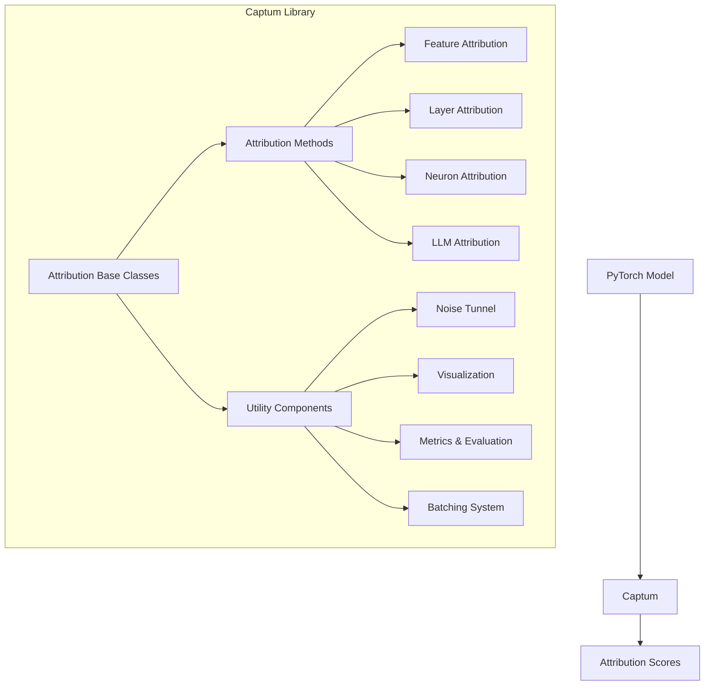
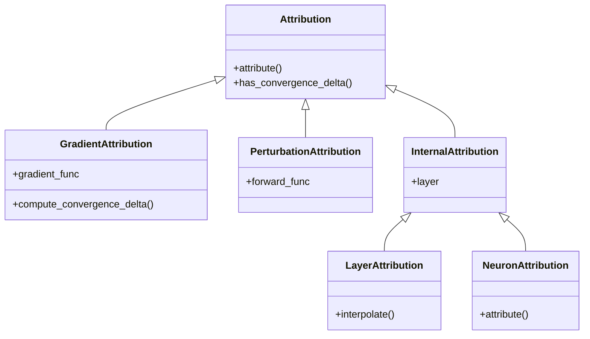
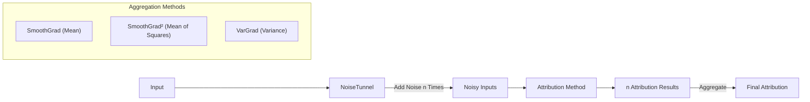
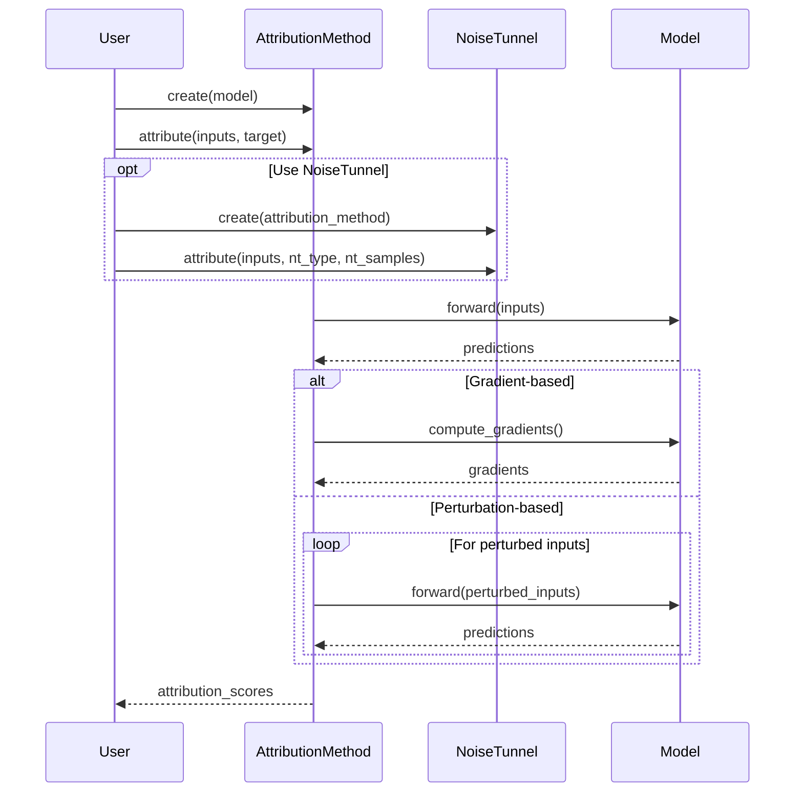
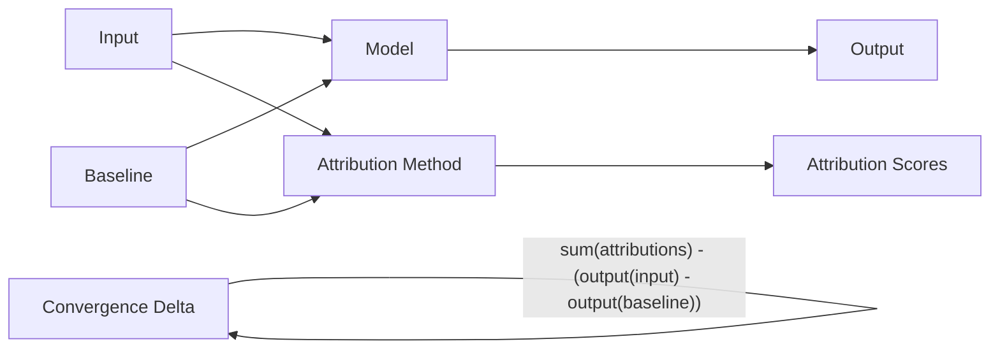

<!-- source: DeepWiki mcp.deepwiki.com · repo pytorch/captum · page 1 Overview · fetched 2026-10-21 -->

# Overview

<details>
<summary>Relevant source files</summary>

The following files were used as context for generating this wiki page:

- [README.md](README.md)
- [captum/attr/_core/deep_lift.py](captum/attr/_core/deep_lift.py)
- [captum/attr/_core/gradient_shap.py](captum/attr/_core/gradient_shap.py)
- [captum/attr/_core/input_x_gradient.py](captum/attr/_core/input_x_gradient.py)
- [captum/attr/_core/integrated_gradients.py](captum/attr/_core/integrated_gradients.py)
- [captum/attr/_core/noise_tunnel.py](captum/attr/_core/noise_tunnel.py)
- [captum/attr/_core/saliency.py](captum/attr/_core/saliency.py)
- [captum/attr/_utils/approximation_methods.py](captum/attr/_utils/approximation_methods.py)
- [captum/attr/_utils/attribution.py](captum/attr/_utils/attribution.py)
- [captum/attr/_utils/common.py](captum/attr/_utils/common.py)
- [docs/Captum_Attribution_Algos.png](docs/Captum_Attribution_Algos.png)

</details>


Captum is a model interpretability and understanding library for PyTorch that provides state-of-the-art algorithms for explaining predictions of deep learning models. The name "Captum" means "comprehension" in Latin, reflecting its purpose of providing insights into how machine learning models make decisions. This document provides a high-level overview of Captum's architecture, components, and key functionality.

## Purpose and Scope

Captum helps researchers and practitioners understand their PyTorch models by attributing predictions to input features, neurons, or layers. It offers implementations of popular attribution methods such as Integrated Gradients, DeepLift, GradientSHAP, Feature Ablation, and more. The library serves two main audiences:

1. **Model developers** working to improve their models by understanding feature importance
2. **Interpretability researchers** who develop and benchmark attribution algorithms

For information about specific attribution methods, see [Core Attribution Methods](#3).

Sources: [README.md:21-36](README.md:21-36), [README.md:38-43](README.md:38-43)

## Core Components

Captum is organized around the central concept of "attribution" - assigning importance scores to different aspects of machine learning models.



The core components of Captum include:

1. **Attribution Base Classes**: Define common interfaces and behaviors for attribution methods
2. **Attribution Methods**: Various techniques for computing feature, layer, and neuron importance
3. **Utility Components**: Tools for batching, noise addition, visualization, and quality metrics

Sources: [captum/attr/_utils/attribution.py:29-145](captum/attr/_utils/attribution.py:29-145), [README.md:29-31](README.md:29-31)

## Attribution Class Hierarchy

The design of Captum follows clear object-oriented principles with a well-defined inheritance hierarchy.



This hierarchy allows Captum to:
- Share common functionality between similar attribution methods
- Maintain a consistent API across different types of methods
- Extend with new methods while ensuring compatibility

Sources: [captum/attr/_utils/attribution.py:27-182](captum/attr/_utils/attribution.py:27-182), [captum/attr/_utils/attribution.py:183-344](captum/attr/_utils/attribution.py:183-344), [captum/attr/_utils/attribution.py:347-367](captum/attr/_utils/attribution.py:347-367)

## Key Attribution Approaches

Captum provides three major categories of attribution methods:

### 1. Gradient-Based Attribution

These methods use gradients of the model output with respect to inputs to determine feature importance.

- **IntegratedGradients**: Approximates the integral of gradients along a path from baseline to input
- **DeepLift**: Computes differences between inputs and reference activations
- **GradientShap**: Combines concepts from SHapley Additive exPlanations and gradients
- **Saliency**: Returns gradients (optionally absolute values) with respect to inputs
- **InputXGradient**: Multiplies input with gradients

Sources: [captum/attr/_core/integrated_gradients.py:28-408](captum/attr/_core/integrated_gradients.py:28-408), [captum/attr/_core/deep_lift.py:43-145](captum/attr/_core/deep_lift.py:43-145), [captum/attr/_core/gradient_shap.py:26-302](captum/attr/_core/gradient_shap.py:26-302), [captum/attr/_core/saliency.py:19-150](captum/attr/_core/saliency.py:19-150), [captum/attr/_core/input_x_gradient.py:17-144](captum/attr/_core/input_x_gradient.py:17-144)

### 2. Perturbation-Based Attribution

These methods analyze how perturbing input features affects model outputs.

- **FeatureAblation**: Measures impact of removing features
- **FeaturePermutation**: Measures impact of shuffling feature values
- **Occlusion**: Measures impact of replacing features with baselines

Sources: [captum/attr/_utils/attribution.py:346-366](captum/attr/_utils/attribution.py:346-366)

### 3. Internal Attribution

These methods examine contributions of specific internal components of the model.

- **LayerAttribution**: Analyzes importance of neurons in specific layers
- **NeuronAttribution**: Analyzes importance of inputs for specific neurons

Sources: [captum/attr/_utils/attribution.py:371-472](captum/attr/_utils/attribution.py:371-472), [captum/attr/_utils/attribution.py:405-538](captum/attr/_utils/attribution.py:405-538)

## Utility Components

### NoiseTunnel

NoiseTunnel enhances attribution quality by applying noise to inputs and aggregating the results:



NoiseTunnel supports three aggregation types:
- **smoothgrad**: Computes mean of attributions for noisy samples
- **smoothgrad_sq**: Computes mean of squared attributions
- **vargrad**: Computes variance of attributions

Sources: [captum/attr/_core/noise_tunnel.py:33-519](captum/attr/_core/noise_tunnel.py:33-519)

### Approximation Methods

For methods like IntegratedGradients that require numerical integration, Captum provides different approximation approaches:

- **Riemann methods**: left, right, middle, trapezoid
- **Gauss-Legendre** quadrature

Sources: [captum/attr/_utils/approximation_methods.py:10-140](captum/attr/_utils/approximation_methods.py:10-140)

## Typical Workflow

The typical workflow for using Captum follows these steps:



1. Initialize the attribution method with a PyTorch model
2. Call the `attribute()` method with inputs and optional parameters
3. Optionally wrap the attribution method in NoiseTunnel for smoother results
4. Use the resulting attribution scores for analysis or visualization

Sources: [README.md:106-115](README.md:106-115), [README.md:184-185](README.md:184-185)

## Example Usage

Here's a simplified example of how you would use Captum to compute Integrated Gradients for a classification model:

```python
# Create model
model = MyPytorchModel()

# Create attribution method
ig = IntegratedGradients(model)

# Compute attributions for class 3
attributions = ig.attribute(input, target=3)

# Optional: Use with NoiseTunnel for smoother results
nt = NoiseTunnel(ig)
attributions = nt.attribute(input, nt_type='smoothgrad', nt_samples=10, target=3)
```

This example demonstrates the core pattern of using Captum: initialize an attribution method with a model, then call `attribute()` with inputs and parameters specific to that method.

Sources: [README.md:117-309](README.md:117-309)

## Common Parameters

Most attribution methods in Captum share some common parameters:

| Parameter | Description |
|-----------|-------------|
| `inputs` | Input tensor(s) for which attributions are computed |
| `baselines` | Reference values compared to inputs (often zeros) |
| `target` | Output indices for which attributions are computed |
| `additional_forward_args` | Optional arguments passed to the model's forward function |
| `return_convergence_delta` | Whether to return approximation error metrics |

Sources: [captum/attr/_core/integrated_gradients.py:129-230](captum/attr/_core/integrated_gradients.py:129-230), [captum/attr/_core/deep_lift.py:149-274](captum/attr/_core/deep_lift.py:149-274)

## Convergence Delta

Many attribution methods in Captum provide a "convergence delta" that indicates the approximation error:



The convergence delta is based on the completeness axiom, which states that the sum of attributions should equal the difference between the model's outputs for the input and baseline.

Sources: [captum/attr/_utils/attribution.py:203-343](captum/attr/_utils/attribution.py:203-343), [captum/attr/_core/integrated_gradients.py:232-246](captum/attr/_core/integrated_gradients.py:232-246)

## Extension and Customization

Captum is designed to be extensible, allowing users to create custom attribution methods by:

1. Extending the appropriate base class (`Attribution`, `GradientAttribution`, etc.)
2. Implementing the required `attribute()` method
3. Optionally implementing `compute_convergence_delta()` and other methods

This architecture enables researchers to implement new attribution algorithms while leveraging Captum's infrastructure for common tasks.

Sources: [captum/attr/_utils/attribution.py:29-181](captum/attr/_utils/attribution.py:29-181)

---

