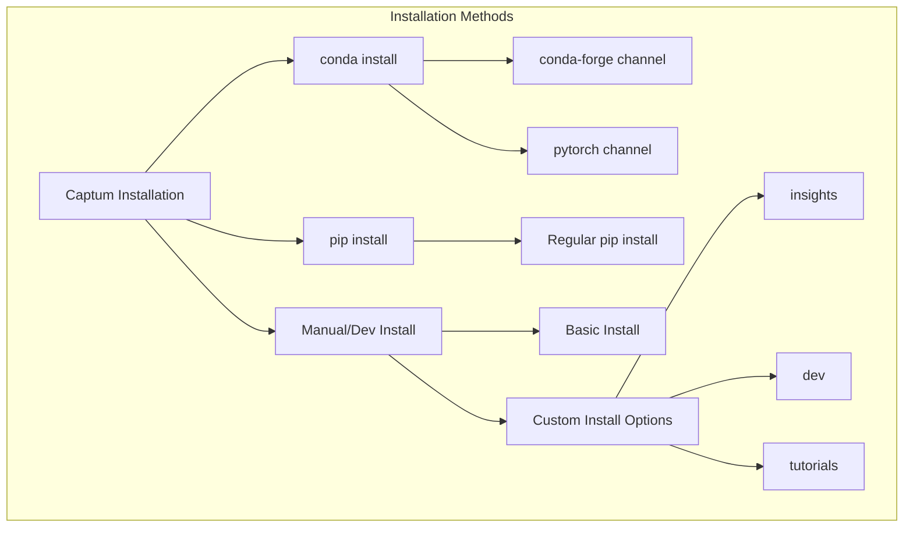
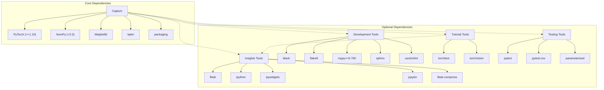
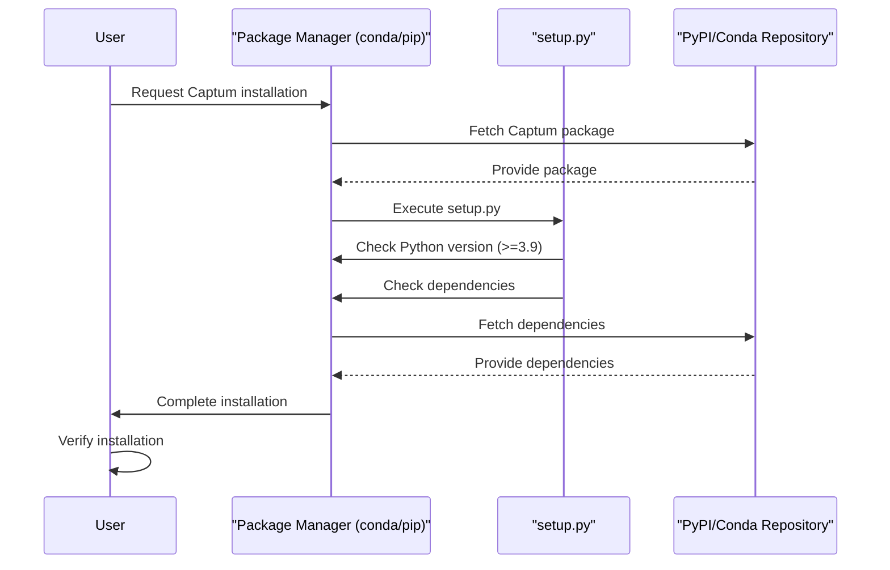

<!-- source: DeepWiki mcp.deepwiki.com · repo pytorch/captum · page 2 Installation and Setup · fetched 2026-10-21 -->

# Installation and Setup

<details>
<summary>Relevant source files</summary>

The following files were used as context for generating this wiki page:

- [.conda/meta.yaml](.conda/meta.yaml)
- [.github/workflows/test-conda-cpu.yml](.github/workflows/test-conda-cpu.yml)
- [.github/workflows/test-pip-cpu.yml](.github/workflows/test-pip-cpu.yml)
- [CONTRIBUTING.md](CONTRIBUTING.md)
- [README.md](README.md)
- [captum/attr/_utils/approximation_methods.py](captum/attr/_utils/approximation_methods.py)
- [docs/Captum_Attribution_Algos.png](docs/Captum_Attribution_Algos.png)
- [scripts/install_via_conda.sh](scripts/install_via_conda.sh)
- [scripts/install_via_pip.sh](scripts/install_via_pip.sh)
- [setup.py](setup.py)
- [tests/attr/test_llm_attr_hf_compatibility.py](tests/attr/test_llm_attr_hf_compatibility.py)
- [website/static/CNAME](website/static/CNAME)

</details>


This page provides detailed instructions for installing and setting up Captum, a model interpretability and understanding library for PyTorch. It covers various installation methods, configuration options, and verification steps to ensure a successful setup. For an overview of Captum and its capabilities, please refer to [Overview](#1).

## System Requirements

Before installing Captum, ensure your system meets the following requirements:

| Requirement | Minimum Version |
|-------------|-----------------|
| Python      | 3.9 or higher   |
| PyTorch     | 1.10 or higher  |

Sources: [README.md:46-49](), [setup.py:18-31]()

## Installation Methods

Captum can be installed using different package managers. The following diagram illustrates the available installation methods:



### Conda Installation (Recommended)

Conda is the recommended method for installing Captum. You can install it from either the `pytorch` or `conda-forge` channels:

From the PyTorch channel:
```bash
conda install captum -c pytorch
```

From the conda-forge channel:
```bash
conda install captum -c conda-forge
```

Sources: [README.md:54-71](), [.conda/meta.yaml:1-41]()

### Pip Installation

You can also install Captum using pip:

```bash
pip install captum
```

Sources: [README.md:72-77]()

### Manual/Dev Installation

For the latest development version or custom installation options, you can install directly from the GitHub repository:

1. Clone the repository:
```bash
git clone https://github.com/pytorch/captum.git
cd captum
```

2. Install based on your needs:

| Installation Type | Command | Purpose |
|------------------|---------|---------|
| Basic Install | `pip install -e .` | Minimal installation |
| Insights | `pip install -e .[insights]` | Includes Captum Insights (deprecated) |
| Development | `pip install -e .[dev]` | Includes development tools |
| Tutorials | `pip install -e .[tutorials]` | Includes tutorial dependencies |

Sources: [README.md:78-97](), [setup.py:54-81]()

## Installation Dependencies

The following diagram shows Captum's core and optional dependencies:



Sources: [setup.py:54-81](), [.conda/meta.yaml:14-24]()

## Installation Process

The following sequence diagram shows the typical installation process for Captum:



Sources: [setup.py:21-32](), [README.md:46-97]()

## Custom Installation Options

Captum provides several environment variables that can be used to customize the installation process:

| Environment Variable | Purpose |
|----------------------|---------|
| `BUILD_INSIGHTS` | Enables building Captum Insights via yarn |

To use these options, set the environment variable before running the installation:

```bash
# To build Captum Insights
BUILD_INSIGHTS=1 python setup.py develop
```

Sources: [setup.py:6-9](), [setup.py:40](), [setup.py:115-117]()

## Verifying Installation

After installing Captum, you can verify the installation by running a simple test:

```python
import captum
print(captum.__version__)
```

## Testing the Installation

To run the full test suite to ensure everything is working correctly:

```bash
# Using pytest
pytest -ra

# Using unittest
python -m unittest

# For coverage reports
pytest -ra --cov=. --cov-report term-missing
```

Sources: [README.md:98-104](), [CONTRIBUTING.md:71-83]()

## Version Compatibility

Captum is regularly tested against multiple Python and PyTorch versions. The following table shows the compatibility matrix:

| Python Version | Compatible PyTorch Versions |
|----------------|----------------------------|
| 3.9            | 1.10 - 2.3.0              |
| 3.10           | 1.11 - 2.3.0              |
| 3.11           | 1.13 - 2.3.0              |
| 3.12           | 2.2.0 - 2.3.0             |

Sources: [.github/workflows/test-pip-cpu.yml:14-38](), [.github/workflows/test-conda-cpu.yml:17-18]()

## Troubleshooting

### Common Issues

1. **Python Version Error**:
   If you see an error about the Python version, ensure you're using Python 3.9 or higher.

2. **PyTorch Compatibility**:
   Make sure your PyTorch version is compatible with Captum (1.10 or higher).

3. **ImportError for NumPy Features**:
   Some advanced attribution methods like `gausslegendre` require NumPy. If you encounter related errors, ensure NumPy is properly installed.

Sources: [setup.py:21-32](), [captum/attr/_utils/approximation_methods.py:123-124]()

### Using with CUDA

Captum works with both CPU and CUDA versions of PyTorch. The attribution calculations will automatically use CUDA if your model is on a CUDA device.

Sources: [tests/attr/test_llm_attr_hf_compatibility.py:29-33](), [tests/attr/test_llm_attr_hf_compatibility.py:76-77]()

---

