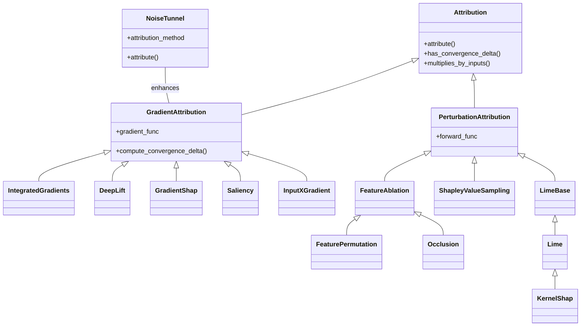
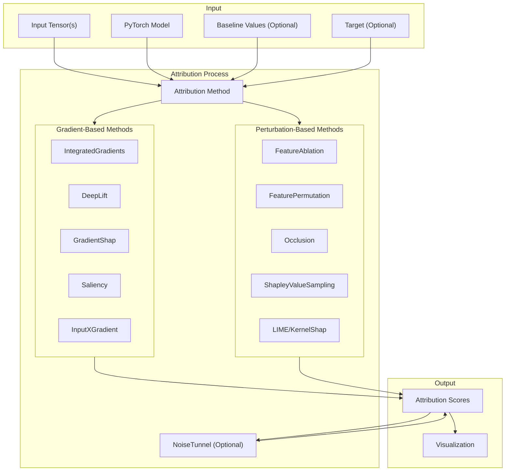
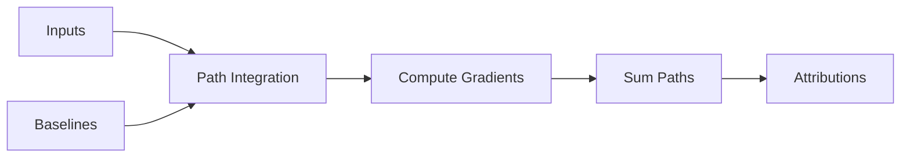
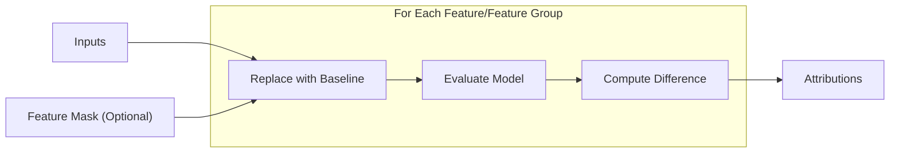
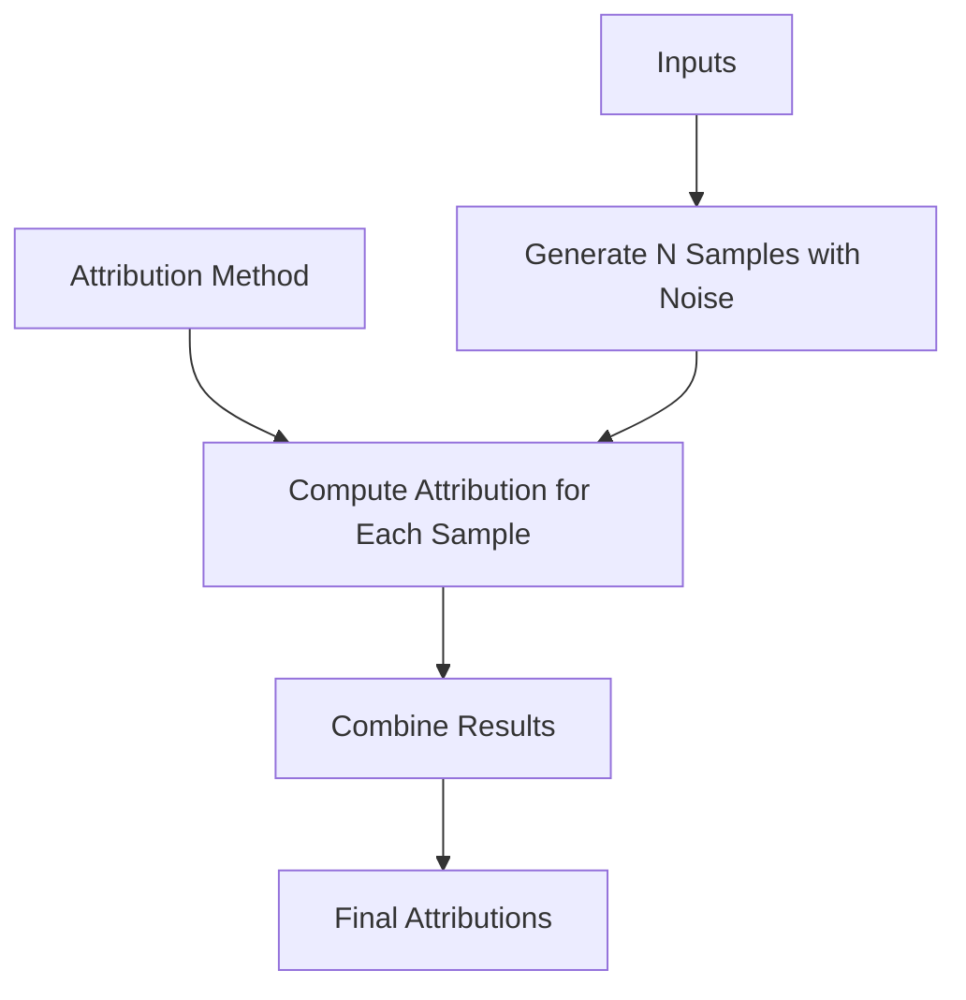
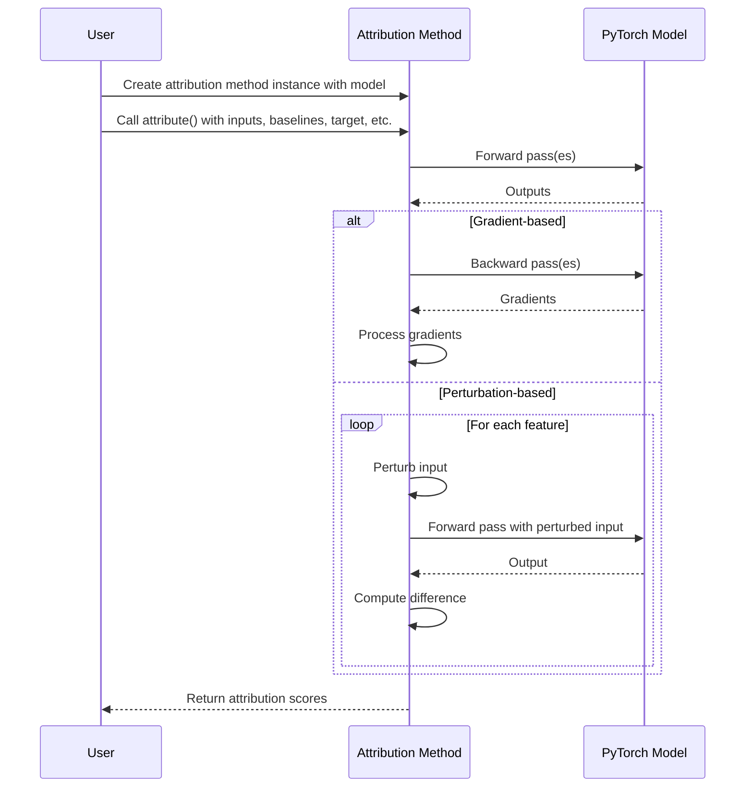

<!-- source: DeepWiki mcp.deepwiki.com · repo pytorch/captum · page 3 Core Attribution Methods · fetched 2026-10-21 -->

# Core Attribution Methods

Relevant source files

The following files were used as context for generating this wiki page:

- [captum/attr/__init__.py](captum/attr/__init__.py)
- [captum/attr/_core/deep_lift.py](captum/attr/_core/deep_lift.py)
- [captum/attr/_core/feature_ablation.py](captum/attr/_core/feature_ablation.py)
- [captum/attr/_core/feature_permutation.py](captum/attr/_core/feature_permutation.py)
- [captum/attr/_core/gradient_shap.py](captum/attr/_core/gradient_shap.py)
- [captum/attr/_core/input_x_gradient.py](captum/attr/_core/input_x_gradient.py)
- [captum/attr/_core/integrated_gradients.py](captum/attr/_core/integrated_gradients.py)
- [captum/attr/_core/noise_tunnel.py](captum/attr/_core/noise_tunnel.py)
- [captum/attr/_core/occlusion.py](captum/attr/_core/occlusion.py)
- [captum/attr/_core/saliency.py](captum/attr/_core/saliency.py)
- [captum/attr/_utils/attribution.py](captum/attr/_utils/attribution.py)
- [captum/attr/_utils/common.py](captum/attr/_utils/common.py)
- [tests/attr/test_feature_ablation.py](tests/attr/test_feature_ablation.py)
- [tests/attr/test_feature_permutation.py](tests/attr/test_feature_permutation.py)
- [tests/attr/test_occlusion.py](tests/attr/test_occlusion.py)

This page provides an overview of the core attribution methods available in Captum, which form the foundation of the library's model interpretability capabilities. Attribution methods help quantify the contribution of input features to a model's output, allowing users to understand which features are most important for specific predictions.

For information about layer-specific or neuron-specific attribution methods, see [Layer and Neuron Attribution](#4). For visualization techniques, see [Visualization](#5).

## Attribution Method Hierarchy

Captum's attribution methods follow a well-defined class hierarchy that enables code reuse and consistent APIs across different attribution techniques.

Sources: 
- [captum/attr/_utils/attribution.py:29-132](). The base `Attribution` class
- [captum/attr/_utils/attribution.py:183-343](). The `GradientAttribution` class
- [captum/attr/_utils/attribution.py:346-366](). The `PerturbationAttribution` class
- [captum/attr/__init__.py:1-153](). Registration of all attribution methods

All attribution methods in Captum follow this hierarchy:

1. **Attribution** - The base class for all attribution methods, defining the core API
2. **GradientAttribution** - Attribution methods that utilize gradients
3. **PerturbationAttribution** - Attribution methods that perturb inputs and observe changes in output

## Attribution Computation Flow

Sources:
- [captum/attr/_utils/attribution.py:47-74](). The core `attribute` method definition
- [captum/attr/_core/noise_tunnel.py:33-106](). The NoiseTunnel class

## Gradient-Based Attribution Methods

Gradient-based attribution methods compute feature importance by examining gradients of the output with respect to input features. These methods are generally faster and more efficient than perturbation-based approaches, especially for high-dimensional inputs.

### IntegratedGradients

Integrated Gradients approximates the integral of gradients along the path from a baseline to the input. It satisfies the completeness axiom, meaning the sum of attributions equals the difference between the model's output at the input and baseline.

Sources:
- [captum/attr/_core/integrated_gradients.py:28-314]()

Key characteristics:
- Requires a baseline/reference point
- Approximates the integral using numerical techniques (e.g., Riemann sums or Gauss-Legendre quadrature)
- Supports convergence delta calculation to verify attribution quality

### DeepLift

DeepLift (Deep Learning Important FeaTures) computes attribution by comparing activations with reference activations at a baseline and backpropagating the differences.

Sources:
- [captum/attr/_core/deep_lift.py:43-555]() - The DeepLift class
- [captum/attr/_core/deep_lift.py:557-1123]() - DeepLiftShap extension

Key characteristics:
- Implements the Rescale rule for attributions
- Supports convergence delta calculation
- DeepLiftShap extends DeepLift to work with multiple baselines, approximating SHAP values

### GradientShap

GradientShap combines concepts from DeepLift and SHAP by computing the expected gradients using random sampling from a baseline distribution.

Sources:
- [captum/attr/_core/gradient_shap.py:26-302]()

Key characteristics:
- Approximates SHAP values using gradient-based methods
- Requires multiple baselines/references
- Can be viewed as an approximation of integrated gradients with multiple baselines

### Saliency

Saliency is the simplest gradient-based method, using the gradients of the output with respect to the input as attribution scores.

Sources:
- [captum/attr/_core/saliency.py:19-151]()

Key characteristics:
- Fast computation, no need for baselines
- Typically returns absolute values of gradients
- Can be noisy for complex models

### InputXGradient

InputXGradient multiplies inputs by their gradients, which often provides clearer attributions than raw gradients.

Sources:
- [captum/attr/_core/input_x_gradient.py:17-145]()

Key characteristics:
- Simple and efficient computation
- Provides better attribution quality than pure gradients in many cases
- Inherently multiplies by inputs

## Perturbation-Based Attribution Methods

Perturbation-based methods work by modifying input features and observing the effect on the model output. They tend to be more intuitive but are computationally more expensive.

### FeatureAblation

FeatureAblation measures importance by replacing features with a baseline value and measuring the change in output.

Sources:
- [captum/attr/_core/feature_ablation.py:52-702]()

Key characteristics:
- Can use feature masks to group features
- Flexible baseline specification
- Can be expensive for high-dimensional inputs
- Supports cross-tensor attribution

### FeaturePermutation

FeaturePermutation measures feature importance by shuffling feature values within a batch and measuring the change in output.

Sources:
- [captum/attr/_core/feature_permutation.py:28-329]()
- [tests/attr/test_feature_permutation.py:15-284]()

Key characteristics:
- Requires a batch of examples, cannot be performed on a single example
- Extends FeatureAblation but uses permutation instead of replacement
- Useful for identifying dependencies between features

### Occlusion

Occlusion is a variant of feature ablation that works by replacing contiguous rectangular regions with a baseline value.

Sources:
- [captum/attr/_core/occlusion.py:19-362]()
- [tests/attr/test_occlusion.py:28-366]()

Key characteristics:
- Especially useful for image data
- Configurable sliding window shape and stride
- Handles both single and multi-input models

## Noise Tunnel

NoiseTunnel is a wrapper that adds Gaussian noise to inputs before computing attributions, which can improve the quality and robustness of attributions.

Sources:
- [captum/attr/_core/noise_tunnel.py:33-519]()

NoiseTunnel supports three methods:
1. **SmoothGrad** - Computes the mean of attributions for noisy samples
2. **SmoothGrad Squared** - Computes the mean of squared attributions
3. **VarGrad** - Computes the variance of attributions

## Common Usage Patterns

All attribution methods follow a consistent API pattern centered around the `attribute()` method. Here's a general workflow for using attribution methods:

Sources:
- [captum/attr/_utils/attribution.py:47-74]() - Base `attribute()` method
- [captum/attr/_core/integrated_gradients.py:106-314]() - Example implementation in IntegratedGradients
- [captum/attr/_core/feature_ablation.py:110-408]() - Example implementation in FeatureAblation

Key parameters across attribution methods:
- `inputs`: Input tensor(s) for which attributions are computed
- `baselines`: Reference values for comparison (required for some methods)
- `target`: Output index for which attributions are computed
- `additional_forward_args`: Additional arguments for the forward function

## Choosing an Attribution Method

The appropriate attribution method depends on the model, data type, and desired properties:

| Method | Speed | Theoretical Guarantees | Input Types | Baseline Required |
|--------|-------|------------------------|-------------|-------------------|
| IntegratedGradients | Medium | Completeness, Implementation Invariance | Any | Yes |
| DeepLift | Fast | Completeness | Any | Yes |
| GradientShap | Medium | Expected Value Property | Any | Yes (multiple) |
| Saliency | Very Fast | None | Any | No |
| InputXGradient | Very Fast | None | Any | No |
| FeatureAblation | Slow | Model Agnostic | Any | Optional |
| FeaturePermutation | Slow | Model Agnostic | Requires batch | No |
| Occlusion | Very Slow | Model Agnostic | Spatial data | Optional |

Sources:
- Comparison based on method implementations across files
- [captum/attr/_core/integrated_gradients.py:28-45]() - IntegratedGradients guarantees
- [captum/attr/_core/deep_lift.py:43-72]() - DeepLift properties
- [captum/attr/_core/gradient_shap.py:26-57]() - GradientShap properties

## Advanced Features

### Batching and Performance Optimization

For large inputs, many attribution methods support batching computations through the `internal_batch_size` parameter, which chunks the computation to save memory.

Sources:
- [captum/attr/_utils/batching.py]() (implicit from references in code)
- [captum/attr/_core/integrated_gradients.py:214-222]() - Batching parameters

### Cross-Tensor Attribution

For multi-input models, attribution methods like FeatureAblation support `enable_cross_tensor_attribution`, allowing attribution of features that span across multiple input tensors.

Sources:
- [captum/attr/_core/feature_ablation.py:244-247]() - Cross-tensor attribution parameter
- [captum/attr/_core/feature_ablation.py:494-652]() - Cross-tensor attribution implementation

---

