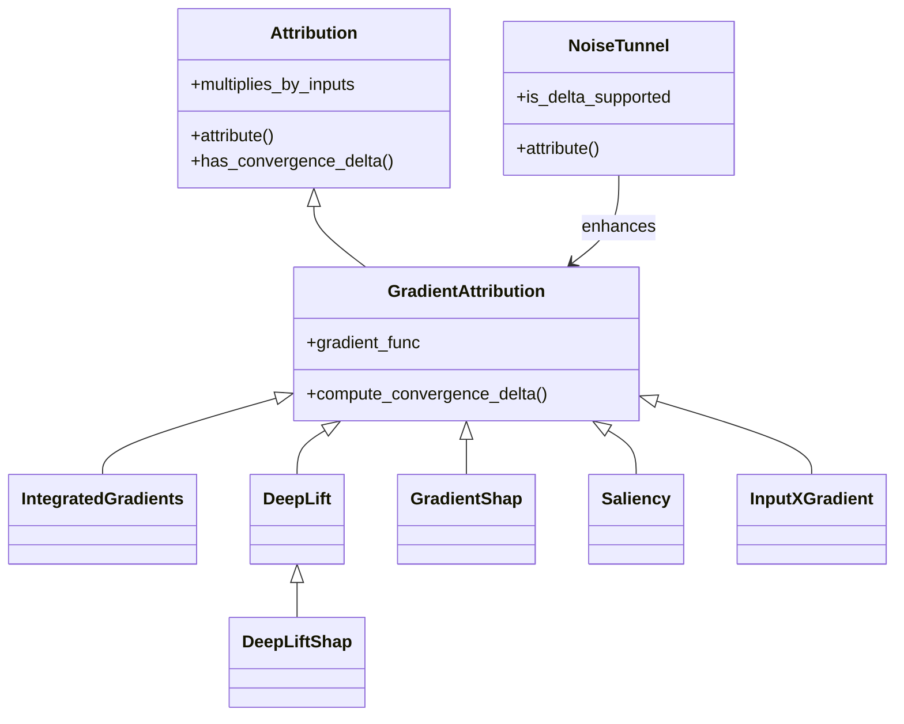
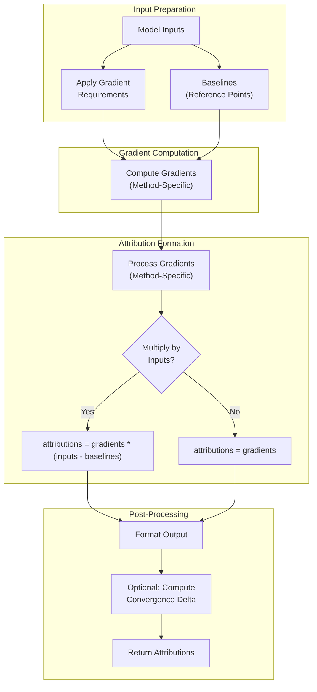
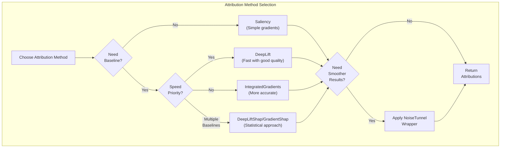

<!-- source: DeepWiki mcp.deepwiki.com · repo pytorch/captum · page 3.1 Gradient-Based Attribution · fetched 2026-10-21 -->

# Gradient-Based Attribution

<details>
<summary>Relevant source files</summary>

The following files were used as context for generating this wiki page:

- [captum/attr/_core/deep_lift.py](captum/attr/_core/deep_lift.py)
- [captum/attr/_core/gradient_shap.py](captum/attr/_core/gradient_shap.py)
- [captum/attr/_core/input_x_gradient.py](captum/attr/_core/input_x_gradient.py)
- [captum/attr/_core/integrated_gradients.py](captum/attr/_core/integrated_gradients.py)
- [captum/attr/_core/noise_tunnel.py](captum/attr/_core/noise_tunnel.py)
- [captum/attr/_core/saliency.py](captum/attr/_core/saliency.py)
- [captum/attr/_utils/attribution.py](captum/attr/_utils/attribution.py)
- [captum/attr/_utils/common.py](captum/attr/_utils/common.py)
- [tests/attr/test_common.py](tests/attr/test_common.py)
- [tests/attr/test_deeplift_classification.py](tests/attr/test_deeplift_classification.py)
- [tests/attr/test_input_x_gradient.py](tests/attr/test_input_x_gradient.py)
- [tests/attr/test_integrated_gradients_basic.py](tests/attr/test_integrated_gradients_basic.py)
- [tests/attr/test_integrated_gradients_classification.py](tests/attr/test_integrated_gradients_classification.py)
- [tests/attr/test_saliency.py](tests/attr/test_saliency.py)

</details>


Gradient-based attribution methods in Captum form a family of model interpretability techniques that quantify the importance of input features by analyzing gradients of model outputs with respect to inputs. These methods are foundational to many interpretability approaches and serve as the building blocks for understanding neural network behavior.

This document covers the various gradient-based attribution methods implemented in Captum, their underlying principles, implementation details, and usage patterns. For information about other attribution types like perturbation-based methods, see [Perturbation-Based Attribution](#3.2).

## Hierarchy and Relationships 

Gradient-based attribution methods in Captum share common infrastructure and inherit from the `GradientAttribution` base class, which itself inherits from the `Attribution` class.



Sources: [captum/attr/_utils/attribution.py:183-344](). [captum/attr/_core/noise_tunnel.py:32-519]().

## Core Attribution Process

All gradient-based attribution methods follow a similar process but differ in how they compute and process gradients:



Sources: [captum/attr/_core/integrated_gradients.py:106-146](). [captum/attr/_utils/attribution.py:204-267]().

## Core Gradient-Based Attribution Methods

### Integrated Gradients

Integrated Gradients (IG) is an axiomatic attribution method that assigns importance scores by approximating the integral of gradients along a straight line path from a baseline to the input.

**Key characteristics:**
- Satisfies the completeness axiom (attributions sum to the difference between output at input and baseline)
- Implementation-invariant: attributions are identical for functionally equivalent networks
- Sensitive to all input features, regardless of gradient saturation
- Supports various integral approximation methods

**Implementation:**
```python
# Example usage
ig = IntegratedGradients(model)
attributions = ig.attribute(inputs, baselines=baseline, target=target_class, n_steps=50)
```

**Parameters:**
- `n_steps`: Number of steps in the path integral approximation (higher = more accurate)
- `method`: Approximation method (`riemann_right`, `riemann_left`, `riemann_middle`, `riemann_trapezoid`, `gausslegendre`)
- `internal_batch_size`: Controls memory usage for large inputs by dividing computation

The algorithm computes path integrals by:
1. Creating interpolated points between baseline and input
2. Computing gradients at these points
3. Integrating these gradients along the path
4. Optionally multiplying by (input - baseline) to get final attributions

Sources: [captum/attr/_core/integrated_gradients.py:28-409](). [tests/attr/test_integrated_gradients_classification.py:1-142]().

### DeepLift

DeepLift (Deep Learning Important FeaTures) assigns importance scores by comparing activation differences between the input and a reference (baseline) activation.

**Key characteristics:**
- Addresses gradient saturation issues through reference-based approach
- Rescale rule implementation that distributes importance based on neuron contributions
- Similar attribution quality to Integrated Gradients with faster computation

**Implementation:**
```python
# Example usage
dl = DeepLift(model)
attributions = dl.attribute(inputs, baselines=baseline, target=target_class)
```

DeepLift works by:
1. Registering hooks on non-linear layers
2. Calculating differences between activations at input and baseline
3. Propagating these differences through the network according to the rescale rule

**Limitations:**
- Currently supports a limited set of non-linear activations
- Does not support built-in PyTorch LSTMs/RNNs/GRUs (custom implementations required)

Sources: [captum/attr/_core/deep_lift.py:43-555](). [tests/attr/test_deeplift_classification.py:1-207]().

### DeepLiftShap

DeepLiftShap extends DeepLift by approximating SHAP (SHapley Additive exPlanations) values using DeepLift's algorithm.

**Key characteristics:**
- Combines DeepLift with SHAP framework for explanation
- Assumes feature independence and additive composition of effects
- Computes attributions with respect to multiple baselines, then averages results

**Implementation:**
```python
# Example usage
dl_shap = DeepLiftShap(model)
attributions = dl_shap.attribute(inputs, baselines=multiple_baselines, target=target_class)
```

**Differences from DeepLift:**
- Requires multiple baselines for distribution approximation
- Baselines can be provided as a tensor with the first dimension representing the distribution samples

Sources: [captum/attr/_core/deep_lift.py:557-775](). [tests/attr/test_deeplift_classification.py:84-101]().

### GradientShap

GradientShap approximates SHAP values by computing the expectations of gradients by randomly sampling from the distribution of baselines/references.

**Key characteristics:**
- Combines gradient-based methods with the SHAP framework
- Approximates SHAP values through random sampling and gradient computation
- Assumes feature independence and linear explanation model

**Implementation:**
```python
# Example usage
gs = GradientShap(model)
attributions = gs.attribute(inputs, baselines=multiple_baselines, n_samples=5, target=target_class)
```

**Parameters:**
- `n_samples`: Number of samples to generate with Gaussian noise
- `stdevs`: Standard deviation of Gaussian noise added to inputs

GradientShap works by:
1. Randomly selecting baselines from the provided distribution
2. Adding Gaussian noise to inputs
3. Computing gradients along paths between baselines and noisy inputs
4. Averaging results to approximate expected gradients

Sources: [captum/attr/_core/gradient_shap.py:26-439](). [tests/attr/test_integrated_gradients_classification.py:1-142]().

### Saliency

Saliency is a simple attribution method that returns the gradients of outputs with respect to inputs.

**Key characteristics:**
- Baseline approach for computing feature importance
- Simple and fast computation
- Can return absolute values of gradients for better visualization

**Implementation:**
```python
# Example usage
saliency = Saliency(model)
attributions = saliency.attribute(inputs, target=target_class, abs=True)
```

**Parameters:**
- `abs`: Whether to return absolute values of gradients (default: True)

Sources: [captum/attr/_core/saliency.py:19-151](). [tests/attr/test_saliency.py:1-181]().

### InputXGradient

InputXGradient is another simple baseline approach that multiplies inputs by their gradients.

**Key characteristics:**
- Provides element-wise product of input and gradient
- Simple computation that highlights both input magnitude and gradient direction
- Also known as "gradient * input" in literature

**Implementation:**
```python
# Example usage
input_x_grad = InputXGradient(model)
attributions = input_x_grad.attribute(inputs, target=target_class)
```

Unlike Saliency, InputXGradient always multiplies gradients by inputs, which can lead to different interpretations as it emphasizes features based on both their value and gradient magnitude.

Sources: [captum/attr/_core/input_x_gradient.py:17-145](). [tests/attr/test_input_x_gradient.py:1-131]().

## Enhancing Attribution with Noise Tunnel

NoiseTunnel is a wrapper that adds Gaussian noise to inputs before computing attributions, which can produce smoother and more reliable results.

### Noise Types

NoiseTunnel supports three types of noise-based attribution:

| Noise Type | Description | Use Case |
|------------|-------------|----------|
| `smoothgrad` | Averages attributions across noisy samples | General smoothing of attributions |
| `smoothgrad_sq` | Averages squared attributions | Emphasizes high-variance regions |
| `vargrad` | Computes variance of attributions | Identifies high-uncertainty areas |

### Implementation

```python
# Example usage with Integrated Gradients
ig = IntegratedGradients(model)
nt = NoiseTunnel(ig)
attributions = nt.attribute(inputs, 
                           nt_type='smoothgrad', 
                           nt_samples=10, 
                           stdevs=0.1, 
                           target=target_class)
```

**Parameters:**
- `nt_type`: Noise tunnel type (`smoothgrad`, `smoothgrad_sq`, or `vargrad`)
- `nt_samples`: Number of noisy samples to generate
- `nt_samples_batch_size`: Batch size for processing noisy samples (for memory efficiency)
- `stdevs`: Standard deviation of Gaussian noise

NoiseTunnel works by:
1. Generating multiple noisy versions of the input
2. Computing attributions for each noisy sample
3. Combining results according to the selected noise type

Sources: [captum/attr/_core/noise_tunnel.py:32-519](). [tests/attr/test_integrated_gradients_basic.py:31-46]().

## Common Implementation Details

### Convergence Delta

Many gradient-based methods support computing a convergence delta, which measures the approximation error based on the completeness axiom:

```
delta = sum(attributions) - (F(input) - F(baseline))
```

This value should be close to zero for accurate attributions. Methods that support this feature include:
- IntegratedGradients
- DeepLift
- GradientShap

```python
# Example usage with convergence delta
attributions, delta = ig.attribute(inputs, 
                                  baselines=baseline, 
                                  target=target_class,
                                  return_convergence_delta=True)
# delta provides approximation error information
```

Sources: [captum/attr/_utils/attribution.py:204-267](). [captum/attr/_utils/common.py:246-269]().

### Custom Attribution Functions

Most gradient-based methods support custom attribution functions for advanced use cases:

```python
# Example custom attribution function
def custom_attr_func(multipliers, inputs, baselines):
    return tuple(mult * (inp - base)**2 for mult, inp, base in zip(multipliers, inputs, baselines))

# Usage with custom function
attributions = ig.attribute(inputs, 
                           baselines=baseline, 
                           custom_attribution_func=custom_attr_func)
```

This gives flexibility to define your own logic for combining gradients with inputs.

Sources: [captum/attr/_utils/common.py:308-332](). [captum/attr/_core/deep_lift.py:229-248]().

### Batching Support

Gradient-based methods support batched inputs and provide utilities for memory-efficient computation:

```python
# Using internal batching for memory efficiency
attributions = ig.attribute(inputs, 
                           baselines=baseline, 
                           target=target_class,
                           n_steps=100,
                           internal_batch_size=16)
```

The `internal_batch_size` parameter divides the total computation into smaller chunks, which is useful for large inputs or many integration steps.

Sources: [captum/attr/_core/integrated_gradients.py:215-225](). [captum/attr/_utils/batching.py]().

## Method Comparison and Selection Guide

| Method | Speed | Memory Usage | Quality | Use Cases |
|--------|-------|-------------|---------|-----------|
| Saliency | Fastest | Lowest | Baseline | Quick approximate feature importance, debugging |
| InputXGradient | Fast | Low | Improved over Saliency | Simple attribution that accounts for input magnitude |
| IntegratedGradients | Moderate | High (depends on n_steps) | High | When accuracy matters, detailed analysis, verifiable results |
| DeepLift | Fast | Moderate | High | Faster alternative to IG with similar quality |
| GradientShap | Moderate | Moderate | High | When explanations need statistical grounding |
| DeepLiftShap | Moderate | Moderate | High | When combining DeepLift efficiency with SHAP framework |

**General guideline for choosing a method:**
- For quick visualization and debugging: Saliency or InputXGradient
- For detailed analysis with theoretical guarantees: IntegratedGradients
- For faster analysis with similar quality to IG: DeepLift
- For statistical robustness and feature interactions: GradientShap or DeepLiftShap
- For any method where noise helps: Use NoiseTunnel wrapper

Sources: [captum/attr/_core/deep_lift.py:60-62](). [captum/attr/_core/integrated_gradients.py:44-51]().

## Implementation Details: Key Properties and Parameters

Each gradient-based attribution method has specific parameters and characteristics:



Source: [captum/attr/_utils/attribution.py:183-344](). [captum/attr/_core/noise_tunnel.py:32-519]().

### Implementation Details: Key File References

| Component | Primary File | Key Classes/Functions |
|-----------|-------------|------------------------|
| Base Classes | attr/_utils/attribution.py | `Attribution`, `GradientAttribution` |
| Integrated Gradients | attr/_core/integrated_gradients.py | `IntegratedGradients` |
| DeepLift | attr/_core/deep_lift.py | `DeepLift`, `DeepLiftShap` |
| GradientShap | attr/_core/gradient_shap.py | `GradientShap`, `InputBaselineXGradient` |
| Saliency | attr/_core/saliency.py | `Saliency` |
| InputXGradient | attr/_core/input_x_gradient.py | `InputXGradient` |
| Noise Tunnel | attr/_core/noise_tunnel.py | `NoiseTunnel`, `NoiseTunnelType` |
| Common Utilities | attr/_utils/common.py | `_compute_convergence_delta`, `_tensorize_baseline` |

## Conclusion

Gradient-based attribution methods are a fundamental part of Captum's model interpretability toolkit. Each method has its strengths and use cases, from simple gradient-based approaches to more sophisticated techniques that integrate statistical frameworks.

For most use cases, IntegratedGradients or DeepLift provide a good balance of accuracy and computational efficiency. When additional smoothing is needed, the NoiseTunnel wrapper can enhance results. For cases requiring statistical rigor and handling feature interactions, GradientShap or DeepLiftShap are appropriate choices.

---

