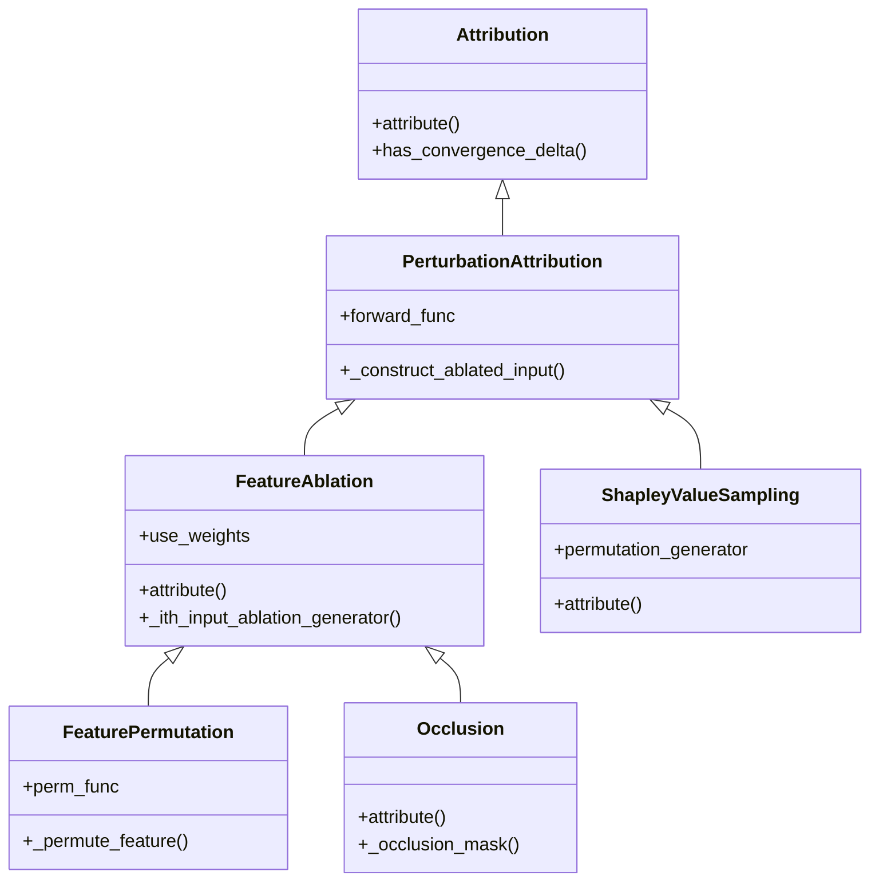
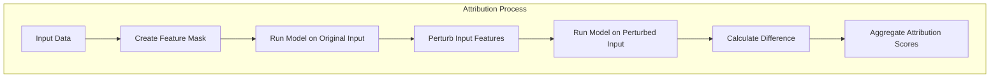
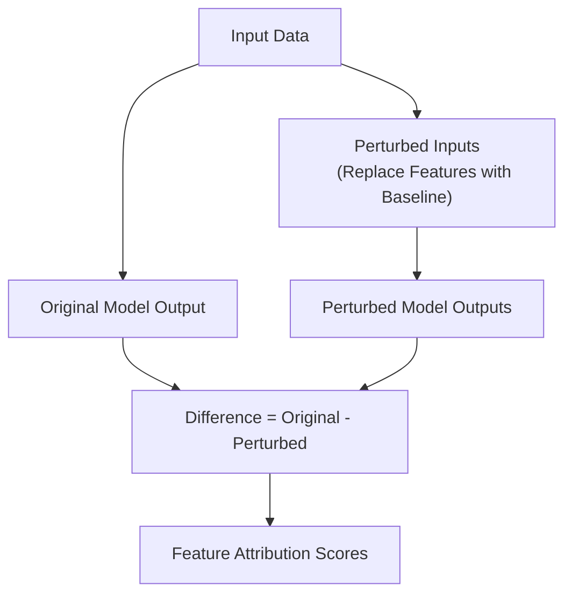
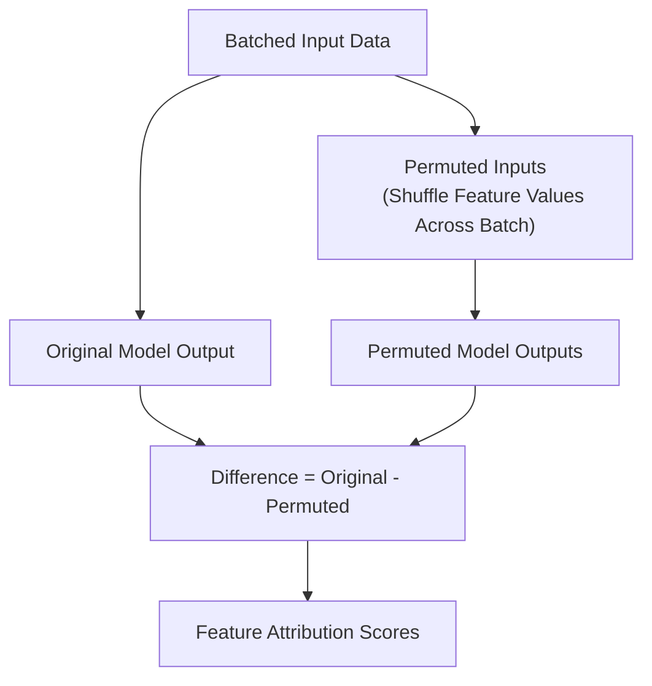
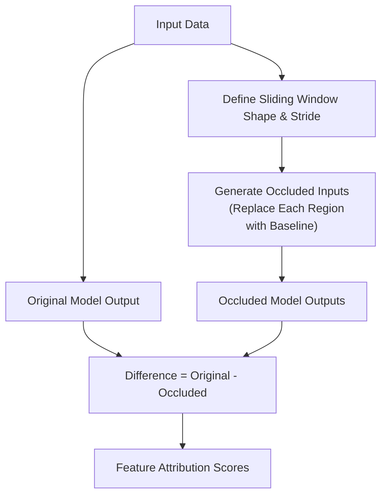
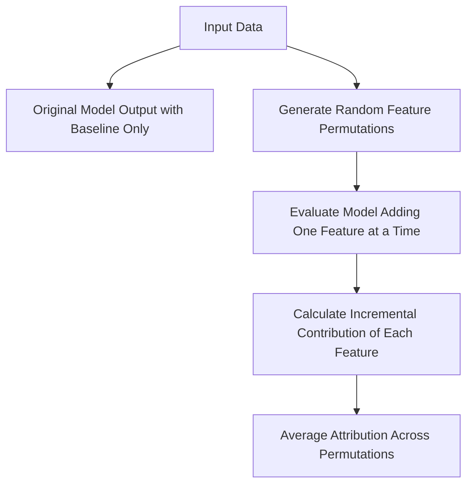
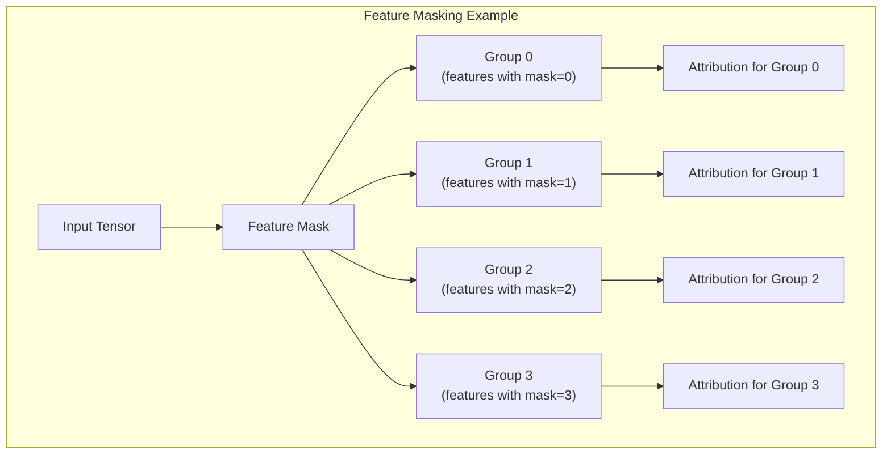
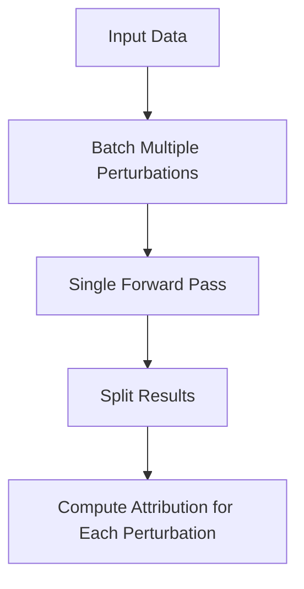
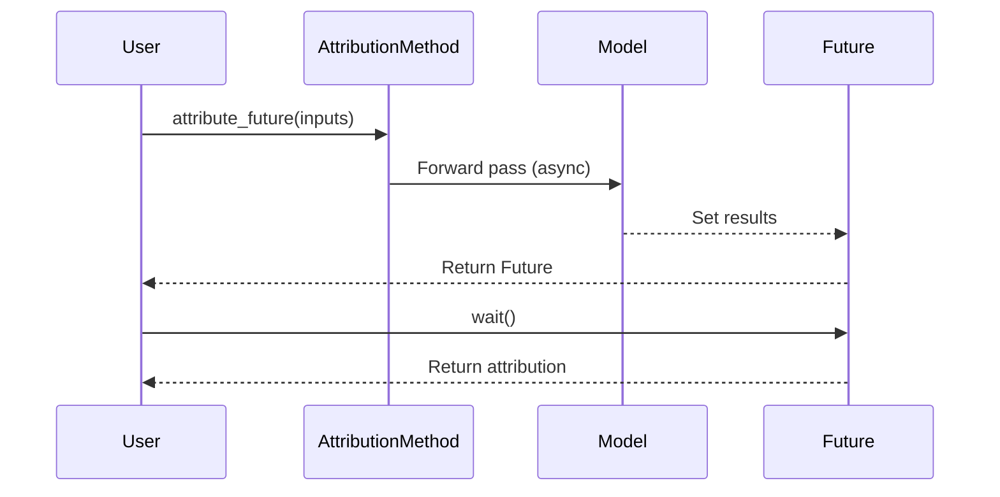

<!-- source: DeepWiki mcp.deepwiki.com · repo pytorch/captum · page 3.2 Perturbation-Based Attribution · fetched 2026-10-21 -->

# Perturbation-Based Attribution

<details>
<summary>Relevant source files</summary>

The following files were used as context for generating this wiki page:

- [captum/_utils/exceptions.py](captum/_utils/exceptions.py)
- [captum/attr/__init__.py](captum/attr/__init__.py)
- [captum/attr/_core/feature_ablation.py](captum/attr/_core/feature_ablation.py)
- [captum/attr/_core/feature_permutation.py](captum/attr/_core/feature_permutation.py)
- [captum/attr/_core/occlusion.py](captum/attr/_core/occlusion.py)
- [captum/attr/_core/shapley_value.py](captum/attr/_core/shapley_value.py)
- [captum/testing/helpers/basic_models.py](captum/testing/helpers/basic_models.py)
- [tests/attr/test_feature_ablation.py](tests/attr/test_feature_ablation.py)
- [tests/attr/test_feature_permutation.py](tests/attr/test_feature_permutation.py)
- [tests/attr/test_occlusion.py](tests/attr/test_occlusion.py)
- [tests/attr/test_shapley.py](tests/attr/test_shapley.py)

</details>


Perturbation-based attribution methods in Captum determine feature importance by systematically modifying input features and measuring the resulting changes in model output. These methods provide an alternative to gradient-based approaches ([Gradient-Based Attribution](#3.1)) by directly observing the model's behavior under different input conditions, which can be more intuitive to understand and doesn't require model gradients.

Sources: [captum/attr/_utils/attribution.py](captum/attr/_utils/attribution.py), [captum/attr/__init__.py:96-99]()

## Core Concepts and Architecture

Perturbation-based attribution methods derive from the `PerturbationAttribution` base class, which extends the fundamental `Attribution` class in Captum.



**Diagram: Perturbation-Based Attribution Class Hierarchy**

Sources: [captum/attr/__init__.py:96-100](), [captum/attr/_core/feature_ablation.py:52-108](), [captum/attr/_core/feature_permutation.py:28-95](), [captum/attr/_core/occlusion.py:19-48](), [captum/attr/_core/shapley_value.py:68-106]()

The key workflow for perturbation-based attribution methods involves:



**Diagram: General Perturbation Attribution Workflow**

Sources: [captum/attr/_core/feature_ablation.py:100-408](), [captum/attr/_core/feature_permutation.py:100-297]()

## Feature Ablation

Feature ablation works by replacing individual features or feature groups with a baseline value and measuring the resulting change in output. This approach allows identifying which features contribute most significantly to the model's predictions.



**Diagram: Feature Ablation Process**

Sources: [captum/attr/_core/feature_ablation.py:52-409]()

### Key Parameters

- **inputs**: Input tensor or tuple of tensors for which attributions are computed
- **baselines**: Reference values that replace features when ablated (defaults to zero)
- **feature_mask**: Optional mask for grouping features that should be ablated together
- **perturbations_per_eval**: Number of perturbations to process simultaneously
- **enable_cross_tensor_attribution**: Whether features should be grouped across input tensors

### Example Usage

```python
# Model takes a single input tensor of size Nx4x4
net = SimpleClassifier()
# Input with size 2 x 4 x 4
input = torch.randn(2, 4, 4)
# Initialize FeatureAblation
ablator = FeatureAblation(net)
# Compute attribution for each input element independently
attr = ablator.attribute(input, target=1)

# Group features using a feature mask (2x2 squares)
feature_mask = torch.tensor([[[0,0,1,1],[0,0,1,1],
                             [2,2,3,3],[2,2,3,3]]])
attr = ablator.attribute(input, target=1, feature_mask=feature_mask)
```

Sources: [captum/attr/_core/feature_ablation.py:272-303]()

## Feature Permutation

Feature permutation is a variant of feature ablation that, instead of replacing features with a baseline, permutes feature values within a batch. This technique requires that the batch contains multiple samples, as the permutation occurs across examples within the batch.



**Diagram: Feature Permutation Process**

Sources: [captum/attr/_core/feature_permutation.py:14-410]()

### Key Differences from Feature Ablation

1. Requires a batch size greater than 1 (typically at least 2 examples)
2. Uses permutation instead of replacement with baselines
3. Measures importance based on how shuffling feature values affects the model output

### Example Usage

```python
# Model takes a single input tensor of size Nx4x4
net = SimpleClassifier()
# Batch of 10 inputs
input = torch.randn(10, 4, 4)
# Initialize FeaturePermutation
feature_perm = FeaturePermutation(net)
# Compute attribution by permuting each input element independently
attr = feature_perm.attribute(input, target=1)

# Group features using a feature mask (2x2 squares)
feature_mask = torch.tensor([[[0,0,1,1],[0,0,1,1],
                             [2,2,3,3],[2,2,3,3]]])
attr = feature_perm.attribute(input, target=1, feature_mask=feature_mask)
```

Sources: [captum/attr/_core/feature_permutation.py:246-280]()

## Occlusion

Occlusion is a specialized perturbation method that replaces contiguous rectangular regions (or "patches") of the input with a baseline. This approach is particularly useful for images, where spatial relationships between features are important.



**Diagram: Occlusion Attribution Process**

Sources: [captum/attr/_core/occlusion.py:19-363]()

### Key Parameters

- **sliding_window_shapes**: Shape of the patch (hyperrectangle) to occlude each input
- **strides**: Step by which the occlusion window should be shifted for each iteration
- **baselines**: Reference values that replace features when occluded

### Example Usage

```python
# Model takes a single input tensor of size Nx4x4
net = SimpleClassifier()
# Input with size 2 x 4 x 4
input = torch.randn(2, 4, 4)
# Initialize Occlusion
ablator = Occlusion(net)
# Compute attribution using 3x3 sliding windows
attr = ablator.attribute(input, target=1, sliding_window_shapes=(3,3))

# Use custom stride
attr = ablator.attribute(input, target=1, sliding_window_shapes=(3,3), strides=2)
```

Sources: [captum/attr/_core/occlusion.py:204-215]()

## Shapley Value Sampling

Shapley Value Sampling is a perturbation-based approach based on cooperative game theory. It works by taking random permutations of input features and adding them one-by-one to the baseline, measuring the incremental contribution of each feature.



**Diagram: Shapley Value Sampling Process**

Sources: [captum/attr/_core/shapley_value.py:68-1002]()

### Key Parameters

- **n_samples**: Number of feature permutations to test
- **feature_mask**: Optional mask for grouping features
- **perturbations_per_eval**: Allows multiple ablations to be processed simultaneously

### Example Usage

```python
# Model takes a single input tensor of size Nx4x4
net = SimpleClassifier()
# Input with size 2 x 4 x 4
input = torch.randn(2, 4, 4)
# Initialize ShapleyValueSampling
svs = ShapleyValueSampling(net)
# Compute attribution with 200 samples
attr = svs.attribute(input, target=1, n_samples=200)

# Group features using a feature mask (2x2 squares)
feature_mask = torch.tensor([[[0,0,1,1],[0,0,1,1],
                             [2,2,3,3],[2,2,3,3]]])
attr = svs.attribute(input, target=1, feature_mask=feature_mask)
```

Sources: [captum/attr/_core/shapley_value.py:264-298]()

## Implementation Details

### Feature Masking

All perturbation-based methods support the concept of feature masks, which allow grouping multiple input elements to be treated as a single feature. This is particularly useful for:

- Images: Group pixels into segments or regions
- Text: Group words or tokens
- Structured data: Group related features



**Diagram: Feature Masking Concept**

Sources: [captum/attr/_core/feature_ablation.py:201-222](), [captum/attr/_core/shapley_value.py:205-226]()

### Cross-Tensor Attribution

Perturbation-based methods in Captum can operate either:
- Within individual tensors (default behavior)
- Across tensors with `enable_cross_tensor_attribution=True`

This allows treating features from different input tensors as a unified group, which is useful for models that take multiple types of inputs.

Sources: [captum/attr/_core/feature_ablation.py:494-652](), [captum/attr/_core/feature_permutation.py:368-408]()

### Batched Processing

For efficiency, all perturbation methods support the `perturbations_per_eval` parameter, which allows processing multiple perturbations in a single forward pass:



**Diagram: Batched Perturbation Processing**

Sources: [captum/attr/_core/feature_ablation.py:225-238](), [captum/attr/_core/shapley_value.py:229-246]()

## Choosing Between Perturbation Methods

| Method | When to Use | Advantages | Limitations |
|--------|-------------|------------|-------------|
| **Feature Ablation** | General purpose, when baselines are available | Simple, intuitive | Can be computationally expensive |
| **Feature Permutation** | When data has multiple examples and natural baseline isn't clear | Doesn't require explicit baseline | Requires batch size > 1, can give misleading results with correlated features |
| **Occlusion** | For spatial data (images, time series) | Captures spatial relationships | Only suitable for data with locality properties |
| **Shapley Value Sampling** | When theoretical foundation is important | Principled approach, well-defined properties | Most computationally expensive |

Sources: [captum/attr/_core/feature_ablation.py:52-68](), [captum/attr/_core/feature_permutation.py:28-74](), [captum/attr/_core/occlusion.py:19-38](), [captum/attr/_core/shapley_value.py:68-89]()

## Common Implementation Details

### Asynchronous Support

Most perturbation methods support asynchronous computation through the `attribute_future` method, which returns a Future object containing the attribution results.



**Diagram: Asynchronous Attribution Flow**

Sources: [captum/attr/_core/feature_ablation.py:722-841](), [captum/attr/_core/feature_permutation.py:299-321]()

### Error Handling

Perturbation methods implement custom error types to handle asynchronous operations:
- `FeatureAblationFutureError`
- `ShapleyValueFutureError`

Sources: [captum/_utils/exceptions.py:1-19]()

## Summary

Perturbation-based attribution methods offer an intuitive approach to feature attribution by directly measuring the impact of feature modifications on model output. They provide flexibility through feature masking, cross-tensor attribution, and batch processing capabilities. While they tend to be more computationally expensive than gradient-based methods, they can be applied to any model (even non-differentiable ones) and often produce more interpretable results.

---

