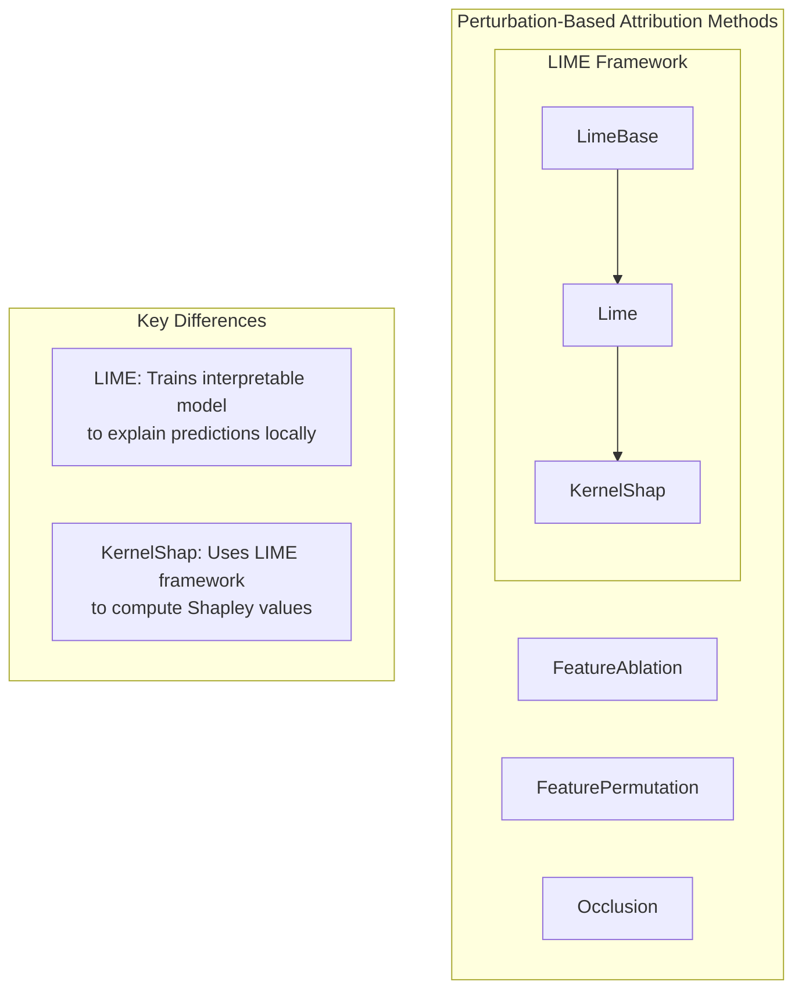
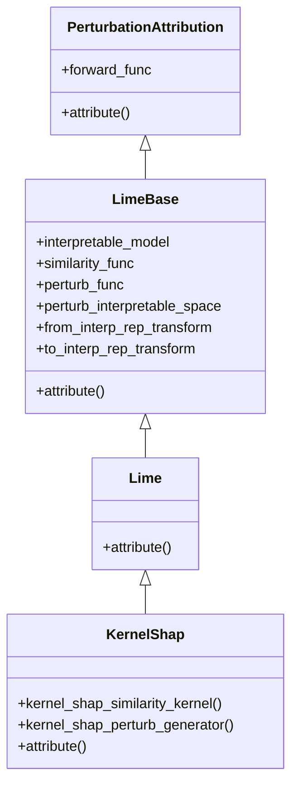
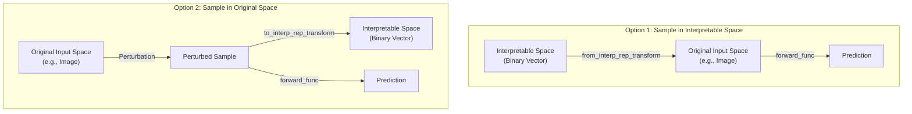
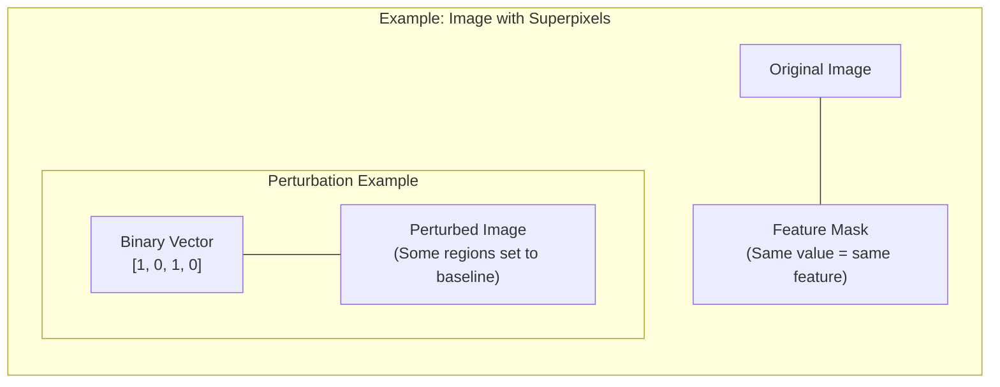
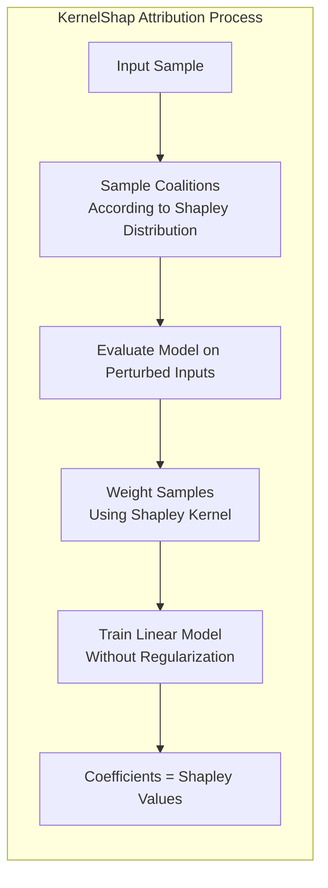
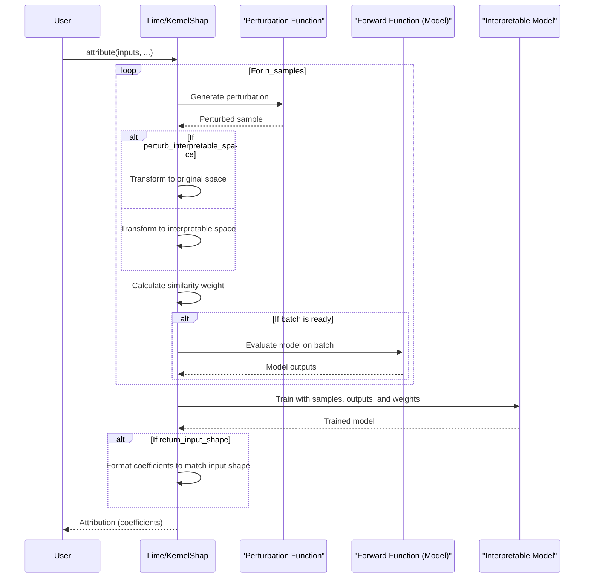

<!-- source: DeepWiki mcp.deepwiki.com · repo pytorch/captum · page 3.3 LIME and KernelShap · fetched 2026-10-21 -->

# LIME and KernelShap

<details>
<summary>Relevant source files</summary>

The following files were used as context for generating this wiki page:

- [captum/attr/_core/kernel_shap.py](captum/attr/_core/kernel_shap.py)
- [captum/attr/_core/lime.py](captum/attr/_core/lime.py)
- [tests/attr/test_kernel_shap.py](tests/attr/test_kernel_shap.py)
- [tests/attr/test_lime.py](tests/attr/test_lime.py)

</details>


This document covers the LIME (Local Interpretable Model-agnostic Explanations) and KernelShap implementation in Captum. These are perturbation-based attribution methods that explain model predictions by training surrogate interpretable models. The document details their implementation, usage patterns, and how they differ from other attribution approaches in Captum.

For gradient-based attribution methods, see [Gradient-Based Attribution](#3.1). For other perturbation-based methods like Feature Ablation and Occlusion, see [Perturbation-Based Attribution](#3.2).

## 1. Overview

LIME and KernelShap are model-agnostic interpretability techniques that explain individual predictions by approximating the complex model locally with a simpler, interpretable model. Unlike direct attribution methods, they return learned coefficients of a surrogate model rather than direct attribution scores.



Sources: [captum/attr/_core/lime.py:39-590](). [captum/attr/_core/kernel_shap.py:17-28]()

### 1.1 Key Concepts

Both methods operate by:
1. Generating perturbed versions of an input sample
2. Getting the complex model's predictions for these perturbed inputs 
3. Training a simple interpretable model (usually linear) to approximate the complex model locally
4. Using the coefficients of the interpretable model as feature importances

The main difference is that KernelShap uses a specific sampling approach and weighting to approximate Shapley values, while LIME offers more flexibility in how perturbations are generated and weighted.

### 1.2 Class Hierarchy



Sources: [captum/attr/_core/lime.py:39-721](). [captum/attr/_core/kernel_shap.py:17-18]()

## 2. LimeBase

`LimeBase` is the foundation class that provides a generic framework for training surrogate interpretable models. It differs from most other attribution methods since it returns coefficients of an interpretable model rather than direct attribution scores.

### 2.1 Key Parameters

```
LimeBase(
    forward_func,                   # Model to explain
    interpretable_model,            # Surrogate model (e.g., linear regression)
    similarity_func,                # Function to weight samples by similarity
    perturb_func,                   # Function to generate perturbed inputs
    perturb_interpretable_space,    # Whether perturbations are in interpretable space
    from_interp_rep_transform,      # Transform interpretable to original space
    to_interp_rep_transform         # Transform original to interpretable space
)
```

Sources: [captum/attr/_core/lime.py:69-235]()

### 2.2 Interpretable Space vs. Original Input Space

LimeBase allows two approaches to generate perturbations:



Sources: [captum/attr/_core/lime.py:153-182](). [captum/attr/_core/lime.py:201-221]()

### 2.3 Attribution Process

The `attribute` method trains the surrogate model following these steps:

1. Generate perturbed samples using `perturb_func`
2. Convert between interpretable space and original space as needed
3. Compute model outputs for perturbed samples
4. Calculate similarity weights using `similarity_func`
5. Train the interpretable model with samples, outputs, and weights
6. Return the representation of the trained model (e.g., coefficients)

Sources: [captum/attr/_core/lime.py:241-516]()

## 3. Lime

`Lime` provides a more specific implementation than `LimeBase` with a consistent API similar to other perturbation-based attribution methods. It assumes the interpretable representation is a binary vector corresponding to elements in the input being set to baseline values (0) or original values (1).

### 3.1 Default Configuration

Lime initializes with sensible defaults:
- Interpretable model: `SkLearnLasso(alpha=0.01)`
- Similarity function: Exponential kernel with cosine distance
- Perturbation function: Random binary vectors with 0.5 probability for each feature

Sources: [captum/attr/_core/lime.py:757-871]()

### 3.2 Feature Masks

Feature masks allow grouping input elements to correspond to the same interpretable feature:



Sources: [captum/attr/_core/lime.py:740-751](). [captum/attr/_core/lime.py:693-718]()

### 3.3 Attribution Method

The Lime class's `attribute` method extends `LimeBase.attribute` with:
- Support for baselines to replace masked features
- Feature mask handling to group input elements
- Option to return attributions in the input shape or as raw coefficients

Sources: [captum/attr/_core/lime.py:874-913]()

## 4. KernelShap

`KernelShap` is an extension of Lime that uses the LIME framework to compute Shapley values. It configures the sampling strategy and similarity kernel to approximate Shapley values more efficiently than direct computation.

### 4.1 Theoretical Foundation

KernelShap approximates Shapley values by:
1. Using a special perturbation generator that samples coalitions according to the Shapley kernel
2. Applying a specific similarity weighting that ensures proper weighting of coalitions
3. Training a linear model without regularization to compute feature attributions



Sources: [captum/attr/_core/kernel_shap.py:17-28](). [captum/attr/_core/kernel_shap.py:326-369]()

### 4.2 Implementation Details

KernelShap's implementation has several key components:

1. The `kernel_shap_perturb_generator` function:
   - Samples the number of selected features using the distribution p(k) = (M - 1) / (k * (M - k))
   - Generates random binary vectors with k ones
   - Always includes all-ones and all-zeros samples to satisfy endpoint constraints

2. The `kernel_shap_similarity_kernel` function:
   - Assigns extremely high weights to the all-ones and all-zeros samples (1000000)
   - Assigns equal weights (1.0) to all other samples

Sources: [captum/attr/_core/kernel_shap.py:302-324](). [captum/attr/_core/kernel_shap.py:326-369]()

### 4.3 Usage Pattern

The `attribute` method for KernelShap has the same parameters as Lime's method but performs specialized sampling internally:

```
KernelShap(forward_func).attribute(
    inputs,                   # Input to explain
    baselines=None,           # Baseline values for perturbations
    target=None,              # Output target index
    feature_mask=None,        # Mask for grouping features
    n_samples=25,             # Number of samples to generate
    perturbations_per_eval=1, # Batch size for model evaluation
    return_input_shape=True,  # Whether to reshape attributions to match input
    show_progress=False       # Whether to show progress bar
)
```

Sources: [captum/attr/_core/kernel_shap.py:46-293]()

## 5. Comparison of LIME and KernelShap

The following table highlights the key differences between LIME and KernelShap:

| Feature | LIME | KernelShap |
|---------|------|------------|
| Purpose | Generate local explanations with interpretable model | Approximate Shapley values efficiently |
| Sampling strategy | Flexible, defaults to uniform random | Specific distribution to match Shapley kernel |
| Similarity weighting | Flexible, defaults to exponential kernel | Fixed weighting based on Shapley kernel |
| Interpretable model | Configurable, defaults to Lasso | Linear regression without regularization |
| Theoretical guarantees | Local approximation | Approximates Shapley values |

Sources: [captum/attr/_core/lime.py:721-756](). [captum/attr/_core/kernel_shap.py:17-28]()

## 6. Data Flow During Attribution



Sources: [captum/attr/_core/lime.py:241-516](). [captum/attr/_core/kernel_shap.py:46-293]()

## 7. Usage Examples

### 7.1 Basic LIME Example

```python
# Create explainer
lime = Lime(model)

# Generate explanations
attributions = lime.attribute(
    inputs,
    target=target_class,
    n_samples=100
)
```

### 7.2 LIME with Feature Mask

```python
# For image data, create a feature mask for superpixels
feature_mask = torch.tensor([[[0,0,1,1],
                             [0,0,1,1],
                             [2,2,3,3],
                             [2,2,3,3]]])

# Generate explanations with grouped features
attributions = lime.attribute(
    inputs,
    target=target_class,
    feature_mask=feature_mask,
    baselines=0.0,  # Set masked regions to black
    n_samples=200
)
```

### 7.3 KernelShap Example

```python
# Create explainer
ks = KernelShap(model)

# Generate explanations (approximating Shapley values)
attributions = ks.attribute(
    inputs,
    target=target_class,
    n_samples=500
)
```

Sources: [tests/attr/test_lime.py:540-577](). [tests/attr/test_kernel_shap.py:384-393]()

## 8. Common Utility Functions

### 8.1 Exponential Kernel Similarity

The `get_exp_kernel_similarity_function` creates a similarity function using an exponential kernel with either cosine or Euclidean distance:

```python
similarity_func = get_exp_kernel_similarity_function(
    distance_mode="cosine",  # or "euclidean"
    kernel_width=1.0         # Controls the width of the kernel
)
```

Sources: [captum/attr/_core/lime.py:622-671]()

### 8.2 Default Perturbation Function

The `default_perturb_func` generates random binary vectors with 0.5 probability for each feature:

```python
default_perturb_func(
    original_inp,
    num_interp_features=10  # Number of interpretable features
)
```

Sources: [captum/attr/_core/lime.py:674-686]()

### 8.3 Feature Mask Construction

The `construct_feature_mask` function creates a feature mask for grouping input elements:

```python
feature_mask_tuple, num_interp_features = construct_feature_mask(
    feature_mask,     # User-provided mask or None
    formatted_inputs  # Input tensors
)
```

Sources: [captum/attr/_core/lime.py:689-718]()

## 9. Implementation Notes

1. Both methods support multi-input models by using tuples of tensors
2. Both support batched inputs, explaining each example independently
3. Progress can be shown during attribution with `show_progress=True`
4. Both methods reuse the same interpretable model for different attributions
5. Neither method supports the `attribute_future` feature available in some other attribution methods

Sources: [captum/attr/_core/lime.py:551-558](). [captum/attr/_core/kernel_shap.py:295-300]()

---

